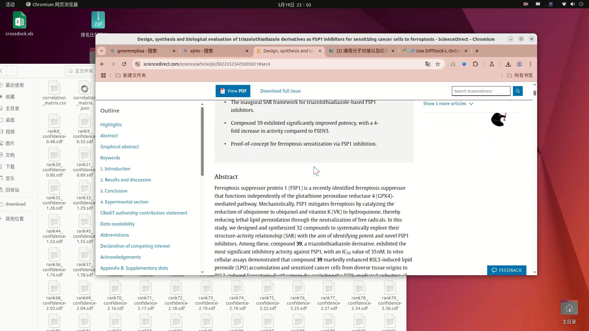
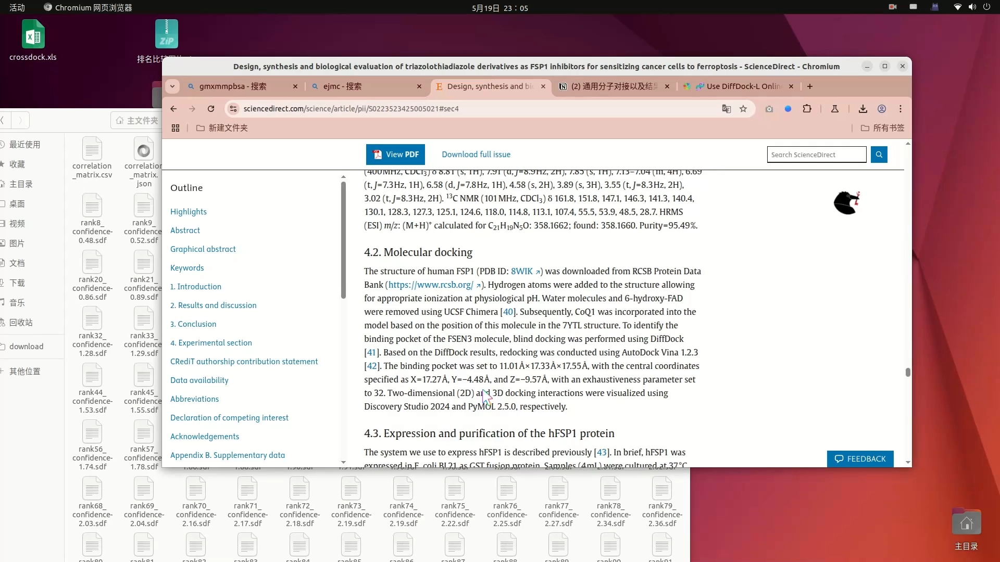
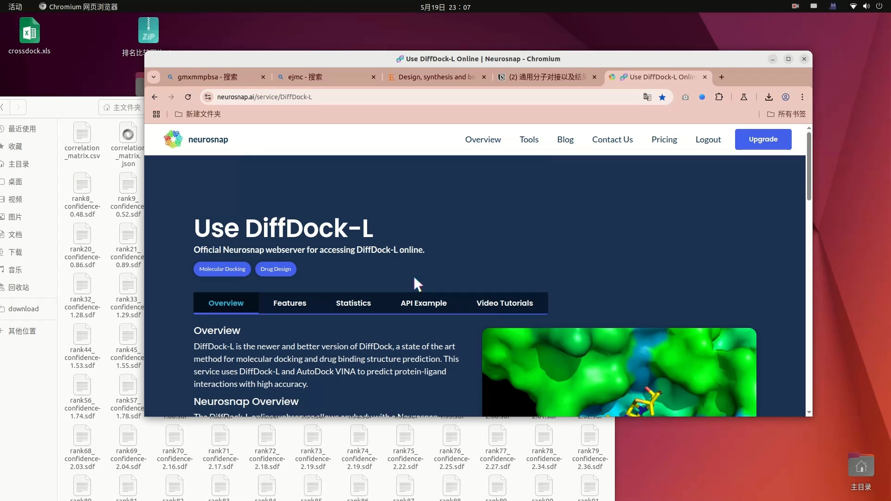
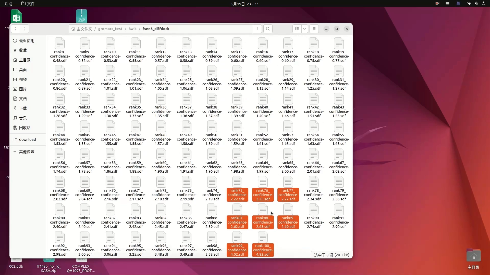
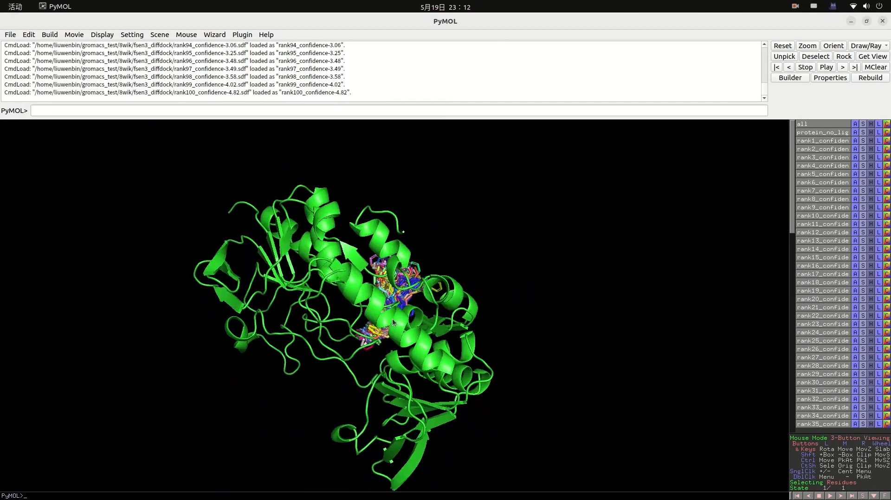
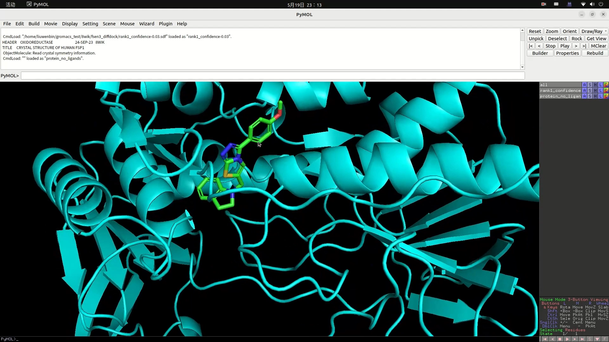
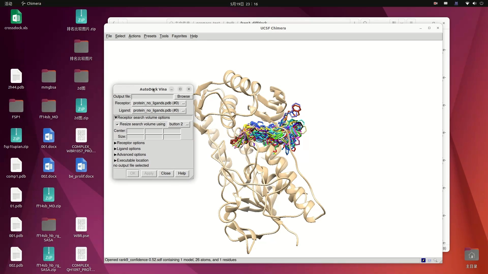
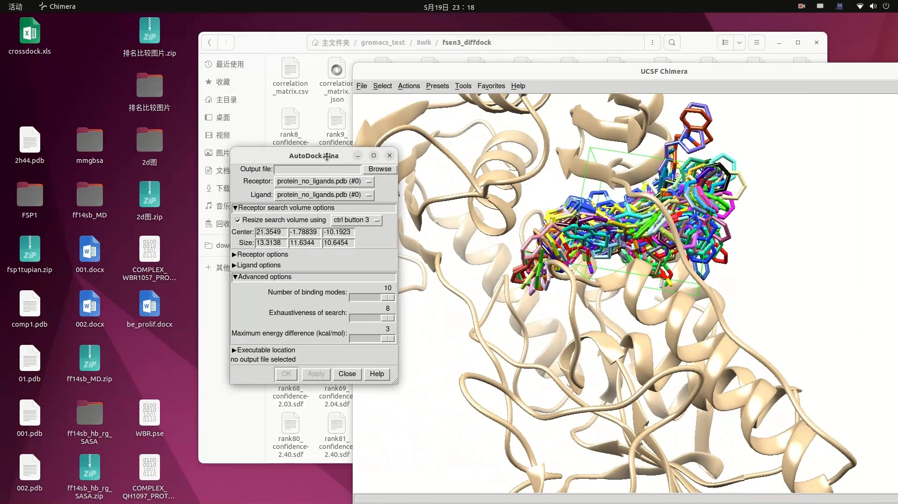

# 全盲对接实战：DiffDock-L 找位置 + Vina 精修物理合理性

> 本文整理自 B 站视频[《分子对接实例1-小分子和蛋白全盲对接（diffdock-L+vina）》](https://www.bilibili.com/video/BV1coEdztEVT/)（约 20 分钟）。讲者复现自己发表在药物化学期刊（口述为 EGMC）论文中的对接工作：在靶蛋白-抑制剂复合物共晶未公布的情况下，如何用"生成式扩散对接 + 经验式对接精修"两步走，得到既找得准、又符合物理规则的小分子结合模式。DiffDock 工具的基础操作见姊妹篇[《AI驱动的分子对接新范式：DiffDock云工具》](AI驱动的分子对接新范式：DiffDock云工具.md)；对接与盲对接的概念见[《五分钟搞清分子对接底层原理》](../../1.5_分子相互作用/1.5.2_分子对接pose口袋盲对接/五分钟搞清分子对接底层原理.md)。

## 本讲要解决的核心问题（SCQA）

**背景**：化合物设计与结构解释需要知道小分子结合在靶蛋白的哪个口袋。讲者研究的 **FSP1**（铁死亡相关蛋白）在 PDB 数据库里有四五个结构（人源、鼠源），但**都没有与抑制剂的共晶复合物**；当时做系列化合物设计与结构解释，只能依赖对接结果来支撑。[【跳转到 01:07】](https://www.bilibili.com/video/BV1coEdztEVT/?t=67)

**冲突**：没有共晶、口袋位置未知——这就是"全盲对接"。传统路线两头堵：口袋预测工具（Schrodinger 的 **SiteMap**）给出 3 个相距很远的候选位点，尝试后感觉不理想；经验式对接工具（如 **Vina**）做盲对接效率低、准确度不高。而 AI 生成式对接虽能盲采，生成的构象却时常违反物理规则。[【跳转到 03:37】](https://www.bilibili.com/video/BV1coEdztEVT/?t=217)、[【跳转到 12:54】](https://www.bilibili.com/video/BV1coEdztEVT/?t=774)

**疑问**：口袋未知时，怎么得到一个"找得准、又物理合理"的结合模式？

**回答（中心思想）**：**两步走**——第一步用生成式扩散对接 **DiffDock-L** 做"位置预测"：采 100 个构象，看它们集中在哪里；第二步以这个位置为参考画对接盒子，用 **Vina** 在盒内重新对接（exhaustiveness 调大）。DiffDock 负责"找得准"，Vina 负责"修得物理合理"。[【跳转到 12:32】](https://www.bilibili.com/video/BV1coEdztEVT/?t=752)

---

## 一、案例背景：FSP1 与一篇论文的对接部分

讲者复现其论文中的小分子-蛋白全盲对接。蛋白选人源 FSP1（PDB ID：**8WIK**）。最终结果图里，结合位点处有两个辅酶/辅基类小分子——**NAD** 与**泛醌类**分子，中间是所设计的化合物；论文要解释的就是这个三者的结合方式是怎么获得的。[【跳转到 01:57】](https://www.bilibili.com/video/BV1coEdztEVT/?t=117)

## 二、第一步之前：口袋预测的两种路线

### 2.1 经典路线：Schrodinger SiteMap

SiteMap 输入蛋白结构即可"傻瓜式"地点点鼠标预测口袋：能给出 3 个候选结合位点，以及口袋的位置与体积。但在本案例里，3 个位点分布得很远，尝试之后感觉结果不太理想。[【跳转到 04:01】](https://www.bilibili.com/video/BV1coEdztEVT/?t=241)

### 2.2 AI 路线：DiffDock-L（全盲对接最强）

生成式对接模型 **DiffDock** 可以在**不指定结合位点**的情况下自动预测配体结合位姿。讲者用的是 Neurosnap 平台上的 **DiffDock-L**——这个工具刚发表时，论文里拿它和很多对接工具对比，**全盲对接结果最好**，于是选它来做盲对接。[【跳转到 05:46】](https://www.bilibili.com/video/BV1coEdztEVT/?t=346)

> Neurosnap 是一个在线计算平台：用学生邮箱注册即可免费使用，里面除了 DiffDock-L，还有 ADMET 预测、AlphaFold3 等不少 AI 工具。[【跳转到 05:04】](https://www.bilibili.com/video/BV1coEdztEVT/?t=304)

## 三、DiffDock-L 实操（Neurosnap）

1. 新建 job，随便起个描述性名字（视频里输 FS03）；
2. 上传受体：从 PDB 下载的蛋白**最好先处理一下**（可用 ChimeraX 等工具预处理后再上传）；
3. 配体：可以直接粘贴 **SMILES** 字符串，也可以上传 **SDF / PDB** 文件；
4. 设置采样数量（samples）：100 / 150 / 200 都可以，视频里设 50；提交后排队约 1–2 小时出结果。[【跳转到 08:47】](https://www.bilibili.com/video/BV1coEdztEVT/?t=527)

### 3.1 结果怎么看

下载结果：共 **100 个构象**（rank 1~100），外加处理后的无配体受体 PDB 文件。把全部构象和受体一起拖进 ChimeraX 查看：**绝大部分分子集中在同一个区域**——这个集中区就是 DiffDock 给出的"结合位置"，其他位置基本没有分子结合。做对接时，就以这个位置为参考。[【跳转到 09:56】](https://www.bilibili.com/video/BV1coEdztEVT/?t=596)、[【跳转到 10:43】](https://www.bilibili.com/video/BV1coEdztEVT/?t=643)

## 四、关键坑：生成式结构的物理合理性问题

为什么不直接用排名最高的 rank1？因为扩散是**生成式**的，生成的构象有时**不符合物理规则**：双键可能不在一个平面上、构象极端扭曲、酰胺键不在同一平面、苯环发生不符合常识的扭转、键长被拉长、键角/二面角异常。看起来"结合得挺好"，但那不是分子的真实状态。[【跳转到 11:26】](https://www.bilibili.com/video/BV1coEdztEVT/?t=686)、[【跳转到 12:17】](https://www.bilibili.com/video/BV1coEdztEVT/?t=737)

## 五、第二步：以 DiffDock 位置定盒子，用 Vina 精修

Vina 这类经验式对接工具做盲对接效率太低，但**给定确定盒子后**，它生成的结构比扩散式生成更符合物理规律。于是把 DiffDock 的输出当"位置预测"用，四步完成精修：

1. ChimeraX 同时打开受体与 DiffDock 生成的构象（把排名前 100 的分子位置都框进去）；
2. 用 ChimeraX 自带的对接盒子工具画盒子：按住 Ctrl+右键移动盒子，在盒面上拖动调整长宽高；**不必完全罩住所有分子**——盒子越大越不利于 Vina 对接，把大部分分子框选起来即可；[【跳转到 14:45】](https://www.bilibili.com/video/BV1coEdztEVT/?t=885)
3. 移动盒子时面板上的 **center（盒子中心 XYZ）**数值随之变化，把三组 center 数值和盒子尺寸（dimensions XYZ）记下来；[【跳转到 16:05】](https://www.bilibili.com/video/BV1coEdztEVT/?t=965)
4. 在 Vina（或 ChimeraX 内置 Vina）里设置盒子，并把 **exhaustiveness** 从默认 8 调大到 **24 或 32**（结果更准确），再设输出构象数；跑完即得"物理合理 + 位置可靠"的最终对接结果。[【跳转到 16:30】](https://www.bilibili.com/video/BV1coEdztEVT/?t=990)

## 六、方法总结与延伸

- **角色分工**：DiffDock 相当于用 AI 预测了一下结合位置——讲者经验里比 SiteMap 更靠谱；Vina 负责在盒子内做符合物理规则的精修对接。两条口袋预测路线（SiteMap vs DiffDock）都可以试，选更符合自己结果支撑的那个。[【跳转到 17:57】](https://www.bilibili.com/video/BV1coEdztEVT/?t=1077)
- **可复现性**：论文方法部分把所用蛋白、处理步骤、软件、口袋 center、exhaustiveness=32 等都写清楚了，欢迎大家复现与讨论改进。[【跳转到 19:06】](https://www.bilibili.com/video/BV1coEdztEVT/?t=1146)
- **延伸玩法**：AlphaFold 等工具预测生成的蛋白结构，也可以走同样的"盲对接"流程。[【跳转到 19:31】](https://www.bilibili.com/video/BV1coEdztEVT/?t=1171)

## 小结

- 没有共晶 ≠ 没法做结构解释：全盲对接可以**两步走**。
- DiffDock-L（Neurosnap 平台，学生邮箱免费）盲采 100 个构象 → **构象集中的区域即候选结合位置**。
- 生成式构象可能违反物理规则（键长/键角/平面性异常），**不要直接拿 rank1 当最终答案**。
- 以 DiffDock 位置画盒子 → **Vina 精修**（exhaustiveness 24~32）→ 兼得"找得准"与"修得合理"。

## 关键术语速查

| 术语 | 一句话解释 |
| --- | --- |
| 全盲对接 | 不预先给定口袋位置的蛋白-小分子对接 |
| DiffDock-L | DiffDock 的大模型版本，发表时基准对比中盲对接最好 |
| SiteMap | Schrodinger 的结合位点（口袋）预测工具 |
| Neurosnap | 在线生物计算平台，学生邮箱可免费使用 |
| 对接盒子 | 经验式对接中圈定搜索范围的长方体区域（center + size） |
| Vina | 经典经验式对接工具；给定盒子后高效且物理合理 |
| exhaustiveness | Vina 的搜索强度参数，默认 8，调大（24/32）结果更准 |
| samples | DiffDock 的采样数量：一次生成多少个候选结合构象 |
