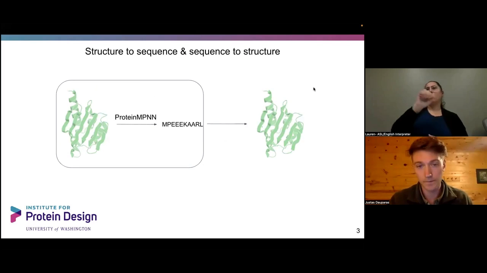
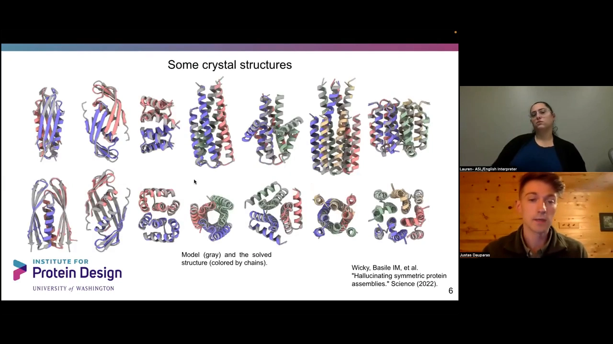
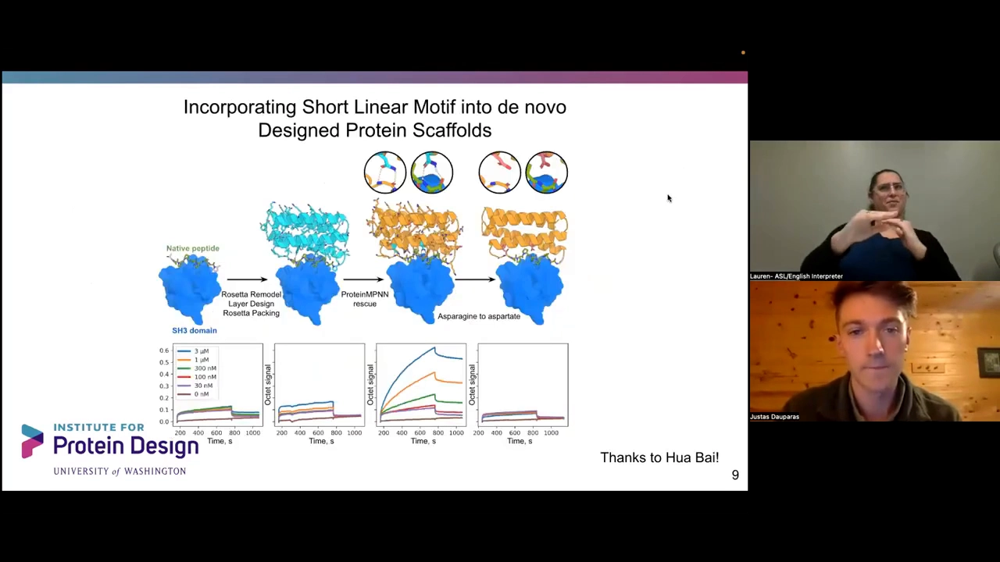
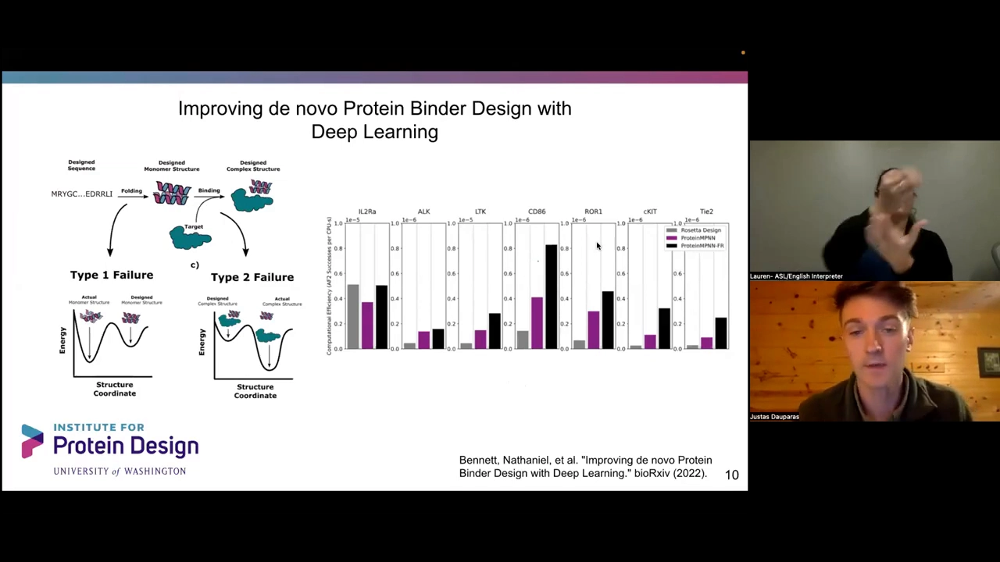
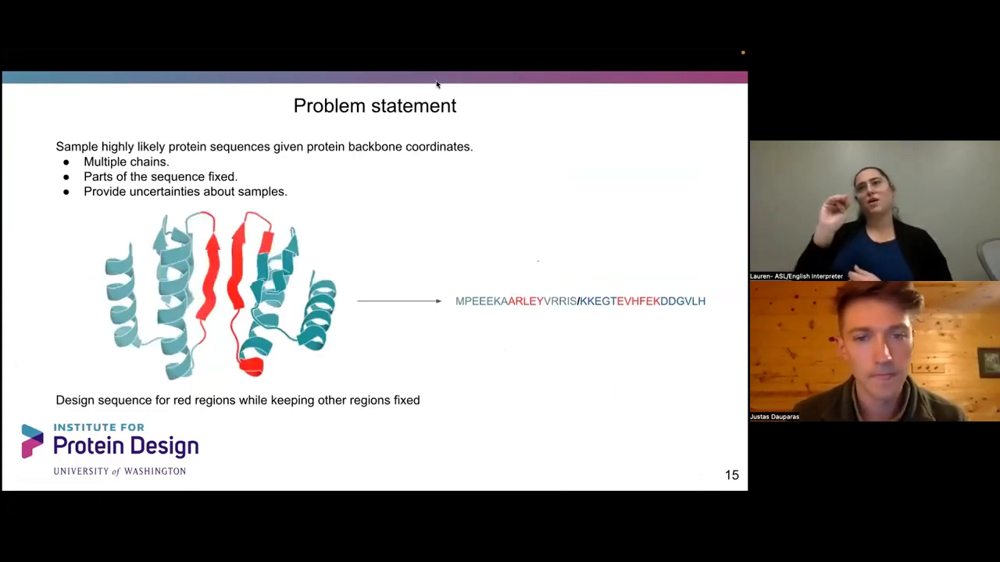
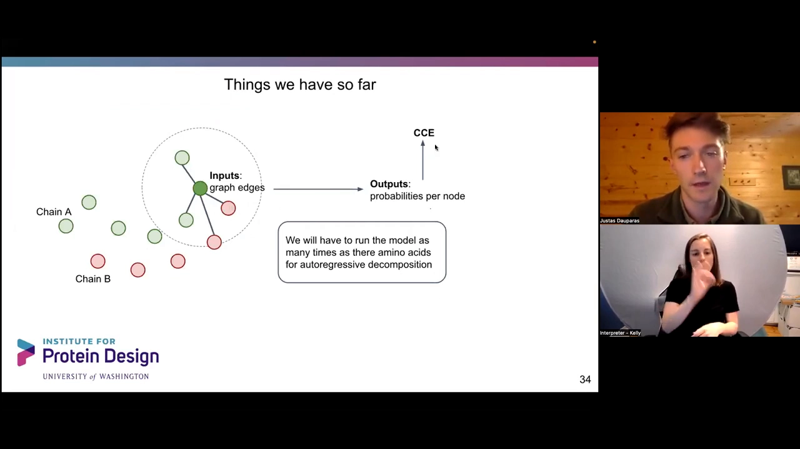
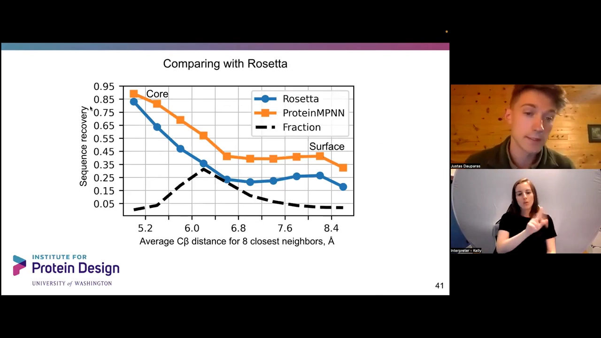
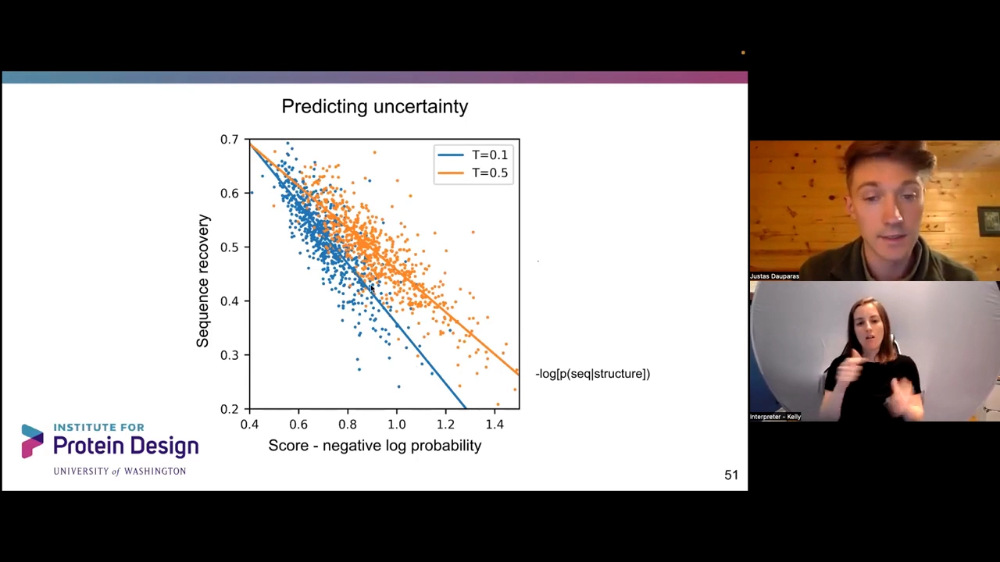
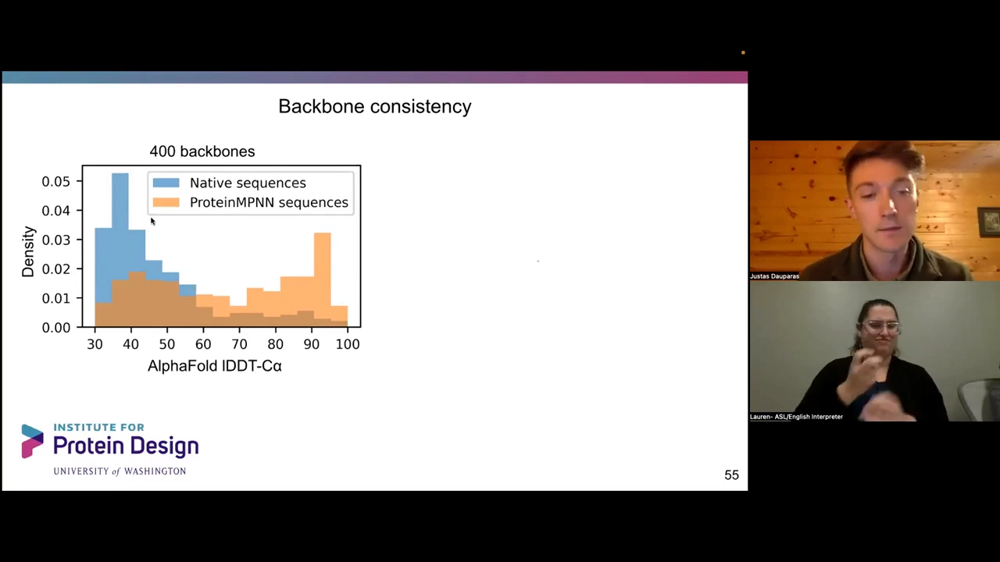
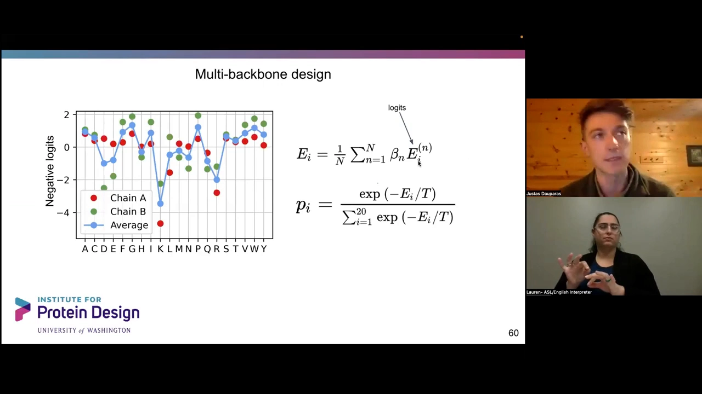

# 【中文字幕】science论文-使用鲁棒机器学习ProteinMPNN的蛋白设计

> 本文整理自 B 站视频《【中文字幕】science论文-使用鲁棒机器学习ProteinMPNN的蛋白设计》（[BV1ng411e7Em](https://www.bilibili.com/video/BV1ng411e7Em/)，时长 53 分钟）。视频是 ProteinMPNN 一作 Justas（华盛顿大学 Baker 实验室博士后，剑桥大学生物物理学博士）的报告，先讲实验结果与模型，后半段为听众问答。原报告为英文，视频配中文字幕；文中概念与数据均出自报告内容，配图截自视频对应时刻，可点击时间戳跳转核对。

## 本讲要解决的核心问题（SCQA）

**背景**：AlphaFold（AF）、RF 等模型已经把"序列 → 结构"预测做得很好；蛋白质设计需要反方向的模型——给定目标骨架，找出能折叠成它的序列。

**冲突**：传统方法（如 Rosetta）做逆折叠序列设计速度慢、序列恢复率有限；而且很多设计"能折叠却不可溶、难表达"，实验成功率低。

**疑问**：能不能用一个轻量的神经网络，把蛋白质骨架几何直接映射到序列，并且让设计出的序列更容易被 AF 验证、更容易做出来？

**回答（中心思想）**：ProteinMPNN——一个把蛋白质骨架几何映射到氨基酸序列的生成模型。它只有约 170 万参数，用消息传递编码器 + 自回归随机顺序解码器建模，配合采样温度与固定残基等控制手段，再用 AlphaFold 做正向折叠验证，能把"设计 → 验证 → 表达"的闭环成功率大幅提升。

## 一、先看实验效果（作者把结论放前面）

报告一反常态：不从头讲项目怎么开始，而是**先展示实验数据**，再深入指标（[跳转到 01:01](https://www.bilibili.com/video/BV1ng411e7Em/?t=61)）。ProteinMPNN 的定位是"把蛋白质骨架几何映射到蛋白质序列"的模型——与 AF、RF 的"从序列预测结构"正好相反（[跳转到 01:15](https://www.bilibili.com/video/BV1ng411e7Em/?t=75)）。

### 1.1 对称蛋白"幻觉"设计：MPNN 重设计让可溶产量提高一个数量级

与 ProteinMPNN 同时发表的一篇 Science 论文做"对称蛋白组装的幻觉设计"：实验室的 Lukas、Basile 和 Alexis 用 AF 玩"幻觉"——对序列完全相同的多个拷贝（如三聚体）施加高 pLDDT、pTM 损失和循环对称（cyclic）损失，再用马尔可夫链蒙特卡洛（MCMC）突变序列迭代，直到指标达标（[跳转到 01:40](https://www.bilibili.com/video/BV1ng411e7Em/?t=100)）：

问题是：这些 MCMC 幻觉设计的可溶产量中位数只有约 10 mg/L，很多设计聚集成不溶蛋白。**用 ProteinMPNN 重新设计后**，在对数坐标上产量达到 100 甚至接近几千 mg/L（[跳转到 03:00](https://www.bilibili.com/video/BV1ng411e7Em/?t=180)）；七个设计的晶体结构（灰色为设计模型、彩色为实验结构）都与设计吻合，包括二聚体、三聚体和一些有趣的 β sheet / α helix 结构（[跳转到 03:39](https://www.bilibili.com/video/BV1ng411e7Em/?t=219)）：

更大的对称组装（如六个单位、内部对称性 18 的例子，负染电镜可见）同样能被 MPNN 重新设计并保持序列对称性（[跳转到 04:30](https://www.bilibili.com/video/BV1ng411e7Em/?t=270)）。

### 1.2 修复失败的纳米粒子设计

实验室同事研究纳米粒子：Rob 重新设计了一批四面体纳米粒子。最初用 Rosetta FastDesign 的版本界面没有形成、粒子组装不起来；重新设计后——骨架与早期论文里失败的那些非常相似——拿到了非常好的晶体结构，粒子非常稳定（[跳转到 05:00](https://www.bilibili.com/video/BV1ng411e7Em/?t=300)）。

### 1.3 把功能基序移植进全新支架

另一个例子是把短的线性基序（motif）纳入从头设计（de novo）的蛋白支架：绿色是结合天然肽的功能基序，橙色是 MPNN 重新设计后把绿色基序"托住"的支架，并保持基序处于给定的天然构象；实验证明这些残基确实在支撑目标小肽（[跳转到 05:32](https://www.bilibili.com/video/BV1ng411e7Em/?t=332)）：

### 1.4 结合剂设计的失败模式与 AF 度量

Nate Bennett 的例子总结了结合剂设计的两类失败：结合剂本身不折叠（形成不起来）、或折叠了却不结合（[跳转到 06:33](https://www.bilibili.com/video/BV1ng411e7Em/?t=393)）。合适的度量是"AF 预测比对误差（PAE）下的成功率"：比较 Rosetta、ProteinMPNN、以及"FastRelax 与 ProteinMPNN 循环交替"三种设计方式（[跳转到 06:58](https://www.bilibili.com/video/BV1ng411e7Em/?t=418)）。论文的基准结果表明 AF 可以区分结合蛋白的优劣；不过循环交替法带来了一些"假的成功"——有点欺骗 AF，让它以为这些都是好结合剂：

### 1.5 伪对称口袋设计

实验室另一篇工作：在对称寡聚体上"幻觉"出**口袋**用于结合小分子，然后用 MPNN 重新设计、故意去掉序列对称性——允许三个亚基序列不同，形成"伪对称"（pseudo-symmetry）：口袋结构对称、序列不对称（[跳转到 07:48](https://www.bilibili.com/video/BV1ng411e7Em/?t=468)）。

## 二、问题设定与使用方式

### 2.1 用"图像配文字"来类比

作者用图像领域的类比解释方向：文本生成图像（如 Imagen：给文字提示生成柯基戴帽子墨镜的图）是生成模型，产生很多可能的解；而 ProteinMPNN 更像"给图像配文字"（image captioning）：骨架是"图像"、序列是"文字"，输入是 3D 原子坐标而非像素网格（[跳转到 10:35](https://www.bilibili.com/video/BV1ng411e7Em/?t=635)）。氨基酸只有 20 种"字母"，相比之下从单序列、无进化信息做结构预测要难得多（[跳转到 11:25](https://www.bilibili.com/video/BV1ng411e7Em/?t=685)）。

### 2.2 模型能做什么

ProteinMPNN 背后的想法（[跳转到 11:56](https://www.bilibili.com/video/BV1ng411e7Em/?t=716)）：可以**采样**很可能合理的序列；可以建模**多链**；可以把链的一部分**固定**（fixed）起来只重设计其余部分（例如固定两条链、只重新设计界面——图中红色的部分）；同时提供采样带来的不确定性信息：

应用场景包括结合蛋白（binder）设计、同源寡聚体设计、酶设计等（[跳转到 12:21](https://www.bilibili.com/video/BV1ng411e7Em/?t=741)）。

### 2.3 现场演示：1QYS 重设计

作者现场演示了 Simon 制作的 Hugging Face demo（另有 GitHub 代码、选项更多）：输入 PDB ID 1QYS（一个从头设计蛋白），只设计一条链，用默认采样温度，几秒钟就输出重设计序列；序列与原序列相似性约 45%（"负对数概率"作为分数，越低越好），再用 AF 验证循环确认（[跳转到 08:18](https://www.bilibili.com/video/BV1ng411e7Em/?t=498)）。这个例子的 AF 验证结果：最好的设计 Cα RMSD 仅 0.7 Å，与输入骨架非常匹配——对这类蛋白，重新设计是相当容易的任务（[跳转到 37:23](https://www.bilibili.com/video/BV1ng411e7Em/?t=2243)）。

## 三、模型架构：编码器-解码器

### 3.1 训练数据与防泄露

训练数据由 Ivan 和 Sheng 收集，与 RF 的训练数据类似：使用 PDB biounits，按 30% 序列同一度去冗余，使用小于 1 万个残基的复合物（[跳转到 12:46](https://www.bilibili.com/video/BV1ng411e7Em/?t=766)）。数据里有大量同源二聚体、多聚体、同源寡聚体。为了防止数据泄露，有一条关键规则：**若两条链序列相似性超过 70%，模型必须同时预测所有链的序列**，而不是只预测一条（否则模型直接从上下文链"抄"序列就行了）；模型的目标是最小化交叉熵（CCE）损失（[跳转到 13:36](https://www.bilibili.com/video/BV1ng411e7Em/?t=816)）。

### 3.2 自回归 + 随机解码顺序

模型按自回归方式解码：每步预测一个氨基酸的概率分布，采样得到一个氨基酸后，把它加入条件继续预测下一个（[跳转到 14:26](https://www.bilibili.com/video/BV1ng411e7Em/?t=866)）。与语言模型常见的"从左到右"解码不同，**ProteinMPNN 使用任意解码顺序**——训练时随机给出解码顺序。这样做的好处是：解码中间的氨基酸时可以同时利用左边和右边已经解码的内容（[跳转到 14:59](https://www.bilibili.com/video/BV1ng411e7Em/?t=899)）。

### 3.3 输入特征：链编码 + 几何距离

- **链内相对位置**：同一条链内用相对位置编码（如 +32/-32 表示"在它左边第几个残基"）；跨链则用二值指示器表示"不同链"——类似 AF 的相对位置编码，但链的编号（A、B）本身不重要，不存在"A 必须在 B 之前"的约定（[跳转到 15:49](https://www.bilibili.com/video/BV1ng411e7Em/?t=949)）。
- **原子间距离**：边特征用径向基函数（RBF）编码 N、Cα、C、O 与**虚拟 Cβ**（甘氨酸等没有 Cβ 的残基也算一个虚拟 Cβ）两两之间的距离，共 25 对；真实距离减去每个 bin 中心、除以标准差，取值 0~1（[跳转到 17:41](https://www.bilibili.com/video/BV1ng411e7Em/?t=1061)）。作者也试过角度等特征，效果不如距离——距离是更好的归纳偏置。
- **局部近邻假设**：模型假设局部环境最重要。用 16 个、2 个、64 个最近邻做实验，序列恢复率会收敛——图连得再密也不更好，说明局部信息足够（[跳转到 16:51](https://www.bilibili.com/video/BV1ng411e7Em/?t=1011)）。

### 3.4 编码器与解码器

整体是 encoder-decoder 结构（[跳转到 18:56](https://www.bilibili.com/video/BV1ng411e7Em/?t=1136)）：**编码器**是一个 3 层的消息传递神经网络——把原子间距离作为边特征、节点初始为零但不能忽略，交替更新节点和边；**解码器**也是 3 层，把骨架编码与已解码的氨基酸一起输入、逐个产出概率分布。训练时用 teacher forcing（把真实序列整体喂给解码器），推理时才逐个采样（[跳转到 20:11](https://www.bilibili.com/video/BV1ng411e7Em/?t=1211)）：

模型非常轻量：只有约 170 万参数（3+3 层、隐藏维度 128），AF 则约有 1 亿参数。因此 ProteinMPNN 在 CPU 上跑也很便宜，还能处理一万残基级别的超大蛋白（[跳转到 20:11](https://www.bilibili.com/video/BV1ng411e7Em/?t=1211)）。

## 四、训练技巧与消融实验

### 4.1 骨架噪声

晶体结构可能带有伪影（尤其是高分辨率结构），而设计时的骨架（参数化螺旋、AF 骨架等）并不"完美"。所以训练时给所有坐标加高斯噪声，让模型对输入坐标不太敏感、有一定"松弛"；推理时不需要加噪声（[跳转到 21:01](https://www.bilibili.com/video/BV1ng411e7Em/?t=1261)）。

### 4.2 相对 Ingraham 基线的改进

ProteinMPNN 的想法源自 John Ingraham 的《Generative Models for Graph-Based Protein Design》。在逐项只改一件事的消融里（[跳转到 21:26](https://www.bilibili.com/video/BV1ng411e7Em/?t=1286)）：

- 把原子间距离加入输入特征：序列恢复率从 41% 直接到 **49%**——距离特征是最有用的归纳偏置；
- 让编码器像普通方式一样更新边（原方法仅基于节点）：小幅提升；
- 两者结合：再高一点；
- 从"从左到右解码"切换到"随机解码顺序"：也带来提升（[跳转到 22:16](https://www.bilibili.com/video/BV1ng411e7Em/?t=1336)）。

### 4.3 晶体伪影值多少分？

测试训练噪声水平时发现：不加噪声的模型在 PDB 晶体结构上表现最好，但差异只有约 3%——这约 3% 来自模型"记住"了晶体伪影（N 与 Cα 之间的特定距离能指示特定氨基酸）。而用 AF 预测结构当"理想骨架"时差异小得多；有时宁可训练一个不那么"贴合"晶体结构的鲁棒模型（[跳转到 23:06](https://www.bilibili.com/video/BV1ng411e7Em/?t=1386)）。

## 五、序列恢复率：与 Rosetta 的系统比较

一个与侧链 packing 无关、能反映残基埋藏程度的度量是"最近 Cβ 距离"：把序列恢复率画成最近 Cβ 距离均值的函数（虚拟 Cβ 对没有 Cβ 原子的残基也计算）——平均约 30% 的残基最近邻 Cβ 在 6.2 Å（约 8 个近邻）内（[跳转到 23:56](https://www.bilibili.com/video/BV1ng411e7Em/?t=1436)）：

结论：无论蛋白质核心还是表面，ProteinMPNN 都优于 Rosetta（Baker 实验室的主力工具）；核心处一致性极高——接近 90% 的准确率，模型能恢复实际存在的氨基酸；表面则低得多，但都随距离单调变化（[跳转到 24:21](https://www.bilibili.com/video/BV1ng411e7Em/?t=1461)）。逐蛋白来看（约 400 多个单体结构，一个点一个蛋白），大多数情况下 ProteinMPNN 的恢复率都更高，仅有个别例外（[跳转到 25:11](https://www.bilibili.com/video/BV1ng411e7Em/?t=1511)）。

## 六、采样温度：确定性与多样性的旋钮

### 6.1 原理

模型在复合物、同源寡聚体和界面上都有训练。使用时有个"采样温度"旋钮（[跳转到 25:36](https://www.bilibili.com/video/BV1ng411e7Em/?t=1536)）：网络最后输出 logits，概率分布由 softmax(logits/温度) 得到，归一化后和为 1。温度小 → 分布尖锐（接近贪心）；温度大 → 分布接近均匀。训练时温度设为 1。

### 6.2 核心确定、表面多样

有意思的现象：温度升高时序列多样性增加，但即使温度为零，多样性也还有约 10%——这来自随机解码顺序（模型每步略有不同）。分区看更清楚（[跳转到 27:16](https://www.bilibili.com/video/BV1ng411e7Em/?t=1636)）：**核心**的序列在低温下相似度约 75%，基本被模型"确定"；**表面**的序列相似度低温约 75%、高温只有约 47%——模型对表面氨基酸的不确定性大得多，它并不确定什么氨基酸该放到表面。

### 6.3 氨基酸偏差

画"模型偏差 − 天然（PDB）偏差"可以看到（[跳转到 27:41](https://www.bilibili.com/video/BV1ng411e7Em/?t=1661)）：温度越低偏差越大（如温度 0.1 时负向偏差更多）；训练温度 1.0 时与天然分布匹配得很好，仅略减少极性氨基酸——模型学到的"最佳猜测"是把带电荷的氨基酸放到表面、少用极性氨基酸。对比 Rosetta 的设计偏差：它有已知的采样问题（比如有时不能把 Ala 塞进核心），带来不同的偏差（[跳转到 28:31](https://www.bilibili.com/video/BV1ng411e7Em/?t=1711)）。

### 6.4 骨架分辨率也影响恢复率

序列恢复率与 PDB 分辨率有明显趋势：3 Å 结构与 1.5 Å 结构的恢复率不同；AF 也一样（它的置信度与"像不像训练数据里的晶体结构"相关）。ProteinMPNN 在高分辨率结构上恢复率最高——所以**每当有人报告序列恢复率，都要检查骨架分辨率**（[跳转到 28:56](https://www.bilibili.com/video/BV1ng411e7Em/?t=1736)）。

### 6.5 用 NLL 给序列排序

设计时我们不知道"正确答案"，序列恢复率算不出来；但模型会给出设计序列的负对数概率（NLL）。实验显示 NLL 与序列恢复率之间有很好的直线关系（[跳转到 29:46](https://www.bilibili.com/video/BV1ng411e7Em/?t=1786)）：

所以实用策略是：低温（如 0.1）得到高恢复率但序列间差异小；高温（如 0.5，恢复率约 48%~50%）采样大量序列，再按分数排序、挑选满足特定功能要求的——多样性更大（[跳转到 30:36](https://www.bilibili.com/video/BV1ng411e7Em/?t=1836)）。

## 七、用 AlphaFold 做正向折叠验证

### 7.1 MPNN 的序列更"容易被 AF 预测"

设计出序列后，人们常用"正向折叠"验证：因为设计序列与天然序列差异很大，不收集 MSA，**只用单一序列**让 AF 预测结构，检查预测是否与目标骨架匹配（[跳转到 31:26](https://www.bilibili.com/video/BV1ng411e7Em/?t=3186)）。对约 400 个蛋白骨架的测试：把**天然序列**单序列喂给 AF，输入输出匹配度很低——没有进化信息时 AF 很难预测天然序列的折叠；但同样骨架用 ProteinMPNN 重新设计的序列则"理想化"得多，AF 预测结构与输入骨架匹配好得多（[跳转到 32:01](https://www.bilibili.com/video/BV1ng411e7Em/?t=1921)）。例如 de novo 设计 NTF2：Rosetta 原设计 vs MPNN 重设计，后者给出的序列折叠结果更好（[跳转到 32:26](https://www.bilibili.com/video/BV1ng411e7Em/?t=1946)）：

### 7.2 噪声消融：恢复率降、AF 成功率升

训练噪声的影响很有趣：噪声增加时序列恢复率从 55% 降到 51%，但 **AF 成功率（输入输出匹配以 lDDT-Cα 90 为标准）反而上升**——模型更鲁棒，产出的序列更"理想化"、更容易被 AF 预测（[跳转到 32:51](https://www.bilibili.com/video/BV1ng411e7Em/?t=1971)）。而且带更多噪声的模型产生的序列更接近进化给出的 PSSM（位置特异打分矩阵）共识——可以理解为一种"共识序列"效应（[跳转到 33:41](https://www.bilibili.com/video/BV1ng411e7Em/?t=2021)）。

### 7.3 多采样几次再验证

另一个实用发现：AF 成功率随重采样次数上升——1 次约 3.6%，3 次 16%，6 次提升约 20%，再增加 6 倍采样又提升近 20%（[跳转到 34:31](https://www.bilibili.com/video/BV1ng411e7Em/?t=2071)）。这说明结构预测是 encoder-decoder 里最难的部分：即使某些序列 AF 预测得不太好，它们可能仍然折叠在正确的骨架上——随着结构预测方法进步，验证会越来越容易。

## 八、扩展：多状态设计与 logits 组合

ProteinMPNN 输出的是分布，因此可以把多个骨架的 logits **线性加权组合**（[跳转到 35:21](https://www.bilibili.com/video/BV1ng411e7Em/?t=2121)）：同源寡聚体设计就是对 A、B 两条链的 logits 取平均（它们需要相同序列）；权重 β 可正可负，于是可以实现"反向设计"（negative design，要求不结合某物）和**多状态设计**（一个序列折叠成多个状态），最后从组合分布中反复采样（[跳转到 36:11](https://www.bilibili.com/video/BV1ng411e7Em/?t=2171)）：

其它实用特性：开源、快速、轻量，几乎不需要专家定制；可以指定固定区域只重设计其余部分；可以对表面氨基酸加偏差（也许有助于表达量和溶解度）（[跳转到 36:36](https://www.bilibili.com/video/BV1ng411e7Em/?t=2196)）。

## 九、Q&A 精选

报告后半段是问答，要点如下（[跳转到 37:60](https://www.bilibili.com/video/BV1ng411e7Em/?t=2280) 起）：

- **能用来稳定蛋白吗？** 可以：用 MPNN 使蛋白质更稳定或提升特定属性是合理用法；与"突变计算"类工具的分工需按具体工具看。
- **不用 RBF 还能用什么？** 可以用其它编码，比如离散 bin（约 0.5 Å 粒度），确实有效。
- **能输入多个构象吗？** 可以：ProteinMPNN 只要一个 PDB 文件，把多个骨架放进同一个 PDB、在空间里分开即可——模型是局部图，只会"看到"附近的节点（[跳转到 39:15](https://www.bilibili.com/video/BV1ng411e7Em/?t=2355)）。
- **能输入配体、金属吗？** 这个版本不能。
- **训练数据的分辨率范围？** 不只高分辨率：2 Å、2.5 Å、3.5 Å 都有、性能相当，更多数据更重要；**没有用电镜结构**（分辨率可能太低）；"把 AF 预测结构当附加训练集"是个想法（[跳转到 25:55](https://www.bilibili.com/video/BV1ng411e7Em/?t=2576)）。
- **模型版本号 v_48_002 什么意思？** 48 = 图中最近邻 48 条边；0.02 = 训练时 0.02 Å 高斯噪声；v = 版本。对更大噪声更鲁棒（[跳转到 46:11](https://www.bilibili.com/video/BV1ng411e7Em/?t=2771)）。
- **MPNN 改善 AF 验证的设计，主要改的是表面还是核心？** 应该主要是表面重设计，可能夹带少量核心变化——没有统计数据，要问 Lukas、Basile 和 Alexis。
- **模型是确定性的吗？** 序列对解码顺序依赖很小，但分数（NLL）确实是解码顺序的函数；想要精确分数可以多次运行取平均和标准差，偏差通常很小。
- **解码顺序有讲究吗？** 试过"核心到表面""表面到核心"等几何启发式顺序，与随机顺序相比结果差不多。
- **训练成本？** 单张 GPU 约 2 天（A100），训练相当快。
- **B-factor 能当输入吗？** 没测试过；而且实际设计时骨架多来自参数化螺旋或 AF，B-factor 不一定可用。
- **膜蛋白表现如何？** 没仔细研究，但模型确实能生成膜状蛋白——把疏水残基放到跨膜区。
- **能设计抗体 CDR 吗？** 没试过；预计是相当难的任务，专门针对 CDR loop 的训练是否有帮助未知。
- **典型偏差值怎么定？** 偏差值是经验性的，GitHub repo 有示例，需要反复试验（[跳转到 51:36](https://www.bilibili.com/video/BV1ng411e7Em/?t=3096)）。
- **最大序列恢复率是多少？** 说不准——许多不同序列可折叠成同源结构；实践中更关注核心的恢复率（[跳转到 40:05](https://www.bilibili.com/video/BV1ng411e7Em/?t=2405)）。
- **未来应用？** 已用于重设计序列以改善可溶性、稳定天然酶并保持功能等；这项工作最困难的其实仍是"想出一个好的骨架"——有了像样的骨架，ProteinMPNN 能帮你找出能表达的序列（[跳转到 49:56](https://www.bilibili.com/video/BV1ng411e7Em/?t=2996)）。

## 小结

- ProteinMPNN 解决"骨架 → 序列"的逆折叠问题，与 AF/RF 的"序列 → 结构"互补，是蛋白设计闭环中的关键一环。
- 实验：把幻觉设计的对称蛋白可溶产量提高一个数量级、修复失败的纳米粒子与结合剂设计、把功能基序移植进全新支架、构造伪对称口袋——配合 AF 验证形成完整工作流。
- 架构：局部近邻图 + 距离（RBF）与链编码特征 + 3 层消息传递编码器 + 3 层自回归**随机顺序**解码器，仅 170 万参数，CPU 可跑、支持万级残基。
- 训练：30% 同一性去冗余的 PDB 数据、>70% 相似链必须全链预测防泄露、训练加骨架噪声。消融显示距离特征把序列恢复率从 41% 提到 49%，约 3% 收益来自"记住"晶体伪影。
- 序列恢复率在核心接近 90%，全面优于 Rosetta；报告恢复率时必须交代骨架分辨率。
- 采样温度控制"确定 vs 多样"：核心氨基酸被模型确定，表面高度不确定；低温高恢复、高温多样性，用 NLL 排序挑选序列。
- AF 正向折叠验证：天然序列单序列难以被 AF 折对，MPNN 序列更"理想"；训练噪声提高 AF 成功率；多采样几次再验证成功率更高。
- 扩展：多骨架 logits 线性组合支持同源寡聚体平均、反向设计与多状态设计；支持固定残基与表面偏差。

## 关键术语速查

| 术语 | 一句话解释 |
| --- | --- |
| 逆折叠（inverse folding） | 给定目标骨架，设计能折叠成它的氨基酸序列 |
| 序列恢复率（sequence recovery） | 设计序列与天然序列的一致比例；衡量逆折叠模型的常用指标 |
| NLL（负对数概率） | 模型给"骨架 + 序列"组合打的分数，越低表示模型越"相信"这对组合 |
| 采样温度 | softmax(logits/T) 中的 T：小 → 分布尖锐（确定性高），大 → 接近均匀（多样） |
| teacher forcing | 训练时把真实序列整体喂给解码器（而非逐步采样） |
| 随机解码顺序 | 不从左到右、按随机顺序解码氨基酸，可同时利用两侧上下文 |
| 虚拟 Cβ | 甘氨酸等无 Cβ 的残基按几何规则补出的 Cβ，用于计算距离特征 |
| RBF（径向基函数） | 把原子间距离编码成 0~1 的一组"bin"响应值 |
| 骨架噪声 | 训练时对输入坐标加高斯噪声，让模型不依赖"完美"骨架 |
| 伪对称（pseudo-symmetry） | 结构/口袋对称但序列不对称的寡聚体设计 |
| 正向折叠（forward folding） | 用 AF 对设计序列做单序列结构预测，验证是否折叠成目标骨架 |
| 多状态设计 | 一个序列在多个骨架/状态下都成立，通过 logits 线性组合实现 |
| 固定残基（fixed residues） | 指定某些位置的氨基酸不变，只重新设计其余部分 |
| pLDDT / PAE / lDDT-Cα | AF 的置信度指标，用于判断设计是否"折叠成目标" |

> 延伸：ProteinMPNN 代码开源于 [github.com/dauparas/ProteinMPNN](https://github.com/dauparas/ProteinMPNN)，也有 Hugging Face demo 与集成进 Rosetta 的 C++ 版本；配套论文为 Science 2022《Robust deep learning-based protein sequence design using ProteinMPNN》。
