# 零基础多图详解图神经网络（GNN／GCN）【论文精读】

> 本文整理自 B 站视频《零基础多图详解图神经网络（GNN/GCN）【论文精读】》（[BV1iT4y1d7zP](https://www.bilibili.com/video/BV1iT4y1d7zP/)，时长 66 分钟）。视频是"读论文"系列的一期，逐段精读 Distill 上的入门文章《A Gentle Introduction to Graph Neural Networks》。文中概念、例子与评论均出自视频讲解，配图截自视频对应时刻，可点击时间戳跳转原视频核对。

## 本讲要解决的核心问题（SCQA）

**背景**：神经网络各有"舒适区"——文本是一个序列，图片是一个矩阵，都有成熟模型。而在社交网络流行的十几年前，研究者就提出过针对图数据的神经网络（GNN），但图做起来太难，长期没火。

**冲突**：最近三年，把神经网络用在图上的研究方向逐渐兴起，可图是不规则、稀疏、动态的结构：每个节点邻居数不同，顶点顺序怎么排都不改变图本身。把神经网络直接套上去，"怎么表示图"就是第一道坎。

**疑问**：如果要构建一个图神经网络，需要哪些模块？它们背后的思想是什么？

**回答（中心思想）**：GNN 是"对图上所有属性做可优化、且保持图对称性的变换"。最简单的版本只需要三个 MLP（分别处理顶点、边、全局），再配上"消息传递"让结构信息在图上流动起来，就能一步步逼近现代 GNN。

## 一、图：一种通用的数据表示

### 1.1 这篇文章在讲什么

视频选的是 Distill 上的《A Gentle Introduction to Graph Neural Networks》：标题刻意写得浅显易懂，四位作者都来自 Google Research，2021 年 9 月 2 日发表（[跳转到 03:29](https://www.bilibili.com/video/BV1iT4y1d7zP/?t=209)）。作者开篇说"我们身边到处都是图"：药物发现、物理模拟、虚假新闻检测、车流量预测、推荐系统里都有图（[跳转到 05:24](https://www.bilibili.com/video/BV1iT4y1d7zP/?t=324)），但他也用了 "starting to" 这样的措辞——GNN 仍是新领域，应用刚刚起步，这既是挑战也是机遇（[跳转到 05:49](https://www.bilibili.com/video/BV1iT4y1d7zP/?t=349)）。

文章分四块（[跳转到 06:04](https://www.bilibili.com/video/BV1iT4y1d7zP/?t=364)）：① 什么数据可以表示成图；② 图和别的数据有什么不同、为什么要专门为它设计神经网络；③ 构建一个 GNN、看各个模块长什么样；④ 提供一个 GNN playground。作者对文章架构非常自信，所以正文里连导航都不写，直接往下读就行。

### 1.2 图的记号：节点、边、全局与三种属性

图表示实体之间的关系：实体就是顶点（node），关系就是边（edge）（[跳转到 07:05](https://www.bilibili.com/video/BV1iT4y1d7zP/?t=425)）。Distill 文章的最大特点是尽量用图说话，文字基本是对图的解释，所以读它的文章看图就差不多了。

文章用一张记号图约定全文符号（[跳转到 08:01](https://www.bilibili.com/video/BV1iT4y1d7zP/?t=481)）：顶点 V、边 E，还有一个 U。学过图论的读者可能见过 U 表示另一类顶点（比如二分图），但这里的 U 表示**全局信息**，代表整个图。每个顶点、每条边、整个图都携带自己的**属性（attributes）**：

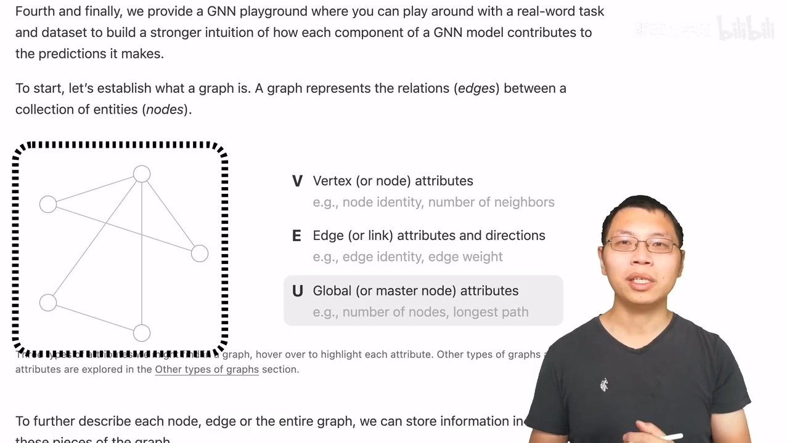

属性用什么表示？用向量（embedding）——顶点属性是一条 6 维向量，边是 8 维，全局是 5 维，向量的高矮表示数值大小（[跳转到 08:51](https://www.bilibili.com/video/BV1iT4y1d7zP/?t=531)）。核心问题是：怎么把我们关心的信息表示成这些向量、以及这些向量能否从数据中学到——这正是 GNN 要关注的重点。

图还分无向与有向（[跳转到 09:38](https://www.bilibili.com/video/BV1iT4y1d7zP/?t=578)）：微信好友是双向的，边无向；B 站上我关注你、你不一定回关，边有向。

### 1.3 什么数据都能表示成图

**图片**：一张 244×244×3（RGB 三通道）的图，通常输入 CNN 的是一个三维 tensor；换个角度，每个像素就是图上的一个点，相邻像素之间连边（[跳转到 10:12](https://www.bilibili.com/video/BV1iT4y1d7zP/?t=612)）。边可以用**邻接矩阵**表示：第 i 行第 j 列为 1（蓝色点）就代表一条边，每个非边界像素恰好有 8 个邻居（[跳转到 11:13](https://www.bilibili.com/video/BV1iT4y1d7zP/?t=673)）——通常是一个很大、非常稀疏的矩阵：

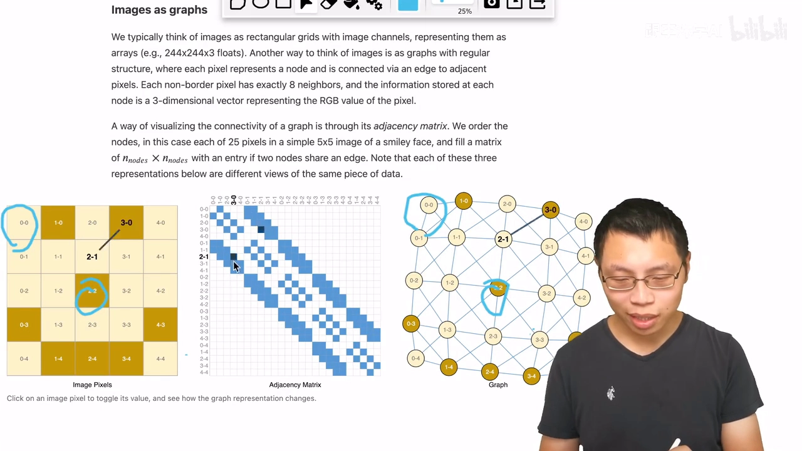

**文本**：把每个词当作一个顶点，上一个词到下一个词连一条有向边，比如文章第一句 "graphs are all around us" 就构成一条有向路径（[跳转到 12:23](https://www.bilibili.com/video/BV1iT4y1d7zP/?t=743)）。

**分子**：原子是顶点，化学键是边——香料分子、咖啡因的整个结构都能被一张图完整表达（[跳转到 13:29](https://www.bilibili.com/video/BV1iT4y1d7zP/?t=809)）：

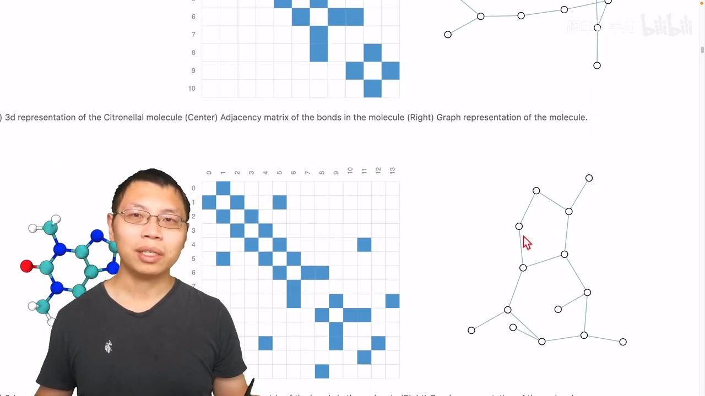

**社交网络**：《奥德赛》剧中人物同场景出现就连一条边；空手道俱乐部里"哪个老师和哪个学生比过赛"也构成社交图（[跳转到 14:18](https://www.bilibili.com/video/BV1iT4y1d7zP/?t=858)）：

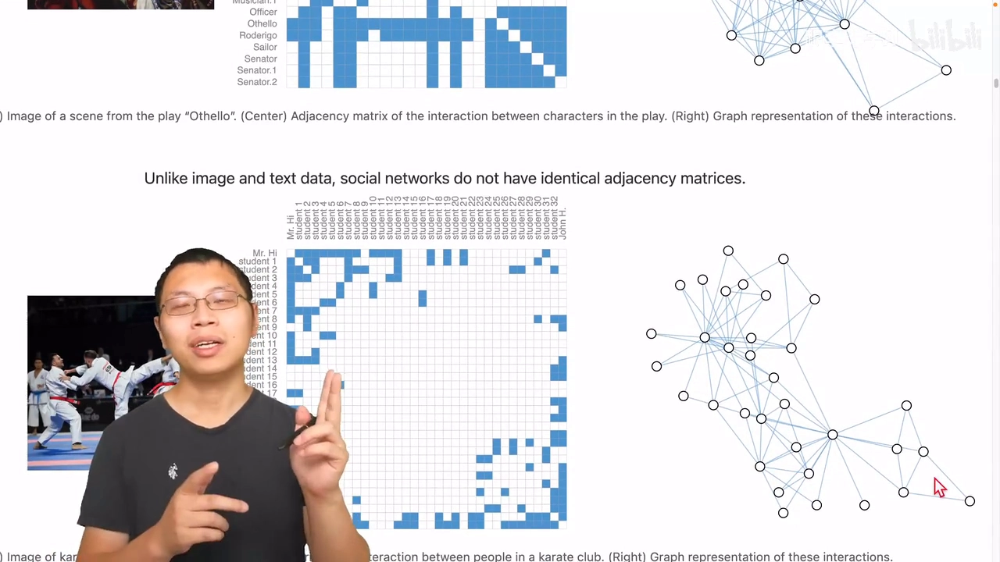

**引用网络与知识图**：论文引用是有向边（我引用你不代表你引用我）；英文 Wikipedia 是一张 1200 万顶点、3 亿条边的巨大知识图，平均每篇文章引出 62 条边，其中一篇文章引出了 100 万条边——可能是个特别大的索引页（[跳转到 16:06](https://www.bilibili.com/video/BV1iT4y1d7zP/?t=966)）：

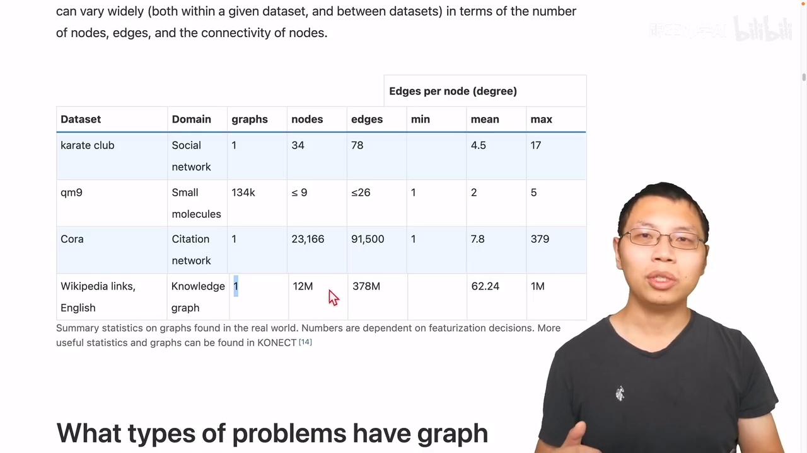

### 1.4 图上的三类预测任务

把数据表示成图之后，能定义什么问题？文章分了三大类（[跳转到 16:30](https://www.bilibili.com/video/BV1iT4y1d7zP/?t=990)）：

- **图层面**：给整张图分类。例如识别哪张图里有"两个环"——这个例子简单到用普通编程语言沿图走一走就能写出来，复杂任务才需要 GNN（[跳转到 16:49](https://www.bilibili.com/video/BV1iT4y1d7zP/?t=1009)）：

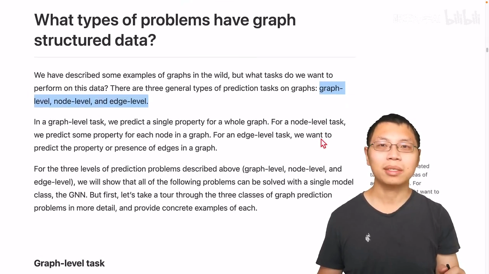

- **顶点层面**：预测每个节点的属性。经典例子是空手道图：两位老师决裂后，根据"谁跟谁比过赛"判断每个学生站老师 A 还是老师 B（[跳转到 17:31](https://www.bilibili.com/video/BV1iT4y1d7zP/?t=1051)）。
- **边层面**：预测边的属性。例如先语义分割出图片中的人物，再预测人物之间"在踢（对方）""是观众在看比赛"这类关系（[跳转到 18:12](https://www.bilibili.com/video/BV1iT4y1d7zP/?t=1092)）：

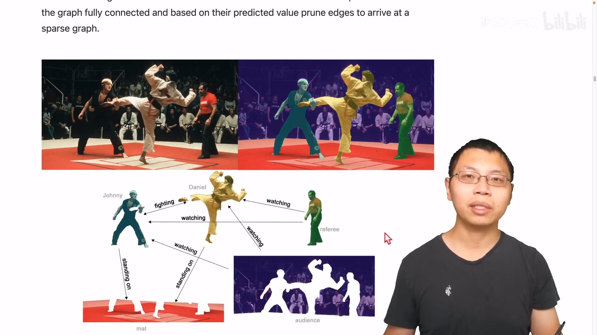

## 二、把图喂给神经网络，难在哪

### 2.1 邻接矩阵的两大问题

图上有四种信息：顶点属性、边属性、全局信息，以及**连接性**（每条边连接哪两个点）（[跳转到 19:01](https://www.bilibili.com/video/BV1iT4y1d7zP/?t=1141)）。前三种都可以用向量表示，神经网络对向量很友好；麻烦的是连接性。

直觉上连接性可以用邻接矩阵表示：n 个顶点就是 n×n 方阵，相连为 1 否则为 0。但它有两个大问题（[跳转到 20:18](https://www.bilibili.com/video/BV1iT4y1d7zP/?t=1218)）：

1. **太大**：Wikipedia 数据集有 1200 万个点，矩阵就是 1200 万×1200 万。虽然可以用稀疏矩阵存储，但高效计算稀疏矩阵本身很难，用在 GPU 上更是一个基础难题。
2. **顺序无关**：任意交换邻接矩阵的行或列，它表示的还是同一张图。《奥德赛》社交网络画成两张视觉上不同的矩阵，本质是同一张图（[跳转到 21:06](https://www.bilibili.com/video/BV1iT4y1d7zP/?t=1266)）。四个顶点、四条边的图就有非常多种合法的邻接矩阵——神经网络必须对"怎么排"都不敏感，结果才一致。

### 2.2 存储高效且顺序无关的表示

文章给出的方案是"属性列表 + 邻接列表"（[跳转到 21:54](https://www.bilibili.com/video/BV1iT4y1d7zP/?t=1314)）：以 8 顶点、7 条边的图为例，每个点/每条边/全局的属性各存成一个列表（标量或向量都行），再维护一个长度等于边数的**邻接列表**——第 i 项记录第 i 条边连接的是哪两个节点：

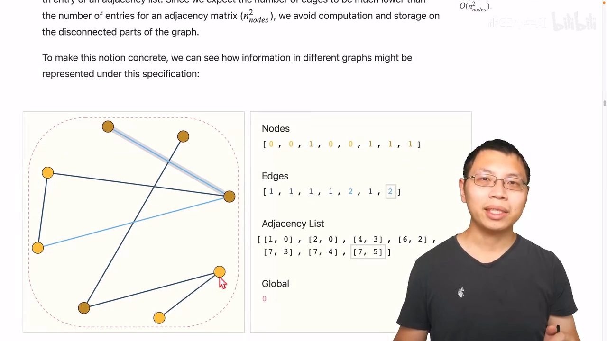

这种表示只存边和属性，存储高效；打乱边的顺序或顶点的顺序，只要同步更新邻接列表即可，对顺序天然无关。接下来最重要的问题就是：给定这种输入形式，怎么用神经网络处理它？

## 三、最简单的 GNN：先满足两条底线

### 3.1 GNN 的定义

文章给 GNN 的定义是（[跳转到 23:19](https://www.bilibili.com/video/BV1iT4y1d7zP/?t=1399)）：**对图上所有属性（顶点、边、全局上下文）做的一个可优化的变换**，并且这个变换要保持图的对称信息——顶点重新排序后结果不变。文章用 message passing（消息传递）框架来描述它：GNN 的输入是一个图、输出也是一个图，它变换属性向量，但**不改变图的连接性**（[跳转到 24:09](https://www.bilibili.com/video/BV1iT4y1d7zP/?t=1449)）。

### 3.2 三个 MLP 组成的 GNN 层

最简单的 GNN 层长这样（[跳转到 24:47](https://www.bilibili.com/video/BV1iT4y1d7zP/?t=1487)）：对顶点向量、边向量、全局向量分别配一个 MLP（多层感知机），输入输出大小相同。图进来，三种向量各走各的 MLP 得到更新，属性全变了、图结构原封不动：

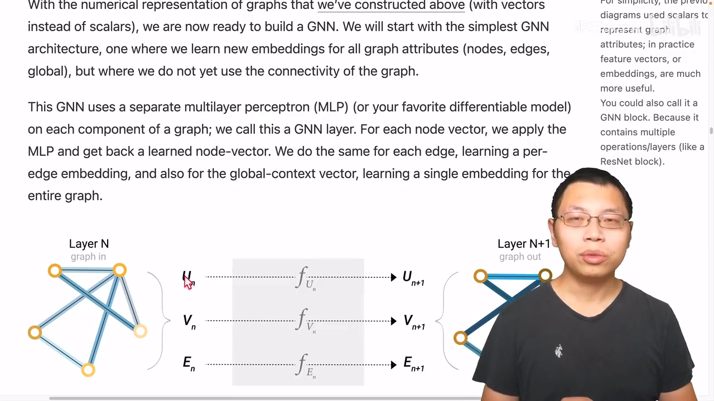

因为 MLP 对每个向量独立作用、完全不看连接信息，这个层自动满足"排序不变"。把这样的层叠起来就得到更深的 GNN（[跳转到 26:03](https://www.bilibili.com/video/BV1iT4y1d7zP/?t=1563)）。

### 3.3 输出层做预测

对顶点做预测时，在最后一层后接一个所有顶点**共享**的全连接层再加 softmax：二分类就输出维度 2，n 分类就输出 n，回归就单输出（[跳转到 26:35](https://www.bilibili.com/video/BV1iT4y1d7zP/?t=1595)）。不管图多大，一层里始终只有 3 个 MLP——所有顶点共享同一个 MLP、所有边共享同一个（[跳转到 27:50](https://www.bilibili.com/video/BV1iT4y1d7zP/?t=1670)）。

### 3.4 汇聚：缺哪类向量就补哪类

如果想预测的对象没有自己的向量怎么办？用 **pooling（汇聚）**（[跳转到 28:14](https://www.bilibili.com/video/BV1iT4y1d7zP/?t=1694)）：把与这个点相连的边向量、以及全局向量一共五条向量全部加起来（维度不同就先投影），得到代表这个点的向量，再送进输出层。反过来，只有顶点向量想预测边、或只有顶点向量想预测整个图，都如法炮制（[跳转到 30:18](https://www.bilibili.com/video/BV1iT4y1d7zP/?t=1818)）——缺哪类属性，就从别的属性汇聚过来。

## 四、消息传递：让结构信息流动起来（核心）

### 4.1 聚合步 + 更新步

最简单的 GNN 有个致命局限：MLP 各算各的，**完全没用到图的结构信息**（[跳转到 31:15](https://www.bilibili.com/video/BV1iT4y1d7zP/?t=1875)）——顶点不知道自己跟谁相连。改进方法就是**消息传递**（[跳转到 32:16](https://www.bilibili.com/video/BV1iT4y1d7zP/?t=1936)）：

更新某个顶点时，先把它的向量与邻居顶点的向量**加在一起**（聚合步），再把汇聚后的向量送进 MLP（更新步）：

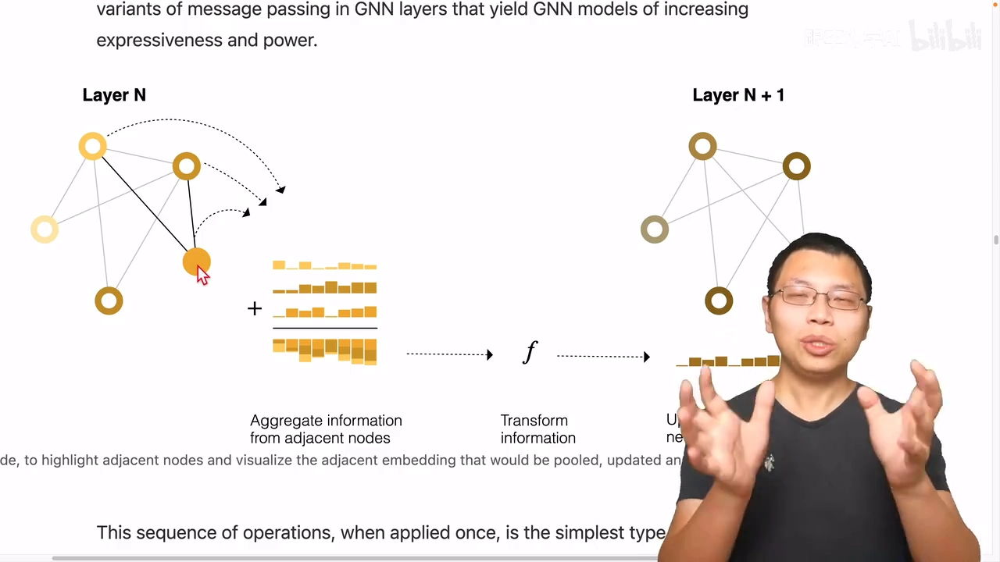

记作 ρ(Vn→Vn) 的汇聚过程（[跳转到 35:15](https://www.bilibili.com/video/BV1iT4y1d7zP/?t=2115)）。

### 4.2 与图片卷积的异同

作者说这跟标准图片卷积有点像（[跳转到 33:22](https://www.bilibili.com/video/BV1iT4y1d7zP/?t=2002)）：如果把像素邻接关系当成图，这个操作确实等价于卷积——但要求卷积核里所有权重相同，因为我们这里是"直接相加"而不是加权和；而卷积里的多输入/多输出通道结构，对应的就是 MLP 变换，这部分保留了下来（[跳转到 34:08](https://www.bilibili.com/video/BV1iT4y1d7zP/?t=2048)）。

### 4.3 层数 = 感受野

跟卷积一样，一层只看一跳邻居，但层可以堆叠（[跳转到 34:39](https://www.bilibili.com/video/BV1iT4y1d7zP/?t=2079)）：堆得够深，顶部节点就能汇聚"邻居的邻居的邻居……"的信息，完成长距离传递——这正是视频开头那张四层交互图演示的效果。

### 4.4 顶点与边互相传递

消息传递不止发生在顶点之间（[跳转到 35:59](https://www.bilibili.com/video/BV1iT4y1d7zP/?t=2159)）：可以先把顶点向量汇聚给边（ρ(Vn→En)，维度不同先投影，或直接 concat），再让边把信息传回顶点，然后各自进 MLP 更新（[跳转到 36:18](https://www.bilibili.com/video/BV1iT4y1d7zP/?t=2178)）：

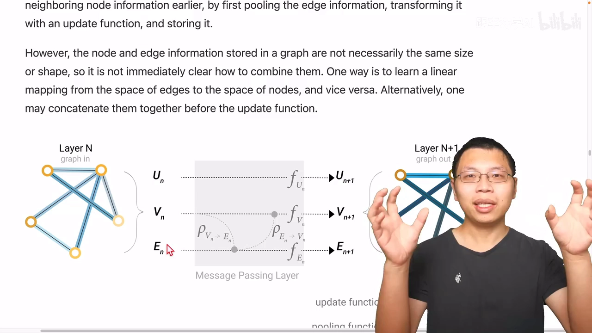

注意先后顺序有讲究：先"顶点→边"再"边→顶点"，与反过来做，结果不一样（[跳转到 37:08](https://www.bilibili.com/video/BV1iT4y1d7zP/?t=2228)），目前并没有一致结论说谁更好；一个替代方案是两个方向同时做，代价是向量稍微变宽（[跳转到 37:51](https://www.bilibili.com/video/BV1iT4y1d7zP/?t=2271)）。

### 4.5 全局向量 = master node

前面一直没解释"为什么要有全局信息"。如果图很大、连接稀疏，消息从一个点传到很远的点要走很多步；解决方案是加一个叫 master node（context vector）的虚拟点（[跳转到 38:31](https://www.bilibili.com/video/BV1iT4y1d7zP/?t=2311)）——它跟所有顶点、所有边都相连，其实就是记号里的 U。任何汇聚都会把 U 带上，更新 U 时则汇聚全部顶点与边的信息。这也解释了之前讲 pooling 时图里总画着的那个 U（[跳转到 39:45](https://www.bilibili.com/video/BV1iT4y1d7zP/?t=2385)）。

至此，基于消息传递的 GNN 完整成形：早期层就开始充分汇聚图上信息，预测时每个对象除了自身向量，还能把相关的边、顶点、全局向量都拿来一起用——作者说这有点像 attention 机制：图结构直接告诉你"谁跟谁相近"（[跳转到 40:34](https://www.bilibili.com/video/BV1iT4y1d7zP/?t=2434)）。

## 五、GNN playground：动手感受超参数

### 5.1 playground 怎么玩

文章第四部分把一个 GNN 训练程序嵌进了 JavaScript，配一个小的分子图预测数据集，浏览器里直接跑、不用装任何东西（[跳转到 41:19](https://www.bilibili.com/video/BV1iT4y1d7zP/?t=2479)）。可调的超参数包括：GNN 层数（1–4 层）、汇聚操作（求和 / 按元素平均 / 按元素 max，分别对应 CNN 里的 average/max pooling）、顶点/边/全局向量的维度（25、50、100）、以及信息在哪些属性之间传递（[跳转到 41:44](https://www.bilibili.com/video/BV1iT4y1d7zP/?t=2504)）：

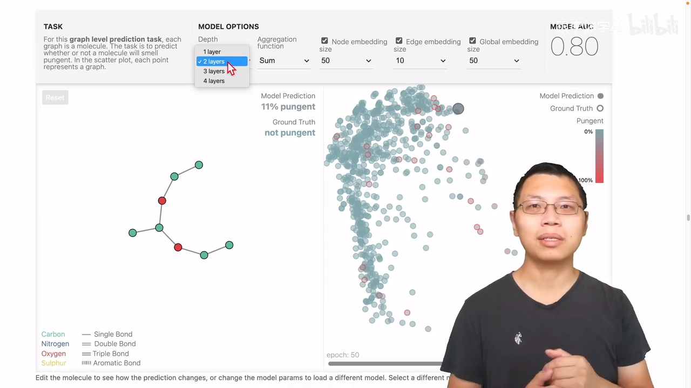

每改一个超参数就用 50 个 epoch 重新训练一次，然后报告模型的 AUC（越大越好）（[跳转到 42:34](https://www.bilibili.com/video/BV1iT4y1d7zP/?t=2554)）。右侧把所有数据点的真实值画成边框颜色、预测值画成实心颜色，边框与实心同色即为预测正确；每个分子图的向量还被投影到二维可视化；左侧可以实时改图（多连几条边、换个原子）看预测值变化（[跳转到 43:26](https://www.bilibili.com/video/BV1iT4y1d7zP/?t=2606)）。视频作者的体验是：跑得挺快、很酷炫，但调了很多参数也说不清哪个参数对 AUC 最重要——比如层数从 2 到 3，AUC 从 0.8 掉到 0.75，从 3 到 4 又回到 0.80（[跳转到 43:51](https://www.bilibili.com/video/BV1iT4y1d7zP/?t=2656)）。

### 5.2 五组实验的结论

文章随后用一批固定数据集上的统计图解释各超参数的影响：

- **参数量**：x 轴是可学习参数个数（log 刻度），y 轴 AUC。参数量指数级增大后，AUC 的**上限**明显抬高（小模型最好也就 0.75 以下，大模型能到 0.8 以上）；但反过来，大模型参数调不好也会掉到小模型的水平（[跳转到 45:04](https://www.bilibili.com/video/BV1iT4y1d7zP/?t=2704)）：

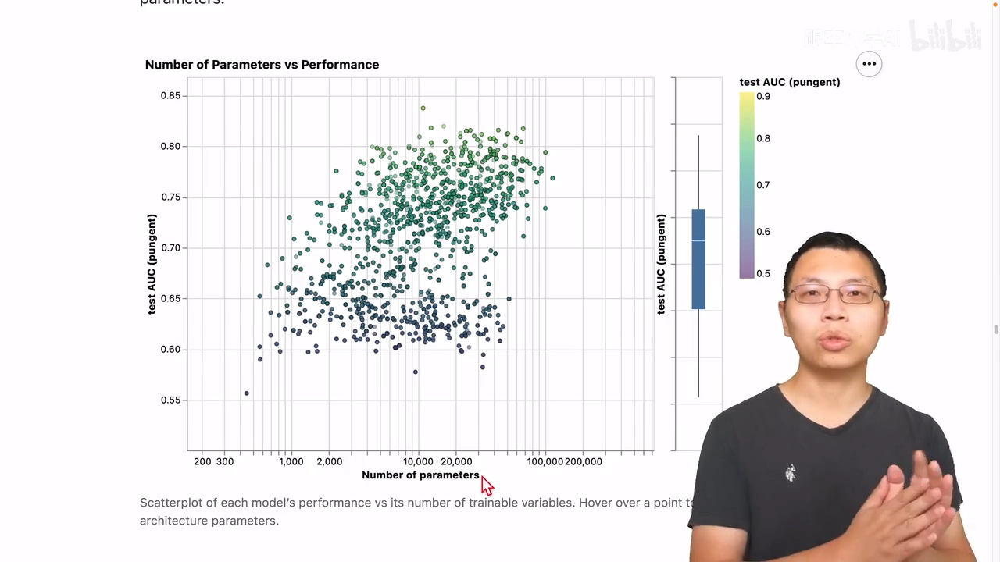

- **向量长度**：顶点、边、全局的嵌入从 25 到 50、100，中值略升但都不明显——数据点的方差太大了（[跳转到 47:07](https://www.bilibili.com/video/BV1iT4y1d7zP/?t=2827)）。
- **层数**：层数增加时中值确实在涨，但方差也大，整体耦合得很近——层数调高也要把其余参数调好才行（[跳转到 47:43](https://www.bilibili.com/video/BV1iT4y1d7zP/?t=2863)）。
- **聚合操作**：求和、平均、max 三种几乎等价，在这个数据集上用哪个都无所谓（[跳转到 48:23](https://www.bilibili.com/video/BV1iT4y1d7zP/?t=2903)）。
- **消息传递的对象**（最关键的实验）：完全不传递信息的绿色配置最差；只在顶点和全局之间传递（不用边）效果也不错；顶点、边、全局之间全部传递的配置中值最高，说明**边（分子里的化学键）在信息传递上帮助不大**，但总体规律是：传递的信息越少，效果越差（[跳转到 48:44](https://www.bilibili.com/video/BV1iT4y1d7zP/?t=2924)）：

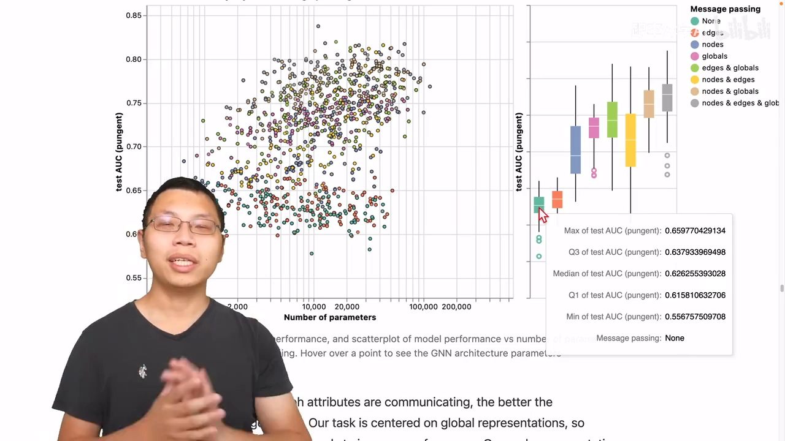

总结起来，GNN 对超参数比较敏感，能调的东西有四个：层数、每种属性的 embedding 大小、汇聚操作（影响不大）、信息传递的方式（[跳转到 49:39](https://www.bilibili.com/video/BV1iT4y1d7zP/?t=2979)）。

## 六、相关技术话题速览

文章最后一部分宽泛地扫了一遍 GNN 相关话题（视频作者认为这部分讲得偏浅、有点画蛇添足）：

- **别的图**：multigraph（两个顶点之间可以有多种边，如红色无向边+绿色有向边）；hypernode（某个顶点内部其实是一个子图）。图结构不同，信息汇聚的方式也会受影响（[跳转到 50:14](https://www.bilibili.com/video/BV1iT4y1d7zP/?t=3014)）。
- **采样与 batch**：层数多、图又连通时，最后一个顶点"看到"的可能是整张图，反向传播要把整个图的中间结果都存下来，算不起。办法是每次采一个子图训练：① 随机采点+邻居；② 随机游走固定步数；③ 两者结合；④ 从一个点做 k 步宽度遍历（BFS）（[跳转到 53:00](https://www.bilibili.com/video/BV1iT4y1d7zP/?t=3180)）。做 batch 时，不同顶点邻居数不同，怎么把邻居合并成规整的张量是个有挑战的问题（[跳转到 53:25](https://www.bilibili.com/video/BV1iT4y1d7zP/?t=3205)）。
- **归纳偏置**：任何模型都有假设——CNN 假设空间变换不变性，RNN 假设时序延续性；GNN 的假设就是**保持图的对称性**：交换顶点顺序结果不变（[跳转到 54:18](https://www.bilibili.com/video/BV1iT4y1d7zP/?t=3258)）。
- **聚合操作没有万能**：图 {2,4} 和 {4,4} 用 max 汇聚都是 4，区分不开，mean/sum 能区分；{3,3} 和 {3} 用 max/mean 都区分不开，只有 sum 能；但 sum 又会被"加起来一样"的反例骗过。所以没有一种聚合天生更好，要按任务选（[跳转到 55:22](https://www.bilibili.com/video/BV1iT4y1d7zP/?t=3322)）。
- **GCN 的另一种视角**：文章其实没定义 GCN（只在图注里提过），可以把它理解为"k 层、每层看一跳邻居"的模型，等价于 CNN 里 k 层 3×3 卷积——每个顶点看的是以自己为中心、半径 k 的子图（[跳转到 55:53](https://www.bilibili.com/video/BV1iT4y1d7zP/?t=3353)）。
- **图卷积 = 矩阵乘法**：在图上做卷积或随机游走，等价于拿邻接矩阵跟向量反复做乘法——PageRank（十五年前最常讨论的技术）就是这么实现的。这也是高效实现 GNN 的关键（[跳转到 57:34](https://www.bilibili.com/video/BV1iT4y1d7zP/?t=3454)）。
- **GAT（图注意力网络）**：图上没有"位置"概念（邻居可任意排序），所以做加权和时权重不能依赖位置，而应依赖两个顶点向量之间的关系——比如做点乘再过 softmax，这就是 graph attention network（[跳转到 59:04](https://www.bilibili.com/video/BV1iT4y1d7zP/?t=3544)）。
- **可解释性与生成建模**：训练完的模型可以用子图信息解释它学到了什么；GNN 本身不改图结构，但我们也想**生成**图——核心难点是怎么对图的拓扑结构建模（[跳转到 59:53](https://www.bilibili.com/video/BV1iT4y1d7zP/?t=3593)）。

## 七、评论：文章与 GNN 本身

### 7.1 写作：交互图是优点也是门槛

视频作者先评写作：文章先讲图的属性用向量表示、数据怎么表示成图、图上三类预测任务，然后才定义 GNN——而且不是一上来就讲 GCN，而是先给"三个全连接层"的最简例子，一步步把读者带过来，只要有基本机器学习背景就能读懂（[跳转到 1:01:14](https://www.bilibili.com/video/BV1iT4y1d7zP/?t=3674)）。

文章最大的特点是图极其精美且基本可交互：信息可以藏进交互里，图不显得杂乱。但这也是缺点——交互图制作非常难，写一篇这样的文章至少需要"一个懂机器学习 + 一个懂 JavaScript 可视化"的作者组合，同时懂两样的人极少，门槛非常高（[跳转到 1:02:54](https://www.bilibili.com/video/BV1iT4y1d7zP/?t=3774)）。Distill 在当年 6 月曾一度讨论要不要关门：编辑发现改一篇投稿要花 50 个小时，"还不如自己写"——每篇 50 小时、又只有极少数人能写，就没法量产（[跳转到 1:03:44](https://www.bilibili.com/video/BV1iT4y1d7zP/?t=3824)）。另外，作者刻意避免公式和代码，有时公式其实更简洁准确；如果能公式、代码、图、文字多维度结合会更好（[跳转到 1:04:09](https://www.bilibili.com/video/BV1iT4y1d7zP/?t=3849)）。

### 7.2 GNN：强大但门槛高

再看 GNN 本身：图非常强大，几乎所有数据都能表示成图；但强大也带来问题——图是稀疏、动态的结构，在 CPU/GPU/加速器上高效计算很难；GNN 对超参数又非常敏感（架构、采样方式、优化过程都敏感）。这两个原因导致 GNN 门槛较高：过去三四年吸引了很多研究者，但工业界应用仍然很少，还需要几年积累（[跳转到 1:05:24](https://www.bilibili.com/video/BV1iT4y1d7zP/?t=3924)）。

## 小结

- 图 = 顶点 + 边 + 全局，三者也都可以携带属性；属性统一用向量表示，能否从数据学出来是 GNN 的核心问题。
- 图片、文本、分子、社交网络、引用网络、知识图全都能表示成图；图上的任务分图层面、顶点层面、边层面三类。
- 邻接矩阵又大又"顺序无关"，更好的表示是属性列表 + 邻接列表。
- GNN 的定义：对图属性做可优化且保持对称性的变换；最简实现是顶点/边/全局各一个 MLP，不改变连接性。
- 缺哪类向量就用汇聚（pooling）从别的属性补；要让结构信息起作用，核心机制是消息传递：聚合邻居 + MLP 更新。
- 层数决定"感受野"；顶点与边可以互相传递；全局向量（U / master node）让远距离节点一步相连。
- Playground 实验显示：GNN 对超参数敏感；参数量抬升 AUC 上限；聚合方式几乎无所谓；信息传得越少效果越差，边传递的帮助相对有限。
- GNN 强大但门槛高：稀疏动态结构难算、超参敏感，工业界应用仍少。

## 关键术语速查

| 术语 | 一句话解释 |
| --- | --- |
| 顶点 / 边 / 全局（V / E / U） | 图的三类对象；U 是代表整张图的全局对象 |
| 属性（attributes） | 挂在顶点、边或全局上的信息，用向量（embedding）表示 |
| 邻接矩阵 | n×n 方阵，1 表示有边；大且与顶点排序无关 |
| 邻接列表 | 长度等于边数的列表，第 i 项记第 i 条边连接的两个节点 |
| GNN | 对图上所有属性做"可优化、保持对称性"的变换；图进图出，不改连接性 |
| 汇聚（pooling） | 缺某类向量时，从别的属性把向量加起来（必要时先投影）补齐 |
| 消息传递 | 先把邻居向量聚合（相加），再送进 MLP 更新：ρ(源→目标) |
| master node（U） | 与所有顶点、边相连的虚拟全局点，解决稀疏图长距离传递 |
| GNN playground | 文章提供的浏览器内交互训练环境（分子图分类，指标 AUC） |
| 归纳偏置 | 模型内建假设；GNN 的假设是保持图的对称性 |
| GAT | 用注意力（向量间关系）代替固定权重做邻域加权求和的 GNN |
| multigraph / hypernode | 多重边图 / 内部是子图的"超级节点" |

> 延伸：同系列姊妹篇《Understanding Convolutions on Graphs》讲图上卷积的来龙去脉；想动手可前往原文的 GNN playground 直接试玩。
