# AlphaFold 3 deep dive

> 来源：[AlphaFold 3 deep dive（YouTube，Looking Glass Universe）](https://www.youtube.com/watch?v=Or3iq4_9-wA)，时长 45:43，播放 33k+。本博客基于「图-字幕」视频演说图文稿整理，内容可回视频核查。
>
> 编注：本讲逐块拆解 AlphaFold 3 架构，其中 **Pairformer** 一节与 4.3.3（结构预测扩散）、5.1.1（Protenix——AF3 开源复刻）直接相关：Pairformer 的三角注意力正是"三角注意力"这一知识点的 AF3 形态（AF2 Evoformer 形态见本系列《AlphaFold Decoded： Evoformer (Lesson 5)》一篇）。

## 本讲要解决的核心问题（SCQA）

**背景**：AlphaFold2 解决了蛋白质折叠预测。但现实的生物学问题往往不止一个蛋白：蛋白 + DNA + RNA + 配体（小分子）如何相互作用、整体复合物长什么样，才是药物设计真正关心的。

**冲突**：不同分子的输入形式异构（蛋白是氨基酸序列、DNA/RNA 是碱基序列、配体是原子），而且配体没有 MSA（多序列比对）——AF2 那套以进化信息为中心的设计覆盖不了它们；同时复合物里残基对/原子对的关系远比单链复杂。

**疑问**：如何用一套统一的表示与流程，直接从序列描述预测出整个复合物的全原子结构？

**回答（中心思想）**：AlphaFold 3 把所有分子统一成 **token**，用「输入嵌入 → 主干处理（Pairformer 为主）→ 扩散模块」三段式给出答案：Pairformer 用三角注意力强化 pair 表示；最后由扩散模块（去噪 transformer）从随机原子坐标出发，迭代去噪出全原子结构——结构生成从"直接预测"变成了"去噪"。

---

## 一、问题设定：从蛋白折叠到全分子复合物

[【跳转到 0:21】](https://www.youtube.com/watch?v=Or3iq4_9-wA&t=21)

AlphaFold 3 解的题与 AF2 略有不同：不只是蛋白折叠，而是**蛋白、DNA、RNA、配体**等多种分子。它们都能被简单描述：蛋白按氨基酸（又称残基，residue）序列描述即可，但氨基酸放进水里不会排成一条直线，而是折叠成特定形状——蛋白折叠问题就是预测折叠方式。DNA/RNA 同理，碱基序列告诉你分子是什么，却不告诉你折叠形状，更不告诉你蛋白结合到 DNA 哪些位点、如何改变其功能；配体则可能作为药物修正行为异常的分子。AlphaFold 3 的想法：把若干蛋白、DNA、RNA、配体一起放进算法，输出它们相互作用的完整结构。

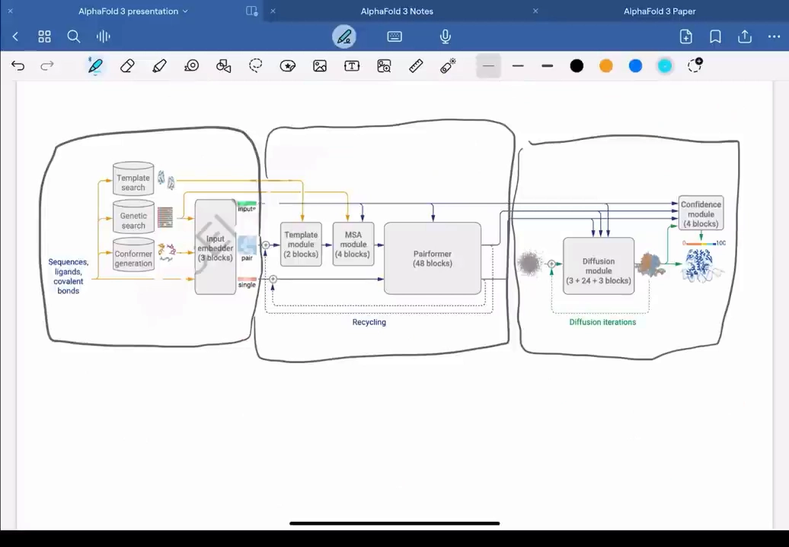

### 1.1 一切皆 token（氢原子除外）

[【跳转到 2:21】](https://www.youtube.com/watch?v=Or3iq4_9-wA&t=141)

分子以 token 输入：蛋白 = 氨基酸序列；DNA = 碱基对；RNA = 碱基；配体 = 逐个原子（**氢原子除外**——整个算法都假装氢原子不存在）。

## 二、算法总览：三段式

[【跳转到 2:46】](https://www.youtube.com/watch?v=Or3iq4_9-wA&t=166)

整个算法分三部分：

1. **输入与嵌入**：输入序列，通过搜索（遗传搜索、模板搜索、conformer 生成）补充信息，一并送进输入嵌入器；
2. **主干处理**：pair 表示与 single 表示的主要加工区——计算量最大的部分；
3. **扩散 + 置信度**：扩散模块把加工好的 pair/single 表示变成"原子在哪里"的结构；置信度模块告诉我们对这个结构及其各部分能有多放心。

作者还贴出了主推理循环的文字版——拆开看并不复杂，自然分成三段。

## 三、输入与搜索：给序列"补课"的三种途径

### 3.1 已知特征：token 级标记

[【跳转到 4:18】](https://www.youtube.com/watch?v=Or3iq4_9-wA&t=258)

有些特征直接已知：token 序列本身（蛋白是氨基酸、DNA 是碱基对）。复合物里不止一条序列，所以需要：①一个标记说明 token 属于配体/蛋白/RNA/DNA 中的哪类；②一个标记说明属于哪条链（第一条蛋白、第二条蛋白……）；③token 类型标记（是哪个碱基/氨基酸）。token 级特征要回答的就是"这些 token 是什么、来自哪个分子"。

### 3.2 conformer generator：token 内原子的标准位置

[【跳转到 6:07】](https://www.youtube.com/watch?v=Or3iq4_9-wA&t=367)

第一种搜索是 **conformer 生成器**：对每个 token 查一个叫 conformer 的东西——如果 token 代表一个氨基酸，conformer 会给出该氨基酸内所有原子的"标准位置"。你可能会说原子位置哪有标准可言——某些键确实可以旋转、自由度存在，但 conformer 就是取一个标准摆放。查 conformer 很有用，因为 token 内部原子的位置其实相当受限。那位置相对谁？相对 token 内部某个中心点，并假定一个特定旋转——没关系，因为后面真正使用这些位置时会施加随机旋转与平移，这里用什么坐标系无所谓。

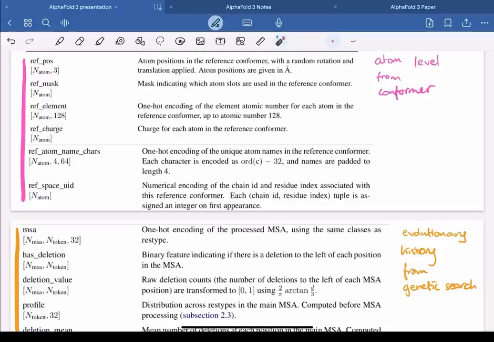

### 3.3 遗传搜索与模板搜索

[【跳转到 7:42】](https://www.youtube.com/watch?v=Or3iq4_9-wA&t=462)

**遗传搜索**利用进化历史推测蛋白折叠方式（后面细讲）。**模板搜索**找相似且结构已知的序列：与目标蛋白至少 10% 序列重叠、且结构已知的蛋白可作为模板——最多允许 4 个。这些已知结构作为"初始猜测"，而且你会看到，它们在初始 pair 嵌入的输入中占了相当大的比重。

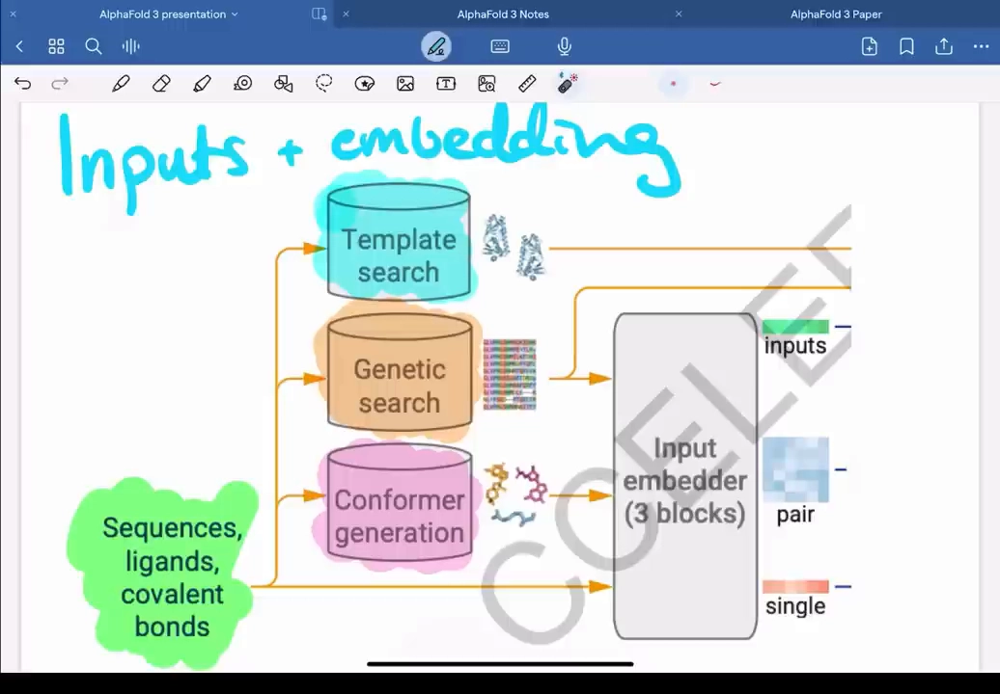

## 四、single 与 pair 表示：AF3 的"双重记账"

[【跳转到 8:38】](https://www.youtube.com/watch?v=Or3iq4_9-wA&t=518)

**single 表示 s**：每个 token 位置 i 上有一个**向量**（不是一个数），里面可以装很多信息——第一维可能是残基类型、第二维是保守程度等等。

**pair 表示 Z_ij**：编码 token **对**的信息。两个氨基酸在序列上可能相距很远，但链一折叠物理上可能挨得很近；对每一对 token 我们想知道它们的关系——是否成键、是否靠近、电荷是否相反……答案就存在 Z 的 ij 位置那个向量里。

AlphaFold 全程同时维护两种表示，说实话挺奇怪。但 AF2 里 single 或许更重要（大量进化数据进入这里），**AF3 里 pair 表示重要得多**——后面会看到。初始化方式也顺理成章：per-token 特征（类型、链归属）进 s_i；per-pair 特征进 Z_ij。有个之前没细讲的 **token-bond 特征**：token i 与 j 之间是否存在已知的 polymer–ligand 或 ligand–ligand 键——显然该进 pair 表示。

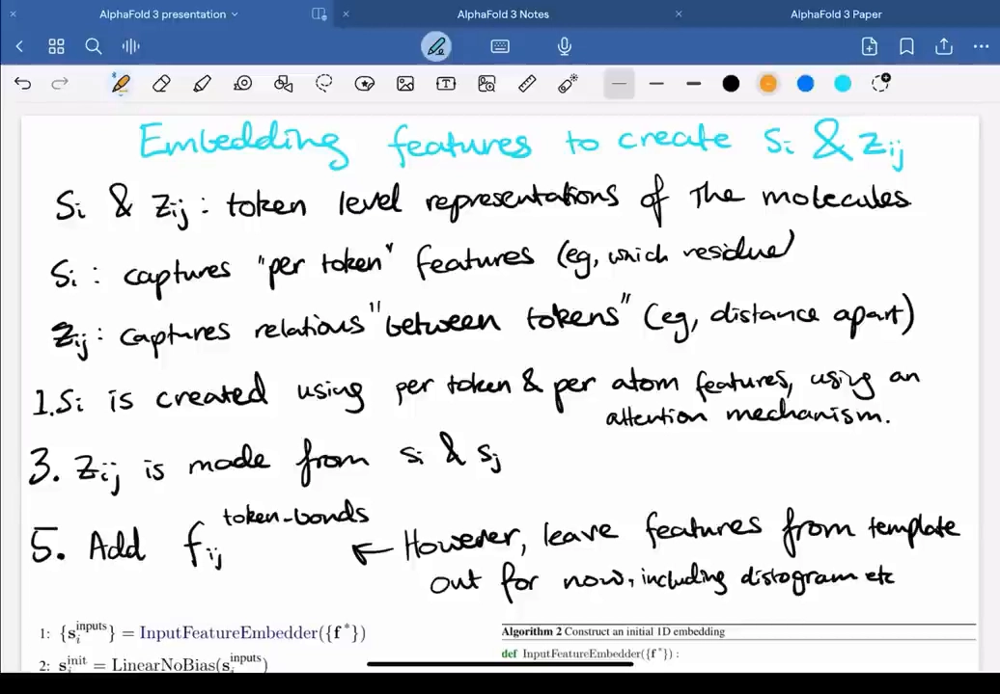

### 4.1 初始化：z_ij = linear(s_i) + linear(s_j) + 成对特征

[【跳转到 11:55】](https://www.youtube.com/watch?v=Or3iq4_9-wA&t=715)

算法第一段先初始化 s_i：用全部 per-token 与 per-atom 特征（per-atom 大多来自 conformer 搜索——参考位置、原子是哪种元素等）。token 内可能有多个原子，把原子级信息平均/聚合成整个 token 的信息放进 s_i（用一些注意力机制把特征"折"进去）。然后 z_ij 由 s_i 与 s_j 的拷贝经线性层相加而成。"LinearNoBias" 记号看着容易懵，其实就是对 s_i 做线性变换（乘个矩阵），no bias 表示不加偏置项，权重都是可学习参数。当然还要把关于 i、j 的其他已知特征编码进来——这就是流程图里那两块的作用。

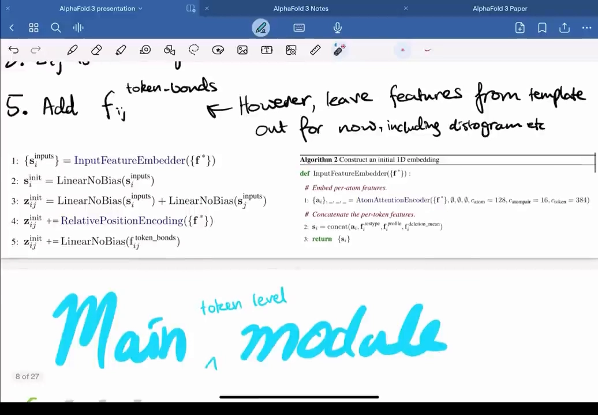

## 五、Pairformer：AF3 的主引擎

[【跳转到 14:54】](https://www.youtube.com/watch?v=Or3iq4_9-wA&t=894)

主干模块有三部分：**template 模块、MSA 模块、Pairformer**。Pairformer 才是真正的主体处理：**48 个块**，块最多、算力最多。template 与 MSA 模块主要负责消化模板搜索与遗传搜索的信息——conformer 的 per-atom 信息早在嵌入阶段就进过 pair/single 表示了，不用再操心；遗传搜索只有少量特征进过嵌入，大头在下一步处理；模板搜索的特征则完全还没进过表示。先讲 Pairformer，因为 template 模块复用了它的部件。

### 5.1 重心在 pair：AF3 对 AF2 的整体转向

Pairformer 同时加工 pair 与 single 表示，但**绝大部分加工在 pair 上**——这就是 AF3 相对 AF2 的整体主题：对 pair 表示投入了多得多的注意力（字面意义上的 attention）。single 表示只有一个注意力块。为什么这些注意力与标准注意力不太一样？

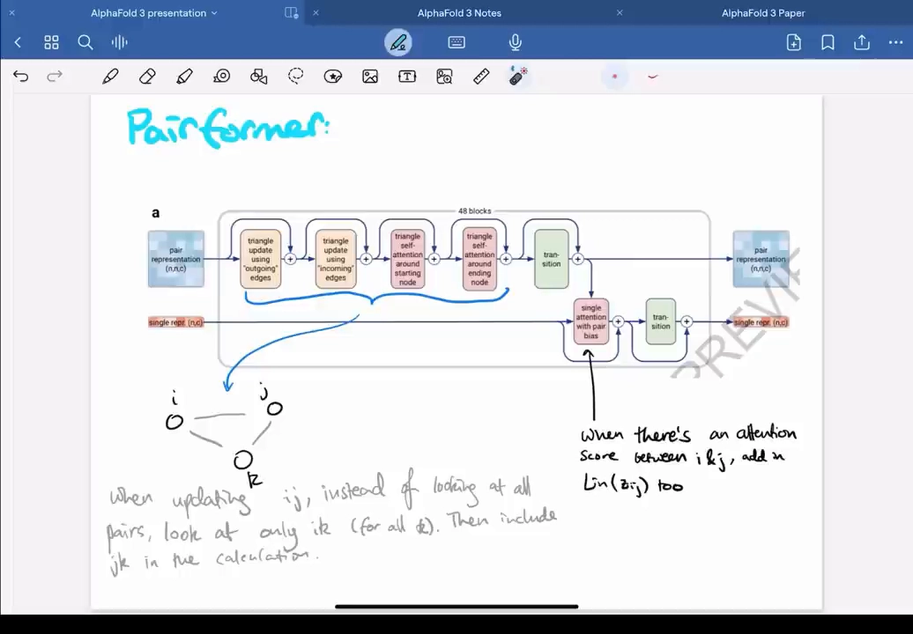

### 5.2 ij 与 ji 的对称性：为什么有四块三角注意力

[【跳转到 16:09】](https://www.youtube.com/watch?v=Or3iq4_9-wA&t=969)

pair 表示里，Z 的 ij 块与 ji 块代表同一对 token，"道义上"应该对称——严格说有些量带符号（比如 i 相对 j 的位置与 j 相对 i 的位置差个负号），但大体应对称。算法通过**对称地处理它们**来促成对称：每个操作都有 outgoing（around the starting node，起始节点周围）与 incoming（around the ending node，结束节点周围）两个版本——这就是为什么这里放了四块注意力：这是它的对称版本、那也是它的对称版本。从 ij 视角理解一个，另一半算法处理 ji。

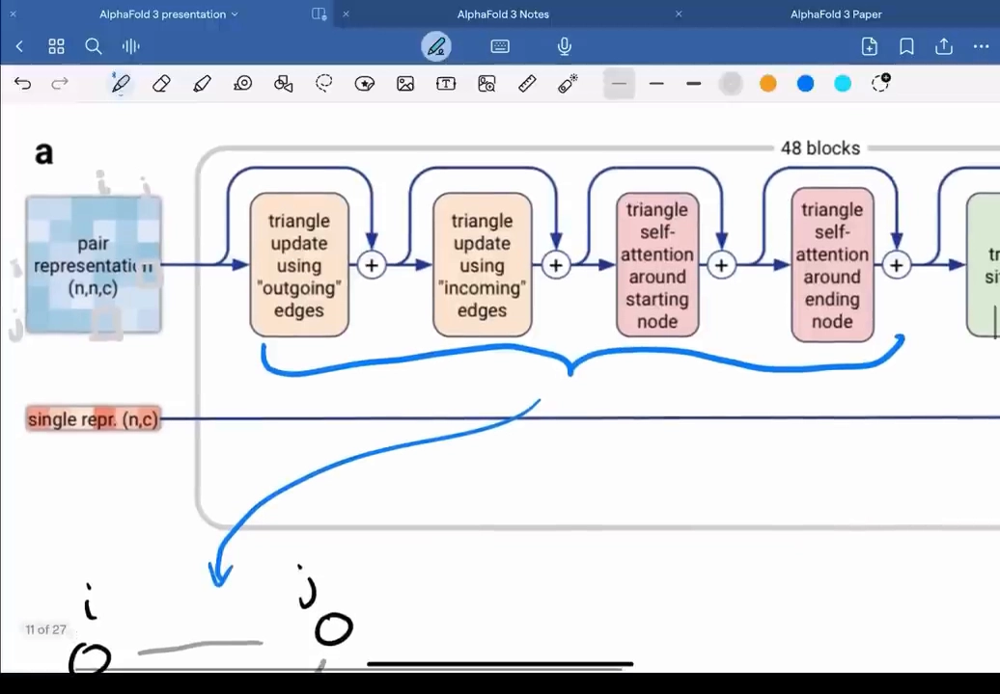

### 5.3 三角注意力：更新 ij 必须看 ik 与 jk

[【跳转到 17:49】](https://www.youtube.com/watch?v=Or3iq4_9-wA&t=1069)

如果用普通注意力更新 pair ij，会去看所有其他 token 对——比如 P、Q 组成的 PQ。可 ij 凭什么关心随机的 PQ？真正相关的是 **ik 与 jk**（k 可以是任何其他 token：K2、K3、K4……每个 k 都构成一个三角形）。换句话说：**pair ij 只关注它所参与的三角形里的其他边**——这就是"三角注意力"名字的由来。

第二个要点：不能只看 ik 就独立更新 ij。设想 ij 只根据 ik 把自己的"距离估计"改得很长，而 jk 没更新——一个三角形一条边太长、另两条太短，**三角不等式**（任何一边不得超过另两边之和）被破坏，三维结构就矛盾了。所以更新 ij 时要同时注意 ik 与 jk 两条边；同时别忘了还有许多不同的 k，更新 ij 时要把它们构成的三角形都照顾到。

用注意力语言说：这个 query 关注这个 key 并按其 value 更新，再关注下一个 key……只不过——正如对称性那段所说，ij 无法真正对称，只能"打个补丁"：**两个三角注意力**，一个处理 ij，一个处理 ji。

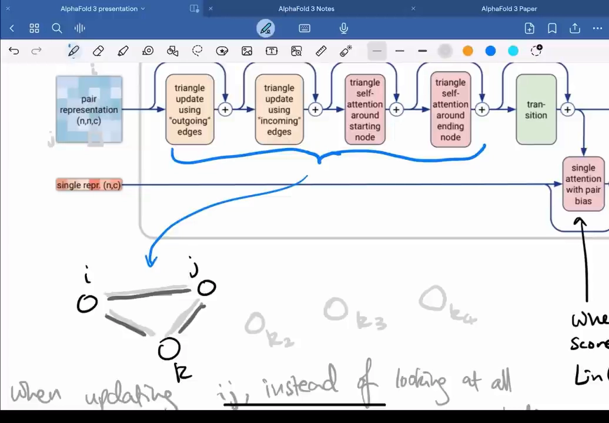

### 5.4 single 的注意力：分数直接来自 pair 表示

[【跳转到 21:15】](https://www.youtube.com/watch?v=Or3iq4_9-wA&t=1275)

single 表示也有一个注意力机制，而且有条箭头从 pair 表示指进这个注意力——为什么？single 注意力更新 token i 时会看包括 j 在内的所有 token：注意力分数表示"i 有多在乎 j"，value 表示"j 如何影响 i"。那 i 凭什么在乎 j？可能成键、可能靠近、可能电荷相反——**这恰恰是 pair 表示里装的信息**！既然如此，与其从零学一个注意力模式，不如直接从 pair 表示拿注意力分数。所以这里的注意力**不再计算 key 与 query 的点积，注意力分数就是 pair 表示的一个线性变换**，value 矩阵照常。这就是 pair 影响 single 的方式。

注意：在这个块里，single **无法反向**影响 pair——那件事只发生在 MSA 模块里。

## 六、template 模块与 MSA 模块：两个"配角"

### 6.1 template 模块：每个模板过 2 层 Pairformer 再平均

[【跳转到 23:20】](https://www.youtube.com/watch?v=Or3iq4_9-wA&t=1400)

template 模块大量基于 Pairformer。模板（来自模板搜索）是若干"看起来合理"的结构，可能只覆盖序列的一部分，也可能覆盖全长。对每个模板结构：把结构里的信息并进初始 Z_ij，记作 V_ij（V_ij1 到 V_ij4）；每个 V_ij 过一遍 Pairformer（注意只过 **2 块**，对比主干 48 块）得到更新的 V_ij；最后把所有更新的 V_ij 平均，加进真正的 Z_ij。template 嵌入对 single 表示**不做任何事**——模板讲的全是 token 之间的关系（相对距离、相对旋转），放进 pair 表示即可。

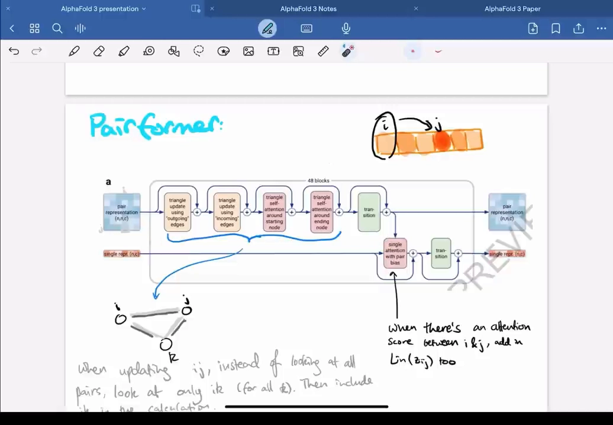

### 6.2 MSA 模块：进化信息被"降级"处理

[【跳转到 25:25】](https://www.youtube.com/watch?v=Or3iq4_9-wA&t=1525)

MSA 模块处理进化历史——而 MSA 在 AF3 里被塞进这么小的一块，实在奇怪：AF2 里它极其重要（进化历史被认为是最关键的信息），AF3 里却被怪异地弱化了。MSA 模块是算法里唯一能看到**完整 MSA** 的地方。

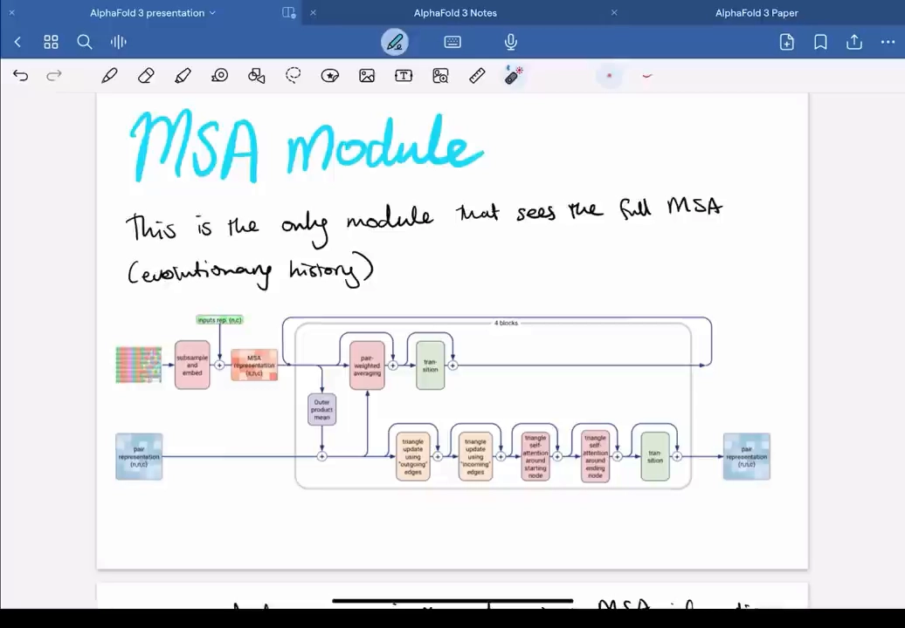

先补 MSA 直觉：目标物种（比如猫）的蛋白，在鱼、蠕虫等物种里都有高度相似的版本。如果某位置在所有物种里都随机变化，说明这个氨基酸对结构不太重要；如果看到大量**共同进化**（这个位置一变、那个位置必跟着变），说明这一对残基相互关联——若其中一个突变破坏了相互吸引，键断开、蛋白形状彻底改变；要保持同样形状，就必须一起变。进化历史能告诉我们蛋白长什么样，值得挖掘。但要提醒：**配体没有 MSA**——这可能是 AF3 弱化 MSA 的原因之一：并非每个分子都有 MSA。

AF2 的 MSA 表示有列注意力与行注意力。列注意力看同一位置跨物种的进化历史——**这个注意力在 AF3 里没有了**，取而代之的是 **outer product mean**：把 MSA 的信息送进 pair 表示。它怎么取信息？不做完整注意力，只**沿列取均值**——是的，很意外，这就是进化历史被使用的唯一方式：取个均值。另一边的注意力则是前面讲过的"pair 表示当注意力分数"的 single 注意力。MSA 模块其余部分，说句扎心的，基本是在**重复 Pairformer 里那套三角注意力**——Pairformer 里已经做了 48 次，这里又来一遍。最终主干输出更新后的 pair 与 single 表示；原始输入特征在几个模块里起过作用，本身不受影响，后续模块还会用到。

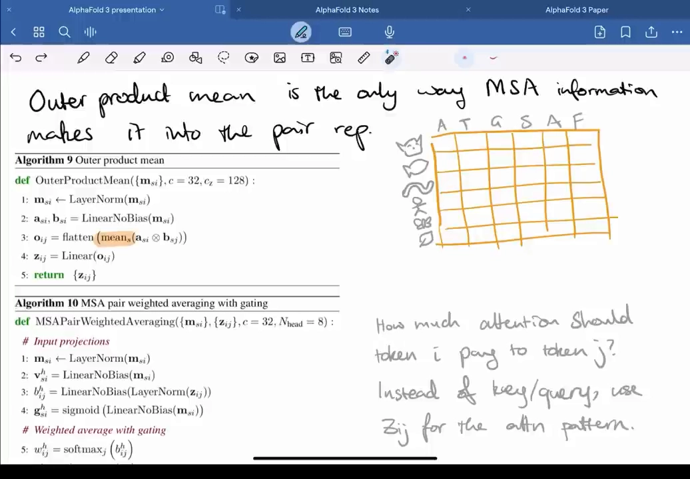

## 七、扩散模块：结构生成 = 去噪

### 7.1 去噪 transformer 的训练直觉

[【跳转到 30:50】](https://www.youtube.com/watch?v=Or3iq4_9-wA&t=1850)

假设有个数据库：各种分子的原子坐标 + 分子描述。目标是训练一个"给描述、出坐标"的算法。扩散的思路：把已知结构加噪，训练**去噪算法**——把加了噪的原子坐标连同**正确的分子描述**一起喂给去噪 transformer，期望它输出真实原子位置。描述至关重要：去噪 transformer 要读描述、理解每个原子物理化学上最合理的位置——"这是个碳原子，应该与相邻原子成键，但不该离那个原子太近"。每次预测都与已知结构比对，按常规梯度下降训练；反复进行、有时加很多噪声，去噪 transformer 越来越擅长理解描述。想象它好到输入随机位置 + 描述就能吐出真实位置——你就得到了一个能从零预测原子结构的模型：对未知结构的分子，输入纯随机坐标 + 描述，输出正确位置。

有个细节被略过了：扩散不是一次前向就出完美预测，而是**迭代**的——输入随机噪声，得到稍微没那么随机的预测；把它作为新输入再改进一点；如此往复直到收敛，即为最终位置。本质上，扩散模块就是一个训练好的去噪 transformer（用 transformer 做去噪器是较新的进展，效果很好）。

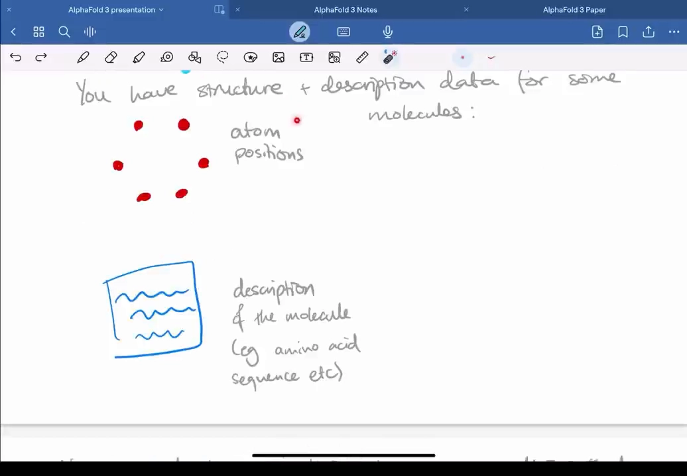

### 7.2 条件化的两种方案：cross attention vs adaptive layer norm

[【跳转到 33:20】](https://www.youtube.com/watch?v=Or3iq4_9-wA&t=2000)

引入 transformer 做扩散的那篇论文给了两个方案。方案一（直觉上该这么做）：token 流做自注意力，再用**交叉注意力**（cross attention）参照描述流更新原子位置流——完全合理，但多头注意力计算量大。方案二：没有 cross attention，描述经 MLP 输出 LayerNorm 的 **scale 与 shift 参数**——描述决定原子位置向量被缩放、平移多少。这叫**自适应 LayerNorm**（adaptive layer norm），条件化能力稍弱但高效得多——**AF3 选的是它**。

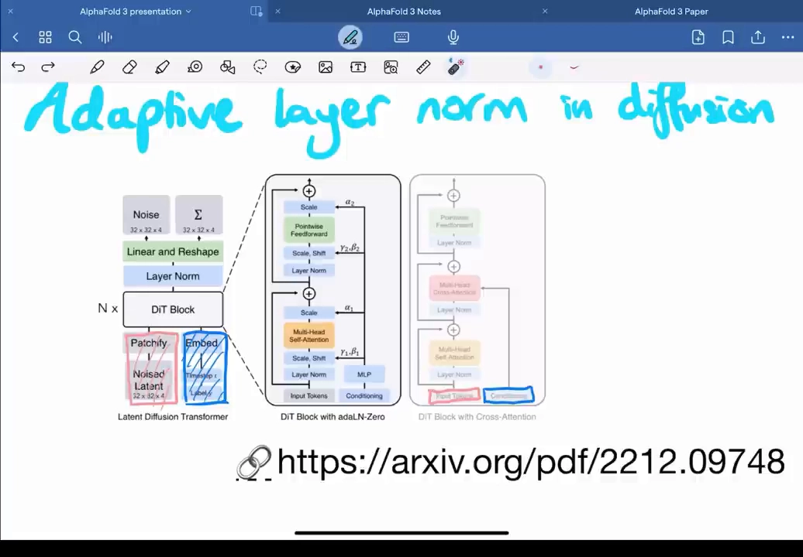

### 7.3 AF3 扩散的输入：描述被"最重度"加工

[【跳转到 36:32】](https://www.youtube.com/watch?v=Or3iq4_9-wA&t=2192)

扩散模块输入分两部分：**描述**（初始特征 + 已被重度加工的 pair 与 single 表示）与**噪声原子坐标**。注意：普通扩散 transformer 里描述没被加工多少，而 AF3 里**描述是整个算法中被加工得最狠的东西**。两者进扩散模块，迭代若干轮后输出正确的原子坐标。另外，这个扩散模块并不简单——不是几个注意力头就完事，而是在多个尺度上有大量处理。

### 7.4 扩散模块内部：原子级与 token 级"双胞胎"

[【跳转到 38:37】](https://www.youtube.com/watch?v=Or3iq4_9-wA&t=2217)

进入模块先做更多预处理（把部分特征再次折进描述），得到 pair 与 single 表示及其他几个量；输入原子初始完全随机，且**每轮迭代都对原子做随机旋转与平移**——意在鼓励输出具有旋转与平移不变性。与 AF2 不同，这种不变性**不靠硬约束**，而是期望算法自己学会。

模块内有**两个原子级注意力块**与一个 **token 级注意力块**。token 级就是已认识的 single/pair 表示；原子级是它们的"孪生兄弟"：

- **P_lm**：原子对关系（l、m 是否成键、距离多远）——Z_ij 的更细粒度版本（每个 token 内有多个原子）；
- **C_l**：原子级的元数据（是哪种元素？残基里的碳是 Cα 还是 Cβ？）——还塞进了 conformer 的参考位置；
- **Q_l**：最终用于更新原子位置的量——可以理解为"原子要往哪挪"的信息载体；
- **A_i**：token 对应的位置量。

三个注意力步骤依次是：原子级 → token 级 → 原子级。token 级 transformer 拿当前 token 级表示更新 A_i；**原子级 transformer 就是同一个扩散 transformer**——只是把 A_i 换成 Q_l、s_i 换成 C_l、Z_ij 换成 P_lm。这就是为什么说两种表示是不同长度尺度上的双胞胎。

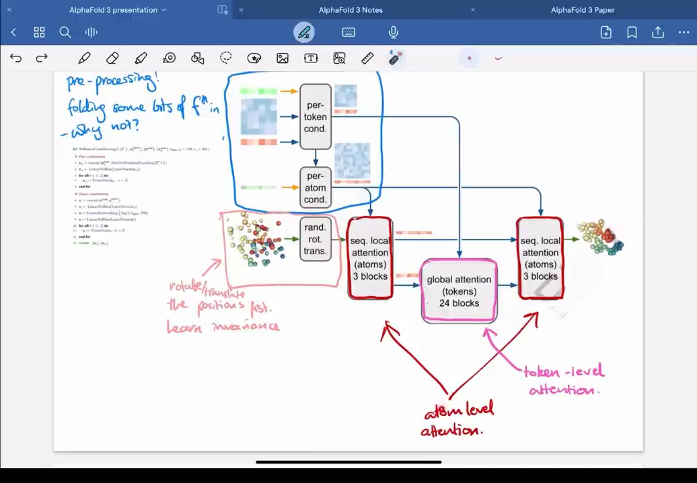

### 7.5 局部性掩码：原子只关注邻近原子

[【跳转到 40:42】](https://www.youtube.com/watch?v=Or3iq4_9-wA&t=2442)

原子级与 token 级还有一个重大区别。原子级 transformer 里，**原子只被允许关注邻近原子**——由一个掩码强制：原子 l、m 靠得近，β_LM 就是 0（不影响任何东西）；离得远，β_LM 基本是负无穷（更新 Q_l 时完全不关注 M）。token 级则相反：β_ij 恒为 0，**任何 token 都能关注任何 token**，无论距离多远。这一大堆原子级/token 级处理的最终目的就是更新 Q_l 与 A_i：先让 Q_l 参考其所属 token 的 A_i（把 token 位置注入原子位置），最终用 Q_l 更新原子坐标。

回到全局图景：从随机原子位置出发 → 全部处理 → 每个位置略微变好 → 回填起点 → 再更新 → 更准一点 → 循环直到满意——输出的就是你研究的分子/复合物的结构。

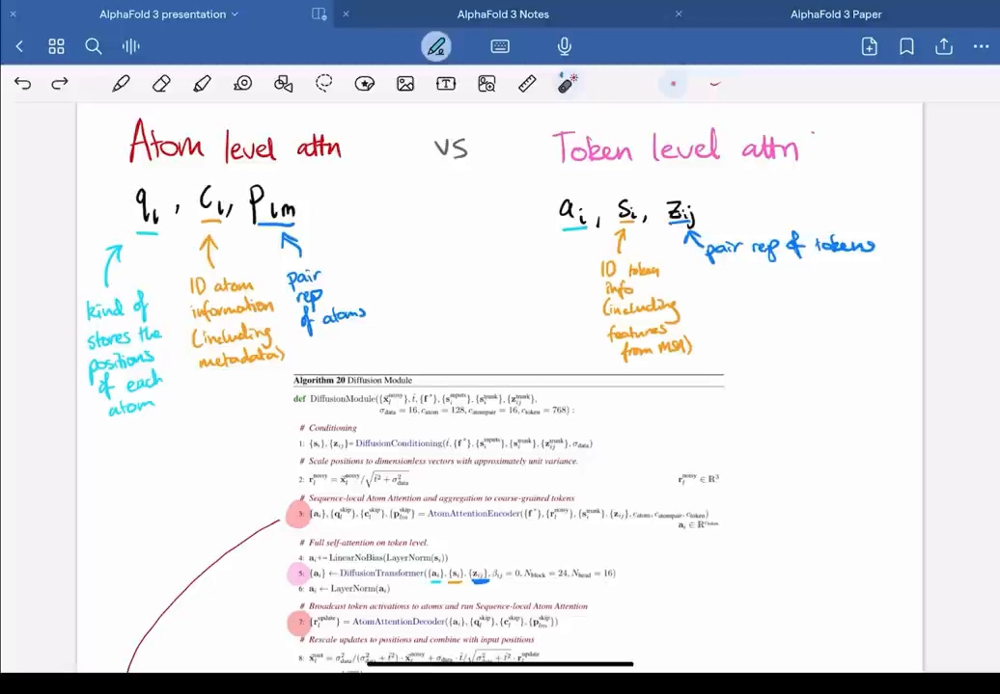

## 八、总结：三段式各司其职

[【跳转到 44:52】](https://www.youtube.com/watch?v=Or3iq4_9-wA&t=2692)

AlphaFold 3 算法讲完了。它分三部分：第一段把你已知或可搜索的复合物信息嵌入 pair/single 表示这类有用的表示里；第二段加工这些信息；最后一段训练去噪算法——拿随机原子坐标与前面产出的描述，迭代改进每个原子的位置预测。这就是 AlphaFold 3 准确预测多种分子结构的全部秘密。

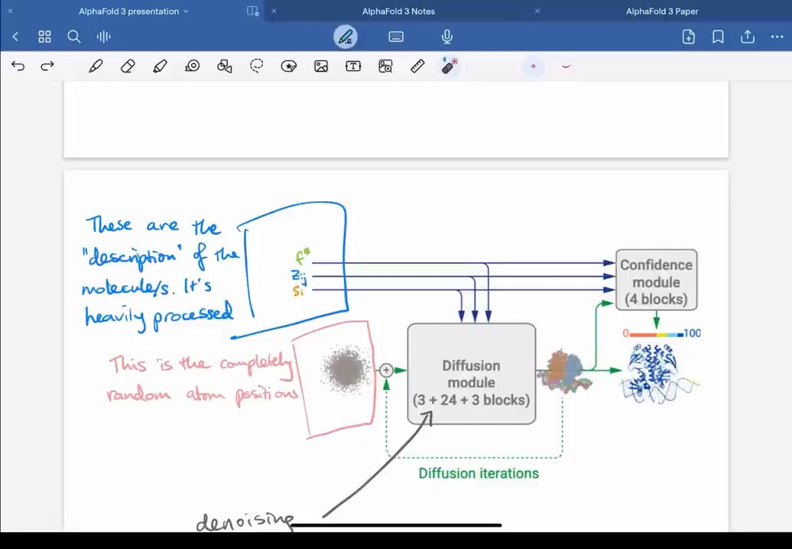

---

## 小结

- **问题升级**：AF3 从"蛋白折叠"扩展到"蛋白 + DNA + RNA + 配体复合物"的全原子结构预测。
- **统一 token 化**：蛋白=氨基酸、DNA=碱基对、RNA=碱基、配体=重原子；氢原子全程忽略。
- **三段式**：输入嵌入（含 conformer/遗传搜索/模板搜索）→ 主干（Pairformer 48 块为主）→ 扩散 + 置信度。
- **双重表示**：single s_i（每 token 向量）与 pair Z_ij（每 token 对向量）；AF3 的重心明显偏向 pair 表示。
- **Pairformer 三角注意力**：更新 ij 只看它参与的三角形（ik 与 jk），避免违反三角不等式；因 ij/ji 无法真正对称，outgoing 与 incoming 各来一套。
- **single 的注意力捷径**：注意力分数不靠 query·key，而是 pair 表示的线性变换——"i 为什么在乎 j"的答案本就写在 pair 表示里。
- **配角模块**：template 模块把每个模板并入 Z_ij 过 2 层 Pairformer 后平均；MSA 模块被大幅弱化——列注意力被 outer product mean（沿列取均值）取代，其余是三角注意力的重演；配体没有 MSA 或是弱化原因。
- **扩散 = 去噪**：训练去噪 transformer（噪声坐标 + 描述 → 真实坐标），推理时迭代去噪；条件化用自适应 LayerNorm 而非交叉注意力（省算力）。
- **原子/token 双层注意力**：P_lm/C_l/Q_l 是 Z_ij/s_i/A_i 在原子尺度的孪生；原子级有局部性掩码（只关注邻近原子），token 级无限制。
- **不变性靠学习**：每轮迭代对原子施加随机旋转与平移，期望算法自己学出旋转/平移不变性——AF2 那种硬约束不复存在。

## 关键术语速查

| 术语 | 一句话解释 |
| --- | --- |
| token | AF3 的统一输入单元：氨基酸/碱基/重原子，氢原子忽略 |
| conformer | token 内原子的标准相对位置（不考虑键旋转自由度的标准摆放） |
| 模板搜索 | 找 ≥10% 序列重叠且结构已知的相似蛋白（最多 4 个）作初始猜测 |
| 遗传搜索（MSA） | 跨物种同源序列的进化历史；共变残基对暗示空间上相互关联 |
| single 表示 s_i | 每个 token 一个向量：类型、链归属、保守性等 per-token 信息 |
| pair 表示 Z_ij | 每对 token 一个向量：成键/距离/电荷等 per-pair 信息，AF3 的重心 |
| token-bond 特征 | 标记 token i 与 j 间已知的 polymer–ligand / ligand–ligand 键 |
| LinearNoBias | 无偏置的线性变换（纯矩阵乘法），权重可学习 |
| Pairformer | AF3 主干：48 块，pair 表示为主、single 一个注意力块 |
| 三角注意力 | 更新 pair ij 时同时关注 ik 与 jk，维持距离的三角不等式 |
| outgoing / incoming | 起始节点周围 / 结束节点周围的更新方向，分别处理 ij 与 ji 的对称版本 |
| adaptive layer norm | 用条件（描述）生成 LayerNorm 的 scale/shift 参数，替代交叉注意力 |
| 扩散模块 | 训练好的去噪 transformer：随机坐标 + 描述 → 迭代去噪出结构 |
| P_lm / C_l | 原子级孪生表示：原子对关系 / 原子级元数据（元素、Cα/Cβ、参考位置） |
| Q_l / A_i | 原子位置更新载体 / token 位置量；原子级 transformer 用 Q_l 更新坐标 |
| 局部性掩码 β_lm | 原子级注意力只看邻近原子（远处置 −∞）；token 级 β_ij 恒为 0 |
| outer product mean | AF3 中取代 MSA 列注意力的操作：沿列取均值把 MSA 信息送进 pair |
