# 几何深度学习（五）：EGNN 等变性几何图神经网络

> 来源：[几何深度学习（五）：EGNN 等变性几何图神经网络（B 站）](https://www.bilibili.com/video/BV1MfBVYsE8a/)，时长 30:48。本博客基于「图-字幕」视频演说图文稿整理，内容可回视频核查。

## 本讲要解决的核心问题（SCQA）

**背景**：分子、蛋白质本质上是三维几何对象。用图神经网络（GNN）建模分子性质时，此前的经典做法（如 SchNet）只使用"距离"这类标量特征——它们在分子旋转、平移后保持不变。

**冲突**：标量只携带"不变性"，丢掉了方向信息。而蛋白质的功能与其三维结构直接相关：结构一旦形变，属性与功能随之改变。只看距离的模型感知不到"方向随空间变化而变化"。

**疑问**：能不能把**等变性**（equivariance，输出随输入的旋转 / 平移 / 反射同步变化）作为归纳偏置，设计进图神经网络？

**回答（中心思想）**：可以。EGNN 用「标量消息流 + 坐标向量流」双分支实现了 E(3) 等变：节点特征 h 由标量信息（节点特征、距离、边特征）计算，天然保持不变；坐标 x 用 `m̂_ij·(x_i−x_j)` 更新，严格随空间变换而等变。相比基于高阶可导向特征的 TFN，EGNN 更简单、计算更省，精度也有保证。

---

## 一、不变性与等变性：几何 GNN 的两种归纳偏置

### 1.1 不变性：标量的性质

[【跳转到 00:50】](https://www.bilibili.com/video/BV1MfBVYsE8a/?t=50)

以一个小分子为例：两个原子之间的**距离**（键长）、**夹角**、**二面角**，一般都不会随着分子在空间中的位置变化而改变——这就是**不变性**（invariance）。

从数学角度看原因很直接：距离、夹角、二面角本质上都可以用一个**标量**（数值）表征，而标量不具备方向性，所以空间位置移动时它们不会改变。

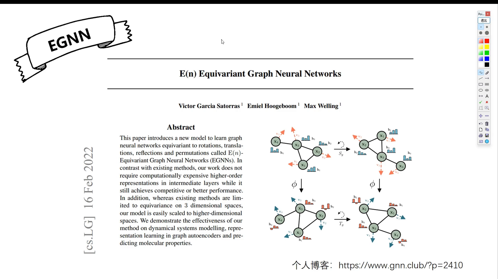

### 1.2 等变性：向量的性质

[【跳转到 01:40】](https://www.bilibili.com/video/BV1MfBVYsE8a/?t=100)

那什么属性会随空间变化？把它引申到**向量**这一层就清楚了：向量具备方向性，空间一变，向量也随之变化——这就是**等变性**（equivariance）。

给图神经网络建模时，如果把等变性纳入算法的**归纳偏置**（inductive bias，即算法设计理念里预设的先验），模型会更贴合问题本身。

### 1.3 为什么分子建模需要等变性：蛋白质形变的例子

[【跳转到 02:05】](https://www.bilibili.com/video/BV1MfBVYsE8a/?t=125)

蛋白质的功能与结构直接相关：结构在空间里发生形变，属性与功能会跟着变化——这正是"等变"的体现。所以解决这类问题时，把等变性写进模型先验，模型会更有效、更符合问题设定。

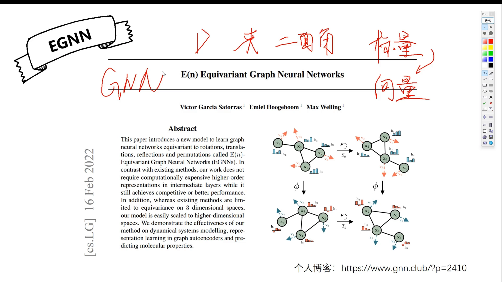

---

## 二、EGNN 论文摘要拆解

EGNN 是把等变性引入 GNN 的一篇最经典工作。它的摘要很短，但信息量不少。

### 2.1 E(3)：对旋转、平移、反射都等变

[【跳转到 03:45】](https://www.bilibili.com/video/BV1MfBVYsE8a/?t=225)

摘要开宗明义：我们引入了一个新的图神经网络，它具备等变性——针对**旋转、平移、反射**三类变换。这三类变换正是群论里的小技术点：在三维欧几里得空间里对平移、旋转、反射都等变，一般记作 **E(3)**，模型也由此得名（E(n)-equivariant GNN）。

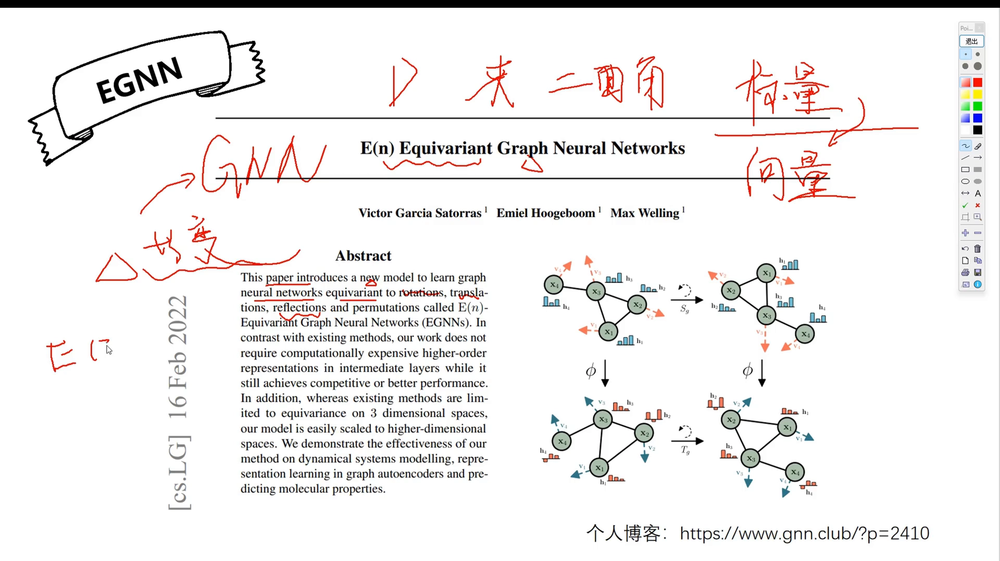

### 2.2 对比 TFN：一段"扬长避短"的写作示范

[【跳转到 04:34】](https://www.bilibili.com/video/BV1MfBVYsE8a/?t=274)

摘要没有明确点名对比对象，实际暗指的是 **TFN**（Tensor Field Network，张量场神经网络）——一种基于**高阶可导向特征**（steerable features）的建模方式。作者强调自己的方法：①不需要高计算复杂度；②不需要中间层的高阶特征表示；③还能保证精度。

主讲人的个人看法：计算快、不复杂确实是 EGNN 的优势，但 TFN 并非一无是处——TFN 更像纯深度学习的方式，**潜力更大**：训练数据充足时，基于高阶可导向特征的深度模型精度上限更高、表征能力更强。摘要只讲 EGNN 的长处、不讲 TFN 的好处，是典型的扬长避短写作，读论文时要留心。

### 2.3 另外两个卖点

- 现存模型大多被限制在三维空间的等变性上，而 EGNN 可以**非常简单地扩展到高维空间**；
- 模型对**动态建模**同样有效，在图的自动编码器与分子属性预测上都有很好的表现。

---

## 三、四类框架对比：从普通 GNN 到 EGNN

讲者把 EGNN 与三类代表框架放在一起对比：普通 GNN、基于距离的径向模型、SchNet、TFN。除了第二个（径向模型）已经过时可以忽略，其余都需要掌握。

### 3.1 普通 GNN：三步走

[【跳转到 08:50】](https://www.bilibili.com/video/BV1MfBVYsE8a/?t=530)

普通 GNN 的框架分三步：

1. **消息定义**：把目标节点 i 的特征、邻居 j 的特征、以及 i–j 边的初始特征拼接，送进神经网络，得到消息 `m_ij`——它表征 i、j 之间边的信息；
2. **消息聚合**：对目标节点 i，把它所有邻居 j 的 `m_ij` 求和（最简单的聚合方式）；
3. **节点更新**：把聚合后的 `m_i` 与节点 i 自身特征拼接，再过一层神经网络，得到更新后的节点特征 `h_i`。

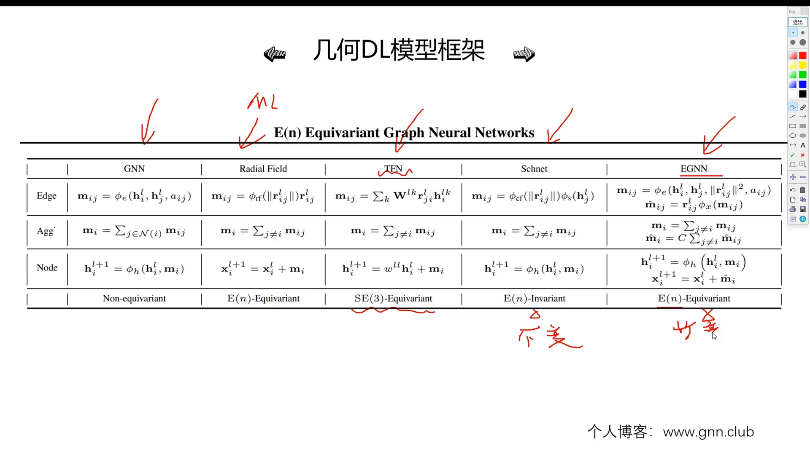

### 3.2 基于距离的径向模型：给方向向量加权

[【跳转到 10:05】](https://www.bilibili.com/video/BV1MfBVYsE8a/?t=605)

这类模型的理念很简单：**把距离特征考虑进来**。取 i、j 坐标（特征向量）之差得到方向向量 r_ij——方向具备空间等变性；再用其**模长**表征两点间距离，送进**径向模型**（属于量子力学/量子化学里的知识点，也是前置知识）建模出权重：邻居离目标节点越近，权重越大；越远越小。用这个权重对方向向量做重要程度的重分配，聚合后直接加到目标节点坐标上完成更新。

讲者特别提醒：这个方法**已经过时**，不重要，这里讲它只是为了对比框架。

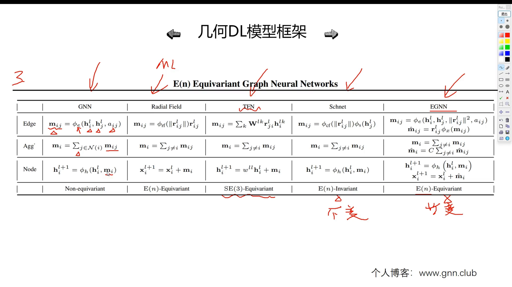

### 3.3 SchNet：基于距离的"不变性"代表

[【跳转到 13:50】](https://www.bilibili.com/video/BV1MfBVYsE8a/?t=830)

SchNet 之前讲过（系列第一个视频），它也是基于距离的几何 GNN。因为距离属于不变量，所以整个模型通过距离建模实现**不变性**属性：

- 计算节点 i、j 之间的模长（距离）；
- 距离送进径向模型得到权重；
- 权重分配给每个邻居 j 的映射结果（邻居特征过神经网络）；
- 按权重求和聚合成 `m_i`，与 `h_i` 拼接过神经网络，得到更新后的 `h_i`。

讲者顺带纠正了自己的口误：这里用的"径向模型"，标准说法是**连续型卷积层（cfconv）**——连续型卷积层里面包含径向基的部分，之前讲的没有错，只是不够精确。

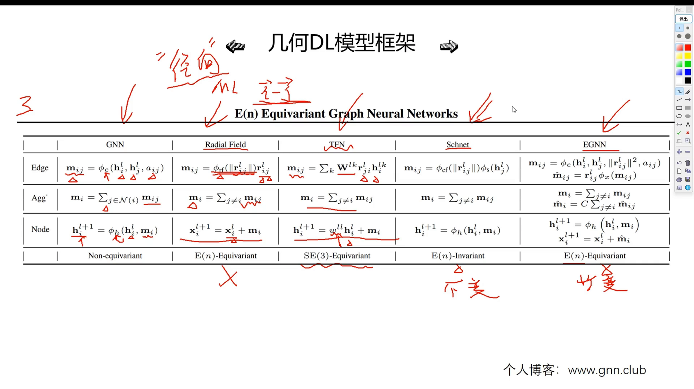

### 3.4 TFN：高阶可导向特征，只差"反射"

TFN 与 EGNN 的性质区别：EGNN 对**旋转、平移和反射**都等变，而 TFN 只对**旋转和平移**等变，没有对反射的对称性。TFN 的消息定义也不是简单拿方向向量与节点向量相乘就完事，还有一个与 **CG 系数**（Clebsch–Gordan 系数）相关的权重矩阵——这些属于后续视频的内容。TFN 与径向模型比较像：后两步差不多，只是最后更新节点特征时会乘上一个权重矩阵。

### 3.5 EGNN 的消息定义：距离直接拼进来

[【跳转到 16:20】](https://www.bilibili.com/video/BV1MfBVYsE8a/?t=980)

对比 SchNet 看 EGNN 的消息定义：拼接的东西更多——不仅包含节点消息 `h_i`、`h_j`、边信息（这三个和普通 GNN 一样），又加了一个**距离信息**。关键在于：这个距离不像 SchNet 那样还要经过径向模型、连续型卷积做进一步处理，而是**直接拼进来**——相对简单粗暴。这正是摘要里"简单、高效"的注脚：很多计算上它就比较"暴力"，没有那么多交互。

对比之下，基于不变性的模型要对距离用径向模型建模、对夹角用球谐函数建模、二面角同理；球面函数、球谐函数的计算都相对复杂，得到的高阶（high order）特征表示也复杂，而且随着分子变大、模型变深，计算复杂度呈几何级增长。EGNN 直接把距离拼进来，绕开了这些开销。

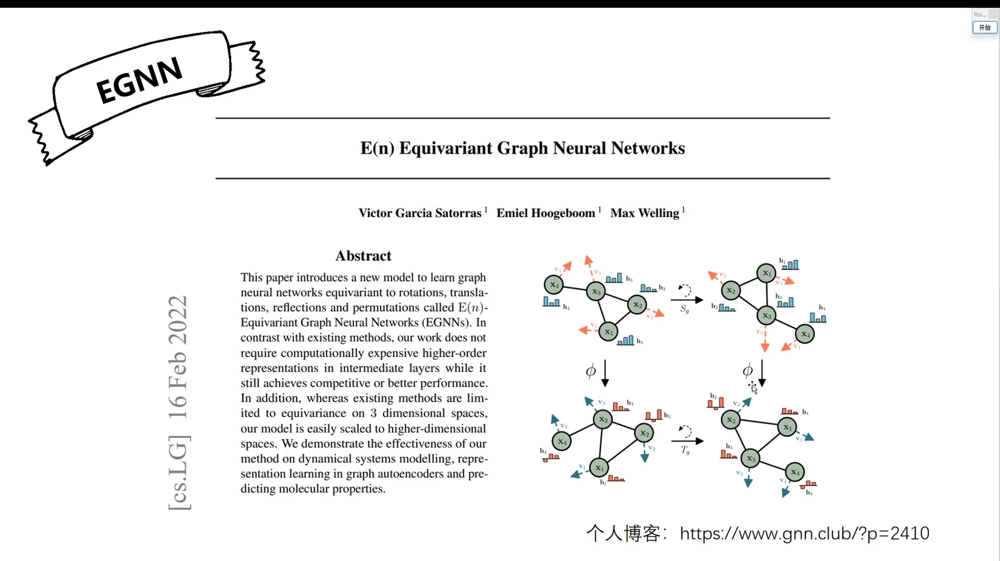

---

## 四、EGNN 的计算流程：标量流 + 坐标流

### 4.1 消息 m_ij 与坐标分支 m̂_ij

[【跳转到 17:26】](https://www.bilibili.com/video/BV1MfBVYsE8a/?t=466)

除了消息 `m_ij`，EGNN 还有一个 **M 帽** `m̂_ij`：把算出来的 `m_ij` 再过一个神经网络 φ，然后与向量 `r_ij` 相乘。`r_ij` 从哪来？就是坐标向量 `x_i − x_j`——一个向量减法，也可以理解成位置的减法：节点 i 的位置减去节点 j 的位置，得到表征"邻居 j 指向目标节点 i"的方向向量。

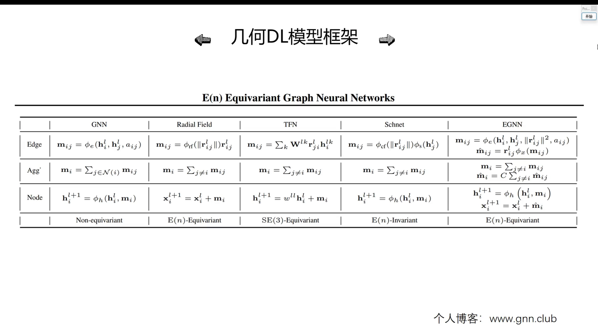

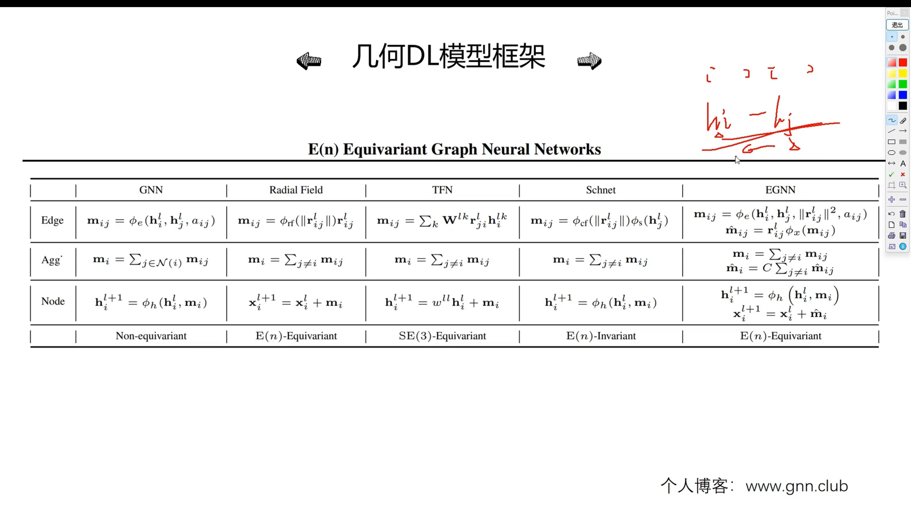

### 4.2 双分支聚合与坐标更新

[【跳转到 19:06】](https://www.bilibili.com/video/BV1MfBVYsE8a/?t=1146)

聚合阶段，标量消息与向量消息各聚各的（与之前模型原理相同）。向量聚合里的 **C 是归一化因子**：防止聚合的邻居数量不一致导致结果有偏差。之后两个分支分别更新：

- **节点更新**：与前面一样——聚合后的消息与原节点信息拼接，过神经网络得到新 `h_i`；
- **坐标更新**：简单粗暴——直接把聚合后的向量信息（M 帽之和）**加到目标节点 i 原本的 x 坐标上**，x 理解成三维坐标（空间信息）。

这就是 EGNN 的完整计算流程：比普通 GNN / 基于不变性的模型**多了一个专门处理位置向量的分支**——先做位置的定义（`r_ij = x_i − x_j`），再做位置的聚合，最后做位置的更新。

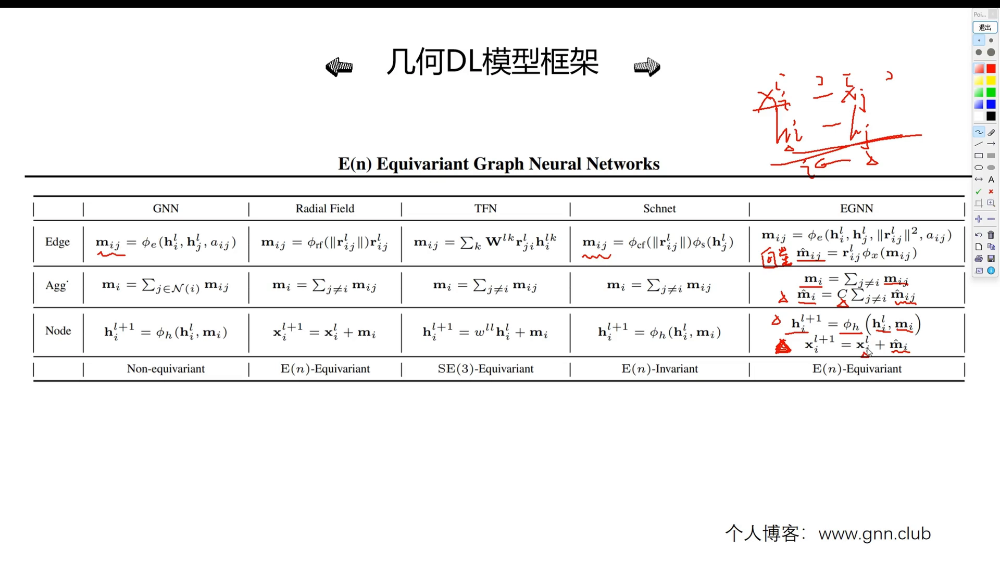

---

## 五、等变性证明：h 不变、x 等变

### 5.1 为什么节点特征 h 天然不变

[【跳转到 22:26】](https://www.bilibili.com/video/BV1MfBVYsE8a/?t=1346)

用 Q（旋转矩阵——矩阵乘法可以表征旋转，尤其是正交矩阵，线代知识点）加一个偏移量（平移）对节点 i 的位置 x 做空间变换，再送进 EGNN 层，问：输出会不会发生相同的变化？

先看节点信息 h——不用证明就知道它具备的是**不变性**，不是等变性。原因：更新后的 h 由 `h_i` 与聚合的 `m_i` 拼接过神经网络得到；而 `m_ij` 的定义里只有节点特征 `h_i`、`h_j`、**距离**、边信息——距离没有方向性，节点与边的初始特征也不具备方向性。所以在 h 的整条计算链路里，归纳偏置是**不变性**。等变性最主要的体现就是那个新分支：**坐标 x 的更新**。

### 5.2 x 的等变性推导：先变换再过模型 = 先过模型再变换

[【跳转到 24:21】](https://www.bilibili.com/video/BV1MfBVYsE8a/?t=1461)

论文里那张图想表达的就是：一个图结构过 EGNN 得到结果；把图先做旋转/平移再过 EGNN，得到的输出与"先过 EGNN、再对结果做相同变换"一致。证明思路：

1. 写出坐标更新：`x_i^{l+1} = x_i^l + m̂`，其中 `m̂ = (1/C)·Σ_{j≠i} r_ij·φ(m_ij)`；
2. `r_ij = x_i − x_j`，把式子里所有含空间的项都施加相同的变换（乘 Q 再加平移）；
3. 展开去括号：平移项相减抵消，把 Q 提到求和外面，式子退回 `Q·x_i^l + t + (1/C)·Σ Q·r_ij·φ(m_ij)`——正好是"先变换后更新"的形式。

结论：空间位置变化后送进模型，模型输出也同步等变；模型结果再变换与直接对输入变换**等价**——这就是等变性的体现，证明完毕。

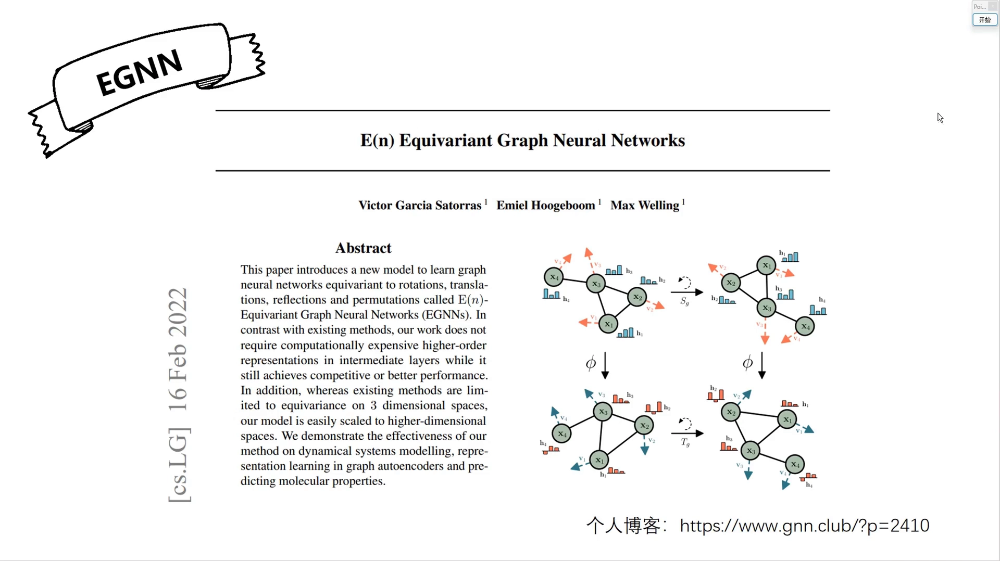

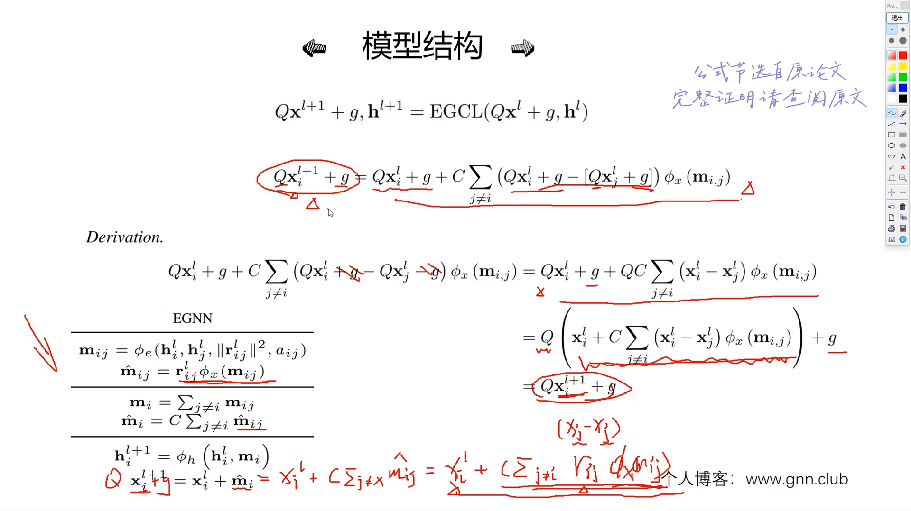

---

## 六、实验效果与系列安排

[【跳转到 29:46】](https://www.bilibili.com/video/BV1MfBVYsE8a/?t=1786)

EGNN 的实验效果挺不错：对比了基于不变性的 SchNet、DimeNet、以及 TFN 等经典模型，EGNN 在很多指标上都很优秀。

讲者的系列安排：后续会持续更新基于等变性的模型（比如非常经典的 **PaiNN**），大约再讲四五个等变模型后，进入第三部分——基于高阶可导向特征（如 TFN 张量场神经网络）的讲解。

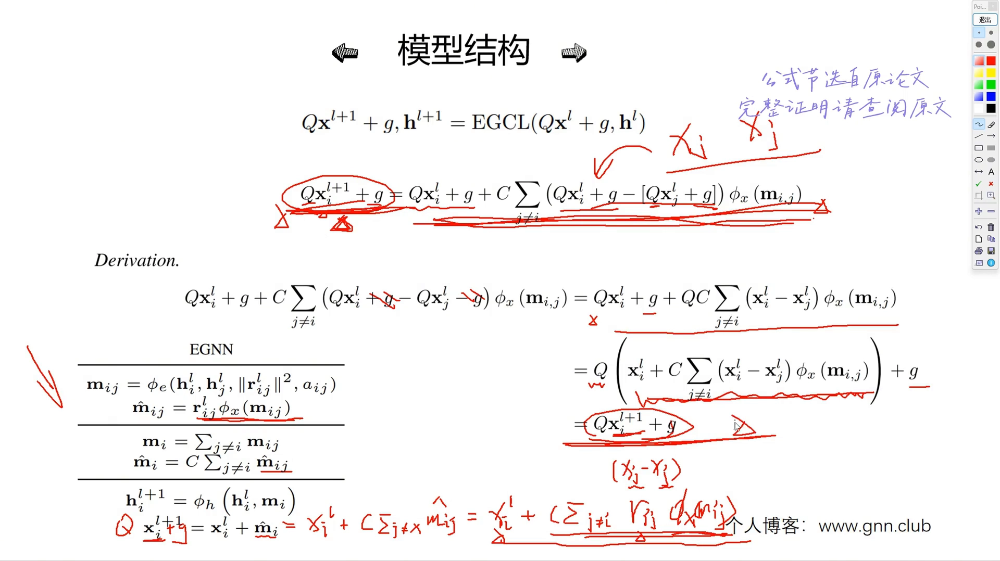

---

## 小结

- **不变性 vs 等变性**：标量（距离、夹角、二面角）空间变换后不变；向量（方向）随空间同步变化。它们是几何 GNN 两类归纳偏置的数学根源。
- **EGNN 的核心设计**：在普通 GNN 的"消息定义→聚合→更新"之外，增加一条**坐标分支**——`m̂_ij = φ(m_ij)·(x_i−x_j)`，聚合后直接加到坐标上。
- **双分支分工**：节点特征 h 的链路只用标量信息 → 保持**不变**；坐标 x 的链路显式使用方向向量 → 严格**等变**。
- **对 E(3) 等变**：旋转、平移、反射都覆盖，比 TFN（只对旋转平移）多出反射等变。
- **简单高效**：距离直接拼进消息，不经径向模型/球谐函数的高开销建模；复杂度不随分子变大呈几何级增长。
- **证明思路**：把更新式里所有含空间的项同时施加 Q（旋转）+平移，化简后回到原式，说明"先变换再算 = 先算再变换"。
- **实验**：对比 SchNet、DimeNet、TFN 均有竞争力；后续系列将讲 PaiNN 与高阶可导向（TFN）。

## 关键术语速查

| 术语 | 一句话解释 |
| --- | --- |
| 不变性（invariance） | 输入做空间变换后，输出保持不变（如距离、夹角等标量） |
| 等变性（equivariance） | 输入做空间变换后，输出以相同方式同步变化（如方向向量） |
| 归纳偏置（inductive bias） | 算法设计里预设的先验假设，让模型更贴合问题结构 |
| E(3) | 三维欧几里得空间上的旋转、平移、反射变换群；对三者都等变即 E(3) 等变 |
| EGNN | E(n)-Equivariant GNN，等变图神经网络：标量流 + 坐标流双分支 |
| TFN | 张量场神经网络：基于高阶可导向特征，对旋转平移等变（不含反射） |
| 径向模型 / cfconv | 用距离经径向基映射成权重的连续型卷积层（SchNet 采用），实现不变性 |
| SchNet | 基于距离建模的几何 GNN，不变性归纳偏置的代表 |
| DimeNet | 基于距离与方向（夹角）信息的几何 GNN，EGNN 论文中的对比基线 |
| m_ij / m̂_ij | 边消息 / 消息过 φ 后与方向向量相乘的坐标更新分量（"M 帽"） |
| r_ij | `x_i − x_j`，节点 j 指向节点 i 的方向向量，等变性的载体 |
| 球谐函数 | 建模夹角方向的经典基函数，与径向模型配合刻画高阶几何特征 |
| PaiNN | 讲者预告的下一个等变模型，经典工作 |
