# ABodyBuilder2 - Final Presentation

> 来源：[ABodyBuilder2 - Final Presentation](https://www.youtube.com/watch?v=9fA4be8rvIM)（YouTube，约 12 分钟）
> Jason Langlais 的课程项目演示：完整走一遍 **ABodyBuilder2 网页工具**（牛津 OPIG 的 SAbPred 平台）——从抗体重/轻链序列怎么来，到提交任务、读建模分数、在线查看器逐项分析，最后下载 PDB 文件并逐列解读。对应本系列「端到端全原子生成」条目的动手侧；方法原理见同条目的一作报告与科普总览两篇。

## 本讲要解决的核心问题（SCQA）

**背景**：拿到一条抗体序列后，想知道它的三维结构——特别是 6 个 CDR 环长什么样、哪些残基可信。

**冲突**：自己搭 AlphaFold2/深度学习环境门槛高；而 ABodyBuilder2 提供了网页端（"Machine Learning based antibody Fv modelling"，适合小规模建模），但界面上表单、评分、查看器、PDB 下载一长串，初学者不知道每一步在做什么。

**疑问**：一个不写代码的普通用户，怎么把这条"序列进 → 全原子结构 + 误差评估出"的流水线完整跑通？

**回答（中心思想）**：五步即可：**准备 V(D)J 来源的轻重链序列 → 表单提交（选编号方案）→ 等几秒看建模分数 → 在线查看器做误差与结构分析 → 下载 PDB 逐列解读**。本视频把这五步全部演示了一遍。

## 一、背景：抗体结构与工具定位

[【跳转到 00:00】](https://www.youtube.com/watch?v=9fA4be8rvIM&t=0) 开场先补了一页抗体基础：抗体由**重链**与**轻链**两条链组成，共同构成可变区与恒定区；**可变区**负责结合目标，结合的特异性由可变区末端的 **CDR 环**（互补决定区）决定——它们与目标（抗原）上的**表位（epitope）**相互作用。

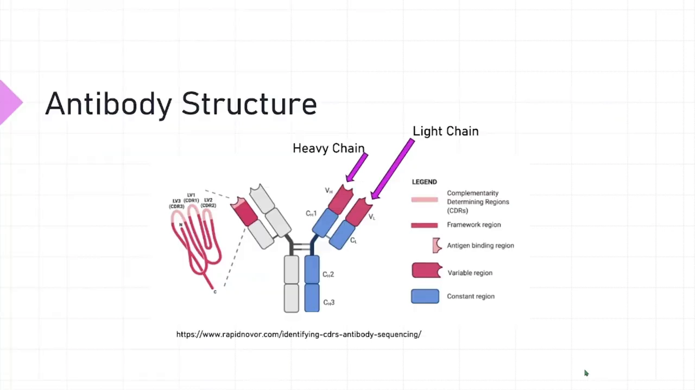

[【跳转到 01:14】](https://www.youtube.com/watch?v=9fA4be8rvIM&t=74) 工具的"About"页写明定位：**基于机器学习的抗体 Fv（可变区）建模**；网页版面向**小规模**结构建模，要做大规模分析请用命令行/批量方式（页面链接了论文与示例输出）。这一点很重要：它只管"序列 → Fv 结构"这一段，不是全流程抗体设计平台。

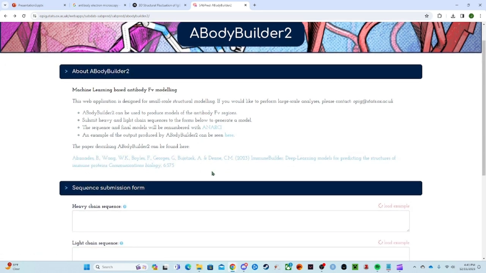

## 二、准备输入：序列从哪来

[【跳转到 00:32】](https://www.youtube.com/watch?v=9fA4be8rvIM&t=32) 用工具前需要两条序列：**重链序列**（由 14 号染色体编码）与**轻链序列**（由 2 号染色体编码）。讲者解释了来源：抗体的链条由基因片段拼接而成——重链是 **VDJ** 片段（来自 14 号染色体），轻链是 **VJ** 片段（来自 2 号染色体）。

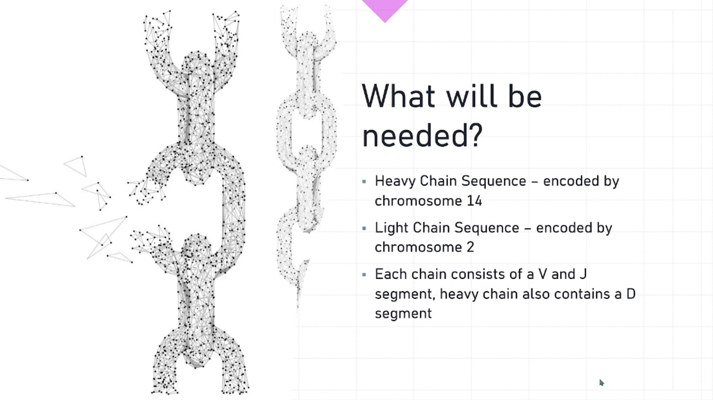

[【跳转到 02:16】](https://www.youtube.com/watch?v=9fA4be8rvIM&t=136) 讲者演示了自己怎么造这两条序列：用 R 语言的 **BioMart** 访问人类基因组，取 14/2 号染色体上 VDJ 编码片段的转录本，取出 DNA 序列、拼接、再翻译成氨基酸序列——"就是你们看到的提交表单里这两串字母"。

> 对初学者的注解：真实抗体库研究中序列一般直接来自测序数据（对照 OAS，见 4.2/1.4 各条）；这里手工拼 V(D)J 是为了课程演示构造"合法的"抗体序列。

## 三、提交任务：表单、编号方案与运行状态

[【跳转到 01:35】](https://www.youtube.com/watch?v=9fA4be8rvIM&t=95) 提交表单四件事：

1. **重链序列**、**轻链序列**两个输入框；
2. **Job name**（任务名）——它决定之后下载文件的命名（演示用 `Example_Ab`）；
3. **CDR 定义选项**：IMGT / Kabat / Chothia / Martin 等单选。讲者选 **IMGT**，他的理由是"IMGT 面向脊椎动物做编号与 CDR 划定"。

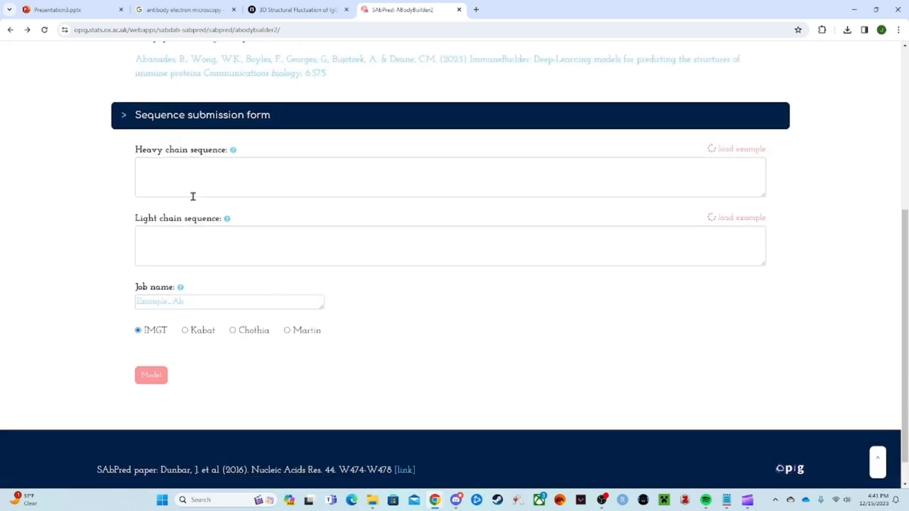

> 注解：这四个选项是**抗体编号方案**——不同方案对"CDR 边界划在哪"约定不同（对照 1.4.3「框架区与 numbering 编号方案」），并非按物种切换。选哪个方案会直接影响"哪些残基被算进 CDR"。

4. 表单页还注明：序列与最终模型会**用 ANARCI 重新编号**（ANARCI 是抗体序列编号的标准工具，见下方结果页脚注）。

[【跳转到 02:54】](https://www.youtube.com/watch?v=9fA4be8rvIM&t=174) 点击 Model 后进入**任务状态页**：Job ID、任务名、状态从 `started` 很快走到 `finished`——"它只需要几秒钟"（对比 AlphaFold-Multimer 的半小时，呼应条目主题"端到端提速"）。日志区还能看到工具的出处：*ABodyBuilder2: A Method for Antibody Structure Prediction*（作者 Brennan Abanades Kenyon，导师 Charlotte Deane——正是同条目一作报告的讲者）。

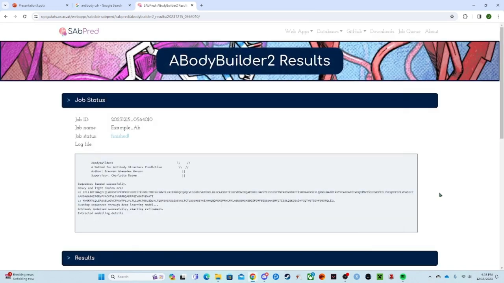

## 四、读结果：建模分数表

[【跳转到 03:36】](https://www.youtube.com/watch?v=9fA4be8rvIM&t=216) 结果页提供三类输出：

- **View model and annotation**（在线查看器，下一节）；
- **Renumbered Fv model (PDB format)**：重编号后的 PDB 文件下载（第七节）；
- **Modelling scores**：**区域 × 预测误差**表——第一列是抗体区域（框架区 Fr、各链 CDR），第二列是该区域的预测误差，含义是"工具自评它把每个残基放对位置与朝向的把握"。分数按重链、轻链分开，**每条链给出总体误差与每个 CDR 的单独误差**。

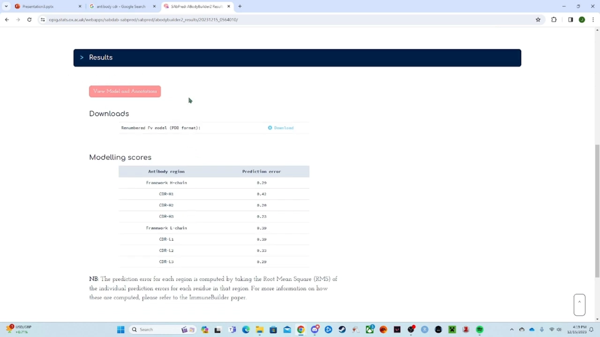

这张表正是 ImmuneBuilder 论文强调的"每条预测附误差估计"（对照科普篇第六节）：拿到结构的第一件事，就是看**哪里可信、哪里要打折**——CDR-H3 一列通常是全场最高分（最不可信）。

## 五、在线分析器：一个模型，多种视角

[【跳转到 04:42】](https://www.youtube.com/watch?v=9fA4be8rvIM&t=282) 点开 "View model and annotation" 进入分析页面。第一层信息是**着色注释**：重链浅蓝、轻链粉色，深色标出 **IMGT 定义的 CDR 区**——"这些就是要真正去结合目标的环结构"。

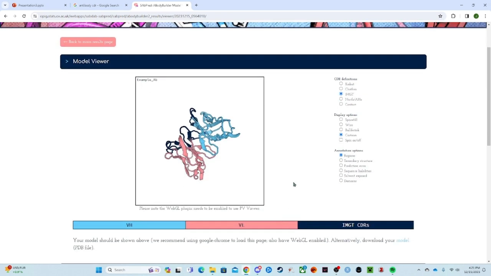

[【跳转到 05:23】](https://www.youtube.com/watch?v=9fA4be8rvIM&t=323) 查看器提供了成套的分析视角，讲者逐一演示：

- **显示模式**：Spacefill（空间填充）/ Wireframe（线框）/ Ball & stick（球棍）/ Cartoon（卡通）。讲者偏爱卡通模式——"箭头能告诉我们序列往哪个方向走"；点任意残基还能看到氨基酸名字（如第 2 位是缬氨酸 Valine）；
- **二级结构**：标出 α 螺旋、β 折叠与环区——深色的 CDR 区域正是"环"；
- **序列 liability（序列风险位点）**：标出可能导致抗体功能异常或结构"塌掉"的化学基序（在折叠中或折叠后都可能出问题）；
- **溶剂暴露（solvent exposure）**：显示可变区里哪些残基埋在内部、哪些暴露在外；
- **结构域（domains）**：标出 VH 与 VL。

[【跳转到 06:30】](https://www.youtube.com/watch?v=9fA4be8rvIM&t=390) 讲者特别强调两个边界：**这个工具只建模可变区与 CDR 环，不建模恒定区**；而且它给的是一个 Fv——**每个抗体的两臂各有两个可变区**，完整抗体上你会有两个这样的结构。

## 六、预测误差阈值滑块：把"可信度"调出来看

[【跳转到 06:49】](https://www.youtube.com/watch?v=9fA4be8rvIM&t=409) 把注释选项切到 **prediction error** 后，出现了本视频最有教学价值的功能：一个**阈值滑块**，按预测误差给残基着色。

- 阈值调到 **1**：整个结构里只有 **2 个残基**误差 ≥1——"这是全结构里最不可能摆放正确的两个残基"；切到区域视图一看，**它们都落在 CDR 环上**。"这很合理——CDR 环高度可变，抗体有几百万种目标要结合，所有可能的 CDR 环之间差异巨大"，所以工具对它们的把握最差。

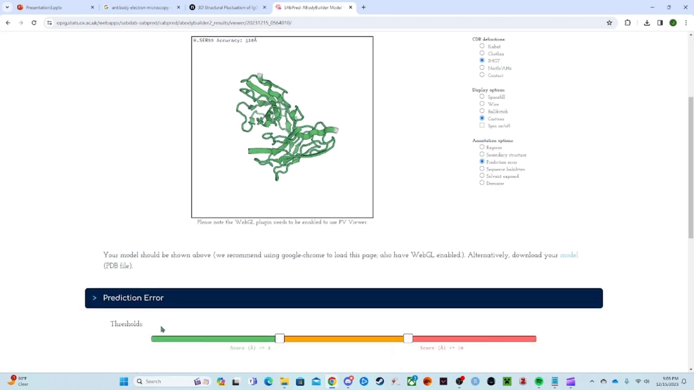

- 阈值调低到 **0.3**：**几乎全部 CDR 环**都亮了（误差 ≥0.3），而内部残基大多低于 0.3——"再次印证：CDR 区高度可变，工具对它们最没把握，对内核最有把握"。

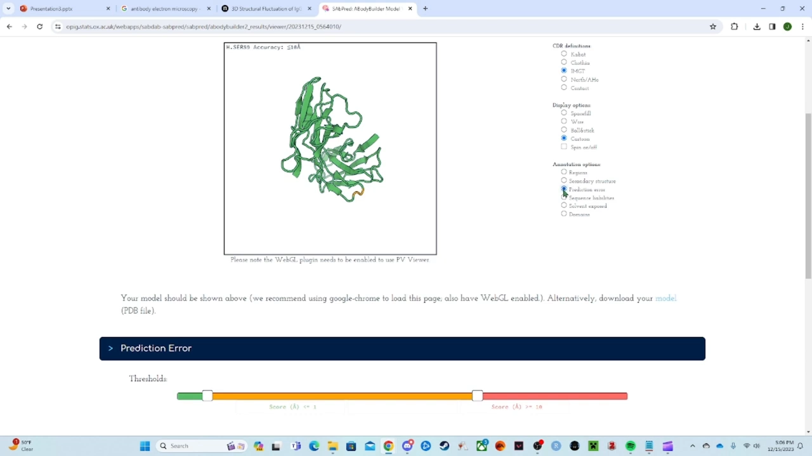

[【跳转到 08:21】](https://www.youtube.com/watch?v=9fA4be8rvIM&t=501) 页面下方还有 **ANARCI 编号序列**视图：VH、VL 两条序列逐残基标注预测误差，蓝色标出 IMGT 编号的 CDR 段——"一、二、三；一、二、三——**每条链 3 个环**，正是应有的结构"。序列视图与结构视图相互印证，这也是检查"编号方案是否生效"的实用办法。

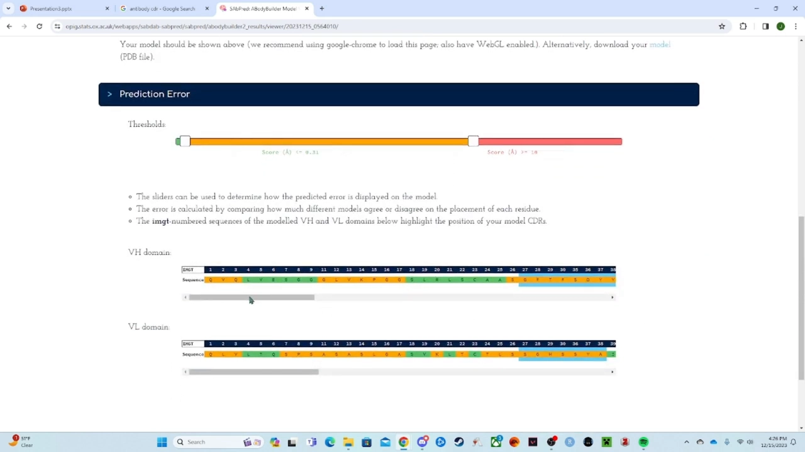

## 七、下载 PDB：逐列读懂结构文件

[【跳转到 08:51】](https://www.youtube.com/watch?v=9fA4be8rvIM&t=531) 最后一步：点结构上方的 **Model** 按钮下载 PDB 文件（`Example_Ab.pdb`——任务名就是文件名）。讲者在文本编辑器里打开文件，逐列解释了 PDB 的 ATOM 记录：

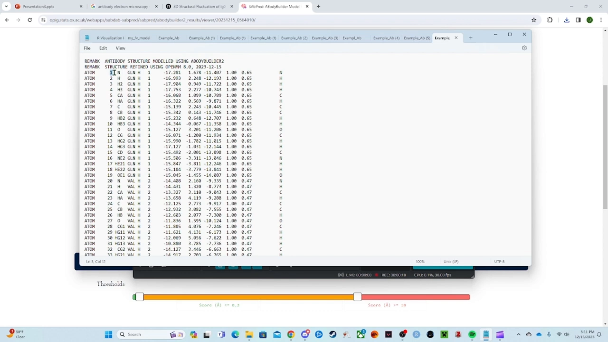

| 列 | 含义（按讲者讲解 + PDB 规范） |
| --- | --- |
| `ATOM` | 记录类型：这一行是分子里的一个原子——"序列的每个部分都由原子构成" |
| 序号 | 原子在整条链中的编号（注意：**不是**氨基酸编号，是逐原子累加） |
| 元素 | 该原子是什么（N、H…）——"序列里第一个原子是氮，然后氢、两个氢……" |
| 残基名 / 链 / 残基号 | 氨基酸三字母缩写 + 所属链（`H`）+ 第几个氨基酸 |
| X, Y, Z | 原子的三维坐标 |
| occupancy（占据率） | 该残基可有几种构象（1 = 只有一种） |
| temperature factor | 温度因子（B-factor）：讲者称其与电子密度相关、属电镜/实验场景的量，"不是从模型里真能算出来的" |
| 元素符号（行尾） | 原子的元素标识 |

> 注解（对照 2.2.3）：PDB 的 B-factor 列在**实验结构**中反映原子热运动/无序程度（X 射线晶体学场景），讲者"电镜"的说法并不准确；在 **AI 预测结构**中，不少工具会把这一列改作它用（如写入逐残基置信度），拿到预测 PDB 时应先查该工具的文档说明，再决定怎么解读这一列。

## 小结

- 工具定位：**ML 驱动的抗体 Fv 建模网页**，只做"序列 → 可变区全原子结构"，适合小规模、零代码使用；
- 输入准备：重链 VDJ（14 号染色体）+ 轻链 VJ（2 号染色体）；演示用 R/BioMart 拼接翻译，实战中序列多来自测序库；
- 提交要点：任务名决定文件命名；**CDR 定义（编号方案）是显式选项**（IMGT/Kabat/Chothia/Martin），输出统一经 ANARCI 重编号；
- 结果三层：**建模分数表**（每链、每 CDR 的预测误差）→ **在线查看器**（着色/显示模式/二级结构/liability/溶剂暴露/结构域）→ **PDB 下载**；
- 误差阈值滑块是最直观的置信度工具：阈值 1 → 仅 2 个残基（都在 CDR 上）；阈值 0.3 → 几乎全部 CDR 环——**CDR 高可变 ⇔ 预测误差高**，与工具设计逻辑一致；
- PDB 逐列解读：ATOM / 原子序号 / 元素 / 残基与链 / XYZ / occupancy / B-factor（实验中反映热运动，AI 预测中常被改作置信度，需查工具文档）；
- 讲者的结尾建议：这只是预测工具生态的一小部分——恒定区预测、表位结合等还要靠其它工具接力。

## 关键术语速查

| 术语 | 一句话解释 |
| --- | --- |
| Fv / 可变区 | 抗体上负责结合的片段（VH+VL）；本工具只建模这一段 |
| VDJ / VJ 片段 | 重链（14 号染色体）与轻链（2 号染色体）的基因片段，拼接产生抗体多样性 |
| CDR 定义 / 编号方案 | IMGT、Kabat、Chothia、Martin 等对"CDR 边界划在哪"的不同约定 |
| ANARCI | 抗体序列编号工具；ABodyBuilder2 的输入输出都会用它重新编号 |
| 预测误差（prediction error） | 工具对"每个残基位置与朝向是否正确"的自评分；越低越可信 |
| 序列 liability | 序列中可能导致抗体功能异常或结构不稳定的化学基序 |
| occupancy（占据率） | PDB 列之一，表示原子可采取的构象数（1 = 唯一构象） |
| temperature factor（B-factor） | PDB 列之一；实验结构中反映原子热运动/无序度（对照 2.2.3） |
| epitope（表位） | 抗原上被 CDR 环识别结合的部分 |

## 同条目配套视频

- 方法原理（一作亲讲）：[ImmuneBuilder： Deep-Learning models for predicting... - Brennan Abanades - 3D-SIG - ISMB／ECCB 2023](ImmuneBuilder： Deep-Learning models for predicting... - Brennan Abanades - 3D-SIG - ISMB／ECCB 2023.md)
- 科普总览：[ABodyBuilder2 - ImmuneBuilder： Deep Learning for Immune Protein Structure (T-cell, NanoBodies)](ABodyBuilder2 - ImmuneBuilder： Deep Learning for Immune Protein Structure %28T-cell, NanoBodies%29.md)
