# ImmuneBuilder： Deep-Learning models for predicting... - Brennan Abanades - 3D-SIG - ISMB／ECCB 2023

> 来源：[ImmuneBuilder: Deep-Learning models for predicting... - Brennan Abanades - 3D-SIG - ISMB/ECCB 2023](https://www.youtube.com/watch?v=-XPS3b_nQ2o)（YouTube，约 14 分钟）
> 讲者 Brennan Abanades 是 ImmuneBuilder 论文的第一作者（牛津大学，导师 Charlotte Deane 教授；与 Roche 合作完成，EPSRC / Roche 资助，见片尾致谢页）。本视频是讲者在 3D-SIG（ISMB/ECCB 2023 卫星会）上的报告，对应本系列「端到端全原子生成」条目中 ImmuneBuilder 一侧的方法原理。

## 本讲要解决的核心问题（SCQA）

**背景**：抗体是现代生物药最成功的类型——已有超过 100 款抗体药物上市；AlphaFold2 / AlphaFold-Multimer 已能把蛋白质结构预测做到接近实验精度。

**冲突**：抗体研究的输入规模爆炸了。免疫库测序（immune repertoire sequencing）每次研究产出数百万条序列，汇总库 OAS（Observed Antibody Space）已收录超过 20 亿条单链序列；而 AlphaFold-Multimer 预测一条抗体结构要 GPU 跑约半小时——"每条半小时 × 百万条"在计算上不可行。

**疑问**：能不能既保住精度、又把速度提上去，为海量抗体序列做结构预测？

**回答（中心思想）**：可以。因为抗体是"一个结构高度保守、只有 6 个 CDR 环多变"的单一蛋白家族，可以去掉 AlphaFold2 里昂贵的 MSA / Evoformer 分支，只保留结构模块（Structure module），用单一家族的数据重新训练——ImmuneBuilder 套件（ABodyBuilder2 / NanoBuilder2 / TCRBuilder2）由此而来：端到端、直接从序列输出全原子结构，精度与 AlphaFold-Multimer 基本相当，速度快约 100 倍。

## 一、抗体：Y 形"分子导弹"，难在 6 个 CDR 环

抗体的本职工作是"高亲和力、高特异性地识别并中和几乎任何病原体"。它整体是一个 Y 形结构：

- **骨架保守**：Y 形的柄和两臂大部分区域在不同抗体之间高度相似，"很容易预测"；
- **CDR 环多变**：真正决定"结合什么"的是可变区顶端（Fv）的 6 个环——重链 H1/H2/H3、轻链 L1/L2/L3，统称 CDR（互补决定区）环。它们"在序列和结构上都变化极大"，从而能呈现出各不相同的结合表面。

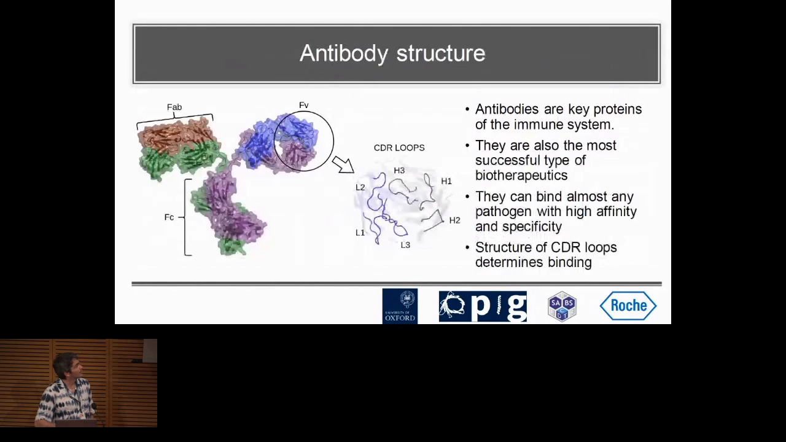

正因为它"能结合几乎任何病原体"，抗体成为最成功的一类生物药（>100 款药物），也正因为 CDR 环多变，抗体结构预测的难点全部集中在这一小撮环上——尤其是后面反复出现的 **CDR-H3**（最难预测、对结合最重要）。

## 二、现状的瓶颈：AlphaFold 准但慢，扛不住 20 亿条序列

[【跳转到 01:26】](https://www.youtube.com/watch?v=-XPS3b_nQ2o&t=86)

报告把"现状"拆成三句：

1. **AlphaFold2 单链预测近乎实验精度，但对抗体并不好用**——AF2 是为单链蛋白设计的；
2. **AlphaFold-Multimer 是抗体现状的最优解**——因为抗体有重链、轻链两条链，Multimer 能处理多链复合物；
3. **两者的共同问题是计算太贵**：一条抗体在 GPU 上要跑约半小时。而抗体场景下我们要为"数百万条序列"出结构——乘起来就完全做不动了。

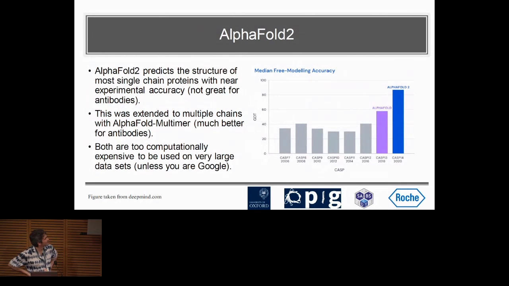

[【跳转到 02:16】](https://www.youtube.com/watch?v=-XPS3b_nQ2o&t=136) 为什么一定要为这么多序列做结构？讲者给出两个理由：

- **数据端**：下一代测序（NGS）已常规用于免疫库分析，每次研究百万级序列；汇总库 OAS 现在已有超过 20 亿条单链序列；
- **价值端**：对 3D 社区而言这几乎是常识——"结构决定结合"，从结构层面分析抗体，才能对功能与结合对象给出深入洞见。

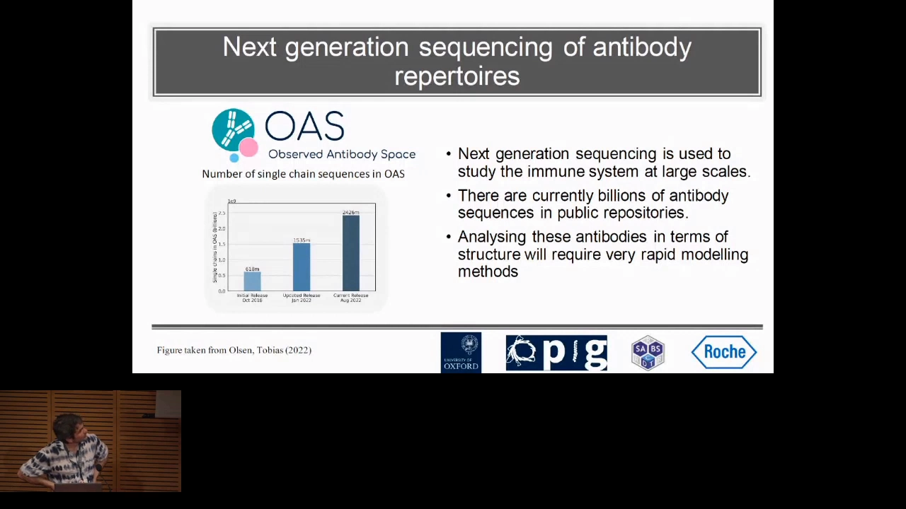

## 三、核心方法：为抗体"裁剪" AlphaFold2

[【跳转到 03:31】](https://www.youtube.com/watch?v=-XPS3b_nQ2o&t=211) 加速的突破口来自一个对抗体的关键观察：

- **主体保守**：抗体大部分结构在不同抗体间几乎一样；
- **CDR 环的多变性不来自进化**：多数蛋白的结构多样性是进化驱动的（AlphaFold 依赖 MSA 里的共进化信号），而抗体 CDR 环的多样性主要来自 **VDJ 重组**与**体细胞超突变**——"共进化信号对预测 CDR 环结构帮助不大"。

于是讲者的研究问题非常直接（也对应幻灯片上的大字标题）："**能否又准又快地预测抗体结构？**"——目标是比 AlphaFold 快得多。

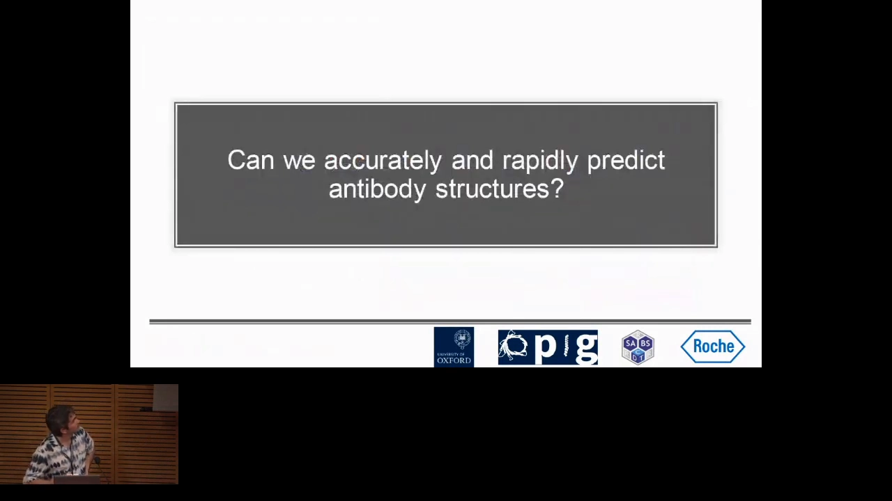

[【跳转到 04:21】](https://www.youtube.com/watch?v=-XPS3b_nQ2o&t=261) 具体做法是"裁剪"AlphaFold2 的流水线。先看 AF2 原架构：输入序列 → 搜 MSA / 模板 → Evoformer（48 块）混合进化信息与配对表示 → 结构模块（8 块）输出 3D 结构 → 循环精修三次。其中搜 MSA 与跑 Evoformer 正是耗时大户。

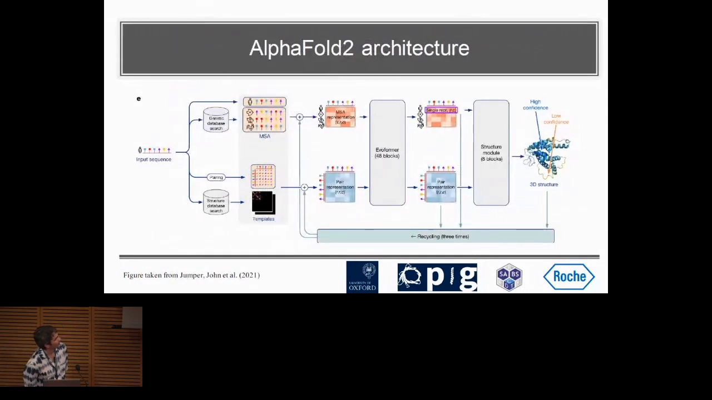

ABodyBuilder2 的改造（对应幻灯片 "Based on the AlphaFold2 structure module with modifications"）：

- **只保留 AF2 的结构模块**，去掉 MSA 与 Evoformer，让模型直接从单条序列学习；
- 对结构模块做**抗体化微调**：修改输入方式使其接受单序列、调整损失函数与架构（细节见讲者次日的后续报告与论文）；
- **只在抗体这一个蛋白家族上训练**——讲者的原话是"刻意对这一个家族过拟合"；
- 结构模块**预测角度并据此计算全部原子位置**，因此输出的是包含侧链的**全原子**结构，而不是只有主链。

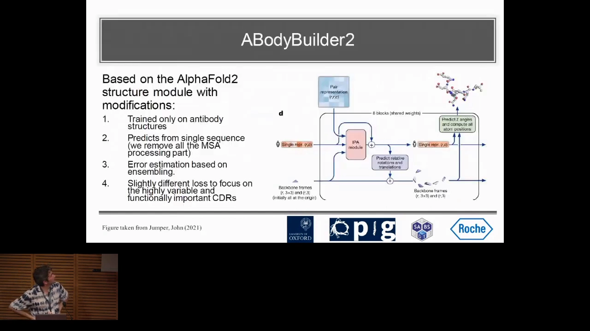

这就是"端到端全原子"的路线：**序列进、全原子结构出，一步到位**——没有 MSA 检索、没有能量最小化的迭代循环（精修另算，见第五节）。

## 四、结果：精度对齐 AlphaFold-Multimer，快约 100 倍

[【跳转到 05:41】](https://www.youtube.com/watch?v=-XPS3b_nQ2o&t=341) 成绩单分两页：

- **对比表**：上半部分是此前的抗体专用预测方法，底部两行是 AlphaFold-Multimer 与 ABodyBuilder2。总体表现"基本与 AlphaFold 相当"——包括最难、最重要的 **CDR-H3**；讲者顺带说在这个测试集上我们还略好（"虽然不显著，但让我挺高兴"）。
- **侧链精度表**：按 H1/H2/H3、L1/L2/L3 各环分列 RMSD（如表中 ABodyBuilder 与 ABlooper 的对比），是论文 extensive benchmark 的一部分。

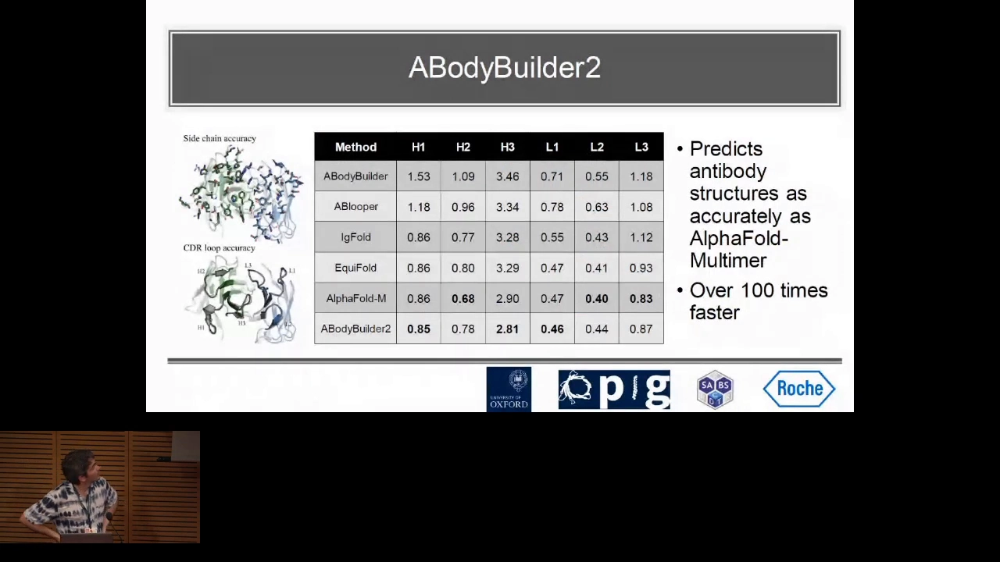

[【跳转到 06:06】](https://www.youtube.com/watch?v=-XPS3b_nQ2o&t=366) 速度方面讲者的原话值得注意：他先说"快了超过一千倍"，随即自我更正为"**快约 100 倍**"。论文的基准测试覆盖侧链预测、结构域间夹角等一系列指标——结论是"所有指标上基本与 AlphaFold 等效，同时快约 100 倍"；在纳米抗体上甚至更好（下一节解释为什么）。

## 五、模型学到了什么：不是同源建模，也不是物理

[【跳转到 06:56】](https://www.youtube.com/watch?v=-XPS3b_nQ2o&t=416) 报告专门用两页做"模型行为剖析"：

**检验一：它是不是在"复制粘贴"？** 有人假设模型只是学会了同源建模——把训练集里见过的 CDR 抄过来。检验方法：把 CDR-H3 的 RMSD 对"测试集抗体与训练集中最近序列的相似度"画散点图。若模型在抄模板，相似度越高应该预测越好。结果是**看不到明显相关**——模型学到的东西超出了"复制粘贴 CDR"（佐证：它确实优于同源建模类方法）。

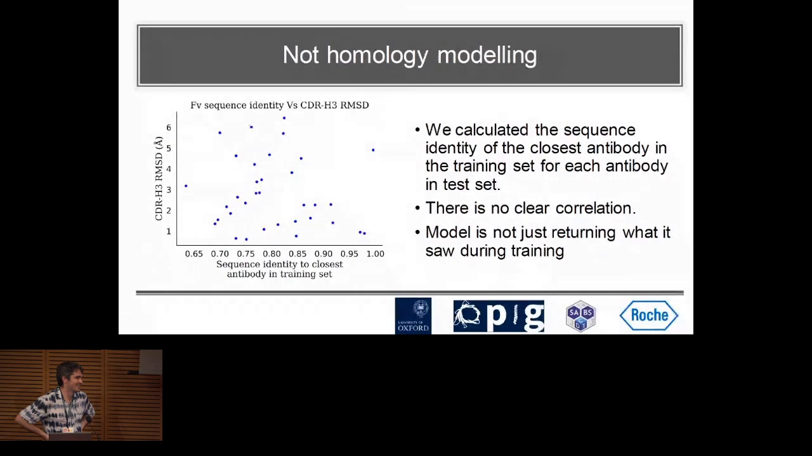

[【跳转到 07:46】](https://www.youtube.com/watch?v=-XPS3b_nQ2o&t=466) **检验二：它学到物理了吗？** 没有。这类模型（"不止我们的，很多模型都一样"）会生成**非物理结构**：原子碰撞、不正确的键长、错误的顺/反肽键等。幻灯片上的金句："**Deep learning models learn patterns in the data, not physics**"——训练数据还不够大，模型学的是数据里的模式，而不是蛋白质折叠的物理规律。

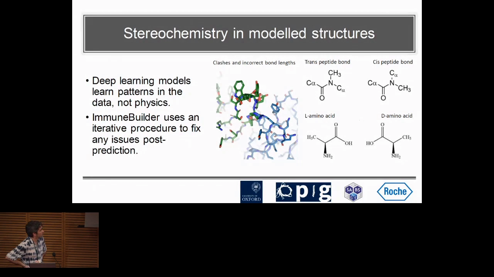

[【跳转到 08:36】](https://www.youtube.com/watch?v=-XPS3b_nQ2o&t=516) 补救方案是**预测后精修**：用基于分子动力学（MD，具体用 OpenMM）的 refinement 对预测结构做物理合理性修正，"似乎能把这些都修好"。这套"深度学习出粗构 → MD 精修"的组合拳贯穿了 ImmuneBuilder 全系列。

## 六、推广到纳米抗体与 TCR：AlphaFold 的"隐式上下文"

[【跳转到 08:50】](https://www.youtube.com/watch?v=-XPS3b_nQ2o&t=530) "家族特异训练"这条路并不只对抗体有效：同一思路套到 **TCR**（TCRBuilder2）上基本达到 AlphaFold-Multimer 的水平；套到**纳米抗体**（NanoBuilder2）上，在 CDR-H3 上甚至"略好一点"。

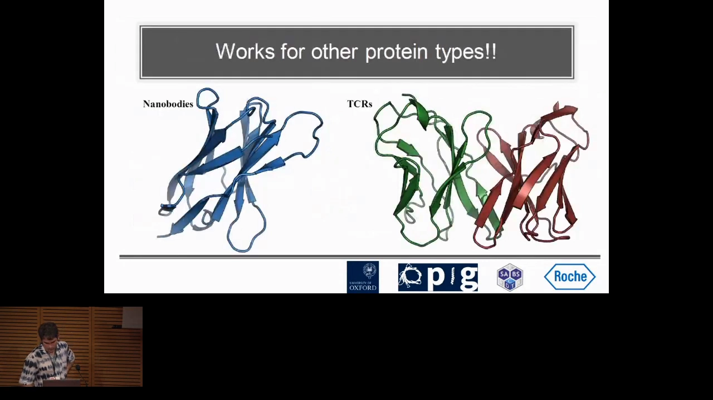

[【跳转到 09:15】](https://www.youtube.com/watch?v=-XPS3b_nQ2o&t=555) 为什么纳米抗体上会更好？讲者给出一个很有意思的解释，牵出 AlphaFold 的一个"性格"：

- 纳米抗体（VHH）序列与抗体重链高度相似，但 **PDB 里抗体数据远多于纳米抗体**；
- 训练时 AlphaFold 见过大量"纳米抗体样"序列——它们都带着**轻链**出现，于是它学会了"把 H3 预测成不会碰撞轻链、构象正确"的样子；
- 到了纳米抗体场景（没有轻链），这种学来的"**隐式上下文**"反而不成立——H3 其实可以折进轻链本来会占据的空间。幻灯片总结："**AlphaFold2 appears to predict nanobodies as if there were a light chain present**"。

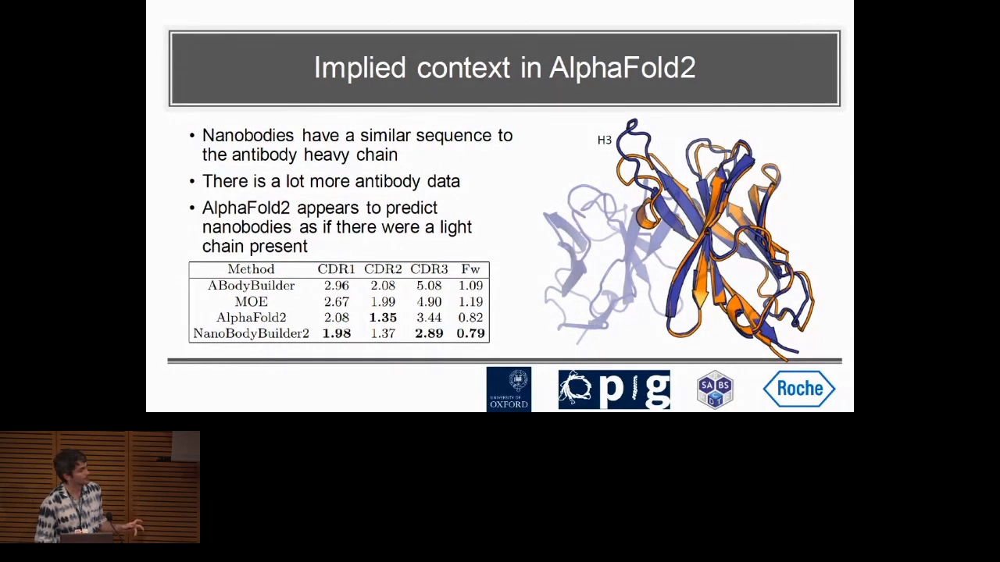

[【跳转到 10:30】](https://www.youtube.com/watch?v=-XPS3b_nQ2o&t=630) 讲者的方法论提醒：用 AlphaFold 系模型预测时，要想想"**这类蛋白通常在什么上下文里出现**"（有没有伙伴链、什么复合物环境）——训练分布里的上下文会影响预测。有时这正合你意（顺带获得了复合物合理性），有时不是。

## 七、总结与 Q&A 精要

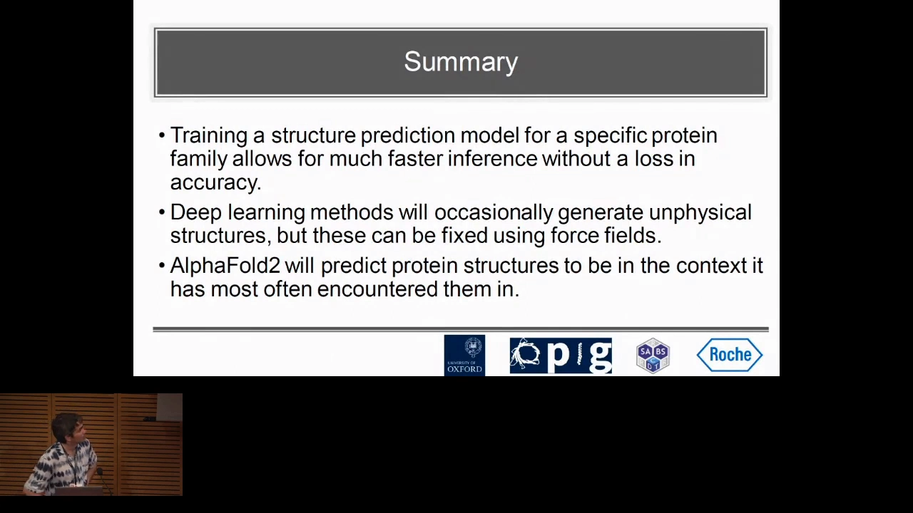

[【跳转到 10:55】](https://www.youtube.com/watch?v=-XPS3b_nQ2o&t=655) 报告的三点总结：

1. **为特定蛋白家族训练结构预测模型，是在不损失精度的前提下大幅提速的有效路径**——抗体、TCR、纳米抗体均验证成立；
2. 家族内聚焦后，进化信息（MSA）作用不大，**去掉它几乎不损失精度**；
3. 深度学习方法不懂物理，**偶尔生成非物理结构**——可用力场等后处理方法修正；此外 AF2 会把蛋白预测成它最常见到的上下文形态。

[【跳转到 12:45】](https://www.youtube.com/watch?v=-XPS3b_nQ2o&t=765) Q&A 补充了几个实用细节：

- **侧链是谁管的？** 问："侧链构象是靠事后的 MD 修的吗？"答："不是——模型自己就预测侧链构象（不只是主链）"；MD 精修要看区域而定，有些地方根本不需要修。
- **非物理结构多常见？** 答："看区域"——最难建模的环区出现得较频繁；框架区这类模型有信心的区域，输出通常是物理合理的。
- 有听众指出"不预测多个构象可能错过好构象"，讲者的回应很坦诚："这是蛋白结构预测的普遍局限——我们默认存在唯一结构可预测。"

## 小结

- 抗体结构预测的真痛点是**规模**：OAS 超 20 亿条序列 vs AlphaFold-Multimer 每条约半小时；
- 破局点在**家族特异性**：抗体主体保守，CDR 环多样性由 VDJ 重组与体细胞超突变驱动、无共进化信号——所以可以去掉 MSA/Evoformer；
- 路线是**端到端全原子**：只保留 AF2 结构模块，单家族数据重训，序列直出含侧链的全原子结构；
- 成绩：精度对齐 AlphaFold-Multimer（含 CDR-H3），**快约 100 倍**；纳米抗体 CDR-H3 上还略优；
- 代价与兜底：模型不学物理、偶发非物理结构 → OpenMM/MD 精修后处理；
- 两个普适启示：**家族特异训练是通用提速思路**（TCR/纳米抗体同样成立）；**AlphaFold 有隐式上下文**，预测前先问"这个蛋白通常在什么环境里出现"。

## 关键术语速查

| 术语 | 一句话解释 |
| --- | --- |
| CDR（互补决定区） | 抗体可变区顶端的 6 个环（H1-H3 / L1-L3），决定结合特异性；CDR-H3 最难预测也最重要 |
| VDJ 重组 / 体细胞超突变 | 抗体基因片段随机重组与高频突变，是 CDR 多样性的主要来源（区别于多数蛋白的进化驱动） |
| MSA | 多序列比对；AlphaFold 用它挖掘共进化信号，本工作证明抗体场景下可以不要 |
| Evoformer / 结构模块 | AF2 两大主干：Evoformer（48 块）融合 MSA 与配对表示，结构模块（8 块）负责出 3D 坐标 |
| OAS | Observed Antibody Space，抗体序列汇总库，单链序列已超 20 亿条 |
| 全原子（all-atom） | 输出不止主链，还包括侧链在内的全部原子坐标 |
| OpenMM / MD 精修 | 预测后用分子动力学修正非物理结构（原子碰撞、键长/肽键问题） |
| 隐式上下文 | 模型按训练数据中最常见的环境（如"有没有轻链"）来预测结构的倾向 |
| 同源建模 | 用同源模板序列"抄结构"；本工作用相似度-误差散点证明模型并非在抄模板 |

## 同条目配套视频

- 科普向总览：[ABodyBuilder2 - ImmuneBuilder： Deep Learning for Immune Protein Structure (T-cell, NanoBodies)](ABodyBuilder2 - ImmuneBuilder： Deep Learning for Immune Protein Structure %28T-cell, NanoBodies%29.md)
- 工具实操：[ABodyBuilder2 - Final Presentation](ABodyBuilder2 - Final Presentation.md)
