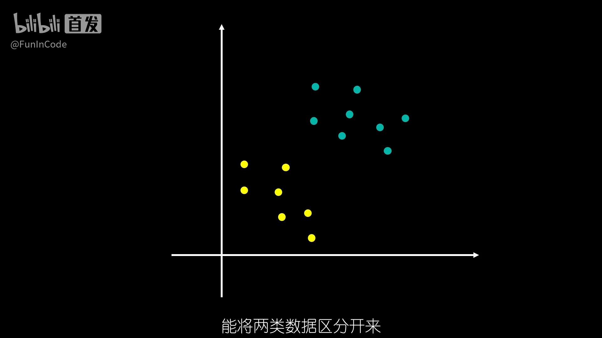
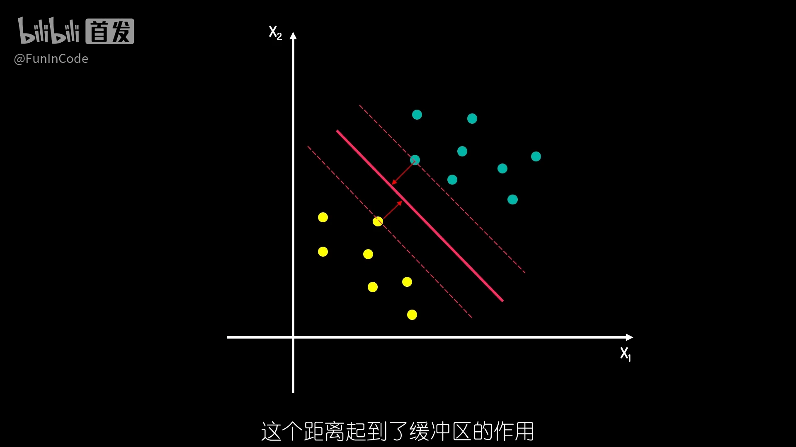
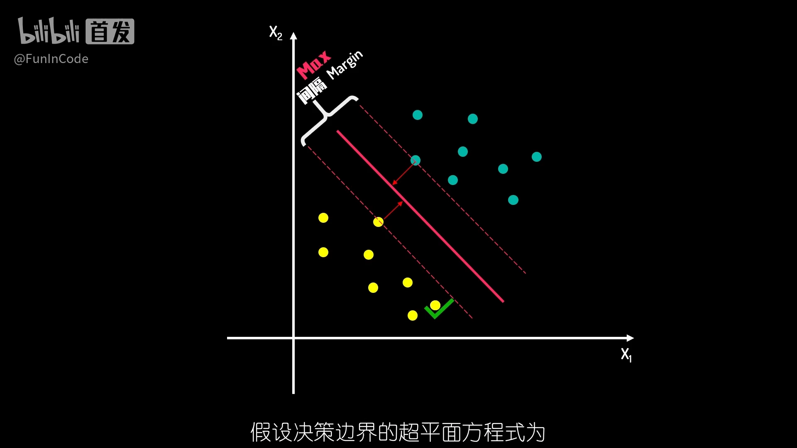
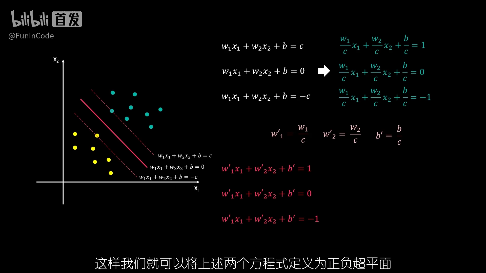
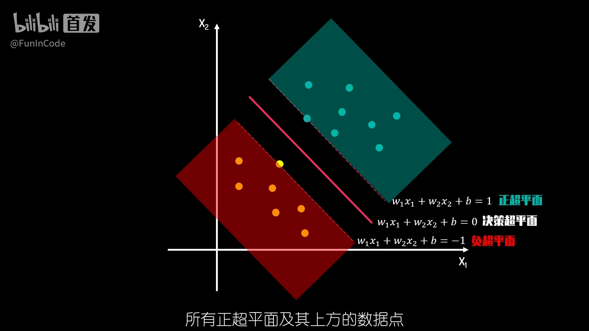
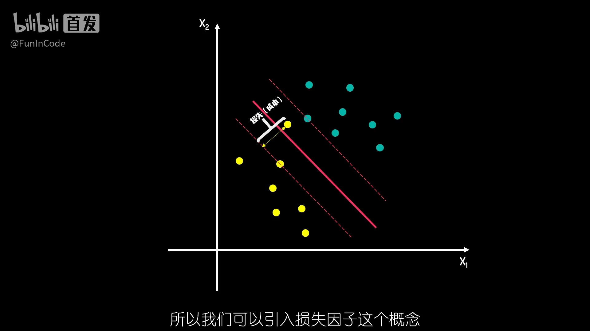
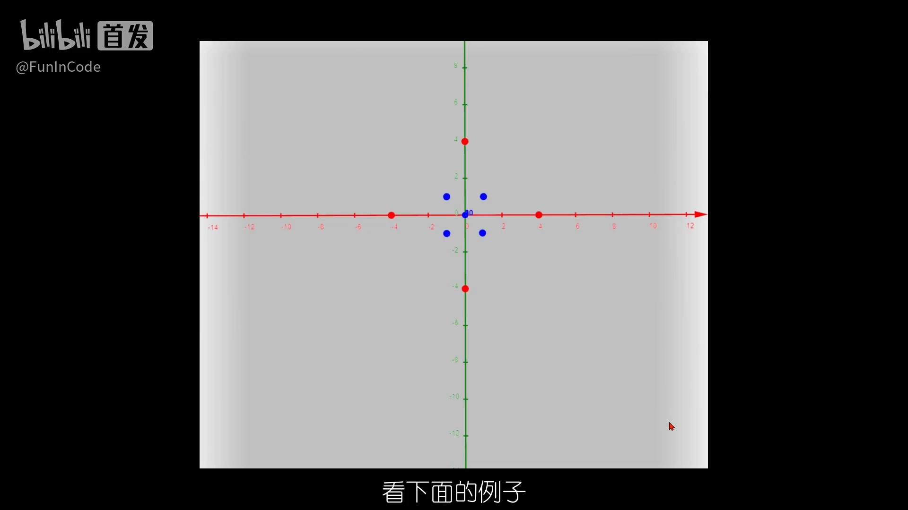
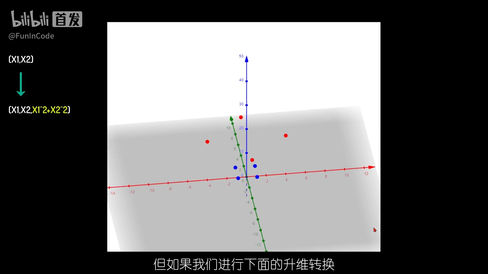
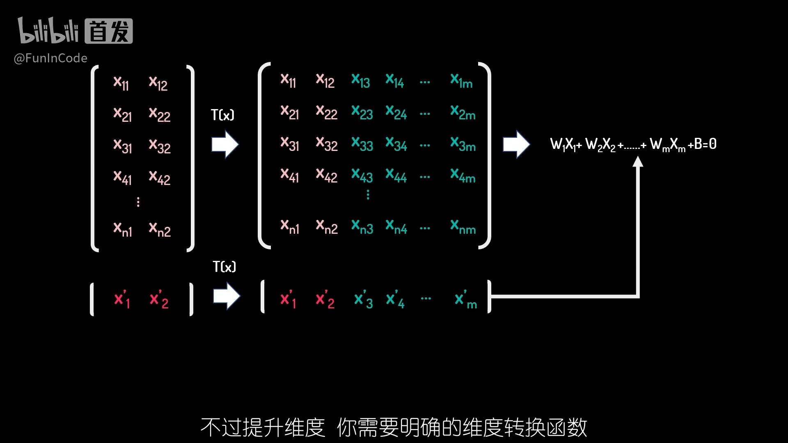
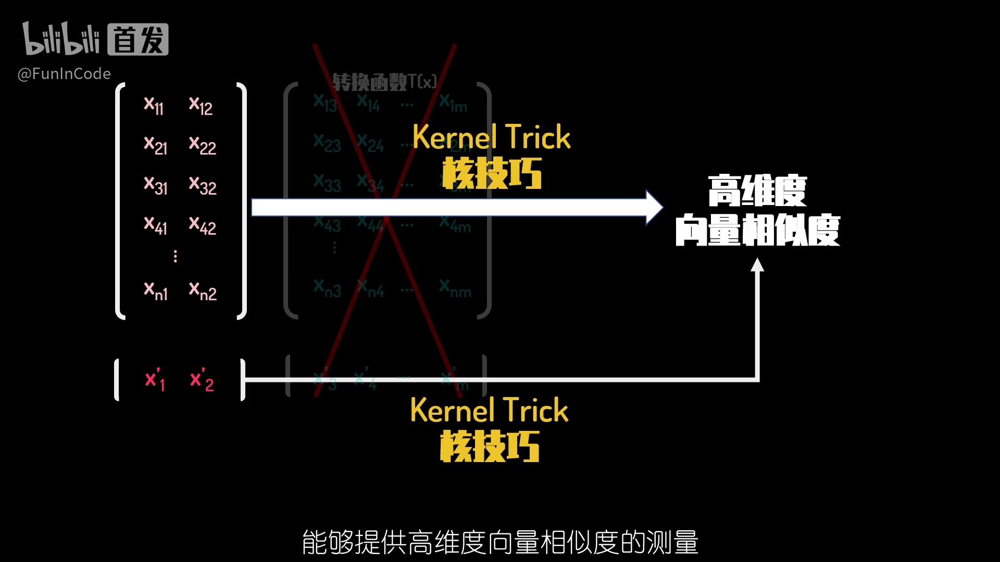

# 【数之道】支持向量机SVM是什么，八分钟直觉理解其本质

> 来源：Bilibili【数之道】《支持向量机SVM是什么，八分钟直觉理解其本质》（[BV16T4y1y7qj](https://www.bilibili.com/video/BV16T4y1y7qj/)，时长 8:27）。
> 本篇是「4.5.1 SVM / SVR 回归（ABDP pI/Tm）」条目的第一篇：SVM 的直觉是理解 SVR 回归（[姊妹篇](支持向量回归（SVR）.md)）的地基。

## 本讲要解决的核心问题（SCQA）

**背景**：机器学习里最直观的任务之一，是在散点图上画一条直线，把两类不同颜色的数据点分开。

**冲突**：能分开的线有无数条——贴着两类点画的线也能分开，但新数据一来就很容易判错。

**疑问**：哪条线才是"最好"的？如果数据复杂到怎么画直线都分不开，又该怎么办？

**回答（中心思想）**：支持向量机（SVM）的答案是"**间隔最大化**"——选让两类数据与分割线距离最大的那条线，而这条线只由离它最近的少数点（支持向量）决定；遇到线性不可分的数据，先做升维转换，再用核技巧在不显式升维的情况下拿到同样的分类效果。

## 一、画哪条线：从"能分开"到"分得稳"

### 1.1 问题设定：用超平面分开两类数据

在二维空间里存在一批数据点，不同颜色代表两个类别，我们要画一条直线把它们区分开，并且新数据来的时候也能判断它属于哪一类。这个问题可以不断推广：三维空间里用二维平面区分，四维空间里用三维超平面区分。归纳成一般形式：为了区分两类数据（N 为样本数，M 为维度数），要设计一个维度为 M−1 的超平面，其中的 W 可以理解为每个维度 X 对应的权重（[01:00](https://www.bilibili.com/video/BV16T4y1y7qj/?t=60)）。

### 1.2 贴着数据画的线是危险的

同样是"能分开"，画法却有好几种。第一种画法里，两类数据都有数据点与决策边界（Decision Boundary，即那条分割线）非常接近——这种画法很危险：当新数据同样接近这条直线时，分类错误的概率非常大（[01:25](https://www.bilibili.com/video/BV16T4y1y7qj/?t=85)）。

### 1.3 间隔：给分类留一个缓冲区

另一种画法让所有点都与决策边界保持一定距离，这个距离起到了**缓冲区**的作用：缓冲区足够大时，分类结果的可信度更高。这个缓冲区就叫**间隔（Margin）**（[01:50](https://www.bilibili.com/video/BV16T4y1y7qj/?t=110)）。间隔把两类数据所处的空间分隔开来，间隔距离可以体现两类数据的差异大小：**间隔越大，意味着两类数据差异越大，区分起来就越容易**（[02:15](https://www.bilibili.com/video/BV16T4y1y7qj/?t=135)）。

## 二、最大间隔与支持向量：SVM 的核心

### 2.1 寻找最佳边界 = 求解最大间隔

既然间隔越大越好，"寻找最佳决策边界"就转化为**求解两类数据的最大间隔问题**；间隔的正中就是决策边界。新数据来了，看它落在决策边界的哪一侧，就能分类（[02:40](https://www.bilibili.com/video/BV16T4y1y7qj/?t=160)）。

### 2.2 支持向量：最近的点决定一切

把决策边界的超平面方程上下各平移 C，就得到间隔的上下边界。上下边界一定会经过一些样本点，这些点距离决策边界最近、决定了间隔的距离——它们就是**支持向量（Support Vector）**。这也正是"支持向量机"这个名字的由来（[03:05](https://www.bilibili.com/video/BV16T4y1y7qj/?t=185)）。

### 2.3 三个超平面：正超平面、决策超平面、负超平面

把上下边界方程两边同除以 C，再用 W′、b′ 替换变量，方程右侧就化成了 +1。这样得到三个超平面方程式：**正超平面、决策超平面、负超平面**。正超平面及其上方的点属于正类，负超平面及其下方的点属于负类；W′、b′ 只是求解用的代号，换回 W、b 不影响计算（[03:30](https://www.bilibili.com/video/BV16T4y1y7qj/?t=210)、[03:55](https://www.bilibili.com/video/BV16T4y1y7qj/?t=235)）。

也就是说，分类只需要看新数据与决策超平面的**相对位置**。至于 W 和 b 具体怎么求解，视频系列安排了后续两期专门讲数学推导（[04:20](https://www.bilibili.com/video/BV16T4y1y7qj/?t=260)）。

## 三、软间隔：给异常点留出容错空间

### 3.1 一个异常点的两难

如果数据里出现了一个异常点，按之前的方法，间隔会被它压得很窄；忽略这个异常点，间隔距离则明显增加。那要不要为这一个异常点牺牲间隔？异常点更多呢？（[04:45](https://www.bilibili.com/video/BV16T4y1y7qj/?t=285)）

### 3.2 收入与成本：最大化"利润"

解决办法是引入**损失因子**：每个违背规则的异常点都对应一个损失值。把间隔距离想象成**经营收入**，损失值想象成**经营成本**，目标就变成同时考虑收入与成本、最大化"利润"。这个最优解下形成的间隔叫**软间隔（Soft Margin）**——它有一定的容错率，在间隔距离和错误大小之间找平衡；而之前严格不容出错的间隔叫**硬间隔（Hard Margin）**（[05:10](https://www.bilibili.com/video/BV16T4y1y7qj/?t=310)、[05:35](https://www.bilibili.com/video/BV16T4y1y7qj/?t=335)）。

## 四、升维转换：线性不可分就换一个空间

### 4.1 二维分不开的数据

有些数据在二维空间里显然无法用一条直线有效区分（[06:07](https://www.bilibili.com/video/BV16T4y1y7qj/?t=367)）。

### 4.2 加一个维度，超平面出场

但只要做一次升维转换、增加一个新维度，就能在三维空间里用一个超平面把数据区分开（[06:16](https://www.bilibili.com/video/BV16T4y1y7qj/?t=376)）。

### 4.3 标准两步法及其代价

对低维下不好分类的数据，标准做法是两步（[06:32](https://www.bilibili.com/video/BV16T4y1y7qj/?t=392)）：

1. 用合适的**维度转换函数**把低维数据升维；
2. 在高维下求解 SVM，找到分割超平面；新数据先做同样的升维转换，再按高维决策边界判断。

代价是：你需要**明确的维度转换函数**，还要承担更多的存储与计算需求（[06:57](https://www.bilibili.com/video/BV16T4y1y7qj/?t=417)）。

## 五、核技巧：不升维，也能拿到高维的效果

有没有办法既不把数据真的送进高维计算，又能获得同样的分类效果？这就需要**核技巧（Kernel Trick）**。SVM 的本质是量化两类数据的差异，而**核函数（Kernel Function）能提供高维度向量相似度的测量**：选好合适的核函数，就无需知晓具体的维度转换函数，直接拿到数据在高维下的差异度并据此分类（[06:57](https://www.bilibili.com/video/BV16T4y1y7qj/?t=417)、[07:22](https://www.bilibili.com/video/BV16T4y1y7qj/?t=442)）。

视频系列后续会用两期数学推导做基础、再专门展开核技巧，本集先点到为止（[07:22](https://www.bilibili.com/video/BV16T4y1y7qj/?t=442)）。

## 小结

- 能分开两条数据的线有无数条，**贴着数据画的线最危险**，安全的线要留出缓冲区。
- 缓冲区就是**间隔（Margin）**；间隔越大，两类数据差异越大，分类越可信。
- 于是"找最佳边界"变成**最大化间隔**，而间隔只由最近的少数点——**支持向量**——决定。
- 正/决策/负三个超平面方程把分类化成**看新数据落在决策超平面哪一侧**。
- 有异常点时用**软间隔**：间隔是收入、损失是成本，目标是最大化利润；严格无错则叫硬间隔。
- 线性不可分时先**升维转换**；其代价是转换函数与算力，而**核技巧**能不升维直接算出高维相似度。

## 关键术语速查

| 术语 | 一句话解释 |
| --- | --- |
| 决策边界（Decision Boundary） | 分开两类数据的分割线/超平面 |
| 间隔（Margin） | 决策边界到两类数据之间的缓冲区宽度 |
| 支持向量（Support Vector） | 距决策边界最近、决定间隔大小的样本点 |
| 硬间隔（Hard Margin） | 严格不允许分错的间隔 |
| 软间隔（Soft Margin） | 允许异常点付出损失值，换取更大间隔 |
| 升维转换 | 用维度转换函数把数据映射到更高维空间再分类 |
| 核技巧（Kernel Trick） | 用核函数直接计算高维相似度，避免显式升维的计算代价 |
