# 支持向量回归（SVR）

> 来源：Bilibili《支持向量回归（SVR）》（[BV1jWDVYaEs7](https://www.bilibili.com/video/BV1jWDVYaEs7/)，时长 25:33）。
> 本篇是「4.5.1 SVM / SVR 回归（ABDP pI/Tm）」条目的第二篇：ABDP 平台用 SVM/SVR 这类经典机器学习方法回归预测蛋白质的 pI（等电点）与 Tm（熔解温度），本视频系统讲清 SVR 的模型假设、不敏感损失、对偶求解、SMO 算法与核函数选择。SVM 分类直觉见[姊妹篇](【数之道】支持向量机SVM是什么，八分钟直觉理解其本质.md)。

## 本讲要解决的核心问题（SCQA）

**背景**：蛋白质的 pI、Tm 这类性质是连续数值，预测它们是**回归**任务；SVM 的"最大间隔"思想在分类任务中非常成功。

**冲突**：把分类那一套直接搬到回归上并不顺利——传统回归对**每一个点**的误差都敏感，一个离群点就可能把拟合线拉偏。

**疑问**：能不能让模型"容忍"小误差、只认真对待大偏差，同时保持模型足够简单？

**回答（中心思想）**：SVR 用 **ε 不敏感带**把带内误差清零，用**松弛变量 ξ** 与**惩罚系数 C** 平衡拟合与复杂度，经**拉格朗日对偶**转化为只依赖内积的问题——最终只有少数带外样本（支持向量）决定预测函数 f(x)，用 **SMO** 迭代求解，核函数按数据特点选择。

## 一、SVR 要解决什么问题

### 1.1 模型假设：拟合好、复杂度低

支持向量回归（SVR）是基于支持向量机方法的回归模型，目标是找到一个能很好拟合数据的函数，**同时保证模型复杂度尽可能低**（[00:05](https://www.bilibili.com/video/BV1jWDVYaEs7/?t=5)）。

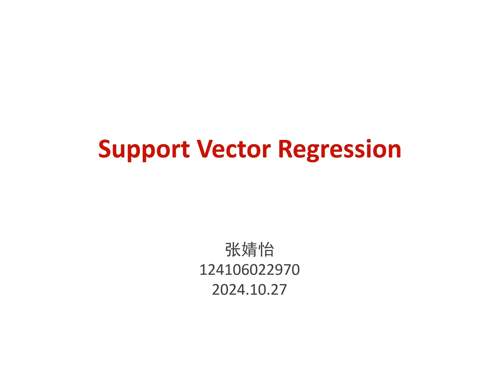

### 1.2 两个数据集：一个线性、一个三角函数

左边的数据集是典型的一次函数数据，用 y = kx + b（或 y = kx）就能简单描述；右边橙色的数据集则无法用 y = kx 描述，更像一个三角函数的模样（[00:23](https://www.bilibili.com/video/BV1jWDVYaEs7/?t=23)）。

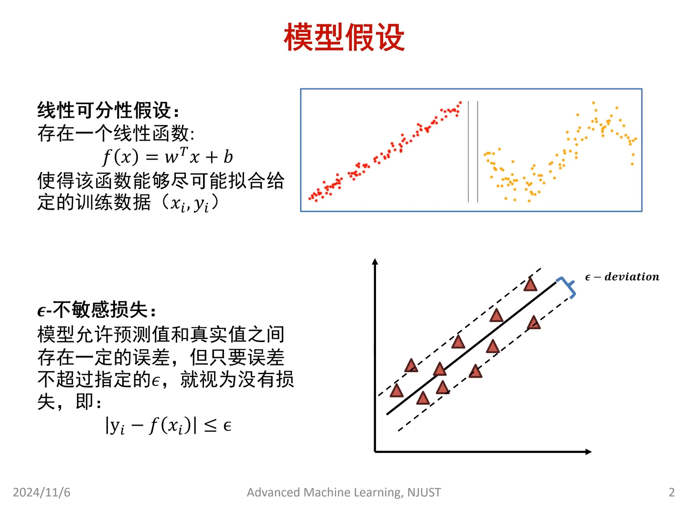

### 1.3 硬用线性模型会发生什么

如果硬用线性模型描述右边的数据，大量点会落在预测范围之外。所以模型假设先假设数据可用线性函数拟合，之后再借助**核函数**把 SVR 推广到非线性数据（[00:48](https://www.bilibili.com/video/BV1jWDVYaEs7/?t=48)、[01:13](https://www.bilibili.com/video/BV1jWDVYaEs7/?t=73)）。

### 1.4 不敏感损失：SVR 区别于传统回归的关键

**不敏感损失（ε-insensitive loss）是 SVR 模型区别于传统回归模型最重要的部分**（[01:13](https://www.bilibili.com/video/BV1jWDVYaEs7/?t=73)）。

## 二、不敏感损失：ε 带内的点不计损失

### 2.1 传统回归：所有点都影响损失

传统回归模型中，所有不在这条线上的点都会对损失造成影响：用欧氏距离的话，要计算每个点到拟合线的距离平方作为损失，拟合线根据这些损失调整（[01:38](https://www.bilibili.com/video/BV1jWDVYaEs7/?t=98)）。

### 2.2 ε 误差边界：带内不算错

SVR 则设置了一个**误差边界**——两条虚线之间的带。只要误差没有超过这个边界，就认为**没有产生任何损失**；只需要让尽可能多的点落进带内，模型就算预测得足够好（[02:03](https://www.bilibili.com/video/BV1jWDVYaEs7/?t=123)）。当然，还要保证模型足够简单——如果误差带宽得离谱，模型也没有意义（[02:28](https://www.bilibili.com/video/BV1jWDVYaEs7/?t=148)）。

### 2.3 软边界与松弛变量：把带外的点"移回来"

软边界与松弛变量的假设：只有偏离 ε-偏差（epsilon deviation）之外的部分（图中的三角形点）才会对拟合线产生误差。软间隔处理的是数据不完全线性可分（或不完全线性）的情况：给它一点多余的空间，不追求严格拟合；带内（虚线内侧）的样本点不作处理，对带外的每个样本添加一点**松弛变量**，把样本点"移回"虚线上（[02:53](https://www.bilibili.com/video/BV1jWDVYaEs7/?t=173)、[03:18](https://www.bilibili.com/video/BV1jWDVYaEs7/?t=198)）。

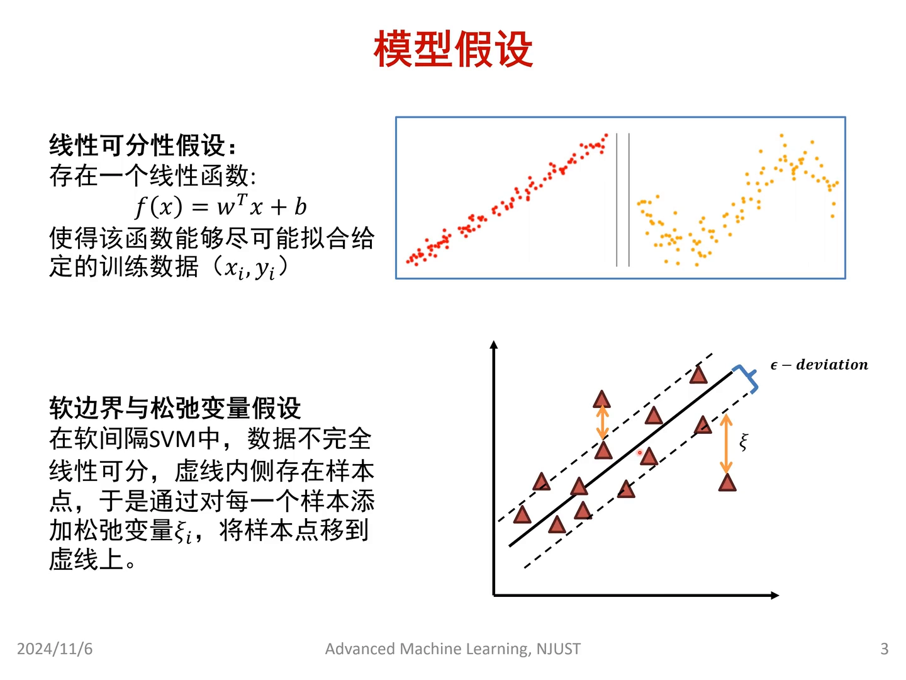

### 2.4 支持向量：移到边界上的点

把样本点移到虚线上，就意味着这个样本点被"成功处理"了。这也是"支持向量机回归"名字的由来：这些被移到边界上的点，成了**支撑整个模型最重要的部分**。更通俗地说：ε 带中间的点不会对损失造成任何影响、对模型没有帮助；只有带外的点，才真正支撑了模型的拟合（[03:43](https://www.bilibili.com/video/BV1jWDVYaEs7/?t=223)、[04:08](https://www.bilibili.com/video/BV1jWDVYaEs7/?t=248)）。

## 三、学习准则：目标函数与约束

### 3.1 目标函数：复杂度 + ε 带内

SVR 的目标是找到一个超平面，使大多数训练样本的预测值落在 ε 范围内，同时模型复杂度尽可能低。目标公式中：**W 是权重向量**，表示模型如何把输入特征映射到输出；**权重的大小决定模型对输入特征的敏感度**（[04:38](https://www.bilibili.com/video/BV1jWDVYaEs7/?t=278)）。

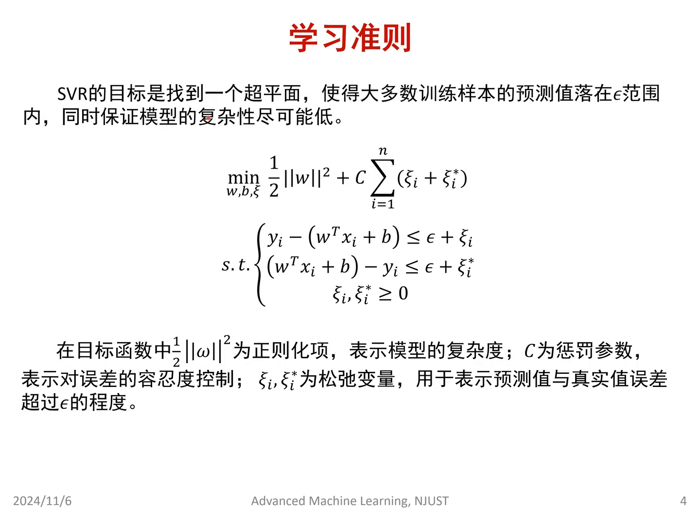

### 3.2 W 的大小为什么重要

若 W 很小（如 0.1），数据从 1 变到 10，输出只从 0.1 变到 1——对特征变化不敏感；若 W 非常大，模型对输入反应剧烈，很可能对噪声**过拟合**。让 W 的平方较小（即 W 较小）意味着对噪声不敏感，预测曲线更平滑、不易过拟合、**泛化能力更好**——这正是最小化 ½‖W‖² 项的意义（[05:03](https://www.bilibili.com/video/BV1jWDVYaEs7/?t=303)、[05:28](https://www.bilibili.com/video/BV1jWDVYaEs7/?t=328)）。

### 3.3 惩罚系数 C 与松弛变量 ξ

公式后半部分对应"让大多数样本落在带内"。**C 是惩罚系数：越大，模型对误差的容忍度越低**。ξᵢ 和 ξᵢ* 就是前面说的松弛变量，表示预测值与真实值误差**超过 ε 的程度**（[05:53](https://www.bilibili.com/video/BV1jWDVYaEs7/?t=353)）。

### 3.4 约束条件

限制条件有两条：样本点要落在带内——两端是绝对值关系，点必须落在 ε + ξ 范围内（ξ 就是把带外的点"移回来"的变量）；且两个 ξ 都必须 ≥ 0（[06:18](https://www.bilibili.com/video/BV1jWDVYaEs7/?t=378)、[06:43](https://www.bilibili.com/video/BV1jWDVYaEs7/?t=403)）。

## 四、拉格朗日与对偶问题

### 4.1 引入拉格朗日乘子

带多个约束的优化问题比较难解，为有效处理约束，引入**拉格朗日乘子**构造**拉格朗日函数**，把有约束问题转化成无约束问题。原始目标函数配三个限制条件：两个"点必须落在 ε 带宽之间"，一个"乘子非负"（[07:08](https://www.bilibili.com/video/BV1jWDVYaEs7/?t=428)）。

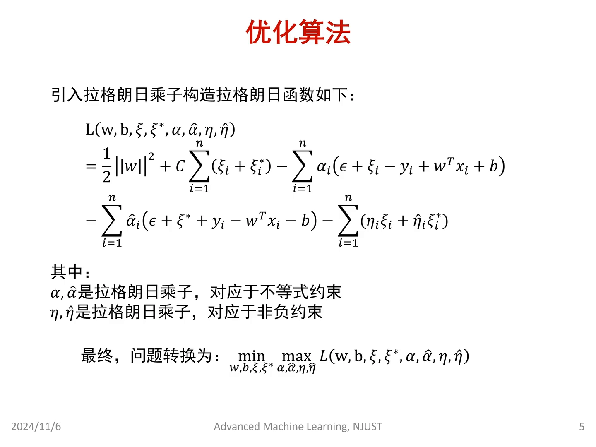

### 4.2 min-max 与鞍点

转化后的问题是**最小最大化（min-max）**：最小化是对原始变量 W、b——取到某组值时整个函数最小，即原问题的目标最低点；最大化是对拉格朗日乘子——它确保优化过程不偏离原始约束。整体是一个**寻找鞍点**的过程（[07:33](https://www.bilibili.com/video/BV1jWDVYaEs7/?t=453)、[07:58](https://www.bilibili.com/video/BV1jWDVYaEs7/?t=478)）。

### 4.3 对偶问题：只需要内积

把"先最小、再最大"翻转成"先最大、再最小"，就得到**对偶问题**。好处：最后计算时直接用**样本间的内积**表示即可，不需要显式求出 W 和 b 的具体值；内积只依赖样本数量、与特征维度无关，可大大降低计算复杂度（[08:23](https://www.bilibili.com/video/BV1jWDVYaEs7/?t=503)）。

## 五、求解：偏导、消元与最终模型

### 5.1 对每个变量求偏导

先求对偶问题内部的最小值部分：对每一项求偏导——含 W 的项是 ½‖W‖²，求导得 W；再令导数等于零（导数为零处是极值点）。同样地对 b 求偏导、对 ξᵢ 与 ξᵢ* 求偏导，得到**四个式子**（[08:48](https://www.bilibili.com/video/BV1jWDVYaEs7/?t=528)、[09:13](https://www.bilibili.com/video/BV1jWDVYaEs7/?t=553)、[09:38](https://www.bilibili.com/video/BV1jWDVYaEs7/?t=578)）。

### 5.2 化简出 W 的解

四个式子化简后得到：W = Σ(α̂ᵢ − αᵢ)xᵢ（α̂ᵢ、αᵢ 为两个方向的拉格朗日乘子）；Σ(αᵢ − α̂ᵢ) = 0；以及含常数项的约束 C − αᵢ − ηᵢ = 0（[10:03](https://www.bilibili.com/video/BV1jWDVYaEs7/?t=603)）。

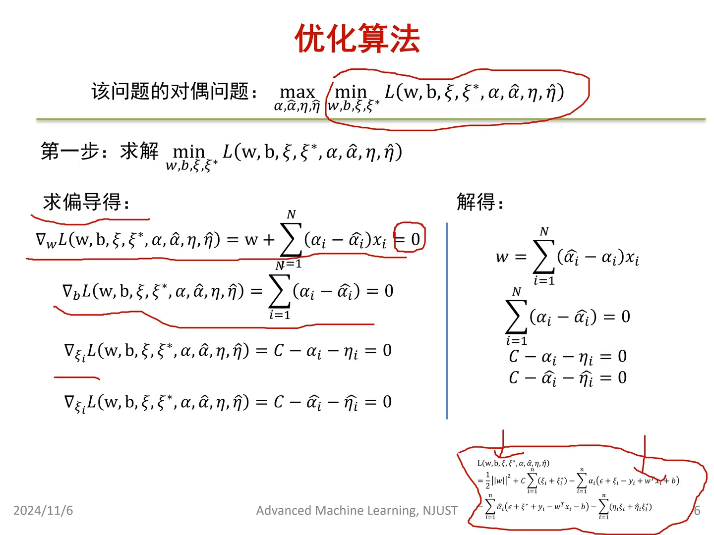

### 5.3 代回原方程、消去 η

把 W、b、ξ、ξ* 的解代回原方程并保留所有限制条件后，公式中只剩 α、α* 与 xᵢxⱼ 的**内积**——内积只跟数据相关，不需要再求导求解。接着做两件事：其一，消去 ηᵢ 与 ηᵢ*——η 本是保证松弛变量 ≥ 0 的乘子，可以转成隐含条件"αᵢ 限制在 0 到 C 的范围内"，最后只剩对 α、α* 求最小；其二，把"求最大"翻成"求最小"——原式含负号，对负值求最大等价于对正值求最小，只是为了方便求解（[10:28](https://www.bilibili.com/video/BV1jWDVYaEs7/?t=628)、[10:53](https://www.bilibili.com/video/BV1jWDVYaEs7/?t=653)、[11:18](https://www.bilibili.com/video/BV1jWDVYaEs7/?t=678)、[11:43](https://www.bilibili.com/video/BV1jWDVYaEs7/?t=703)）。

### 5.4 写出最终模型

假设已求出 α 和 α* 的最优解（记作 α*、α̂*），代回原式就得到 **W\* 与 b\***。有了 W 和 b，线性模型 f(x) 就写出来了；在对偶形式中 f(x) 只依赖输入样本与训练样本的内积（[12:08](https://www.bilibili.com/video/BV1jWDVYaEs7/?t=728)、[12:33](https://www.bilibili.com/video/BV1jWDVYaEs7/?t=753)）。

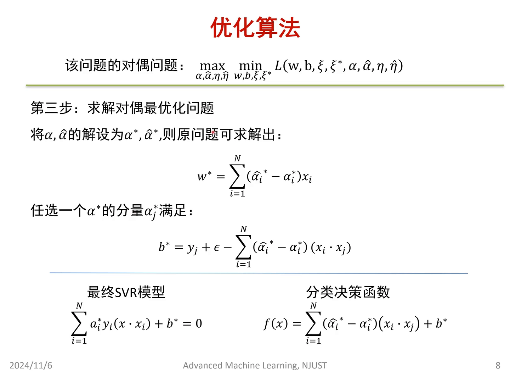

## 六、稀疏性：支持向量再次登场

### 6.1 乘子为零的项不影响 W

W 的解是求和式：有多少个数据就加多少项。如果某个样本的 α̂ᵢ* − αᵢ* = 0，这一项对结果没有任何影响——相当于往 W 上加了一个零。只有 α̂ᵢ* − αᵢ* ≠ 0 的项才会得到一个数乘以 xᵢ、真正影响 W（[13:23](https://www.bilibili.com/video/BV1jWDVYaEs7/?t=803)、[13:48](https://www.bilibili.com/video/BV1jWDVYaEs7/?t=828)）。

### 6.2 少数点支撑整个模型

这是一个**非常稀疏的模型**：大多数样本点的拉格朗日乘子为零，只有少数几个数据点（比如 x₁ 或 x₁₀）的乘子非零——只有这几个向量真正决定了 W，可以说它们就是 **W 的支持向量**。这也是"支持向量回归"这个名字的由来（[14:13](https://www.bilibili.com/video/BV1jWDVYaEs7/?t=853)、[14:38](https://www.bilibili.com/video/BV1jWDVYaEs7/?t=878)）。

## 七、SMO：序列最小优化

### 7.1 剩下的问题：怎么求出 α* 和 α̂*

前面的一切都建立在"已经知道 α 和 α* 的解"之上；实际求解中，最优乘子由数据集决定，不能直接推导得到，需要专门算法——**SMO（Sequential Minimal Optimization，序列最小优化）算法**（[14:38](https://www.bilibili.com/video/BV1jWDVYaEs7/?t=878)、[15:03](https://www.bilibili.com/video/BV1jWDVYaEs7/?t=903)）。

### 7.2 SMO 的步骤

1. **初始化**：随机初始化拉格朗日乘子 α 和 α*；设置精度参数与最大迭代次数（保证算法能停下来）；计算初始偏置 b；
2. **循环选两个变量并优化**（[15:26](https://www.bilibili.com/video/BV1jWDVYaEs7/?t=926)）。

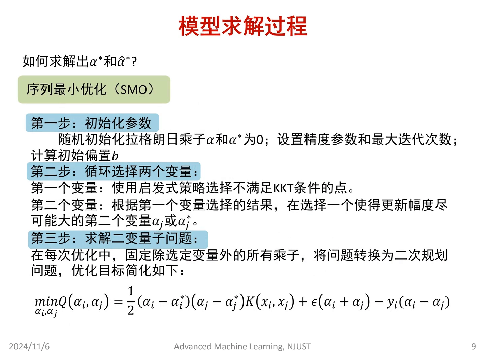

### 7.3 变量选择：一个违反 KKT，一个离它最远

第一个变量用启发式策略选**不满足 KKT 条件的点**。KKT 条件本质上是确保解在约束边界上的最优性——尤其看解是否满足互补松弛条件、每个不等式约束能否"起作用"；选它就是选一个"不属于最优"的点。第二个变量选**使更新幅度尽可能大**的变量——即离第一个变量最远的点，这样一次优化的效果最大（[15:51](https://www.bilibili.com/video/BV1jWDVYaEs7/?t=951)、[16:16](https://www.bilibili.com/video/BV1jWDVYaEs7/?t=976)）。

### 7.4 固定其余变量 → 二次规划 + 核函数

选定两个变量后，**固定其余所有乘子**，把问题转化成一个**二次规划**子问题。式中出现 K(xᵢ, xⱼ)——**核函数**：核心作用是通过内积运算实现**隐式的特征映射**，让模型在低维空间中找到非线性的边界，也就是用核函数处理非线性问题（[16:41](https://www.bilibili.com/video/BV1jWDVYaEs7/?t=1001)、[17:06](https://www.bilibili.com/video/BV1jWDVYaEs7/?t=1026)）。

### 7.5 迭代：算出步长再更新

迭代就是逐步朝最优解靠拢：每步要算出走多远（步长）与往哪走。先定义预测值与真实值的误差，并计算 αᵢ 的更新量 **η**（[17:40](https://www.bilibili.com/video/BV1jWDVYaEs7/?t=1060)）。

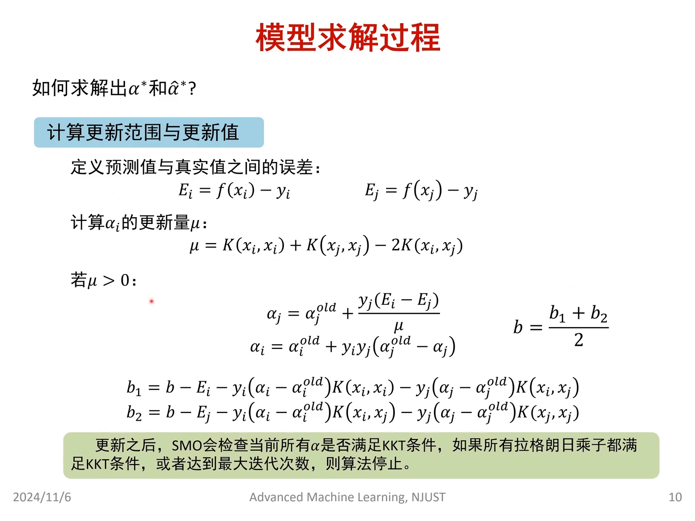

### 7.6 η 背后是样本相似度

η 的定义含核函数，体现的是**样本之间的相似度**：xᵢ 和 xⱼ 非常接近时，K(xᵢ,xⱼ) 无限趋近于前两项相加。取极端情况 xᵢ = xⱼ：K(xᵢ,xᵢ) + K(xⱼ,xⱼ) − 2K(xᵢ,xⱼ) = 0。所以两个样本非常像时 η 趋近于零；**η = 0 意味着没有可以更新的方向，步长失去意义**（[18:05](https://www.bilibili.com/video/BV1jWDVYaEs7/?t=1085)、[18:30](https://www.bilibili.com/video/BV1jWDVYaEs7/?t=1110)）。

### 7.7 更新与终止

η > 0 时有非零步长，可对 αᵢ、αⱼ 做有效更新（更新式里：步长项 + 原来的 αⱼ → 新的 αⱼ）；随后不断更新 α 与 b（最后 b 取 (b₁+b₂)/2）。每轮更新后检查 α 是否满足 KKT 条件——每次只优化两个 α，所以每次都要检查全部 α；只要还有不满足的，下一轮就先挑它。**所有乘子都满足 KKT 条件（或达到最大迭代次数）时，算法停止**，得到最终的 α* 与 α̂*（[18:55](https://www.bilibili.com/video/BV1jWDVYaEs7/?t=1135)、[19:20](https://www.bilibili.com/video/BV1jWDVYaEs7/?t=1160)、[19:45](https://www.bilibili.com/video/BV1jWDVYaEs7/?t=1185)、[20:10](https://www.bilibili.com/video/BV1jWDVYaEs7/?t=1210)）。

## 八、核函数怎么选

### 8.1 三种常用核

- **线性核**：数据本身可线性拟合/线性可分时使用，就是最朴素的内积形式；
- **高斯核**：能捕捉很复杂的非线性关系；**不确定非线性关系长什么样时，用它最合适，也是运用最广泛的核**；
- **多项式核**：适合先验知识已知函数形式的情况（如二次、三次函数），但比起高斯核表达能力有限，只在特定场景好用（[20:25](https://www.bilibili.com/video/BV1jWDVYaEs7/?t=1225)）。

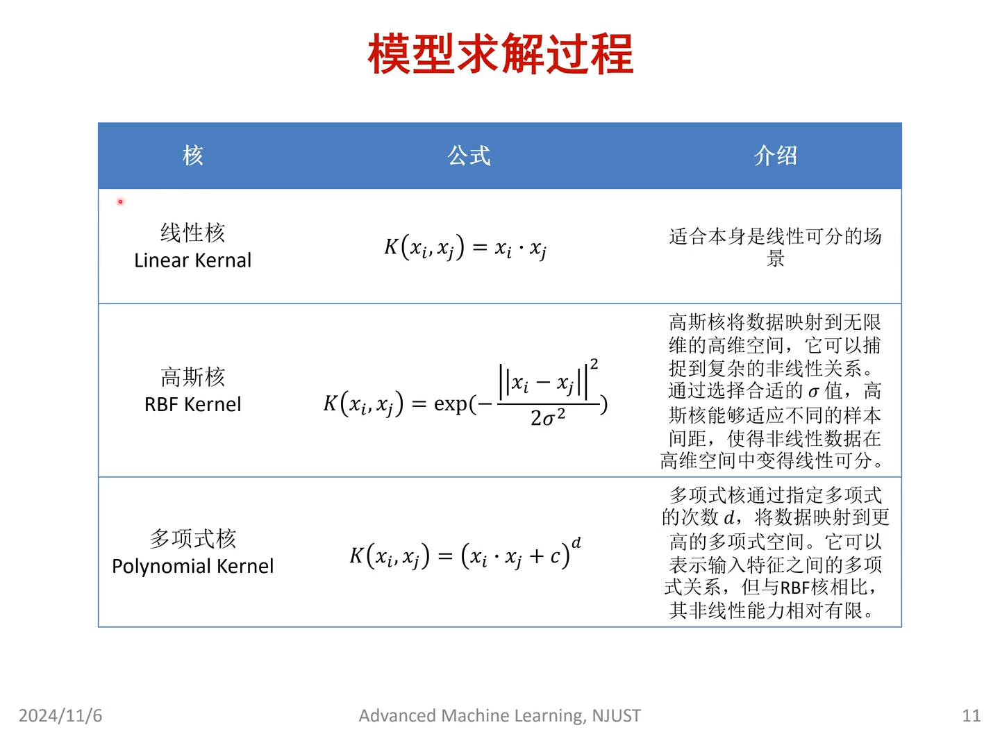

### 8.2 正弦实验：高斯核全程能打

用正弦函数加噪声生成随机数据，截取不同长度的片段测试：不管数据段较短还是较长、较复杂，**高斯核都能完成非常好的拟合**；线性核只有在数据有明显线性趋势时暂时可用，稍微复杂就完全失效（[21:28](https://www.bilibili.com/video/BV1jWDVYaEs7/?t=1288)、[21:53](https://www.bilibili.com/video/BV1jWDVYaEs7/?t=1313)）。

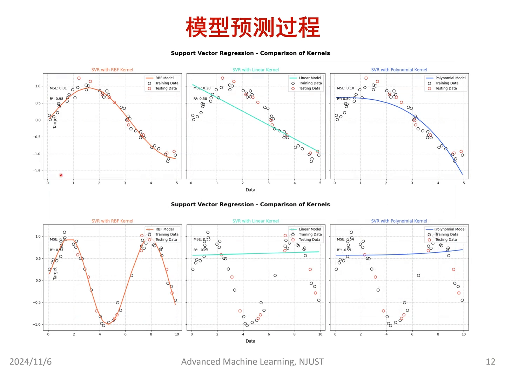

### 8.3 多项式核的边界

多项式核在数据"看起来满足多项式"的片段上表现尚可，但把坐标轴拉长、覆盖更长一段非线性后，它就**失去表达能力**了。所以多数情况下预测还是用高斯核（[21:53](https://www.bilibili.com/video/BV1jWDVYaEs7/?t=1313)、[22:18](https://www.bilibili.com/video/BV1jWDVYaEs7/?t=1338)）。

## 九、SVM vs SVR：一张图看懂

### 9.1 SVM：让最近的点离得最远

一篇论文的配图把两者关系画得很清楚。左图是经典 SVM：让超平面**离它最近的样本点**（图中那几个边界点）距离最大——因为若换一条也能分开两类的线，某些点会紧贴边界，这不是 SVM 想要的（[22:43](https://www.bilibili.com/video/BV1jWDVYaEs7/?t=1363)、[23:08](https://www.bilibili.com/video/BV1jWDVYaEs7/?t=1388)）。

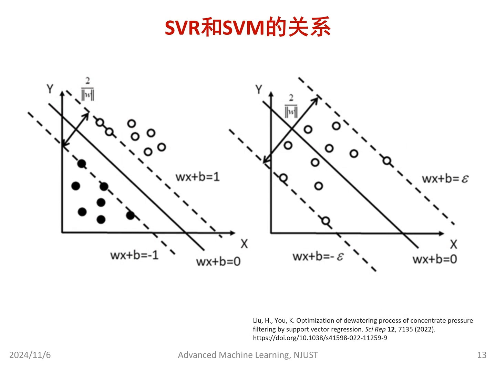

### 9.2 SVR：让最远的点离得最近

SVR 正好"反着来"：希望**尽可能多的点落进 ε 带中间**——换句话说，**离超平面最远的样本点，距离要最小**；最远点的距离最小，意味着 ε 足够小（[23:33](https://www.bilibili.com/video/BV1jWDVYaEs7/?t=1413)、[23:58](https://www.bilibili.com/video/BV1jWDVYaEs7/?t=1438)）。

### 9.3 完全相反，却同出一门

SVM 的间隔宽度希望**越大越好**；SVR 对应的 ε 希望**越小越好**——听起来完全相反。但两者都与支持向量机同源：SVM 的决策线只由**离它最近的边界点**支持，SVR 的拟合线只由**离它最远的带外点**支持——本质上都是由少数几个点完成的模型，只是任务不同、构造的目标函数略有区别（[24:23](https://www.bilibili.com/video/BV1jWDVYaEs7/?t=1463)、[24:48](https://www.bilibili.com/video/BV1jWDVYaEs7/?t=1488)、[25:13](https://www.bilibili.com/video/BV1jWDVYaEs7/?t=1513)）。

## 小结

- SVR 把 SVM 思想搬到回归：**ε 带内不计损失**，带内样本对模型毫无贡献，只有带外点参与建模。
- 目标函数 = 复杂度项（½‖W‖²，W 越小越平滑、越不易过拟合）+ 偏差项（C 惩罚带外误差，C 越大容错越低）。
- 拉格朗日对偶把约束问题化成只依赖**内积**的形式——为核函数（隐式特征映射）铺路。
- 解是稀疏的：乘子为零的样本不影响 W，**少数支持向量决定 f(x)**。
- 乘子用 **SMO** 求解：每次选一个违反 KKT 的点和一个离它最远的点，固定其余变量做二次规划，直到全部满足 KKT。
- 核函数选择：不确定就用**高斯核**；数据可分或形式已知才用线性核/多项式核。
- SVM 最大化"最近点"的距离，SVR 最小化"最远点"的距离——一图之差，同出一门。

## 关键术语速查

| 术语 | 一句话解释 |
| --- | --- |
| ε 不敏感带 | 预测误差落在带内不计损失的"容差管道"，宽度为 2ε |
| 松弛变量 ξᵢ、ξᵢ* | 带外样本超出 ε 的程度，相当于把点"移回"带边的代价 |
| 惩罚系数 C | 对带外误差的惩罚力度；越大越不容忍误差、越容易过拟合 |
| 拉格朗日乘子 α、α* | 对偶问题中每个样本的系数；为 0 的样本不影响模型 |
| 对偶问题 | 把"先最小再最大"翻转后的等价问题，只需计算样本内积 |
| KKT 条件 | 最优解在约束下必须满足的条件；SMO 用它选点与判停 |
| SMO | 序列最小优化：每次固定其余乘子、只优化两个变量的迭代算法 |
| 步长 η | K(xᵢ,xᵢ)+K(xⱼ,xⱼ)−2K(xᵢ,xⱼ)，反映样本相似度；为 0 时无法更新 |
| 高斯核 | 最常用的核函数，能拟合复杂非线性关系；不确定时的默认选择 |
