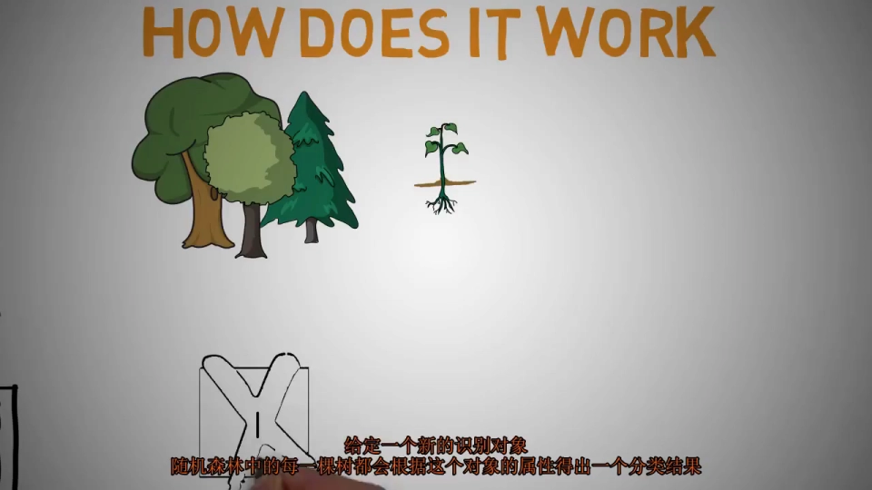
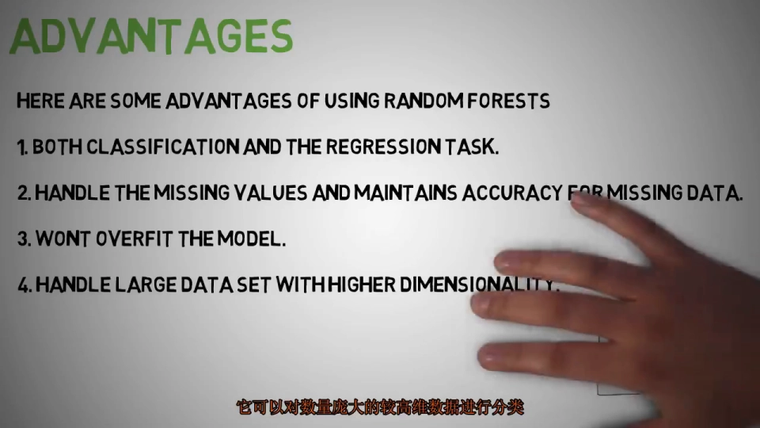
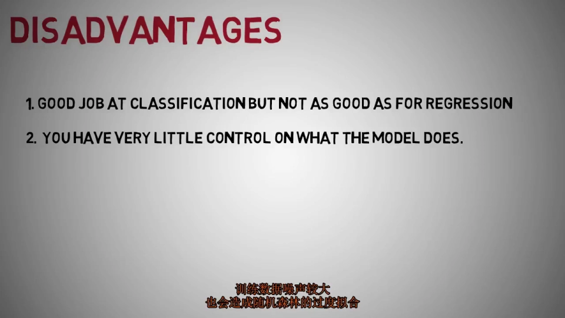
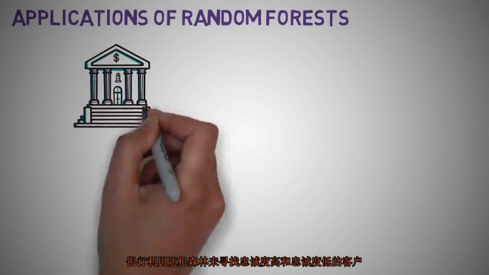
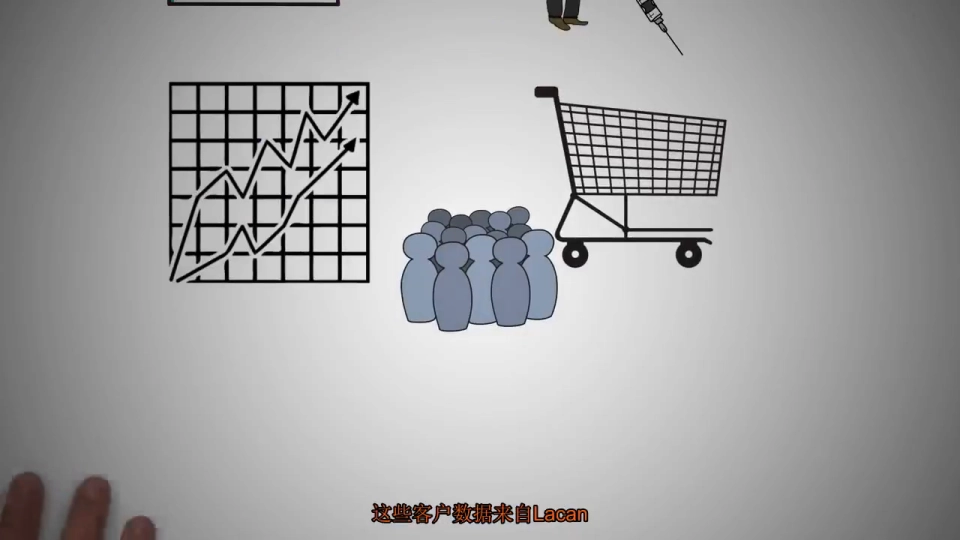
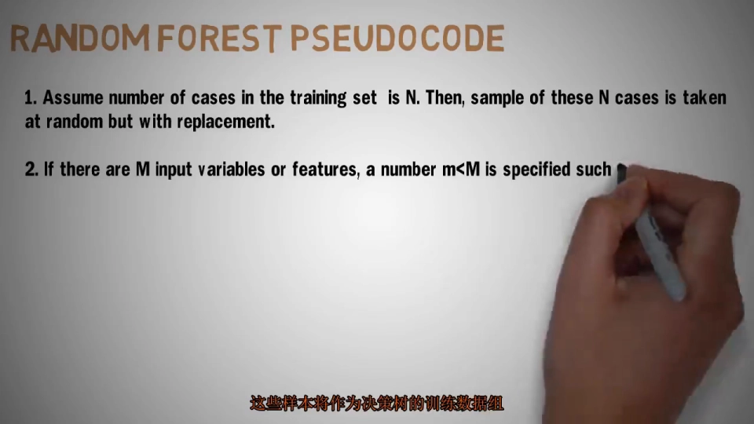
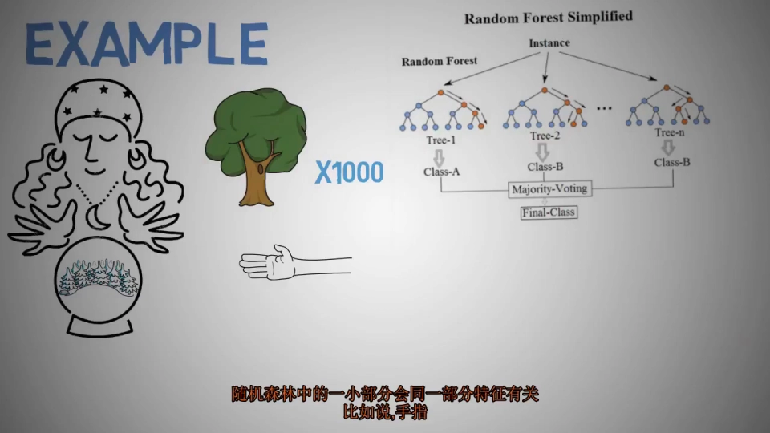
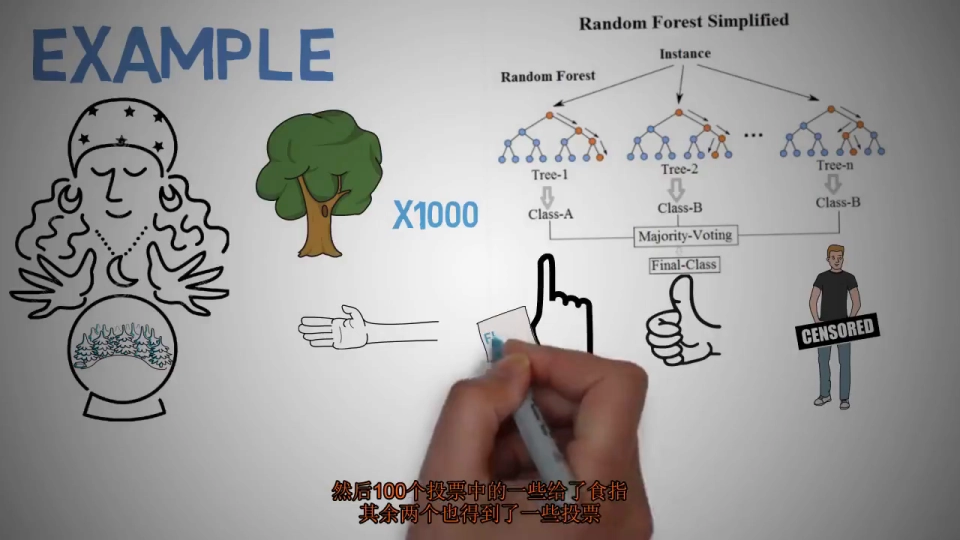
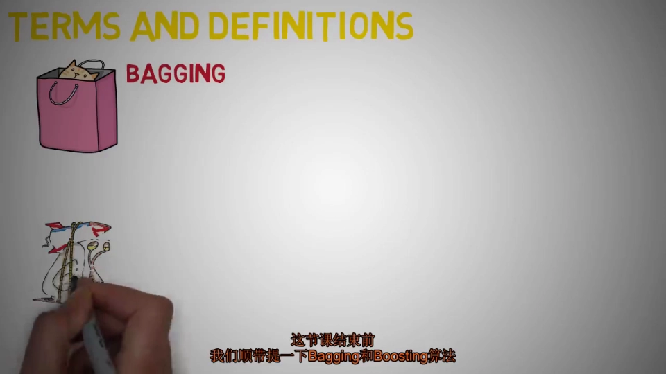
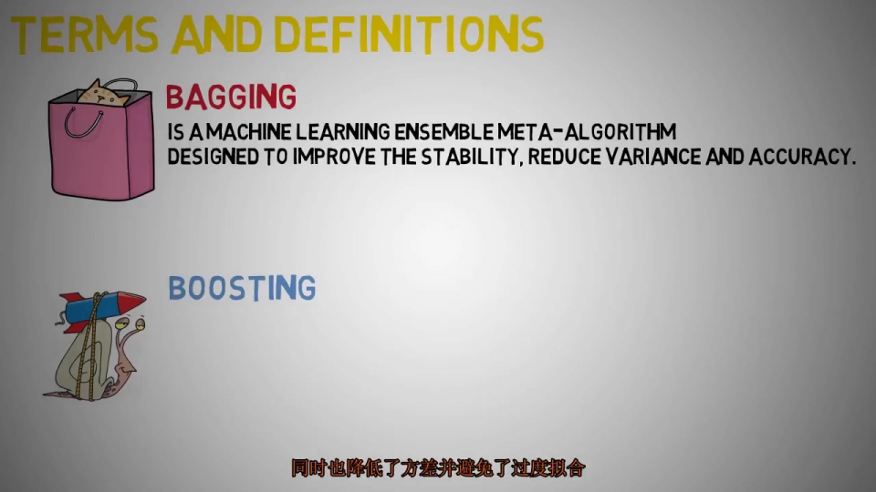

# [中字]简单易懂的随机森林算法原理分析

> 视频来源：[[中字]简单易懂的随机森林算法原理分析（BV1FW411c762）](https://www.bilibili.com/video/BV1FW411c762/)，本文依据该视频的中文字幕与画面逐窗口整理，内容可回看核查。
> 对应知识体系条目：4.5.2 随机森林（ABDP Binding、p2ank 的方法底座）。

## 本讲要解决的核心问题（SCQA）

**背景**：随机森林是最流行、最强大的有监督机器学习算法之一，既能做分类任务，也能做回归任务。

**冲突**：名字好记，但"一片森林里的树是怎么协作的、什么场景适合用、什么时候会翻车"，多数初学者并不清楚。

**疑问**：随机森林内部如何工作？它的优点、缺点和典型应用分别是什么？

**回答（中心思想）**：随机森林用"许多棵随机生长的决策树"做集成——分类投票取多数、回归取平均；它的长处是高维数据与缺失值下的稳健，短处是回归精度与"黑箱"属性。

## 一、随机森林：用决策树种出一片森林

顾名思义，这个算法用**许多决策树**创建出一片森林——森林里的树越多，预测就越稳健。构建每棵树用的都是与决策树相同的方法（信息增益或基尼指数划分）。

它与 **CART 模型**只构建一棵树相反：我们会构建多棵树，根据属性对新对象进行分类。每棵树都给出一个分类结果，**得票最多的类别**就是森林的输出；在回归情形下，则取不同树输出的**平均值**。

[【跳转到 00:57】](https://www.bilibili.com/video/BV1FW411c762/?t=57)

## 二、优点与缺点

### 2.1 优点

- **能处理缺失值并保持准确性**：即使很大一部分数据缺失也能应对；
- **抗过拟合**：当森林里有更多的树时，随机森林不容易过拟合；
- **高维大数据**：它有能力处理高维度的大型数据集——这正是 p2rank 一类"以大量分子特征做预测"的场景看重它的原因。

[【跳转到 01:47】](https://www.bilibili.com/video/BV1FW411c762/?t=107)

### 2.2 缺点

- **回归不精确**：它给不出精确的连续性预测，在回归任务上不如分类表现好；
- **不会外推**：回归时不会预测超出训练数据范围的值；
- **噪声敏感**：遇到特别嘈杂的数据集，它也可能过拟合；
- **黑箱**：对统计建模人员来说，随机森林像黑箱方法——你对模型内部几乎没有控制，最多只能尝试不同的参数和随机种子。

[【跳转到 02:17】](https://www.bilibili.com/video/BV1FW411c762/?t=137)

## 三、随机森林都用在哪儿

- **银行业**：区分忠实客户与欺诈客户；
- **医学**：识别正确的成分组合来验证药物，也有助于识别疾病（如分析病人的病历）；
- **股票市场**：识别群体行为以及预期的损失或利润；
- **电子商务**：用于推荐引擎的一部分，基于"相似客户"识别顾客喜欢被推荐产品的可能性；
- **计算机视觉**：图像分类——微软为 Xbox Kinect 用随机森林做人体部位识别；其他应用还包括唇读和语音分类。

[【跳转到 02:47】](https://www.bilibili.com/video/BV1FW411c762/?t=167)

## 四、伪代码：每棵树怎么种出来

视频给出了随机森林的伪代码，每棵树的构建和生长分六步：

1. 假设训练集中有 **N 个案例**；
2. 从这 N 个案例中**随机抽取样本**，抽样是**有放回的**（with replacement），抽出的样本作为这棵树的训练集；
3. 如果有 **M 个输入变量（特征）**，指定一个小于 M 的数 **m**；
4. 每个节点分裂时，从 M 个变量中**随机选出 m 个**，用这 m 个变量的**最优拆分**来分裂节点（m 在每个节点保持不变）；
5. 每棵树**尽可能生长，不做剪枝**；
6. **聚合**各棵树的预测：分类用**多数票**，回归用**平均数**。

[【跳转到 04:01】](https://www.bilibili.com/video/BV1FW411c762/?t=241)

## 五、一个例子：一千棵树识别一只手

假设我们构建了 **1000 棵随机决策树**组成随机森林，任务是检测一张图像是否包含一只手：

- 每棵树会为相同的测试特征预测出不同的结果或类别——因为森林中的每棵树各查看一组**随机选择的特征**；
- 假设 100 棵树共预测出三个不同的目标类别（比如手指、拇指或其他部位），就从这一百棵树的判断中统计每个类别获得的票数；
- 如果"手指"得到最高票数，整个随机森林就返回"手指"。这种投票概念被称为**多数投票**，就像选举一样。

[【跳转到 05:16】](https://www.bilibili.com/video/BV1FW411c762/?t=316)

## 六、为什么有效：集成学习

这就是随机森林被称为**集成（ensemble）机器学习**的原因：集成是一种用于提高性能的"分而治之"方法。它背后的主要原理是——

> **一群弱学习者（weak learner）可以聚集在一起，形成一个强学习者。**

每棵树都是一个弱学习者，许多弱学习者加在一起就是一个强学习者。集成方法**减少了方差，提高了性能**。

[【跳转到 06:00】](https://www.bilibili.com/video/BV1FW411c762/?t=360)

## 七、两个绕不开的术语：Bagging 与 Boosting

- **Bagging（装袋法）**：一种机器学习集成**元算法**，旨在提高算法的稳定性和准确性，可用于统计分类和回归；它还能**减少方差**，并有助于**避免过拟合**——随机森林就属于这一族；
- **Boosting（增强）**：也是一种集成算法，但主要用于**减少偏差**；它是把弱学习者转化为强学习者的一系列监督学习算法。

[【跳转到 06:26】](https://www.bilibili.com/video/BV1FW411c762/?t=386)

## 小结

- 随机森林 = 许多棵随机生长的决策树；分类投票取多数，回归取平均；
- 优点：处理缺失值、适应高维大数据、不易过拟合（树足够多时）；
- 缺点：回归不精确、不外推、噪声数据下可能过拟合、模型偏"黑箱"；
- 每棵树的种植口诀：有放回抽样 → 每节点从 M 个特征随机选 m 个 → 最优分裂 → 不剪枝 → 聚合；
- 集成的原理：弱学习者聚成强学习者，减少方差；
- Bagging 减方差（随机森林属此类），Boosting 减偏差。

## 关键术语速查

| 术语 | 一句话解释 |
| --- | --- |
| 随机森林 | 多棵随机生长的决策树的集成模型 |
| CART | 只建一棵树的经典决策树算法，RF 与之相反建多棵 |
| 有放回抽样（with replacement） | 每棵树的训练集抽样方式（bootstrap） |
| m / M | 每个节点随机选用的特征数 / 总特征数 |
| 多数投票 | 分类任务的聚合方式，得票最多的类别胜出 |
| 集成（ensemble） | "分而治之"式的组合方法，弱学习器合为强学习器 |
| 弱学习者 / 强学习者 | 单棵表现平平的树 / 组合后表现强劲的模型 |
| Bagging（装袋法） | 减方差、防过拟合的集成元算法（RF 所属） |
| Boosting（增强） | 减偏差、把弱学习者转化为强学习者的集成算法 |
