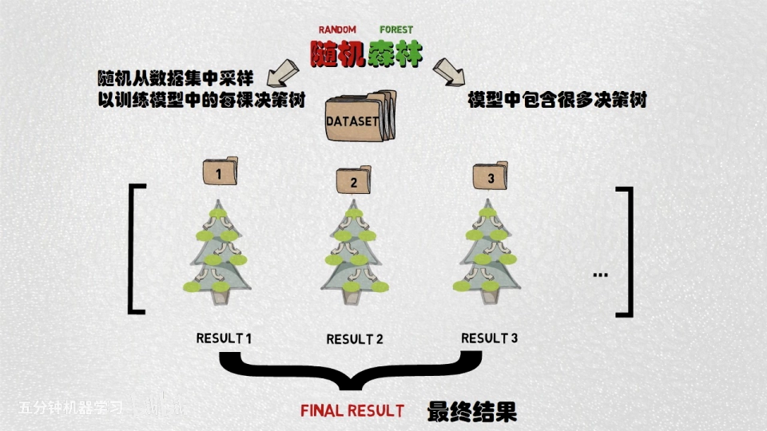
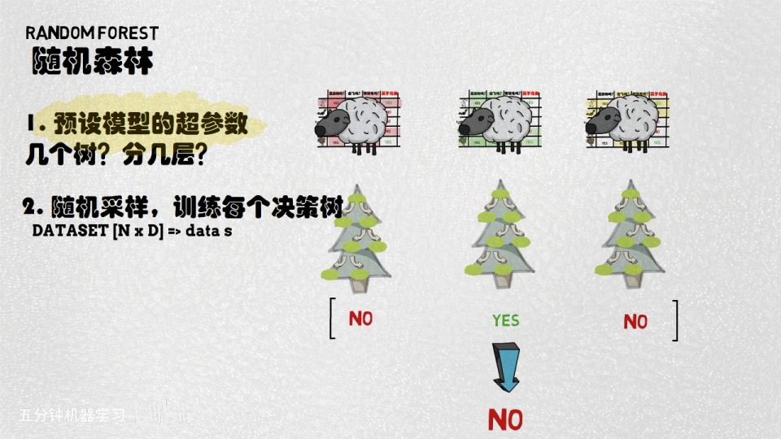
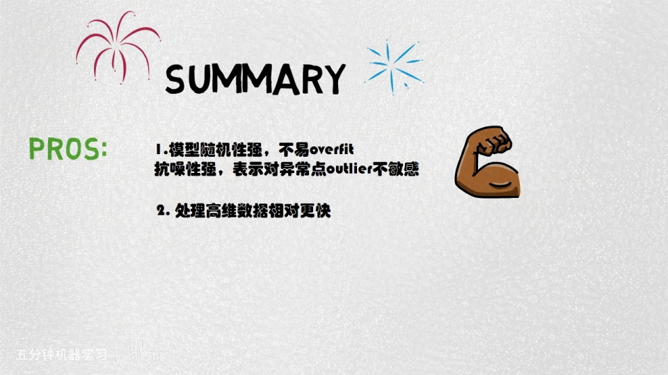
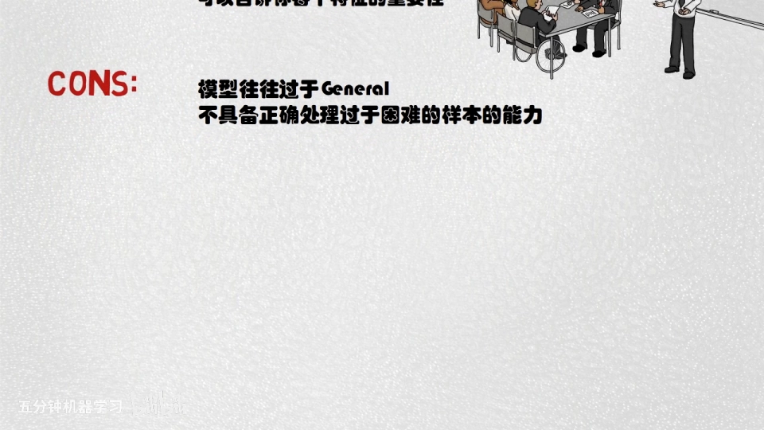
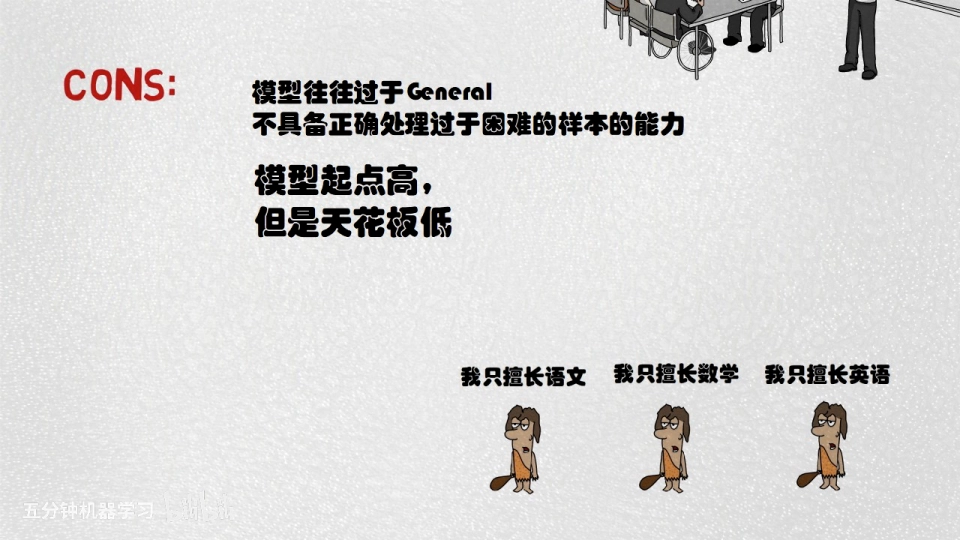

# 【五分钟机器学习】随机森林：看我以弱搏强

> 视频来源：[【五分钟机器学习】随机森林（RandomForest）：看我以弱搏强（BV1H5411e73F）](https://www.bilibili.com/video/BV1H5411e73F/)，本文依据该视频的 AI 字幕与画面逐窗口整理，内容可回看核查。
> 对应知识体系条目：4.5.2 随机森林（ABDP Binding、p2ank 的方法底座）。

## 本讲要解决的核心问题（SCQA）

**背景**：上一期讲的 SVM 支持向量机，是"学霸中的战斗机"——单个模型自己就很强。

**冲突**：但现实里很多时候，我们手里只有一堆各有所长的"偏科"弱模型：每个都在某个方向表现好，合在一起却谁也不服谁。

**疑问**：一群"以弱搏强"的模型，真能打赢一个学霸级的强模型吗？

**回答（中心思想）**：能。随机森林用"随机采样 + 多树整合"把一群弱学习器合而为一——这就是集成学习（ensemble learning）里 bagging 路线的代表算法。

## 一、三个臭皮匠的故事

俗话说，三个臭皮匠赛过诸葛亮。视频用一个考试故事开场：班里测验语数外三门，学霸每门都能考 95 分以上；普通同学 A、B、C 却各自"偏科"——A 语文 100 分但另外两门不及格，B 数学 100 分，C 英语 100 分。三人决定合力应付考试：A 做语文卷子、B 做数学卷子、C 做英语卷子，最后每门都是 100 分，打败了学霸。

[【跳转到 00:05】](https://www.bilibili.com/video/BV1H5411e73F/?t=5)

这就是**集成学习**的直觉：整个模型内部由多个弱模型（weak learner）组成，每个 weak learner 只在某个方向上表现比较好；把这些算法合而为一，就得到一个稳定而且各方面都表现较好的模型。

## 二、拆名字：森林 + 随机

随机森林（Random Forest）是集成学习中典型的 **bagging 类型**算法。理解它可以从名字入手：

- **森林**：整个模型包含很多棵决策树，可以把这个包含很多决策树的模型看成一个森林；
- **随机**：森林中的每棵决策树都**随机采样数据集中的一小部分**进行训练——也就是"看问题的角度不一样"，从而保证每个决策树的输出相似、但不一样，最后把它们整合在一起作为一个输出。

[【跳转到 01:17】](https://www.bilibili.com/video/BV1H5411e73F/?t=77)

## 三、图解训练过程：三棵树、三种采样

视频用一个小数据集演示：数据包含 **5 个样本**，每个样本由 **3 个特征**描述；假设森林里有 **3 棵树**：

- 训练第一棵决策树时，随机从数据集中采样**红色**部分作为训练集；
- 训练第二棵树，随机采样**绿色**部分；
- 训练第三棵树，随机采样**黄色**部分。

每棵树训练完后，把待测样本分别送进三棵树做决策。由于每棵树见到的样本不一样（看问题的角度不一样），得到的结论可能不同；再把不同的结论综合起来，就是随机森林的最终输出。

[【跳转到 01:48】](https://www.bilibili.com/video/BV1H5411e73F/?t=108)

完整的训练过程是三步：

1. **设计超参数**：比如森林里有多少棵树、每棵树最多几层深度；
2. **为每棵树随机采样**：从完整数据集（N 个样本、F 个特征）中随机采样出小 n 个样本、小 d 个特征，保证每棵树看问题的角度都不一样；
3. **整合结果**：regression（回归）问题通常取所有输出的**均值**；classification（分类）问题通常取**众数（mode）**，即所有输出中最多的那个类别。

[【跳转到 02:13】](https://www.bilibili.com/video/BV1H5411e73F/?t=133)

## 四、优点：为什么"以弱搏强"能赢

得益于随机采样，模型的随机性很强：

- **难过拟合**：最后的整合包含不同"看问题角度"的结果，模型很难 overfit（过拟合）；
- **对异常点不敏感**：对噪音点或异常值（outlier）也不那么敏感；
- **高维数据训练快**：每次采样只取原数据集的一小部分，对高维数据，训练速度比传统决策树快很多；
- **可解释度高**：随机森林是树状结构，它可以告诉你数据集中**哪些特征更重要**（特征重要性）——这是它很重要的一个优点。

[【跳转到 03:08】](https://www.bilibili.com/video/BV1H5411e73F/?t=188)

## 五、缺点：起点高，天花板低

但这个算法的随机采样 + 整合训练过程，会让模型**忽略难以处理的样本点**，也就是模型往往过于泛化（general）：

- 组成森林的每棵决策树都**不是强分类器**；
- 训练过程中模型不关注那些难以处理的样本——比如分类问题中难以区分类别的样本；
- 这导致有很大概率，每棵树都无法对这类样本给出正确分类，整合的结果自然也很一般。

简单来说：**模型的起点高，但天花板很低**。打个比方——三个学渣绑在一起可能有所进步，但特别困难的问题，他们还是做不对。

[【跳转到 04:08】](https://www.bilibili.com/video/BV1H5411e73F/?t=248)

## 六、下期预告：Boosting

对于"难样本做不对"的问题，接下来视频会介绍另一种集成学习算法——**Boosting**：让模型在训练过程中**更加关注那些难以做对的问题**，从而使整体性能提高。

[【跳转到 04:18】](https://www.bilibili.com/video/BV1H5411e73F/?t=258)

## 小结

- 随机森林 = 集成学习中 bagging 路线的代表：多棵弱决策树合而为一；
- "随机"的关键：每棵树随机采样数据集的一小部分（小 n 个样本、小 d 个特征），看问题的角度各不相同；
- 整合方式：分类取众数（mode），回归取均值；
- 优点：难过拟合、对异常点不敏感、高维数据训练快、可解释（特征重要性）；
- 缺点：忽略难样本、过于泛化——起点高但天花板低；
- 难样本问题的解药是 Boosting：训练时更加关注做错的问题。

## 关键术语速查

| 术语 | 一句话解释 |
| --- | --- |
| 集成学习（ensemble learning） | 多个弱模型合而为一，得到稳定且表现较好的模型 |
| 随机森林 | bagging 类集成算法：很多棵决策树的"森林" |
| 弱学习器（weak learner） | 只在某个方向表现较好的单棵树/单模型 |
| 随机采样 | 每棵树只训练数据集的一小部分（小 n 样本、小 d 特征） |
| 众数 / 均值 | 分类整合取 mode / 回归整合取平均 |
| 特征重要性 | 树状结构带来的可解释性：哪些特征更重要 |
| 过拟合（overfit） | 模型死记训练数据、泛化差；RF 因随机性较难发生 |
| Boosting | 下期主角：训练中更关注难样本的集成算法 |
