# 集成算法：决策树和随机森林的原理介绍

> 视频来源：[集成算法：决策树和随机森林的原理介绍（BV1wR9eYkEZj）](https://www.bilibili.com/video/BV1wR9eYkEZj/)，本文依据该视频的 AI 字幕与画面逐窗口整理，内容可回看核查。
> 对应知识体系条目：4.5.2 随机森林（ABDP Binding、p2ank 的方法底座）。

## 本讲要解决的核心问题（SCQA）

**背景**：在生物信息的模型工具箱里，有一批任务不走深度学习，而是用"经典机器学习"扛大旗——比如抗体-抗原结合预测（ABDP 的 Binding 任务）与配体结合位点预测（p2rank 一类工具），它们的底座都是**随机森林**（Random Forest）。

**冲突**：很多人会调 `sklearn` 里的一行 `RandomForestClassifier()`，却说不清"森林里每棵树怎么长出来、为什么集成起来更准"；树都理解不了，调参就只能碰运气。

**疑问**：决策树到底是怎么一步步"问问题"做预测的？随机森林凭什么比单棵决策树更准、更稳？

**回答（中心思想）**：先理解决策树——用不纯度选特征、层层提问、叶子节点给出类别；再看随机森林——多棵树 + 有放回采样 + 投票/平均。这就是从"一棵树"到"一片森林"的完整原理。

## 一、决策树：像条件概率一样层层提问

### 1.1 决策树长什么样

决策树是一种具有决策功能的树状图，是机器学习中最基础的算法之一。它的形式很像初中数学里学的条件概率：计算条件概率时，我们根据某个条件进行分支，再根据另一个条件继续分支，最后形成一棵树状图——两者长得非常像，但原理并不相同。

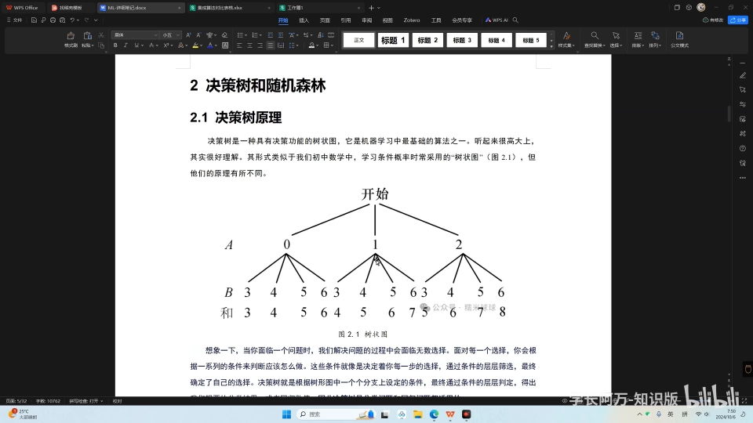

换一个更生活的视角：解决问题的过程，其实就是面临无数选择的过程。每面对一个选择，你都会根据一系列条件来判断该怎么做——就像走到分岔口时，会根据很多条件评估该走 A 路还是 B 路。这些条件决定了你每一步的选择；条件的层层筛选，最终确定你要走的那条路。决策树就是这个原理：预测时通过不同的条件不断往下分支，越往下越接近最终的决策。

[【跳转到 00:55】](https://www.bilibili.com/video/BV1wR9eYkEZj/?t=55)

### 1.2 它解决两类问题：分类与回归

无论分类还是回归，决策树都适用：

- **分类问题**：预测数据所属的**类别**。预测"明天是否下雨"只有下雨/不下雨两种类别，是二分类；预测"下雨、大雨、小雨、中雨、晴天、多云"多种情况之一，就是多分类——类别数大于两种即为多分类问题。
- **回归问题**：预测一个**连续数值**。比如预测明天的温度，它可能是 25~35 度之间的任何值（不限制小数位时有无数种可能），像在一条温度线上取任意位置；预测房价同理——价格是连续数值，而不是某种分类。

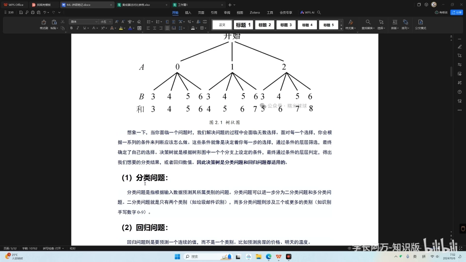

[【跳转到 02:10】](https://www.bilibili.com/video/BV1wR9eYkEZj/?t=130)

## 二、用红酒数据集走一遍

### 2.1 特征值与标签值

光说不练不容易懂，视频用了**红酒数据集**来通俗演示：根据红酒的各项化学成分含量，预测它属于三种红酒中的哪一种。

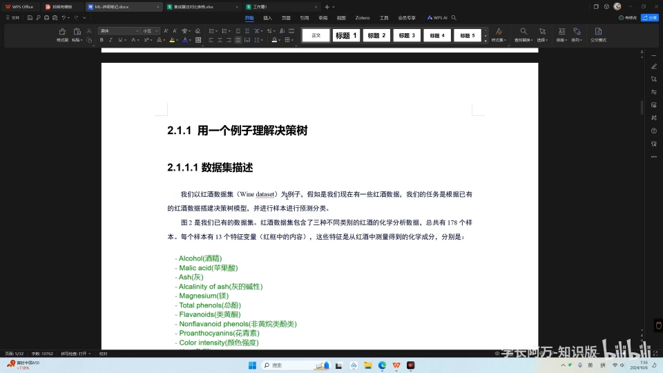

数据集一般分为两部分：

- **特征值**（输入）：这里的 13 个特征大部分是化学成分的含量，比如酒精、苹果酸、灰分的碱性、镁等；
- **标签值**（要预测的值）：三种红酒类别，分别用 0、1、2 表示，对应琴酒、雪梨、贝尔摩德。

数据集一共有 177 组样本，横着的每一行是一组样本，包含特征值和标签值。模型拿到的信息就是：每一组样本的类别是什么（比如类别 0 = 琴酒），以及它这 13 个特征各自的含量。

[【跳转到 04:40】](https://www.bilibili.com/video/BV1wR9eYkEZj/?t=280)

### 2.2 一棵真实长出来的树

决策树的任务：从这些数据里训练出一个规律；之后拿到一杯**未知分类的液体**时，只需测量这 13 个特征的含量，交给模型，就能预测它所属的类别。

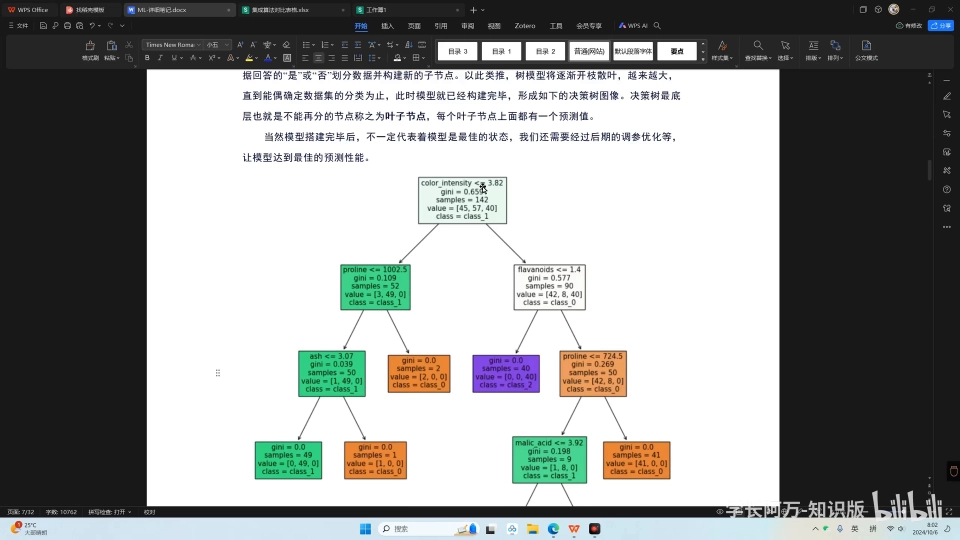

看这棵最终生成的树：

- 最上面一行（**根节点**）选择了 `color intensity`（颜色强度）作为最初的划分条件，提问"是否小于 3.82"：小于的进入一支，不小于的进入另一支——一开始全部 177 个样本一起评估；
- 在左侧分支里又选择 `proline`（脯氨酸），提问"是否小于 1002.5"，继续划分；
- 以此类推，每一次分支都会选择一个特征。

[【跳转到 08:37】](https://www.bilibili.com/video/BV1wR9eYkEZj/?t=517)

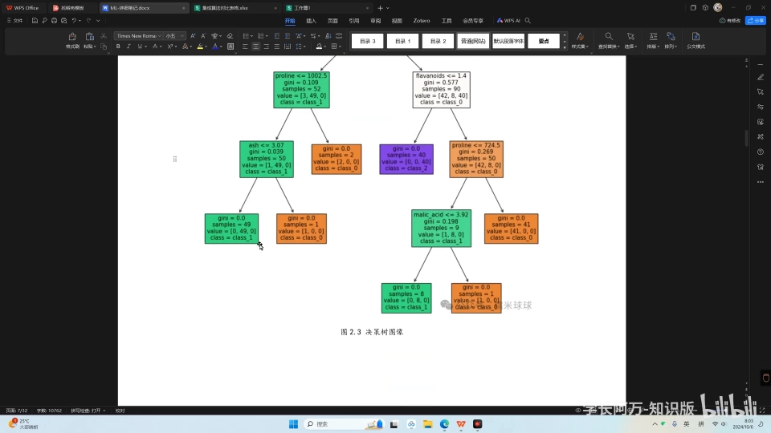

当节点**分无可分**时，就被称为**叶子节点**。叶子节点的最后一行会显示 `class=0`、`class=1` 或 `class=2`：分到某个叶子节点上的所有样本，预测类别就是它标注的类别，对照 0/1/2 就能还原出对应的红酒类型。

总结决策树的工作流程：最开始选取一个特征作为根节点，对它提问并分支；对划分出的子节点数据集，再根据某个特征提问、再分支；最底层不能再分的节点就是叶子节点，而**叶子节点一定带有对应的分类标签**。

[【跳转到 10:14】](https://www.bilibili.com/video/BV1wR9eYkEZj/?t=614)

## 三、决策树怎么选特征：不纯度

### 3.1 不纯度越低越好

看到这里你可能会问：明明有 13 个特征，凭什么第一次分支就选 `color intensity`？为什么不选灰分、不选酒精？选特征的标准是什么？

答案是**不纯度**（impurity）：决策树在寻找最佳分支特征时，用不纯度来衡量，一般**不纯度越低越好**。不纯度越低 = 纯度越高：

- 最开始所有样本混在一起，非常杂乱，"熵"是最高的；
- 每分一次，划分出的数据就变得稍微纯净一点；
- 继续分下去，越往下样本集越纯，最后纯到把不同的类别都分清。

就像最开始是"一锅粥"，越分越清。所以"不纯度越低越好"的直观含义就是：**尽量让每一次分支分出来的两份样本都越纯越好**。

[【跳转到 13:07】](https://www.bilibili.com/video/BV1wR9eYkEZj/?t=787)

### 3.2 基尼系数与信息熵

感性理解之外，还有专门的数学公式来计算不纯度：

- **基尼系数**（Gini）：衡量数据集不纯度的指标，纯度越高值越小。模型会一次性计算所有特征分类后的基尼系数，**谁的值小，就选谁**先分支；
- **信息熵**（entropy）：计算**父节点与子节点的信息熵之差**（即信息增益）。选定一个特征后，把其余特征都各算一遍信息熵并与父节点相减，**差值最大说明信息增益最大**，差值最大的特征就被选作分支特征。

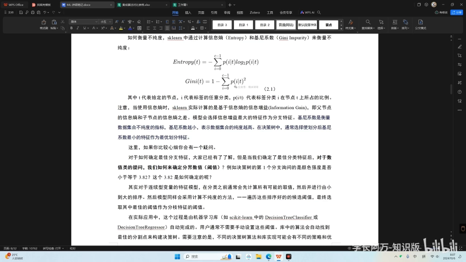

[【跳转到 15:14】](https://www.bilibili.com/video/BV1wR9eYkEZj/?t=914)

### 3.3 阈值 3.82 又是怎么来的？

还有一个疑问："是否小于 **3.82**"——这个 3.82 为什么不是 3.5、3.6 或 5？

它同样由评估指标确定：当特征是连续型变量时，划分之前会枚举所有可能的取值。假设取值范围是 0~5，就等距地取 20 个值，分别计算以每个值划分后的不纯度，比较之后挑出最优的那个（3.82）作为分支阈值。

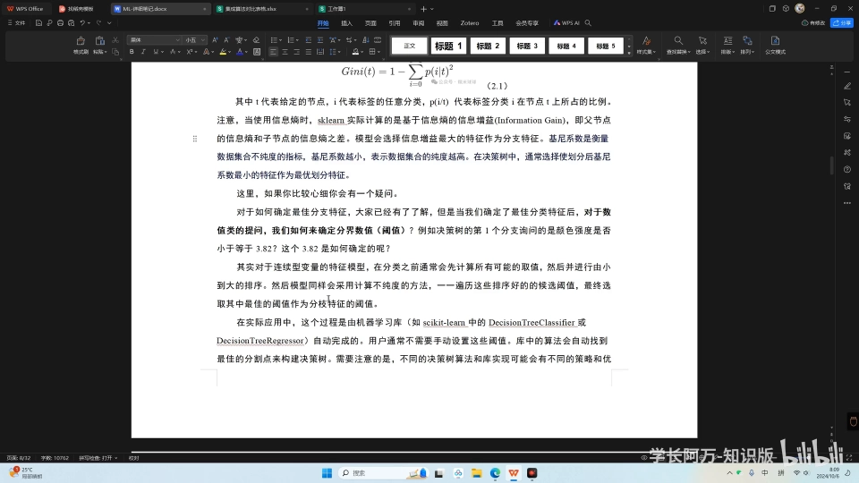

这个过程是机器学习内部自动完成的，我们无法通过超参数设置它，了解即可——不同的决策树算法在细节上还会有差别。

[【跳转到 16:12】](https://www.bilibili.com/video/BV1wR9eYkEZj/?t=972)

## 四、回归树的分支指标：均方误差

分类树用不纯度，**回归树**用的是**均方误差**（MSE，又称 L2 损失）：

- **真实值**：数据里已标注的标签（比如 0、1、2）；
- **预测值**：把标签那一列遮住，只把特征交给决策树，让它预测出来的值；
- 好坏通过比较预测值与实际值来判断：看它是否预测正确、预测正确的比例是多少。

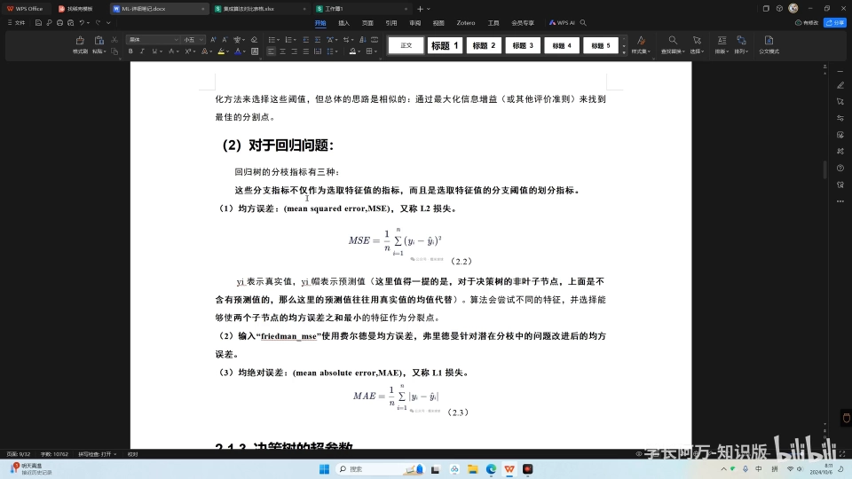

作为分支指标时，决策树算法会尝试不同的特征，选择使**两个子节点的均方误差之和最小**的划分。除了均方误差，还可以选择 **Friedman 均方误差**，只是公式不同。

[【跳转到 17:26】](https://www.bilibili.com/video/BV1wR9eYkEZj/?t=1046)

## 五、决策树的超参数

从代码角度看，决策树有哪些超参数？可以到 sklearn 官网的 User Guide 里查：在监督模型中找到决策树，它分分类与回归两种情况（分类对应 `DecisionTreeClassifier`），页面详细列出了所有相关超参数，视频中还做了翻译与总结。

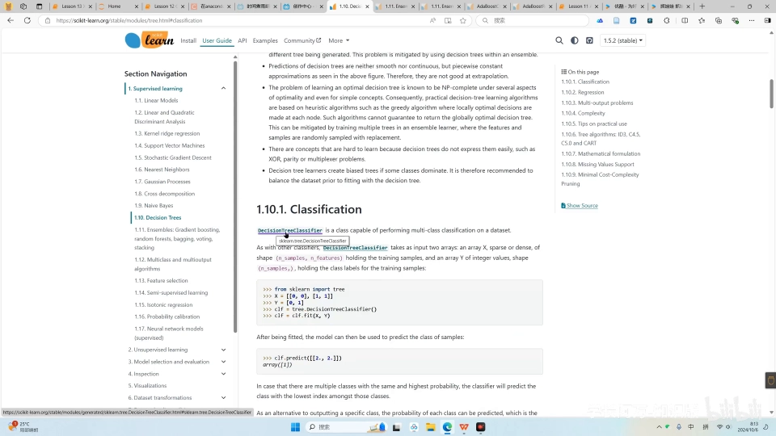

举两个例子：

- `criterion`：选择衡量分支质量的评价指标。回归问题可选均方误差或绝对误差；
- 分类问题里把 `criterion` 设为 `entropy`，就意味着用信息增益作为分支的评价标准。

[【跳转到 21:13】](https://www.bilibili.com/video/BV1wR9eYkEZj/?t=1273)

## 六、随机森林：把树变成森林

### 6.1 集成：投票与平均

理解了决策树，随机森林就非常简单：**把多个决策树集合在一起**，一棵棵树组成了森林。

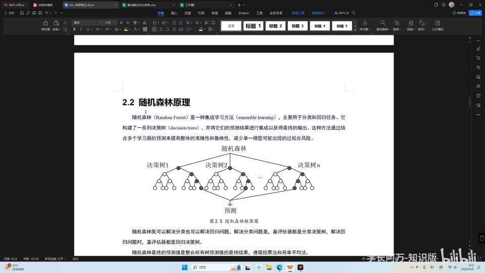

最终的预测值由所有树的输出整合而来：

- **分类问题**：投票，取众数。比如样本 A 落到 20 棵决策树上，16 棵预测它是一类、4 棵预测是零类，遵从少数服从多数，最终预测为一类；
- **回归问题**：取平均。20 棵树预测明天的温度，给出 25 度、26 度、27 度、27.5 度、28.5 度等 20 个答案，把所有预测值相加除以决策树的数量，得到的平均值就是最终预测。

[【跳转到 23:39】](https://www.bilibili.com/video/BV1wR9eYkEZj/?t=1419)

### 6.2 为什么森林比单棵树强

随机森林一定比决策树更高级，预测结果也通常更准确——因为**一个人的能力，不如一个团队**。它同样两类问题通吃：解决分类问题时，森林里所有的树都是分类决策树；解决回归问题时，所有的树都是回归决策树。

### 6.3 关键超参数：n_estimators 与 bootstrap

随机森林比决策树多了一个核心超参数 **`n_estimators`**：设置森林里有多少棵树。设 100 就有 100 棵决策树，设 1000 就有 1000 棵。

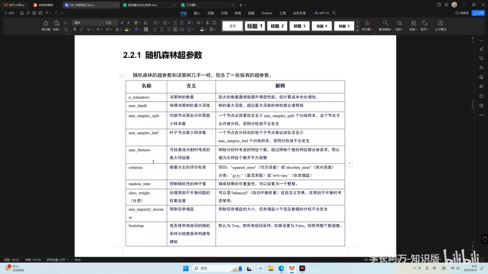

此外还有 **`bootstrap`**：控制是否对训练数据做**有放回的随机采样**来构建每棵决策树。举例：总共有 100 个样本，每次抽 20 个建一棵树——

- `bootstrap=True`（有放回）：这棵树建完后，把抽出的 20 个样本放回去、打乱，重新再抽——这就是有放回的采样；
- `bootstrap=False`：每次建树都基于全部数据集，不再抽取子集。

除此之外，每棵树如何分支、如何选特征，与决策树**一模一样**。随机森林和决策树的唯一区别，就是树的数量与采样方式。

[【跳转到 24:54】](https://www.bilibili.com/video/BV1wR9eYkEZj/?t=1494)

## 小结

- 决策树 = 用一系列条件层层提问的树状预测模型；分类预测类别，回归预测连续数值；
- 一棵真实的树：根节点选特征提问（如 `color intensity < 3.82`），层层划分，叶子节点给出 class；
- 选特征靠**不纯度**（基尼系数 / 信息熵），分类树谁的不纯度低就选谁；连续特征的阈值由等距枚举、逐一比较得出；
- 回归树用**均方误差**（或 Friedman 均方误差）选择划分；
- 随机森林 = 多棵决策树 + 有放回采样（bootstrap）：分类投票取众数，回归取平均；
- 核心超参数：`n_estimators`（树的数量）、`bootstrap`（是否有放回采样）。

## 关键术语速查

| 术语 | 一句话解释 |
| --- | --- |
| 决策树 | 用条件层层分支的树状预测模型，叶子节点给出预测结果 |
| 分类 / 回归 | 预测离散类别 / 预测连续数值 |
| 特征值 / 标签值 | 模型的输入属性 / 要预测的目标 |
| 根节点 / 叶子节点 | 树的第一问 / 分无可分、带有类别标签的终点 |
| 不纯度 | 衡量节点数据混杂程度的指标，越低越好 |
| 基尼系数 / 信息熵 | 两种常用的不纯度度量；信息增益 = 父子节点熵差 |
| 均方误差（MSE / L2） | 回归树衡量预测偏差、选择划分的指标 |
| 随机森林 | 多棵决策树的集成；分类投票取众数，回归取平均 |
| n_estimators | 森林中决策树的数量 |
| bootstrap | 是否有放回地随机采样来训练每棵树 |
