# 【机器学习八股文】集成学习：bagging、boosting、stacking

> 视频来源：[【机器学习八股文】集成学习，bagging，boosting，stacking（BV13JHveYE97）](https://www.bilibili.com/video/BV13JHveYE97/)，本文依据该视频的 AI 字幕与画面逐窗口整理，内容可回看核查。
> 对应知识体系条目：4.5.3 ensemble 集成（APEX 40 权重）。

## 本讲要解决的核心问题（SCQA）

**背景**：上一讲的随机森林（4.5.2 条目）里已经用到了集成学习；在本知识树中，APEX 平台的"40 权重"（4.5.3 条目）也是一种集成——多个模型权重各自预测，再整合成最终输出。

**冲突**：但"集成"到底有几种方式？每种方式的机制和数学形式长什么样，初学者往往说不清楚。

**疑问**：bagging、boosting、stacking 三种集成方式，各自的机制和公式分别是什么？

**回答（中心思想）**：集成学习大概有三种方式——**bagging 并行抽样、取平均/投票（降方差）；boosting 串行训练、按错误率调权重（降偏差）；stacking 多层堆叠、meta model 整合（提升准确率）**。本讲用 6 分钟把三种方式的机制与公式一次讲清。

## 一、三种方式总览

视频承接上一讲的随机森林：random forest 里就用到了集成学习，这一讲把集成学习这个话题单独拿出来讲。集成学习里面大概有三种方式：

1. **bagging**；
2. **boosting**；
3. **stacking**。

[【跳转到 00:00】](https://www.bilibili.com/video/BV13JHveYE97/?t=0)

## 二、bagging：抽样训练 + 取平均/投票，降方差

bagging 的全称是 **bootstrap aggregation（自助抽样聚合）**：将原始数据集抽样，生成很多子数据集（这些子数据集叫做 bootstrap）；对每一个子数据集训练一个模型；在新数据集上进行测试的时候，把**所有模型的预测结果取平均或者进行投票**。

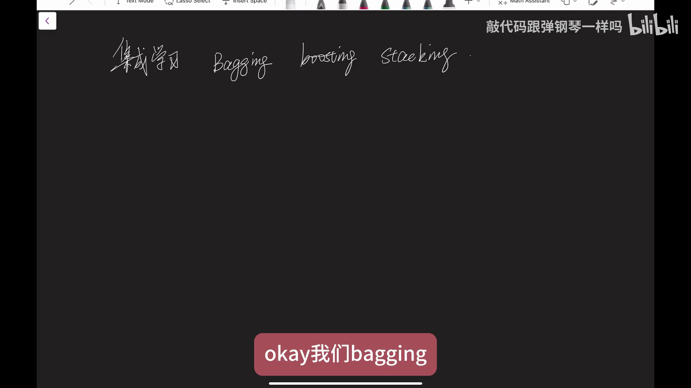

[【跳转到 00:25】](https://www.bilibili.com/video/BV13JHveYE97/?t=25)

上一讲提到的**随机森林**用到的就是这种。它的优点：可以**防止过拟合**，比较适合原始模型**方差较高**的情况——用这种集成的方式，**方差会得到减少**。

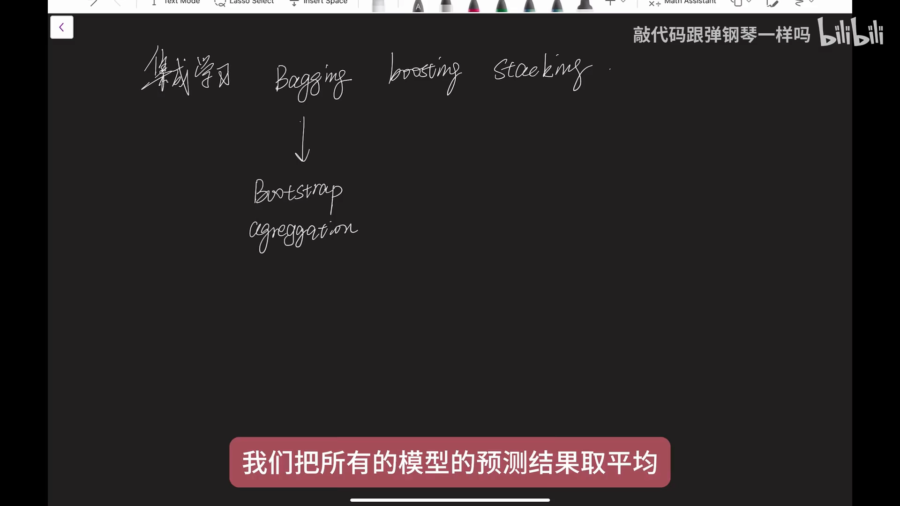

[【跳转到 00:50】](https://www.bilibili.com/video/BV13JHveYE97/?t=50)

## 三、boosting：串行集成 + 调权重，降偏差

boosting 是一种**序列化（串行）**的集成方式：首先训练一个模型，然后**根据它的错误率来调节样本的权重**，让后续的模型更关注那些**难以预测的数据**。代表模型有 **AdaBoost、GBDT（gradient boosting machine）**等。

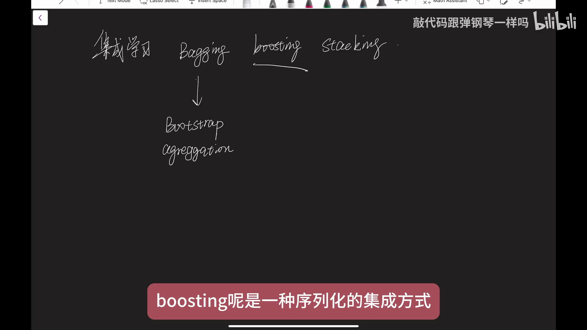

[【跳转到 01:15】](https://www.bilibili.com/video/BV13JHveYE97/?t=75)

这一类模型的优点：能够**减少模型的偏差（bias）**。与 bagging 对照着记：**bagging 降方差，boosting 降偏差**。

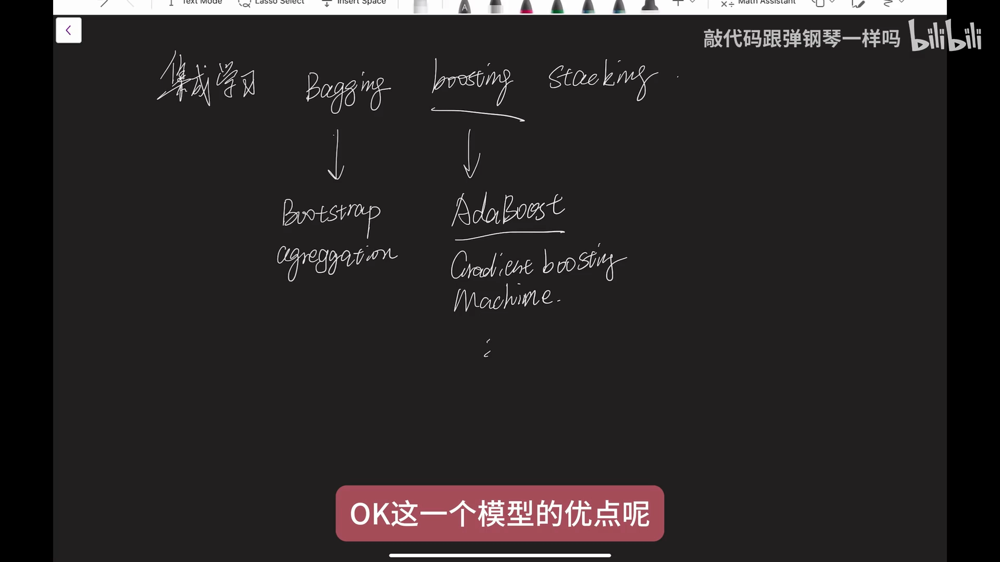

[【跳转到 01:40】](https://www.bilibili.com/video/BV13JHveYE97/?t=100)

## 四、stacking：多层堆叠 + meta model

stacking 是一种**多层次**的集成方式：首先用**不同的模型**（比如决策树、KNN 之类的模型）去做一些预测，把它们的预测结果作为**新的特征**，生成一个新的数据集；然后再训练一个叫做 **meta model** 的模型，把这些新特征放进去进行预测。meta model 可以是线性的，也可以是比较复杂的模型。

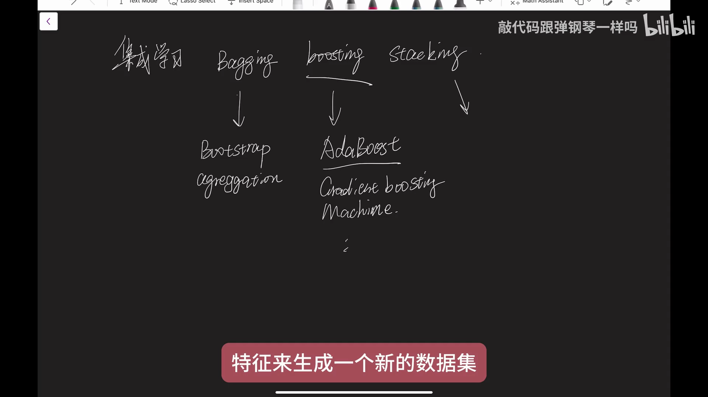

[【跳转到 02:05】](https://www.bilibili.com/video/BV13JHveYE97/?t=125)

好处：可以**提升预测准确率**，并且能用到**不同模型各自的优势**。注意事项：使用 stacking 时，**meta model 的选择非常重要**——选错了，它的表现可能还没有其他集成学习的方式好。

## 五、数学形式：三种集成各一个公式

接下来用数学方法具体讲这三种集成方式。

### 5.1 bagging：K 个模型取平均

假设有 M 个样本、K 个子数据集，记作 D₁、D₂……D_K；在每个子数据集上训练一个模型，记作 H₁、H₂……H_K。对新的数据集进行预测时，最终预测结果等于对 K 个模型在 X 上的预测结果**取平均**：

```
pred(X) = (1/K) · Σ_{k=1..K} H_k(X)
```

这就是 bagging。

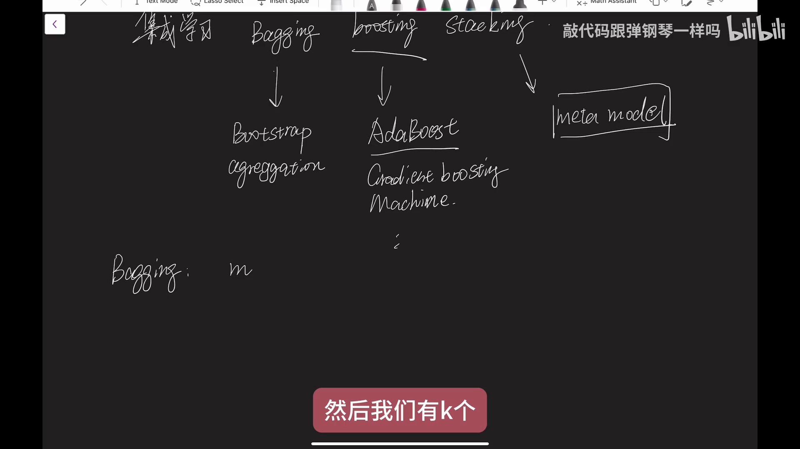

[【跳转到 02:55】](https://www.bilibili.com/video/BV13JHveYE97/?t=175)

### 5.2 boosting：AdaBoost 的权重更新

boosting（以 AdaBoost 为例）的数学流程：

1. **初始化权重**：给每个训练样本一个权重，w_i = 1/N（N 是样本总数）；
2. **训练与计算误差**：按权重训练一个模型 H₁(X)，计算加权误差——err = Σ_{i=1..N} w_i · I(H(x_i) ≠ y_i)，其中 I 是指示函数，预测错时取 1；
3. **更新权重**：更新后的权重 w_i(t+1) = 原始权重 × exp(α_t · I(·))，指数里"乘以 1"的系数就是指示函数（当 T(x_i) ≠ y_i，即预测错误时取 1）；其中 α_t 是当前的模型系数（表示模型的权重），α_t 由错误率取对数得到：α_t = log((1−err)/err)；
4. **最终输出**：从 t = 1 到 T 都做这样的加权，把各个 T(x) 组合起来，就是它最终的公式。

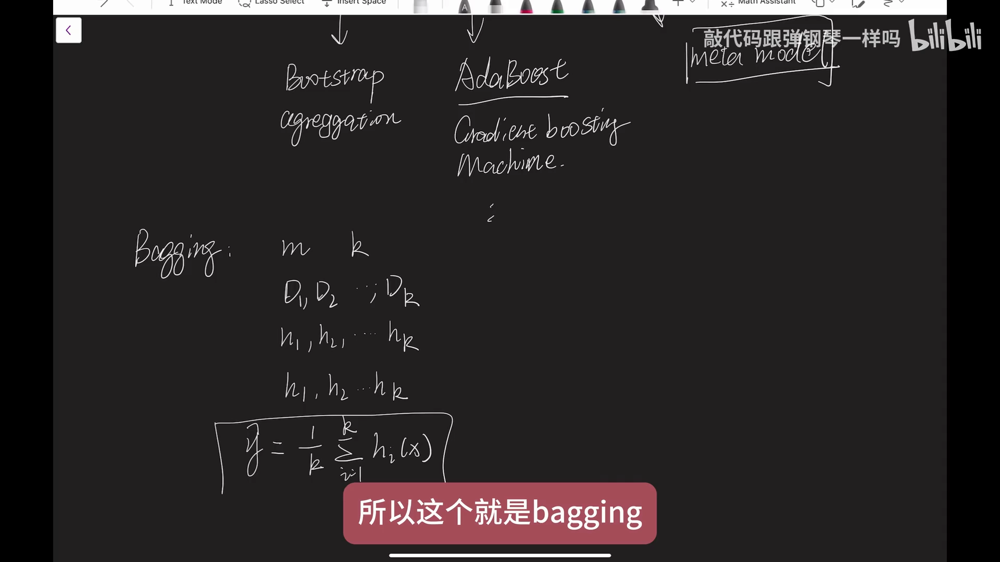

[【跳转到 03:20】](https://www.bilibili.com/video/BV13JHveYE97/?t=200)

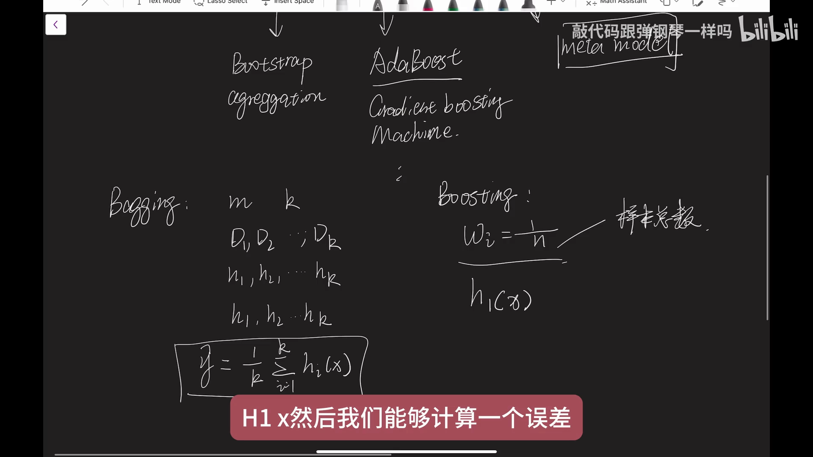

[【跳转到 03:45】](https://www.bilibili.com/video/BV13JHveYE97/?t=225)

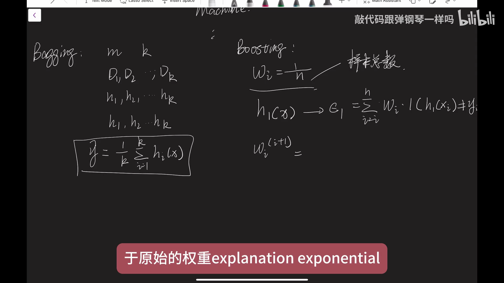

[【跳转到 04:10】](https://www.bilibili.com/video/BV13JHveYE97/?t=250)

### 5.3 算个例子：sign(0.7×1 + 0.4×(−1)) = 1

做一个简单的二分类问题：先训练一个 H₁ 模型，再训练一个 H₂ 模型；输出结果是各模型的预测乘以自己的模型系数再求和，最后用 **sign 函数**（取正负号）来检测它的类别。假设 α₁ 取 0.7、α₂ 取 0.4，样本在 H₁ 输出 1、在 H₂ 输出 −1，那么最终预测：

```
y_hat = sign(0.7×1 + 0.4×(−1)) = sign(0.3) = 1
```

这个公式就是这个意思。

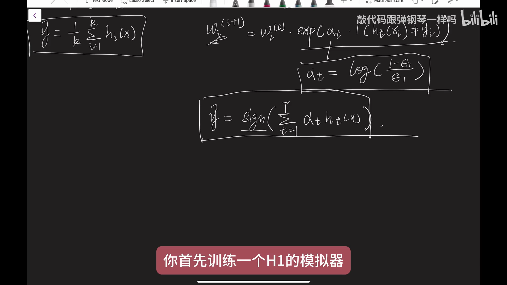

[【跳转到 05:00】](https://www.bilibili.com/video/BV13JHveYE97/?t=300)

### 5.4 stacking：基础模型输出拼成向量 Z，交给 G 训练

stacking 也会有基础模型，比如一个用决策树、另一个用线性回归。对于每一个样本，它都有一个输出；这个输出可以表示成 Z——一组数，也就是一个**向量（vector）**。然后把这个 Z 放到一个模型 G 里面进行训练，得到最终的预测结果。这就是 stacking 的数学形式。

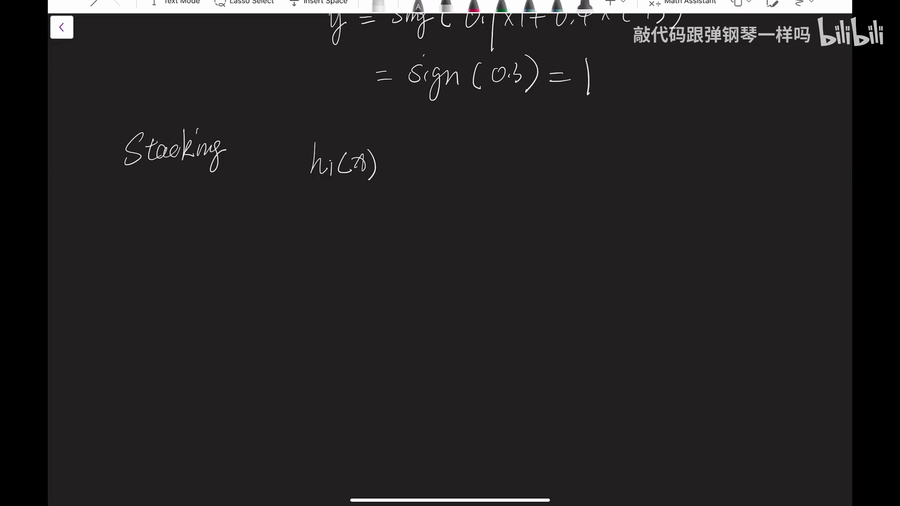

[【跳转到 05:50】](https://www.bilibili.com/video/BV13JHveYE97/?t=350)

## 小结

- 集成学习大概有三种方式：**bagging / boosting / stacking**；
- **bagging**（bootstrap aggregation）：抽样子集 → 每个子集一个模型 → **取平均或投票**；防过拟合、**降方差**；随机森林就是它；
- **boosting**：串行训练 → 按错误率**调样本权重** → 后续模型更关注难样本；**降偏差**；代表 AdaBoost、GBDT；
- **stacking**：不同模型的预测结果作为**新特征** → 训练 **meta model** 再预测；提升准确率、汇集各模型优势，但 meta model 要选好；
- 公式一句话：bagging 是 K 个模型预测取平均；boosting（AdaBoost）从 w_i = 1/N 出发，误差 Σw·I、权重乘 exp(α_t·I)、α_t = log((1−err)/err)、最后加权取 sign；stacking 是基础模型输出拼成向量 Z 交给模型 G；
- 对照记忆：bagging 降方差、boosting 降偏差；回到知识树，APEX 的 40 权重集成正是"多个模型权重各自预测、再整合"的思路——用集成把单个模型不稳定的输出变得更稳。

## 关键术语速查

| 术语 | 一句话解释 |
| --- | --- |
| 集成学习（ensemble learning） | 把多个模型组合成一个更强模型的方法总称，大概有 bagging、boosting、stacking 三种方式 |
| bagging（bootstrap aggregation） | 自助抽样生成多个子数据集，各自训练模型，预测取平均/投票；降方差、防过拟合 |
| boosting | 串行集成：按错误率调样本权重，让后续模型关注难样本；降偏差；代表 AdaBoost、GBDT |
| stacking | 多层集成：把不同模型的预测结果当新特征，再训练 meta model 整合 |
| meta model | stacking 中整合各基础模型输出的第二层模型，选择非常重要 |
| 指示函数 I(·) | 条件成立取 1、否则取 0（这里用来标记预测错的样本） |
| α_t | AdaBoost 第 t 个模型的系数（模型权重），由错误率取对数得到：log((1−err)/err) |
| sign 函数 | 取正负号：正输出 1、负输出 −1（用于二分类判别） |
| GBDT | gradient boosting machine，梯度提升类 boosting 模型的统称 |
