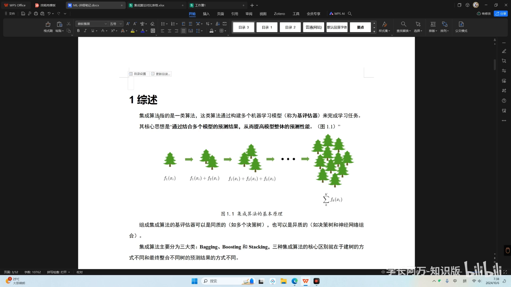
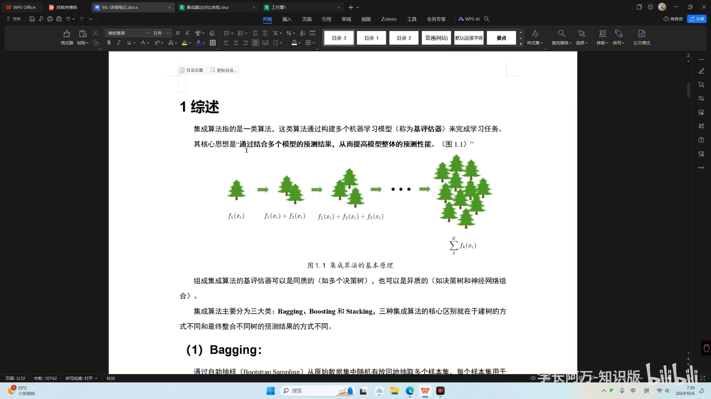
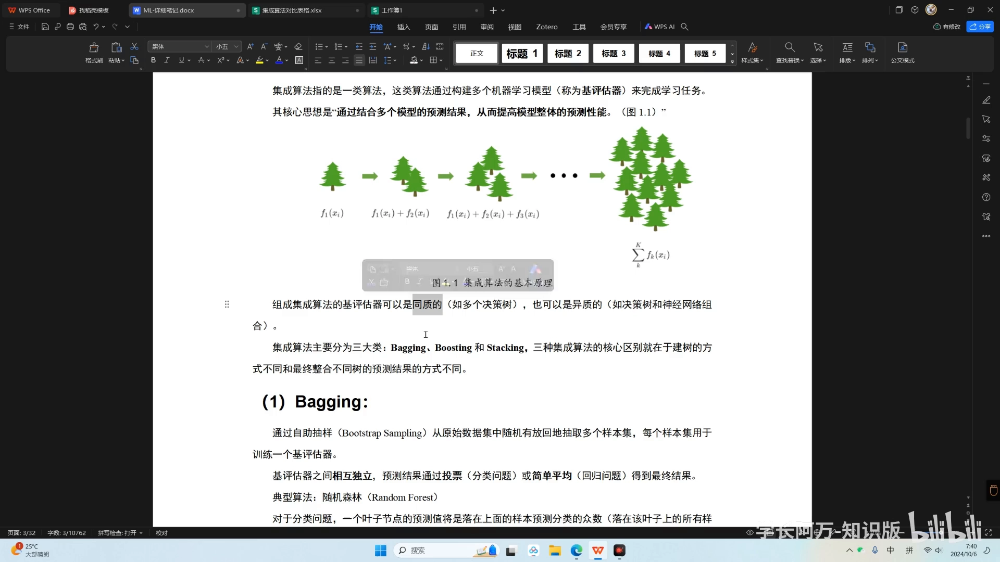
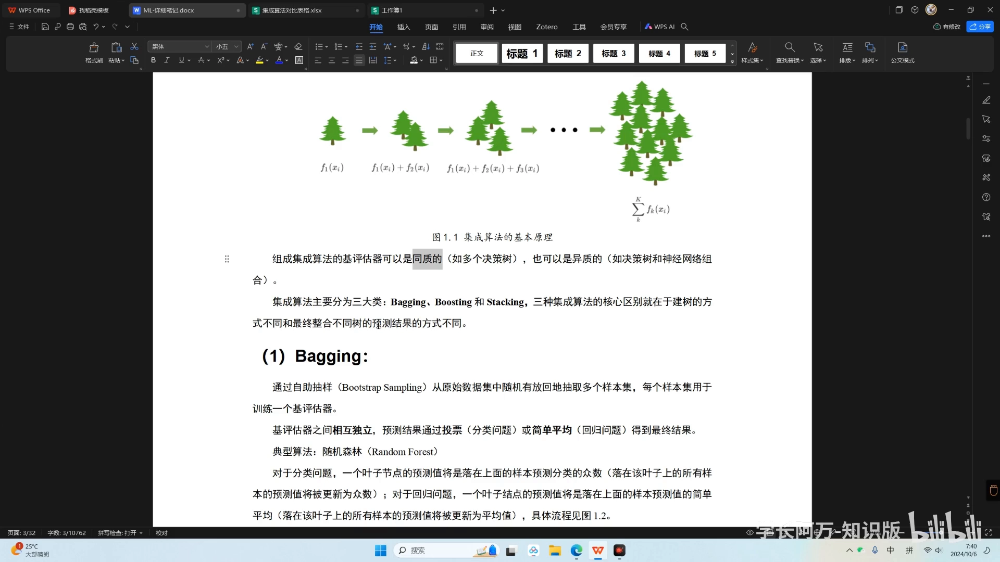
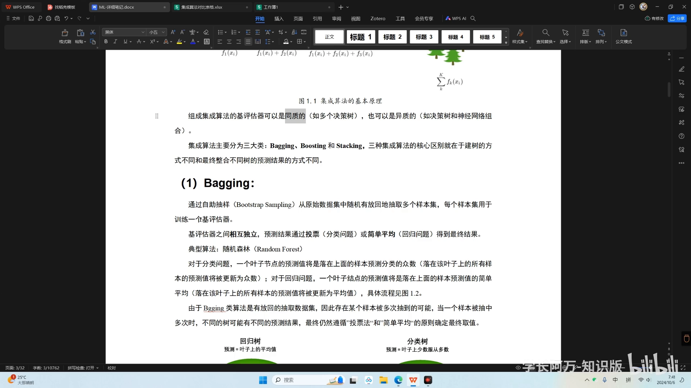
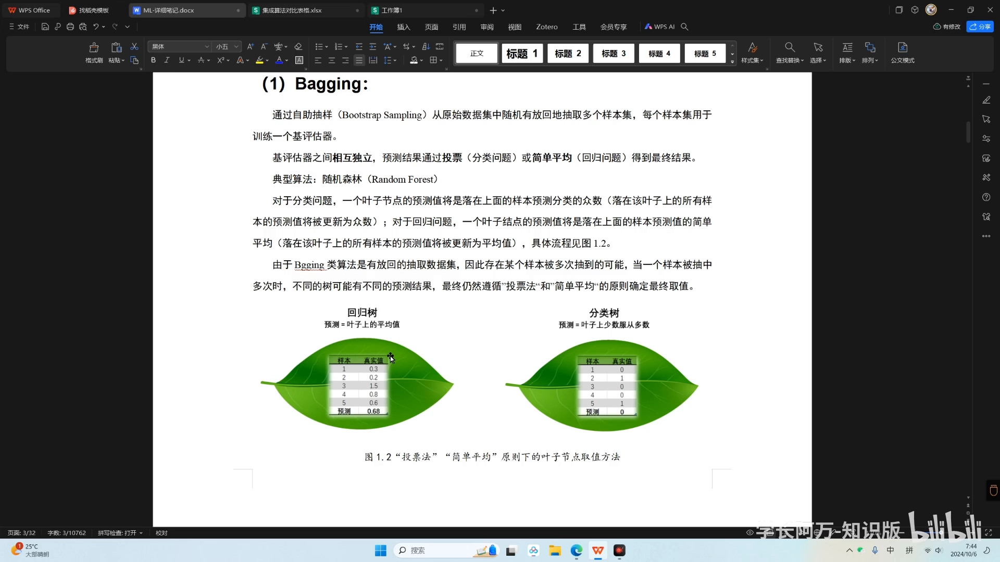
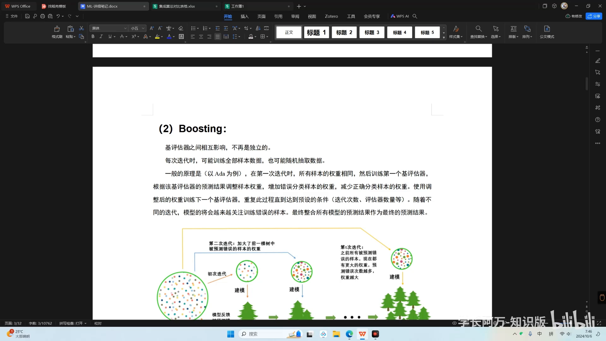
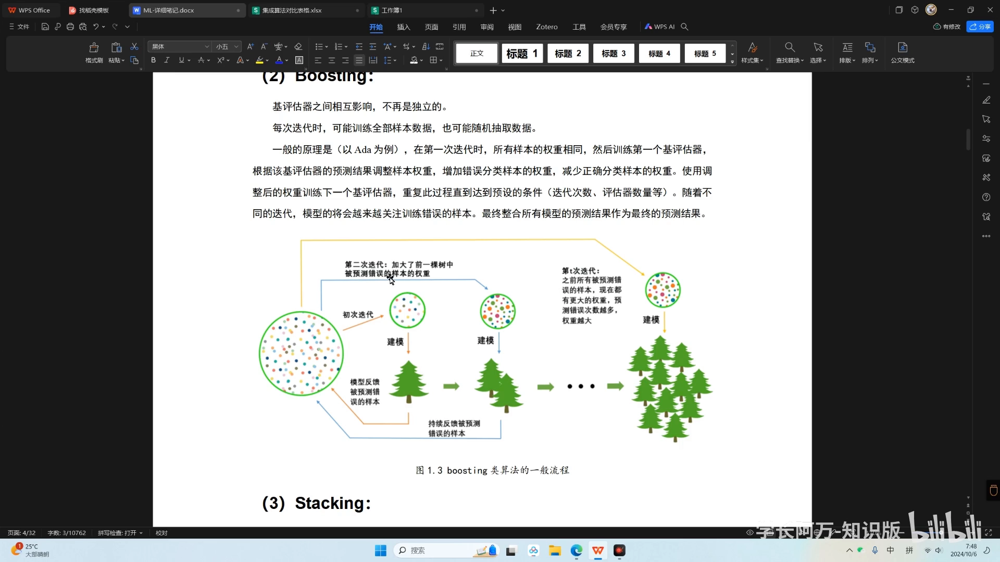
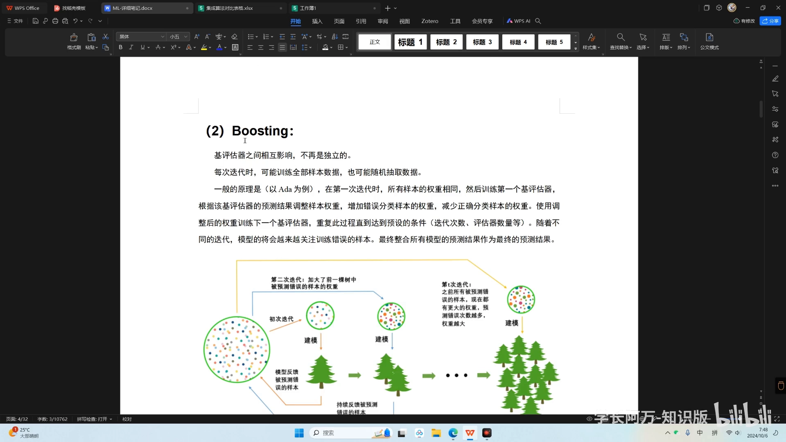

# 集成算法：bagging 和 boosting 算法简介

> 视频来源：[集成算法：bagging和boosting算法简介（BV1pR9eYkEAC）](https://www.bilibili.com/video/BV1pR9eYkEAC/)，本文依据该视频的 AI 字幕与画面逐窗口整理，内容可回看核查。
> 对应知识体系条目：4.5.3 ensemble 集成（APEX 40 权重）。

## 本讲要解决的核心问题（SCQA）

**背景**：在本知识树中，APEX 平台（抗菌肽 MIC 预测，见 5.4.4 条目）给出的 MIC 估计来自 **40 个模型权重的集成**——这正是条目"ensemble 集成（APEX 40 权重）"的含义。

**冲突**：单个模型再好也有"看走眼"的时候；为什么把几十个模型的结果合在一起，反而能得到更可靠的整体输出？

**疑问**：多个模型到底怎么"合"？合的方式有几种？

**回答（中心思想）**：这就是**集成算法**——由多个基评估器组成一个大模型，核心思想是结合多个模型的预测结果来提高整体性能。按"怎么建基评估器 + 怎么整合结果"，它分为 **bagging、boosting、stacking** 三大类；本讲用最直观的例子讲清前两类的原理。

## 一、集成算法：多个基评估器组成一个大模型

集成算法指的是**一类**算法，而不是某一种具体的算法。它的特点是：由多个机器学习模型组成，这些模型被称为**基评估器**（base estimator，即组成集成的单个模型）；多个基评估器组成一个大模型来完成某个学习任务，这个大模型就是集成算法。

[【跳转到 00:00】](https://www.bilibili.com/video/BV1pR9eYkEAC/?t=0)

核心思想一句话：**通过结合多个模型的预测结果，提高模型整体的预测性能**。对比着看：我们平时学习的其他算法，像决策树、支持向量机，都是一个单模型；而集成算法是汇集多个单模型"组成一片森林"，最终把这么多个单模型的预测结果通过某种方式整合，输出最终的预测值。

[【跳转到 00:30】](https://www.bilibili.com/video/BV1pR9eYkEAC/?t=30)

视频用"众人拾柴火焰高"作比：所有人的能力加在一起，往往要超过一个人——这就是集成算法的优势所在。

## 二、基评估器可同质可异质；三大类区别在"怎么建 + 怎么合"

组成集成算法的基评估器有两点自由度：

- **种类**：一般来说这些基评估器都是决策树，但不局限于此——支持向量机、逻辑回归、线性回归等都可以；
- **同质还是异质**：同质指一个集成算法当中的所有基评估器都是相同的；异质指里面的基评估器可以多种多样。

[【跳转到 01:20】](https://www.bilibili.com/video/BV1pR9eYkEAC/?t=80)

按"怎么建基评估器 + 怎么整合各棵树的预测结果"这两个维度，集成算法主要分为三大类：**bagging 类、boosting 类和 stacking 类**。三者最核心的区别就在于建树（建基评估器）的方式不同，以及把不同树的预测结果整合为最终预测结果的方式不同。

## 三、bagging：自助抽样 + 投票/平均（代表：随机森林）

bagging 的全称是 **bootstrap aggregation（自助抽样聚合）**，做法是：通过自助抽样，从原始数据集当中随机**有放回**地抽取多个样本集，每个样本集用于训练一个基评估器。

- **抽样**：假如数据集有 100 组样本，每次从这 100 组样本当中随机抽取一定的比例（比如 20%～30%），每次随机抽取都会构成一个小的数据样本；
- **分别训练**：基于每一个小数据样本构建一个基评估器，也就是建立一棵树；这些基评估器之间**相互独立**——你预测你的，我预测我的，互不影响；
- **整合结果**：通过**投票**（分类问题）或者**简单平均**（回归问题）的方式得到最终预测结果。

[【跳转到 02:10】](https://www.bilibili.com/video/BV1pR9eYkEAC/?t=130)

bagging 类的典型代表算法就是**随机森林**（本知识树 4.5.2 条目已专文讲解）。

### 3.1 回归问题用"简单平均"：叶子节点取均值

对单棵决策树而言，预测值是在**叶子节点**上产生的。以回归树为例：假如某一片叶子节点上落入了五个样本，它们的预测值分别是 0.3、0.2、……0.6（字幕特别纠正：幻灯片上写的"真实值"应为预测值）。做法是**简单平均**：把五个预测值相加再除以五，最终得到 0.68——于是给这个叶子节点整体打上 0.68 这个标签；后续所有落入这个叶子节点的样本，预测值一律输出 0.68。

[【跳转到 03:50】](https://www.bilibili.com/video/BV1pR9eYkEAC/?t=230)

[【跳转到 04:15】](https://www.bilibili.com/video/BV1pR9eYkEAC/?t=255)

### 3.2 分类问题用"投票"：众数原则

分类问题里，叶子节点的预测值是落在它上面的样本预测分类的**众数**（出现次数最多的类别）。比如五个样本来预测一个二分类问题，落入同一个叶子节点后，五个样本分别给出的预测结果是 0、1、0、0、1——计算这些预测结果的众数，发现预测 0 的数量最多，就给这个叶子整体打上 0 类的标签；后续落入该叶子的样本一律预测为 0 类。这就是**投票法：少数服从多数**。

[【跳转到 05:05】](https://www.bilibili.com/video/BV1pR9eYkEAC/?t=305)

### 3.3 多棵树之间：同样投票或平均

上面说的是单棵树内部；一个集成算法里有很多棵树时，规则相同。正因为是**有放回**地抽样，同一个样本可能被抽中很多次：比如样本 A，抽 100 次可能有 30 次都抽中了它；每次抽中，它都会落入到一棵决策树的某个叶子节点上——也就是说它会被多棵树分别预测，而不同决策树的预测值可能不一样。

[【跳转到 06:10】](https://www.bilibili.com/video/BV1pR9eYkEAC/?t=370)

这时依然采用投票法或简单平均：假设样本 A 一共落入 20 棵决策树，其中 15 棵给出的预测结果是 0、5 棵是 1，那么以多数决策树的表决作为最终预测值——还是"少数服从多数"。

[【跳转到 07:00】](https://www.bilibili.com/video/BV1pR9eYkEAC/?t=420)

视频在这里补了一句听课提示：没听懂也不用担心，后面介绍随机森林时会更详细地过一遍这个流程；如果你有一定基础、知道什么是决策树，这一部分应该完全没有问题。

## 四、boosting：串行训练、环环相扣（以 AdaBoost 为例）

boosting 类算法最大的特点：**基评估器之间相互影响，不再是独立的**。上面介绍过 bagging 类的基评估器相互独立、彼此平等；boosting 类不是这样——它们相互影响、环环相扣：第二棵树、第三棵树的建立，一定受到前面树的影响。

[【跳转到 07:51】](https://www.bilibili.com/video/BV1pR9eYkEAC/?t=471)

每次迭代时，boosting 可能一次性用所有数据样本训练，也可能只在数据样本中抽取一部分来建一棵树——这是不确定的，因为不同的 boosting 类算法不一样。以 **AdaBoost** 为例，一般流程是：

1. 基于数据集建立第一棵树；
2. 第一棵树反馈它预测错误的样本；
3. 建立第二棵树时，**更重视**第一棵树预测错误的样本——因为第一棵树把这些预测错误的样本的权重加大了；
4. 如此继续，后续的树会越来越重视前面所有树预测错误的样本。

[【跳转到 08:54】](https://www.bilibili.com/video/BV1pR9eYkEAC/?t=534)

[【跳转到 09:19】](https://www.bilibili.com/video/BV1pR9eYkEAC/?t=559)

一句话总结：在 boosting 的训练过程中，集成算法会越来越**关注数据集中被预测错的数据**，越来越重视那些比较难预测的样本。

## 五、stacking：本视频只点名，不展开

集成算法还有第三类：**stacking 算法**。视频说明：stacking 用得比较少，这方面的介绍也比较少，所以本视频不深入展开。想看它的数学形式（基础模型输出拼成新特征、交给 meta model 再训练）的读者，可以看本条目的另一篇《【机器学习八股文】集成学习，bagging，boosting，stacking》，其中有 stacking 的公式与直觉解释。

[【跳转到 09:44】](https://www.bilibili.com/video/BV1pR9eYkEAC/?t=584)

## 小结

- 集成算法是一**类**算法：多个**基评估器**组成一个大模型，通过结合多个模型的预测结果来提高整体性能——"众人拾柴火焰高"；
- 基评估器可以同质（都是决策树）也可以异质（多种多样），也不限于决策树（SVM、逻辑回归、线性回归都行）；
- 三大类 **bagging / boosting / stacking** 的核心区别在"怎么建基评估器 + 怎么整合结果"；
- **bagging**（自助抽样聚合）：有放回地抽多个样本集 → 各自独立训练一棵树 → **分类投票、回归取平均**；代表算法是随机森林；
- 记住三个例子：回归叶子取平均（0.68）、分类叶子取众数（0,1,0,0,1 → 0 类）、多棵树之间投票（20 棵树 15 票 0 对 5 票 1）；
- **boosting**：基评估器串行、环环相扣；AdaBoost 不断调高"难样本"的权重，让集成越来越重视预测错的样本；
- **stacking** 用另一层模型整合各基评估器的输出，本视频仅点名；
- 回到知识树：APEX 的 40 权重集成正是"多个模型权重各自预测、再整合"的思路——把不稳定的单模型输出，变成更稳的整体输出。

## 关键术语速查

| 术语 | 一句话解释 |
| --- | --- |
| 集成算法（ensemble） | 由多个基评估器组成的大模型，结合多个模型的预测结果提升整体性能 |
| 基评估器（base estimator） | 组成集成的单个模型，可以是决策树、SVM、逻辑回归等 |
| 同质 / 异质 | 集成内所有基评估器相同 / 各不相同 |
| bagging | bootstrap aggregation：有放回自助抽样训练多个相互独立的基评估器，投票或取平均；代表：随机森林 |
| boosting | 基评估器串行训练、相互影响，后面的模型更重视前面预测错的样本；代表：AdaBoost |
| stacking | 用另一层模型整合各基评估器的输出（本视频未展开） |
| 投票法 | 分类问题的整合方式：取众数，少数服从多数 |
| 简单平均 | 回归问题的整合方式：取各预测值的算术平均 |
| AdaBoost | boosting 代表算法：给预测错误的样本加大权重，让后续模型更关注难样本 |
