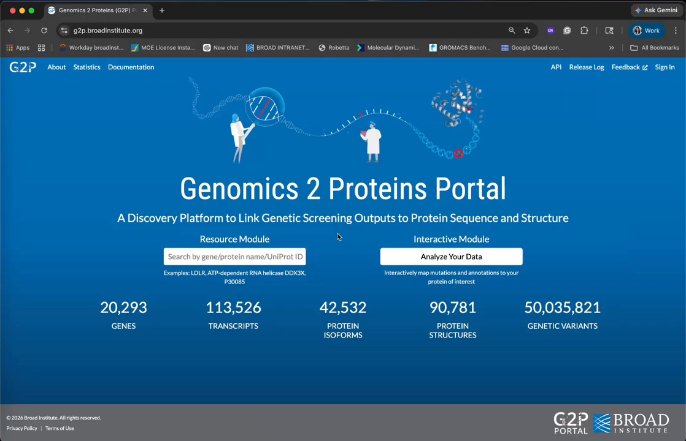
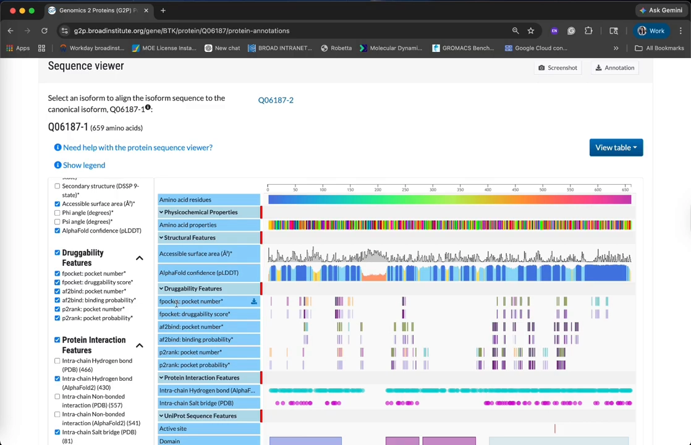
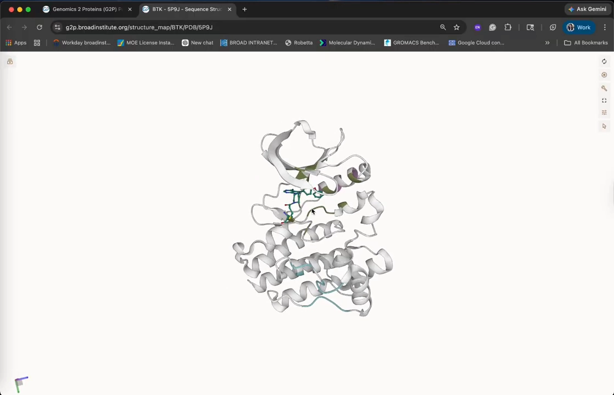
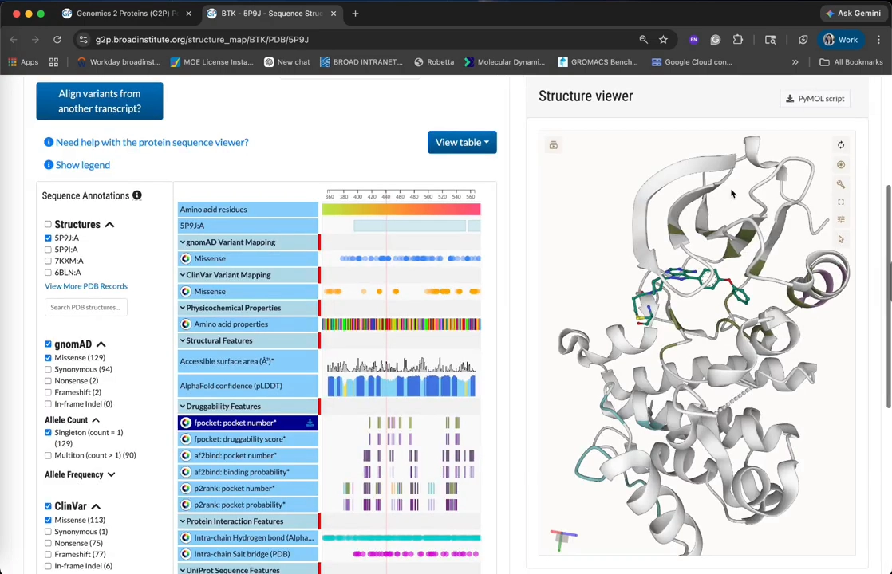
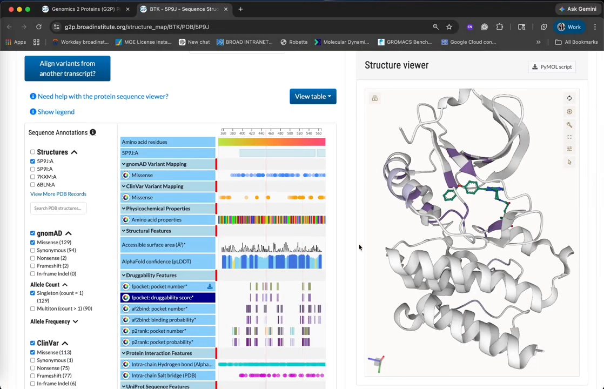
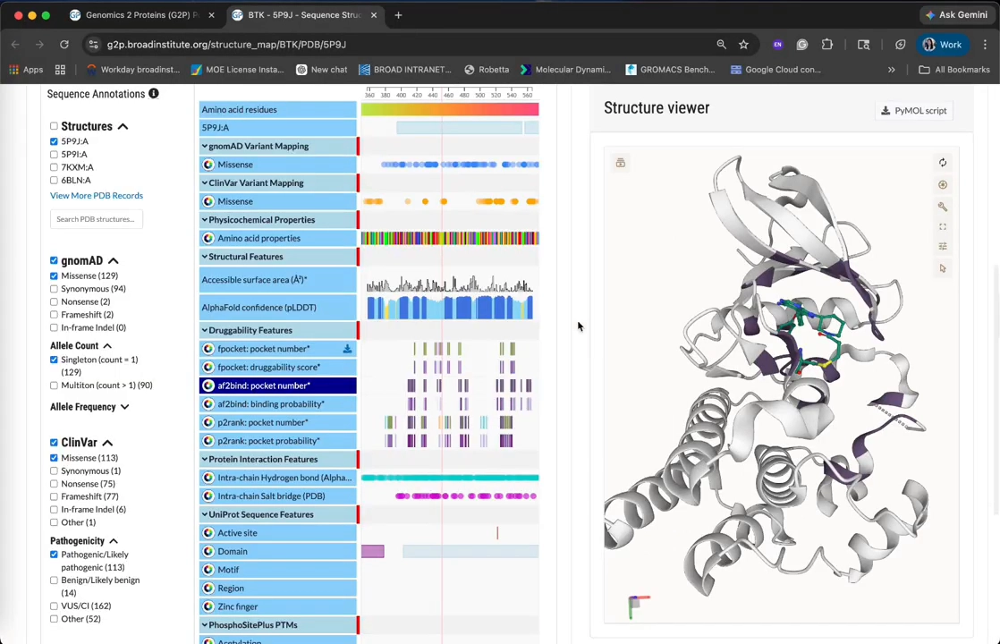
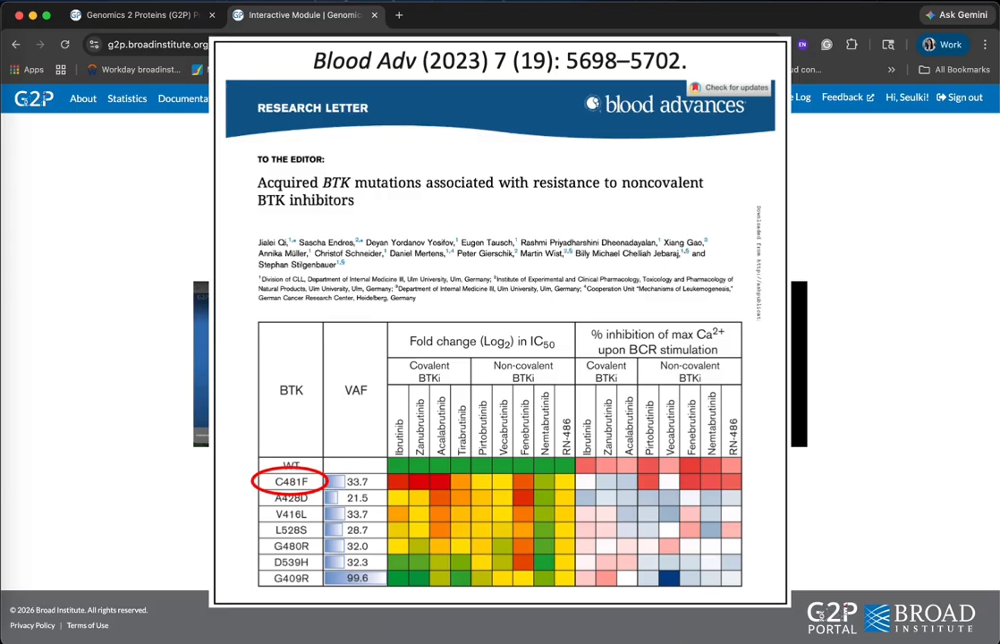
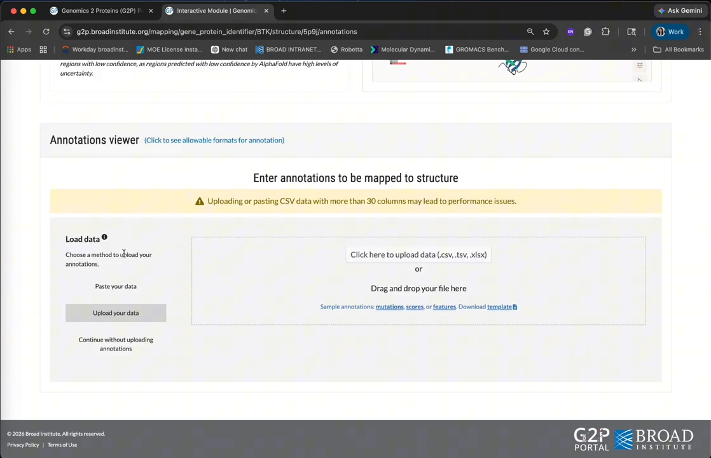
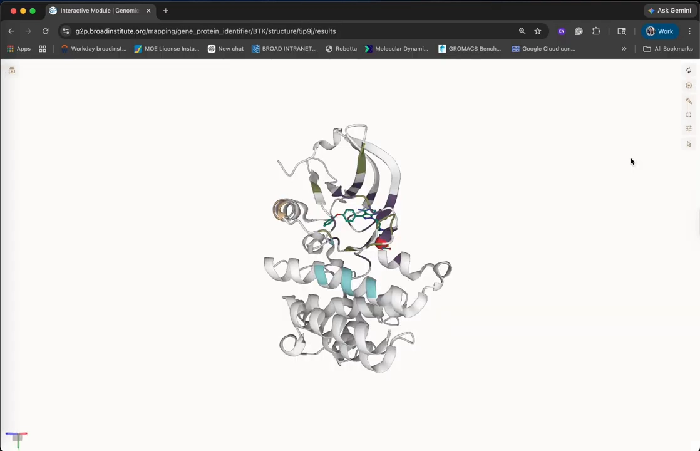

# 口袋成药性预测三件套：fpocket、AF2BIND、P2Rank 在 BTK 上互相验证

> 原视频：[12. Druggability feature predictions | P2Rank, AF2BIND, and Fpocket | BTK inhibitor binding sites](https://www.youtube.com/watch?v=-MaTw83dqf0)（YouTube，约 5 分钟，Genomics to Proteins (G2P) Portal 教程系列第 12 集）。字幕为英文自动字幕，已按上下文修正错拼（fpocket、AF2BIND、druggability、Bruton's tyrosine kinase 等）。

## 本讲要解决的核心问题（SCQA）

**背景**：找药先找口袋——靶标蛋白表面能装下小分子的凹陷区域，往往就是药物结合位点。BTK（Bruton's tyrosine kinase，布鲁顿酪氨酸激酶）是 B 细胞发育、分化与信号转导的核心激酶，也是成熟的血液肿瘤靶点：已有多个临床批准的小分子抑制剂**共价**结合它的激酶域，代表药就是伊布替尼（ibrutinib）。

**冲突**：口袋预测工具不止一个，算法思路各不相同，报出的口袋数量和边界也不一致——单独看任何一个工具的结果，都难以判断哪个口袋才是"真口袋"。

**疑问**：多方法并排预测，能否互相印证，把可信的成药口袋锁定出来？

**回答（中心思想）**：可以。G2P 门户把 **fpocket、AF2BIND、P2Rank** 三个互补工具放在同一个 Druggability 功能页里并排出结果；在 BTK 上，三个方法虽然给出了不同数量的口袋，却**一致把伊布替尼结合位点排为第一**——跨方法收敛本身就是值得关注的信号。门户还能把耐药突变（如 C481F）直接映射到结构上，看它是否正落在预测口袋里。

[【跳转到 00:00】](https://www.youtube.com/watch?v=-MaTw83dqf0&t=0)

## 一、一个功能页，三种互补的口袋预测方法

[【跳转到 00:47】](https://www.youtube.com/watch?v=-MaTw83dqf0&t=47)

G2P 门户是一个把遗传筛选结果关联到蛋白序列与结构的发现平台。在蛋白序列查看器里有专门的 **Druggability（成药性）功能页**，并列展示三个工具预测的口袋及其概率分数：

- **fpocket**——几何方法，基于 alpha 球把空腔找出来（本系列条目 4.5.4 的主角）；
- **AF2BIND**；
- **P2Rank**。

三个工具的方法学各有差异，门户文档里有更详细的说明。在 BTK 这个案例上，三种方法总体上**在序列上高亮的是相似的区域**——接下来切换到结构视角逐个看。

## 二、fpocket 预测：三个口袋，绿色正中伊布替尼位点

[【跳转到 01:35】](https://www.youtube.com/watch?v=-MaTw83dqf0&t=95)

BTK 有很多带已知抑制剂的共晶结构，教程选择 **BTK 与伊布替尼共晶**的结构来对照。点击 Druggability 功能页里的 fpocket 编号，结构上出现**三个预测口袋**（紫、绿、蓝三色）——其中**绿色的口袋与伊布替尼的结合位点正好重合**。

### 成药性评分：颜色越深，分数越高

[【跳转到 01:47】](https://www.youtube.com/watch?v=-MaTw83dqf0&t=107)

**Druggability score（成药性评分）**估计的是一个被检测到的口袋有多可能结合小分子。在结构查看器里用颜色深浅表示分数：**颜色越深，分数越高**。可以看到，与伊布替尼结合位点重叠的那个口袋，成药性评分正是三个口袋里最高的。

## 三、换工具对比：fpocket 的"一个大口袋" vs P2Rank 的"四个口袋"

[【跳转到 02:03】](https://www.youtube.com/watch?v=-MaTw83dqf0&t=123)

切到 fpocket 的对比视图：fpocket 只返回**一个口袋**，但预测的结合区域**更大**；位置仍然落在同一个地方——伊布替尼结合的激酶域。

[【跳转到 02:17】](https://www.youtube.com/watch?v=-MaTw83dqf0&t=137)

再看 P2Rank：它报出**四个口袋**——一个正好在伊布替尼结合位点，另外三个散布在激酶域表面其它地方。与 fpocket 类似，**与小分子结合位点对齐的那个口袋，口袋概率分数最高**。

## 四、三方法收敛：结果不一致时，"收敛"本身就是信号

[【跳转到 02:37】](https://www.youtube.com/watch?v=-MaTw83dqf0&t=157)

把三个方法放在一起看结论：**尽管底层方法不同、返回的口袋数量不同，伊布替尼结合位点在三种方法下都被一致地识别为排名最高的可成药口袋**。

教程给出的使用建议很实在：

1. 每个方法各有强项，结果会随蛋白情境变化；
2. 所以三个都值得跑一遍；
3. 它们不会永远一致，但**跨方法的收敛（convergence）是一个值得认真对待的信号**。

## 五、把耐药突变映射到结构上：C481F 正落在预测口袋里

[【跳转到 03:18】](https://www.youtube.com/watch?v=-MaTw83dqf0&t=198)

Druggability 功能之外，门户还有交互式**突变映射模块**：如果你手上有一批感兴趣的突变，可以把它们连同成药性特征一起画到结构上。

BTK 对伊布替尼产生耐药的已知机制，是在 **C481 位点获得突变**——这个位置的半胱氨酸正是与伊布替尼形成共价键的关键，突变后共价结合被破坏。

操作流程：

1. 进入第一个子模块，输入基因/蛋白标识符，搜索 BTK；
2. 选择要映射突变的结构——可以用刚才的共晶结构，也可以用 **AlphaFold 预测结构**，甚至上传自己的结构（来自其它预测工具或自有实验结构）；
3. 录入注释：手动输入，或上传带突变分数/特征注释的 **CSV / TSV** 文件；教程示例输入 **C481F** 突变。

[【跳转到 04:04】](https://www.youtube.com/watch?v=-MaTw83dqf0&t=244)

突变随即显示在结构查看器上；再叠加 P2Rank 的口袋预测一起看——**这个耐药突变正好位于与抑制剂的共价结合位点上，也落在预测的配体结合口袋之内**。

[【跳转到 04:30】](https://www.youtube.com/watch?v=-MaTw83dqf0&t=270)

## 小结

- **一个功能页三种方法**：G2P 门户的 Druggability 页并列展示 fpocket、AF2BIND、P2Rank 的口袋预测与概率分数。
- **fpocket**：在 BTK 上报 3 个口袋，与伊布替尼位点重合的口袋成药性评分最高；fpocket 视图本身只返回 1 个大口袋。
- **P2Rank**：报 4 个口袋，位点处的口袋概率分数最高。
- **跨方法收敛是真信号的判据**：方法不一致是常态，但多个独立方法指向同一区域时，值得优先关注。
- **突变映射闭环验证**：C481F 耐药突变被映射到共价结合位点、且落在预测口袋内——结构与功能对上了。

## 关键术语速查

| 术语 | 一句话解释 |
| --- | --- |
| BTK | Bruton's tyrosine kinase，B 细胞发育与信号转导的核心激酶，血液肿瘤成熟靶点 |
| 伊布替尼（ibrutinib） | 共价结合 BTK 激酶域的临床批准抑制剂 |
| pocket（口袋） | 蛋白表面能容纳小分子的凹陷区域 |
| druggability score | 口袋可成药性评分：多可能结合小分子药物，颜色越深分越高 |
| fpocket | 基于 Voronoi 镶嵌几何 + alpha 球的几何法口袋检测工具 |
| AF2BIND | G2P 门户集成的口袋预测工具之一 |
| P2Rank | 基于机器学习的配体结合位点预测与排序工具 |
| C481 | BTK 上与伊布替尼形成共价键的半胱氨酸位点，突变后耐药 |
| G2P Portal | Genomics to Proteins 门户：把遗传筛选结果关联到蛋白序列与结构 |
