# 蛋白质-配体分子对接实战：fpocket 自动找口袋，AutoDock Vina 完成对接

> 原视频：[Protein-ligand Docking Tutorial : Using AutoDock Vina and fpocket tool](https://www.youtube.com/watch?v=lY_8HAwnsWU)（YouTube，约 14 分钟，BioAxle building block library 出品的分步教程）。字幕为英文自动字幕，已按上下文修正错拼（imatinib、AutoDock Vina、PDBQT、3HEC 等）。

## 本讲要解决的核心问题（SCQA）

**背景**：分子对接（docking）是用计算方法预测小分子配体"卡"进靶标蛋白的哪个位置、怎么结合。对接软件需要一个明确的搜索范围——蛋白表面的口袋（pocket）。

**冲突**：很多靶标蛋白手上只有没有配体的"裸"结构（apo 结构），口袋在哪全靠猜；即便有共晶复合物，换一个新靶标也不一定有。

**疑问**：能不能让程序自动找出蛋白表面的空腔、按成药可能性打分，再把它变成对接软件能直接用的搜索盒子？

**回答（中心思想）**：可以。本讲跟着 BioAxle 教程完整走一遍流水线：**fpocket 自动计算蛋白空腔并给每个口袋输出评分与成药性指标 → 按体积过滤后挑出可信口袋、生成对接盒 → AutoDock Vina 在盒内对接配体 → 把对接姿势与实验结构叠合验证**。全程以 p38α 激酶（MAPK14）与抗癌药 imatinib 为例。

[【跳转到 00:05】](https://www.youtube.com/watch?v=lY_8HAwnsWU&t=5)

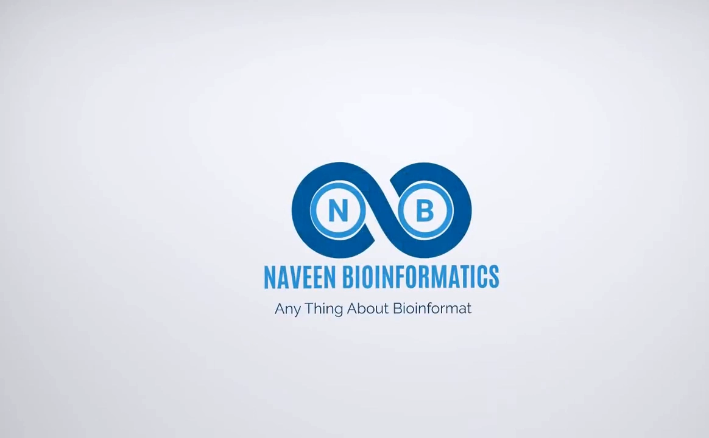

## 一、三个输入参数决定整个流程

[【跳转到 02:10】](https://www.youtube.com/watch?v=lY_8HAwnsWU&t=130)

教程一开始就交代了三个输入参数：

| 参数 | 本例取值 | 含义 |
| --- | --- | --- |
| PDB 代码 | `3HEC` | p38α 与 imatinib 的实验复合物结构；去掉小分子后作为对接靶标 |
| 配体代码 | `STI` | imatinib 在 PDB 里的三字母代码，用于下载这个小分子 |
| 口袋目录 | pocket directory | 存放口袋提取结果（临时文件）的文件夹 |

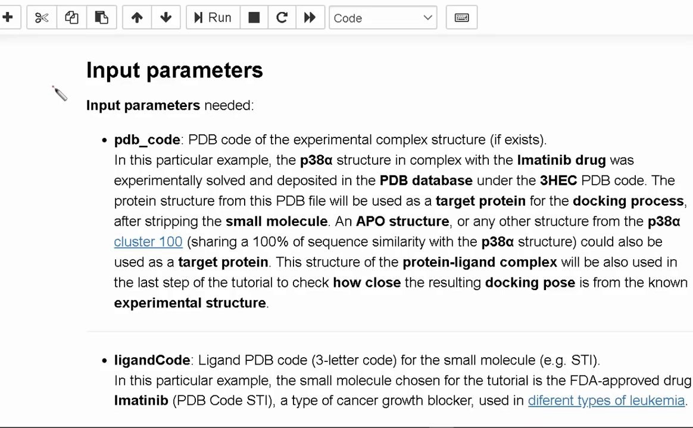

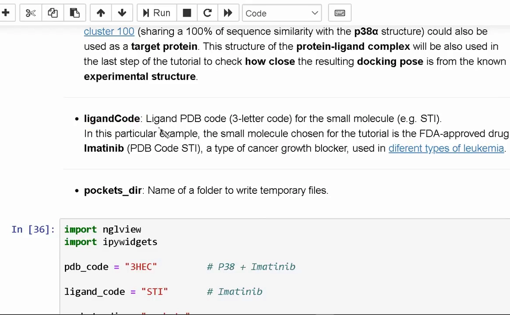

两点提示：

- 靶标蛋白不一定非用复合物结构——**apo 结构或 p38 家族里的其它结构都可以当靶标**；带配体的复合物结构留着，最后一步对照用。
- **AutoDock Vina 的对接计算不是确定性的**：同样的输入，多次运行的结果可能不一样。教程建议把对接流程多跑几次，确认结果稳定后再下结论。

[【跳转到 03:08】](https://www.youtube.com/watch?v=lY_8HAwnsWU&t=188)

## 二、准备靶标：下载结构、看清内容、去掉"多余分子"

第一步是取结构：从 PDB 数据库下载 `3HEC`，用 **NGL viewer** 在浏览器里可视化。此时结构里不只有蛋白，还能看到小分子 **STI（imatinib）** 和去垢剂 **β-辛基葡萄糖苷（β-octyl glucoside，BOG）**——结晶时为了稳定蛋白加进去的"辅料"。

[【跳转到 03:48】](https://www.youtube.com/watch?v=lY_8HAwnsWU&t=228)

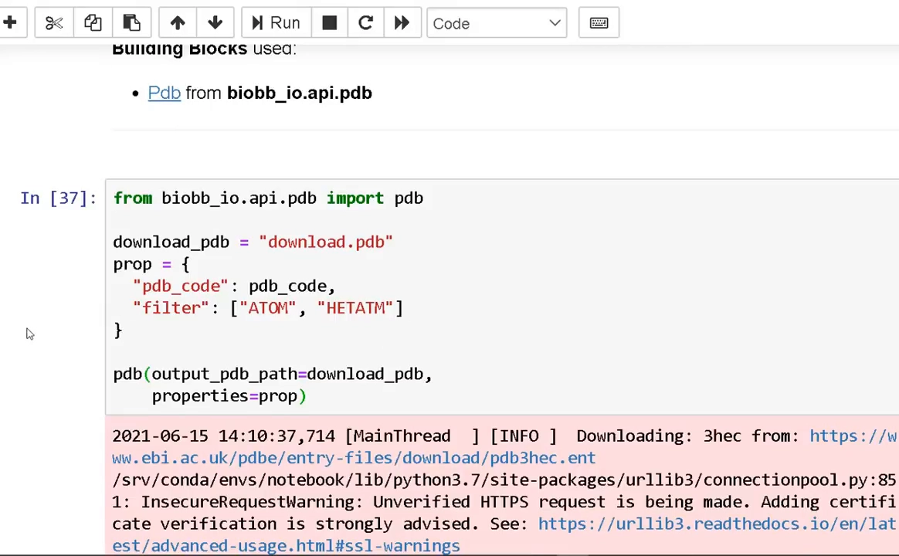

第三步是"抽纯蛋白"：从下载的 PDB 文件里删掉所有多余的分子——配体、离子、水分子，只留蛋白链。删完再可视化一遍确认：小分子都不见了，剩下的蛋白就是要交给对接流程的靶标。

为什么必须删？因为口袋检测和对接都只关心蛋白表面的几何形状；配体、水、离子留在原地会"占据"口袋，让程序误判空腔位置。

## 三、fpocket 登场：自动计算蛋白空腔

[【跳转到 04:42】](https://www.youtube.com/watch?v=lY_8HAwnsWU&t=282)

结构干净之后，教程调用 **fpocket** 工具计算蛋白空腔（cavities）；对接算法随后会在这些空腔里寻找小分子最可能结合的表面区域。

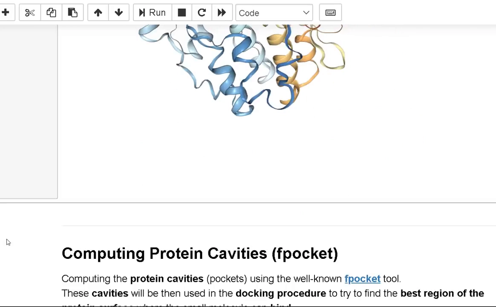

> **背景知识（fpocket 的算法原理，视频演示未展开）**：fpocket 的底层正是本条目主题所说的 **Voronoi 镶嵌几何（Voronoi tessellation，泰森多边形）**——把蛋白按每个原子的"势力范围"切分成一堆 Voronoi 多面体，每个多面体里放一个 **alpha 球（alpha sphere）**；球越小，说明该处空间越局促、越像被埋住的空腔。fpocket 把聚集的小 alpha 球归并成口袋。视频里可以直接调的，就是这套几何的几个旋钮。

[【跳转到 05:28】](https://www.youtube.com/watch?v=lY_8HAwnsWU&t=328)

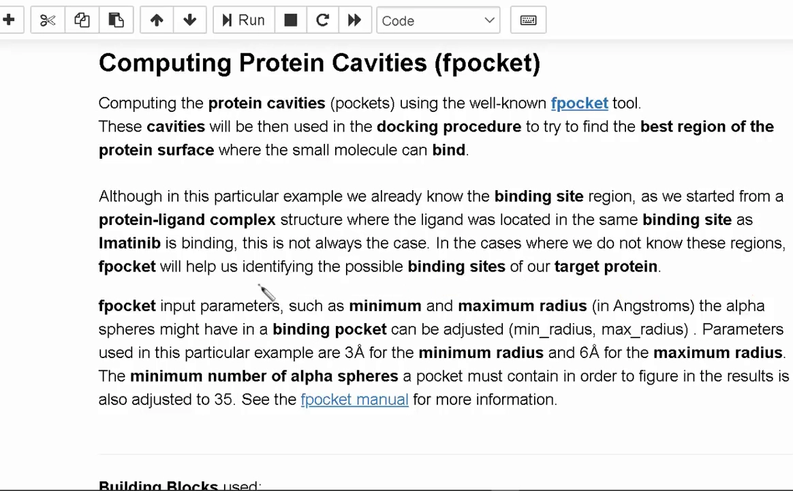

本例设置的三个旋钮：

1. alpha 球**最小半径 3 Å**；
2. alpha 球**最大半径 6 Å**；
3. 一个口袋至少要包含 **35 个 alpha 球**，才会被收进结果。

值得强调的是：本例其实**已知**结合位点（复合物结构里 imatinib 就结合在那里），但并非每个靶标都这么幸运——**如果不知道位点在哪，fpocket 就能帮你把候选口袋找出来**。

### 读懂 fpocket 的 JSON 输出

[【跳转到 06:06】](https://www.youtube.com/watch?v=lY_8HAwnsWU&t=366)

fpocket 的结果以 JSON 文件给出，**每个口袋一个编号**，附带一组指标：

| 指标 | 含义 |
| --- | --- |
| score | 口袋综合评分 |
| druggability score | 成药性评分：这个口袋有多可能结合小分子药物 |
| volume | 体积 |
| hydrophobicity | 疏水性 |
| polarity | 极性 |
| flexibility | 柔性 |

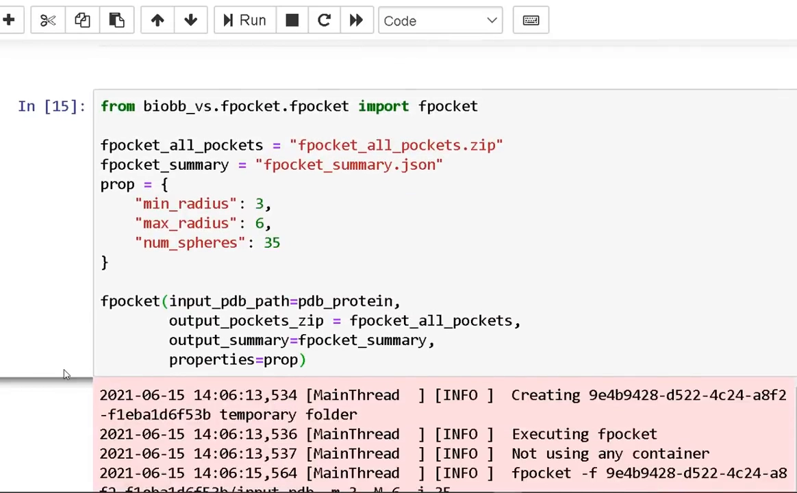

拿到指标后是**过滤**：本例挑体积在 **800–2000 ų** 之间的大空腔——大到足以装下输入的小分子 imatinib。

## 四、提取并可视化口袋，选中 6 号口袋

[【跳转到 06:54】](https://www.youtube.com/watch?v=lY_8HAwnsWU&t=414)

过滤之后是**提取**：把选中的口袋信息写进口袋目录，同时保存 PDB 和 PQR 两种文件（PQR 在 PDB 坐标之外补充了电荷与半径，供后续计算使用）。

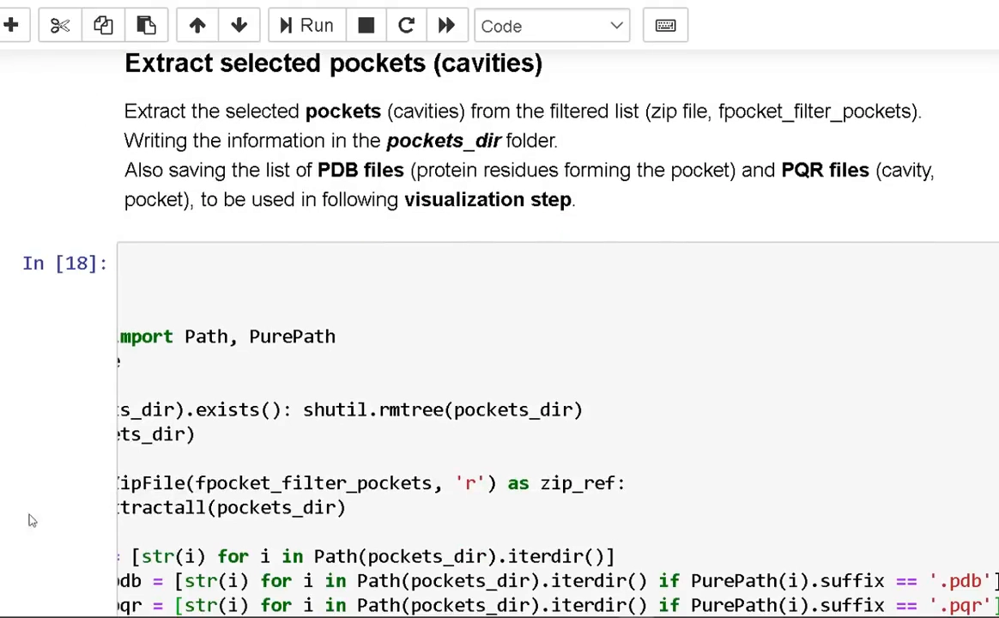

可视化时，随机彩色的表面代表组成空腔的蛋白残基，蓝色网格（mesh）勾出口袋本身，浮动标签给每个口袋编号。接下来就是"选口袋"：

[【跳转到 07:49】](https://www.youtube.com/watch?v=lY_8HAwnsWU&t=469)

- 既然 fpocket 找到的结合位点与已知的蛋白-配体结构一致，剩下要做的只是把它挑出来；
- 本例感兴趣的正是 **6 号口袋**——在下拉菜单里选中它，"extra pocket cavity from the fpocket" 就是我们要的蛋白空腔。

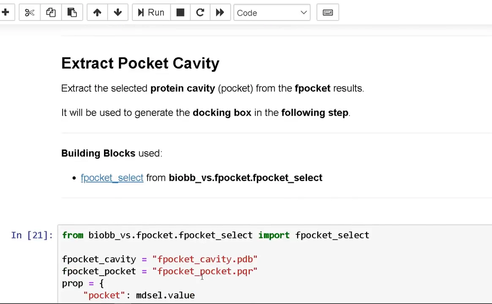

## 五、把口袋变成对接盒：12 Å 偏移

[【跳转到 08:34】](https://www.youtube.com/watch?v=lY_8HAwnsWU&t=514)

选定口袋后，教程在空腔周围生成一个**盒子（box）**——它圈出靶标蛋白表面上对接算法应该搜索配体的区域。为了让盒子装得下小分子的各种摆放姿态（rotation），盒子在口袋基础上向外扩了 **12 Å 的偏移（offset）**。

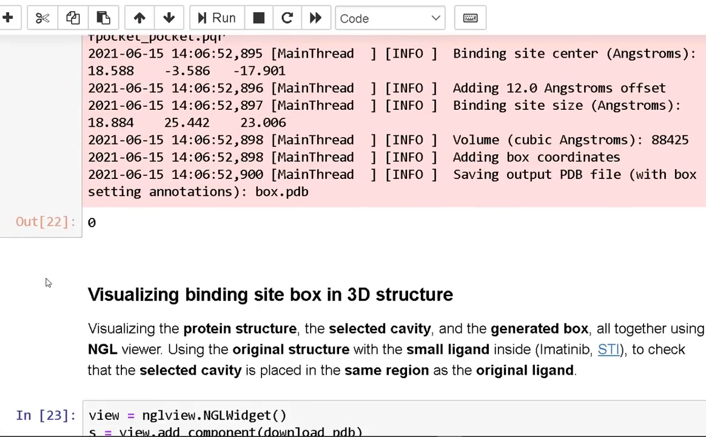

盒子生成后，用原始复合物结构（小分子还在里面）做一次核对：确认盒子圈住的位置与原配体 imatinib 所在区域重合——盒子放对了，后面的对接才有意义。

## 六、准备配体：下载、转格式、变成 PDBQT

对接要用的配体单独下载：就是前文那个 FDA 批准的抗癌药 **imatinib（PDB 代码 STI）**。

[【跳转到 09:52】](https://www.youtube.com/watch?v=lY_8HAwnsWU&t=592)

格式转换分两步：

1. **Open Babel**（化学信息学转换工具）把配体从 SDF 格式转成 PDB 格式；
2. 再把 PDB 转成 **PDBQT**——AutoDock 系工具专用格式。

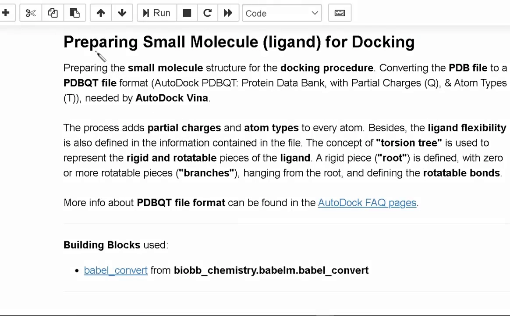

PDBQT 这个名字可以拆开记：**PDB + Q（partial charge，部分电荷）+ T（atom types，原子类型）**。处理过程中每个原子都会被赋予部分电荷和原子类型；配体的柔性也写进文件内容里——

- **扭转树（torsion tree）**：把配体拆成"刚性部分 + 从根部悬挂的可旋转部分"；
- **可旋转键**决定了小分子在对接时能怎么扭。

可视化对比很直观：左面板是带全部氢原子的 PDB 文件；右面板（PDBQT）用的是**联合原子模型（united-atom model）**——只保留极性氢，好把重原子正确标注为氢键供体/受体。

## 七、准备受体：同样转 PDBQT，但不考虑柔性

靶标蛋白走同样的流程：PDB → PDBQT，赋予每个原子部分电荷和原子类型。区别在于——虽然 AutoDock Vina 对选定的受体侧链提供有限的柔性选项，**本教程不考虑受体柔性**，把蛋白当成刚体。

## 八、运行对接：三件套输入，两种姿势看结果

万事俱备，运行对接。输入三件套：**配体、靶标蛋白、结合位点盒子**。

[【跳转到 12:12】](https://www.youtube.com/watch?v=lY_8HAwnsWU&t=732)

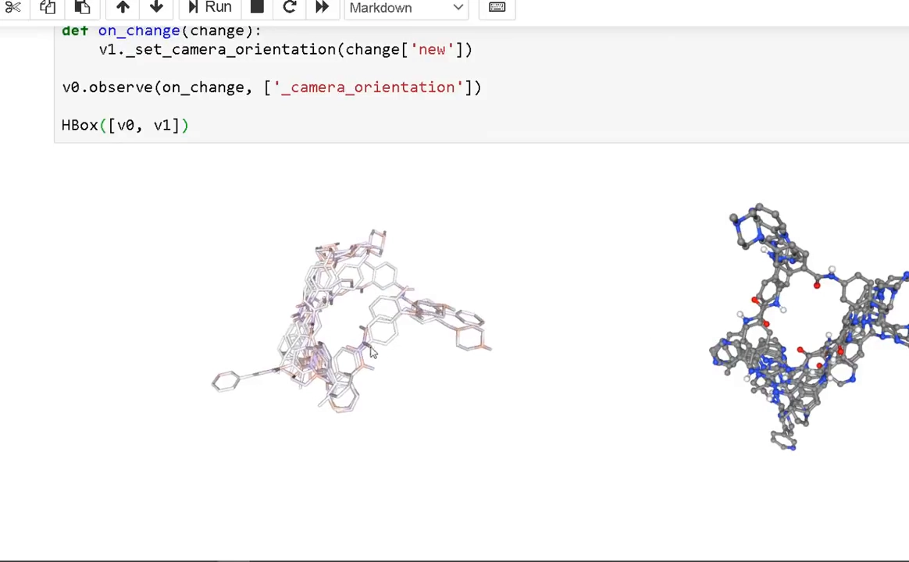

NGL viewer 里看对接输出：

- 左面板：对接姿势（pose）用带部分电荷着色的 licorice（甘草链）表示；
- 右面板：同一批姿势按元素着色的球棍（ball-and-stick）模型。

从输出列表里挑一个 pose 做目视检查——这就是"对接姿势选择"步骤。

## 九、提取姿势、叠合、与实验结构对答案

[【跳转到 13:38】](https://www.youtube.com/watch?v=lY_8HAwnsWU&t=818)

最后三步一气呵成：

1. **提取**选中的对接 pose，转回 PDB 格式；
2. **叠合（superpose）**：把配体姿势叠到靶标蛋白结构上，生成一个同时包含靶标与配体的新 PDB；
3. **对比**：在 NGL viewer 里把算出来的蛋白-配体复合物与实验复合物摆在一起——实验姿势按元素着色，对接姿势用绿色 licorice 显示。

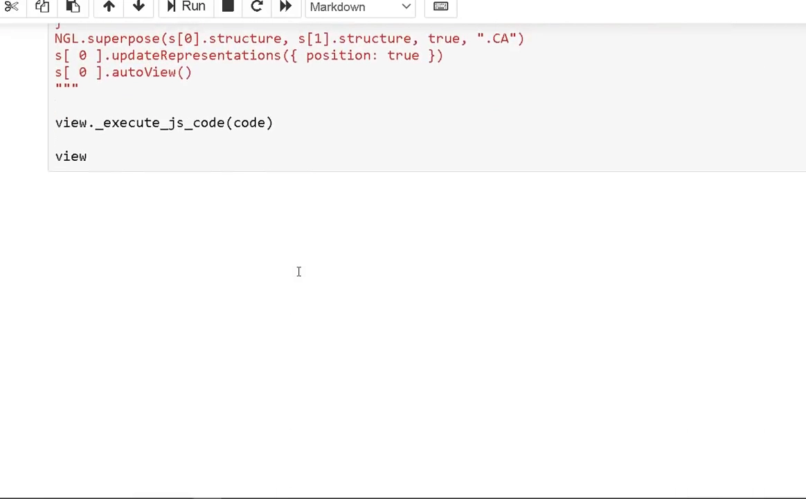

如果绿色的对接姿势与实验姿势高度重合，说明前面 fpocket 找的口袋、生成的盒子都放对了；再加上 AutoDock Vina 本身非确定性、建议多跑几次的提醒，这条"找口袋 → 对接 → 对答案"的流水线就闭环了。

## 小结

- **fpocket 负责找口袋**：基于 Voronoi 镶嵌几何 + alpha 球把蛋白表面空腔自动识别出来；教程旋钮是最小/最大 alpha 球半径 3 Å/6 Å、每口袋至少 35 个 alpha 球。
- **JSON 输出每口袋自带指标**：score、druggability score、volume、hydrophobicity、polarity、flexibility；本例按体积 800–2000 ų 过滤。
- **口袋 → 对接盒**：外扩 12 Å 保证装下小分子的各种姿态，并用原共晶配体核对盒子位置。
- **配体与受体都要转 PDBQT**（Q = 部分电荷，T = 原子类型）；配体柔性用扭转树描述，联合原子模型只保留极性氢。
- **AutoDock Vina 非确定性**：多跑几次再下结论；结果要叠回实验结构对答案。

## 关键术语速查

| 术语 | 一句话解释 |
| --- | --- |
| 分子对接（docking） | 用计算预测小分子配体在靶标蛋白上的结合位置与姿态 |
| 口袋（pocket） | 蛋白表面能容纳小分子的凹陷区域 |
| apo 结构 | 不带配体的"裸"蛋白结构 |
| fpocket | 基于 Voronoi 镶嵌几何 + alpha 球的口袋自动检测工具 |
| Voronoi 镶嵌几何 | 按最近原子把空间切分成多面体（泰森多边形）的方法 |
| alpha sphere | 每个 Voronoi 多面体内放的探针球，小球聚集处即空腔 |
| druggability score | 口袋可成药性评分：多可能结合小分子药物 |
| PDBQT | AutoDock 系格式：PDB + 部分电荷（Q）+ 原子类型（T） |
| 扭转树（torsion tree） | 把配体表示为刚性根部 + 可旋转部分，描述其柔性 |
| 联合原子模型 | 只显式保留极性氢的简化原子模型 |
| pose（对接姿势） | 对接软件输出的配体一种候选摆放方式 |
| Open Babel | 化学文件格式转换工具（如 SDF → PDB） |
| BOG | β-辛基葡萄糖苷，结晶时加入的去垢剂 |
