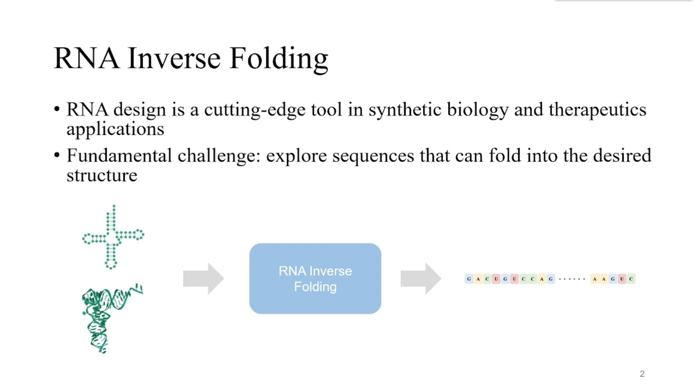
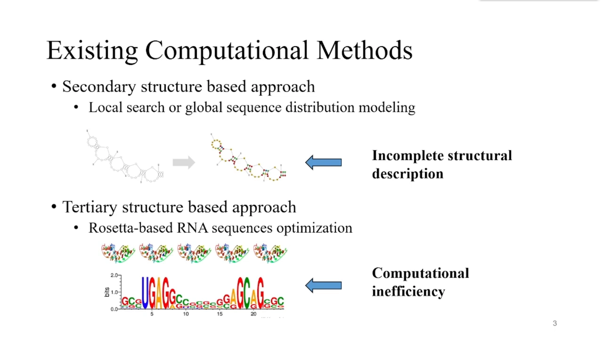
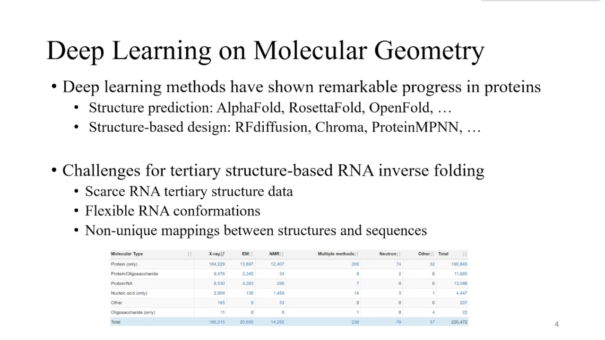
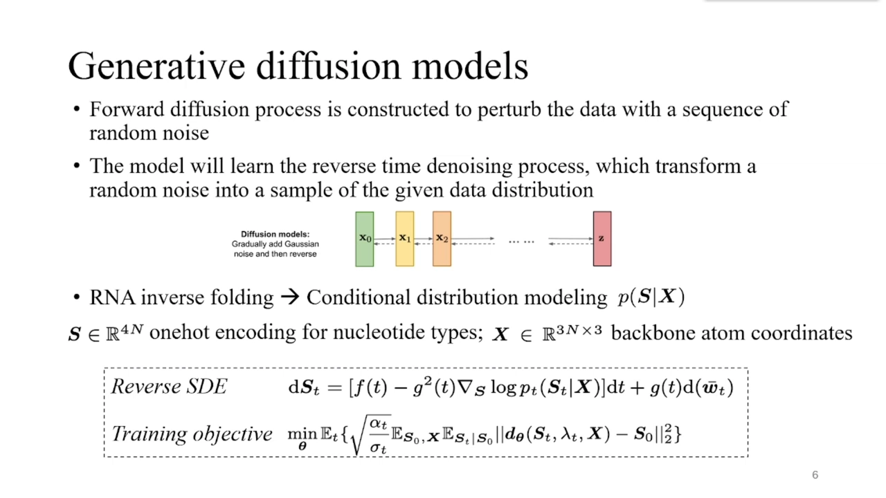
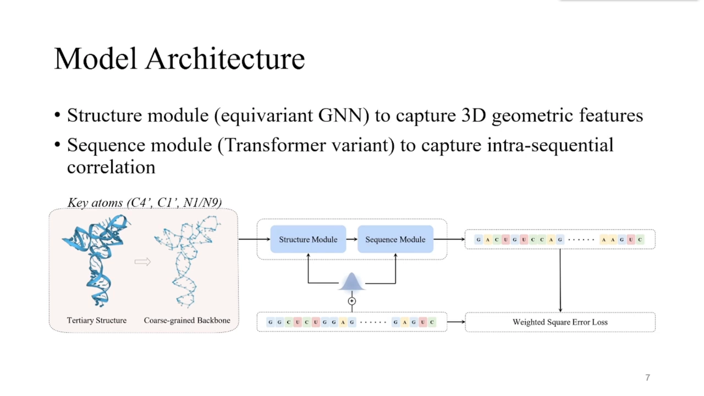
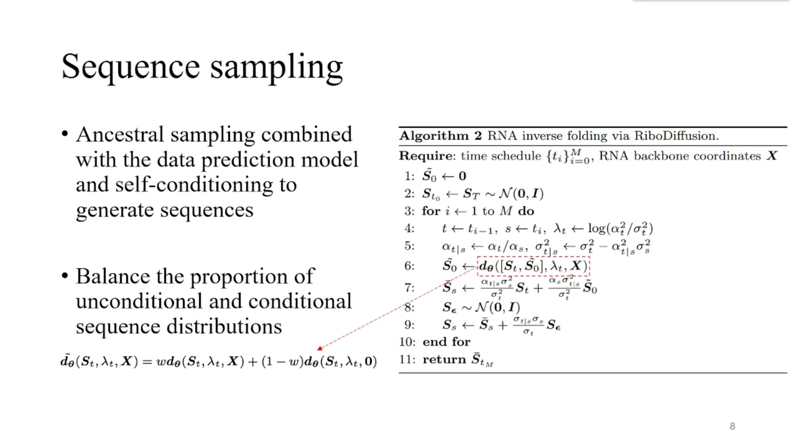
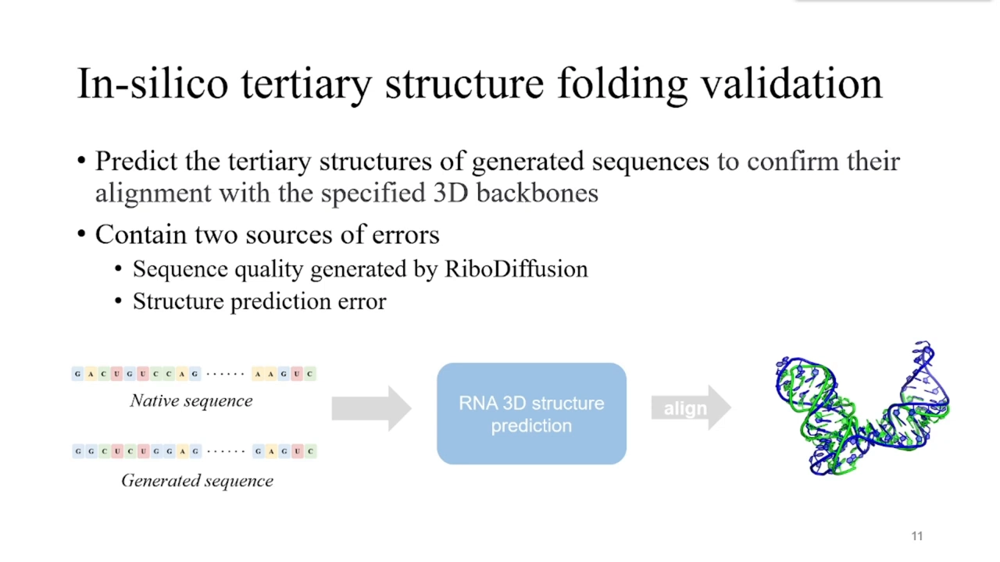
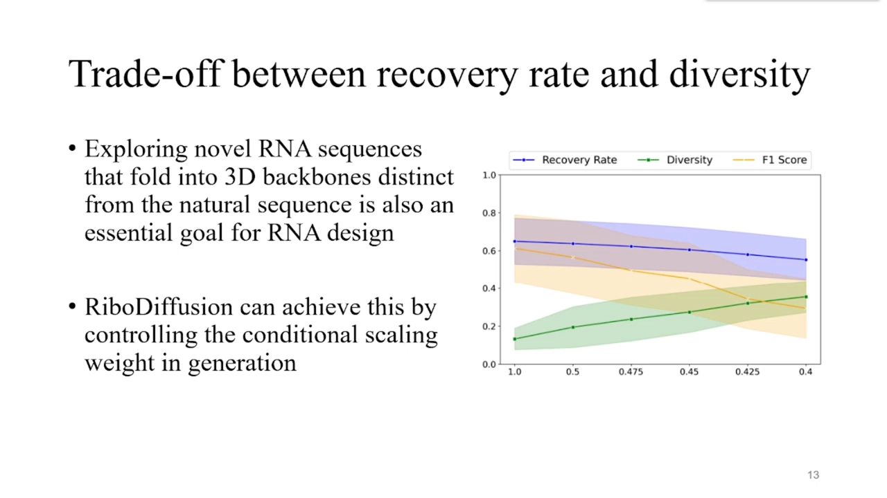

# RiboDiffusion：基于三级结构的RNA逆折叠生成式扩散模型

> 视频来源：[RiboDiffusion: Tertiary Structure-based RNA Inverse Folding with Generative Diffusion Models（YouTube，ISMB 2024 · 3DSIG 报告）](https://www.youtube.com/watch?v=m4Q0n-Xh-QM)
> 本篇是「逆折叠」系列的 RNA 篇：蛋白质侧有 ProteinMPNN 的"图解码"，RNA 侧怎么做逆折叠？这份 ISMB 报告给出一个扩散模型答案。

## 本讲要解决的核心问题（SCQA）

**背景**：RNA 在合成生物学和治疗领域应用越来越多，RNA 设计日益重要；蛋白质侧的深度学习已经大获成功——AlphaFold 的预测精度可以与实验媲美，RFdiffusion 能生成结合目标分子的全新蛋白质。

**冲突**：但**基于三级结构的 RNA 逆折叠**（给定 RNA 三维骨架，设计能折叠成它的序列）依然困难：一方面 RNA 三级结构数据相比蛋白质仍然稀缺；另一方面这个问题要捕捉柔性 RNA 构象的几何特征、处理"结构与序列非一一对应"的映射，还要为不同设计偏好提供多个备选。早期基于二级结构的方法不考虑三维，无法满足精确的功能结构约束（二级结构只部分决定三级结构）；Rosetta 一类物理优化虽然能匹配固定骨架，但受限于局部设计策略与计算效率 [【跳转到 1:05】](https://www.youtube.com/watch?v=m4Q0n-Xh-QM&t=90)。

**疑问**：能不能用生成式深度学习，直接在 RNA 三级结构上做逆折叠，并验证生成的序列真的能折回目标骨架？

**回答（中心思想）**：报告提出 **RiboDiffusion**——把 RNA 逆折叠表述为"学习以固定骨架结构为条件的序列分布"，用**生成扩散模型**求解；在序列回复率、二级结构 F1、家族相似性等基准上超越现有方法，跨 RNA 家族稳健，并通过"循环回折验证"确认生成序列可折回给定骨架；还能在"贴合结构"与"序列多样性"之间自由权衡。

## 一、问题与已有方法：RNA 逆折叠难在哪

### 1.1 问题定义与早期方法

RNA 逆折叠问题就是：**找到满足给定结构约束的功能 RNA 序列**。逆折叠工具可以依据二级或三级结构约束推断 RNA 序列 [【跳转到 1:05】](https://www.youtube.com/watch?v=m4Q0n-Xh-QM&t=65)。

研究者已经探索过不少方法。早期计算方法大多聚焦于**二级结构**：不考虑 RNA 三维结构时，这些方法无法满足精确的功能结构约束——因为二级结构只部分决定三级结构 [【跳转到 1:30】](https://www.youtube.com/watch?v=m4Q0n-Xh-QM&t=90)。

### 1.2 Rosetta 物理优化与深度学习的机会

先驱性的 Rosetta 类 RNA 序列优化采用**基于物理的方法**优化序列以匹配固定骨架，但仍受限于**局部设计策略**和**计算效率** [【跳转到 1:55】](https://www.youtube.com/watch?v=m4Q0n-Xh-QM&t=115)。

得益于深度学习的进展与生物分子结构数据的积累，深度学习在分子设计上潜力巨大：AlphaFold 让蛋白质结构预测精度媲美实验，RFdiffusion 能生成结合目标分子的新蛋白 [【跳转到 2:45】](https://www.youtube.com/watch?v=m4Q0n-Xh-QM&t=165)。但 RNA 这边，三级结构数据稀缺、构象柔性、序列不唯一等挑战仍然存在——这正是 RiboDiffusion 要补的空白。

## 二、RiboDiffusion：数据与问题表述

### 2.1 数据集：PDB 三级结构 + 预测结构增强

RiboDiffusion 用 PDB 数据库中的 RNA 三级结构构建基准数据集，并用 RNA 结构预测模型的预测结果做**数据增强**；测试集按 RNA 聚类、以不同的序列或结构相似度阈值切分 [【跳转到 3:35】](https://www.youtube.com/watch?v=m4Q0n-Xh-QM&t=215)。

### 2.2 生成式表述：p(s|x)

关键想法：把 RNA 逆折叠表述为——**用生成扩散模型，学习以固定骨架结构为条件的序列分布**。评测维度覆盖序列、二级结构与家族相似性，并跨 RNA 长度类别与类型分析；此外还探索跨家族性能、循环回折验证、权衡分析与数据增强消融 [【跳转到 4:25】](https://www.youtube.com/watch?v=m4Q0n-Xh-QM&t=265)。

## 三、扩散模型如何解逆折叠

### 3.1 前向加噪、反向去噪

扩散模型的第一步是构建**前向扩散过程**：用一串噪声逐步扰动数据，把数据分布变成已知的先验分布（比如高斯分布）；模型学习逆转这一过程，从先验分布出发生成新样本。反向去噪过程可以用随机微分方程（SDE）描述 [【跳转到 4:50】](https://www.youtube.com/watch?v=m4Q0n-Xh-QM&t=290)。

在 RiboDiffusion 中，逆折叠被建模为条件分布 **p(s|x)**：s 是核苷酸类型的 one-hot 编码，x 是骨架原子坐标。反向 SDE 中的 score 函数表示对数边缘概率分布的梯度场；他们用一个**数据预测模型**来参数化 score 函数，并按典型扩散模型的做法、以简单的加权平方误差目标优化 [【跳转到 5:40】](https://www.youtube.com/watch?v=m4Q0n-Xh-QM&t=340)。

### 3.2 级联模型：结构模块 + 序列模块

数据预测模型的架构很大程度上决定扩散模型的学习质量。RiboDiffusion 提出一个**级联模型**来预测原始核苷酸类型：**结构模块**捕捉几何特征——基于 GVP（geometric vector perceptron，几何向量感知机）架构并针对 RNA 骨架适配；**序列模块**捕捉序列间关联——由 Transformer block 改造、注入条件特征 [【跳转到 6:55】](https://www.youtube.com/watch?v=m4Q0n-Xh-QM&t=415)。

### 3.3 生成与条件强度调节

基于参数化的反向 SDE 构建生成式去噪过程，用常规的**祖先采样（ancestral sampling）**结合数据预测模型与 self-conditioning 生成"可能折叠成给定骨架"的 RNA 序列。生成过程中，模型通过调节数据预测模型的输出，平衡**无条件/有条件序列分布**的比例 [【跳转到 7:45】](https://www.youtube.com/watch?v=m4Q0n-Xh-QM&t=465)。

## 四、评测：全面优于基线

### 4.1 对比方法与指标

评测对比了四个以三级结构为输入的机器学习基线：**Geometric RNA design**（同期基于图的 RNA 逆折叠方法）、ProFOLD 的 StructGNN 与 GVP-GNN（后两者是蛋白质逆折叠的代表性深度学习方法，改造后兼容 RNA）；还引入以**二级结构**为输入的 RNA 逆折叠方法作对比，如 MCTS、RNA-Learner、Meta-Learner。指标包括 **recovery rate（序列回复率）、F1 score、success rate**，分别衡量生成序列在序列、二级结构、家族相似性上与天然序列的吻合程度 [【跳转到 8:10】](https://www.youtube.com/watch?v=m4Q0n-Xh-QM&t=490)。

结果：在不同的数据集切分下，RiboDiffusion 在这些指标上**优于其他方法** [【跳转到 9:06】](https://www.youtube.com/watch?v=m4Q0n-Xh-QM&t=546)。

### 4.2 跨家族泛化

为评估跨家族性能，数据集按跨家族设定重新划分：从 Rfam 数据库取得三级结构对应的 RNA 家族，随机选 4 个家族做测试、其余训练。结果 RiboDiffusion 在**训练中未出现过的 RNA 家族**上依然表现稳定 [【跳转到 9:29】](https://www.youtube.com/watch?v=m4Q0n-Xh-QM&t=569)。

## 五、循环回折验证与多样性权衡

### 5.1 回折验证：折得回去吗

生成序列能否折叠成给定的 RNA 3D 骨架？做法是用计算方法对生成序列**预测 RNA 结构**，再取生成序列预测结构与给定固定骨架之间 **C1′ 骨架原子的 TM-score** 衡量相似度。注意回折验证包含两类误差：一是折叠方法本身的结构预测误差，二是 RiboDiffusion 生成序列的质量 [【跳转到 10:19】](https://www.youtube.com/watch?v=m4Q0n-Xh-QM&t=619)。

结果显示：RiboDiffusion 生成的**新序列与天然序列不同，但依然倾向于折叠成相似的几何结构**；短 RNA 表现相对较差，受模型回复率不理想与结构预测工具自身局限两方面的影� [【跳转到 10:44】](https://www.youtube.com/watch?v=m4Q0n-Xh-QM&t=644)。

### 5.2 多样性 vs 回复率的权衡

之前的基准比较的是生成序列与天然序列的相似度；但 RNA 设计的现实需求还包括：**探索与天然序列不同、却仍可能折叠成目标骨架的新序列**。生成序列的多样性与回复率之间存在权衡，RiboDiffusion 通过**条件缩放权重（conditional scaling weight）**实现这一平衡 [【跳转到 11:09】](https://www.youtube.com/watch?v=m4Q0n-Xh-QM&t=669)：

- 权重设为 1：模型只考虑结构约束下的（条件）分布；
- 权重逐步调低：开始从"条件+无条件"的混合分布中采样，削弱结构约束的影响、提升生成多样性 [【跳转到 11:34】](https://www.youtube.com/watch?v=m4Q0n-Xh-QM&t=694)。

### 5.3 数据增强消融

训练数据增强主要源于 PDB 中 RNA 序列的稀缺性与有限多样性。加入额外的 RNA 结构预测数据能整体提升生成序列质量，也增强了模型**调节序列多样性**的能力——没有增强数据的模型，序列多样性一直比较低 [【跳转到 11:59】](https://www.youtube.com/watch?v=m4Q0n-Xh-QM&t=719)。

## 小结

- RNA 逆折叠 = 给定结构约束（二级或三级），求功能 RNA 序列；早期方法聚焦二级结构，物理优化（Rosetta 类）受限于局部策略与计算效率。
- 深度学习的机会在蛋白质侧已被 AlphaFold/RFdiffusion 验证；RNA 三级逆折叠的独特难点：数据稀缺、构象柔性、结构-序列多对多。
- RiboDiffusion 把逆折叠表述为学习 **p(s|x)**（s=核苷酸类型 one-hot，x=骨架原子坐标），用生成扩散模型求解。
- 模型是级联结构：**GVP 结构模块**（RNA 骨架适配）+ **Transformer 序列模块**（注入条件特征），配合祖先采样与 self-conditioning。
- 评测全面领先：三级输入基线（Geometric RNA design、ProFOLD StructGNN、GVP-GNN）与二级输入方法（MCTS、RNA-Learner、Meta-Learner）都被超越；跨 Rfam 家族泛化稳定。
- 循环回折验证用 C1′ TM-score 确认生成序列可折回目标骨架；**条件缩放权重**在"贴合结构"与"序列多样性"之间可调；数据增强提升质量与多样性。
- 与蛋白质侧的启发式/学习式逆折叠（如 ProteinMPNN）呼应：RNA 侧也有了基于学习的三级结构逆折叠方案。

## 关键术语速查

| 术语 | 一句话解释 |
| --- | --- |
| RNA 逆折叠 | 给定结构约束（二级/三级），设计能折叠成它的 RNA 序列 |
| 生成扩散模型 | 前向加噪把数据变高斯先验，学习反向去噪来生成样本 |
| score 函数 | 对数概率分布的梯度场，反向 SDE 的核心 |
| 数据预测模型 | 参数化 score 函数、直接预测"原始数据"（此处为核苷酸类型）的网络 |
| GVP | 几何向量感知机：在几何图上以标量/向量特征做消息传递的模块 |
| 条件缩放权重 | 控制条件/无条件分布混合比例，权衡结构贴合度与序列多样性 |
| recovery rate | 生成序列与天然序列的回复/吻合比例 |
| TM-score | 衡量两个结构（此处为 C1′ 骨架）相似度的指标 |
| 循环回折验证 | 对生成序列重新预测结构，验证能否折叠回给定骨架 |
