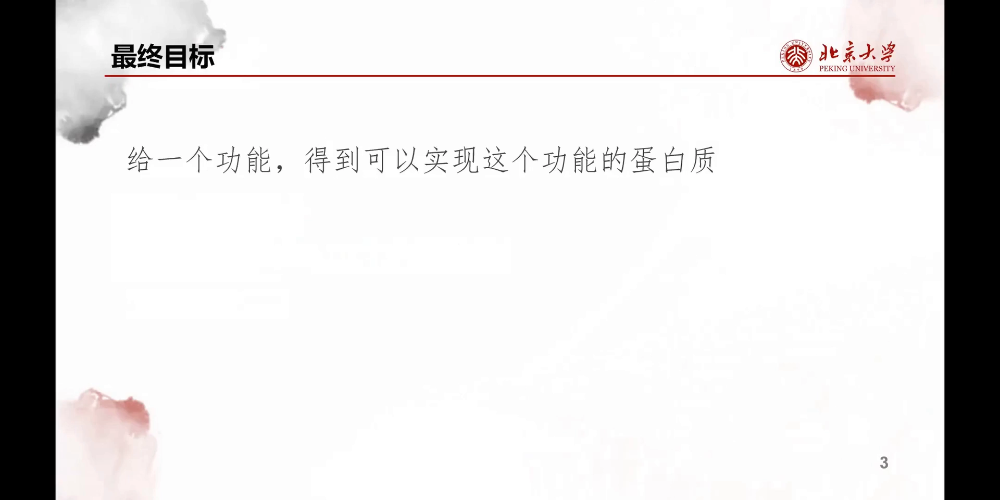
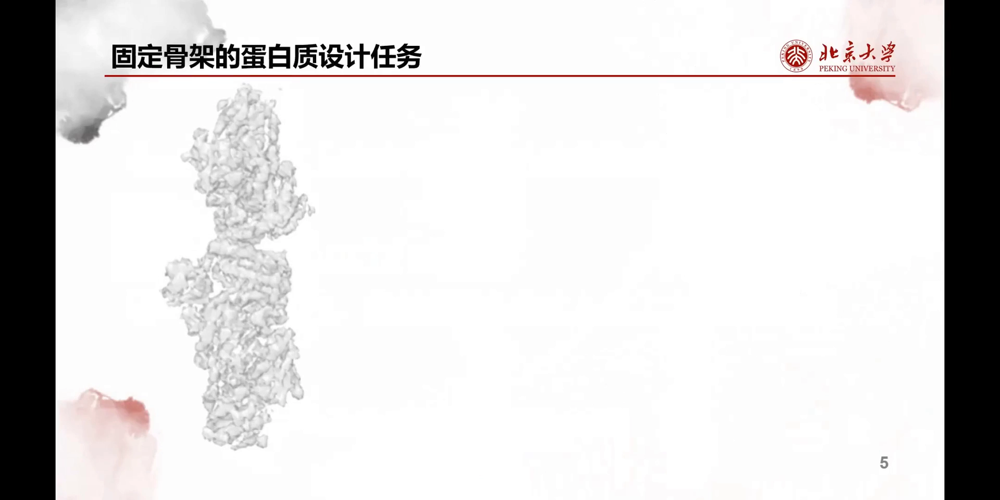
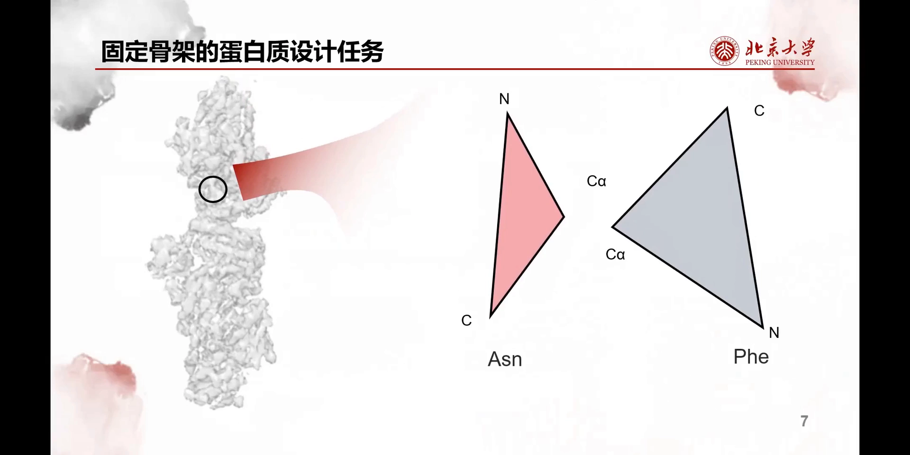
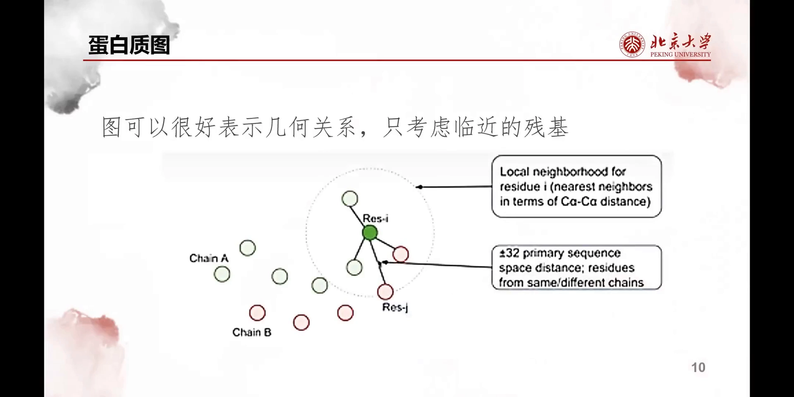
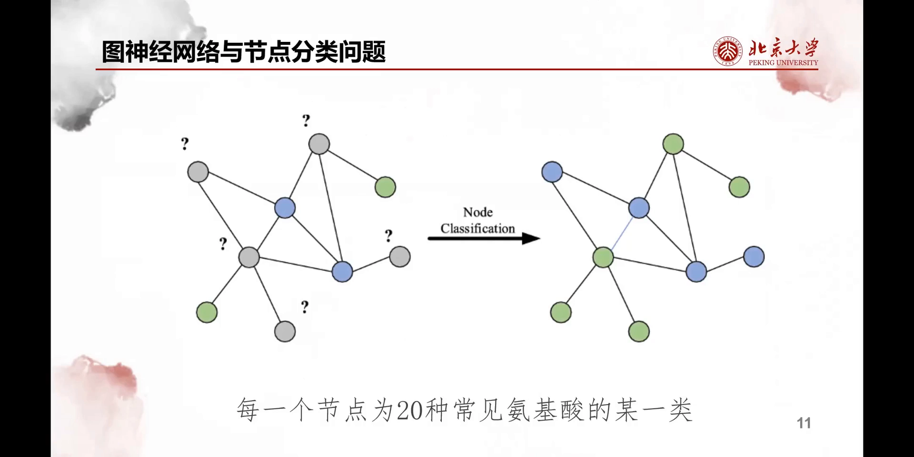
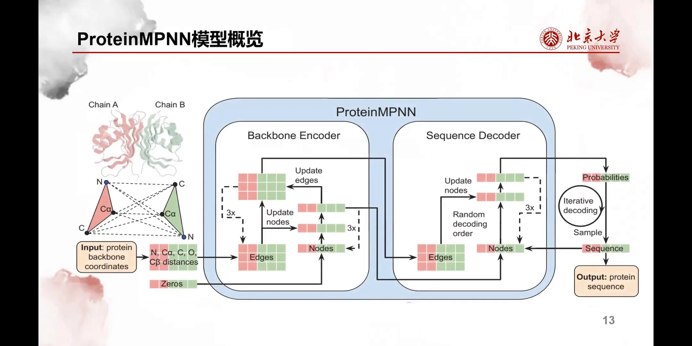
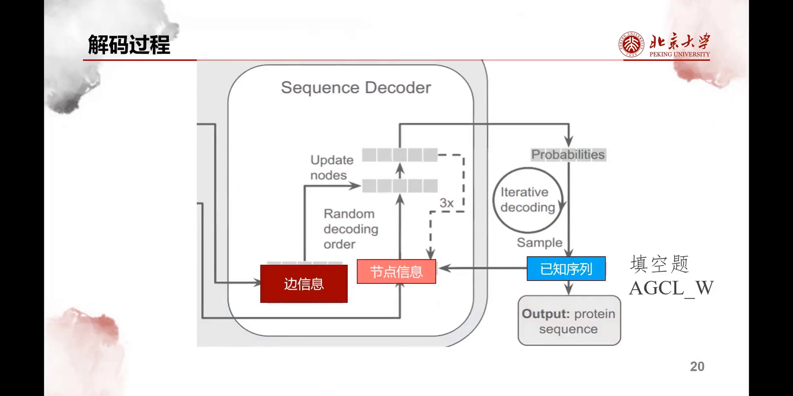
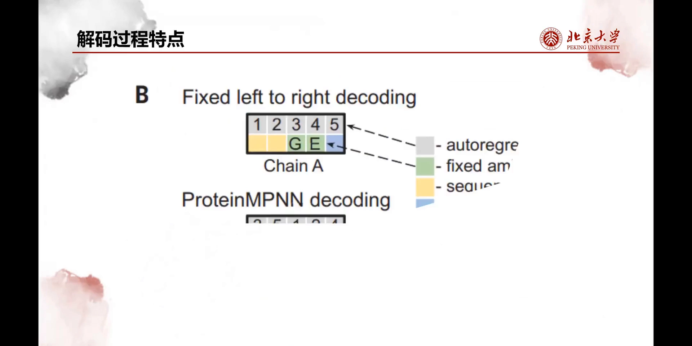
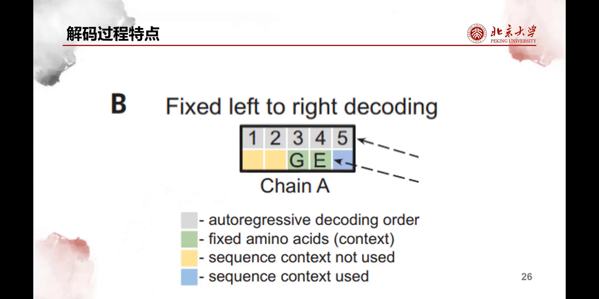
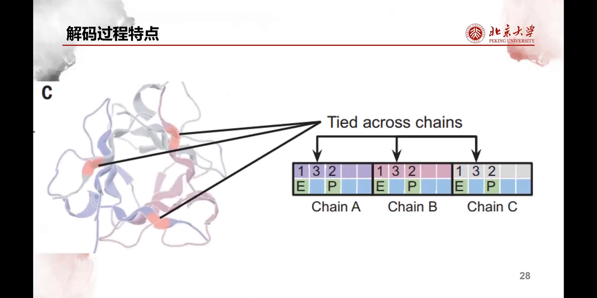

# 没有公式！10分钟动画讲清蛋白质设计

> 视频来源：[没有公式！10分钟动画讲清蛋白质设计（Bilibili）](https://www.bilibili.com/video/BV1Cs421g7Sa/)
> 本篇是「逆折叠」系列的概念篇：什么是蛋白质设计？为什么说它是"折叠"的反问题？经典工具 ProteinMPNN 是如何从一条骨架"解"出氨基酸序列的？

## 本讲要解决的核心问题（SCQA）

**背景**：蛋白质的功能由结构决定，而结构由氨基酸序列决定。AlphaFold 这类工具已经能"从序列预测结构"——这叫前向折叠。

**冲突**：但在很多设计场景里，我们手里只有一个"大概的骨架"（比如某个结合界面的几何约束，或生成模型给出的骨架坐标），并不知道每个位置该填什么氨基酸。功能到序列这一步，直接去算实在太难。

**疑问**：能不能反过来——给定目标结构，反推出能折叠成这个结构的氨基酸序列？

**回答（中心思想）**：可以，这就是**逆折叠（inverse folding）**。本视频用 10 分钟动画讲清：蛋白质设计问题如何表述、ProteinMPNN 如何把设计变成"图上的节点分类"、以及它区别于其他工作的两个关键解码技巧——**随机解码**与**同源多聚体同步解码**。把逆折叠理解成"按局部环境逐位搜索氨基酸"的过程，就是本讲的全部主线。

## 一、什么是蛋白质设计：从"功能"到"序列"的两次转换

### 1.1 设计的原始表述：给定功能，求蛋白质

设计都是奔着功能去的。蛋白质设计可以非常简单地表述成：**给定一个功能，希望得到能实现这个功能的蛋白质**。比如"我希望发出绿色荧光"，那就想设计出一批发绿色荧光的蛋白质 [【跳转到 00:22】](https://www.bilibili.com/video/BV1Cs421g7Sa/?t=22)。

那什么叫"设计出蛋白质"呢？我们知道，**氨基酸序列是蛋白质的一维表示**：有了氨基酸序列，它在生物体中表达就能得到对应的蛋白质。所以"得到蛋白质"其实是"得到氨基酸序列" [【跳转到 00:47】](https://www.bilibili.com/video/BV1Cs421g7Sa/?t=47)。

### 1.2 第一次转换：功能太难，先转成"结构"

虽然表述很直接，但**直接从功能得到氨基酸序列太难了**。这时我们用上另一条已知知识：**结构可以决定性质**。于是把任务转换一下：

> 给定一个蛋白质的稳定结构，希望得到具有这个稳定结构的蛋白质。

这就是蛋白质设计任务的基本表述 [【跳转到 01:12】](https://www.bilibili.com/video/BV1Cs421g7Sa/?t=72)。

### 1.3 既然有 PDB 数据库，为什么还要设计？

大家可能会疑问：既然我都有稳定结构了，就像有 PDB 数据库文件一样，可以直接读出每个原子的坐标、每个氨基酸的种类，那还需要设计干什么？这不是多此一举吗？

实际上，**很多情况下我们只有一个大概的框架，并不知道某个位置该填什么氨基酸**——只知道它大概有这么一个骨架。视频给了一个素描的类比：画一只猫，先画一个大概的轮廓框架，再逐步填充细节，最后得到一只栩栩如生的猫。蛋白质设计也一样：先有一个大概的骨架 [【跳转到 02:02】](https://www.bilibili.com/video/BV1Cs421g7Sa/?t=122)。

更具体地说：我们只有**骨架原子——氮、碳、α 碳、β 碳还有氧——的坐标**，但具体是什么类型的氨基酸并不知道；需要逐步往里添加氨基酸、添加原子，最后得到全原子模型，也就能从这个模型中直接读出蛋白质的氨基酸种类了 [【跳转到 02:27】](https://www.bilibili.com/video/BV1Cs421g7Sa/?t=147)。

## 二、设计的直觉基础：环境决定氨基酸

那具体怎么做这个任务呢？比如从结构上取一个小区域，这个区域的骨架满足某种几何特征，再运用大量统计数据就可以学习出来：**左边这个位置可能是 GLY（甘氨酸），右边可能是 LYS（赖氨酸）** [【跳转到 02:52】](https://www.bilibili.com/video/BV1Cs421g7Sa/?t=172)。

换一个位置，对应的几何框架不同了，左边就可能变成 ASN（天冬酰胺）[【跳转到 03:17】](https://www.bilibili.com/video/BV1Cs421g7Sa/?t=197)，右边变成 PHE（苯丙氨酸）。

所以能发现一件关键的事：**氨基酸的种类其实可以通过周围的环境来决定**——这就是我们进行蛋白质设计的基础。

## 三、ProteinMPNN 的思路：把设计变成图上的节点分类

接下来讲 ProteinMPNN 的解决思路。首先要引入**蛋白质图**的概念 [【跳转到 03:39】](https://www.bilibili.com/video/BV1Cs421g7Sa/?t=219)。

图（graph）由节点和边组成，能很好地表示空间的几何关系，因此用它来表示蛋白质结构、以及对氨基酸进行解码非常有帮助。比如看图中的绿色圈——那是中心残基；先考虑它邻近的残基（图中圈起来的两个绿色和两个红色的圈），再把这些邻近残基 [【跳转到 03:44】](https://www.bilibili.com/video/BV1Cs421g7Sa/?t=224) 和它自己连上边，就得到一个图关系。于是就能从这几个关系中大致解出残基的种类和位置。有了这种连边关系之后，就可以把蛋白质设计任务表述成**一个图的节点分类任务** [【跳转到 04:09】](https://www.bilibili.com/video/BV1Cs421g7Sa/?t=249)。

在一张非常经典的示意图里，节点一共两类（蓝色一类、绿色一类），未分类的节点用灰色表示。经过一个训练好的**图神经网络**之后，它会根据每个节点周围的几何关系和拓扑结构，决定它到底是蓝色一类还是绿色一类 [【跳转到 04:34】](https://www.bilibili.com/video/BV1Cs421g7Sa/?t=274)。

放到蛋白质设计任务里：**把节点归到 20 种氨基酸中的某一类**。在这个空蛋白质骨架上做图节点分类，就得到每个节点对应的氨基酸——于是完成蛋白质设计 [【跳转到 04:59】](https://www.bilibili.com/video/BV1Cs421g7Sa/?t=299)。

## 四、ProteinMPNN 模型三步走：输入 → 消息传递 → 解码

ProteinMPNN 的架构图看起来可能有点吓人、有点长，但一点点剖析就知道它在干什么 [【跳转到 05:29】](https://www.bilibili.com/video/BV1Cs421g7Sa/?t=329)。

### 4.1 输入：骨架坐标建图，节点特征置零

输入部分构建了初始蛋白质图：输入是蛋白质的骨架坐标，也就是把蛋白质中氨基酸之间的距离关系和邻近关系输入进去。特别注意：**节点信息是零**——因为现在还不知道每个节点属于哪一类氨基酸，所以全用零表示 [【跳转到 05:54】](https://www.bilibili.com/video/BV1Cs421g7Sa/?t=354)。

### 4.2 消息传递：逐层更新边与节点信息

之后经过一个叫 MPNN 的**消息传递网络**，得到更新后的边信息和节点信息。这个网络可以很简单地理解：它其实是把第 N 层的边信息、节点信息等更新到第 N+1 层——上一个视频里讲过，没看的话可以去看。经过更新函数，边和节点信息沟通融合，得到一种更新的表示 [【跳转到 06:30】](https://www.bilibili.com/video/BV1Cs421g7Sa/?t=390)。

### 4.3 解码：支持"填空"，逐位填成完整序列

接下来是解码过程。解码器的初始输入也是边信息和节点信息，但有一个不同之处 [【跳转到 06:53】](https://www.bilibili.com/video/BV1Cs421g7Sa/?t=413)：

有时我们可能**已经知道一部分序列**——比如任务不是从头设计，而是给定一部分序列的"填空"问题。这时就可以把已知序列作为另一个输入：先用已知序列更新节点信息，之后再用边信息去更新节点信息 [【跳转到 07:03】](https://www.bilibili.com/video/BV1Cs421g7Sa/?t=423)。

大家看图中，节点信息要被更新三次，也被边信息更新三次。等节点信息更新好之后，就预测它的概率，在对应的 20 种氨基酸中取其中一种，把这个空填上——完成一次解码。实际上这个过程要不断解码、不断填空，最终填成完整的氨基酸序列 [【跳转到 07:28】](https://www.bilibili.com/video/BV1Cs421g7Sa/?t=448)。

这个架构图虽然复杂，但剖析清楚后基本思路非常简单。而在解码过程中，有几个重要特点是 ProteinMPNN 与其他工作不同之处 [【跳转到 07:53】](https://www.bilibili.com/video/BV1Cs421g7Sa/?t=473)。

## 五、ProteinMPNN 的两个关键解码特性

### 5.1 随机解码（random decoding）：不必从左到右

首先它采用了一种叫**随机解码**（random decoding）的方式，与固定解码不同。什么叫固定解码呢？想想聊天机器人 ChatGPT 或者其他大模型：输入一句话后，它一个词一个词往外蹦，也就是模型**从左到右**解码 [【跳转到 08:18】](https://www.bilibili.com/video/BV1Cs421g7Sa/?t=498)。

这种解码有什么问题呢？看这张图：图中 3、4 号位已经给定了是 G 和 E 两种氨基酸，那么从左到右解码时，解码 1、2 号位时**用不到 3、4 号位的信息**——为什么？因为从左到右"说话"时，并不知道下一个、下两个词甚至下十个词应该说什么，所以用不到那个信息；而写到第 5 个的时候，才可以用到 3、4 号位的信息 [【跳转到 08:43】](https://www.bilibili.com/video/BV1Cs421g7Sa/?t=523)。

与固定解码不同，ProteinMPNN 使用随机解码：比如从 G 这一位开始解码，采取 **3→5→1→2→4** 这样的解码顺序 [【跳转到 09:08】](https://www.bilibili.com/video/BV1Cs421g7Sa/?t=548)。于是解码先到 G 位，但它已经是给定的，跳过；接下来是 E 位，也被给定了，同样跳过；剩下三个空位，解码时就可以**利用 G 和 E 这两个位置的信息**。

所以说 ProteinMPNN 这种解码方式带来了更多信息，也进一步保证了**在固定一部分序列的情况下，所生成的蛋白质会有比较正确的结果** [【跳转到 09:33】](https://www.bilibili.com/video/BV1Cs421g7Sa/?t=573)。

### 5.2 同源多聚体同步解码（tied positions）

ProteinMPNN 还实现了另一个很好的解码方式：如果我们输入的蛋白质要求设计成**同源多聚体**（homomer，多条链氨基酸完全相同的多聚蛋白），它会在对应的位置进行**同步解码**。比如图示的是一个三聚体，三条链都是相同的氨基酸，ProteinMPNN 知道这一点后，解码时就会把这三个位置**一块解码**，这也保证了它是一个同源多聚体 [【跳转到 10:06】](https://www.bilibili.com/video/BV1Cs421g7Sa/?t=606)。

## 小结

- 蛋白质设计的原始表述是"给定功能，求蛋白质"；因为结构决定性质，实际操作中先转换为"给定稳定结构，求具有该结构的序列"。
- 大多数设计场景只有大概骨架（骨架原子的坐标），并不知道每个位置填什么氨基酸——这正是逆折叠要解决的问题。
- 设计的直觉基础：**氨基酸种类由周围的几何环境决定**，同一段骨架换个环境，学习出的氨基酸就不同。
- ProteinMPNN 把设计变成"图上的节点分类"：残基为节点、空间邻近连边，图神经网络按邻居信息给每个节点归 20 类之一。
- 模型三步走：骨架坐标建图（节点特征置零）→ 消息传递逐层更新 → 解码器逐位填空；支持"已知部分序列"的填空输入。
- 两个关键解码特性：**随机解码**（乱序解码，让空位能用上已固定位置的信息）与**同源多聚体同步解码**（相同位置一起解，保证链间一致）。

## 关键术语速查

| 术语 | 一句话解释 |
| --- | --- |
| 蛋白质设计 | 给定功能（或结构），求能实现它的氨基酸序列 |
| 逆折叠（inverse folding） | 折叠的逆问题：从目标结构反推序列 |
| 骨架（backbone） | 蛋白质主链原子（N、Cα、C、O 等）的坐标集合，不含侧链细节 |
| 残基 | 组成蛋白质链的氨基酸单元 |
| 蛋白质图 | 以残基为节点、空间邻近关系为边的图结构 |
| 消息传递网络（MPNN） | 在图上逐层交换并更新节点/边信息的神经网络 |
| 节点分类 | 给图中每个节点归类的任务；此处即归入 20 种氨基酸之一 |
| 随机解码 | 按随机顺序逐位解码序列，使空位可利用已固定位置的信息 |
| 同源多聚体 | 多条相同链组成的多聚蛋白；解码时相同位置同步生成 |
