# 设计优化蛋白序列，通过ProteinMPNN和alphafold2在线网站的傻瓜操作

> 视频来源：[设计优化蛋白序列，通过ProteinMPNN和alphafold2在线网站的傻瓜操作（Bilibili）](https://www.bilibili.com/video/BV1DbUgYCEeB/)
> 本篇是「逆折叠」系列的实操篇：上一讲讲了 ProteinMPNN 的原理，这一讲跟着视频把网页版从上传 PDB 到拿到可用序列完整跑一遍。

## 本讲要解决的核心问题（SCQA）

**背景**：ProteinMPNN 能从蛋白质骨架"逆折叠"出氨基酸序列（原理见本系列概念篇）；官方教程也提供了两个完整案例。

**冲突**：官方教程教的是命令行版 MPNN 软件 + AlphaFold 软件的用法，对没有编程环境的新手门槛不低；而且设计完的序列怎么确认真的能折叠成目标结构，也需要一条验证通路。

**疑问**：能不能在网页上"点点鼠标"完成 逆折叠 → 序列 → 结构验证 的整个闭环？

**回答（中心思想）**：可以。本视频实操演示 ProteinMPNN **网页版**全流程：上传 PDB → 选链、设参数（输出条数、temperature、模型、backbone noise、多聚体、固定区域）→ 生成 15 条序列并按评分与 sequence recovery 挑选 → 用网页内置的 AlphaFold 回折验证（看 RMSD、pLDDT、固定区对比与热图）→ 下载结果用 PyMOL 叠合比对。文末还介绍了一个免外网的中文多功能网站作为备选。

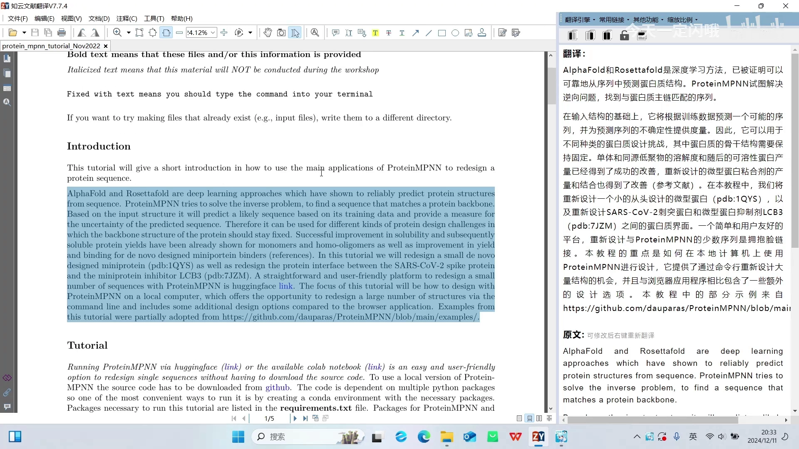

## 一、入口与案例：官方教程给了两个练手题

打开网站（需外网/梯子），它有一段前言介绍和背景文献支撑——整个模型是怎么来的，我们不去深究 [【跳转到 00:58】](https://www.bilibili.com/video/BV1DbUgYCEeB/?t=58)。

官方教程有两个案例：一个是**重新设计一个小的、从头设计的微型蛋白**，提供了对应 PDB 编号；另一个是 **SARS 蛋白和与它对应的蛋白抑制剂**的设计，也提供了 PDB 编号。我们就主要做后面这个 [【跳转到 00:18】](https://www.bilibili.com/video/BV1DbUgYCEeB/?t=18)。

按照教程给出的 PDB 编号输入，这边就导入了 7JZM 这个序列 [【跳转到 01:57】](https://www.bilibili.com/video/BV1DbUgYCEeB/?t=117)。

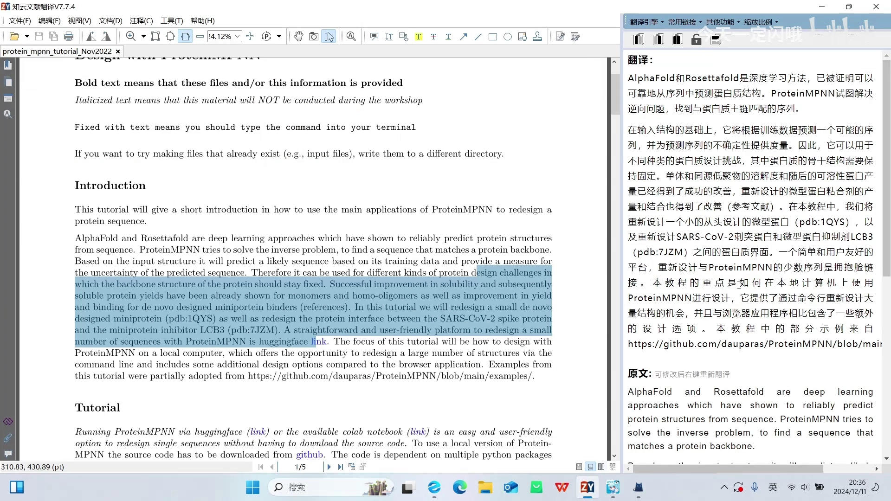

## 二、设计前的关键参数：一个个讲清楚

导入之后就接着来设计，网页上的参数我们一个个过 [【跳转到 02:41】](https://www.bilibili.com/video/BV1DbUgYCEeB/?t=161)：

- **设计哪条链**：根据教程，本案例想设计的是 A 链——就是那个抑制剂（蛋白）的 A 链，我们这边 A 链就不动；如果你要设计 B 链、C 链，手动输入就可以更改。
- **输出几条序列**：这边最多可以拉到 15 个，默认给的是 2 个，按自己需求来。
- **temperature（温度）**：温度对蛋白设计影响比较大，一般默认 0.1；需要修改的话可选 0.1 到 0.3。

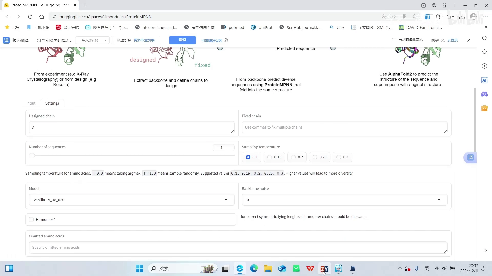

- **模型**：即优化序列所用的模型，有很多选择。除了 Vanilla 的，还有一个 Soluble（可溶性）模型；网站并没有说明哪一个会是更优解，这边选它默认的第 20 代。理论上代数越高优化效果应该越好——比如用 30 代（v_48_030）可能更好一些，但视频只做简单介绍 [【跳转到 03:31】](https://www.bilibili.com/video/BV1DbUgYCEeB/?t=211)。
- **"背景噪音"（backbone noise，骨架噪声）**：其实对应"主链上那个碳原子和它的侧链是否需要维持在原位"。咔嚓拍一张照片，蛋白在这一刻是这个形态；但柔性区域比较大的地方，下一刻可能就变成另一个形态，很难说设计出来的蛋白不会受柔性影响。所以它给出 0 到 0.3 的选择：允许原本给定的那几个碳原子位置左右上下稍微晃动一下，不是规定得那么死。有文章支撑 0.2、0.3 做出来效果比较好；教程没教网页版该填多少（它教的是命令行版 MPNN + AlphaFold 软件），这边先设 0.2，做完再做个 0.3 对比 [【跳转到 03:56】](https://www.bilibili.com/video/BV1DbUgYCEeB/?t=236)。

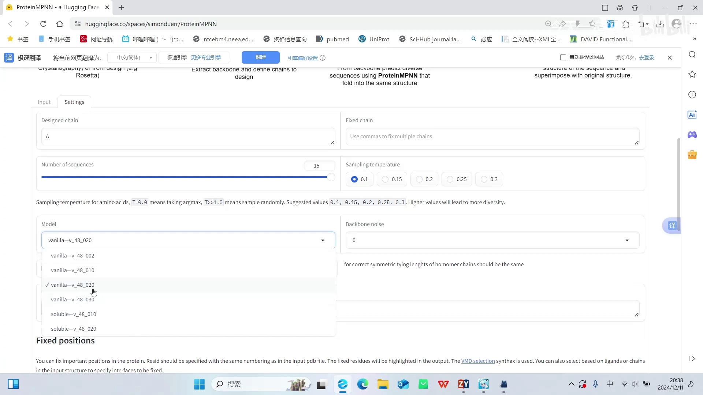

- **多聚体选项**：你设计的蛋白是否是多聚体？比如血红蛋白就是四个亚基聚集在一起形成有功能的、可运氧的复合物。如果蛋白需要变成二聚体、三聚体、四聚体去行使功能，就把它勾上。本案例只是单独一条链，不需要同源多聚化，所以不勾选 [【跳转到 06:01】](https://www.bilibili.com/video/BV1DbUgYCEeB/?t=361)。

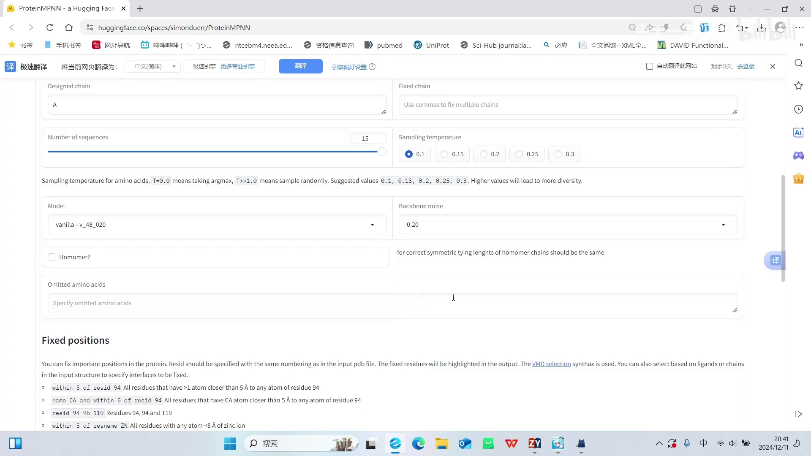

- **其他氨基酸选项**：视频作者表示不太清楚它想让填什么，可能是蛋白一些柔性区域可以被掐掉或额外增加——本案例没有改动这块。

## 三、固定区域：设计"哪里"的核心

### 3.1 为什么要设定固定区域

蛋白与蛋白相互作用有一个**相互作用界面**，类似于一个口袋或接触面。设计时如果想在接触面上做文章，就要把其他部分固定住——按理想想法，只改变它们相接触区域里这些氨基酸的序列 [【跳转到 07:16】](https://www.bilibili.com/video/BV1DbUgYCEeB/?t=436)。

但本案例的思路反过来：**不想改变它本身的接触界面**（维持接触面积），想做的是把其他区域的序列进行优化，让蛋白**水溶性更好**。所以目标是：固定相互接触的界面，改变其他部位的氨基酸——就看你的目的是改结合界面的氨基酸，还是提高水溶性等表面特性 [【跳转到 08:31】](https://www.bilibili.com/video/BV1DbUgYCEeB/?t=511)。

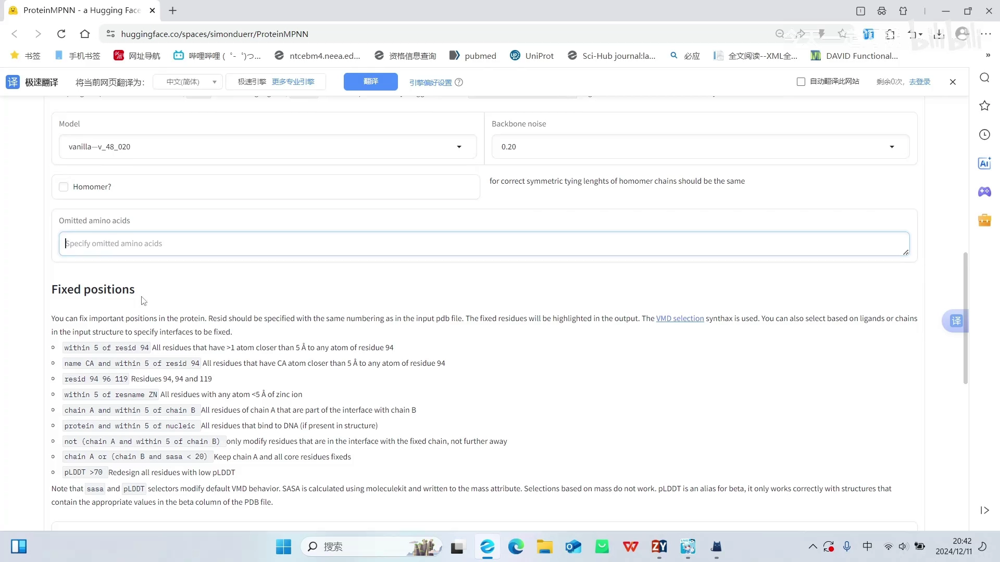

### 3.2 固定命令：A/B 链接触面 5 Å 内的氨基酸

网站会写明固定区域的命令含义。如果想固定两个接触面：A 蛋白和 B 蛋白相互接触、**在 5 Å 范围内**的这些氨基酸——它们有相互作用，是行使功能的区域——就会被选中并固定（不改变它们）[【跳转到 09:21】](https://www.bilibili.com/video/BV1DbUgYCEeB/?t=561)。

教程给的也是这条命令，直接粘贴过来即可。注意 A 链和 B 链要分清楚：如果你设计的蛋白不是 A 链和 B 链（可能是 A 链和 C 链、B 链和 C 链），需要手动更改；这个 5 Å 也可以调整 [【跳转到 09:46】](https://www.bilibili.com/video/BV1DbUgYCEeB/?t=586)。

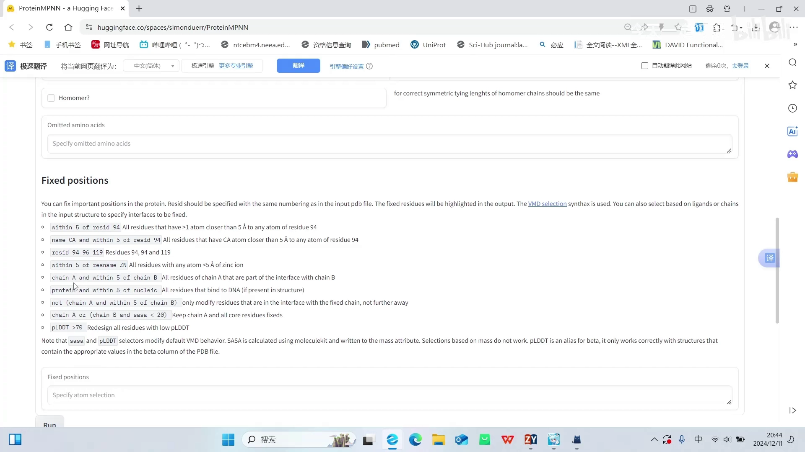

**5 Å 算是一个比较中性的范围**：大部分人认为 5 Å 范围内都是有作用的。可以调小到 4 Å 或 3 Å，但选中的氨基酸会相对少一点，可能漏选重要位点；调到 7 Å、8 Å 范围又过于大——这需要一些经验和文献支撑 [【跳转到 10:11】](https://www.bilibili.com/video/BV1DbUgYCEeB/?t=611)。

## 四、运行与结果解读

### 4.1 两条指标：评分与 sequence recovery

顺着教程让它运行，一共输出了 15 条序列。每条给你两个信息 [【跳转到 11:01】](https://www.bilibili.com/video/BV1DbUgYCEeB/?t=661)：

- **评分**：机器给这条产出序列打的分，**评分越高越好**、可信度越高（机器认为这条预测优化结果比较好）。
- **sequence recovery（序列回复率）**：设计出来的序列和原始野生型序列有多少重叠、占百分比。注意 **recovery 并非越高越好**——我们本来就想让它突变、变得更好，所以这只是一个比较中性的参考指标 [【跳转到 11:26】](https://www.bilibili.com/video/BV1DbUgYCEeB/?t=686)。

再看序列本身：根据我们设置的固定区域指令，输出的序列在那些位置上**没有做出改变**（第 1、3、4 位这样直到第 40 位），可以看到第一个氨基酸都是 N，和野生型一样；剩下区域是它根据自己的模型做的序列优化，无需深究具体怎么优化 [【跳转到 11:51】](https://www.bilibili.com/video/BV1DbUgYCEeB/?t=711)。

### 4.2 用 AlphaFold 回折验证

下一步做三维结构预测——用 AlphaFold 跑一下。这个是网页程序里自带的（官方也给了一个模型，这里不讨论模型本身）。参数上主要看**运行几次（循环几次）**：把前面生成的序列输入模型推出一个三维结构，一代又一代循环后它会类似"自检"，如果还有更好的优化方向，下一次可以再优化。网页上最多能选 15 次；根据查的文献，正常用 AlphaFold 迭代可以做 10 次、15 次甚至更多，但对电脑配置有要求；这个网站最多给 5 次，选 5 次或 3 次都可以。这边就让它运行了 [【跳转到 12:41】](https://www.bilibili.com/video/BV1DbUgYCEeB/?t=761)。

### 4.3 结构与指标：RMSD 与 pLDDT

产出结果后先看设计的 A 链：还是**比较规整的三个 α 螺旋**，没有很多 loop 区，非常规整。左边是输入的 15 条结果，编码从 0 开始（0~14 就是 1~15）[【跳转到 13:56】](https://www.bilibili.com/video/BV1DbUgYCEeB/?t=836)。

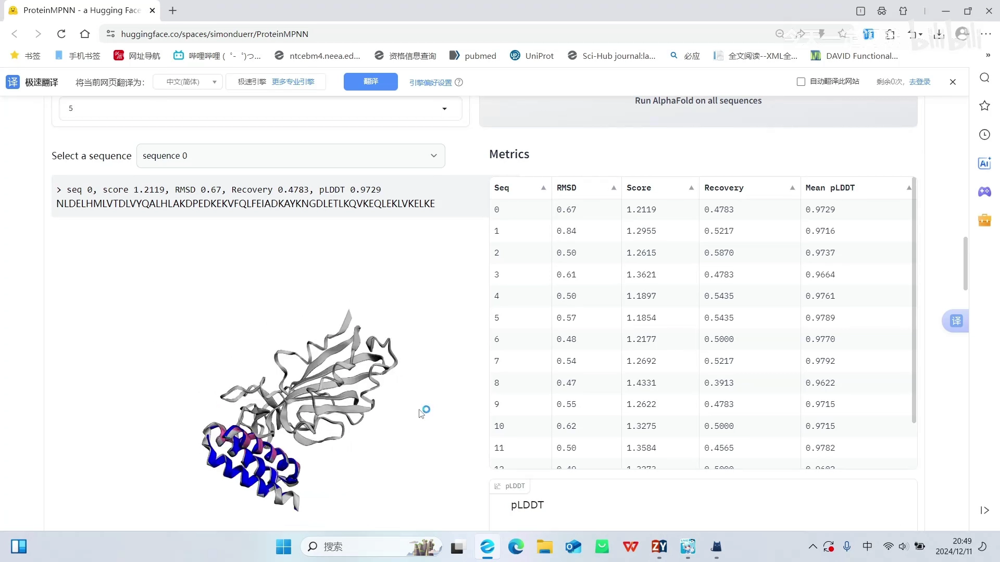

比之前的表格多了两个在建模中比较重要的指标 [【跳转到 14:21】](https://www.bilibili.com/video/BV1DbUgYCEeB/?t=861)：

- **RMSD**：值**越小越好**，可信度越高；
- **pLDDT**：AlphaFold 预测之后模型**对自己的信心度**——它并不是百分百保证预测结果和真实一致（有可能做完生物实验才发现形态就是预测的这样），所以这是模型对自己结果的信心评分，评分越高我们认为越好。

最终**综合这三个指标（评分、RMSD、pLDDT）去选择序列**，页面可以按某个指标从低到高排序；这个 8 号大概是最好的一个 [【跳转到 15:16】](https://www.bilibili.com/video/BV1DbUgYCEeB/?t=916)。

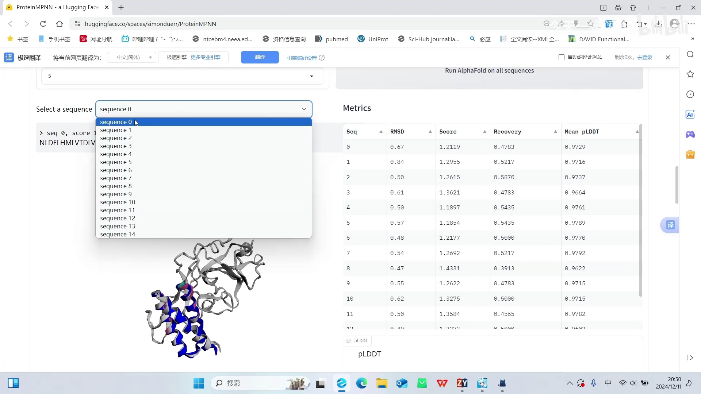

### 4.4 pLDDT 着色图与曲线图怎么看

左边这张着色图说的是 pLDDT [【跳转到 16:14】](https://www.bilibili.com/video/BV1DbUgYCEeB/?t=974)：

- **大于 90 是蓝色区域**——模型认为自己预测比较可靠、非常有信心；
- **黄色是低于 50**——几乎没有信心；
- **红色区域**是我们通过固定指令设定的固定区。

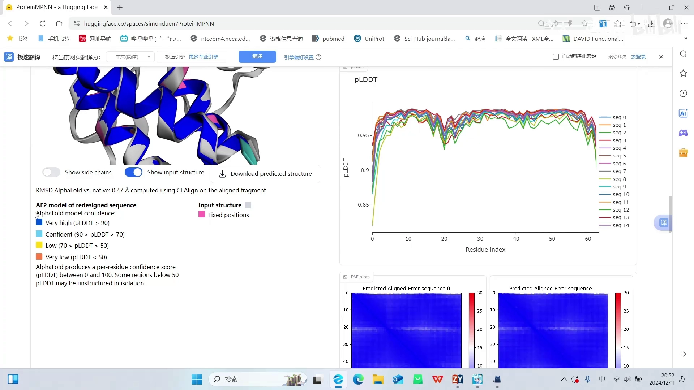

从侧面看，接头部分略微和野生型有些差距：绿色是设计后的、粉色是野生型——毕竟我们改变了其中一些序列 [【跳转到 16:35】](https://www.bilibili.com/video/BV1DbUgYCEeB/?t=995)。

再看 **pLDDT 曲线图**：能看到有一个 0.95 置信度的区域，线条越高、越平稳越好。预测之后所有序列都在某个地方变低——因为那可能是一个**接头区域**，比较柔性；如果预测里有**无规则卷曲（random coil）**的部分，这个值会非常低、呈现一个大裂口，就不会像规整区域那么平整 [【跳转到 17:21】](https://www.bilibili.com/video/BV1DbUgYCEeB/?t=1041)。

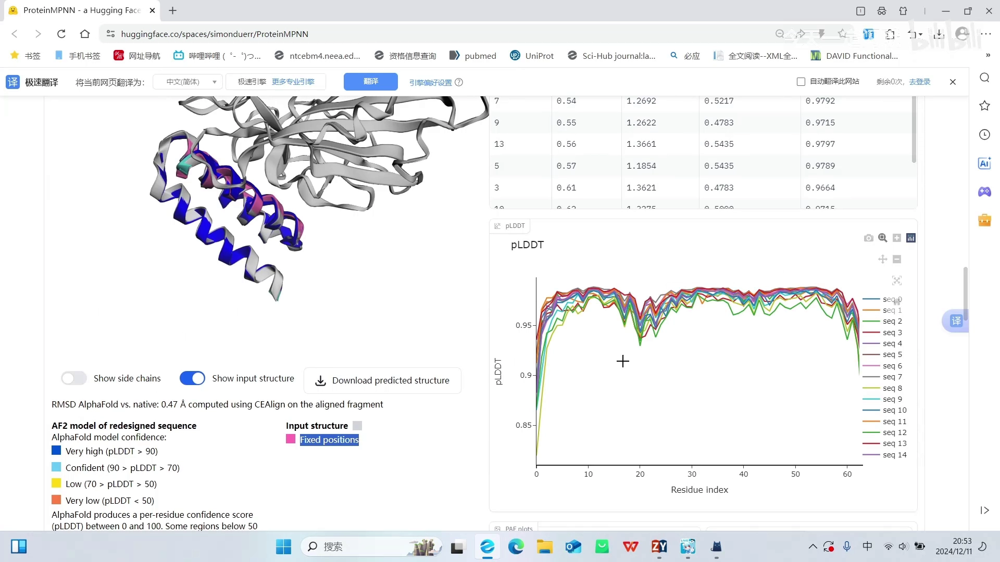

页面里还有各氨基酸、温度等信息的热图：不同部位的突变位点有的高、有的低。最终通过这些结果**选择一些序列去进行生物实验** [【跳转到 18:26】](https://www.bilibili.com/video/BV1DbUgYCEeB/?t=1106)。

## 五、实操注意事项：随机性与结果保存

- **每次运行结果都不同**：就算完全不动任何设置，再跑一次，结果跟上一次也不一样——每一次运行的结果都略微有些不同（采样是随机的）。所以**一定要保存好每一次运行的结果**，把序列和对应的数据都拷贝下来 [【跳转到 18:51】](https://www.bilibili.com/video/BV1DbUgYCEeB/?t=1131)。
- **下载结构与叠合**：需要某个模拟序列的三维结构图可以直接 download；下载下来的是单独这一条预测的 AlphaFold 结果（不带野生型叠加），可以用 PyMOL 或其他软件和野生型叠一下；要其他条目就再 download 其他的 [【跳转到 19:36】](https://www.bilibili.com/video/BV1DbUgYCEeB/?t=1176)。

## 六、备选：免外网的中文多功能网站

视频最后介绍了一个**中文的、不需要挂外网**就能运行的网站，功能更多：可以做很多结构，AlphaFold 也能做。用法类似：上传文件后设置参数 [【跳转到 20:01】](https://www.bilibili.com/video/BV1DbUgYCEeB/?t=1201)。

它的特点 [【跳转到 20:26】](https://www.bilibili.com/video/BV1DbUgYCEeB/?t=1226)：

- **固定区域不分链名**，可以手动输入"补丁"——案例给的是 A 链和 C 链，A 链和 C 链、B 链和 C 链都可以同时设置；
- **输出条数可以超过 15**，能到一百多个，没有实质性上限；
- 模型同样是 20 代、也有 30 代可选，温度参数同前；
- 给出**总体置信度与配体置信度**，还有 sequence recovery；
- 这些结果最终也要配合 AlphaFold 验证——不过这个网站**内置了 AlphaFold**，可以直接对结果做预测，页面下方有详细的小标签说明，照着用即可。

美中不足的是它这里**最多只能两两进行比对**，比较麻烦，所以常规流程还是不如前面那个网站"傻瓜"好用 [【跳转到 22:15】](https://www.bilibili.com/video/BV1DbUgYCEeB/?t=1335)。

## 小结

- ProteinMPNN 网页版把"逆折叠"做成了点点鼠标的流程：上传 PDB → 选链与参数 → 生成序列 → AlphaFold 回折验证。
- 关键参数有六个：设计链、输出条数、temperature（默认 0.1）、模型代数（20/30 代）、backbone noise（0~0.3，柔性容差）、多聚体开关。
- **固定区域**决定"设计哪里"：想改结合界面就固定其余部分；想改表面性质（如水溶性）就固定接触界面——常用命令是"A/B 链接触 5 Å 内氨基酸固定"，5 Å 是中性选择。
- 结果判读两条线：ProteinMPNN 侧看**评分（越高越好）与 sequence recovery（中性参考）**；AlphaFold 侧看 **RMSD（越小越好）与 pLDDT（置信度，>90 蓝色可靠、<50 黄色几乎无信心）**，pLDDT 曲线的低谷对应接头/无规则卷曲等柔性区。
- 采样有随机性，**每次运行结果不同，务必保存每一批结果**；结构可用 PyMOL 与野生型叠合检查。
- 免外网的中文网站可作备选：输出上百条、不分链名打补丁、内置 AlphaFold，但比对最多两两，不如主站傻瓜。

## 关键术语速查

| 术语 | 一句话解释 |
| --- | --- |
| 逆折叠 | 给定骨架/结构，反推氨基酸序列（ProteinMPNN 干的事） |
| temperature | 采样温度；默认 0.1，越高序列越多样 |
| Vanilla / Soluble 模型 | 通用模型与"可溶性"特化模型；另有 20/30 代等版本，代数越高理论上越好 |
| backbone noise | 骨架噪声：允许骨架碳原子位置小幅晃动，容忍结构柔性（0~0.3） |
| 固定区域 | 指定不改变的残基（如结合界面 5 Å 内），让模型只优化其余位置 |
| sequence recovery | 生成序列与野生型的重叠百分比，中性参考指标 |
| RMSD | 预测结构与参考结构的偏差，越小越好 |
| pLDDT | AlphaFold 逐残基置信度，>90 高置信（蓝），<50 几乎无信心（黄） |
| 回折验证 | 把设计序列重新预测结构，确认能折叠成目标构象 |
