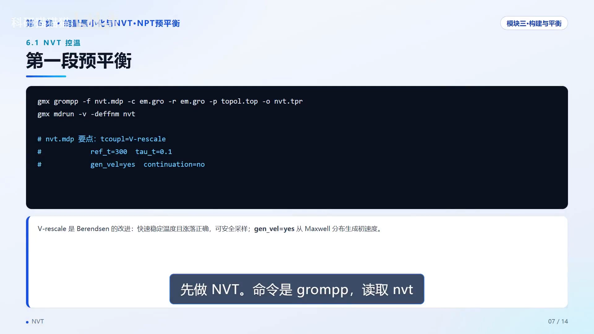
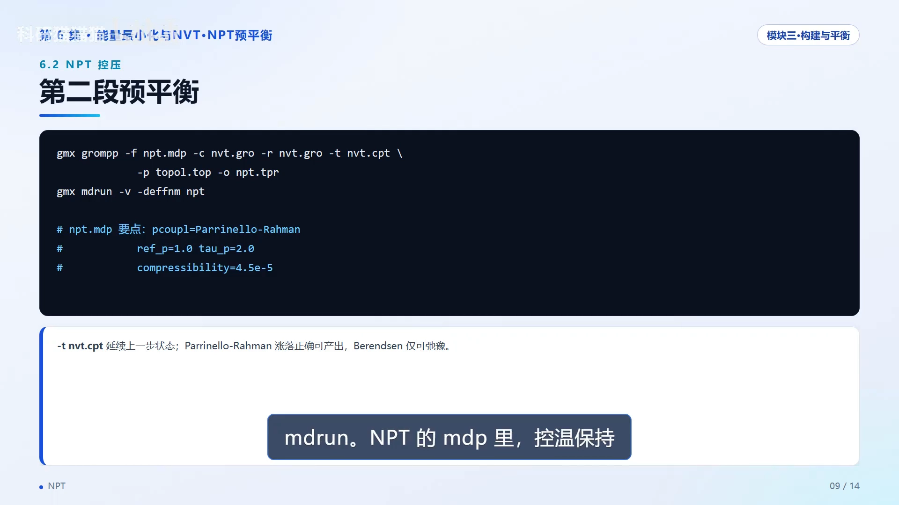
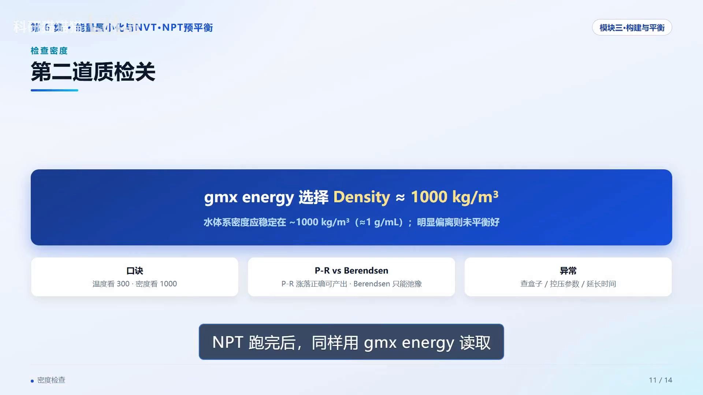

# 分子动力学模拟：第06集——能量最小化与 NVT·NPT 预平衡（GROMACS 教程 06）

> 视频笔记 · Bilibili [BV1Xv4D6vEfQ](https://www.bilibili.com/video/BV1Xv4D6vEfQ/) · UP 主：科研猫猫猫 · 时长约 10 分钟
> 本篇严格依据视频内容整理，配图截自视频，时间戳可跳转回看。

## 本集要解决的核心问题（SCQA）

**背景**：上一集已经构建好了完整体系（蛋白 + 水 + 离子），很多教程到这里就让你直接跑生产模拟。

**冲突**：如果把模拟比作盖楼，现在的地基还很不稳——初始结构里原子可能互相挤在一起，能量极高，直接跑动力学大概率「直接爆炸」：温度飙升、LINCS 警告刷屏、体系崩溃 [【跳转到 00:05】](https://www.bilibili.com/video/BV1Xv4D6vEfQ/?t=5)。

**疑问**：正式开跑之前，怎样把「粗糙的初始结构」变成一个「站稳了的体系」？能量最小化和两步预平衡的 mdp 参数该怎么配？跑完又怎么判断合格？

**回答（中心思想）**：本集给出完整的「地基工程」——先用 steep 最速下降做能量最小化（判据：势能平稳为负 + Fmax < 1000），再做 NVT 控温（V-rescale，300 K）、NPT 控压（Parrinello-Rahman，1 bar）两阶段预平衡（全程用 posre.itp 位置约束锁住蛋白重原子），质检口诀：**温度看 300，密度看 1000**。走完这一集，体系才真正站上生产模拟的起跑线 [【跳转到 00:22】](https://www.bilibili.com/video/BV1Xv4D6vEfQ/?t=22)。


## 一、能量最小化：把粗糙结构抚平成合理起点

### 1.1 为什么必须做

实验结构或建模结构里，原子位置总会有偏差，可能造成两个原子离得过近甚至重叠，这时体系的势能极高、受力极大。直接跑动力学，巨大的力会在第一步就把体系「撕碎」——表现就是温度飙升、LINCS 警告刷屏、直接崩溃 [【跳转到 01:04】](https://www.bilibili.com/video/BV1Xv4D6vEfQ/?t=64)。

### 1.2 steep 最速下降法

能量最小化默认用 **steep（最速下降法）**：每一步都朝能量下降最快的方向走，直到力足够小、能量收敛 [【跳转到 01:39】](https://www.bilibili.com/video/BV1Xv4D6vEfQ/?t=99)。


它的目的**不是探索构象，而是把一个粗糙的结构抚平成合理的起点**。

### 1.3 操作与收敛判断

两步操作 [【跳转到 01:53】](https://www.bilibili.com/video/BV1Xv4D6vEfQ/?t=113)：

```bash
gmx grompp -f minim.mdp -c solv_ions.gro -p topol.top -o em.tpr   # 编译
gmx mdrun -deffnm em                                              # 运行
```

收敛判断两个要点 [【跳转到 02:18】](https://www.bilibili.com/video/BV1Xv4D6vEfQ/?t=138)：

1. **看日志 `em.log`**：末尾搜索 Potential Energy——能量应该是**负的、平稳、不再显著下降**；
2. **看最大力 Fmax**：常规要求 **< 1000**（千焦·摩尔⁻¹·纳米⁻¹），严格的研究要求 **< 100**。也可以用 `gmx energy` 打开 `em.edr` 选 Potential 画能量下降曲线。

如果 Fmax 降不下来，多半是初始结构冲突太严重（UP 主的第 12 集专门讲排查）。

### 1.4 三种最小化算法怎么选

[【跳转到 02:43】](https://www.bilibili.com/video/BV1Xv4D6vEfQ/?t=163)

| 算法 | 特点 | 适用场景 |
| --- | --- | --- |
| steep（最速下降） | 每步沿最陡方向下降，简单稳定 | 最常用的**起步**算法，收敛后期慢 |
| CG（共轭梯度） | 利用上一步搜索方向，收敛更快 | steep 接近收敛后，进一步压小力 |
| L-BFGS（拟牛顿） | 实践中往往收敛最快 | 目前**不支持并行**，不适合大体系 |

最稳妥的实践：先用 steep 跑一段，Fmax 降下来后若还想更严格，再换 CG 或 L-BFGS 收敛。大多数教程直接用 steep 就够了 [【跳转到 03:18】](https://www.bilibili.com/video/BV1Xv4D6vEfQ/?t=198)。


## 二、预平衡两步走：先控温，再控压

预平衡分两步：**先 NVT 控温**，让温度稳定到目标值（比如 300 K）；**再 NPT 控压**，让压力和密度也稳定下来 [【跳转到 03:37】](https://www.bilibili.com/video/BV1Xv4D6vEfQ/?t=217)。

### 2.1 位置约束：为什么要「锁住」蛋白

两阶段都要施加**位置约束（posre.itp）**，把蛋白的重原子短暂锁住，只让水分子和离子先动 [【跳转到 03:52】](https://www.bilibili.com/video/BV1Xv4D6vEfQ/?t=232)。


为什么要锁？因为刚构建的体系里，蛋白周围的水还没有平衡——不锁的话，失衡的溶剂会把蛋白结构「冲坏」。等水和离子先平衡了，生产模拟时再放开约束。

### 2.2 NVT 的命令与 mdp 关键参数

命令套路 [【跳转到 04:19】](https://www.bilibili.com/video/BV1Xv4D6vEfQ/?t=259)：

```bash
gmx grompp -f nvt.mdp -c em.gro -r em.gro -p topol.top -o nvt.tpr
gmx mdrun -deffnm nvt
```

注意：位置约束的参考结构用 `-r` 参数指向 `em.gro`。mdp 里的关键点 [【跳转到 04:24】](https://www.bilibili.com/video/BV1Xv4D6vEfQ/?t=264)：

- **控温算法 V-rescale**：它是 Berendsen 的改进版，既能快速稳定温度，又能给出正确的涨落分布，可以安全采样；
- `ref-t = 300`（目标温度 K），`tau-t = 0.1`（耦合时间，皮秒）；
- **初速度从麦克斯韦分布生成**：`gen-vel = yes`，并且 `continuation = no`——意思是重新开始，而不是接续之前的运行。



### 2.3 温度曲线：预平衡的第一道质检官

NVT 跑完一定要检查温度 [【跳转到 04:49】](https://www.bilibili.com/video/BV1Xv4D6vEfQ/?t=289)：`gmx energy` 读取 `nvt.edr` → 交互菜单选 Temperature → 输出 xvg 画温度-时间曲线。

合格标准 [【跳转到 05:19】](https://www.bilibili.com/video/BV1Xv4D6vEfQ/?t=319)：温度在最初几十皮秒内从初始值爬升到目标值，然后**稳定在 300 K 附近小幅波动——没有剧烈震荡，更没有持续漂移**。如果温度剧烈跳动或爬不上去，回头检查初速度设置、控温参数，或者最小化是否收敛。


## 三、NPT 控压：Parrinello-Rahman 与三个关键参数

温度稳定后做 NPT。命令上比 NVT 多一步——用 `-t` 传入 `nvt.cpt` 检查点，把上一步的速度、温度状态延续下来 [【跳转到 05:44】](https://www.bilibili.com/video/BV1Xv4D6vEfQ/?t=344)：

```bash
gmx grompp -f npt.mdp -c nvt.gro -r nvt.gro -t nvt.cpt -p topol.top -o npt.tpr
gmx mdrun -deffnm npt
```

mdp 里控温保持 V-rescale，**控压用 Parrinello-Rahman**，关键参数 [【跳转到 06:22】](https://www.bilibili.com/video/BV1Xv4D6vEfQ/?t=382)：

- `ref-p = 1.0`（bar）、`tau-p = 2.0`（皮秒）；
- 水的 `compressibility`（可压缩率）= 4.5×10⁻⁵（bar⁻¹）。

**两种控压算法的取舍**：Parrinello-Rahman 能产生正确的压力涨落，适合预平衡和生产；而 **Berendsen 压浴只能用于快速弛豫，绝不能用它采集产出数据**——因为它的压力涨落是不对的。



## 四、质检三看：能量、温度 300、密度 1000

平衡阶段做完，UP 主给出「质检三看」[【跳转到 06:47】](https://www.bilibili.com/video/BV1Xv4D6vEfQ/?t=407)：

1. **看能量**：最小化后的势能应该平稳且为负——说明体系没有明显冲突；
2. **看温度**：NVT 和 NPT 阶段都稳定在 300 K 附近小幅波动——说明控温正常；
3. **看密度和体积**：NPT 阶段密度稳定在 1000 kg/m³、盒子体积不再持续变化——说明控压正常。

这三点对应体系的基本热力学状态（能量、温度、压力）。**任何一项异常都值得停下来查一查，而不是硬着头皮进入生产模拟**——这个习惯能把很多问题拦在预平衡之前。

### 4.1 密度曲线与检验口诀

NPT 跑完后同样用 `gmx energy` 读取 `npt.edr`，选 Density 画密度曲线 [【跳转到 07:32】](https://www.bilibili.com/video/BV1Xv4D6vEfQ/?t=452)。判断标准非常直观：水体系的密度应稳定在 **1000 kg/m³ 左右（≈ 1 g/mL）**——这是水在常温下的真实密度。密度明显偏离说明没平衡好，需要检查盒子大小、控压参数或延长预平衡时间 [【跳转到 07:44】](https://www.bilibili.com/video/BV1Xv4D6vEfQ/?t=464)。

**检验口诀：温度看 300，密度看 1000。两条都过关，体系才算真正站稳。**



## 五、预平衡高频问题与排查

[【跳转到 08:09】](https://www.bilibili.com/video/BV1Xv4D6vEfQ/?t=489)

| 问题 | 常见原因 | 处理 |
| --- | --- | --- |
| 温度爬不上去 / 剧烈震荡 | 初速度设置或最小化没做好 | 回查 `gen-vel` 与 EM 结果 |
| 密度长时间偏高/偏低 | 水模型不对、盒子不合适、compressibility 设错 | 逐项确认后重跑 |
| LINCS 警告刷屏 | `dt` 太大或约束设置有问题 | 回到更保守的设置 |
| 位置约束报错 | posre.itp 未正确 include 进拓扑 | 检查 topol.top 的 include 行 |


预平衡阶段的问题大多能追到**构建和最小化**这两步——前面的每一步都要做扎实。

## 小结

本集四个要点 [【跳转到 09:20】](https://www.bilibili.com/video/BV1Xv4D6vEfQ/?t=560)：

1. **能量最小化**：用 steep 最速下降，判据是 Fmax < 1000、能量平稳为负；
2. **预平衡两步走**：NVT 用 V-rescale 控温 + `gen-vel` 生成初速度；NPT 用 Parrinello-Rahman 控压、`-t` 传入检查点接续状态；
3. **位置约束**：两阶段都靠 posre.itp 锁住蛋白重原子，让溶剂先平衡，生产模拟再放开；
4. **质检三看**：能量、温度 300、密度 1000——任何异常先排查再前进。


视频最后留了两道思考题 [【跳转到 09:45】](https://www.bilibili.com/video/BV1Xv4D6vEfQ/?t=585)：为什么最小化阶段用最速下降 steep 而不用 leap-frog 积分器？为什么 NPT 预平衡要传入 NVT 的 cpt 检查点？

## 关键术语速查

| 术语 | 一句话解释 |
| --- | --- |
| steep / CG / L-BFGS | 三种能量最小化算法：起步用 steep，精修可换 CG 或 L-BFGS（不支持并行） |
| em.log / em.edr | 最小化的日志与能量数据；前者搜 Potential Energy，后者可画能量曲线 |
| Fmax | 最大原子力，收敛判据：常规 < 1000、严格 < 100 kJ·mol⁻¹·nm⁻¹ |
| posre.itp | 位置约束文件，预平衡时锁住蛋白重原子 |
| V-rescale | 速度重标定恒温器，Berendsen 的改进版，涨落正确、可安全采样 |
| ref-t / tau-t | 目标温度（K）/ 温度耦合时间（ps） |
| gen-vel / continuation | 是否重新生成初速度 / 是否接续之前的运行 |
| Parrinello-Rahman | 能产生正确压力涨落的控压器，适合预平衡与生产 |
| Berendsen 压浴 | 只能快速弛豫，不能用于采集产出数据 |
| ref-p / tau-p / compressibility | 目标压强（bar）/ 压力耦合时间（ps）/ 可压缩率（水的为 4.5×10⁻⁵ bar⁻¹） |
| nvt.cpt | NVT 的检查点文件，NPT 用 `-t` 接续速度与温度状态 |
| 质检口诀 | 温度看 300（K），密度看 1000（kg/m³） |
