# 分子模拟从入门到发文章——3.能量最小化、体系平衡及模拟

> 视频笔记 · Bilibili [BV1pA411g7De](https://www.bilibili.com/video/BV1pA411g7De/) · UP 主：I_am_Becky（公众号「Becky 的生活和科研」）· 时长约 38 分钟
> 本篇严格依据视频内容整理，配图截自视频，时间戳可跳转回看。

## 本讲要解决的核心问题（SCQA）

**背景**：上一讲已经把蛋白结构准备好了——补加了氢、补全了缺失原子、去掉了结晶水，得到一份干净的 PDB 文件。很多初学者拿到 PDB 后的第一反应是「赶紧跑模拟」。

**冲突**：但模拟不是「一句话启动」的事。原子挤在一起、溶剂没平衡、电荷没中和的体系，直接上动力学轻则温度飙升、报错刷屏，重则整个体系崩掉，几个小时机时全部白费。

**疑问**：从一份 PDB 到一次可以安心跑的正式模拟（production MD），中间必须做哪些步骤？每一步又怎么判断「做对了」？

**回答（中心思想）**：标准流程是六步——`pdb2gmx` 生成拓扑 → `editconf` 设盒子 → `solvate` 加水 → `genion` 加离子 → **能量最小化（EM）** → **NVT / NPT 两步预平衡**，最后才进入正式模拟；而且每一步都有明确的「质检」判据：命令看报错、最小化看能量与最大力、NVT 看温度稳定在 300 K、NPT 看密度稳定在 1000 kg/m³。跑长模拟时再用 `screen` 挂后台防断线。

## 一、pdb2gmx：把 PDB 变成力场兼容的拓扑

### 1.1 建目录、放入结构文件

教程在 Linux 下先建一个 `protein` 文件夹，把上一节处理好的 PDB 结构放进去（视频里同时放了一个从 charmm36 官网下载的力场文件夹，附带的文献说明可以忽略）[【跳转到 00:25】](https://www.bilibili.com/video/BV1pA411g7De/?t=25)。

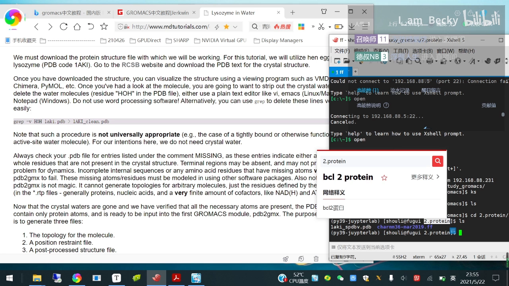

为了和教程文件名保持一致，UP 主把蛋白文件改名成教程同名文件；实际操作时只要保证命令里的文件名与实际文件对应上即可 [【跳转到 00:50】](https://www.bilibili.com/video/BV1pA411g7De/?t=50)。

### 1.2 一条命令生成拓扑：gmx pdb2gmx

`pdb2gmx` 是整个流程的第一条命令，作用是**把 PDB 坐标文件转换成拓扑文件和力场兼容的坐标文件** [【跳转到 01:25】](https://www.bilibili.com/video/BV1pA411g7De/?t=85)：

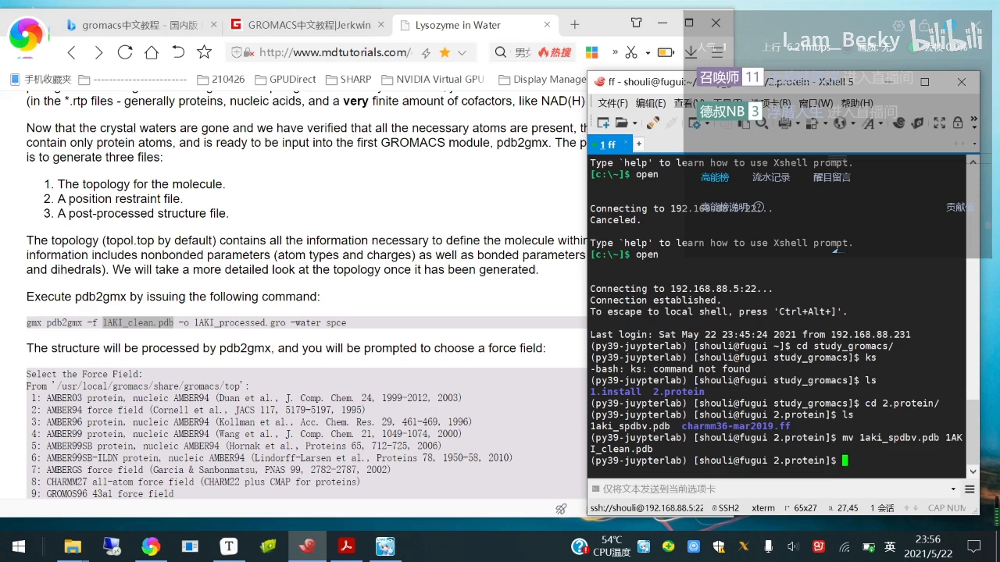

- `-f`：输入结构文件（刚才的 .pdb）；
- `-o`：输出坐标文件（.gro）；
- 回车后 GROMACS 会**交互式询问选择哪个力场** [【跳转到 02:03】](https://www.bilibili.com/video/BV1pA411g7De/?t=123)。

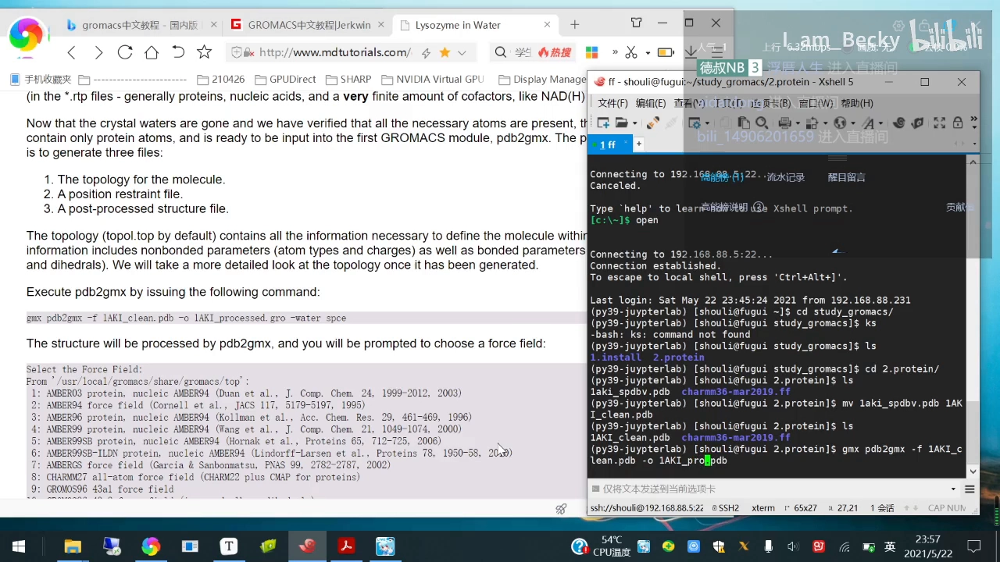

### 1.3 力场怎么选：没有唯一答案，但有参考方法

视频给出的经验是：**没有官方规定必须用哪个力场**，只是一些推荐——做蛋白的话 CHARMM 力场会好一点，但文章里各种力场都有人用。更稳妥的做法是**查文献**：看模拟同一个蛋白的人大多用什么力场；如果没有统一标准，就可以任意选择 [【跳转到 02:34】](https://www.bilibili.com/video/BV1pA411g7De/?t=154)。UP 主这里选了自己从 charmm36 官网主页下载的力场（直接用「charmm36」搜索即可下载，放进文件夹就能被识别）。

### 1.4 三个输出文件与常见报错

选完力场回车，目录里会多出三个文件：`.gro` 坐标文件、`posre.itp`（位置约束文件）、`topol.top` 拓扑文件 [【跳转到 03:55】](https://www.bilibili.com/video/BV1pA411g7De/?t=235)。

如果 `pdb2gmx` 报错，**先看报错提示**。比如提示「缺失氢」，说明 PDB 里氢原子不全，这时在命令后面加 `-ignh`（忽略氢）重新运行即可 [【跳转到 04:43】](https://www.bilibili.com/video/BV1pA411g7De/?t=283)。

### 1.5 去哪里查命令参数：李继存老师中文版教程

每个 GROMACS 命令都有必需参数和可选参数。查参数的推荐姿势是下载**李继存老师翻译的 GROMACS 官网教程中文版**，搜索命令名就能看到它的功能与全部参数注释（例如 pdb2gmx 的 -f / -o / -p / -i 各是什么）[【跳转到 05:39】](https://www.bilibili.com/video/BV1pA411g7De/?t=339)。看英文教程时结合这份中文文档，理解会顺畅很多。

## 二、看懂 topol.top：一份「给每个原子配参数」的清单

用 `vi topol.top` 打开拓扑文件 [【跳转到 07:01】](https://www.bilibili.com/video/BV1pA411g7De/?t=421)：

- 第一行记录所选力场（这里是 charmm36）；
- 接着是体系的**原子类型、分子类型**等定义；
- 分子列表里目前是蛋白，`SOL`（水溶剂）会在后面加水时出现；以后做小分子-蛋白复合模拟时，这里也会多出小分子的条目 [【跳转到 07:51】](https://www.bilibili.com/video/BV1pA411g7De/?t=471)。

可以把拓扑文件理解为：**利用力场文件，给体系里的每一个原子都配上参数**。熟悉它的结构很重要——后面做小分子复合模拟时，需要把小分子的拓扑信息粘贴进蛋白的 topol.top，两个物质才能「兼容」[【跳转到 08:34】](https://www.bilibili.com/video/BV1pA411g7De/?t=514)。

## 三、editconf 设盒子、solvate 加水、genion 加离子

### 3.1 editconf：给蛋白「圈一块地」

`gmx editconf` 设置模拟盒子：`-d 1` 表示盒子边缘距蛋白至少 1 纳米，`-bt cubic` 指定**正方体**盒子 [【跳转到 10:35】](https://www.bilibili.com/video/BV1pA411g7De/?t=635)。

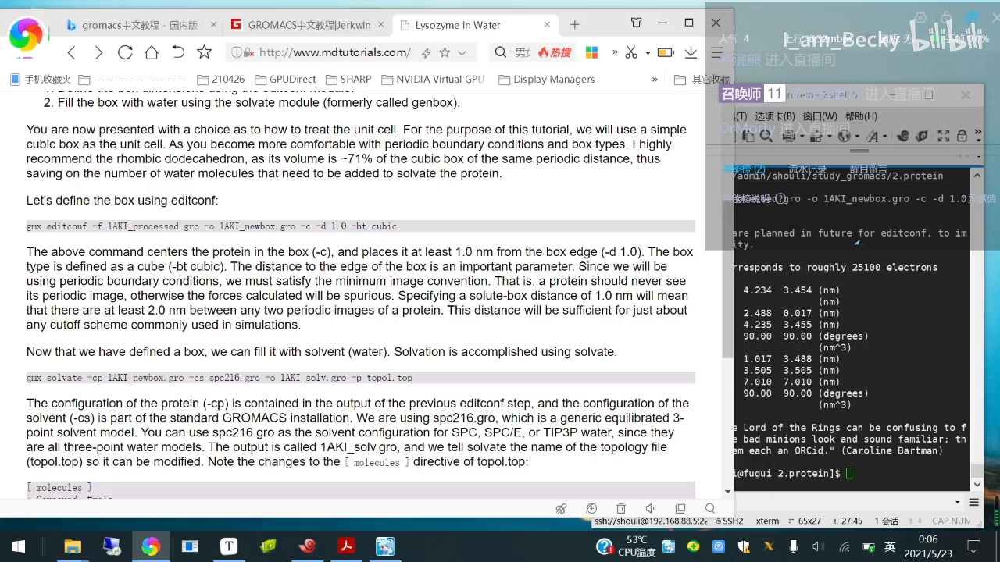

盒子形状没有固定要求，正方体、十二面体都有人用，具体类型可到教程里查 `editconf` 命令的 `-bt` 参数 [【跳转到 11:46】](https://www.bilibili.com/video/BV1pA411g7De/?t=706)。`editconf` 还能转换文件格式（比如把 .gro 转成 PDB），后面看结构时会用到。

### 3.2 solvate：往盒子里灌水

下一步是 `solvate` 加水分子，参数含义（如 `-cs` 用的水盒子配置）可以在中文文档里直接搜命令名 [【跳转到 12:35】](https://www.bilibili.com/video/BV1pA411g7De/?t=755)。加完水再看 topol.top，分子列表里就多了溶剂 `SOL` 条目 [【跳转到 13:08】](https://www.bilibili.com/video/BV1pA411g7De/?t=788)。

### 3.3 genion：加离子中和电荷（或配生理盐水）

加离子前需要一份参数文件。教程官网提供了 `ions.mdp`，复制内容后 `vi ions.mdp` 粘贴保存 [【跳转到 14:09】](https://www.bilibili.com/video/BV1pA411g7De/?t=849)。先用 `grompp` 把参数编译成 .tpr，再运行 `genion`：

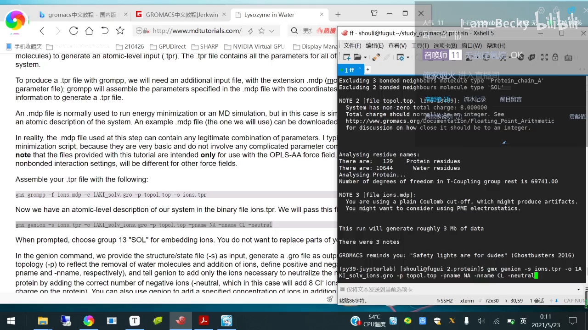

- 运行成功的标志：命令末尾打出 GROMACS 的随机「名人名言」，且中间没有 error / warning [【跳转到 15:52】](https://www.bilibili.com/video/BV1pA411g7De/?t=952)；
- `genion` 会问替换哪个分子组，**选 SOL（第 13 组）**——它把一部分溶剂分子替换成离子（这里是中和电荷所需的氯离子）[【跳转到 16:25】](https://www.bilibili.com/video/BV1pA411g7De/?t=985)；
- 参数上可以指定阴/阳离子数目（`-nn` / `-nname`），也可以直接指定浓度：比如 `-conc 0.15` 就是 0.15 mol/L 的生理盐水浓度 [【跳转到 17:39】](https://www.bilibili.com/video/BV1pA411g7De/?t=1059)。

常见做法是「电中性 + 生理盐水浓度」，也有模拟只中和电荷、不加盐，视研究目的而定 [【跳转到 18:08】](https://www.bilibili.com/video/BV1pA411g7De/?t=1088)。加完离子后 topol.top 的分子列表里会多出离子条目。

### 3.4 顺手可视化：把 .gro 转成 PDB 用 VMD 看

这一步可选：用 `gmx editconf -f 输入.gro -o 输出.pdb` 把 gro 转成 PDB，再用 VMD 打开 [【跳转到 19:40】](https://www.bilibili.com/video/BV1pA411g7De/?t=1180)。隐藏水后能看到蛋白周围添加的氯离子点。看不看都不影响后续流程，主要是直观确认体系没问题。

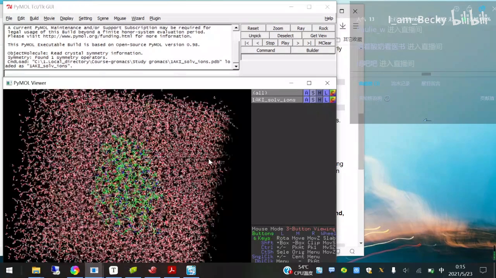

## 四、能量最小化：正式模拟前的「地基工程」

### 4.1 为什么必须先做能量最小化

加完离子后如果直接跑动力学，体系很可能崩掉——建盒、加水过程中原子间可能出现不合理接触，能量很高。能量最小化就是把结构「抚平」：先消除原子间的严重冲突，再进入动力学 [【跳转到 20:51】](https://www.bilibili.com/video/BV1pA411g7De/?t=1251)。

### 4.2 minim.mdp 关键参数：最大步数与收敛判据

能量最小化同样需要参数文件（教程官网提供的 minim.mdp）。其中的核心设置 [【跳转到 21:10】](https://www.bilibili.com/video/BV1pA411g7De/?t=1270)：

- **最大步数 50000 步**：每步迭代一次，最多做 5 万步；
- **收敛判据 1000 kJ·mol⁻¹·nm⁻¹**：迭代过程中一旦（最大力）降到 1000 以下就提前停止——比如运行到第 1 万步就达标，它就会停；如果跑满 5 万步还没达标，也说明结构冲突严重，需要回头检查。

一般直接用教程的默认参数即可，不需要修改 [【跳转到 21:35】](https://www.bilibili.com/video/BV1pA411g7De/?t=1295)。

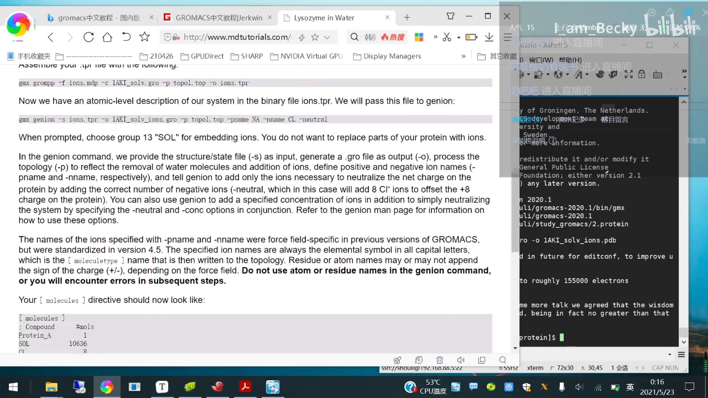

### 4.3 跑最小化：grompp → mdrun 的固定套路

视频里演示了一个**贯穿全程的固定套路**：每一步模拟之前，先用 `grompp` 把参数文件（.mdp）+ 当前坐标 + 拓扑编译成 `.tpr` 运行输入文件，再用 `mdrun` 执行 [【跳转到 22:29】](https://www.bilibili.com/video/BV1pA411g7De/?t=1349)。

实际操作中她还遇到一个 grompp 报错（之前没有、后来反复出现），查了自己之前的笔记发现加一个 `-nt` 参数即可解决 [【跳转到 24:00】](https://www.bilibili.com/video/BV1pA411g7De/?t=1440)。她的经验是：**遇到报错先去必应搜，大多数情况都能搜到答案**；多个网友给的不同方法可以逐个试 [【跳转到 24:40】](https://www.bilibili.com/video/BV1pA411g7De/?t=1480)。

### 4.4 看结果：941 步收敛 + 用 Excel 画能量曲线

这次最小化在 **941 步**就达到了收敛标准 [【跳转到 25:03】](https://www.bilibili.com/video/BV1pA411g7De/?t=1503)。检查结果的方法是 `gmx energy` 导出 xvg 数据再作图 [【跳转到 25:43】](https://www.bilibili.com/video/BV1pA411g7De/?t=1543)：

- 交互菜单里选 `10`（Potential 势能）、`0` 退出，生成 xvg 文件；
- UP 主用 Excel 打开 xvg（选「分隔符号 → 空格」），把表头行对上，直接作图；
- 教程推荐 xmgrace 作图，UP 主学了之后觉得麻烦，还是 Excel 顺手——后续所有 xvg 她都用 Excel 处理 [【跳转到 26:13】](https://www.bilibili.com/video/BV1pA411g7De/?t=1573)。

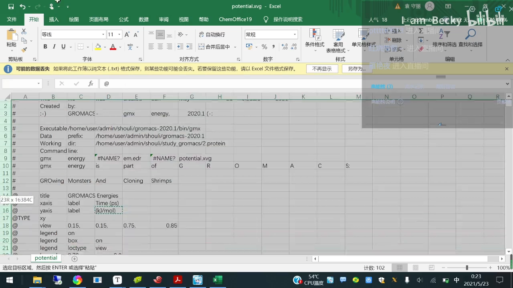

xvg 文件头部会写明数据标题与坐标轴含义：X 轴是 time（皮秒），Y 轴是能量（千焦每摩尔）[【跳转到 26:49】](https://www.bilibili.com/video/BV1pA411g7De/?t=1609)。合格的能量曲线应该**快速下降后趋于平稳**，收敛值远低于阈值 [【跳转到 28:14】](https://www.bilibili.com/video/BV1pA411g7De/?t=1694)。

## 五、两步预平衡：先 NVT 控温，再 NPT 控压

预平衡（equilibration）分两步，目的都是**让体系达到我们指定的温度和压强** [【跳转到 29:01】](https://www.bilibili.com/video/BV1pA411g7De/?t=1741)：

### 5.1 第一步 NVT：把温度稳到 300 K

第一步平衡的参数文件是教程给的 `nvt.mdp`。其中设置的目标温度是 **300 K，即室温** [【跳转到 30:51】](https://www.bilibili.com/video/BV1pA411g7De/?t=1851)。同样走 `grompp → mdrun` 套路；因为要跑一阵子，`mdrun` 时加 `-v` 参数可以看到倒计时进度 [【跳转到 30:21】](https://www.bilibili.com/video/BV1pA411g7De/?t=1821)。

跑完后同样可以画温度曲线检查是否平衡（方法和能量曲线一样，UP 主为省时间没有演示）[【跳转到 31:16】](https://www.bilibili.com/video/BV1pA411g7De/?t=1876)。

### 5.2 第二步 NPT：把压强稳到 1 bar

第二步平衡压强，设定值是**大气压（1 bar）**[【跳转到 31:51】](https://www.bilibili.com/video/BV1pA411g7De/?t=1911)。参数文件 `npt.mdp` 同样照教程粘贴，注意 grompp 时不要漏参数（UP 主就忘了加 `-p`，补上重跑即可）[【跳转到 32:38】](https://www.bilibili.com/video/BV1pA411g7De/?t=1958)。

### 5.3 看懂 npt.mdp 的步数与时长换算

NPT 的 mdp 里有一个关键参数 `nsteps`（步数）：教程设 50000 步，**每步 2 飞秒（fs）**，所以总时长 = 2 fs × 50000 = 100 皮秒（ps）[【跳转到 33:54】](https://www.bilibili.com/video/BV1pA411g7De/?t=2034)。

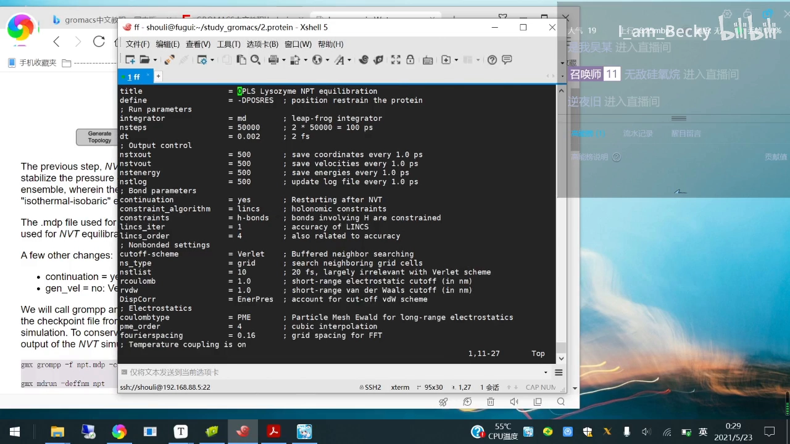

UP 主平时就按教程这套参数跑；**如果模拟中体系崩了，一个常用补救是把前两步平衡（NVT、NPT）的时间延长**，看能否解决问题 [【跳转到 34:22】](https://www.bilibili.com/video/BV1pA411g7De/?t=2062)。

## 六、正式模拟：1 ns 起步，用 screen 防断线

### 6.1 正式模拟的参数文件

平衡完成后就进入正式模拟（production MD），它有单独的参数文件（md.mdp）。教程给的是 **1 纳秒**的模拟时长 [【跳转到 34:47】](https://www.bilibili.com/video/BV1pA411g7De/?t=2087)。UP 主平时改模拟时长就是改这个文件里的步数——通过改步数来改变模拟时间。1 纳秒很快能算完，正适合走一遍完整流程。

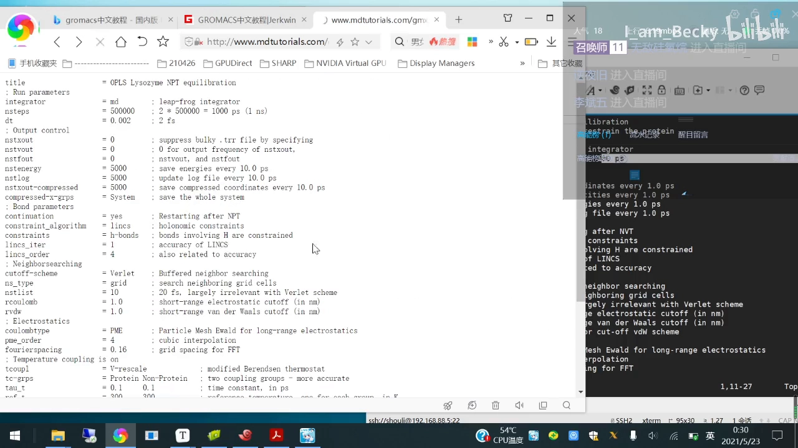

### 6.2 screen：让计算在后台「挂机」

正式模拟动辄几小时几天，如果 SSH 终端断线、电脑死机，计算就受影响，甚至要重头再来。UP 主的做法是用 `screen` 开一个**后台终端**：加 `-R` 参数并给终端起个名字，之后即使退出 Xshell、笔记本重启，计算也不受影响 [【跳转到 36:07】](https://www.bilibili.com/video/BV1pA411g7De/?t=2167)。

实操顺序 [【跳转到 37:13】](https://www.bilibili.com/video/BV1pA411g7De/?t=2233)：

1. `screen -R 名字` 新建后台终端；
2. 在里面跑 `grompp` + `mdrun`（加 `-v` 看倒计时）；
3. 按 **Ctrl+A 再按 D**，把终端挂到后台；
4. 退出 Xshell 也不影响计算；想看进度时重新连上终端即可；
5. 恢复后台终端用 `screen -x`——注意它只在**只开了一个**后台终端时有效，开了两个以上就不适用。

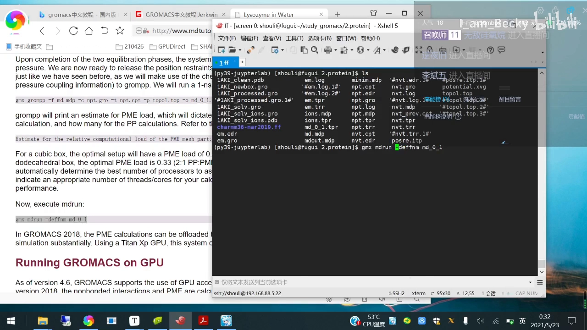

`screen` 的更多用法可以上网搜教程 [【跳转到 37:36】](https://www.bilibili.com/video/BV1pA411g7De/?t=2256)。模拟跑完之后就是数据分析（RMSD 等），UP 主留到下一讲。

## 小结

- **六步流程**：`pdb2gmx` 生成拓扑 → `editconf` 设盒子 → `solvate` 加水 → `genion` 加离子 → 能量最小化 → NVT/NPT 两步预平衡 → 正式模拟；
- **力场选择**：没有唯一答案，做蛋白推荐 CHARMM 系，最终以文献惯例为准；力场文件从 charmm36 官网下载即可；
- **pdb2gmx 报错**：缺氢就加 `-ignh`；命令参数到李继存老师中文版教程里查；
- **能量最小化**：最大步数 50000、收敛判据 1000 kJ·mol⁻¹·nm⁻¹，本例 941 步收敛；能量曲线应快速下降后平稳；
- **步数换算**：`nsteps × dt` = 模拟时长，NPT 平衡 50000 步 × 2 fs = 100 ps；
- **体系崩了先延长预平衡时间**，再考虑改正式模拟参数；
- **screen 后台运行**：`-R` 新建、Ctrl+A D 挂起、`-x` 恢复（单终端时有效）。

## 关键术语速查

| 术语 | 一句话解释 |
| --- | --- |
| pdb2gmx | 把 PDB 坐标转成拓扑文件 + 力场兼容坐标文件的命令，交互式选力场 |
| 拓扑文件（topol.top） | 记录力场与体系内每个原子参数的清单，后续加分子都要更新它 |
| posre.itp | pdb2gmx 一并生成的位置约束文件，预平衡阶段锁蛋白用 |
| editconf | 设置模拟盒子（`-d` 边距、`-bt` 盒型），也能转换文件格式 |
| solvate | 往盒子里填水分子，topol.top 中出现 SOL |
| genion | 把部分溶剂分子替换成离子，可中和电荷或设定盐水浓度（`-conc`） |
| grompp | 把 .mdp 参数 + 坐标 + 拓扑编译成 .tpr 运行输入 |
| mdrun | 真正执行模拟的命令，`-v` 显示进度 |
| 能量最小化（EM） | 消除原子冲突、降低体系能量，收敛看最大力 < 1000 kJ·mol⁻¹·nm⁻¹ |
| NVT / NPT 预平衡 | 先恒温（300 K）再恒压（1 bar）让体系达到目标热力学状态 |
| nsteps × dt | 模拟总步数 × 每步时长（fs）= 模拟物理时长 |
| screen | 终端后台挂机工具：`-R` 新建、Ctrl+A D 挂起、`-x` 恢复 |
| xvg 文件 | GROMACS 输出的数据文件，可导入 Excel/xmgrace 作图 |
