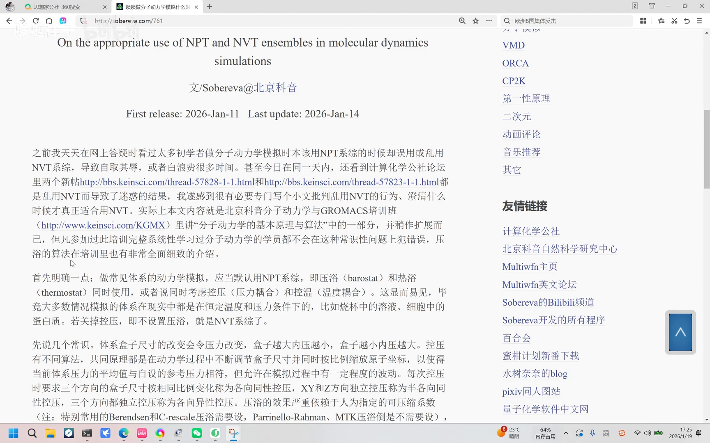
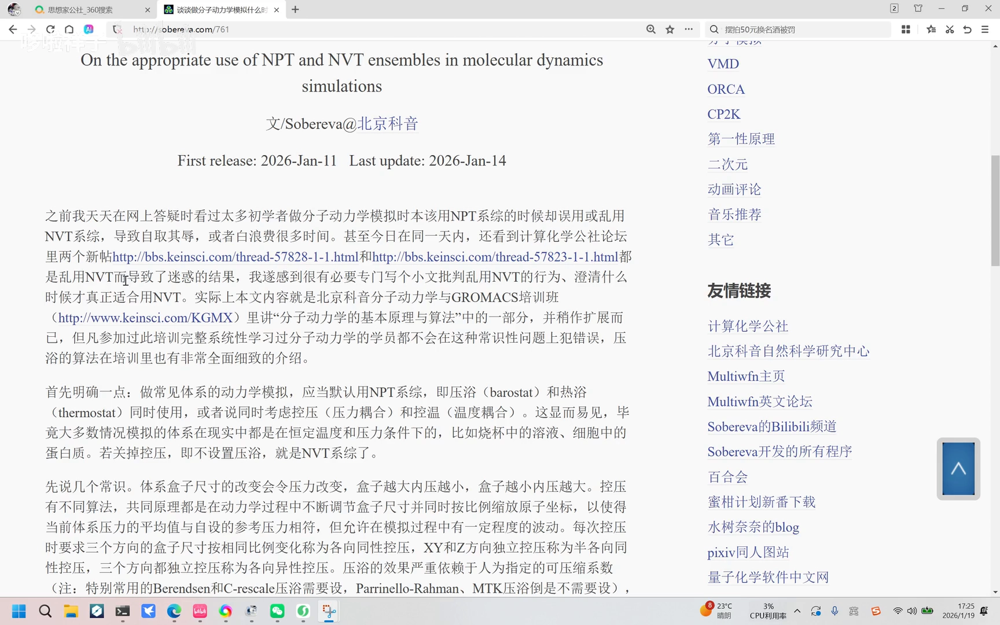
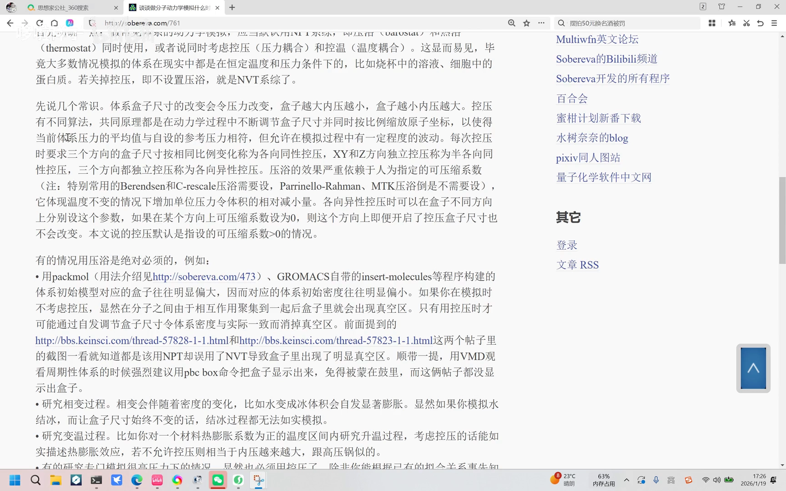
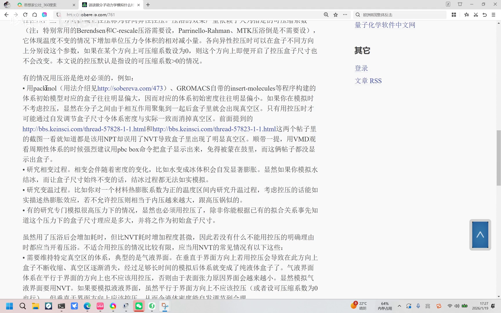
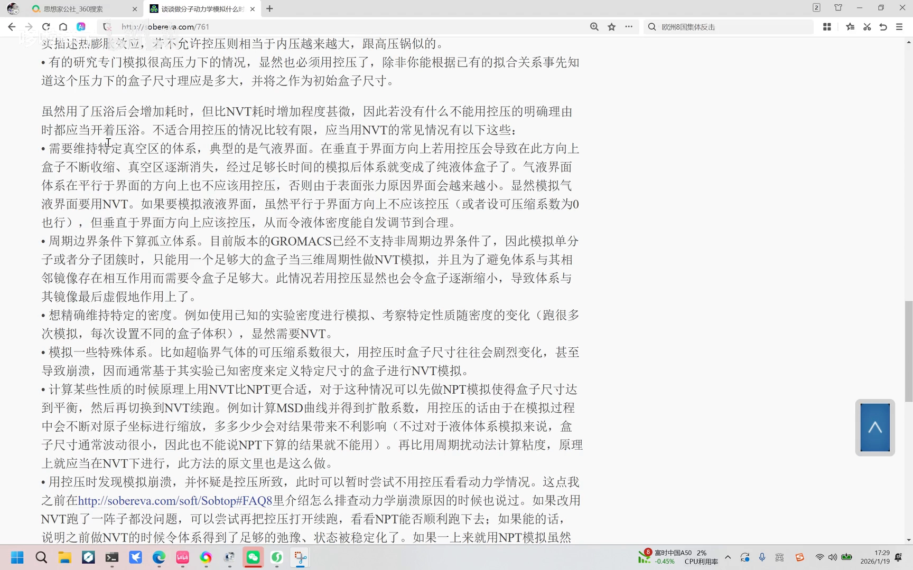
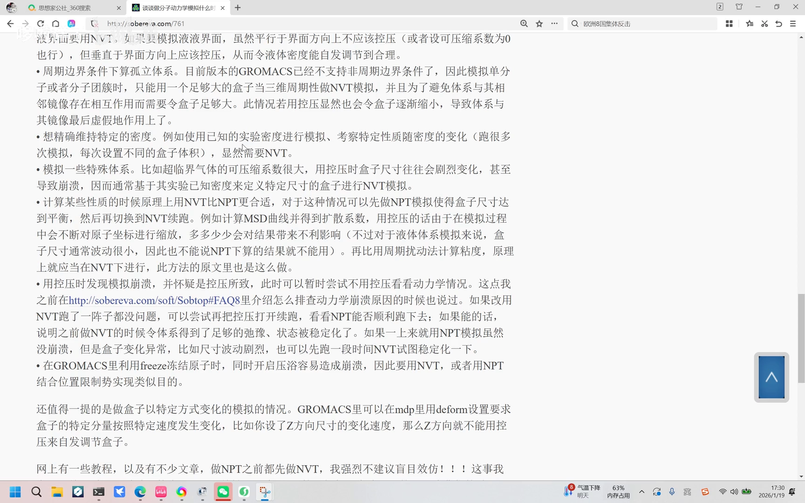
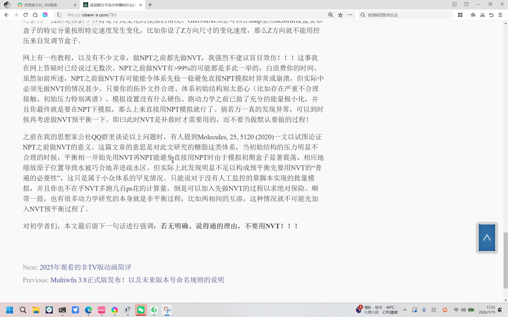
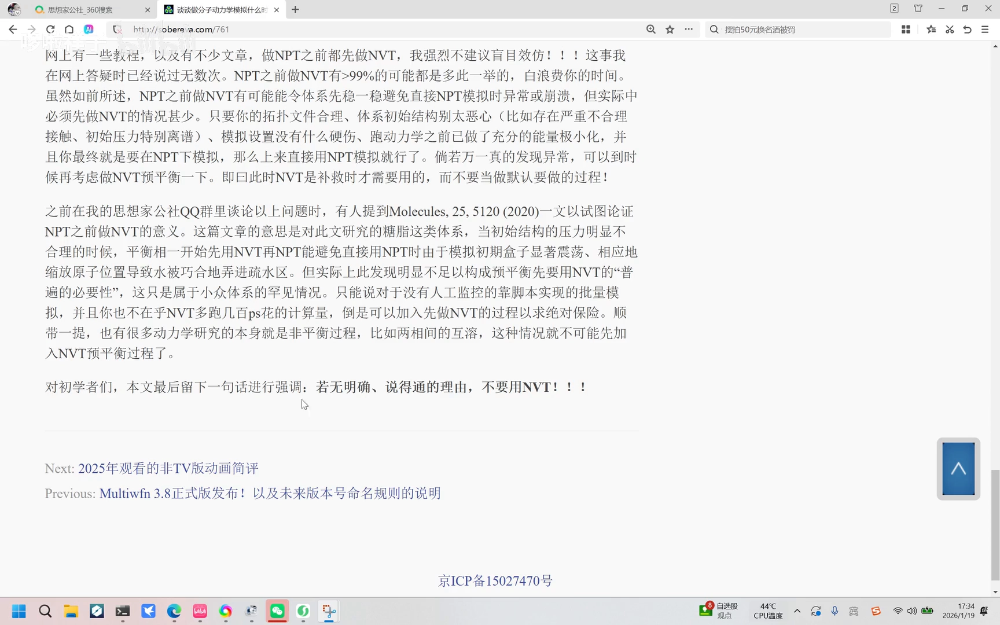

# （101）谈谈做分子动力学模拟什么时候适合用 NPT 和 NVT 系综

> 视频笔记 · Bilibili [BV1bSkYBjE8y](https://www.bilibili.com/video/BV1bSkYBjE8y/) · UP 主：哆啦祥子 · 时长约 10 分钟
> 内容基于卢天老师（sobereva）的文章与答疑经验扩展，本篇严格依据视频内容整理，配图截自视频，时间戳可跳转回看。

## 本期要解决的核心问题（SCQA）

**背景**：卢天老师在网上答疑时发现，很多初学者做分子动力学模拟时，**本该用 NPT 系综却误用或滥用 NVT 系综**——轻则自取其辱，重则白白浪费大量时间；论坛里甚至就有两个帖子是乱用 NVT 导致迷惑结果的典型案例 [【跳转到 00:25】](https://www.bilibili.com/video/BV1bSkYBjE8y/?t=25)。

**疑问**：那到底什么时候该用控压的 NPT，什么时候才真正适合用控体积的 NVT？

**回答（中心思想）**：**做常见体系的动力学模拟，应当默认用 NPT 系综**（控压与控温同时使用）——因为现实中大部分体系就处在恒温恒压条件下；只有需要维持特定真空区域、在周期性边界下算孤立体系、想精确维持密度、或模拟超临界流体等少数情况才应当用 NVT。此外，**没有绝对说得通的理由，就不要在 NPT 之前默认先跑一段 NVT**——九成以上都是白费时间 [【跳转到 00:50】](https://www.bilibili.com/video/BV1bSkYBjE8y/?t=50)。

## 一、控压的基本原理

### 1.1 控压器在做什么

先说几个常识：盒子尺寸的改变会令压力改变——盒子越大内压越小，盒子越小内压越大。各种控压算法的共同原理都是：**在动力学过程中不断调节盒子尺寸，同时按比例缩放原子坐标，使体系的压力平均值与自设的参考压力相符**，但允许模拟过程中有一定程度的波动 [【跳转到 01:15】](https://www.bilibili.com/video/BV1bSkYBjE8y/?t=75)。

### 1.2 各向同性 / 半各向同性 / 各向异性

按盒子三个方向的调节方式分三类 [【跳转到 01:40】](https://www.bilibili.com/video/BV1bSkYBjE8y/?t=100)：

- **各向同性控压**：三个方向按相同比例变化；
- **半各向同性控压**：XY 与 Z 方向独立控压（膜体系常用）；
- **各向异性控压**：三个方向都独立控压。

### 1.3 可压缩系数：控压效果的关键人为参数

控压的效果严重依赖**人为指定的可压缩系数**。视频里提到：特别常用的 Berendsen 和 C-rescale 这类压浴需要自己设定（可压缩系数），PR 和 MTTK 这类压浴则不需要自己设。可压缩系数 κ 的物理含义是：**温度不变时，压强每增加一个单位，体积的相对减小量** [【跳转到 02:05】](https://www.bilibili.com/video/BV1bSkYBjE8y/?t=125)。

各向异性控压时还可以在盒子不同方向上分别控制：**某方向的可压缩系数设为 0，这个方向即便开启了控压，盒子尺寸也不会变**。这里说的控压默认指可压缩系数大于 0 的情况 [【跳转到 02:30】](https://www.bilibili.com/video/BV1bSkYBjE8y/?t=150)。

## 二、这些情况必须用 NPT（控压）

### 2.1 初始盒子明显偏大（Packmol / insert-molecules 建的体系）

用 Packmol、GROMACS 自带 insert-molecules 等程序创建的初始构型，盒子往往明显偏大、密度偏小。这时若用 NVT，体系会相互聚集、出现真空区——**只有控压才能调节盒子尺寸，使密度回到实际值、消除真空区** [【跳转到 02:55】](https://www.bilibili.com/video/BV1bSkYBjE8y/?t=175)。刚才提到的两个论坛帖子正是这种情况：该用 NPT 却误用了 NVT。顺带一提：用 VMD 时强烈建议用 pbc box 把盒子显示出来，免得被蒙在鼓里。

### 2.2 研究相变

相变伴随密度变化——比如水结冰会膨胀。不允许控压的话，**连结冰过程都无法模拟** [【跳转到 03:45】](https://www.bilibili.com/video/BV1bSkYBjE8y/?t=225)。

### 2.3 变温与热膨胀

在材料热膨胀系数为正的温度区间内做变温模拟，控压才能正确描述热膨胀效应；不允许控压的话，内压会越来越大——「像高压锅一样」。还有的研究专门在高压力下进行，也必须要控压——除非能根据已有的关系式事先知道该压力下的盒子尺寸，再作为初始盒子。虽然控压会增加耗时，但相比 NVT 增加甚微，因此**只要没有明确理由不用控压，就应当开着控压** [【跳转到 04:10】](https://www.bilibili.com/video/BV1bSkYBjE8y/?t=250)。

## 三、这些情况应当用 NVT（控体积）

不适合控压的情况比较有限，常见有以下几种 [【跳转到 04:35】](https://www.bilibili.com/video/BV1bSkYBjE8y/?t=275)：

### 3.1 需要维持特定真空区域的体系（典型：气液界面）

在垂直于界面的方向上控压，会导致盒子不断收缩，**真空层就没了**——气液界面模拟必须在界面法向保持 NVT（或各向异性控压时把该方向可压缩系数设 0）。

### 3.2 周期性边界条件下算孤立体系

当前版本的 GROMACS 已不支持非周期边界条件，因此**模拟单分子或分子团簇时，只能用一个足够大的盒子当三维周期体系来做 NVT 模拟**——盒子必须足够大，避免体系与下一个周期的镜像发生相互作用 [【跳转到 05:00】](https://www.bilibili.com/video/BV1bSkYBjE8y/?t=300)。

### 3.3 想精确维持特定密度 / 超临界流体

比如用已知的实验密度进行模拟来考察性质。特殊体系如**超临界气体的可压缩系数很大**，控压时盒子尺寸往往剧烈变化甚至崩溃，因此通常基于实验已知密度做 NVT 模拟 [【跳转到 05:25】](https://www.bilibili.com/video/BV1bSkYBjE8y/?t=325)。

### 3.4 某些性质的计算原理上就该在 NVT 下做

可以**先做 NPT 模拟使盒子尺寸达到平衡，再切换到 NVT** 来采样 [【跳转到 05:50】](https://www.bilibili.com/video/BV1bSkYBjE8y/?t=350)：

- **MSD 扩散系数**：控压过程中会不断对原子坐标进行缩放，多多少少影响结果；不过液体体系的盒子尺寸波动通常很小，也不能说 NPT 算的结果就不能用；
- **周期扰动法算粘度**：原理上就应该在 NVT 下进行，Green-Kubo 方法也是这样做的 [【跳转到 06:15】](https://www.bilibili.com/video/BV1bSkYBjE8y/?t=375)。

## 四、崩溃排查与两个特殊场景

### 4.1 控压崩溃了怎么排查

用控压时发现模拟崩溃，可以怀疑是控压所致：**暂时改用 NVT 跑一阵子**；如果 NVT 没问题，再把控压打开续跑，NPT 能顺利跑下去，说明之前做 NVT 时系统已经得到足够弛豫、状态足够稳定 [【跳转到 06:40】](https://www.bilibili.com/video/BV1bSkYBjE8y/?t=400)。如果一上来就用 NPT，虽没崩溃但盒子尺寸波动异常，可以先跑一段时间让体系稳定化 [【跳转到 07:05】](https://www.bilibili.com/video/BV1bSkYBjE8y/?t=425)。

### 4.2 freeze 冻结原子与 deform 盒子变化

在 GROMACS 中**用 freeze 冻结原子时同时开启控压，很容易造成崩溃**——因此必须用 NVT，或用 NPT 结合位置限制来实现类似目的。此外还有一类「让盒子以特定方式变化」的模拟：GROMACS 可以在 MDP 里用 `deform` 设置盒子沿特定分量按特定速度变化（比如设了 Z 方向的尺寸变化速度，Z 方向就不用控压）[【跳转到 07:30】](https://www.bilibili.com/video/BV1bSkYBjE8y/?t=450)。

## 五、NPT 之前要不要先跑一段 NVT？——大概率不必

网上不少教程和文章做 NPT 之前都先做 NVT。UP 主强调：**不要盲目效仿——NPT 之前先做 NVT，九成以上都是在白白浪费时间** [【跳转到 07:55】](https://www.bilibili.com/video/BV1bSkYBjE8y/?t=475)。

NPT 前做 NVT 的可能作用是让体系先稳一稳、避免直接 NPT 出现异常或崩溃，但实际需要的情况很少 [【跳转到 08:20】](https://www.bilibili.com/video/BV1bSkYBjE8y/?t=500)：只要拓扑文件合理、初始结构不太糟糕（没有严重不合理接触、初始压力不离谱）、模拟设置没有硬伤、跑动力学前已做了充分的能量最小化，并且最终就是要在 NPT 下模拟——**直接上来用 NPT 就可以**。万一发现异常，到时候再用 NVT 补救。

### 5.1 一个小众特例：Molecules 2020 的糖体系

有人在 QQ 群里提到 Molecules 期刊 2020 年的一篇文章，论证 NPT 前先做 NVT 的意义：对文中研究的**糖这类体系**，当初始结构压力明显不合理时，平衡阶段先用 NVT 再切 NPT，能够避免直接 NPT 时**模拟初期盒子显著增长、原子位置缩放把水巧合地挤进疏水腔** [【跳转到 08:45】](https://www.bilibili.com/video/BV1bSkYBjE8y/?t=525)。但这明显不足以构成「预平衡必须先做 NVT」的普遍必要性——只是小众体系的特殊情况 [【跳转到 09:10】](https://www.bilibili.com/video/BV1bSkYBjE8y/?t=550)。

### 5.2 两个可以加 NVT 的例外

[【跳转到 09:35】](https://www.bilibili.com/video/BV1bSkYBjE8y/?t=575)

- **批量脚本模拟**：没有人工监控、又不在乎 NVT 多跑几百皮秒的计算量，可以先加一步 NVT 图个绝对保险；
- **本身就是非平衡过程的研究**（比如两个相的互动）：这时候**不能**先加 NVT 预平衡。

## 结论与小结

**一句话结论：没有绝对说得通的理由，就不要用 NVT（该用 NPT 就用 NPT）** [【跳转到 10:00】](https://www.bilibili.com/video/BV1bSkYBjE8y/?t=600)。

- 常见体系**默认 NPT**（控压 + 控温），因为现实体系就是恒温恒压的；
- **必须控压**：初始盒子偏大（Packmol/insert-molecules）、相变、变温热膨胀、专门的高压研究；
- **应当 NVT**：气液界面等需保真空、PBC 下大盒子算孤立体系、精确维持密度、超临界流体；MSD/粘度等计算先 NPT 平衡盒子再切 NVT 更严谨；
- **崩溃排查**：怀疑控压就先 NVT 跑、再开控压续跑；freeze 原子 + 控压易崩，改用 NVT 或 NPT + 位置限制；
- **NPT 前不必默认做 NVT**：九成以上白费时间；Molecules 2020 糖体系只是小众特例；批量脚本与非平衡体系是例外。

## 关键术语速查

| 术语 | 一句话解释 |
| --- | --- |
| NPT 系综 | 粒子数、压力、温度恒定；控压（压力耦合）+ 控温（温度耦合）同时使用 |
| NVT 系综 | 粒子数、体积、温度恒定；不控压，盒子尺寸固定 |
| 控压器（压浴） | 通过调节盒子尺寸 + 按比例缩放原子坐标，使平均压力趋向参考压力 |
| 各向同性 / 半各向同性 / 各向异性控压 | 三方向同比例 / XY 与 Z 独立 / 三方向全独立调节盒子 |
| 可压缩系数 κ | 温度不变时，压强每增一个单位体积的相对减小量；控压效果的关键参数 |
| Berendsen / C-rescale | 需要自己设可压缩系数的压浴，仅适合快速弛豫 |
| PR / MTTK | Parrinello-Rahman 与 Martyna-Tuckerman-Tobias-Klein 压浴，适合生产采样 |
| pbc box | VMD 中显示周期盒子，便于发现「盒子异常」类错误 |
| deform | MDP 中让盒子沿特定分量按特定速度变化的设置 |
| MSD 扩散系数 / Green-Kubo 粘度 | 原理上更适于在 NVT 下计算的性质 |
