# 教程：怎么使用Protenix进行分子对接

> 视频来源：[B站《教程：怎么使用Protenix进行分子对接》](https://www.bilibili.com/video/BV1Jnn1zFE5b/)（21:40，UP 主阿莎，结构生物学与生物信息学方向）。本文基于视频字幕与画面整理，所有操作细节可点击时间戳回看核对。

## 本讲要解决的核心问题（SCQA）

**背景**：分子对接（docking）是把小分子"放进"蛋白口袋、预测两者如何结合的经典任务。上一期视频讲过如何用 AlphaFold3 做生物建模，它是结构预测的明星模型。

**冲突**：AlphaFold3 有个限制——只能处理一定数量的离子或有机分子；想做"蛋白 + 离子 + 小分子"的对接，还需要一个更开放的工具。

**疑问**：有没有一个免费开源、能复现 AlphaFold3 能力、还能顺手做分子对接的模型？

**回答（中心思想）**：有——**Protenix，AlphaFold3 的开源复刻版**。本讲跟随视频完整走一遍：在它的网页服务器上提交「NDM-1 蛋白 + 2 个锌离子 + 布洛芬」的对接任务，等十几分钟拿到结果，最后在 PyMOL 里与 X 射线实验结构对齐验证：整体完美对齐、锌位置吻合，布洛芬精确落入口袋、羧基的两个氧原子朝向锌离子。

## 一、Protenix 是什么：AlphaFold3 的开源复刻

[【跳转到 00:00】](https://www.bilibili.com/video/BV1Jnn1zFE5b/?t=0)

- **它是可训练的 AlphaFold3 复刻版**。AlphaFold3 有一个限制：只能处理一定数量的离子或有机分子；而 Protenix 还使用了先进的人工智能工具，能以更高精度建模蛋白质结构。
- **能结合的"搭档"更全**：可以把各种分子与蛋白质结合建模——包括离子、DNA、RNA 等；如果你对共价修饰或蛋白质修饰感兴趣，同样可以实现。
- **免费**：网页服务器对所有人免费，包括商业和非商业用途；也可以下载到本地使用。
- **入口**：目前还没有独立域名，要通过 IP 地址 + 端口访问 `101.126.11.40:8000`（视频描述区提供了链接）。

视频最后会把预测结果与 PDB 实验结构对比，验证这个方法的准确性——这也是本教程的收尾环节。

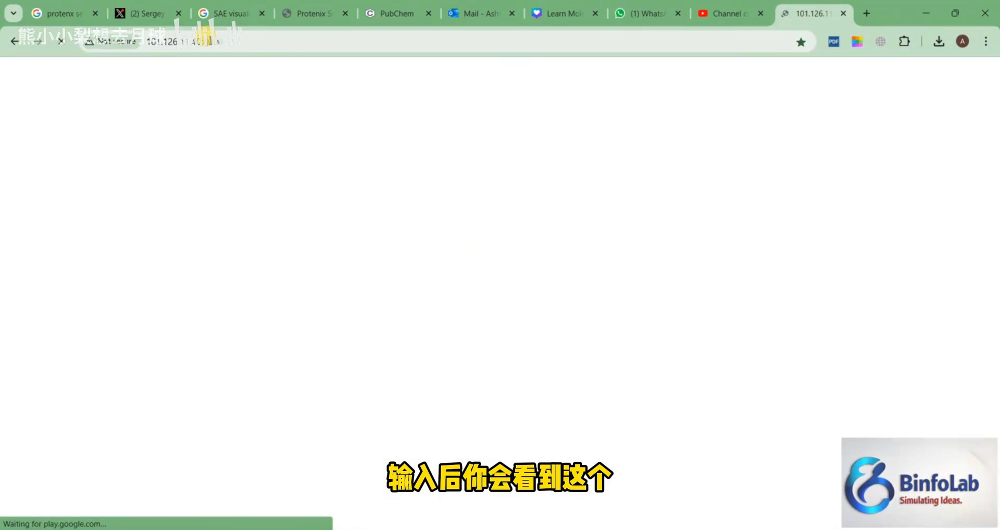

## 二、开跑前的设置：MSA、原子置信度与邮箱

[【跳转到 03:18】](https://www.bilibili.com/video/BV1Jnn1zFE5b/?t=198)

进入服务器、点击 Continue 后，先做四项设置：

- **Job ID**：作业 ID，想改可以修改。
- **Use MSA**：MSA 代表多序列比对——想在预测中使用它就保持开启。注意：**用 MSA 时间会稍长，但更准确，所以建议开启**。
- **原子置信度（atom confidence）**：同理，可能稍慢一点但更准。
- **邮箱**：必须填。因为目前没有专用网页，结果不会在页面上可视化，而是**发送到你的邮箱**。

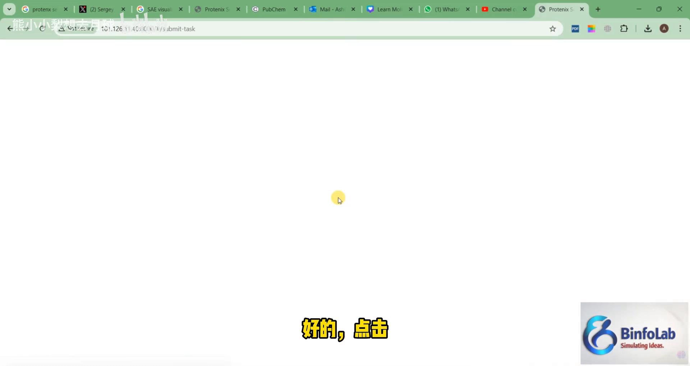

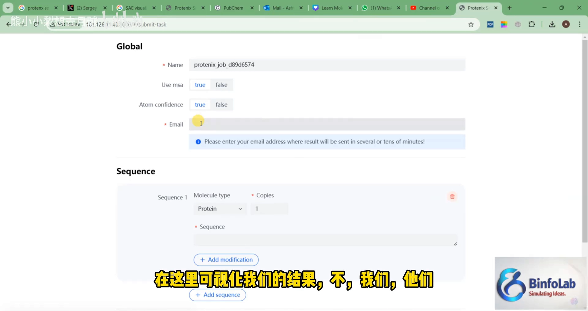

## 三、建模配置：一条序列、两个锌离子、一个布洛芬

### 3.1 粘贴蛋白序列：NDM-1

[【跳转到 07:09】](https://www.bilibili.com/video/BV1Jnn1zFE5b/?t=429)

序列步骤里，讲解者使用他最常用的 NDM-1 蛋白序列：从原页面复制、粘贴进来。这一步还有两个可选项：

- **添加修饰**：如糖基化等。本例不关注任何修饰，保持原样。
- **副本数**：从这里可以看到副本数。如果想模拟二聚体、三聚体、四聚体这类对称单元，就需要把份数增加到二、三、四；本例保持一份（单链蛋白）。

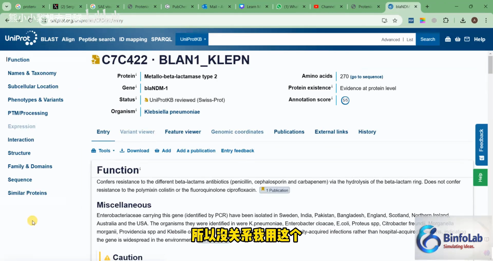

### 3.2 加锌离子：名称必须写 CCD 编码 ZN

[【跳转到 08:42】](https://www.bilibili.com/video/BV1Jnn1zFE5b/?t=522)

因为知道这个蛋白在 PDB 中有结构、其口袋里含有锌，所以在配体区选择「离子」（Ion）：

- **数量**：2 个——每个 NDM 分子的结构口袋里含有两个锌离子。
- **名称是关键**：如果直接写「锌」是错误的，**要写 CCD 标准编码 `ZN`**。以此类推：想加镁写 `Mg`，想加钙写 `Ca`。

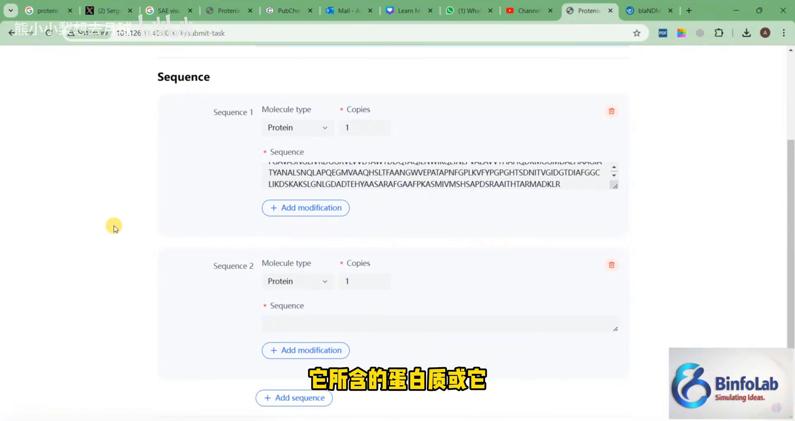

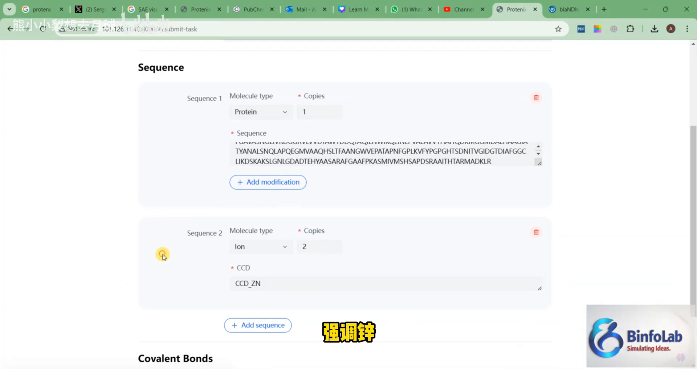

### 3.3 加配体：SMILES 输入布洛芬，小心空格

[【跳转到 10:22】](https://www.bilibili.com/video/BV1Jnn1zFE5b/?t=622)

这是最重要的一步。配体输入方式有两种：类似 CCD 编码的条目，或者 **SMILES**——分子的线性文本表示。演示选的是布洛芬（它有各种商品名，各国不同，但化学名就是 ibuprofen），把它的 SMILES 粘贴进来。

**常见坑**：粘贴 SMILES 时要完整复制。视频中特意演示了这个错误——复制过程混进了一个空格，提交就可能报错；修复方法很简单：大范围重新选中复制，确认没有空格即可。

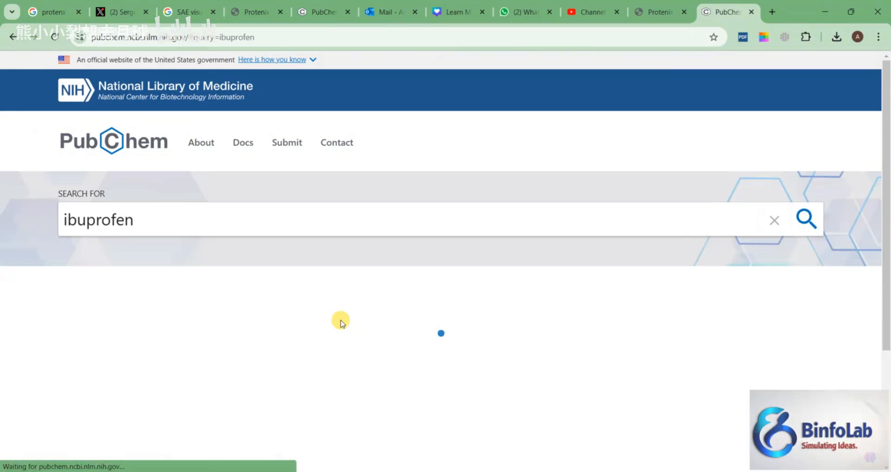

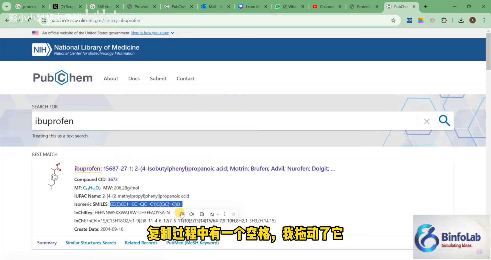

配置完成后的体系：**单链蛋白 + 两个锌离子 + 一个固定在位的配体**。这种方法不需要任何网格框（grid box）之类的东西——它本身更智能。另外，如果你想添加共价修饰，可以点击共价键选项，指定加在哪里、输入原子名称等；本例不涉及。

## 四、提交与等待：确认页信息与 10–15 分钟的耐心

[【跳转到 13:31】](https://www.bilibili.com/video/BV1Jnn1zFE5b/?t=811)

点击提交后，确认页会汇总所有输入：这是你的序列；第二部分是锌离子（数量 2）；配体计数 1；作业 ID；MSA 为真；原子置信度为真；共价键为 0；以及邮箱。

- 第一次提交时视频里显示**验证失败**——原因是邮箱没填。填好邮箱再提交即可。
- 提交后**大约需要十到十五分钟**，可能稍长一点，取决于任务性质、蛋白质和服务器繁忙情况。团队正在开发专用服务器，未来很多事情会变得更容易。

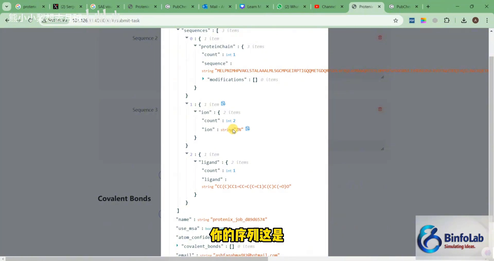

## 五、结果解读：CIF 结构文件与 rank_0

[【跳转到 16:19】](https://www.bilibili.com/video/BV1Jnn1zFE5b/?t=979)

结果页会显示任务 ID、任务状态、你的序列、配体和锌的信息（共价键数据为 0），以及任务输出链接和日志链接。点进输出 URL、进入下载选项，把压缩包提取解压：

- 解压后是 **3 个 JSON 文件和 3 个目录**；
- 进入 Protenix 任务的 seed 和 predictions 目录，会看到若干 JSON 文件和 CIF 文件；
- **你要看的文件是 CIF 文件**（结构文件）。理想情况下，第一个（rank_0）是排名最高的；想要更多信息（分数等），可以查看 rank_0 对应的 JSON 文件。

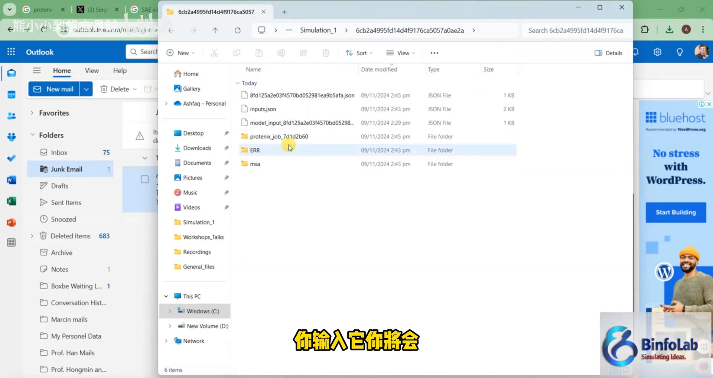

## 六、验证：PyMOL 里与实验结构对齐

[【跳转到 18:35】](https://www.bilibili.com/video/BV1Jnn1zFE5b/?t=1115)

用 PyMOL 打开 rank_0 的 CIF，加载预测结构（锌 + 布洛芬），再从 PDB 加载真实的 X 射线实验结构并叠加对齐：

- **颜色约定**：青色是实验结构，蓝色是预测结构；
- **整体完美对齐**，锌原子的位置也对得上；
- **覆盖差异**：实验结构从 42 号残基（约在 34 号残基的 G 附近）才开始，而预测结构从 Met 1 开始——预测多出的 N 端部分在实验结构里是缺失的（图中绿色为缺口部分），所以看不到那一段的对照；
- **配体落位**：布洛芬占据了精确的口袋，它的羧基两个氧原子朝向锌离子。

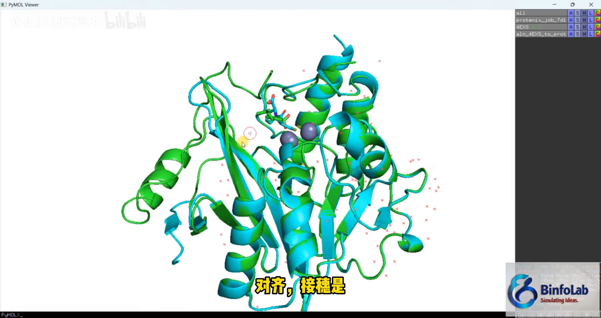

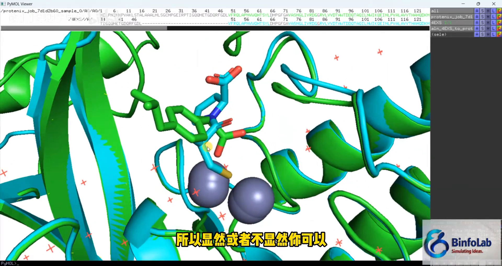

这个结果意味着：从现在开始，你可以用 AlphaFold3/Protenix 去操作你自己的生物系统了。

## 小结

- Protenix 是 **AlphaFold3 的开源复刻**，网页服务器免费（含商用），支持蛋白与离子、DNA、RNA、配体的复合物建模，共价修饰也可选。
- 入口是 IP+端口（`101.126.11.40:8000`），**结果发邮箱**；Use MSA 建议开启（更准但更慢）。
- 加离子时名称必须用 **CCD 编码**（锌=`ZN`，镁=`Mg`，钙=`Ca`），直接写中文或元素俗名会出错。
- 配体可用 **SMILES** 输入；复制时谨防混入空格导致报错。
- 提交后等 10–15 分钟；结果里看 **CIF 文件**，rank_0 是排名最高的结构，分数细节在对应 JSON 里。
- 用 PyMOL 与实验结构对齐验证：整体对齐、锌位置吻合、配体落口袋且羧基氧朝向锌——预测结果靠谱。

## 关键术语速查

| 术语 | 一句话解释 |
| --- | --- |
| Protenix | AlphaFold3 的开源复刻，可建模蛋白与离子、DNA、RNA、小分子的复合物结构 |
| 分子对接（docking） | 预测小分子与蛋白口袋如何结合 |
| MSA | 多序列比对，同源序列信息；开启后更准但更慢 |
| CCD 编码 | PDB 化学组分字典的标准名；输入锌离子要写 `ZN` |
| SMILES | 分子的线性文本表示，一行字符串描述结构 |
| 网格框（grid box） | 传统对接软件里需要人工框定的搜索范围；Protenix 这类方法不需要 |
| CIF | 晶体学信息文件，Protenix 输出中的结构文件 |
| rank_0 | 预测结果里排名最高的模型 |
