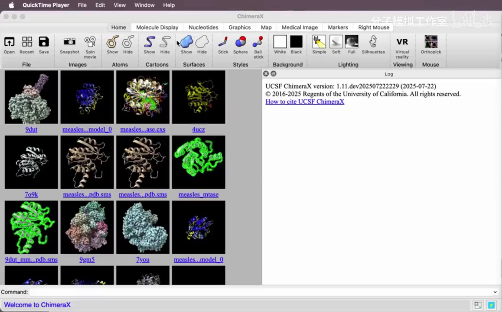
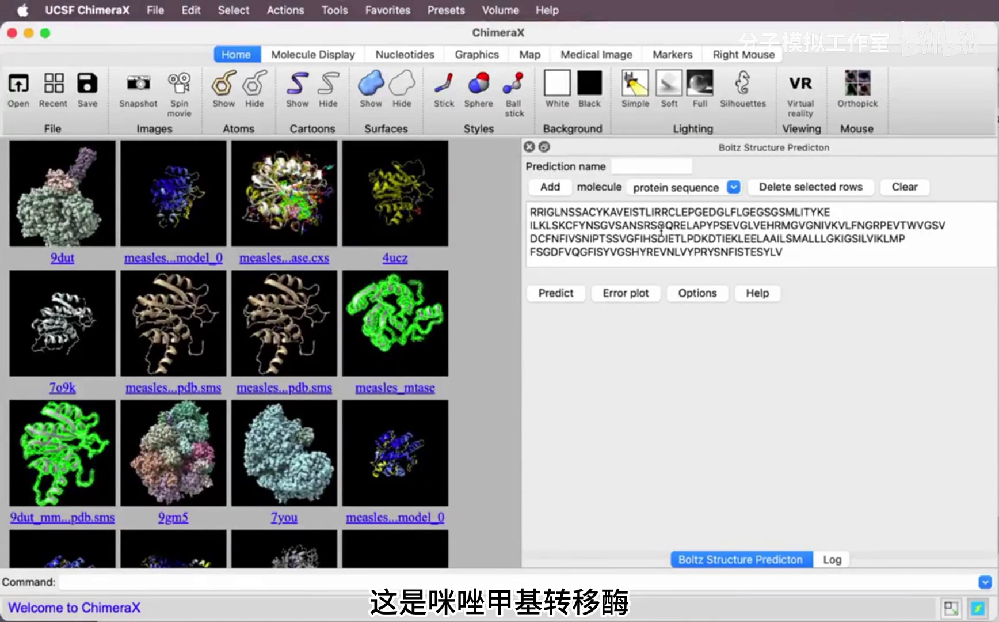
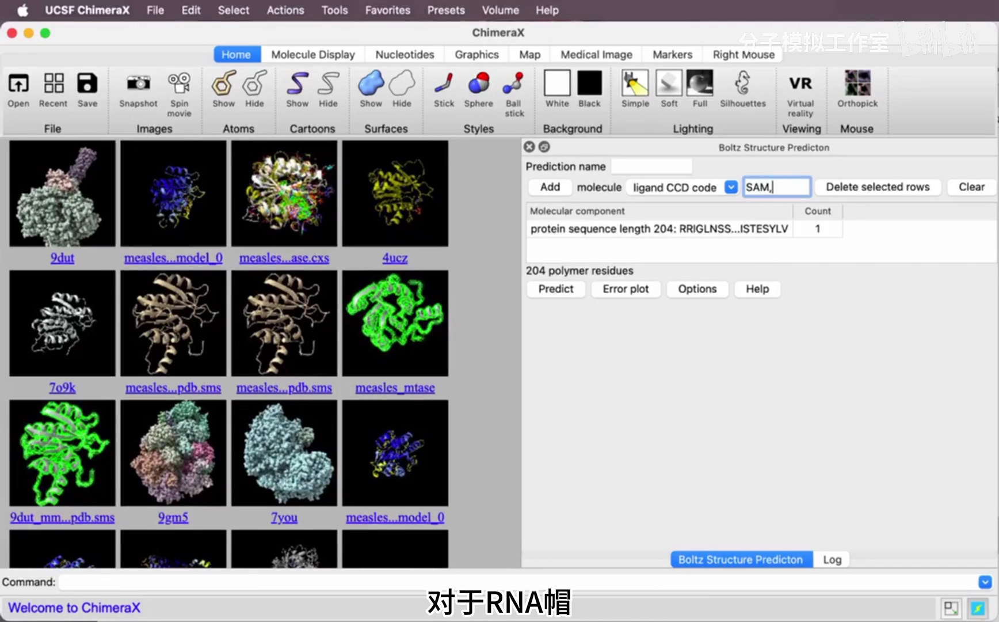
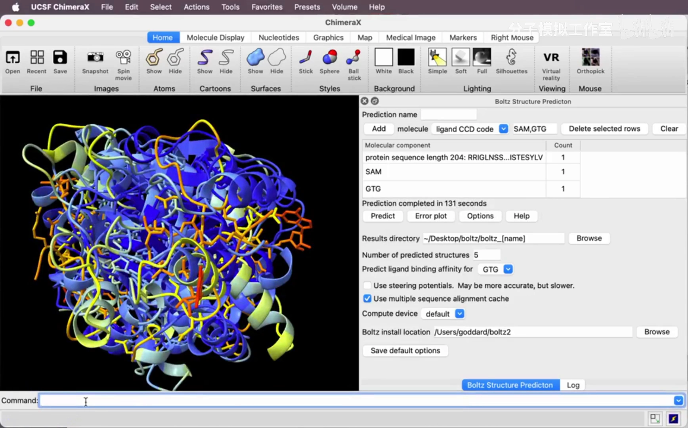
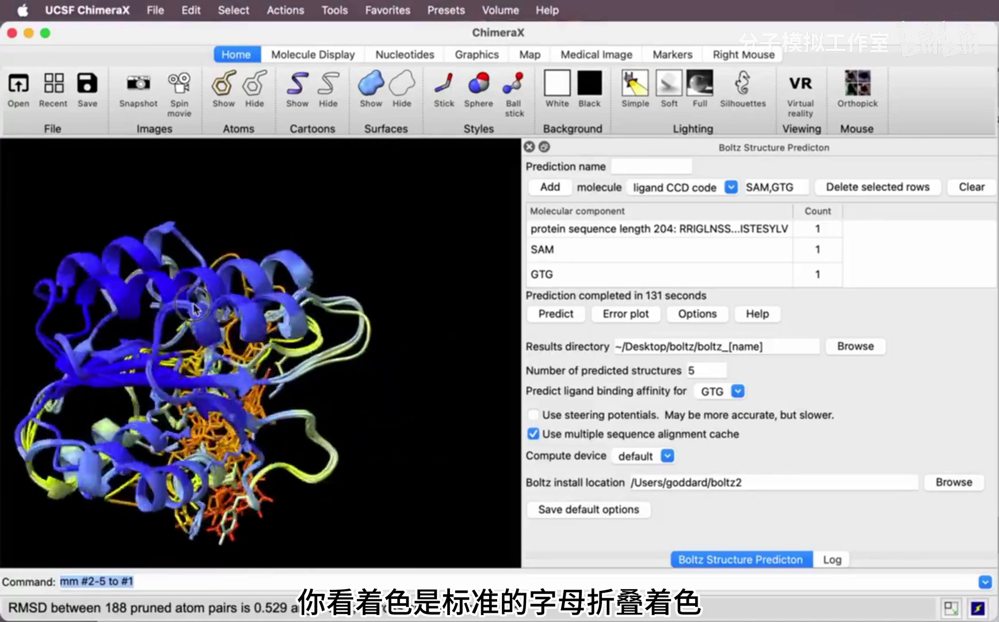
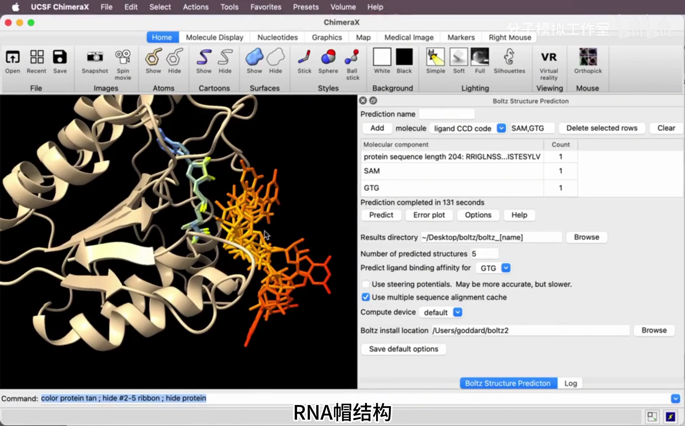
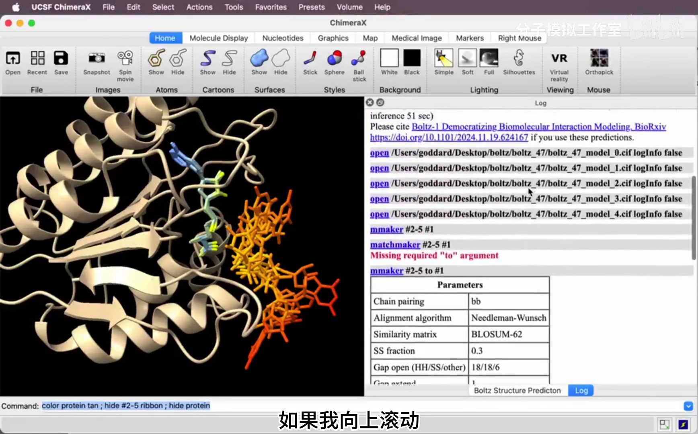

# 一键预测生物大分子，ChimeraX+Boltz2

> 视频来源：[一键预测生物大分子，ChimeraX+Boltz2](https://www.bilibili.com/video/BV1zktqz4Eg6/)（分子模拟工作室，2 分 54 秒；演示对应 UCSF ChimeraX 官方文档引用的"亲和力预测"示例）

## 本讲要解决的核心问题（SCQA）

**背景**：Boltz-2 这类 AF3 类模型既能预测复合物结构，也能预测结合亲和力。云端服务（如上一篇的 NVIDIA NIM）开箱即用，但网页端功能未必齐全。

**冲突**：想要"结构 + 亲和力"一步到位，还希望结果直接出现在自己惯用的分子查看器里，能随手翻看多个构象、调整显示。

**疑问**：不写一行代码，能否在桌面软件里一键完成蛋白-配体的结构与亲和力预测？

**回答**：用 UCSF ChimeraX 内置的 **Boltz** 工具：贴序列 → 加配体 → 勾选亲和力预测 → 点 Predict，几分钟得到 5 个构象和亲和力数值，结构直接载入查看器。

## 一、ChimeraX 内置 Boltz：把预测模型装进桌面软件

**ChimeraX** 是 UCSF 出品的分子可视化与分析软件，新版把 Boltz 结构预测直接集成进来（菜单 Tools → Structure Prediction → Boltz）。打开预测面板后，讲者把它放在 **Log（日志）** 上方以节省空间，随后粘贴感兴趣的蛋白序列（[【跳转到 00:00】](https://www.bilibili.com/video/BV1zktqz4Eg6/?t=0)）。

> **官方文档补充**（来源：[UCSF ChimeraX Boltz 帮助页](https://www.rbvi.ucsf.edu/chimerax/data/boltz-apr2025/boltz_help.html)）：2025-07-22 之后的 ChimeraX 测试版内置 **Boltz 2.1.1** 并支持配体亲和力预测；1.10 正式版（2025-06-26）用的还是 Boltz 1.0.0。首次使用需安装约 1 GB 软件 + 3.3 GB 网络权重 + 0.3 GB CCD 字典。组件可用单字母序列、UniProt ID、三/五字母 CCD 码（如 ATP、HEM）或 SMILES 指定；结果默认存到桌面的 `boltz_<名称>` 文件夹，还有 **Error Plot** 按钮可查看预测对齐误差（PAE）。

## 二、示例体系：麻疹病毒甲基转移酶 + SAM + RNA 帽

本例的蛋白是**麻疹病毒甲基转移酶**——按下 Add 按钮把它加入预测（[【跳转到 00:24】](https://www.bilibili.com/video/BV1zktqz4Eg6/?t=24)）。这个酶的功能是：**把甲基从 S-腺苷甲硫氨酸（SAM）转移到 RNA 帽上**（[【跳转到 00:29】](https://www.bilibili.com/video/BV1zktqz4Eg6/?t=29)）。

> **术语解释**：SAM（S-腺苷甲硫氨酸）是细胞内通用的甲基供体；**RNA 帽**是真核/病毒 mRNA 5' 端的特殊结构，由两个鸟苷经三个磷酸基团连接而成，甲基化与否直接影响 mRNA 的稳定与翻译。

于是要添加两个小分子（[【跳转到 00:29】](https://www.bilibili.com/video/BV1zktqz4Eg6/?t=29)）：

1. **甲基供体 SAM**：按三字母代码 SAM 添加；
2. **RNA 帽**：由两个鸟苷经三个磷酸连接而成，同样按其三字母 CCD 代码作为配体添加（[【跳转到 00:54】](https://www.bilibili.com/video/BV1zktqz4Eg6/?t=54)）。

## 三、勾选亲和力预测，一次出 5 个构象

进入**选项（Options）菜单**，勾选"**显示预测结合亲和力**"，选择 RNA 帽作为亲和力目标，并把预测结构数**从 1 改为 5**（[【跳转到 00:54】](https://www.bilibili.com/video/BV1zktqz4Eg6/?t=54)）。

预测需要几分钟。演示设备是 Mac M2 Ultra；这些预测在 **Mac/Windows/Linux** 上都能运行（[【跳转到 01:19】](https://www.bilibili.com/video/BV1zktqz4Eg6/?t=79)）。

## 四、读懂结果：pLDDT 着色、构象差异与 0.38 μM

预测完成后，**Boltz-2 生成的 5 个预测自动显示在 ChimeraX 中**；用 match 匹配命令把它们对齐，颜色采用**标准 AlphaFold pLDDT 着色**（[【跳转到 01:34】](https://www.bilibili.com/video/BV1zktqz4Eg6/?t=94)）。

**着色规则**：蓝色表示预测高度可信，黄色和橙色表示置信度较低（[【跳转到 01:46】](https://www.bilibili.com/video/BV1zktqz4Eg6/?t=106)）。为了看清配体，讲者做了简化显示：把蛋白质染成浅褐色、只展示其中一个预测、隐藏蛋白侧链（[【跳转到 01:46】](https://www.bilibili.com/video/BV1zktqz4Eg6/?t=106)）。

对比五个预测（[【跳转到 02:11】](https://www.bilibili.com/video/BV1zktqz4Eg6/?t=131)）：

- **甲基供体 SAM 呈蓝色**——构象高度一致；
- **RNA 帽蓝黄相间**——虽然组成一致（两个由磷酸连接的鸟苷），但五个预测给出了**五种不同构象**，颜色偏橙，**置信度非常低**（[【跳转到 02:21】](https://www.bilibili.com/video/BV1zktqz4Eg6/?t=141)）。

构象置信度低，是否意味着亲和力也不可靠？进入**日志（Log）**向上滚动可以看到：**RNA 帽配体的亲和力预测为 0.38 微摩尔（μM）**（[【跳转到 02:37】](https://www.bilibili.com/video/BV1zktqz4Eg6/?t=157)）。也就是说，尽管构象预测置信度较低，**Boltz-2 仍预测出较强的结合亲和力**（[【跳转到 02:37】](https://www.bilibili.com/video/BV1zktqz4Eg6/?t=157)）——结构置信度与亲和力数值是模型的两路输出，读结果时要分开看（亲和力数值越小结合越强，见本系列 1.5.1）。

## 小结

- ChimeraX 把 Boltz-2 集成进桌面软件：**贴序列 → 加配体 → 点 Predict**，全程不写代码，本地即可运行。
- 组件指定方式与云端一致：蛋白贴单字母序列，小分子用**三字母 CCD 代码**（如 SAM）。
- 勾选"预测结合亲和力"并指定目标配体，可同时得到结构与亲和力；把预测数改为 5 可以比较构象多样性。
- 结果解读三件事：**pLDDT 着色**（蓝=高置信）、**构象差异**（本例 RNA 帽五构象不同、低置信）、**亲和力数值**（0.38 μM，较强结合）——三者相互独立。
- 与 5.1.3 的 NIM 路线互补：NIM 网页端适合零部署快速预测，ChimeraX 本地路线适合顺手查看、批量调显示；本例也再次说明 Boltz-2 的招牌能力是**亲和力预测**。

## 关键术语速查

| 术语 | 一句话解释 |
| --- | --- |
| ChimeraX | UCSF 的分子可视化与分析软件，本讲在其内置 Boltz 面板中做预测 |
| Boltz-2 | MIT 开源的 AF3 类结构预测模型，ChimeraX 测试版内置 2.1.1 |
| SAM | S-腺苷甲硫氨酸，通用甲基供体，三字母代码 SAM |
| RNA 帽 | mRNA 5' 端由三个磷酸连接两个鸟苷的帽子结构 |
| CCD 三字母代码 | PDB 化学组分字典的配体代号，ChimeraX 按代码取原子结构 |
| pLDDT 着色 | 逐残基置信度着色：蓝=高可信，黄/橙=较低 |
| 亲和力（μM） | 结合强度预测值，数值越小结合越强；本例 RNA 帽为 0.38 μM |
