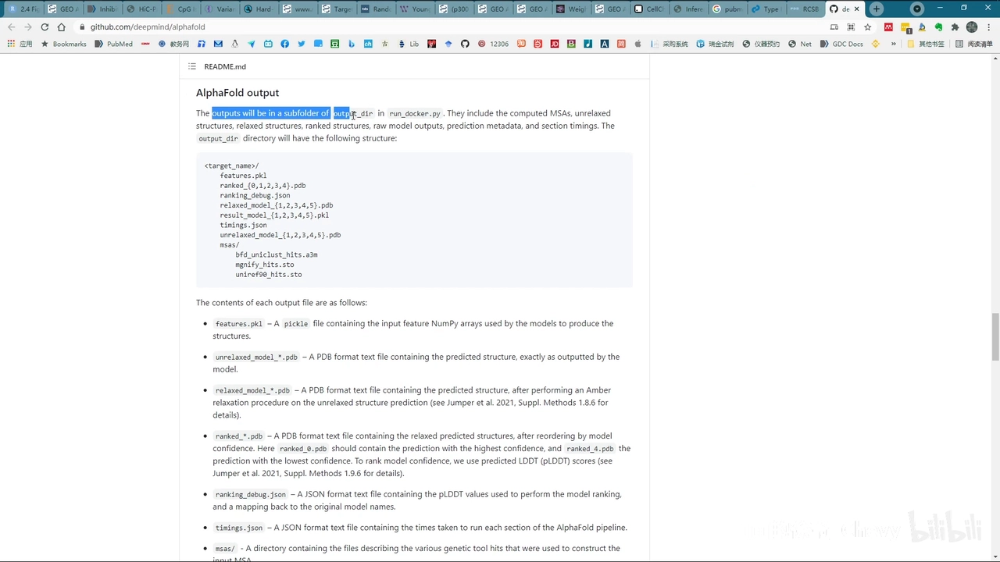
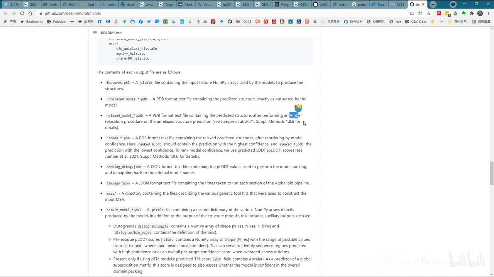
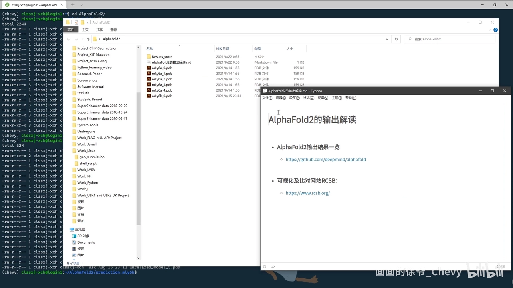
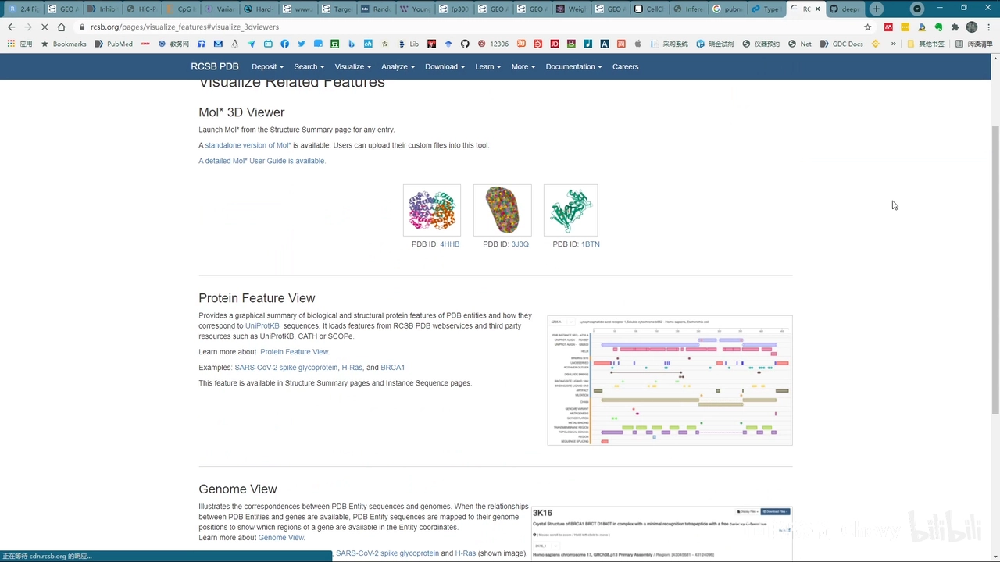
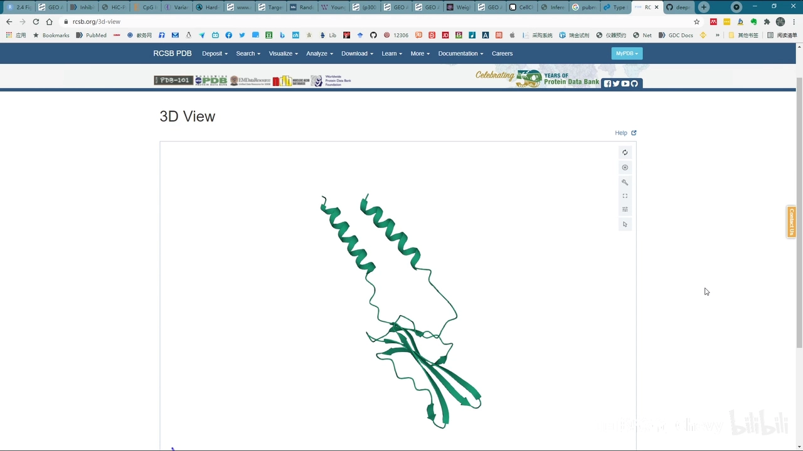
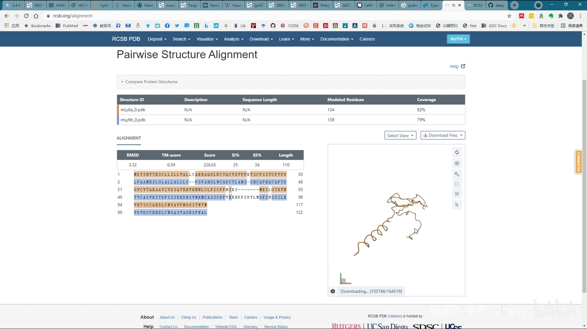

# AlphaFold2结果解读及可视化 （口齿基本清楚，故未加字幕）

> 视频：[【跳转到 00:00】](https://www.bilibili.com/video/BV1Ef4y1N7vy/?t=0) ｜ UP 主：春辉 ｜ 本文基于视频逐句字幕整理，内容可回视频核查。

## 本讲要解决的核心问题（SCQA）

**背景**：很多人拿到蛋白序列就直接丢给 AlphaFold2 跑预测。

**冲突**：预测跑完，输出目录里躺着十几个文件、好几种 PDB，看着一头雾水；想看结构、想对比两个模型，又不知道用什么工具。

**疑问**：AlphaFold2 的输出到底该怎么读？拿到 PDB 文件后怎么可视化、怎么做两个结构的比对？

**回答（中心思想）**：输出文件里最关键的是三类 PDB——unrelaxed（原始）、relaxed（校正）、ranked（按 pLDDT 排序，ranked_0 最优）；日常只需把 ranked 的 PDB 导出，用 **RCSB 网站的 3D viewer** 看单个结构、用 **Pairwise Structure Alignment** 做两两比对，全程免装软件。

## 一、输出目录里有什么：三类 PDB 文件

作者不展开 AlphaFold2 的安装与数据库下载（那部分非常复杂），直接从输出讲起 [【跳转到 00:37】](https://www.bilibili.com/video/BV1Ef4y1N7vy/?t=37)。预测结果放在指定的 output 目录下，里面有 features.pkl、ranked 的 PDB、ranking 的 JSON、relaxed model 的 PDB 等文件和一个子目录 [【跳转到 01:02】](https://www.bilibili.com/video/BV1Ef4y1N7vy/?t=62)。

其中最重要的是**三种 PDB 文件**，它们是一条加工链 [【跳转到 01:27】](https://www.bilibili.com/video/BV1Ef4y1N7vy/?t=87)：

1. **unrelaxed PDB**：最原始的预测模型；
2. **relaxed PDB**：对原始模型做 relax（弛豫）校正后得到；
3. **ranked PDB**：对校正后的模型按 **pLDDT** 分数排序——编号越低排名越高，**ranked_0 就是质量最好的模型** [【跳转到 01:52】](https://www.bilibili.com/video/BV1Ef4y1N7vy/?t=112)。

所以日常使用只需要把 **ranked 的 PDB** 导出到自己的工作文件夹即可 [【跳转到 02:33】](https://www.bilibili.com/video/BV1Ef4y1N7vy/?t=153)。作者以 mouse 一个基因的蛋白序列预测结果为例展开后续操作。

## 二、用 RCSB 在线查看单个结构

**RCSB**（网址见视频简介）整合了数据存储、搜索、可视化、分析等多种功能 [【跳转到 02:58】](https://www.bilibili.com/video/BV1Ef4y1N7vy/?t=178)。只想看单个预测结构的话：

1. 选择 **Visualize** 下的 3D 分子查看器（molecular 3D viewer），点 **Stand Alone** 打开 [【跳转到 03:34】](https://www.bilibili.com/video/BV1Ef4y1N7vy/?t=214)；
2. 点 **Open File**，选择要可视化的 PDB 文件（这里选 mouse 基因的预测结果），点 **Apply**；
3. 左侧窗口即可用鼠标拖转查看 3D 结构，样式参数可自行调整；界面上的保存键可把当前视图存图。

## 三、两个结构的两两比对

如果有两个预测模型想互相比一比（pairwise 比对），同样在 RCSB 里完成 [【跳转到 04:28】](https://www.bilibili.com/video/BV1Ef4y1N7vy/?t=268)：

1. 找到 **Analyze** 选项里的 **Pairwise Structure Alignment**，点击第一个 **Protein** 的 pairwise structure alignment 入口 [【跳转到 04:53】](https://www.bilibili.com/video/BV1Ef4y1N7vy/?t=293)；

2. 两个结构既可以填数据库里已有的 PDB ID，也可以自己上传文件——作者上传了自己跑的两个结果（比如 1~150 区间序列的预测）；
3. **Alignment Method** 在 Help 页面里有详细说明，不同情形该用哪种方法都写得清楚；不确定就先用默认，默认就是大多数人需要的 [【跳转到 05:54】](https://www.bilibili.com/video/BV1Ef4y1N7vy/?t=354)；
4. 点 **Compare**，短暂加载后即完成两个蛋白的比对。

比对结果的读法 [【跳转到 06:24】](https://www.bilibili.com/video/BV1Ef4y1N7vy/?t=384)：可以切换选择链和显示模式（切换后需重新加载）；两个结构分别显示为**蓝色**和**橙色**，而显示为**灰色**的地方就是两者匹配度很低的区域——一眼就能看出差异在哪。

最后用相机快门按钮（Screenshot）把视角调到合适角度后存图下载即可。作者最后说明：本篇只是入门级的结果解读，更深入的分析欢迎大家补充。

## 小结

- AlphaFold2 输出的三类 PDB 是一条加工链：**unrelaxed → relaxed → ranked**，日常只取 **ranked_0**。
- 看单个结构：RCSB 的 Visualize → 3D viewer → Stand Alone → Open File → Apply。
- 比两个结构：RCSB 的 Analyze → Pairwise Structure Alignment，上传或填 PDB ID，Compare 出结果；**蓝/橙是两个结构，灰色区域即匹配度低处**。

## 关键术语速查

| 术语 | 一句话解释 |
| --- | --- |
| unrelaxed PDB | 深度学习直接输出的原始模型，可能含原子冲突 |
| relaxed PDB | 经弛豫（relax）处理校正后的模型 |
| ranked PDB | 按 pLDDT 排序后的模型，ranked_0 最优 |
| pLDDT | 逐残基置信度分数，排序模型的依据 |
| RCSB | 整合结构数据存储/搜索/可视化/分析的网站 |
| Pairwise Structure Alignment | RCSB 内置的两个蛋白结构两两比对功能 |
