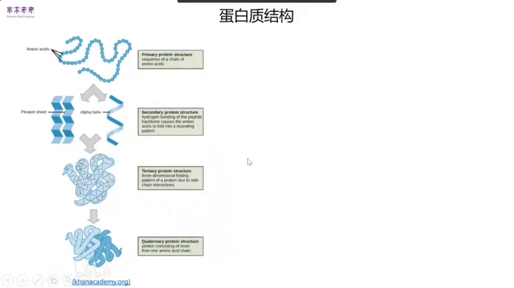
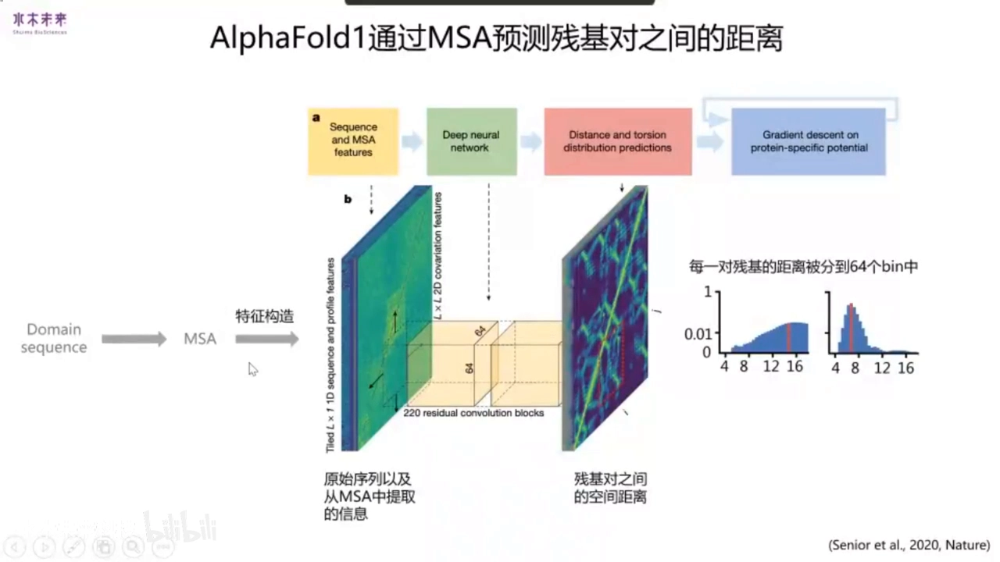
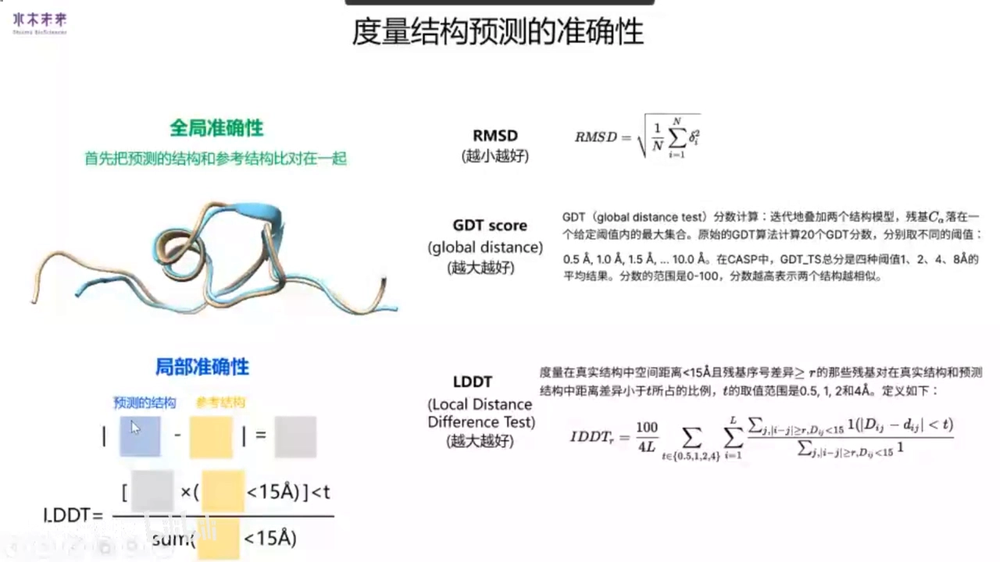
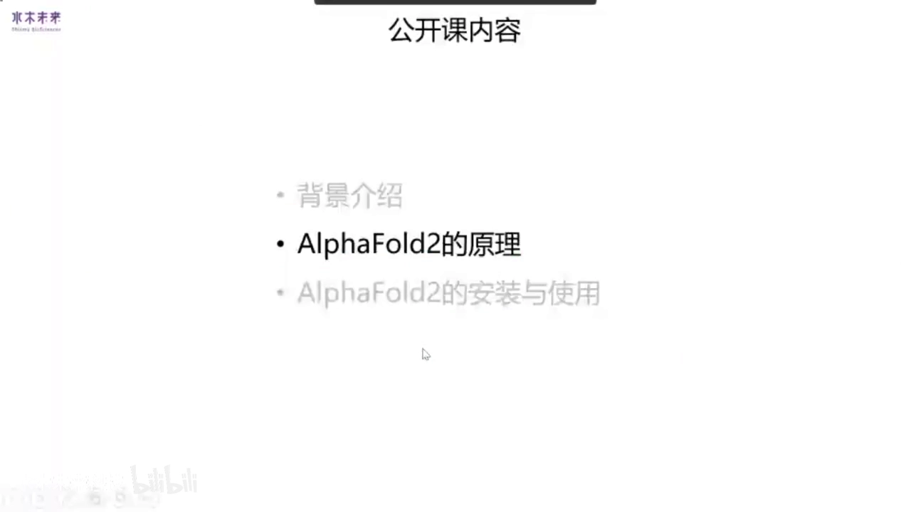
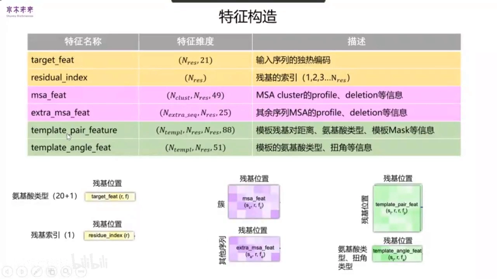
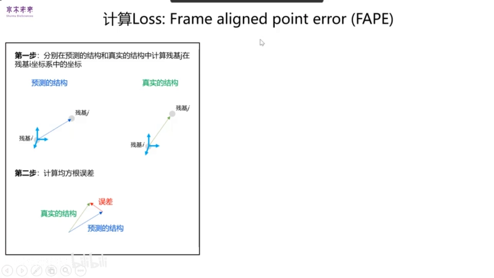
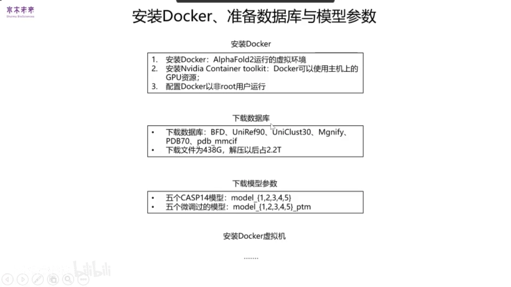
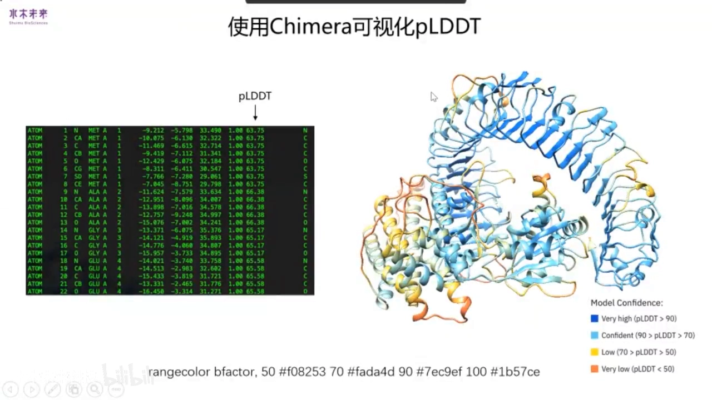
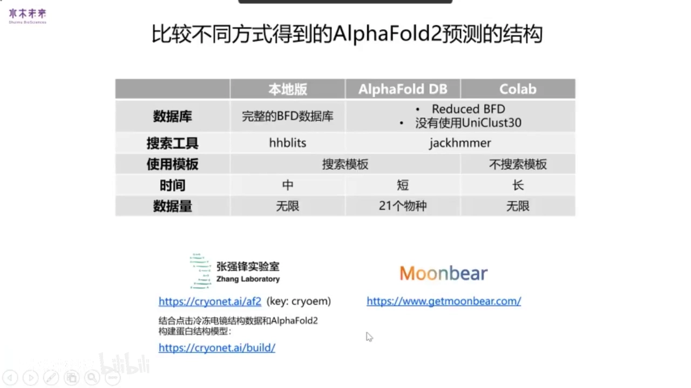

# 【公开课】基于AI预测蛋白质折叠的三维空间结构——AlphaFold2原理及安装使用

> 来源：水木未来 × 赛默飞第 19 期公开课，主讲人：水木未来 AI 平台科学家李盼博士
> 视频：[【跳转到 00:00】](https://www.bilibili.com/video/BV1pg41157zK/?t=0) ｜ 本文基于视频逐句字幕整理，所有内容可回到视频核查。

## 本讲要解决的核心问题（SCQA）

**背景**：蛋白质的三维结构决定了它的功能，结构解析（如冷冻电镜、X 射线晶体学）长期以来昂贵而缓慢；同时，人工智能已经渗入人脸识别、语音识别、自动驾驶等方方面面。

**冲突**：传统计算方法从多序列比对中提取共进化信息再构建模型，准确性长期徘徊；而 2020 年 CASP14 比赛中，一个模型的成绩突然远超所有对手——AlphaFold2。

**疑问**：AlphaFold2 为什么这么准？它内部是怎么从一条氨基酸序列算出全原子三维结构的？普通人想用上它，要怎么安装、怎么运行？

**回答（中心思想）**：AlphaFold2 把「序列数据库检索 → MSA/模板表示 → 48 层 Evoformer 信息交换 → Structure module 生成全原子坐标」做成一条**端到端**的深度学习流水线，使结构预测精度首次逼近实验分辨率；官方提供本地版与 Colab 在线版两条使用路径，安装的本质是「装 Docker + 下 2.2TB 数据库 + 下 10 个模型参数 + 构建 Docker 镜像」四步。

## 一、背景：结构预测难在哪，怎么评价预测好坏

### 1.1 蛋白质结构的四个层级与固定的几何

蛋白质在不同层次上形成复杂结构：**一级结构**是氨基酸的排列顺序；主链之间通过氢键形成 **β 折叠（β-sheet）和 α 螺旋（α-helix）** 这样的**二级结构**；侧链相互作用让整条链折叠成**三级结构**；不同链再通过相互作用组装成**四级结构** [【跳转到 02:46】](https://www.bilibili.com/video/BV1pg41157zK/?t=166)。

氨基酸的几何并非任意：N–Cα–C 夹角一般固定在 109 度左右，α 碳–C 键长约 1.51 Å。相邻原子间的键可以扭动（扭角），而 α 碳、C、O、N、H 和下一个 α 碳六个原子共处一个平面，因此 C–N 之间的扭角 **omega（ω）** 几乎固定在 0 度；**phi（φ）和 psi（ψ）** 两个扭角虽然可动，取值却集中在拉氏图的三个区域内（横轴 phi、纵轴 psi，范围都是 -180°~180°）[【跳转到 04:01】](https://www.bilibili.com/video/BV1pg41157zK/?t=241)。这些"先验几何"正是后面 FAPE 等损失函数能工作的物理基础。

### 1.2 共进化信息：上一代方法的基石

过去人们就发现：若两个残基在空间上接近、能发生相互作用、且这种相互作用在进化中保守，那么多序列比对（MSA）中就能看到它们**成对突变**的痕迹——这就是**共进化信息**。经典流程是：给一条序列 → 搜同源序列 → 找保守配对的残基对并过滤 → 用这些残基对构建初始结构模型 → 用分子动力学模拟等方法精修 [【跳转到 02:36】](https://www.bilibili.com/video/BV1pg41157zK/?t=276)。

### 1.3 从 AlphaFold1 到"单序列也能预测"的尝试

**AlphaFold1** 就是这一思想的深度学习版本：输入一条序列 → 搜同源序列构建 MSA → 从 MSA 提取共变特征，得到一个 N×N×C 矩阵（N 为蛋白长度）→ 用卷积神经网络预测每对残基间的距离 → 以距离为约束做结构优化 [【跳转到 05:38】](https://www.bilibili.com/video/BV1pg41157zK/?t=338)。

同期方法按"用了多少 MSA 共进化信息"可分三类：**PSSM** 只统计每个位点上各残基的比例；**co-evolution**（以 AlphaFold1 为代表）提取共进化矩阵特征；两者都先对 MSA 做了预处理。而 **AlphaFold2 和 RoseTTAFold** 把 MSA 原始信息直接送进模型整体学习。也有不走 MSA 路线的：**ROSETTA** 搜模板、按模板结构预测；**RGN2** 学习蛋白质语言模型，仅凭单条序列就能预测结构 [【跳转到 06:34】](https://www.bilibili.com/video/BV1pg41157zK/?t=394)。

### 1.4 全局与局部准确性：RMSD、GDT_TS、LDDT

评价预测结构准不准，分两类 [【跳转到 08:13】](https://www.bilibili.com/video/BV1pg41157zK/?t=493)：

- **全局指标**（需把两个结构叠合）：**RMSD** 度量对应残基的均方误差；**GDT_TS** 统计对应 α 碳原子距离误差小于 1、2、4、8 Å 四档阈值的比例再取平均，范围 0~1（或 0~100）。
- **局部指标**（不需叠合）：**LDDT** 先分别计算预测结构与参考结构的残基对距离矩阵，两矩阵相减取绝对值得到距离差异；对参考结构中距离小于 15 Å 的残基对，统计距离差异在给定阈值内的比例。范围 0~1，越大越好 [【跳转到 09:28】](https://www.bilibili.com/video/BV1pg41157zK/?t=568)。

### 1.5 CASP13 → CASP14：从"不错"到"惊人"

历届 CASP 比赛最优模型的 GDT 分数显示：2018 年 CASP13 上 AlphaFold1 已表现不错；2020 年 CASP14 上 AlphaFold2 的 RMSD 远低于第二名，成绩非常显著 [【跳转到 10:01】](https://www.bilibili.com/video/BV1pg41157zK/?t=601)。此后 DeepMind 连发两篇文章：一篇讲原理（本课主线），一篇用 AlphaFold2 预测了人类蛋白质组 98% 的蛋白质结构，并持续更新——目前已覆盖 21 个物种。

## 二、AlphaFold2 原理总览：一张图六个部分

AlphaFold2 的整体流程可以用一张图概括，主讲人把它拆成六步 [【跳转到 12:02】](https://www.bilibili.com/video/BV1pg41157zK/?t=722)：

1. **检索**：给定输入序列，到序列数据库和 PDB 数据库中搜索同源序列与模板；
2. **表示**：把同源序列和模板整理成深度学习可接受的矩阵输入；
3. **构造两种表示**：用这些矩阵构造 **MSA representation**（多序列比对表示，蕴含结构信息）和 **pair representation**（残基对表示）；
4. **Evoformer 主干**：通过 48 个 Transformer block，让两种表示互相交换信息；
5. **Structure module**：用学到的表示构造每个原子的三维坐标；
6. **迭代三次**：上述结构生成过程反复迭代三次，逐步精修。

下面逐个模块展开。

## 三、输入准备：从一条序列到六个矩阵

### 3.1 数据库与模板搜索

AlphaFold2 用 HHblits、JackHMMER 等软件到四个数据库搜索同源序列：**UniRef90、Mgnify、Uniclust30、BFD** [【跳转到 13:19】](https://www.bilibili.com/video/BV1pg41157zK/?t=799)。其中 BFD（Big Fantastic Database）是 DeepMind 自建库：从三个数据库收集 25 亿条序列聚类而成；因为直接用 HHblits 搜 BFD 太慢，又制作了 **reduced BFD**——每个家族只抽第一条序列。Mgnify 收集微生物组蛋白序列；UniRef90 与 Uniclust30 都源自 UniProt，只是聚类时相似度阈值不同。模板搜索则用 UniRef90 得到的 MSA 去查 **PDB70**，并取回对应的 CIF 文件。

### 3.2 六个输入矩阵

检索结果被编码成六个矩阵 [【跳转到 14:44】](https://www.bilibili.com/video/BV1pg41157zK/?t=884)：

- **target feature**：查询序列的氨基酸类型矩阵，取值 21 种（20 种氨基酸 + gap），列数即蛋白长度；
- **residue index**：氨基酸索引，从 1 到 N；
- **MSA feature**：对 MSA 聚类后，每行是一个簇（cluster），每列是一个残基位置，格子里填该簇中此位置各残基所占比例；
- **extra MSA feature**：未入选聚类中心、又被抽出的若干条序列，每行一条序列、每列一个残基位置，格子是该序列该位置的氨基酸类型；
- **template pair feature**：模板中残基对的距离、氨基酸类型，以及某氨基酸是否存在于模板中的 mask 信息；
- **template angle feature**：模板的扭角信息（也含氨基酸类型）。

### 3.3 两种表示的初始化

**pair representation** 的初始信息来自 target feature 和 residue index，再整合 template pair feature（模板残基对距离），并通过 **extra MSA stack** 模块吸收 extra MSA 信息 [【跳转到 16:54】](https://www.bilibili.com/video/BV1pg41157zK/?t=1014)。**MSA representation** 则由 target feature 与 MSA feature 构成，再整合模板扭角信息。

怎么直观理解这两种表示？**pair representation 可以看成一张图**：氨基酸是节点，矩阵第 i 行第 j 列（aij）就是从残基 i 到残基 j 的一条边，边里蕴含着残基间距离等信息；**MSA representation 则装着各物种的共进化信息**——本质上就是结构信息。整个 Evoformer 的任务，就是教 pair representation 从 MSA representation 中学会这些共进化知识 [【跳转到 18:09】](https://www.bilibili.com/video/BV1pg41157zK/?t=1089)。

## 四、Evoformer：48 个 block 的信息交换

### 4.1 先弄懂 self-attention

Self-attention 源自 NLP，用来捕获序列中元素间的依赖关系：输入经线性变换得到 **Q、K、V**；Q×K 得到矩阵，经 softmax 变成每行和为 1 的 0~1 权重矩阵；权重再乘 V，完成一次输入更新 [【跳转到 20:00】](https://www.bilibili.com/video/BV1pg41157zK/?t=1200)。放到蛋白质场景：ij 位置的权重就表示"残基 i 对残基 j 的注意力"，可理解为它们之间的共进化信号或距离信号。

### 4.2 从 MSA 提取共进化信息的三个模块

Evoformer 每个 block 分三部分：从 MSA 提取共进化信息 → 把信息整合进 pair representation → 在残基对图上用邻边更新当前边 [【跳转到 19:10】](https://www.bilibili.com/video/BV1pg41157zK/?t=1150)。

从 MSA 提取信息靠三个小模块 [【跳转到 21:15】](https://www.bilibili.com/video/BV1pg41157zK/?t=1275)：

- **row-wise gated self-attention with pair bias**：每次从 MSA 表示中取一行（某个簇的序列）计算 Q、K、V，Q×K 后把 pair representation 的信息也加进来，再 softmax 出权重乘 V；
- **column-wise gated self-attention**：每次取一列，即同一氨基酸在不同物种中的序列，同样算 attention 更新；
- **transition**：通道数先乘 4 再恢复，做逐位置的非线性变换。

### 4.3 外积：把 MSA 信息"搬"进残基对

要更新 pair representation 中 ij 这个 entry，就从 MSA representation 取出第 i 列和第 j 列，做**外积（outer product）**后更新 [【跳转到 22:24】](https://www.bilibili.com/video/BV1pg41157zK/?t=1344)。

### 4.4 三角形更新：让距离关系自洽

对残基对这张"图"的更新有四个模块 [【跳转到 22:49】](https://www.bilibili.com/video/BV1pg41157zK/?t=1369)：

- 两个 **triangular multiplicative update**：更新边 i→j 时，分别借助 i→k 与 j→k 两条边（第一模块），或 k→i 与 k→j 两条边（第二模块），k 遍历其他节点；
- 两个 **triangular self-attention**：更新边 i→j 时，或用 i 出发的所有边的信息，或用所有以 k 为中点的边的信息。

这种"三角形"式的学习方式有助于残基之间学到正确的相对位置关系。经过 48 个 Evoformer block，pair representation 已经充分吸收了结构信息 [【跳转到 24:29】](https://www.bilibili.com/video/BV1pg41157zK/?t=1469)。

## 五、Structure module：从表示到全原子坐标

### 5.1 一切从 frame（标架）说起

要输出坐标，先要懂 **frame**——就是一个坐标系。主讲人用机械臂打比方：桌子有 world frame（世界坐标系），机械臂底座有 base frame，手上还有自己的 frame；同一个点在不同坐标系下坐标不同，乘上旋转矩阵 R（3×3）再加平移 t（3×1）就能换算 [【跳转到 24:49】](https://www.bilibili.com/video/BV1pg41157zK/?t=1489)。

放到蛋白质上：主链 N–Cα–C 构成每个残基自己的局部坐标系——C 原子在局部系下的坐标是 (1.51, 0, 0)，因为键长 1.51 Å；所有残基共享一个全局坐标系 [【跳转到 26:09】](https://www.bilibili.com/video/BV1pg41157zK/?t=1569)。侧链上也有 Cβ、Cγ、Cδ 等坐标系。把局部系坐标乘上对应 frame 就得全局坐标，frame 取逆则可反向换算。

骨架坐标系的构造四步走 [【跳转到 27:24】](https://www.bilibili.com/video/BV1pg41157zK/?t=1644)：①以 Cα→C 向量为 X 轴；②N 到 Cα–C 直线的垂线方向为 Y 轴；③X、Y 平面的法向量为 Z 轴；④以 Cα 为原点、三轴单位化。于是 frame = 位置（Cα 坐标）+ 朝向（三个轴向量）：原点决定残基在哪，三个向量决定残基朝向。

### 5.2 有了 frame 和扭角，就能拼出全原子结构

如果我们知道每个残基的 frame，就能算出骨架坐标；再由 Evoformer 输出的表示推断每个残基**主链与侧链的扭角**，两者结合即可拼出**全原子结构** [【跳转到 28:39】](https://www.bilibili.com/video/BV1pg41157zK/?t=1719)。AlphaFold2 用一个 **single representation** 来推断扭角信息。于是问题变成：怎么获得每个残基的 backbone frame 和这个 single representation？——这就是 structure module 的工作 [【跳转到 29:34】](https://www.bilibili.com/video/BV1pg41157zK/?t=1774)。

Structure module 的输入输出都是 single representation + backbone frame，因此可以堆叠。初始化很"平"：single representation 取 Evoformer 输出的 MSA representation 的**第一行**（即查询序列所在的簇）；初始 backbone frame 中所有残基的原点重合、朝向一致，后续更新中才逐渐分开 [【跳转到 29:59】](https://www.bilibili.com/video/BV1pg41157zK/?t=1799)。

### 5.3 IPA：把三维几何注入注意力

更新 single representation 用的是 **IPA（Invariant Point Attention，不变点注意力）** [【跳转到 30:46】](https://www.bilibili.com/video/BV1pg41157zK/?t=1846)。它在普通 self-attention（算 Q、K、V）的 softmax 之前，额外注入两路信息：pair representation 的信息，以及由 backbone frame 转化来的空间信息。后者可以理解为**三维空间中任意两残基的实际距离**——离得越近，attention 贡献越高。三路信息经 softmax 后与 V、pair representation、转化后的坐标相乘再拼接，完成一次更新。

backbone frame 怎么更新？由 single representation 计算出一个**四元数（quaternion）**——它与旋转矩阵等价，可互相换算——再用它调整原有 frame [【跳转到 32:26】](https://www.bilibili.com/video/BV1pg41157zK/?t=1946)。

### 5.4 FAPE：在"每个残基的坐标系"里算误差

有了预测结构，如何算 loss？AlphaFold2 用 **FAPE（Frame Aligned Point Error）** [【跳转到 32:51】](https://www.bilibili.com/video/BV1pg41157zK/?t=1971)，分两步：

1. 对任意残基对（I, C），分别在预测结构与真实结构中，计算残基 C 在残基 I 坐标系下的向量；
2. 求两个向量的误差，填入一张"行=参考坐标系、列=被比较残基"的表；直观理解：取残基 K 的坐标系把预测结构（绿）与真实结构（灰）对齐，再逐一比较其他残基。

最后对整张表取均值就是 FAPE。除 FAPE 外还有 **distogram loss**（预测的距离图与真实差异）和 **MSA loss**（聚类时 mask 掉部分残基类型再重建）[【跳转到 34:19】](https://www.bilibili.com/video/BV1pg41157zK/?t=2059)。

### 5.5 五个模型与 pTM

官方共训练五个模型：前两个用模板信息、后三个不用；CASP14 后又 fine-tune 出五个 **PTM 模型**，多了预测 **pTM**（度量全局预测准确性的指标）的能力 [【跳转到 34:49】](https://www.bilibili.com/video/BV1pg41157zK/?t=2089)。线上运行五个模型后按平均 pLDDT 排序，取 ranked_0 作为最终结构。

## 六、安装使用：本地版怎么跑起来

### 6.1 本地版与官方在线版的四点差异

AlphaFold2 官方发布**本地版**（装在自己机器上）与**官方在线版**（直接在 Colab 使用）两种，差异有四点 [【跳转到 35:20】](https://www.bilibili.com/video/BV1pg41157zK/?t=2120)：①在线版不搜索模板；②在线版用 reduced BFD 代替 BFD；③在线版不搜索 Uniclust30；④在线版默认用六个模型，本地版只用前五个。差异是实打实的：主讲人测试一个 60 氨基酸的蛋白，本地版在 BFD 中能搜到 127 条同源序列，在线版只有 4 条；本地版预测结构（蓝色）与 PDB 实验结构（灰色）高度一致，在线版则有一个输出差异较大 [【跳转到 36:10】](https://www.bilibili.com/video/BV1pg41157zK/?t=2170)。

### 6.2 安装四步走

安装本地版分四步 [【跳转到 36:41】](https://www.bilibili.com/video/BV1pg41157zK/?t=2201)：

1. **装 Docker**（AlphaFold2 运行的虚拟环境）+ **NVIDIA Container Toolkit**（让 Docker 用上主机 GPU）+ 配置非 root 用户运行；
2. **下载数据库**：约六个库，解压后共约 **2.2 TB**；
3. **下载模型参数**：共十个——model_1~5 与 model_1_ptm~model_5_ptm；
4. **构建 Docker 镜像**（用 Dockerfile）。

### 6.3 Dockerfile 里发生了什么

按 Dockerfile 安装镜像容易出错，主讲人更喜欢交互式安装：`docker pull` 拉镜像 → `docker run -it` 进入环境 → 手动 apt-get/pip 装软件 → 退出后 `docker commit` 存成新镜像，以后用 `docker run` 运行 [【跳转到 38:59】](https://www.bilibili.com/video/BV1pg41157zK/?t=2339)。

Dockerfile 本身做的事 [【跳转到 37:25】](https://www.bilibili.com/video/BV1pg41157zK/?t=2245)：拉取 NVIDIA 提供的 Ubuntu 基础镜像 → apt-get 安装 **HMMER**（同源序列搜索）、**Kalign**（多序列比对）、**HHsuite** → 装 Miniconda 与 conda 包 → 下载标准氨基酸键长键角参数 → pip 安装 **jax、jaxlib** → 因 DeepMind 修改过 OpenMM 源码，需打 patch → 最后设置容器入口为 `run_alphafold.py`。

### 6.4 常见错误四则

主讲人总结了四个高频坑 [【跳转到 38:59】](https://www.bilibili.com/video/BV1pg41157zK/?t=2339)：

1. **apt-get update 报 NVIDIA 源 404**：老镜像（CUDA 11.1-base）导致；换用新版 CUDA 11 + cuDNN8 镜像，或在容器内先改源配置再 update；
2. **HHsuite、jaxlib 安装失败**：先下载到本地，再交互式进入 Docker 安装；
3. **报"不能大于 2GB"错误**：MSA 同源序列太多，TensorFlow 建不了大 tensor；从 features.pkl 的 MSA 中抽 2048 条序列保存即可；
4. **非正常显存不足**：同样显存别人跑得完你跑不完——检查各包版本，尤其 **jaxlib 要更新到 0.1.69** 才能正常预测 [【跳转到 52:57】](https://www.bilibili.com/video/BV1pg41157zK/?t=3177)。

### 6.5 输入极简，输出要认识

输入只有一条序列（外加下载好的 BFD 数据库）[【跳转到 41:49】](https://www.bilibili.com/video/BV1pg41157zK/?t=2509)。输出文件一览：

- **features.pkl**：多序列比对与模板搜索的中间结果；手动改代码可从这步续跑，省去重复搜索；
- **timing.json**：每步耗时（秒）；
- **unrelaxed_model_1~5**：五个模型的深度学习直接输出，可能含 clash（原子空间冲突）；
- **relaxed_model_1~5**：经 **Amber99SB 力场**能量最小化后的结构，消除了 clash；
- **ranked_0~4.pdb**：五个模型按平均 pLDDT 排序后的结果，**ranked_0 即最佳**；
- **ranking_debug.json**：记录排名与原始模型的对应关系；
- **result_model_1~5_ptm.pkl**：distogram（残基对距离图）、experimentally resolved（原子是否可被高分辨率解析）、pLDDT 等附加信息——后三者仅 PTM 模型生成。

### 6.6 用颜色读懂 pLDDT

新版代码输出的 PDB 直接内嵌 pLDDT：越接近 100，模型对该残基越自信 [【跳转到 43:59】](https://www.bilibili.com/video/BV1pg41157zK/?t=2639)。

用 **PyMOL** 打开 PDB，在命令行输入着色命令，即可按 pLDDT 上色查看 [【跳转到 44:24】](https://www.bilibili.com/video/BV1pg41157zK/?t=2664)。

## 七、三种预测途径怎么选

不装本地版也有办法 [【跳转到 44:49】](https://www.bilibili.com/video/BV1pg41157zK/?t=2689)：

- **Colab 在线版**：登录谷歌账号 → 粘贴序列 → 全部运行，约 40~50 分钟出结构；
- **AlphaFold DB**：直接搜索，21 个物种的蛋白质结构已预计算好；
- 对比维度：数据库（本地版用完整 BFD + Uniclust30，后两者都没有）、搜索软件（本地版 HHblits，后两者 JackHMMER）、模板（本地版与 DB 用，Colab 不用）、时间（DB 最快；本地版装好后也不慢；Colab 每次要重装环境反而更久）、数据量（本地版/Colab 一次几十条，DB 已有 21 个物种）。此外 Colab 上还有需 key 的预测组件、可结合冷冻电镜数据建模的方法，以及 Robetta 这类在线服务可选 [【跳转到 45:20】](https://www.bilibili.com/video/BV1pg41157zK/?t=2720)。

## 八、公开课 Q&A 精华（16 问）

- **RoseTTAFold vs AlphaFold2**：RoseTTAFold 的初衷就是复现 AlphaFold2——CASP14 后大家以为 DeepMind 不会开源，学术界想自建工具；它根据 AF2 演讲透露的信息复现，准确性至今仍不如 AF2，但胜在人人可用 [【跳转到 48:39】](https://www.bilibili.com/video/BV1pg41157zK/?t=2919)。
- **能预测二聚体/复合物吗**：官方没打算支持；社区土办法是把两条链用长 linker（如一串 H）连成一条序列再预测，穿进去的 linker 在结果中通常呈无序状态 [【跳转到 49:54】](https://www.bilibili.com/video/BV1pg41157zK/?t=2994)。
- **显存与蛋白长度**：主讲人用 11GB 显存测到约 2500 个残基；3080 只能跑几百个氨基酸多半是包版本问题（jaxlib 0.1.69）[【跳转到 51:59】](https://www.bilibili.com/video/BV1pg41157zK/?t=3119)。
- **膜蛋白胞外区置信度低**：多半是 MSA 序列太少、或训练集中该类蛋白太少——AF2 本质靠共进化信息 [【跳转到 53:22】](https://www.bilibili.com/video/BV1pg41157zK/?t=3202)。
- **RNA 结构预测难在哪**：已知 RNA 三级结构太少，难以像蛋白质那样训练模型；且 RNA 结构柔性大，常需与蛋白结合才稳定 [【跳转到 54:37】](https://www.bilibili.com/video/BV1pg41157zK/?t=3277)。
- **用模板 ≠ 同源建模**：同源建模把新序列"套"进已知结构；AF2 只把模板解析成特征融入学习，且对模板容错——有时给错模板输出变化不大，前两个模型（用模板）的输出甚至可能不如后三个（不用模板）[【跳转到 55:52】](https://www.bilibili.com/video/BV1pg41157zK/?t=3352)。
- **提速**：本地可换用 MMseqs2 做同源搜索（需改代码；已有 Colab 这么做）[【跳转到 57:57】](https://www.bilibili.com/video/BV1pg41157zK/?t=3477)。
- **BFD vs reduced BFD 差别大吗**：大多数情况一致（reduced BFD 保留的是各家族代表性序列），AlphaFold DB 也用它；例外是个例 [【跳转到 58:47】](https://www.bilibili.com/video/BV1pg41157zK/?t=3527)。
- **没有参考结构时怎么挑模型**：看 pLDDT——每残基一个值，均值最高的即 ranked_0；pLDDT 是 AF2 的"自信度"，范围 0~100，官方定义 **>70 为 confident**，序列中 >70 的比例越高整体越可信 [【跳转到 59:33】](https://www.bilibili.com/video/BV1pg41157zK/?t=3573)。
- **能多卡并行吗**：主讲人没试过，网上有教程。
- **在线结果有指导意义吗**：非常有——DB 就是为了让不懂 Docker/Linux、没有好显卡的结构生物学家也能直接用 [【跳转到 1:01:35】](https://www.bilibili.com/video/BV1pg41157zK/?t=3695)。
- **会取代实验结构生物学吗**：不会。AF2 文章自述仅对约 50% 几的蛋白 confident、30% 几 very confident，剩余过半不 confident；且它只预测单一固定构象，柔性蛋白的多构象无解；做 CADD 这类精细工作，人们还是想要实验分辨率的结构 [【跳转到 1:03:15】](https://www.bilibili.com/video/BV1pg41157zK/?t=3795)。
- **"端到端"是什么意思**：AlphaFold1 的深度学习只负责预测残基间距离，后面靠优化方法出结构；AlphaFold2 从序列输入到三维结构输出全程都是神经网络，这有助于更好地学习参数 [【跳转到 1:05:32】](https://www.bilibili.com/video/BV1pg41157zK/?t=3932)。
- **能预测酶活中心/别构位点吗**：活性中心包含在结构里，可以看；但若蛋白存在多种构象（alternative structure），AF2 只给一个固定结构 [【跳转到 1:06:52】](https://www.bilibili.com/video/BV1pg41157zK/?t=4012)。
- **预测结构的应用方向**：解析冷冻电镜难以搞定的结构、药物设计/CADD、指导突变研究（找关键疾病位点）[【跳转到 1:07:42】](https://www.bilibili.com/video/BV1pg41157zK/?t=4062)。
- **复合物预测的具体操作**：两条链序列直接首尾相接，中间插入一段很长的 linker（如一串 H），作为一个"蛋白"去预测即可，linker 部分通常呈无序状态 [【跳转到 1:09:07】](https://www.bilibili.com/video/BV1pg41157zK/?t=4147)。点突变结构的预测可行但准确性无定论 [【跳转到 1:10:22】](https://www.bilibili.com/video/BV1pg41157zK/?t=4222)；AlphaFold DB 里唯一一个模型就是五模型中评分最高的那个 [【跳转到 1:11:12】](https://www.bilibili.com/video/BV1pg41157zK/?t=4272)。

## 小结

- AlphaFold2 在 CASP14 上以显著优势夺冠，其成功来自**端到端**深度学习：序列进、全原子结构出。
- 流水线六步：数据库检索 → 六矩阵表示 → 初始化 MSA/pair 两种表示 → 48 层 Evoformer 交换共进化与残基对信息 → Structure module（IPA + frame 更新）出全原子坐标 → FAPE 等损失驱动训练，迭代三次精修。
- 使用有三条路：**本地版**（完整 BFD+模板，最准但要装 Docker、下 2.2TB 数据）、**Colab**（零安装，不搜模板）、**AlphaFold DB**（21 个物种直接查）。
- 结果怎么读：五个模型按平均 pLDDT 排序取 ranked_0；pLDDT>70 视为 confident；PyMOL 一条命令即可按置信度着色。
- AF2 不是万能：复合物、多构象、RNA、低 MSA 蛋白仍是短板，实验结构生物学不可替代。

## 关键术语速查

| 术语 | 一句话解释 |
| --- | --- |
| MSA | 多序列比对：把同源序列排在一起，暴露共进化信号 |
| 共进化 | 互相作用的残基对在进化中成对突变的现象 |
| MSA / pair representation | Evoformer 的两种输入表示：前者装序列簇信息，后者装残基对（边）信息 |
| Evoformer | 48 层主干网络，含行/列自注意力、外积与三角形更新 |
| Structure module | 由 single representation 与 backbone frame 生成全原子坐标的模块 |
| frame（标架） | 一个坐标系（旋转 R + 平移 t），每个残基一个，决定残基位置与朝向 |
| IPA | 不变点注意力：在注意力中注入 pair 信息与三维空间距离信息 |
| FAPE | 在每个残基坐标系下对齐比较预测与真实结构的误差 |
| pLDDT | 逐残基置信度（0~100），>70 视为 confident |
| pTM | 全局预测置信度指标，由 PTM 模型输出 |
| BFD / reduced BFD | DeepMind 自建的 25 亿条序列数据库及其精简版（每家族取一条） |
| unrelaxed / relaxed / ranked | 深度学习原始输出 / Amber99SB 能量最小化后 / 按平均 pLDDT 排序后的模型 |
| GDT_TS / RMSD / LDDT | 全局与局部结构相似度评价指标 |
| 端到端 | 从输入序列到输出结构全程由神经网络完成，无需传统的单独优化步骤 |
