# Discovery Studio 实操：从 2000 个假结合到 1 个可信复合物

> 视频来源：[Bilibili BV13V4y1n73Y](https://www.bilibili.com/video/BV13V4y1n73Y/)（时长约 31 分半）· 对应知识体系条目：5.1.7 dyMEAN `structure` 任务（仓库 dymean）
>
> 本文基于视频字幕与画面整理，关键步骤与结论均可点击时间戳回看原视频核对。

## 先说结论

**背景**：抗体结构建模（上一教程）和抗原结构（PDB 数据库下载）都就绪后，就可以模拟抗体 V 区与抗原的结合——这一步叫**分子对接**。

**冲突**：抗原-抗体结合主要靠**界面氨基酸的相互作用**，而且理论上只应发生在 CDR 区。但对接程序只搜索形状匹配——只要形状互补它就报"能结合"，直接跑完会得到约 2000 个遍布抗体四周的假结合。

**疑问**：怎么把形状匹配的粗结果，变成一个免疫学上说得通的抗体-抗原复合物？

**回答**：用 Discovery Studio 的四个程序接力：ZDOCK 刚体对接（6°/15° 采样）→ 按 CDR-H3 做位置过滤（2000 → 10）→ ZRank 打分 + RDOCK 柔性优化选出最优 pose（本例为 pose 3）→ Analyze Protein Interfaces 分析界面残基，得到结合表位信息。全流程看完，你会得到一个"计算 + 过滤 + 优化 + 分析"的完整闭环。

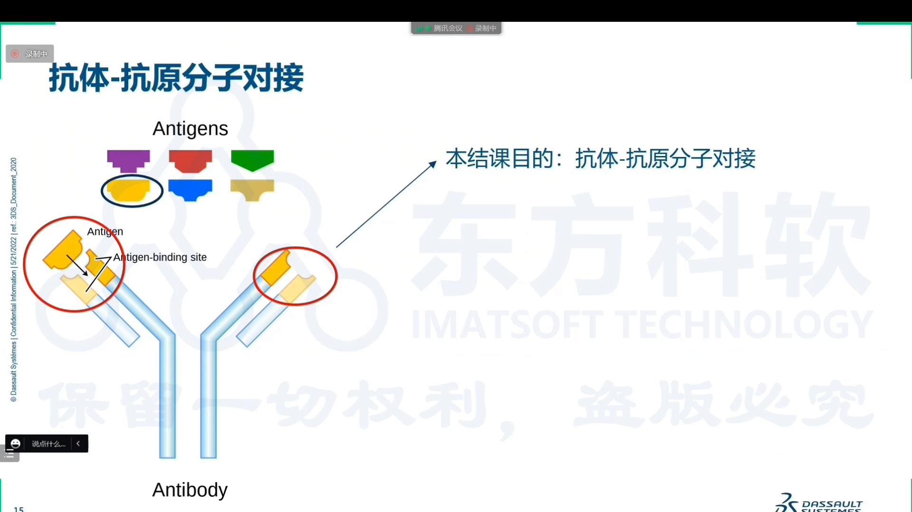

## 一、分子对接是什么：两种场景、三件分工

分子对接就是预测分子之间的结合，分两种场景：化药设计中化合物结合到蛋白内部的空腔；而抗原-抗体结合靠的是**界面氨基酸的相互作用** [【跳转到 01:10】](https://www.bilibili.com/video/BV13V4y1n73Y/?t=70)。

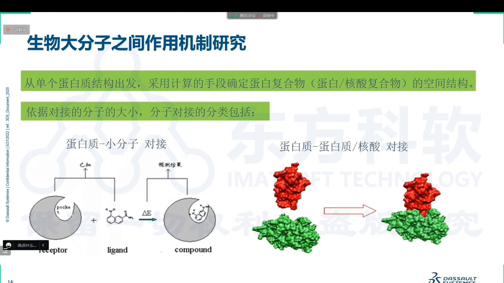

DS 里与之相关的程序有三个分工 [【跳转到 02:13】](https://www.bilibili.com/video/BV13V4y1n73Y/?t=133)：

- **ZDOCK**：对接。原理是形状匹配——通过快速的（傅里叶类）变换提取三维蛋白质结合表面的形状特征，靠特征互补搜索分子间相互作用 [【跳转到 03:03】](https://www.bilibili.com/video/BV13V4y1n73Y/?t=183)、[【跳转到 03:33】](https://www.bilibili.com/video/BV13V4y1n73Y/?t=213)；
- **ZRANK**：给对接结果打分，评估结合强弱；
- **RDOCK**：对前期"形状匹配"的刚体结果做基于能量方程的进一步优化。

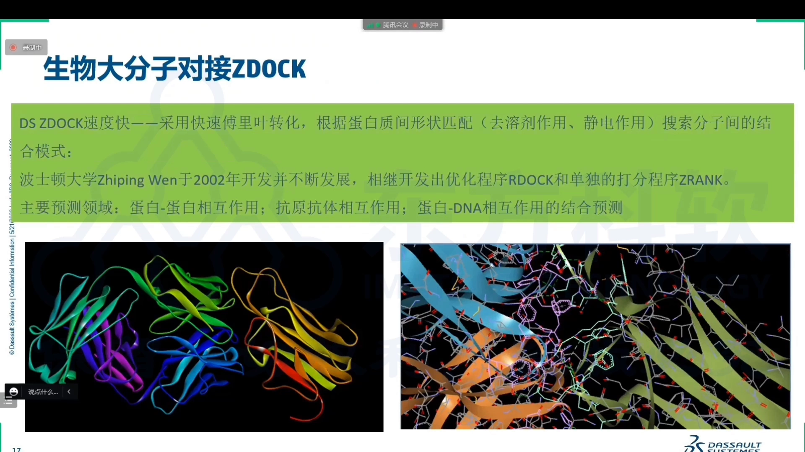

整体流程三步：对接（ZDOCK）→ 打分（强弱判定）→ 优化 [【跳转到 04:05】](https://www.bilibili.com/video/BV13V4y1n73Y/?t=245)。

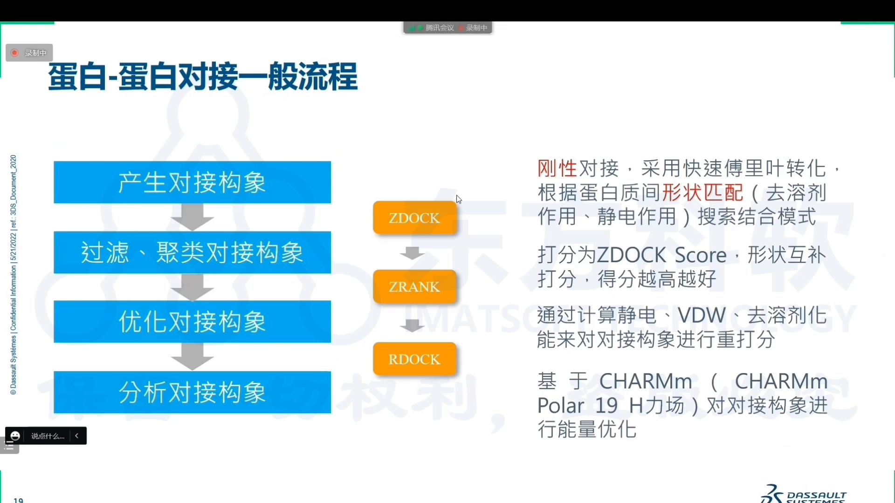

## 二、实操准备：结构从哪来、谁当 receptor

- **抗体结构**：承接前面教程的抗体建模结果，可先做分析和鉴定；
- **抗原结构**：到 PDB 数据库中搜索下载（演示时特意选了个较小的抗原，节省时间）[【跳转到 10:08】](https://www.bilibili.com/video/BV13V4y1n73Y/?t=608)。

ZDOCK 需要输入两个结构：**receptor（受体）和 ligand（配体）**。约定上一般把抗体做成 receptor、抗原做成 ligand；另一个实用约定是"大的做 receptor、小的做 ligand"——两者没有严格要求，把两个蛋白分别输入即可 [【跳转到 06:27】](https://www.bilibili.com/video/BV13V4y1n73Y/?t=387)。

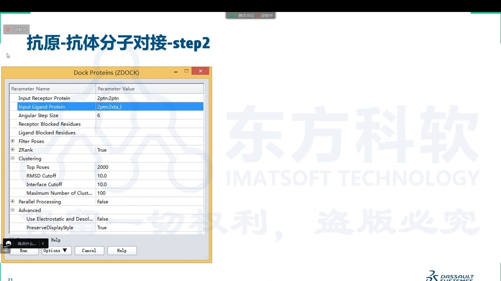

程序入口在 DS 的 Macromolecules → Dock Proteins 下（共四个与蛋白对接相关的程序）[【跳转到 11:41】](https://www.bilibili.com/video/BV13V4y1n73Y/?t=701)。

## 三、跑 ZDOCK：采样角度决定精度

ZDOCK 最关键的参数是**旋转采样角度**：6 度采样密、结果精确但慢；15 度步幅大、快但覆盖度低 [【跳转到 06:52】](https://www.bilibili.com/video/BV13V4y1n73Y/?t=412)。还可以定义氨基酸位置做屏蔽或限定结合区。

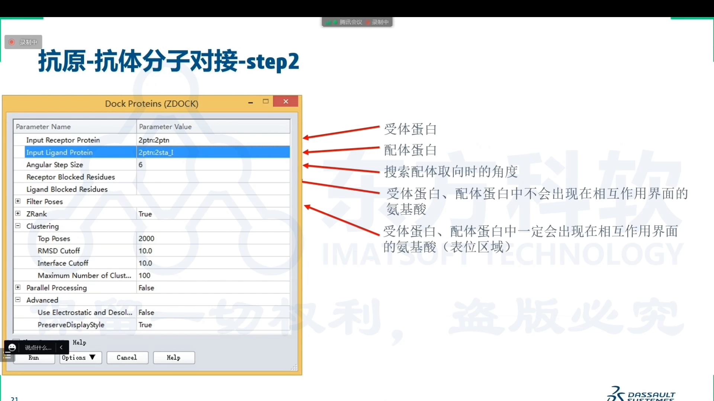

运行原理：ligand protein 绕着 receptor 旋转采样——抗体的 CDR 区下方会形成一些空腔、凹槽，形状匹配就是找这些互补的位置。抗原-抗体结合推荐 6 度，因为要覆盖到整个 CDR 区 [【跳转到 14:13】](https://www.bilibili.com/video/BV13V4y1n73Y/?t=853)。有 GPU 时用 GPU 计算比 CPU 更快；程序里还有把"对接+打分"合二为一的选项 [【跳转到 12:56】](https://www.bilibili.com/video/BV13V4y1n73Y/?t=776)。

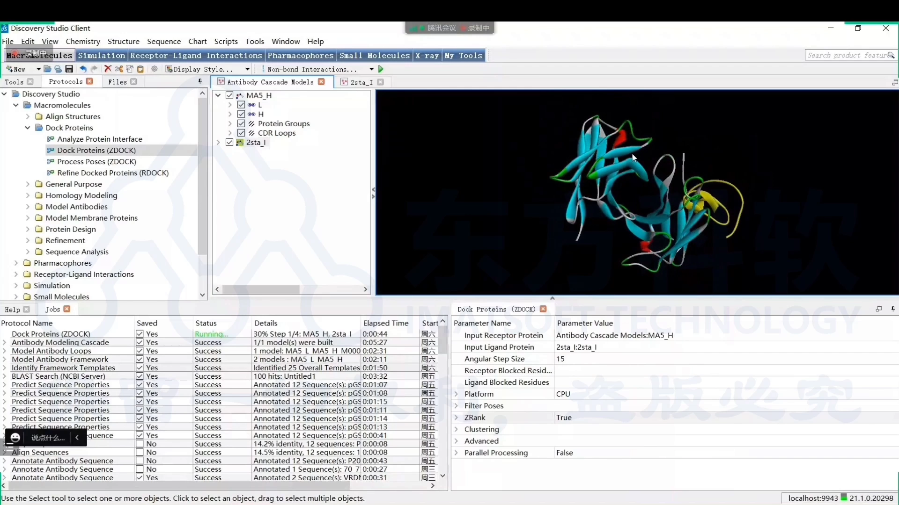

## 四、从 2000 到 10：CDR-H3 位置过滤

跑完 ZDOCK，结果窗口里抗体四周布满**圆点——每一个圆点表示一个可能的结合中心位置** [【跳转到 17:58】](https://www.bilibili.com/video/BV13V4y1n73Y/?t=1078)。Jobs 提示大约有 **2000 种结合可能性**，分布在整个抗体四周 [【跳转到 19:13】](https://www.bilibili.com/video/BV13V4y1n73Y/?t=1153)。

问题在于：ZDOCK 只搜形状匹配，非 CDR 区只要形状互补也会被报为结合——而抗原-抗体结合在理论上只应发生在 CDR 区 [【跳转到 15:28】](https://www.bilibili.com/video/BV13V4y1n73Y/?t=928)。所以要做一个额外操作：**位置过滤**。

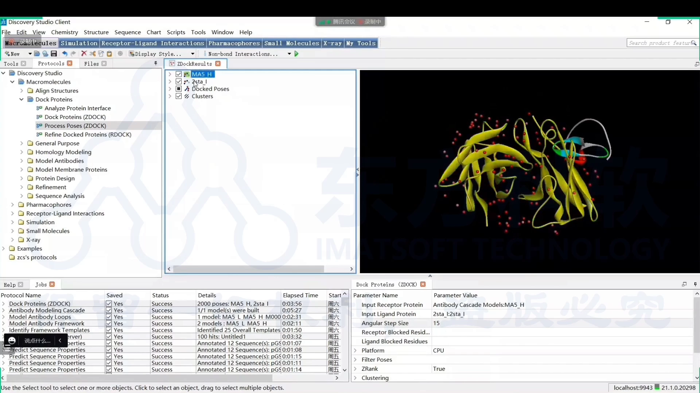

过滤条件选六个 CDR 中的 **CDR-H3**——它对抗原结合最重要，位于最内部核心的位置 [【跳转到 19:38】](https://www.bilibili.com/video/BV13V4y1n73Y/?t=1178)。位置过滤以抗体（receptor）+ 抗原为输入、选 all poses，把结合位置限定到 CDR-H3 附近，以轻链和重链的 CDR（H3）为条件，把其它位置筛掉 [【跳转到 20:11】](https://www.bilibili.com/video/BV13V4y1n73Y/?t=1211)。

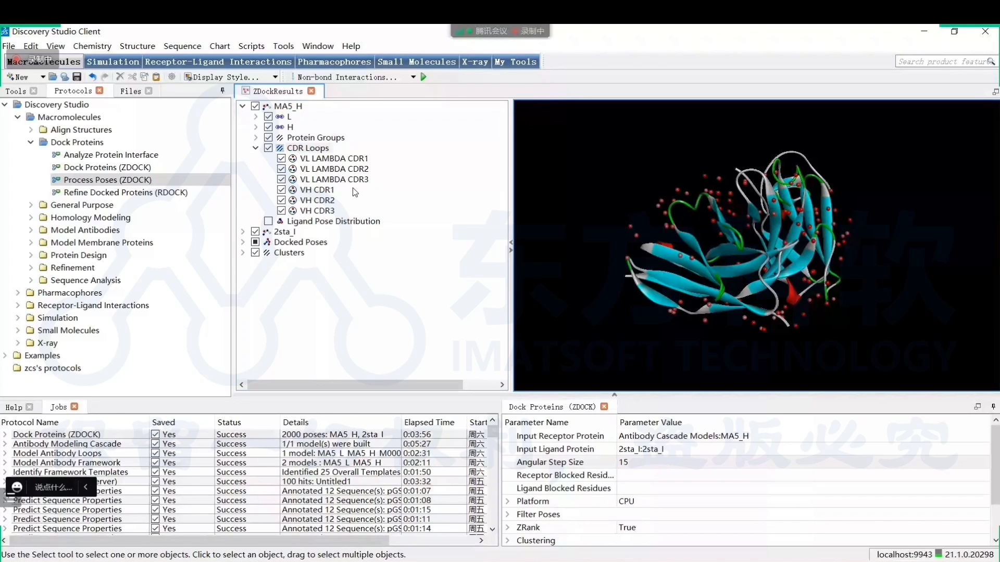

过滤后只剩 **10 个 pose** [【跳转到 21:01】](https://www.bilibili.com/video/BV13V4y1n73Y/?t=1261)。

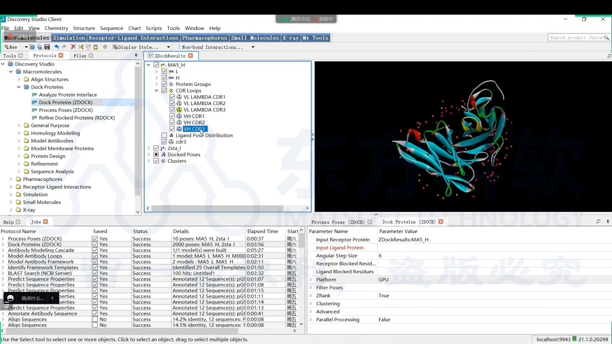

默认只显示结合可能性最高的三个；在结果表里可以显示全部 output poses。pose 用颜色标识打分高低：**越高分越红、低分偏蓝**；十个红点就是十个结合中心，都落在 CDR-H3 附近 [【跳转到 22:13】](https://www.bilibili.com/video/BV13V4y1n73Y/?t=1333)。

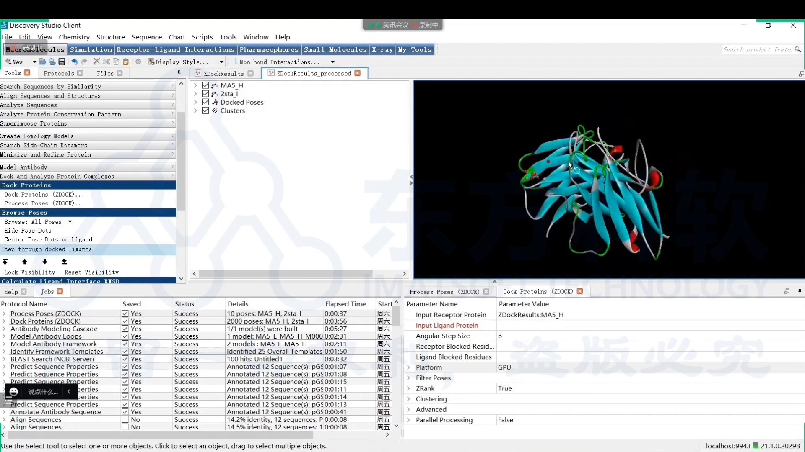

## 五、打分与柔性优化：选出 pose 3

**怎么从 10 个里挑？** 第一种方式看 poses 表格里的 **ZRank score**：分数越低（越负）说明结合亲和力越好，偏正则较弱——注意此时还没有做柔性优化 [【跳转到 23:59】](https://www.bilibili.com/video/BV13V4y1n73Y/?t=1439)。

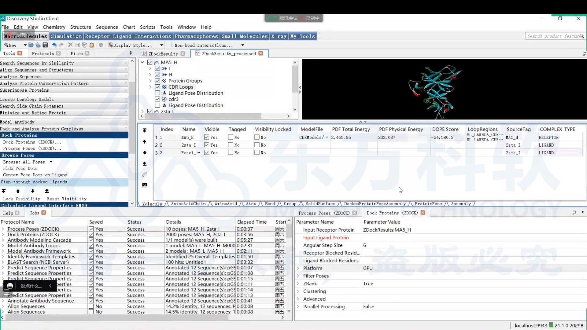

**第二步做 RDOCK 柔性优化**：在当前结合的基础上，重新计算抗原-抗体之间的相互作用能，并改变界面氨基酸残基的位置让结合更好——这些相互作用在刚体对接阶段是没法考虑的，因为对接时界面氨基酸不发生变化 [【跳转到 26:01】](https://www.bilibili.com/video/BV13V4y1n73Y/?t=1561)。输入仍是 receptor + ligand，pose 选第 3 个优化 [【跳转到 25:27】](https://www.bilibili.com/video/BV13V4y1n73Y/?t=1527)。

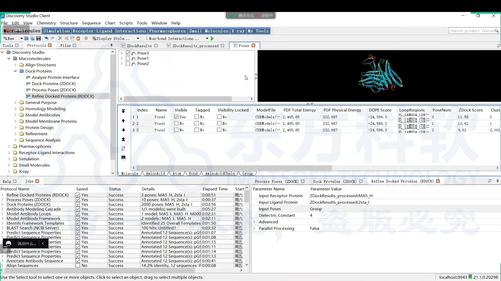

RDOCK 运行完会重新打分排序：本例推荐的顺序是 **pose 3 最好**，然后是 1 和 2；评价标准是 RDOCK 打分，越负说明相互作用越好，另外两个 pose 打分偏高 [【跳转到 27:09】](https://www.bilibili.com/video/BV13V4y1n73Y/?t=1629)。于是**优选 pose 3**——它包含了轻链、重链和抗原的结构信息，三者同在一个复合物里 [【跳转到 27:39】](https://www.bilibili.com/video/BV13V4y1n73Y/?t=1659)。

## 六、界面分析：谁在相互作用

确定最终 pose 后，用 **Analyze Protein Interfaces** 程序分析蛋白界面氨基酸的变化：输入 pose 3、指定配体链，非（共）键相互作用的阈值保持软件默认 [【跳转到 28:54】](https://www.bilibili.com/video/BV13V4y1n73Y/?t=1734)。

结果显示两个分组：**interface ligand residues**（抗原侧参与结合界面的氨基酸）和抗体侧参与结合的氨基酸——后者大部分位于 CDR 区 [【跳转到 29:55】](https://www.bilibili.com/video/BV13V4y1n73Y/?t=1795)。这一步给出**结合表位（界面残基）信息**，也为后续的改造和设计（表位分析）提供前提支撑。

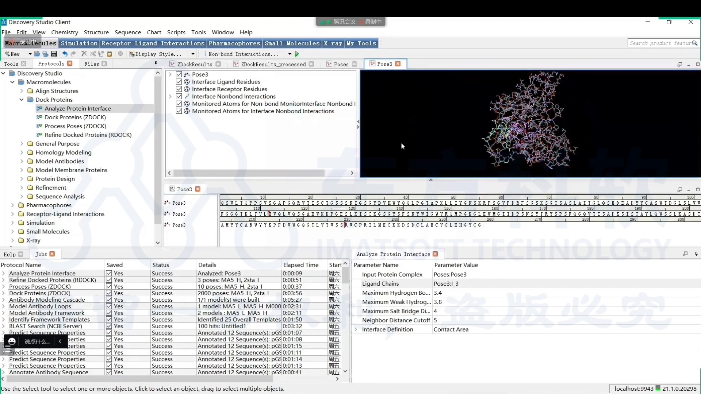

## 七、全流程回顾：2000 → 10 → 1

简单回顾本例的完整链路 [【跳转到 28:04】](https://www.bilibili.com/video/BV13V4y1n73Y/?t=1684)：

1. ZDOCK 对接 → 得到 **2000** 种结合可能性；
2. CDR-H3 位置过滤 → 锁定到 **10**；
3. RDOCK 柔性优化 + 重新打分 → 从 10 个里选 **1** 个（pose 3）；
4. 界面分析 → 明确界面残基与结合表位信息。

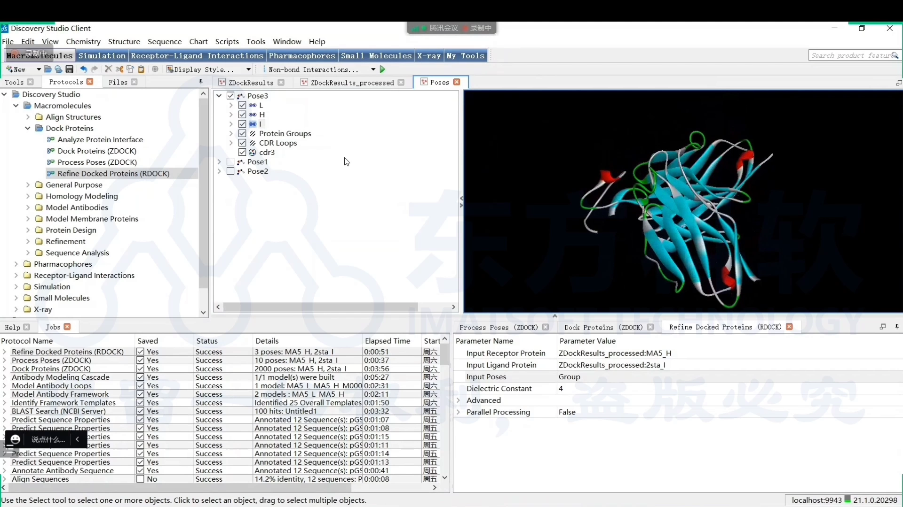

四个程序各司其职：前三个做对接、CDR 限定、柔性优化打分并选最优 pose；最后的分析程序回答"界面哪些氨基酸在相互作用"，即结合表位信息 [【跳转到 30:45】](https://www.bilibili.com/video/BV13V4y1n73Y/?t=1845)。

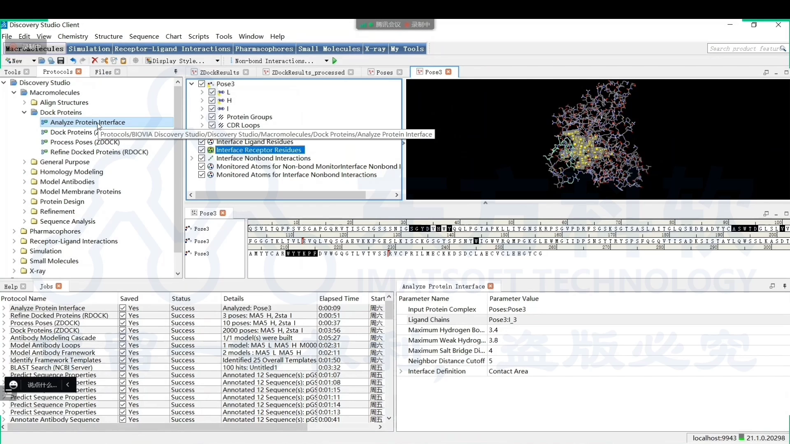

## 小结

- 分子对接两种场景：化合物-蛋白空腔（化药设计）与抗原-抗体界面；后者靠界面氨基酸相互作用，理论上只发生在 CDR 区。
- ZDOCK 是刚体形状匹配（6°/15° 旋转采样、可 GPU 加速），只看形状会给出约 2000 个假结合。
- CDR-H3 位置过滤是抗原-抗体对接区别于普通对接的关键一步：2000 → 10。
- ZRank score 越负越好（未优化前）；RDOCK 柔性优化重算界面能量、调整残基位置后重新排序，本例选出 pose 3。
- Analyze Protein Interfaces 输出抗原侧/抗体侧界面残基，大部分位于 CDR 区，为表位分析与后续改造设计提供依据。

## 关键术语速查

| 术语 | 一句话解释 |
| --- | --- |
| ZDOCK | DS 中基于形状匹配的刚体对接程序 |
| ZRANK | 对接结果的打分程序，分数越负结合越好 |
| RDOCK | 基于能量方程的柔性优化程序，重算界面相互作用 |
| 刚体对接 | 对接时不改变界面氨基酸位置的对接方式 |
| 采样角度 | 旋转采样步长（6°/15°），决定精度与耗时 |
| pose | 一个候选结合方式；ZDOCK 一次可产生约 2000 个 |
| CDR-H3 | 重链第三个 CDR，过滤结合位置的首选锚点 |
| interface residues | 参与结合界面的氨基酸，即结合表位信息 |
