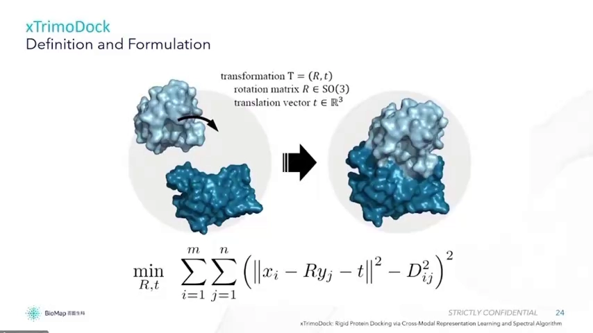
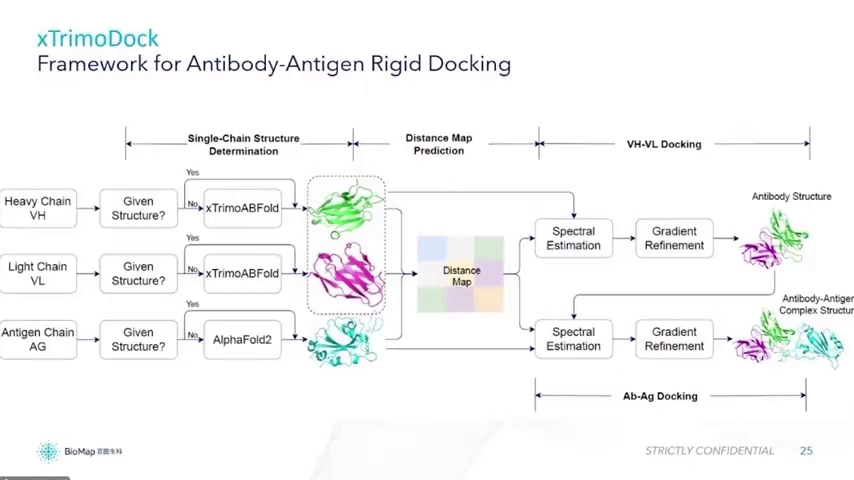
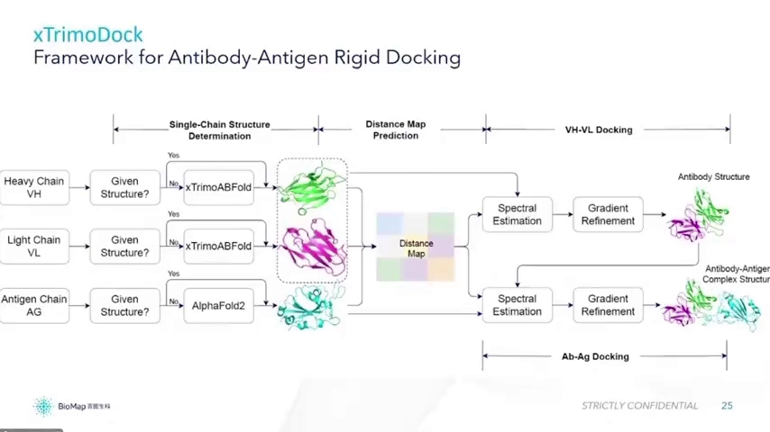
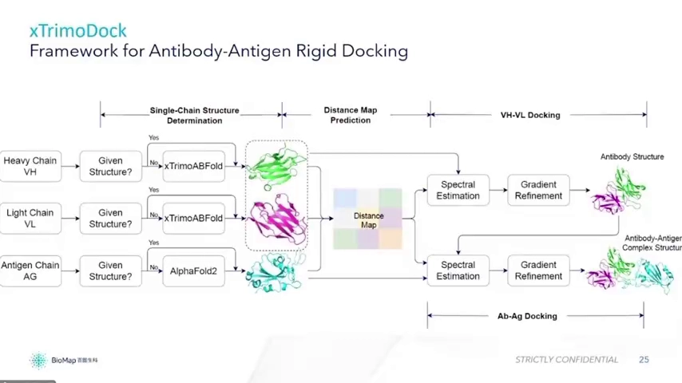
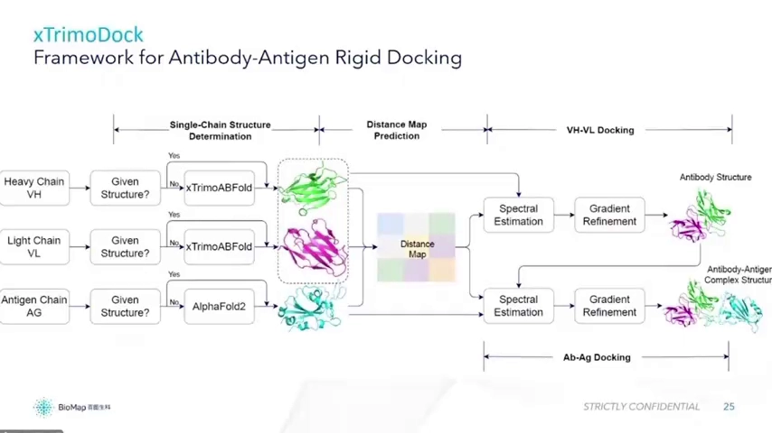
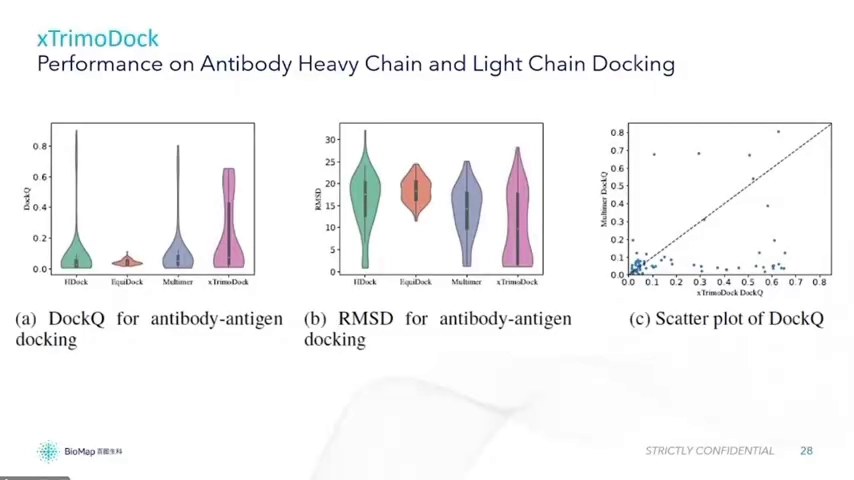
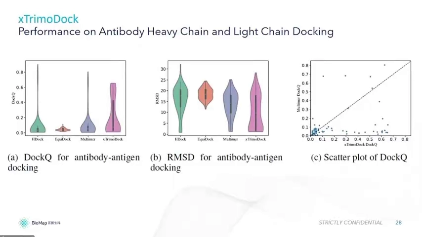
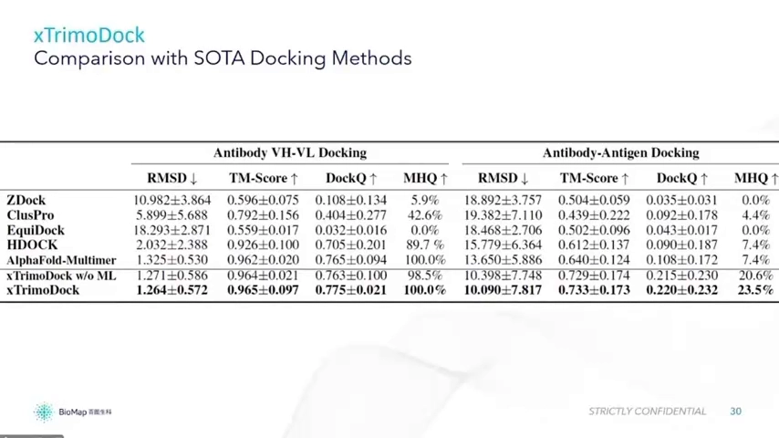
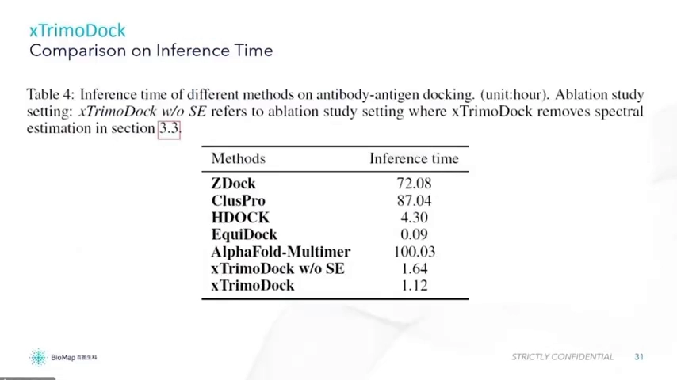
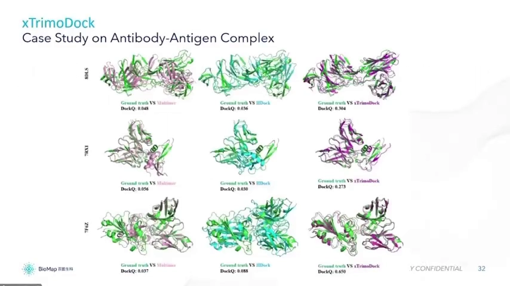

# xTrimoDock：把抗体-抗原"拼"到正确位姿的 AI 对接方法

> 视频来源：[Bilibili BV1rM411f7bW](https://www.bilibili.com/video/BV1rM411f7bW/)（时长约 12 分钟）· 对应知识体系条目：5.1.7 dyMEAN `structure` 任务（仓库 dymean）
>
> 本文基于视频字幕与画面整理，关键数字与结论均可点击时间戳回看原视频核对。

## 先说结论

**背景**：抗体药物设计绕不开一个问题：抗体到底怎么结合抗原？单链结构现在已经能用 AlphaFold 类模型预测，但**把几条链拼成正确的复合物**（pose/位姿预测）仍是瓶颈。

**冲突**：把两条链"拼"对并不容易——把对接写成优化问题时它是非凸的；现有方法的表现也不理想：视频给出的对比里，AlphaFold-Multimer 在抗体-抗原对接上的 DockQ 只有 0.108（大部分样本根本没对上），经典对接方法一次推理要跑约 87 个小时。

**疑问**：有没有既准、又快的方法，能从单链结构直接得到抗体-抗原复合物？

**回答**：xTrimoDock 给出的答案是"先预测链间距离矩阵，再解一个旋转+平移的优化问题"。整个方法分四步：单链结构预测 → 跨链距离矩阵（distance map）预测 → VH-VL 对接 → 抗体-抗原对接；核心求解用**闭式解起步、梯度细化（gradient refinement）收敛**。效果上：VH-VL 对接全部测试样本 DockQ > 0.49（DockQ 均值 0.775），抗体-抗原对接 DockQ 约 0.2（对比 AlphaFold-Multimer 的 0.108），单次推理约 1.12 小时。

## 一、把对接写成一个数学题：学一个旋转 + 平移

先看问题本身：手里有两个蛋白——两条单链的单体结构，需要学习一个**旋转（R）和平移（T）**，使它们能够对接在一起。如果是抗原-抗体的情况，抗体有重链和轻链，再加上一个抗原，就是**三条链**的对接问题 [【跳转到 00:10】](https://www.bilibili.com/video/BV1rM411f7bW/?t=10)。

以两条链为例，把问题数学化：设 X 是第一个蛋白的坐标、Y 是第二个蛋白的坐标。假如知道第一个蛋白与第二个蛋白**所有氨基酸之间的距离 D**（这个 D 也可以由模型预测出来），问题就变成一个优化：寻找旋转 R、平移 T，使得 Y 经过旋转平移后与 X 的距离和真实距离一致——理想情况下 loss 为零 [【跳转到 00:35】](https://www.bilibili.com/video/BV1rM411f7bW/?t=35)。

解这个问题需要两件事：一是知道两个蛋白的**单链结构**，二是知道它如何**旋转到想要的位置** [【跳转到 01:25】](https://www.bilibili.com/video/BV1rM411f7bW/?t=85)。

## 二、方法框架：四步流水线

整个方法以抗原-抗体复合物为例（本身可泛化到广义的蛋白-蛋白对接）：有重链、轻链和抗原三条链；结构已给定的不再预测，没有给定的才需要预测 [【跳转到 01:40】](https://www.bilibili.com/video/BV1rM411f7bW/?t=100)。

**第一步，单链结构预测**。重链与轻链用讲者团队自己的抗体结构预测模型（视频中称其为当时的最好版本，精度大幅超越既有方法）；抗原一侧则发现用 MSA 的效果最好，因此使用内部优化后的 AF2（AlphaFold2）——它与原版 AlphaFold2 很像，但训练上有些细节调整，比如把额外的训练目标与 MSA 放在一起训练。输入支持 bound 或 unbound 状态 [【跳转到 02:05】](https://www.bilibili.com/video/BV1rM411f7bW/?t=125)。

**第二步，跨链距离矩阵（distance map）预测**：估计两条链之间第 i 个氨基酸与第 j 个氨基酸的距离 [【跳转到 02:55】](https://www.bilibili.com/video/BV1rM411f7bW/?t=175)。

支撑这一步的网络输入包括三路特征：因为单链结构已知，可以提取 **structure-level** 特征；序列有 **sequence-level** 特征；再加上搜索到的 **MSA** 信息 [【跳转到 04:10】](https://www.bilibili.com/video/BV1rM411f7bW/?t=250)。设计完网络后预测 pair 之间的距离，用类似 distance map 的 loss——只需关心 **off-diagonal**（非对角）部分，因为矩阵是对称的，而且链内的部分（对角块）单链结构已知、无需预测 [【跳转到 05:00】](https://www.bilibili.com/video/BV1rM411f7bW/?t=300)。此外还引入一个额外的 MSA 掩码重建 loss：参考 NLP 里 mask language model 的方式，重构 MSA 中被 mask 的部分——实验发现这对预测 contact map 有帮助。

**第三、四步，对接求解**。先解前面的优化问题——它可以推导出一个**闭式解**，之后再通过 gradient refinement（梯度细化）继续压低 loss；先用闭式解把抗体两条链的完整结构对出来，再重复同样的工作，得到抗原-抗体复合物 [【跳转到 03:20】](https://www.bilibili.com/video/BV1rM411f7bW/?t=200)。直观理解：如果 X、Y、D 都是真实值，R、T 可以直接解出一个最优解（图中的红点，一个局部值）；但它未必全局最优，所以再用类似梯度细化的算法继续最小化目标函数 [【跳转到 05:57】](https://www.bilibili.com/video/BV1rM411f7bW/?t=357)。得到 R、T 之后，把蛋白旋转、平移到想要的位姿，就得到了 docking 后的复合物结构 [【跳转到 06:38】](https://www.bilibili.com/video/BV1rM411f7bW/?t=398)。

整个流程归纳为四步：①单链结构预测；②跨链 distance map 预测；③VH-VL 对接；④抗体-抗原对接 [【跳转到 03:45】](https://www.bilibili.com/video/BV1rM411f7bW/?t=225)。

## 三、成绩单：又准又快

### 3.1 VH-VL 对接：全部样本 DockQ > 0.49

评估 VH-VL docking 用的是 **DockQ**——docking 领域公认的 metric。对比方法有 HDOCK、DiffDock（MIT 的 diffusion-based 模型）、AlphaFold-Multimer（DeepMind）以及 xTrimoDock（讲者自己的方法）[【跳转到 07:12】](https://www.bilibili.com/video/BV1rM411f7bW/?t=432)。

散点图以 45 度线为界：点落在斜线下方说明 xTrimoDock 更好、落在上方说明 AlphaFold-Multimer 更好——**大部分点都在右下角**，即 xTrimoDock 更优 [【跳转到 07:37】](https://www.bilibili.com/video/BV1rM411f7bW/?t=457)。

表格中列出 RMSD、TM-score 与 MHQ。**MHQ** 指 DockQ > 0.49（质量最高档）的样本占整个测试集的比例。xTrimoDock 的 VH-VL 对接 MHQ 达到 **100%**（全部样本 DockQ > 0.49），DockQ 均值 **0.775**，表中另一项指标约 0.765；HDOCK 也不错（0.7）；DiffDock 在这个数据上基本失效；RosettaDock、ClusPro 等经典对接方法则差得多 [【跳转到 08:27】](https://www.bilibili.com/video/BV1rM411f7bW/?t=507)。

### 3.2 抗体-抗原对接：对 AlphaFold-Multimer 大幅领先

抗体-抗原 docking 上，xTrimoDock 对 AlphaFold-Multimer 大幅领先：DockQ 0.108 的 AlphaFold-Multimer 意味着大部分样本没有对接上；xTrimoDock 约 **0.2**，高出十几个点；TM-score 有接近十个点的提升；高分段占比 MHQ 从 AlphaFold-Multimer 的 **7.4%** 提升到约 **23%** [【跳转到 09:17】](https://www.bilibili.com/video/BV1rM411f7bW/?t=557)。

### 3.3 速度：100 小时 → 1.12 小时

经典对接方法推理非常慢，约需 87 小时；AlphaFold-Multimer 因为要搜 MSA，整体约 100 小时；xTrimoDock 只要 **1.12 小时** [【跳转到 10:20】](https://www.bilibili.com/video/BV1rM411f7bW/?t=620)。

提速的一个关键是前面的**闭式解**：消融实验（ablation study）显示，因为这是个非凸优化问题、无法保证全局最优，用闭式解起步可以用更少的迭代到达更好的 local minimum；否则可能要从更远的地方收敛。所以闭式解 + 细化的组合让 docking 用时更短 [【跳转到 10:45】](https://www.bilibili.com/video/BV1rM411f7bW/?t=645)。

### 3.4 肉眼可见的对比

最后是三个抗体-抗原复合物的可视化：所有方法输入一致（都是预测出的单链结构）；Multimer 基本无法对准，HDOCK 也有多处不准，xTrimoDock 的 DockQ 整体更高、位置基本正确 [【跳转到 11:33】](https://www.bilibili.com/video/BV1rM411f7bW/?t=693)。

## 小结

- 对接的数学本质：已知（或预测）链间距离矩阵 D，求旋转 R 与平移 T，使两条链拼回真实距离——loss 为零即完美对接。
- xTrimoDock 四步：单链结构预测（抗体侧自有模型、抗原侧 MSA+优化版 AF2）→ 跨链 distance map（结构级+序列级+MSA 特征，只算 off-diagonal）→ VH-VL 对接 → 抗体-抗原对接。
- 求解组合拳：闭式解先给出高质量起点，gradient refinement 再细化；非凸问题下这能显著减少迭代、缩短耗时。
- 成绩：VH-VL 全样本 DockQ>0.49（均值 0.775、MHQ 100%）；抗体-抗原 DockQ ~0.2 vs AlphaFold-Multimer 0.108、MHQ 23% vs 7.4%；单次 1.12 小时 vs 经典方法 87–100 小时。

## 关键术语速查

| 术语 | 一句话解释 |
| --- | --- |
| pose / 位姿 | 两个分子相对摆放的方式；对接即预测正确位姿 |
| distance map | 第 i、j 个氨基酸间距离组成的矩阵；跨链部分决定如何拼接 |
| 闭式解 | 直接由公式算出的解；这里用于初始化 R、T |
| gradient refinement | 以梯度迭代继续最小化目标函数的细化步骤 |
| 非凸优化 | 有多个局部极小、无法保证找到全局最优的优化问题 |
| DockQ | 对接质量常用指标（0–1），越高越好 |
| MHQ | DockQ > 0.49 的高质量样本占比 |
| MSA | 多序列比对，为结构预测提供共进化信息 |
| AlphaFold-Multimer | DeepMind 的复合物结构预测模型，本文主要对比基线 |
