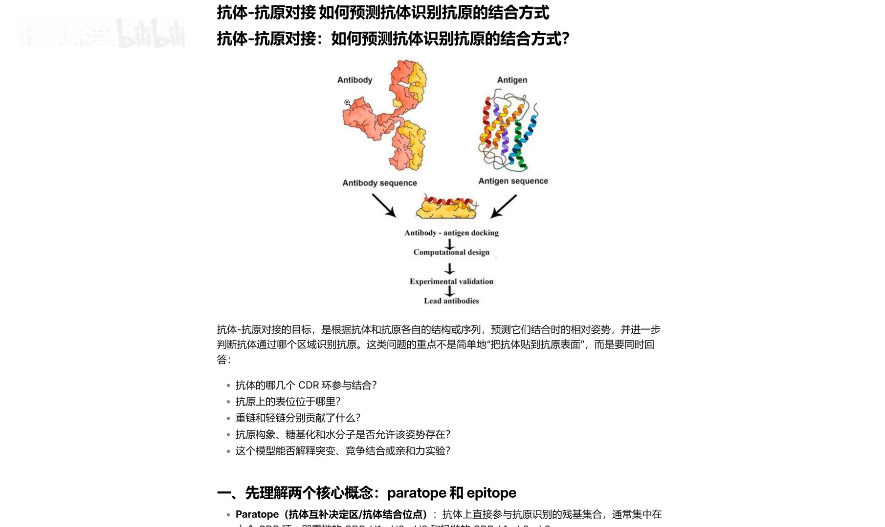
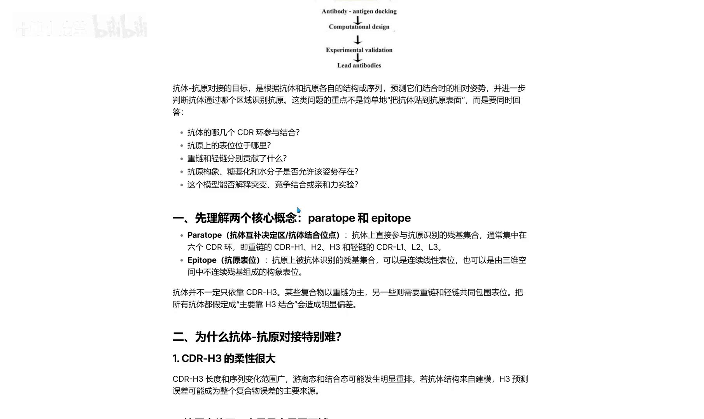
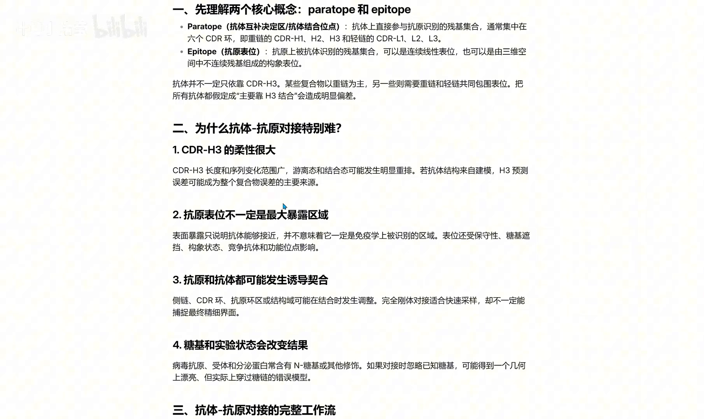
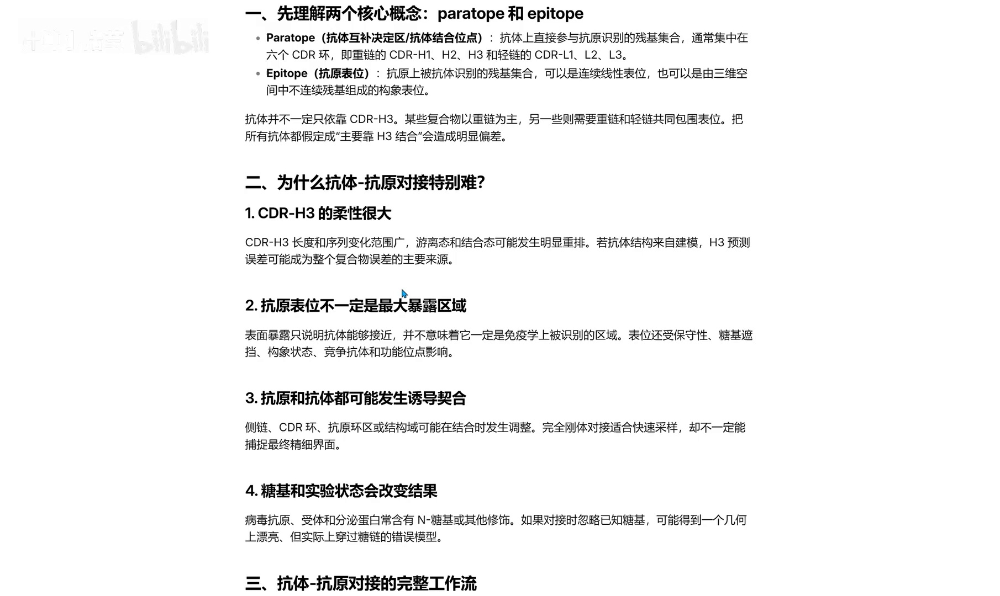
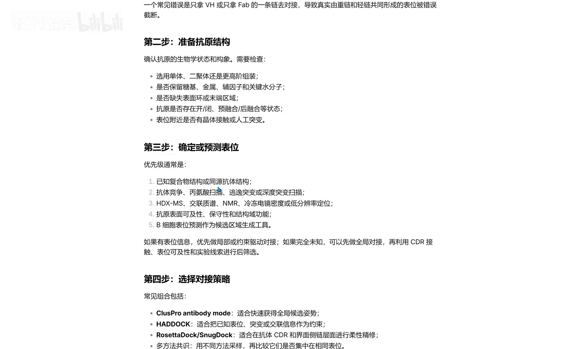
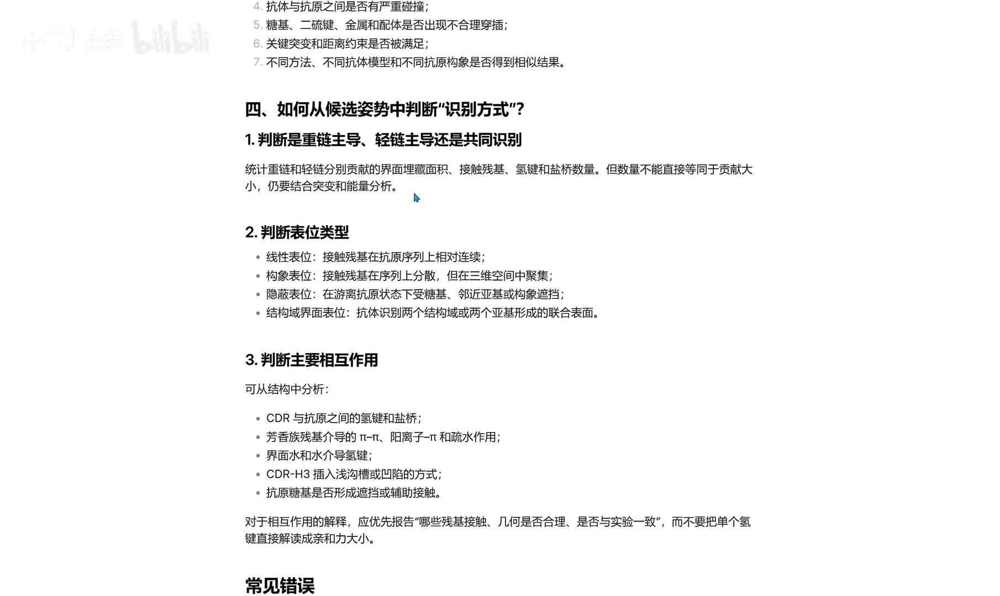
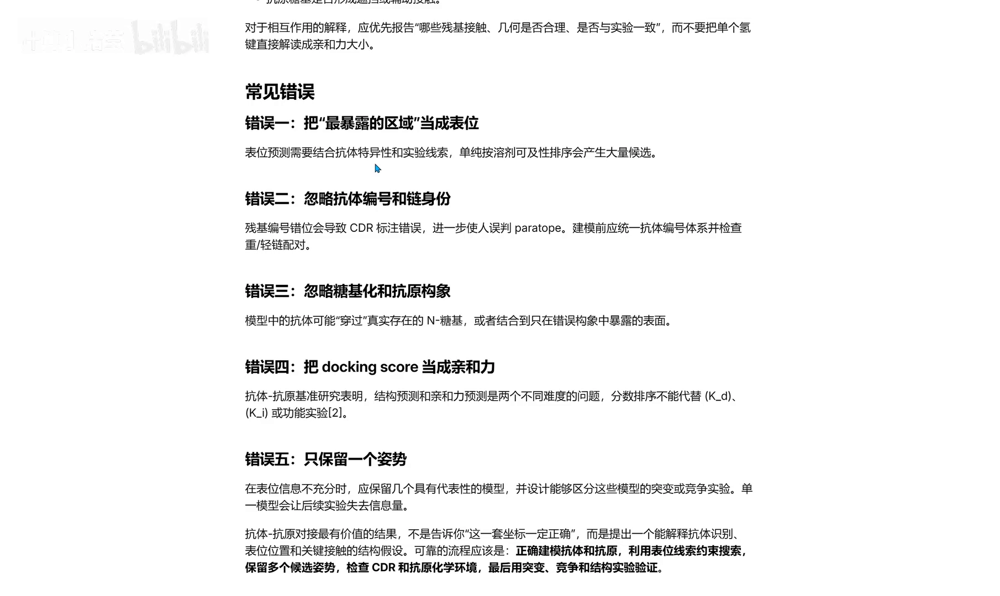

# 抗体-抗原对接：如何预测抗体识别抗原的结合方式

> 视频来源：[Bilibili BV1R7hx6yEZs](https://www.bilibili.com/video/BV1R7hx6yEZs/)（时长约 4 分半）· 对应知识体系条目：5.1.7 dyMEAN `structure` 任务（仓库 dymean）
>
> 本文基于视频字幕与画面整理，关键结论均可点击时间戳回看原视频核对。

## 先说结论

**背景**：做抗体项目时，手里通常已经有抗体和抗原的结构（实验解析或 AlphaFold 类工具预测），下一步自然想知道：抗体到底以什么姿势结合抗原？

**冲突**：这件事比普通蛋白-蛋白对接难得多。抗体的结合位点集中在六个 CDR 环上，其中 CDR-H3 长度、序列变化极大、柔性很高；抗原表位未必是表面上最暴露的区域；结合过程还可能伴随诱导契合和糖基化。把两个结构直接丢进对接软件，会得到一堆"位置能贴上、但免疫学上不成立"的假结合。

**疑问**：怎样预测抗体识别抗原的结合方式才靠谱？

**回答**：走完整的『计算 + 验证』流程：准备抗体结构 → 准备抗原结构（取胞外域）→ 确定预测表位 → 选择对接策略（Rosetta / HDOCK / ClusPro 等）→ 结合位置合理性筛选与界面相互作用分析，最后用突变、竞争、结构实验验证；并且永远保留多个候选姿态（pose），不要只留一个。

## 一、特殊在哪：结合只发生在 CDR 环上

### 1.1 六个 CDR 环决定特异性

相对于普通蛋白-蛋白对接，抗原-抗体对接非常特殊：抗体结构更大，而且结合并不是任何区域都可以发生 [【跳转到 00:00】](https://www.bilibili.com/video/BV1R7hx6yEZs/?t=0)。分析结合方式前要先回答三个问题：抗体有哪些 CDR 环参与结合？抗原上的表位在哪里？重链、轻链各贡献了什么？还可以进一步考虑糖基化和水分子的影响 [【跳转到 00:25】](https://www.bilibili.com/video/BV1R7hx6yEZs/?t=25)。

第一个关键概念是**抗体互补决定区（CDR）**：抗体的结合位点通常集中在六个 CDR 环上，即重链的 H1、H2、H3 和轻链的 L1、L2、L3 [【跳转到 00:50】](https://www.bilibili.com/video/BV1R7hx6yEZs/?t=50)。

为什么集中在 CDR 环？因为这些环**柔性高**，可以进行结构上的改变，更利于结合不同的抗原——在结合特异性抗原时，它能调节自身结构，更好地适应两者的接触面。

### 1.2 表位：线性还是构象，谁在主导

第二个关键概念是**抗原表位（epitope）**：表位可能是连续的（线性表位），也可能是三维空间上不连续的（构象表位）。而且抗体的结合不一定只靠 CDR-H3——某些复合物以重链为主，某些则轻链、重链同时参与 [【跳转到 01:15】](https://www.bilibili.com/video/BV1R7hx6yEZs/?t=75)。

## 二、三个让建模变难的点

1. **CDR-H3 本身难建模**：它的长度和序列变化很大，柔性也很大，建模时往往不准确。
2. **表位不一定是最暴露的区域**：表面暴露只说明抗体"能接近"，并不一定意味着它就是被免疫系统识别的表位；抗原还可能有特殊的构象状态，发生二次变化。
3. **结合是动态的**：抗原-抗体之间可能发生诱导契合（induced fit）——一开始是刚性的，柔性对接后结合区会改变；如果存在糖基化，抗体是在糖基化之后进行结合的，忽略这一点，预测结果就很可能不正确 [【跳转到 01:40】](https://www.bilibili.com/video/BV1R7hx6yEZs/?t=100)。

## 三、完整流程五步

1. **准备抗体结构**：可以用之前讲过的 AlphaFold（Server）建模 [【跳转到 02:30】](https://www.bilibili.com/video/BV1R7hx6yEZs/?t=150)。
2. **准备抗原结构**：注意有时不必把整个膜蛋白都带上，但一定要分清**胞外、胞内和跨膜区域**——不要拿跨膜区域做对接，一般用胞外区域。
3. **确定 / 预测表位**：结合分子模拟、MM/PBSA 等手段。
4. **选择对接策略**：Rosetta、HDOCK、ClusPro 等，都可以试试 [【跳转到 02:55】](https://www.bilibili.com/video/BV1R7hx6yEZs/?t=175)。

5. **模型筛选与识别方式判断**：不要只看对接分数，还要看结合位置是否合理。从候选 pose 中判断：是重链主导还是轻链主导？表位接触类型是线性还是隐蔽（构象）表位？结合位点是抗体识别同一亚基的两个结构域吗？再分析主要相互作用：氢键、盐桥、π-π、阳离子-π、疏水作用等 [【跳转到 03:20】](https://www.bilibili.com/video/BV1R7hx6yEZs/?t=200)。

## 四、五个常见错误

视频最后给出一份"避坑清单" [【跳转到 03:45】](https://www.bilibili.com/video/BV1R7hx6yEZs/?t=225)：

1. 表位预测要结合**抗体特异性和实验线索**，不能只看最暴露的区域；
2. 注意 **CDR 的编号**；
3. 注意**糖基化**问题；
4. **不能把对接分数完全等同于亲和力**；
5. **不要只保留一个 pose**——用表位约束筛选出多个结合姿态，最后用突变、竞争实验、结构实验去验证。

## 小结

- 抗原-抗体结合位点集中在六个 CDR 环（H1–H3、L1–L3），柔性高、可调节，这是对接与普通蛋白-蛋白对接的本质差异。
- 表位分线性与构象两类；重链、轻链的贡献因复合物而异。
- 三大建模难点：CDR-H3 难建准、表位未必最暴露、诱导契合与糖基化不可忽略。
- 五步流程：准备抗体结构 → 准备抗原结构（胞外域）→ 预测表位 → 选对接策略 → 位置合理性筛选与界面相互作用分析。
- 对接分数 ≠ 亲和力；保留多个 pose，用表位约束筛选，再以突变 / 竞争 / 结构实验验证，才是完整的『计算 + 验证』闭环。

## 关键术语速查

| 术语 | 一句话解释 |
| --- | --- |
| CDR | 抗体互补决定区，结合位点所在的六个高柔性环（H1–H3、L1–L3） |
| CDR-H3 | 重链第三个 CDR，长度/序列变化最大、常决定结合特异性 |
| 表位（epitope） | 抗原上被抗体识别的区域；分线性（连续）与构象（不连续） |
| 诱导契合（induced fit） | 结合过程中双方结构调整、结合区改变的动态现象 |
| pose（姿态） | 对接软件输出的一个候选结合方式 |
| MM/PBSA | 结合自由能估算方法，常用于结合模式评价 |
| 对接分数 | 打分函数给出的数值，可排序但不能等同亲和力 |
