# 从序列到结构，一步搞定抗体建模（太香了）

> 视频来源：[Bilibili BV15hEk6oEv5](https://www.bilibili.com/video/BV15hEk6oEv5/)（时长约 8 分半）· 对应知识体系条目：5.1.6 ImmuneBuilder（仓库 immunebuilder）
>
> 本文基于视频字幕与画面整理，关键数字与结论均可点击时间戳回看原视频核对。

## 先说结论

**背景**：做抗体、纳米抗体或 TCR 项目时，手上最先有的是**氨基酸序列**；想知道它对应的**三维结构**，要么靠实验解析（X 射线 / 冷冻电镜，慢且贵），要么靠结构预测模型。

**冲突**：序列看起来再漂亮，也不代表结构层面站得住——CDR-H3（重链第三个互补决定区，抗体识别抗原的主力环区）可能明显偏移、重链与轻链的相对位置可能不稳、突变之后原本的结合面可能不复存在。如果拿一个"歪"的结构去做抗原结合分析，后面的稳定性评估、复合物建模很可能全部白做。

**疑问**：能不能从序列出发，**快速、批量**地拿到"结构上是否可用"的初步答案？

**回答**：可以。**ImmuneBuilder** 是一组专攻免疫蛋白的深度学习结构预测模型，包含三个模型：ABodyBuilder2（常规抗体 Fv 区）、NanoBodyBuilder2（纳米抗体 / VHH）、TCRBuilder2（TCR α/β 变量区）。输入序列即可快速获得三维结构，并附带残基级误差信息，用于判断结构哪里可信、哪里要存疑。本文结合视频讲清它是什么、有多准、怎么用，以及一个 HER2 抗体亲和力成熟突变体评估的完整案例。

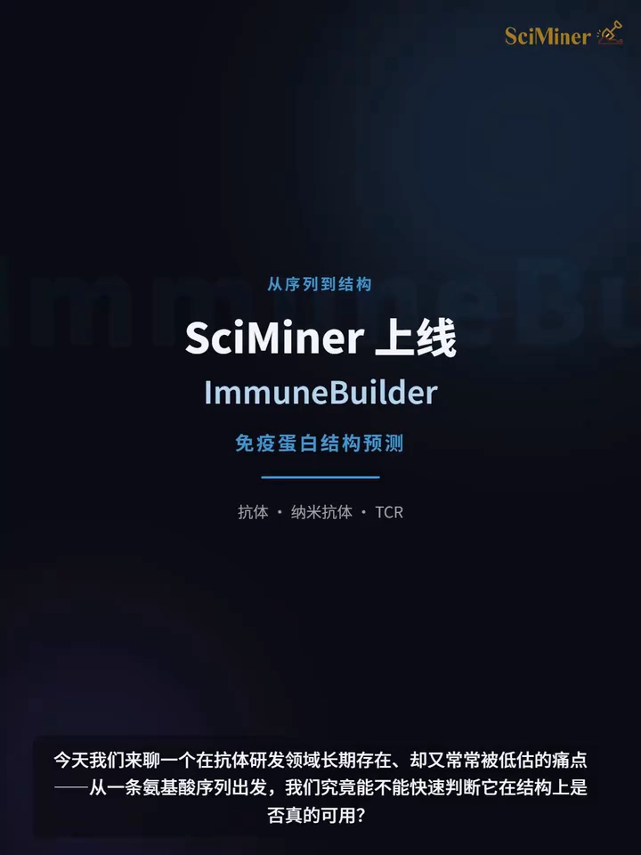

## 一、痛点：序列漂亮 ≠ 结构可用

做抗体项目的朋友一定深有体会：一条抗体序列看起来再漂亮，也不代表它在结构层面就一定合理 [【跳转到 00:05】](https://www.bilibili.com/video/BV15hEk6oEv5/?t=5)。视频列出了几个最常见的担忧：

- **CDR-H3 会不会发生明显偏移？** CDR-H3 是抗体与抗原结合特异性最强的环区，它的构象一变，结合模式可能就变了。
- **重链和轻链的相对位置是否稳定？** 抗体的抗原结合面由重链、轻链的可变区共同拼成，两条链的摆放角度不稳，结合面就不可信。
- **突变之后，原本的结合面还在不在？** 亲和力成熟引入的突变，可能悄悄破坏局部结构。

这些问题在**抗体筛选、亲和力成熟、纳米抗体开发和 TCR 工程化**中都很常见。更麻烦的是，早期研发阶段研究人员面对的往往不是一两条序列，而是**一批候选抗体、一组 CDR 突变体，或者多个 TCR α 链与 β 链的组合**——全部依赖实验解析结构并不现实 [【跳转到 00:50】](https://www.bilibili.com/video/BV15hEk6oEv5/?t=50)。

更常见的做法是：**先用计算模型快速获得结构，再开展稳定性评估、复合物建模和界面分析**。视频介绍的 ImmuneBuilder 承担的正是这个"从序列到结构"的前置建模步骤，现已在 SciMiner 平台上线，支持抗体、纳米抗体和 TCR 的快速结构预测。

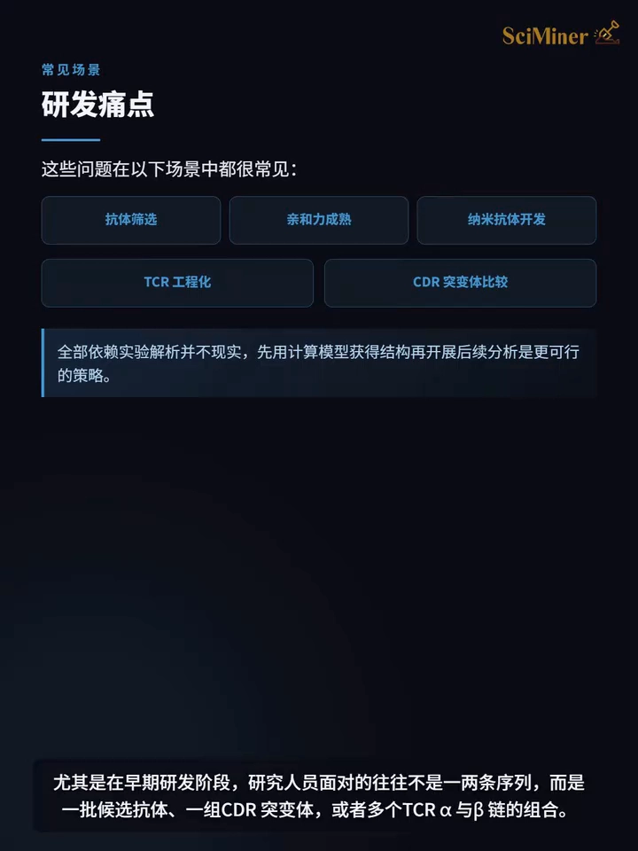

## 二、ImmuneBuilder 是什么：三个 builder 各管一类免疫蛋白

ImmuneBuilder 是一组**面向免疫蛋白的深度学习结构预测模型** [【跳转到 01:26】](https://www.bilibili.com/video/BV15hEk6oEv5/?t=86)。和通用蛋白结构预测工具不同，它专门围绕**抗体、纳米抗体和 TCR** 的结构特点建模，尤其关注 **CDR loops**——这些与识别和结合密切相关的区域。它包含三个模型 [【跳转到 01:45】](https://www.bilibili.com/video/BV15hEk6oEv5/?t=105)：

| 模型 | 面向对象 | 输入 | 输出 |
| --- | --- | --- | --- |
| **ABodyBuilder2** | 常规抗体 | 重链（heavy chain）+ 轻链（light chain）序列 | 抗体 Fv 区结构 |
| **NanoBodyBuilder2** | 纳米抗体 / VHH | 纳米抗体序列 | VHH 三维结构 |
| **TCRBuilder2** | TCR | α 链 + β 链序列 | TCR 变量区结构 |

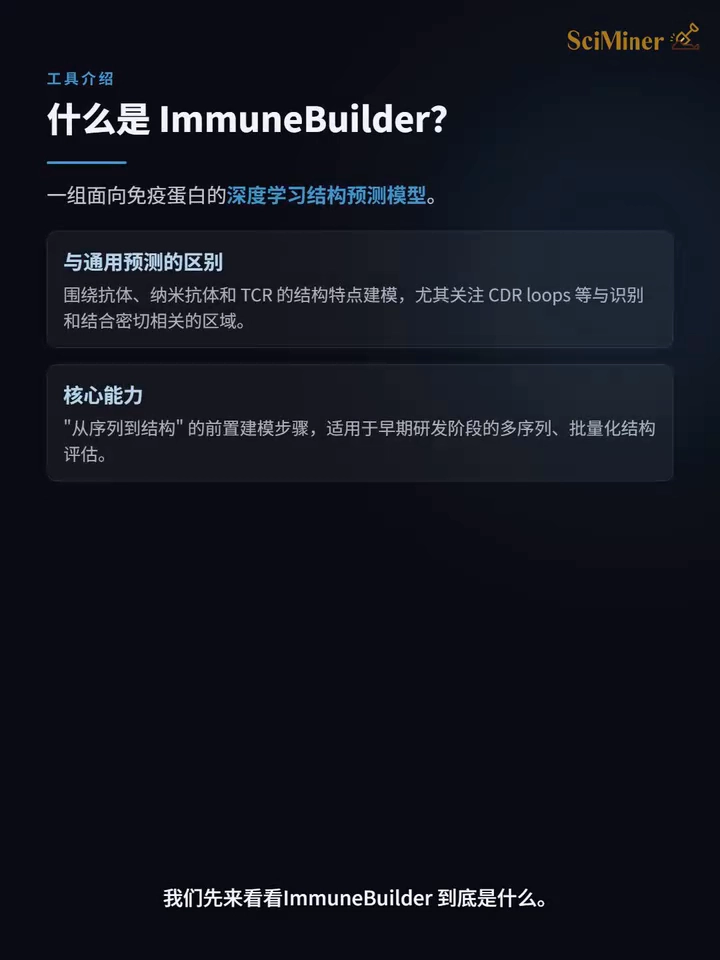

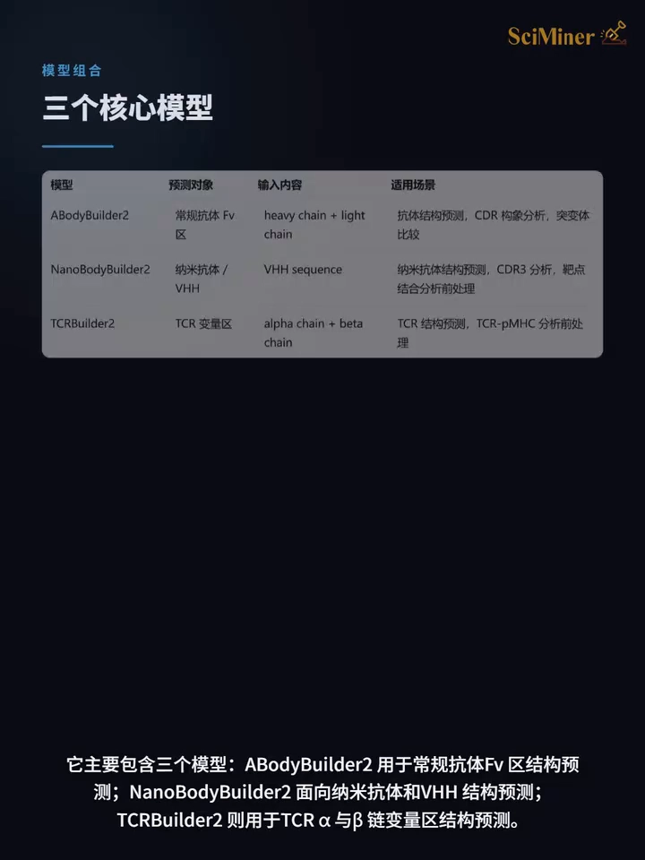

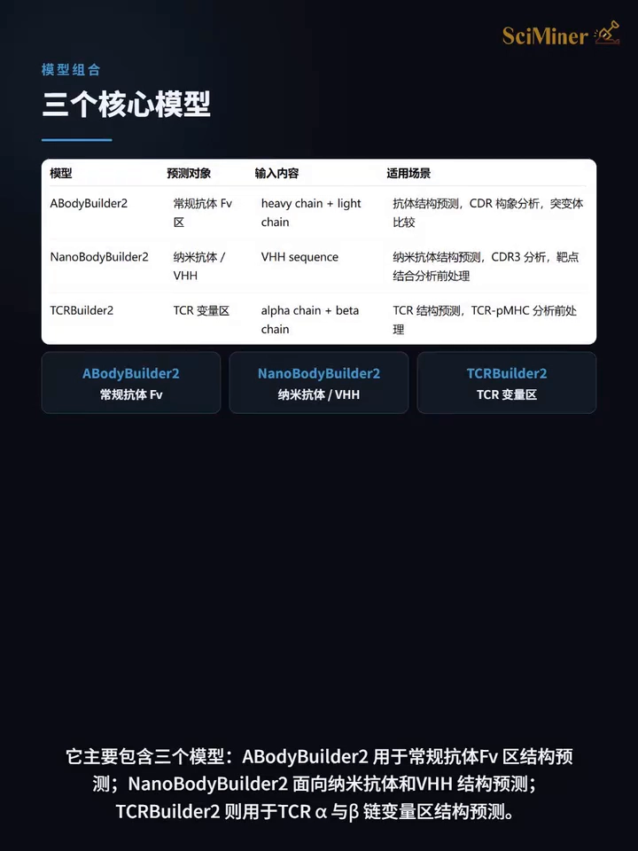

几个术语先解释清楚（本系列前面条目有更系统的展开）：

- **Fv 区**：抗体分子中负责结合抗原的**可变区片段**，由重链可变区（VH）和轻链可变区（VL）组成——结构预测只需这两段序列。
- **纳米抗体 / VHH**：只含**重链可变区**的单域抗体（来自羊驼类动物），分子小、稳定性好，没有轻链，所以只需要一条序列输入。
- **TCR**：T 细胞受体，识别"肽 + MHC"复合物的免疫受体，由 α、β 两条链组成，不是抗体。
- **CDR loops**：可变区里的 6 个高变环区（重链 3 个 + 轻链 3 个），是分子间识别结合的直接参与者，也是预测难度最大的部分。

在抗体工程、纳米抗体筛选和 TCR 设计中，研究人员常常需要快速判断：一条序列的结构是否合理？多个突变体在 CDR 区域是否发生了明显构象变化？ImmuneBuilder 定位正是**从序列到结构的前置建模**这一步 [【跳转到 02:01】](https://www.bilibili.com/video/BV15hEk6oEv5/?t=121)。

## 三、准不准：CDR-H3 平均 RMSD 2.81Å，还更快

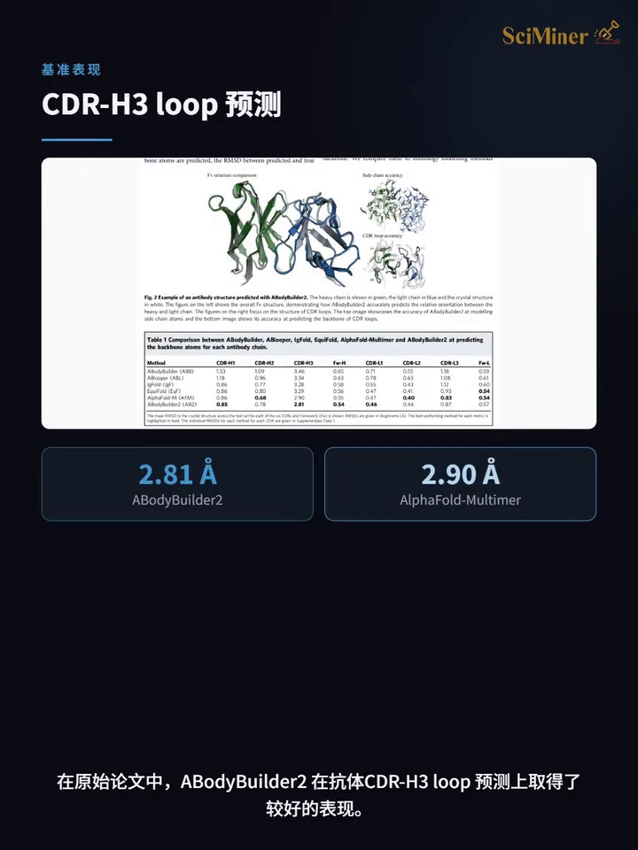

在原始论文的测试中，ABodyBuilder2 在**抗体 CDR-H3 loop 预测**上表现较好 [【跳转到 02:21】](https://www.bilibili.com/video/BV15hEk6oEv5/?t=141)：

- 测试集包含 **34 个近期解析的抗体结构**；
- ABodyBuilder2 的 CDR-H3 loop **平均 RMSD 为 2.81Å**，略优于 **AlphaFold-Multimer 的 2.90Å**；
- 同时它的**运行速度明显更快**，更适合多序列**批量化**的早期结构评估 [【跳转到 02:26】](https://www.bilibili.com/video/BV15hEk6oEv5/?t=146)。

> **RMSD 怎么读**：均方根位移，衡量预测结构与真实结构之间原子位置的偏差，单位埃（Å，1 Å = 10⁻¹⁰ 米）。数值越小预测越准；CDR-H3 是最难预测的环区，能稳定做到 3Å 以内已属可用水平。这也是视频把 ImmuneBuilder 部署到 SciMiner 的原因：补齐免疫蛋白研发中"从序列到结构"的关键一步。

## 四、怎么用：SciMiner 平台上的三个接口

目前 SciMiner 平台已集成 ImmuneBuilder，提供**三个独立接口**，分别对应抗体、纳米抗体和 TCR 三类结构预测任务 [【跳转到 02:48】](https://www.bilibili.com/video/BV15hEk6oEv5/?t=168)。

### 4.1 Predict Antibody：常规抗体 Fv 区建模

输入 **heavy chain 和 light chain** 序列后，即可预测抗体可变区结构。可用于抗体 Fv 建模、查看 CDR-H3 构象、分析重链和轻链的空间排布，也可以作为后续**抗体-抗原复合物**研究的重要结构参考 [【跳转到 03:08】](https://www.bilibili.com/video/BV15hEk6oEv5/?t=188)。

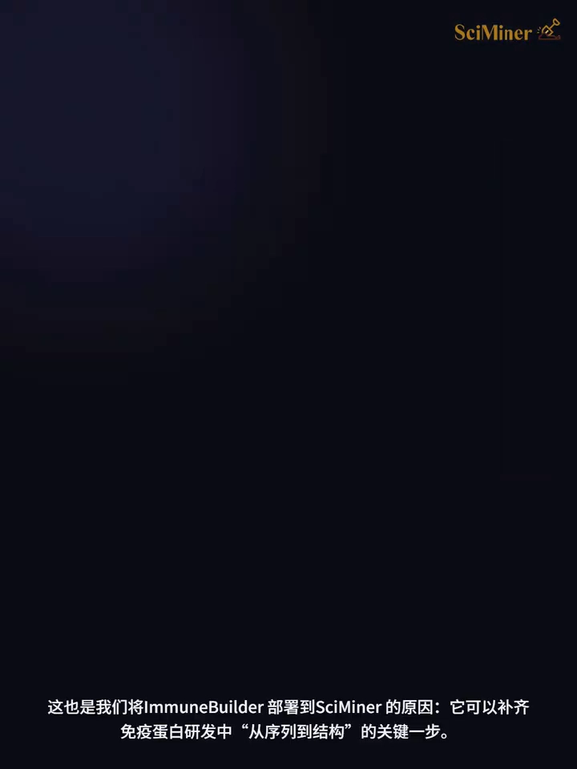

### 4.2 Predict Nanobody：纳米抗体 / VHH 建模

适用于 **VHH 或单域抗体**结构预测 [【跳转到 03:32】](https://www.bilibili.com/video/BV15hEk6oEv5/?t=212)。输入纳米抗体序列后，可快速获得 VHH 三维结构，适合候选序列的**初步筛选**：查看 CDR1、CDR2、CDR3 区域的空间分布，并为后续**纳米抗体-靶点复合物**建模提供结构基础 [【跳转到 03:37】](https://www.bilibili.com/video/BV15hEk6oEv5/?t=217)。

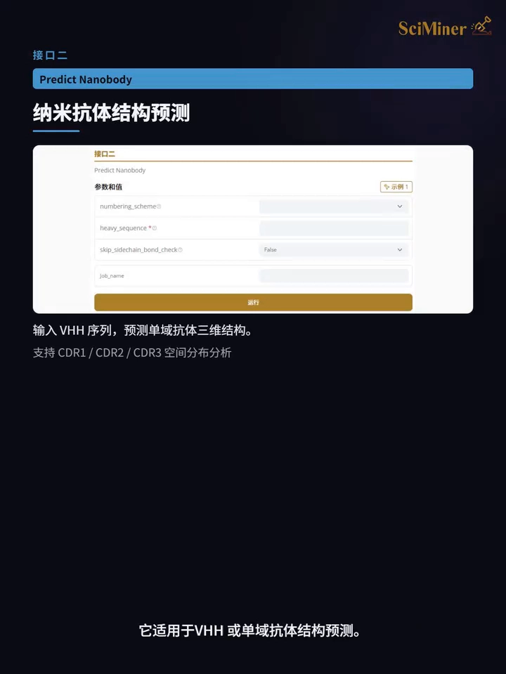

### 4.3 Predict TCR：TCR α/β 变量区建模

适用于 **TCR α 链与 β 链变量区**结构预测 [【跳转到 03:59】](https://www.bilibili.com/video/BV15hEk6oEv5/?t=239)。输入 alpha chain 和 beta chain 序列后，可预测 TCR 变量区结构，用于 TCR 工程化设计、查看 **CDR3α 和 CDR3β** 构象，也可以作为后续 **TCR–pMHC**（肽-MHC 复合物，TCR 识别的靶标）复合物分析的前处理步骤 [【跳转到 04:04】](https://www.bilibili.com/video/BV15hEk6oEv5/?t=244)。

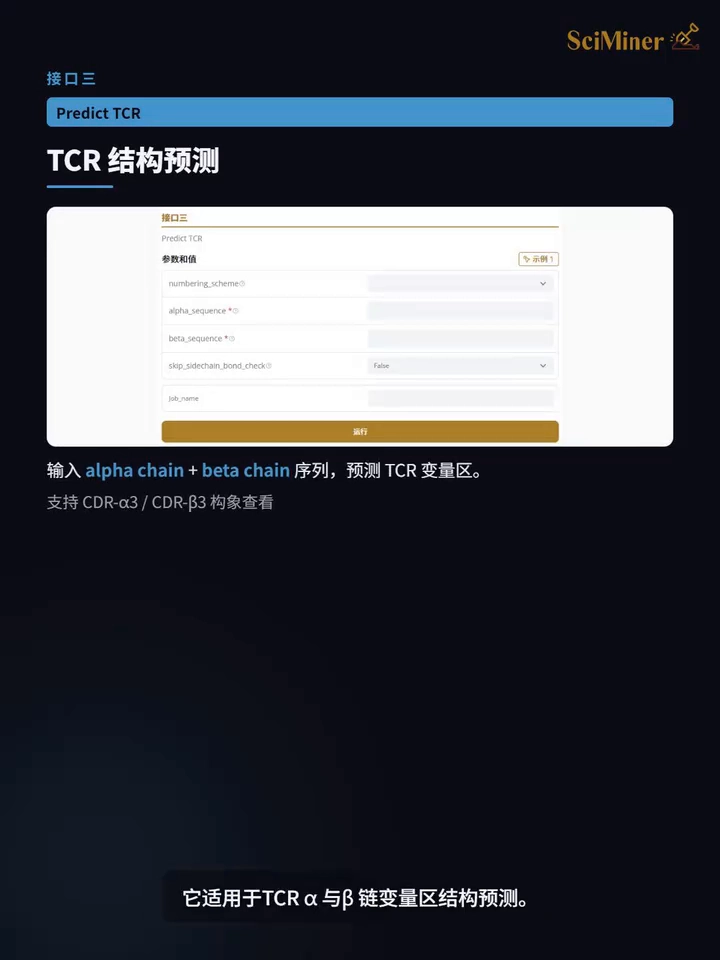

### 4.4 输出解读：残基级误差 + 编号方案

任务运行完成后，平台会输出**预测结构文件**，并提供**残基级误差信息**（error estimate，逐残基标注预测误差，数值越低该区域越可信）[【跳转到 04:27】](https://www.bilibili.com/video/BV15hEk6oEv5/?t=267)。借助它可判断哪些区域预测更稳定、哪些区域需要结合其他模型或实验结果进一步确认。

此外，还可以根据项目需要选择 **IMGT、Chothia、Kabat** 等抗体编号方案（把序列位置按统一规则编号，便于跨序列对齐），方便后续定位 CDR 区域和比较突变位点 [【跳转到 04:29】](https://www.bilibili.com/video/BV15hEk6oEv5/?t=269)。

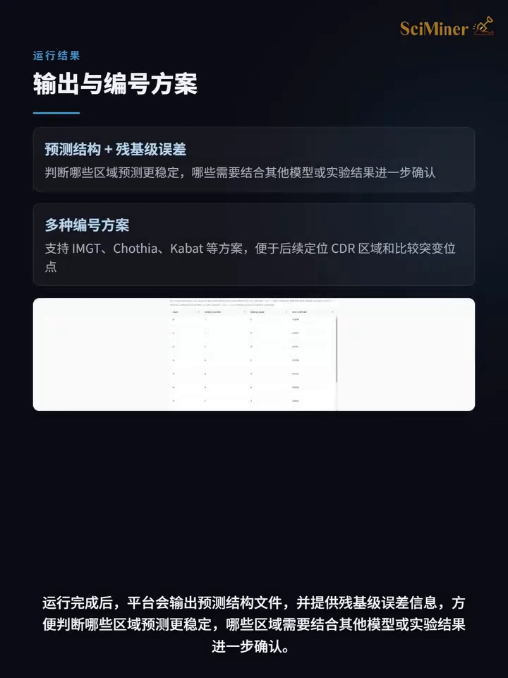

## 五、实战：HER2 抗体亲和力成熟突变体的结构评估

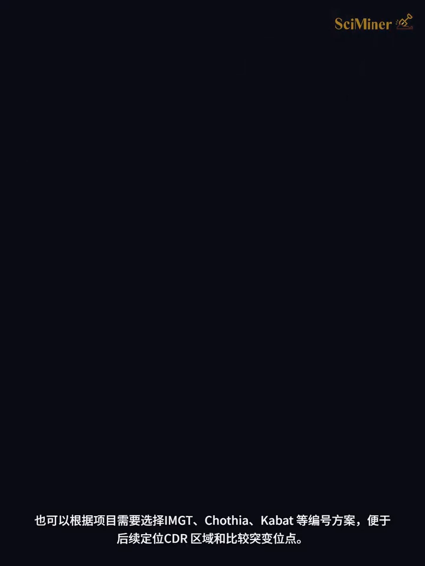

视频用一个具体案例演示了完整流程：**HER2 抗体亲和力成熟中的突变体比较** [【跳转到 04:46】](https://www.bilibili.com/video/BV15hEk6oEv5/?t=286)。

**为什么要做这个检查？** 亲和力成熟过程中，CDR 区域是突变优化的重点。突变可能带来更好的结合潜力，**也可能改变局部结构**：使 CDR loop 发生偏移，甚至影响抗体 Fv 区整体构象。

**操作与结果**：

1. 使用 SciMiner 中的 ImmuneBuilder 对候选突变体做结构预测，并结合亲本结构比较，观察突变后结构是否仍然合理 [【跳转到 05:11】](https://www.bilibili.com/video/BV15hEk6oEv5/?t=311)；
2. **残基误差统计**：在 227 个残基中，有 **198 个残基的 error estimate 低于 0.2**——说明整体 Fv 骨架具有较好的预测可信度 [【跳转到 05:26】](https://www.bilibili.com/video/BV15hEk6oEv5/?t=326)；
3. **结构叠合**：将突变体预测结构与亲本结构叠合后，两者整体 Fv 骨架基本保持一致。图中**绿色为 Trastuzumab（曲妥珠单抗），即 PDB 编号 1N8Z 的亲本结构；蓝色为 ImmuneBuilder 预测的突变体结构** [【跳转到 05:51】](https://www.bilibili.com/video/BV15hEk6oEv5/?t=351)；
4. **结论**：该突变体整体 Fv 结构较为稳定，没有出现明显整体构象破坏 [【跳转到 06:06】](https://www.bilibili.com/video/BV15hEk6oEv5/?t=366)。

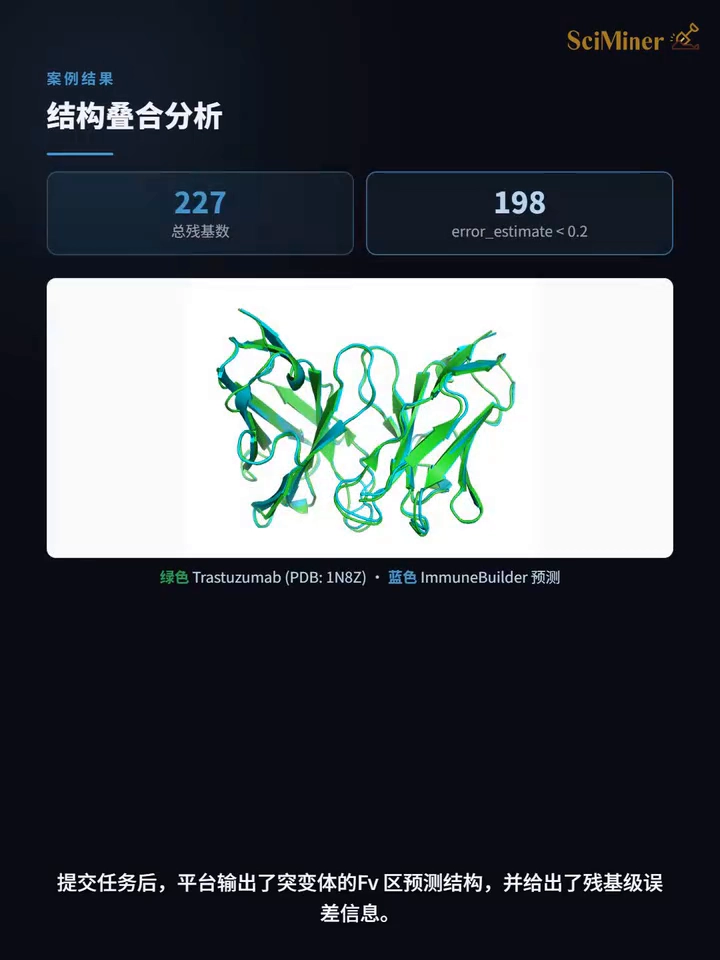

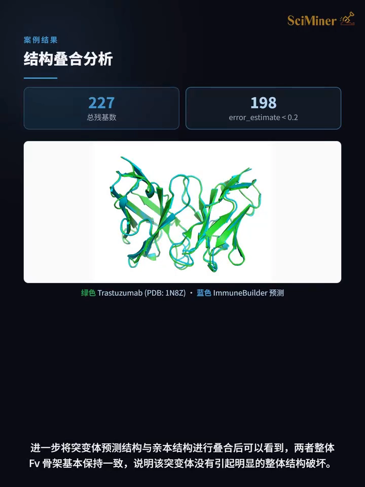

这个案例说明：ImmuneBuilder 不只是生成一个抗体结构文件，还能在**亲和力成熟早期**快速判断候选突变体是否存在明显结构风险。对于需要**批量评估多组突变体**的项目，这一步可以作为后续稳定性评估、复合物建模和实验验证前的**结构筛选环节** [【跳转到 06:11】](https://www.bilibili.com/video/BV15hEk6oEv5/?t=371)。

## 六、拿到结构之后：配套工具链

当然，ImmuneBuilder 的核心能力就是**免疫蛋白结构预测**这一步 [【跳转到 06:36】](https://www.bilibili.com/video/BV15hEk6oEv5/?t=396)。获得结构之后，研发流程还需要编号、结构比较、稳定性评估、复合物建模、相互作用分析等工作；视频介绍了 SciMiner 平台中可与 ImmuneBuilder 配合的工具 [【跳转到 06:41】](https://www.bilibili.com/video/BV15hEk6oEv5/?t=401)：

- **CDR 定位与编号**：结合 ANARCI 对抗体或 TCR 序列做编号定位；
- **交叉对照**：与 IgFold 的抗体结构预测结果对比，验证 CDR 区域预测的一致性；
- **复合物建模**：结合 AF3、Chai-1 或 Protenix，开展抗体-抗原、纳米抗体-靶点或 TCR–pMHC 复合物预测；
- **结构精修**：用 Rosetta FastRelax 对预测结构做进一步能量优化 [【跳转到 07:06】](https://www.bilibili.com/video/BV15hEk6oEv5/?t=426)；
- **突变稳定性评估**：借助 FoldX 评估突变对结构稳定性的影响；
- **相互作用展示**：借助平台中的相互作用分析工具，分析氢键、疏水、π-π 堆积、盐桥等关键相互作用 [【跳转到 07:31】](https://www.bilibili.com/video/BV15hEk6oEv5/?t=451)。

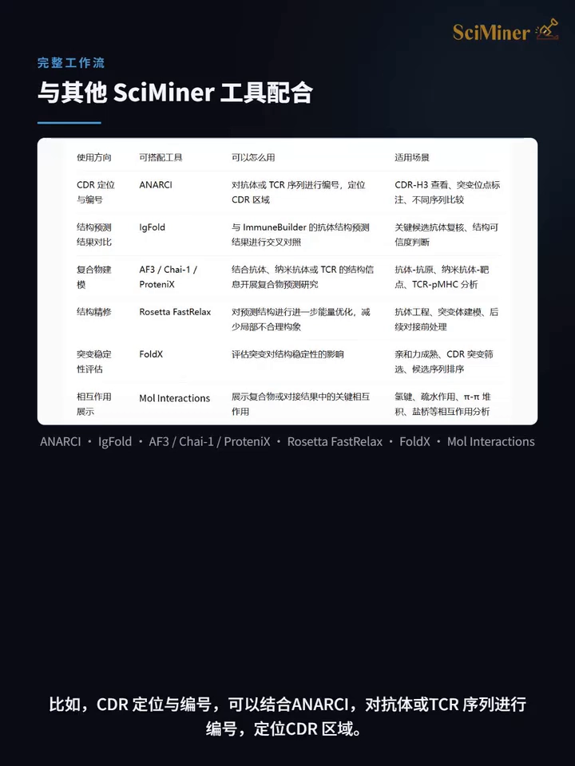

从抗体到纳米抗体，从 TCR 到新抗原识别，免疫蛋白研发越来越离不开结构信息 [【跳转到 07:48】](https://www.bilibili.com/video/BV15hEk6oEv5/?t=468)。SciMiner 上线 ImmuneBuilder 后，用户可以直接输入抗体、纳米抗体或 TCR 序列，快速获得三维结构预测结果，并结合平台中的编号、结构优化、复合物建模和相互作用分析工具，搭建更完整的免疫蛋白设计与评估流程 [【跳转到 07:53】](https://www.bilibili.com/video/BV15hEk6oEv5/?t=473)。

## 小结

- **要解决的问题**：抗体 / 纳米抗体 / TCR 研发中，从序列快速获得"结构上是否可用"的初步判断，避免拿不可信的结构做下游分析。
- **它是什么**：ImmuneBuilder = ABodyBuilder2（抗体 Fv）+ NanoBodyBuilder2（VHH）+ TCRBuilder2（TCR α/β 变量区），免疫蛋白专用深度学习结构预测模型。
- **有多准**：34 个近期解析抗体测试集上，CDR-H3 loop 平均 RMSD 2.81Å，略优于 AlphaFold-Multimer 的 2.90Å，且速度更快、适合批量评估。
- **怎么用**：SciMiner 三个接口（Predict Antibody / Nanobody / TCR），输入对应链的序列即可；输出结构文件 + 残基级误差，可选 IMGT / Chothia / Kabat 编号方案。
- **典型用法**：亲和力成熟突变体的结构风险初筛——误差统计 + 与亲本结构叠合，判断突变是否破坏整体构象。
- **配合生态**：ANARCI 编号、IgFold 交叉对照、AF3 / Chai-1 / Protenix 复合物建模、Rosetta FastRelax 精修、FoldX 突变稳定性评估。

## 关键术语速查

| 术语 | 一句话解释 |
| --- | --- |
| ImmuneBuilder | 面向免疫蛋白的深度学习结构预测模型族，含三个 builder |
| ABodyBuilder2 | 输入重链 + 轻链序列，预测常规抗体 Fv 区结构 |
| NanoBodyBuilder2 | 输入纳米抗体序列，预测 VHH 三维结构 |
| TCRBuilder2 | 输入 α/β 链序列，预测 TCR 变量区结构 |
| Fv 区 | 抗体重链、轻链可变区（VH+VL）组成的功能片段，直接结合抗原 |
| VHH / 纳米抗体 | 只含重链可变区的单域抗体，无需轻链 |
| CDR / CDR-H3 | 互补决定区，分子识别的直接参与者；CDR-H3 指重链第 3 个 CDR |
| RMSD | 预测结构与真实结构的原子位置偏差（Å），越小越准 |
| error estimate | 逐残基预测误差，数值低 = 该区域预测更可信 |
| IMGT / Chothia / Kabat | 抗体编号方案，统一序列位置命名，便于定位 CDR 与比较突变 |
| TCR–pMHC | T 细胞受体与"肽-MHC"复合物的识别体系 |
| ANARCI | 抗体 / TCR 序列编号定位工具 |
| IgFold | 另一个抗体结构预测模型，可做交叉对照 |
| Rosetta FastRelax / FoldX | 结构能量优化 / 突变稳定性（ΔΔG）评估工具 |
