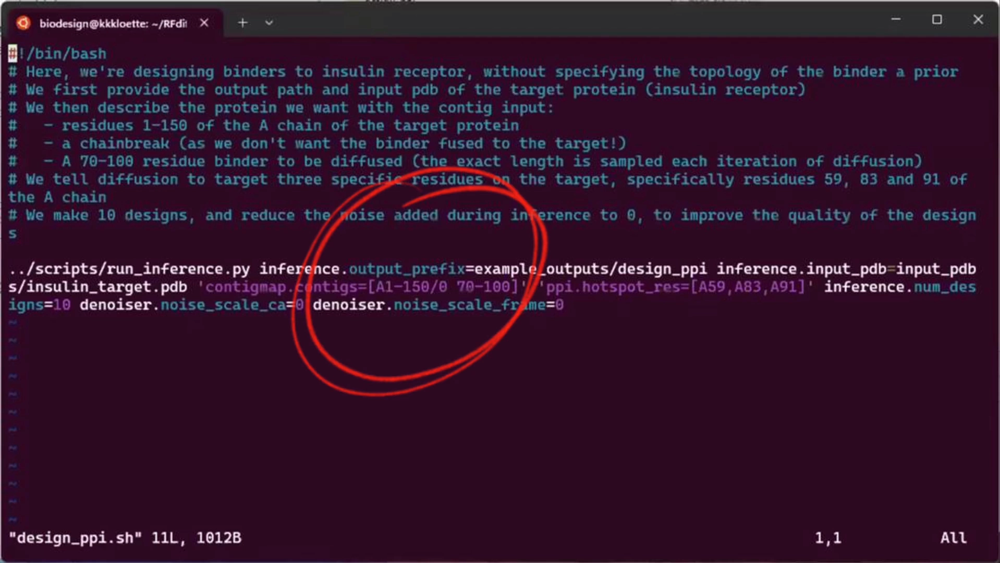
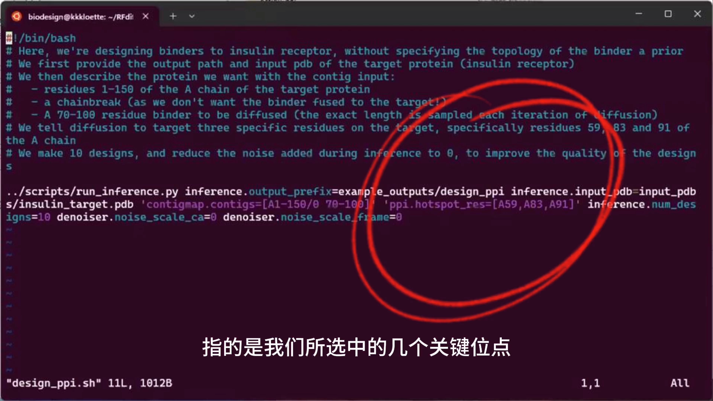
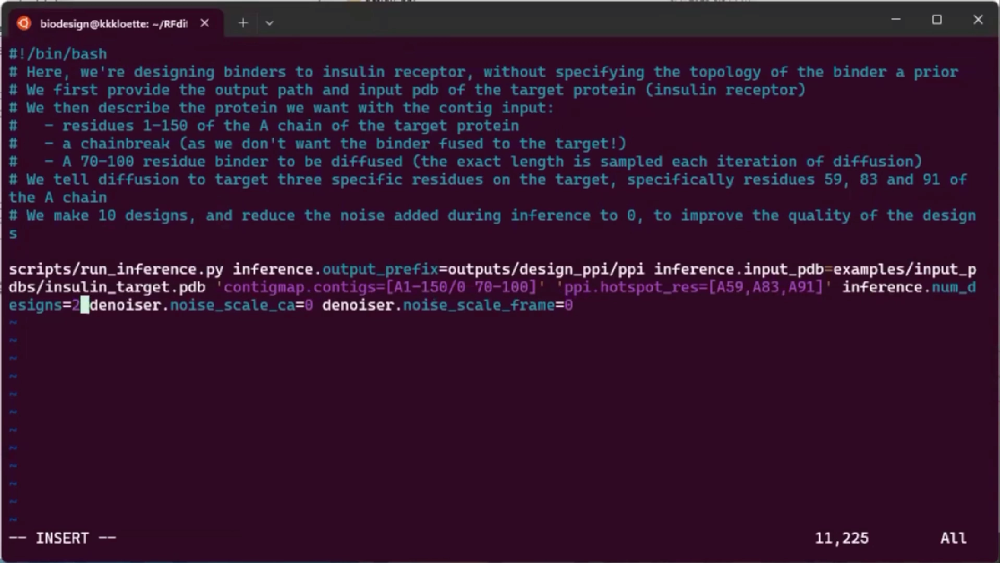
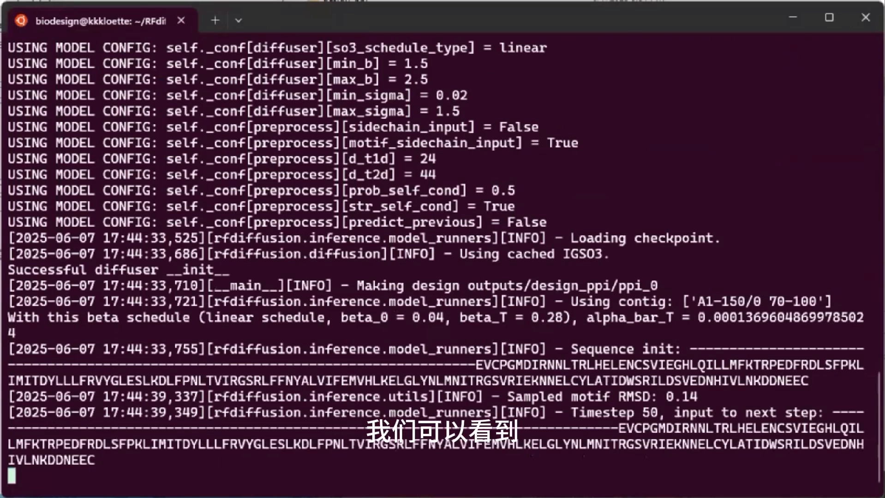
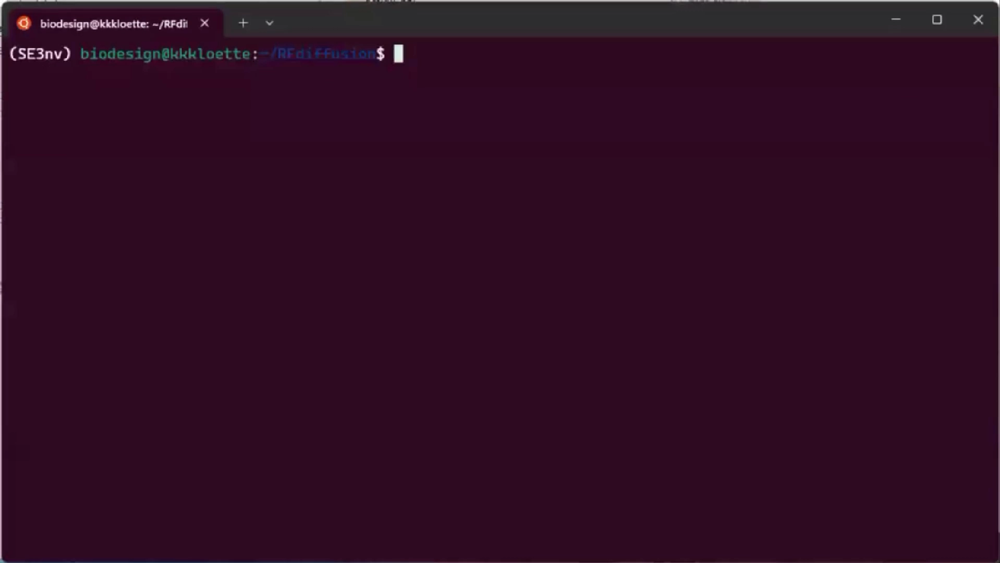
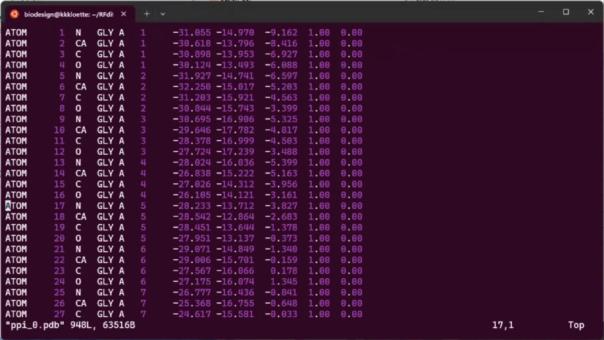
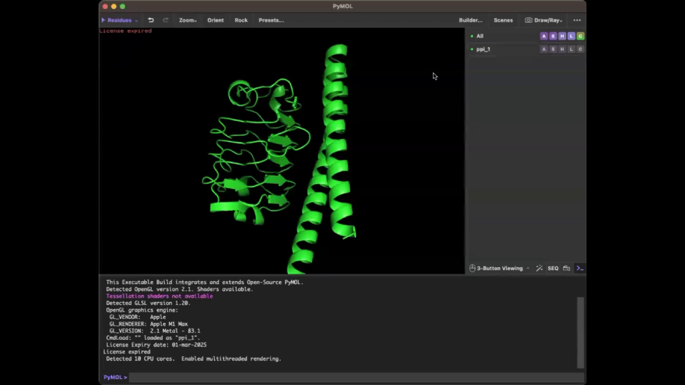
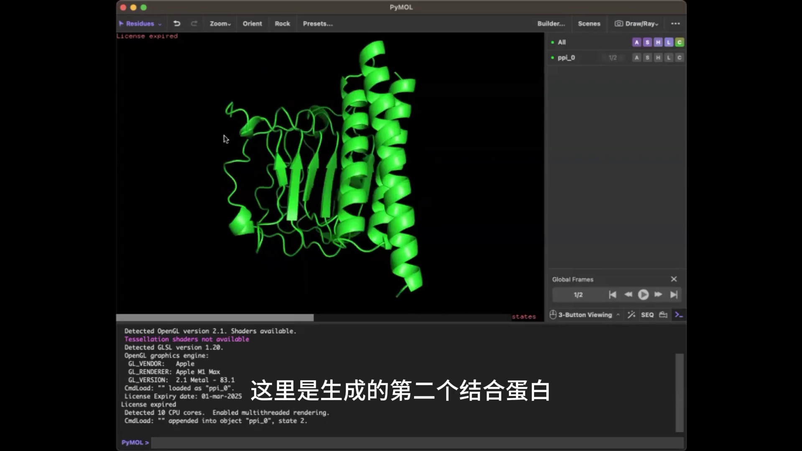

# RFdiffusion系列教程（5）：结合蛋白设计

> 视频来源：Bilibili [RFdiffusion系列教程（5）：结合蛋白设计](https://www.bilibili.com/video/BV1PNNvzvEk6/)（BioDesign，约 4 分 33 秒）。
> 本篇对应「蛋白 Binder 设计三部曲」的第一步——**(a) RFdiffusion 骨架生成**：只负责"长出"能贴合靶蛋白的骨架，序列设计（ProteinMPNN）与回折验证（Protenix/OpenFold3）是后两步的事。

## 本讲要解决的核心问题（SCQA）

**背景**：蛋白 binder（结合蛋白）设计的标准流程是三部曲：RFdiffusion 生成骨架 → ProteinMPNN 设计序列 → 结构预测模型回折验证。第一步的关键工具 RFdiffusion 提供了现成的 binder 设计示例脚本。

**冲突**：但直接拿别人的脚本跑没有意义——换一个靶蛋白，`contigs`（骨架拼装描述）和热点配置就必须跟着改；初学者往往卡在"这两个参数到底在写什么"。

**疑问**：如何为一个 150 个氨基酸的目标蛋白，配置并跑通 RFdiffusion 的结合蛋白设计？

**回答（中心思想）**：修改示例 bash 脚本中的两处配置——`contigs` 写成 `A1-150`（保留目标蛋白全部序列）加 `70-100`（新生成 binder 的长度区间），`PPI_HOTSPOT` 填入按"结合前后溶剂可及表面积变化"选出的关键位点——然后运行脚本，在输出 PDB 里检查甘氨酸占位的骨架长度，最后到 PyMOL 里确认 binder 与目标蛋白的贴合情况。

## 一、准备工作：一切从 example 里的示例脚本开始

视频开篇（[【跳转到 00:00】](https://www.bilibili.com/video/BV1PNNvzvEk6/?t=0)）点明主题：**RFdiffusion 最被广泛应用的功能，就是结合蛋白（binder）的设计**。

操作起手式和系列前几集一致（[【跳转到 00:09】](https://www.bilibili.com/video/BV1PNNvzvEk6/?t=9)）：

1. 激活 conda 环境；
2. 进入 `example` 文件夹，找到 binder 设计对应的 bash 脚本；
3. 把脚本复制到上一级目录（避免改动官方原始示例）；
4. 用 `vi` 编辑这份脚本。

## 二、核心配置：contigs 与 hotspot 写什么

### 2.1 contigs：保留目标链 + 给 binder 一个长度区间

示例中目标蛋白有 150 个氨基酸（[【跳转到 00:34】](https://www.bilibili.com/video/BV1PNNvzvEk6/?t=34)），配置里两段信息的含义是：

- **`A1-150`**：保留目标蛋白 A 链第 1 到 150 位残基的**全部序列**——这部分是"给定条件"，扩散过程不会改动它；
- **`70-100`**：新生成结合蛋白的**长度区间**，即 binder 骨架最终落在这个范围内的某个长度。

可以把 `contigs` 理解成一张"拼装说明书"：已存在的部分照抄（目标蛋白），空白的部分按指定长度现做（binder）。

### 2.2 PPI_HOTSPOT：用关键位点引导 binder "贴"向哪里

配置中的 `PPI_HOTSPOT` 指所选中的**若干关键氨基酸位点**，用来引导结合蛋白围绕这些位置设计（[【跳转到 00:34】](https://www.bilibili.com/video/BV1PNNvzvEk6/?t=34)）。

那这些位点怎么选？视频给出的判据是（[【跳转到 00:59】](https://www.bilibili.com/video/BV1PNNvzvEk6/?t=59)）：**看目标蛋白与原始复合体结合前后，溶剂可及表面积的变化**——结合时被"埋进去"的残基，正是界面上的关键残基。具体挑选方法作者留到后续教程细讲。

## 三、修改路径并运行脚本

接下来仍是系列惯用操作（[【跳转到 01:24】](https://www.bilibili.com/video/BV1PNNvzvEk6/?t=84)）：修改脚本里的**输出路径和想要的文件名**，保存后直接运行 bash 文件（[【跳转到 01:49】](https://www.bilibili.com/video/BV1PNNvzvEk6/?t=109)）。

运行时从终端输出能直接"看懂"扩散进度（[【跳转到 02:15】](https://www.bilibili.com/video/BV1PNNvzvEk6/?t=135)）：

- 前面一段**虚线**：结合蛋白**正在生成的骨架**——骨架还没落地，所以每个位置只是占位；
- 后面的实序列：目标蛋白被保留的部分。

binder 骨架的生成比较慢，视频里直接跳过了这段等待（[【跳转到 02:29】](https://www.bilibili.com/video/BV1PNNvzvEk6/?t=149)）。

## 四、检查输出：先看 PDB，再看 PyMOL

### 4.1 PDB 里新生成的部分全是甘氨酸

进入输出文件夹查看结果（[【跳转到 02:41】](https://www.bilibili.com/video/BV1PNNvzvEk6/?t=161)）：PDB 文件中，**前面这些都是甘氨酸（GLY）**，它们就是新生成的骨架（[【跳转到 03:06】](https://www.bilibili.com/video/BV1PNNvzvEk6/?t=186)）。

这并不奇怪：扩散阶段只决定主链走向，还没设计侧链和序列，所以统一用最小的氨基酸甘氨酸占位。也正因为"只有骨架、没有序列"，才需要三部曲的第二步 ProteinMPNN 来补序列。

长度也可以顺手核对：设定区间是 70~100，本次生成的结合蛋白长度为 **87**，落在区间内；PDB 后面那些序列就是被保留的目标蛋白序列。

### 4.2 PyMOL 里看形状：binder 偏爱 alpha 螺旋

把结构拖进 PyMOL（[【跳转到 03:36】](https://www.bilibili.com/video/BV1PNNvzvEk6/?t=216)）：

- **右侧的 alpha 螺旋**：生成的结合蛋白；
- **左边一大块**：目标蛋白。

视频还展示了第二个 binder 样品，并总结了一条经验规律（[【跳转到 04:01】](https://www.bilibili.com/video/BV1PNNvzvEk6/?t=241)）：**RFdiffusion 比较偏向生成 alpha 螺旋结构**，所以设计出的结合蛋白大部分由 alpha 螺旋组成——看到自己设计的 binder 长成一捆螺旋，不必意外。

## 小结

- 本讲演示了 RFdiffusion binder 设计的完整最小闭环：**改脚本 → 跑扩散 → 查 PDB → PyMOL 目检**。
- `contigs` 两段式：`A1-150` 保留目标蛋白全部序列（给定条件），`70-100` 规定 binder 骨架的长度区间（本次实际生成 87）。
- `PPI_HOTSPOT` 给扩散过程"指路"：候选位点按**结合前后溶剂可及表面积变化**来选，被埋住的残基即界面关键残基。
- 输出 PDB 中新生成部分全是**甘氨酸占位**——这一步只产骨架不产序列，序列要等三部曲第二步 ProteinMPNN。
- 经验规律：RFdiffusion 生成的 binder 大多由 **alpha 螺旋**组成，PyMOL 目检时先看贴合、再看螺旋堆叠是否合理。

## 关键术语速查

| 术语 | 一句话解释 |
| --- | --- |
| binder（结合蛋白） | 人工设计出来、专门"抱住"某个目标蛋白的小蛋白 |
| contigs | RFdiffusion 的骨架拼装描述：哪些残基保留（如 `A1-150`）、哪些现做、做多长（如 `70-100`） |
| hotspot / PPI_HOTSPOT | 目标蛋白上引导 binder 结合的关键位点，按结合前后溶剂可及表面积变化挑选 |
| 甘氨酸（GLY）占位 | 扩散只生成主链骨架，序列未定，输出统一记作甘氨酸 |
| ProteinMPNN | 三部曲第二步：拿到骨架后为其设计氨基酸序列（本系列下一讲） |
