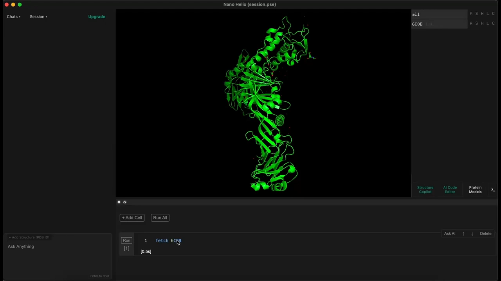
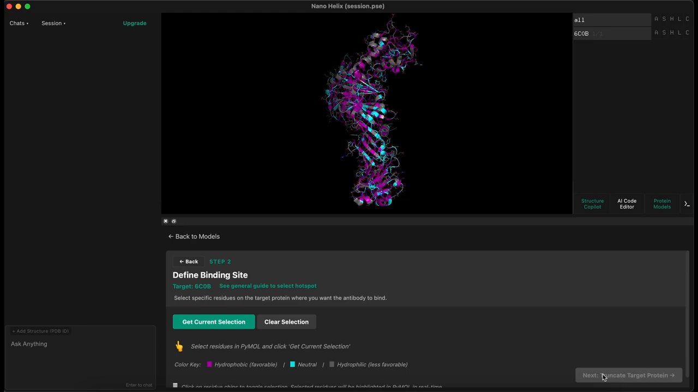
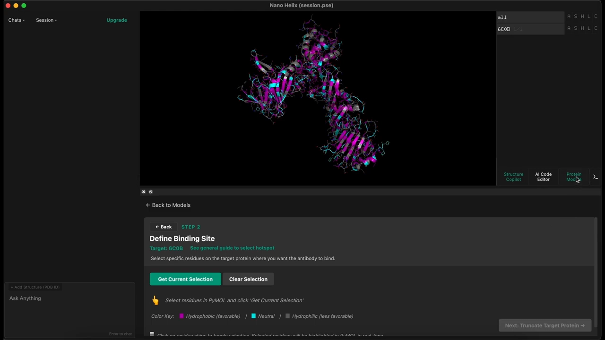
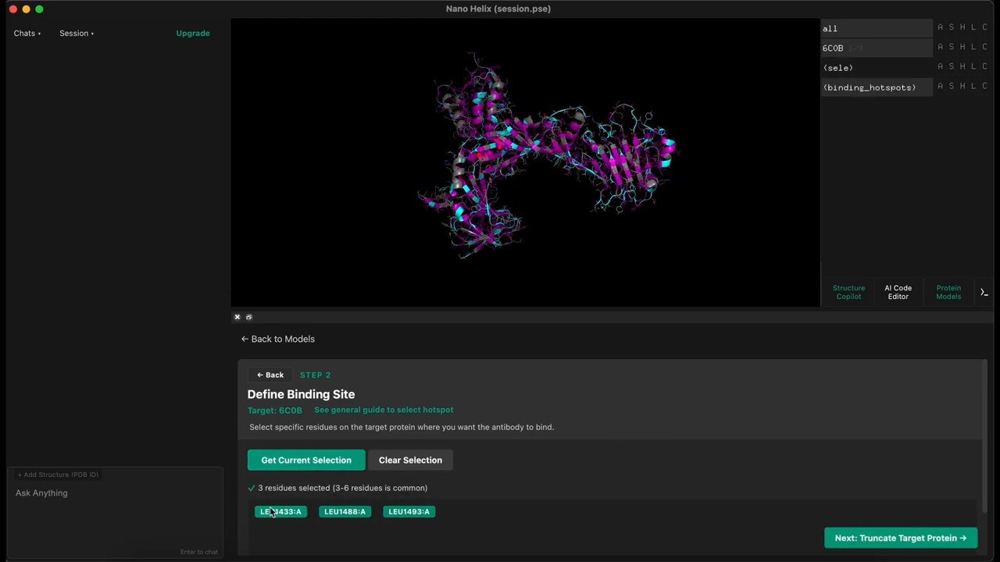
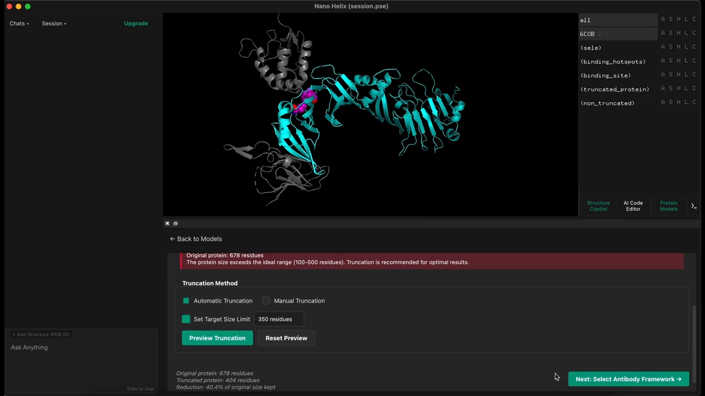
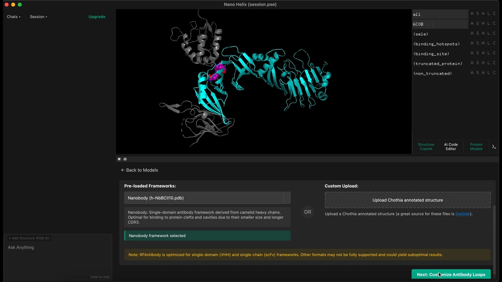
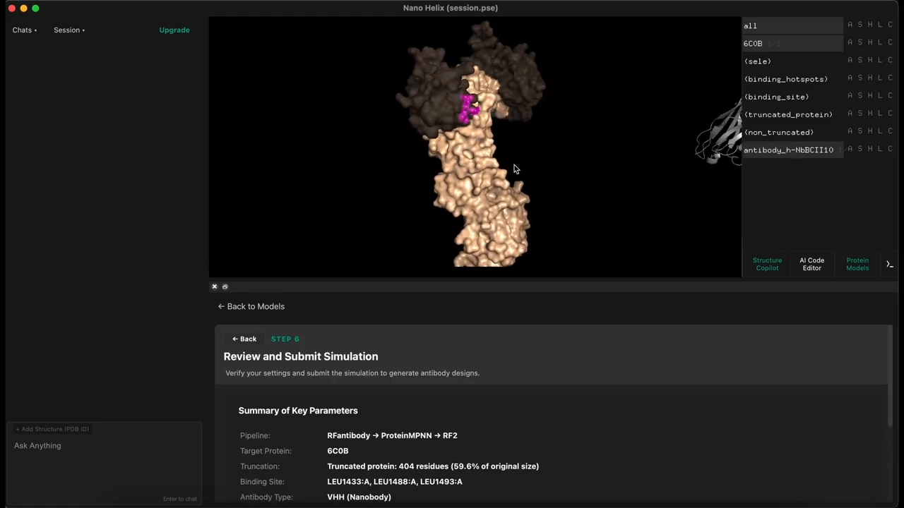
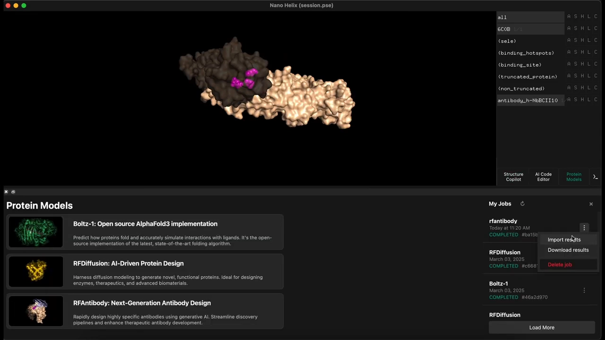
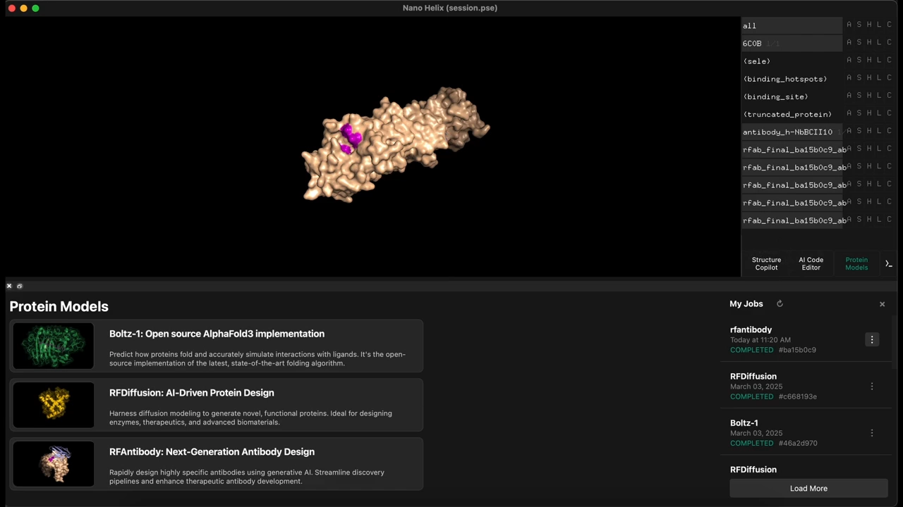
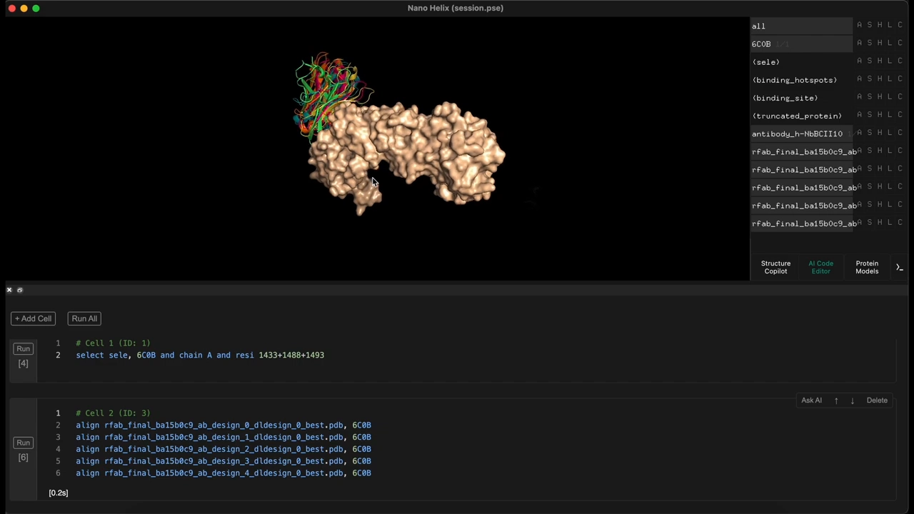

# Designing Antibodies with RF Antibody in Nano Helix

> 视频来源：[Designing Antibodies with RF Antibody in Nano Helix（YouTube）](https://www.youtube.com/watch?v=A50R_oJDqj0)，时长约 4 分钟。本文基于视频演说图文稿整理，时间戳可跳转到对应讲解。

## 本讲要解决的核心问题（SCQA）

**背景**：AI 蛋白设计的成熟打法是"三部曲"——先生成能结合靶点的骨架，再为骨架配氨基酸序列，最后用结构预测回折验证。本系列 5.2.1 已用 RFdiffusion → ProteinMPNN → Protenix/OpenFold3 演示过通用蛋白 binder 的完整闭环；把这套打法搬到抗体上，第一步就换成 RFantibody——RFdiffusion 的抗体特化版本（本系列 4.3.2 介绍过它与 RFdiffusion 的关系）。

**冲突**：抗体比普通 binder 多了三层约束——要选定一个现成的抗体框架、只围绕热点残基设计识别区（CDR 环）、靶蛋白还要满足模型的输入要求。多个模型与参数环环相扣，初学者很容易卡在"工具怎么串、参数怎么填"。

**疑问**：能不能不写一行代码，按网页向导把一次 RFantibody 抗体设计完整跑通？

**回答（中心思想）**：可以。本教程演示的 Nano Helix 平台把全流程做成了网页向导：**选靶蛋白 → 选热点残基 → 截短靶蛋白 → 选抗体框架 → 定 CDR 环长 → 一键提交（自动串行 RFantibody → ProteinMPNN → RosettaFold2）→ 加载结果做贴合检查**。下文按演示顺序逐步拆解。

## 一、开场：选定靶蛋白

教程的示例靶蛋白是 **PDB 6C0B**——一种梭菌属（Clostridium）蛋白，也是 RFantibody 论文中使用的例子 [【跳转到 00:00】](https://www.youtube.com/watch?v=A50R_oJDqj0&t=0)。

操作从 Protein Models 页面开始：选择 RFantibody 模型后进入向导。第一步是选择**靶蛋白**——也就是你希望抗体去结合的蛋白。

> **残基**：蛋白质链上的一个氨基酸单元，下文的"500 残基""热点残基"都以它为单位。**PDB 编号**：蛋白质结构数据库中一个结构的唯一 ID。

## 二、选结合位点：热点残基（hotspot）

第二步是指定抗体应该结合到哪里。RFantibody 以少数**热点残基**为锚来构建结合——它们大致决定了抗体"往哪儿结合"。界面把靶蛋白标成紫色、蓝色、灰色，帮助你定位最适合抗体结合的残基 [【跳转到 00:25】](https://www.youtube.com/watch?v=A50R_oJDqj0&t=25)；旁边还有一份小指南，给出正确选择结合残基的建议。

本例选择与 RFantibody 论文相同的热点残基。选点有两种方式：直接在 3D 结构上逐个点击，或用平台内置的 **AI 编程环境**（可写代码批量操作结构的辅助环境）来选——教程里后者更快 [【跳转到 00:47】](https://www.youtube.com/watch?v=A50R_oJDqj0&t=47)。选好的残基保存在名为 `CL` 的选区中，点击 get current selection（获取当前选区）确认后进入下一步。

## 三、截短靶蛋白：约 500 残基上限

第三步是**截短（truncation）**：RFantibody 要求靶蛋白较小，最好在 **500 个残基以内** [【跳转到 01:12】](https://www.youtube.com/watch?v=A50R_oJDqj0&t=72)。像 6C0B 这样的大蛋白必须先"剪"出包含热点的那一段。

Nano Helix 内置算法会**推荐截短位点**，也支持手动调整。设好长度并预览后，保留的残基显示为蓝色、截去的显示为灰色，而热点残基始终清晰可见——方便确认它们没有被剪掉 [【跳转到 01:37】](https://www.youtube.com/watch?v=A50R_oJDqj0&t=97)。

## 四、选抗体框架，定 CDR 环长

接下来选**抗体框架**。RFantibody 对两类抗体表现良好：**纳米抗体（nanobody）**与 **scFv**（单链可变片段），平台为两者都预置了模板，也支持上传自定义框架 [【跳转到 01:37】](https://www.youtube.com/watch?v=A50R_oJDqj0&t=97)。本演示选择原 RFantibody 论文使用的纳米抗体模板。

选定框架后，3D 查看器会显示它，并把**待设计的环（loop）高亮**：你可以逐条调整环的长度、勾选要设计哪些环，推荐的环长已设为默认值（教程保持默认）[【跳转到 02:02】](https://www.youtube.com/watch?v=A50R_oJDqj0&t=122)。这些环对应抗体的 **CDR**——互补决定区，即真正识别抗原的部位（本系列 1.4.2）。

> **纳米抗体（VHH）**：只含重链可变区的单域抗体，约 15 kDa（本系列 1.4.5）。**scFv**：把重链、轻链可变区用短接头连成一条链的单链抗体。

## 五、提交模拟：三个工具自动串行

最后检查模拟设置：靶蛋白以表面（surface）模式显示，选定的热点残基一目了然；确认后点击 **submit simulation** 提交。提交后平台**依次自动运行三个工具** [【跳转到 02:27】](https://www.youtube.com/watch?v=A50R_oJDqj0&t=147)：

1. **RFantibody**：围绕热点残基生成抗体结合骨架（三部曲第一步，本系列 5.2.1a）；
2. **ProteinMPNN**：为骨架设计氨基酸序列（第二步，本系列 5.2.1b）；
3. **RosettaFold2**：对"抗体-靶蛋白"复合物做结构预测，充当回折验证的角色（对应第三步，本系列 5.2.1c）。

模拟可能需要一段时间，完成后把结果直接加载进查看器。

## 六、查看结果：五个设计的贴合检查

结果加载后，教程先把截短的部分隐藏，让结合界面更清晰 [【跳转到 02:47】](https://www.youtube.com/watch?v=A50R_oJDqj0&t=167)；再借助 AI 编程环境把蛋白**叠合对齐**，即可清楚看到**五个设计出的抗体**各自如何精准结合到靶蛋白的热点残基上 [【跳转到 03:12】](https://www.youtube.com/watch?v=A50R_oJDqj0&t=192)、[【跳转到 03:37】](https://www.youtube.com/watch?v=A50R_oJDqj0&t=217)。

## 小结

- Nano Helix 把 RFantibody 抗体设计做成 7 步网页向导：选靶蛋白 → 选热点 → 截短 → 选框架 → 定环长 → 提交 → 查结果，全程无需命令行。
- 热点残基决定"往哪儿结合"，可选与论文一致的热点；支持手动点选或 AI 编程环境批量选取。
- RFantibody 要求靶蛋白不超过约 500 个残基；平台提供截短位点推荐，热点残基在截短过程中始终可见。
- 抗体框架二选一：纳米抗体或 scFv，均有预置模板，也可上传自定义框架。
- CDR 环长可逐条调整、可选设计哪些环，默认推荐值即可起步。
- 提交后管线自动串行 RFantibody → ProteinMPNN → RosettaFold2，结果支持叠合对齐与热点贴合检查。
- 视频只演示操作流程，未展开模型原理（如抗体微调权重的训练细节）；相关背景见本系列 4.3.2 的 RFdiffusion 讨论。

## 关键术语速查

| 术语 | 一句话解释 |
| --- | --- |
| RFantibody | RFdiffusion 的抗体特化版本（RFdiffusion-Ab），围绕热点残基生成抗体结合骨架 |
| Nano Helix | 提供 RFantibody 网页向导的平台，内置 AI 编程环境辅助选残基与叠合 |
| 靶蛋白 | 设计出的抗体要结合的蛋白；本例为 PDB 6C0B（梭菌属蛋白） |
| 热点残基（hotspot） | 靶蛋白上决定抗体结合位置的关键残基 |
| 截短（truncation） | 把过大的靶蛋白裁剪到 RFantibody 可处理的长度（约 ≤500 残基） |
| 抗体框架 | 抗体的"底盘"结构；本例二选一：纳米抗体或 scFv 模板 |
| 纳米抗体（VHH） | 只含重链可变区的单域抗体（本系列 1.4.5） |
| scFv | 单链可变片段：重链与轻链可变区用短接头连成一条链 |
| CDR 环 | 抗体上识别抗原的互补决定区环；本流程中高亮、定长后交由模型设计 |
| ProteinMPNN | 按骨架逆折叠设计氨基酸序列的工具（本系列 5.2.1b） |
| RosettaFold2 | 结构预测网络，在管线末尾对"抗体-靶蛋白"复合物做结构检查 |
| 选区（CL） | 平台中保存已选残基的命名集合，用 get current selection 确认 |
