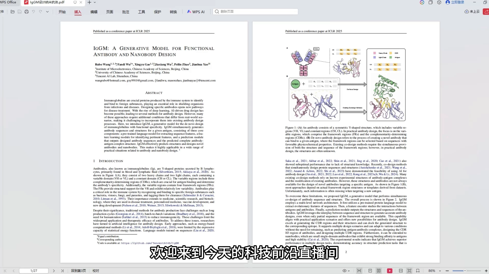
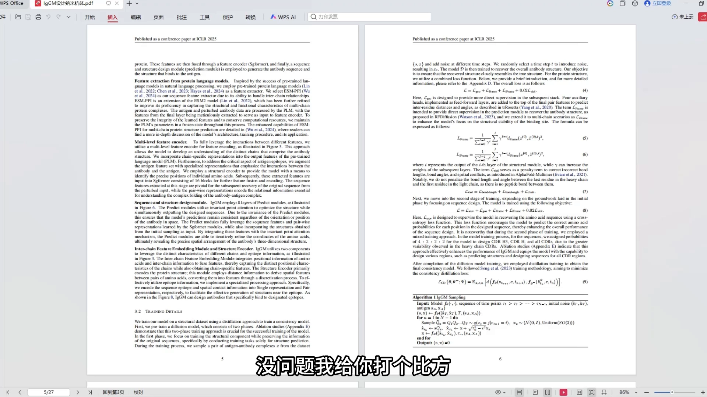
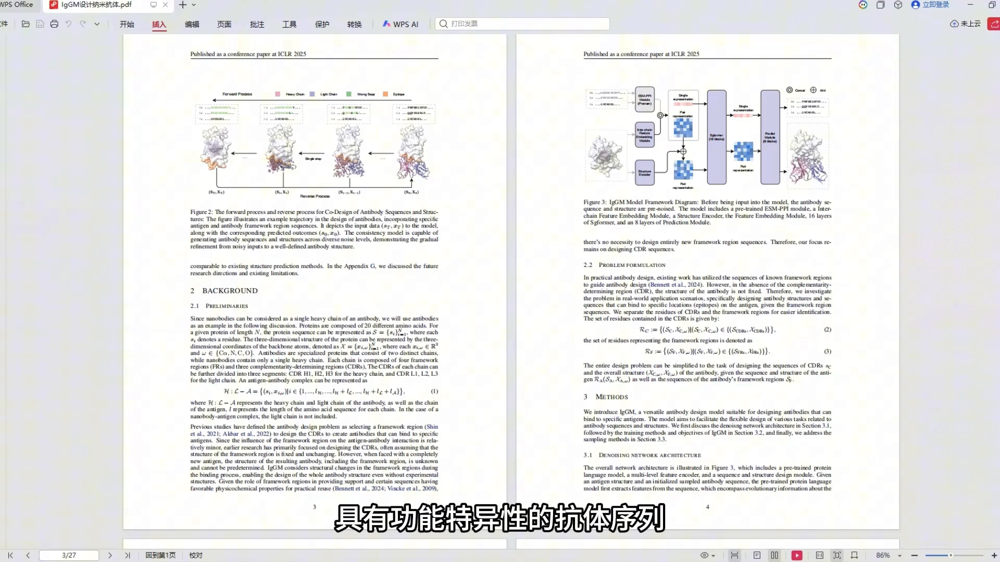
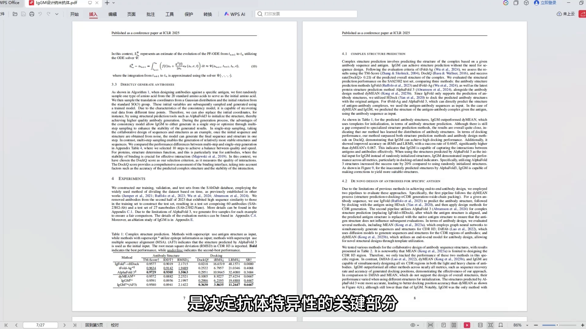
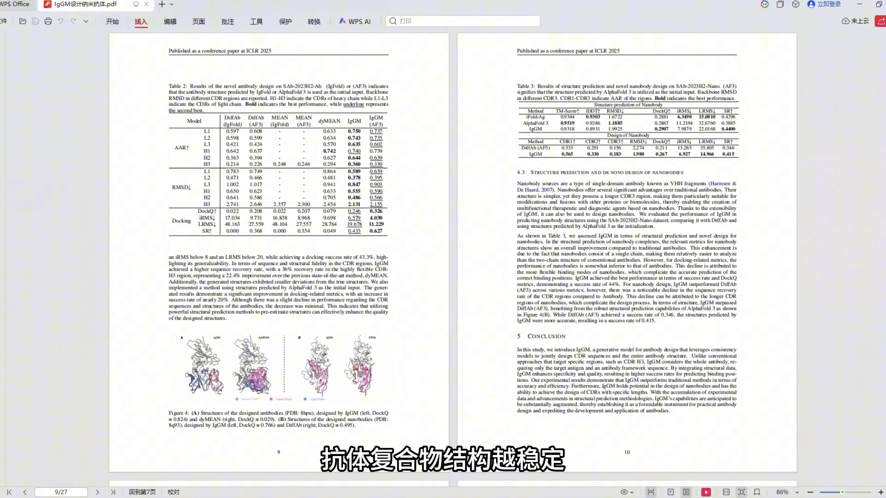
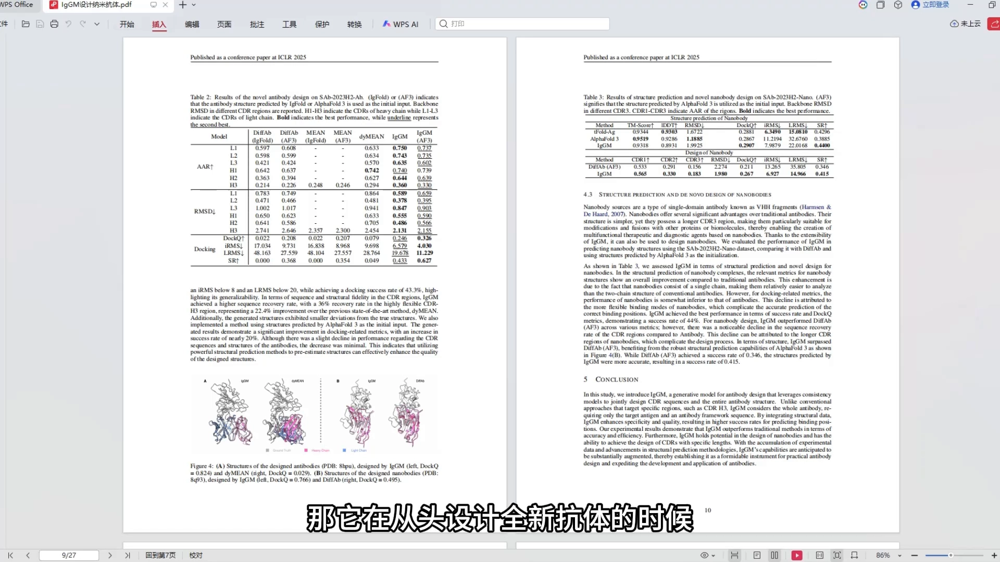
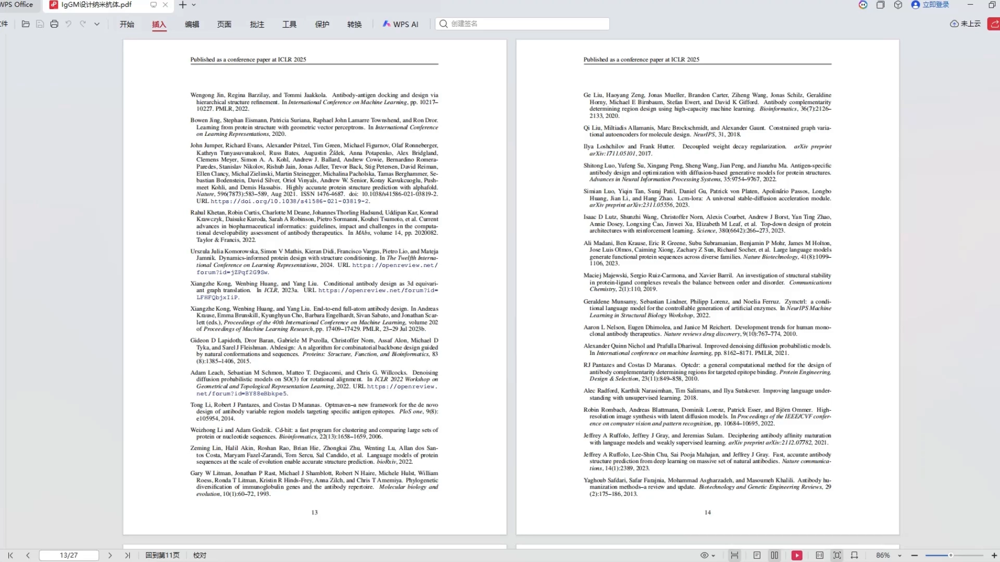
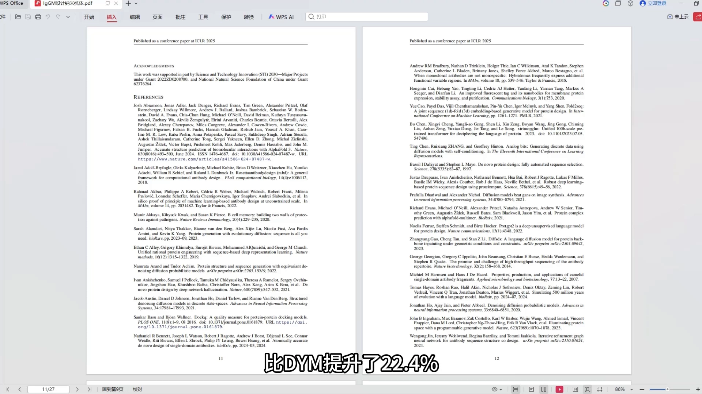
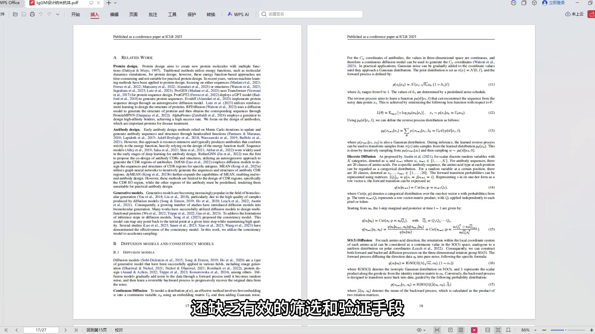
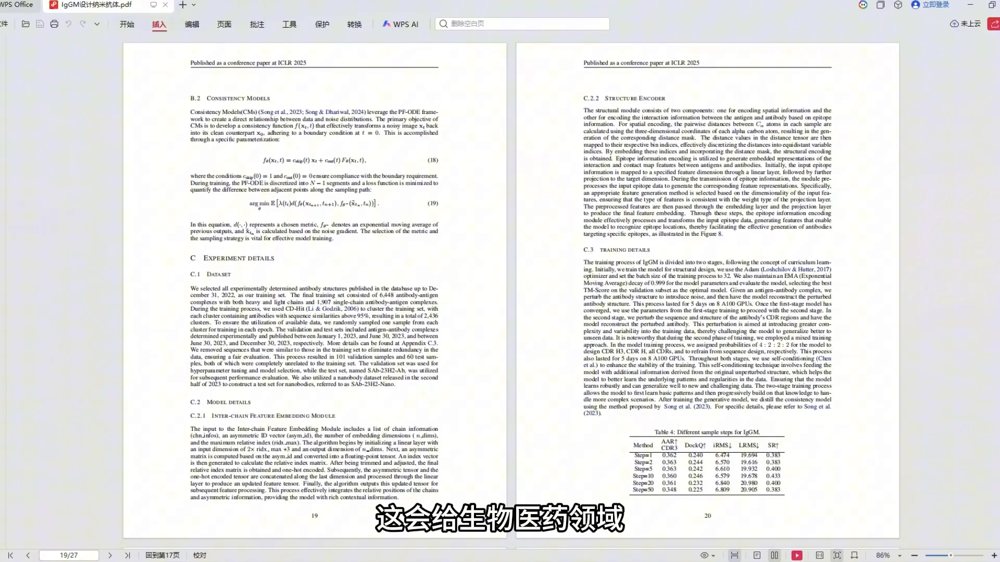

# IgGM：只给抗原，也能"从零设计"抗体的生成式基础模型

> 来源：Bilibili 视频《AI驱动抗体设计新突破：IgGM模型登场》（UP 主：AlphaFold蛋白解析，[BV1w8FqztEp3](https://www.bilibili.com/video/BV1w8FqztEp3/)，时长 08:43）。
> 本文基于视频字幕与画面逐窗口整理而成，配图取自视频截图，时间戳可跳回原视频对应位置核对。视频为直播间对话式科普（主播阿哲、小夏对谈），本篇把对话中的信息按「是什么—怎么做—做得如何—用在哪—边界在哪」重新组织，并把口播中的模型名（"IGGM/EGM/LGM"等均为 IgGM 的口误/听写变体）与指标名（"diy me"=dyMEAN、"DEFAB"=DiffAb、"RMS地址"=RMSD）统一为规范写法；测试集名称按视频口播转写为 SAbDab 2023 相关基准，具体以论文与官方仓库为准。

## 本讲要解决的核心问题（SCQA）

**背景**：抗体是人体免疫系统的"卫士"，能精准识别并绑定病菌、病毒等外来入侵者。但传统抗体研发周期长、成本高，还常有批次差异和免疫原性的问题——新冠疫苗研发前期用传统方法进展缓慢，后来靠 AI 技术介入才加速了很多流程。

**冲突**：已有的 AI 抗体设计方法，大多需要已知的抗体结构或框架信息做"参照"；可面对全新的抗原，这些数据往往根本不存在，方法就失灵了。

**疑问**：有没有一种模型，不需要完整的已知抗体结构，只要给它抗原和部分抗体框架序列，就能直接"配出钥匙"——同时生成抗体的序列和完整结构？

**回答（中心思想）**：腾讯 AI Lab 联合中科院团队推出的 **IgGM** 模型正是这样一位"抗体设计师"。它以预训练蛋白质语言模型 ESM2 为底座，配合特征编码器与预测模块，同时生成具有功能特异性的抗体序列和抗原-抗体复合物结构；在结构预测、对接、从头设计、纳米抗体四项任务上交出了超越 DiffAb、dyMEAN 等主流方法的量化成绩，代码已开源在 GitHub。

## 一、IgGM 是什么：一位会"按锁配钥匙"的抗体设计师

### 1.1 抗体为什么难设计

抗体是我们人体免疫系统里的卫士，能精准识别和绑定外来的病菌或病毒。但按视频的说法，传统抗体研发有三座大山：

- **周期长、成本高**：一个候选抗体从想法到验证要很久；
- **批次差异**：不同批次产品的质量不一致；
- **免疫原性**：抗体进人体验出"排异"反应的风险。

AI 技术早就介入了抗体设计——比如新冠疫苗研发后期就靠它提速。但**之前的 AI 抗体设计方法有一个共同软肋**：大多需要依赖已知的抗体结构或者框架信息。面对全新的抗原，我们根本没有这些数据，方法就不管用了。

### 1.2 IgGM 的解法：不需要完整抗体结构，也能"配钥匙"

[【跳转到 00:55】](https://www.bilibili.com/video/BV1w8FqztEp3/?t=55)

IgGM 最牛的一点：**它不需要完整的已知抗体结构**。只要给它**抗原**和**部分抗体框架序列**，它就能同时生成具有功能特异性的**抗体序列**和**完整结构**。

视频打了个比方：设计一把钥匙，得先知道锁的样子。IgGM 就像一个超级设计师——

1. 先通过预训练模型，了解所有可能"钥匙坯子"的特征；
2. 再分析锁（抗原）的结构和需要匹配的地方；
3. 最后直接生成一把完美匹配的钥匙。

而且它能**同时生成钥匙的形状和具体的齿纹**——齿纹就相当于抗体的 **CDR 区域**（互补决定区），是决定抗体"认得哪把锁"（特异性）的关键部分。

## 二、核心架构：三段式流水线

[【跳转到 01:20】](https://www.bilibili.com/video/BV1w8FqztEp3/?t=80)

IgGM 的核心架构分为三个部分，像一条流水线：

1. **预训练 ESM2 模型**：提取序列的进化特征（ESM2 是一个"读"过海量蛋白质序列的蛋白质语言模型，懂得氨基酸序列里暗藏的规律）；
2. **特征编码器**：学习抗原和抗体之间的相互作用——也就是研究"锁"和"钥匙"怎么咬合；
3. **预测模块**：输出设计好的抗体序列和抗原-抗体复合物结构。

一句话概括：**语言模型读懂序列规律，编码器学会相互作用，预测模块落笔成结构。**

## 三、成绩单：四项任务的量化表现

### 3.1 结构预测：TM-score 0.9591，逼近 AlphaFold3

[【跳转到 02:10】](https://www.bilibili.com/video/BV1w8FqztEp3/?t=130)

在结构预测任务里，视频提到 IgGM 在 SAbDab 2023 抗体测试集上的 **TM-score 达到了 0.9591**，和专门的结构预测方法（比如 AlphaFold3）已经非常接近。虽然还有点差距，但已经足够说明它学懂了抗体结构的分布规律。（TM-score 衡量预测结构与真实结构的相似程度，越接近 1 越像。）

### 3.2 对接：DockQ 0.2986，成功对接率 46.67% 对比 dyMEAN 的 6.7%

[【跳转到 03:00】](https://www.bilibili.com/video/BV1w8FqztEp3/?t=180)

在对接性能上，IgGM 的 **DockQ 得分达到 0.2986**，超过了现有的结构预测和抗体设计方法（DockQ 越高，说明预测出来的抗原-抗体复合物结构越稳定、结合得越好）。它的 **i-RMSD 和 L-RMSD** 这两个对接相关指标也都更准确。最显眼的是成功对接的概率：**IgGM 能达到 46.67%，而之前的 dyMEAN 模型只有 6.7%**——视频里两位主播直呼"提升太明显了"。

### 3.3 从头设计：CDR-H3 序列恢复率 36%，超越 DiffAb 与 dyMEAN

[【跳转到 03:25】](https://www.bilibili.com/video/BV1w8FqztEp3/?t=205)

从头设计抗体才是 IgGM 的强项。在同样的测试集上，它在 **CDR 区域的序列恢复率和结构准确性都超过了之前的主流方法**（比如 DiffAb 和 dyMEAN）。特别是在 **CDR-H3 这个最难预测的区域**，它的序列恢复率达到了 **36%**，比 dyMEAN 提升了 22.4%；而且它设计出来的结构和真实结构的偏差更小（**RMSD 更低**）。

### 3.4 纳米抗体：小个子也能设计

[【跳转到 03:50】](https://www.bilibili.com/video/BV1w8FqztEp3/?t=230)

纳米抗体是一种小型的**单域抗体**：比传统抗体更小，但亲和力和稳定性都更强，特别适合药物开发和诊断。IgGM 通过扩展设计能力，在 SAbDab 2023 纳米抗体测试集上的结构预测和从头设计都比 DiffAb 表现更好，**DockQ 得分 0.2907，对接成功率 44%**。

这么看来，IgGM 确实是一个很全能的工具：结构预测、对接、从头设计、纳米抗体，样样拿得出手。

## 四、能用在哪，边界在哪

### 4.1 四大应用场景

[【跳转到 04:40】](https://www.bilibili.com/video/BV1w8FqztEp3/?t=280)

- **新药研发**：快速设计针对特定疾病靶点的抗体药物，比如癌症、自身免疫病或传染病的治疗性抗体；
- **个性化医疗**：根据每个患者的基因信息和疾病特征，定制专属的抗体疗法；
- **疫苗开发**：设计更高效的抗原结合抗体，提升疫苗免疫效果；
- **生物诊断**：设计更灵敏的检测抗体，提高疾病早期诊断的准确率。

### 4.2 局限与改进方向

[【跳转到 05:05】](https://www.bilibili.com/video/BV1w8FqztEp3/?t=305)

主播也提醒了两点局限：

1. **目前主要在计算模拟层面表现出色**，要真正应用到临床，还需要和湿实验结合；现在的评估方法大多基于现有数据的对比，对全新的抗原还缺乏有效的筛选和验证手段；
2. **改进方向**：开发专门的判别模型，筛选亲和力更高、特异性更强的抗体候选物；以及把 IgGM 和其他 AI 模型结合——比如先用 AlphaFold3 预估结构，再用 IgGM 优化，进一步提升设计质量。

### 4.3 行业格局与开源

[【跳转到 05:55】](https://www.bilibili.com/video/BV1w8FqztEp3/?t=355)

效率对比很直观：传统抗体研发可能要几年甚至十几年、成功率还低；有了 IgGM 这样的 AI 模型，**几周甚至几天就能设计出一批候选抗体**。

腾讯 AI Lab 这次把 IgGM 的代码开源在了 GitHub 上，全球科研人员都可以用它做研究。视频还顺带盘了盘同行：DeepMind 的 AlphaFold 系列、Recursion Pharmaceuticals、In silico Medicine 等——不过 IgGM 在**抗体和纳米抗体的联合设计**上有独特优势，特别是在**不需要完整框架结构**的情况下也能高效设计，这是很多其他模型做不到的。

## 小结

- 传统抗体研发周期长、成本高，且已有 AI 方法依赖已知抗体结构，面对全新抗原会"失灵"。
- IgGM 不需要完整已知抗体结构：输入抗原 + 部分抗体框架序列，即可同时生成抗体序列与复合物结构。
- 架构是三段式：预训练 ESM2 提取进化特征 → 特征编码器学习抗原-抗体相互作用 → 预测模块输出序列与结构。
- 结构预测 TM-score 0.9591，逼近 AlphaFold3；对接 DockQ 0.2986、成功对接率 46.67%（dyMEAN 仅 6.7%）。
- 从头设计是强项：CDR 区域序列恢复率与结构准确性超 DiffAb、dyMEAN，CDR-H3 达 36%。
- 纳米抗体也能设计：DockQ 0.2907、对接成功率 44%，优于 DiffAb。
- 应用覆盖新药研发、个性化医疗、疫苗开发、生物诊断；局限是仍在计算模拟层面，需湿实验验证。
- 代码已开源在 GitHub；未来可与判别模型、AlphaFold3 等结合继续提效。

## 关键术语速查

| 术语 | 一句话解释 |
| --- | --- |
| 抗体 | 免疫系统产生的"卫士"分子，能精准识别并绑定病菌/病毒等抗原 |
| 抗原 | 被抗体识别的"锁"，即外来病原或靶点上的目标物质 |
| CDR（互补决定区） | 抗体上直接"咬合"抗原的区域，决定抗体特异性；视频比喻为钥匙的齿纹 |
| CDR-H3 | 重链上的第三个互补决定区，被认为是变异最大、最难预测的区域 |
| 纳米抗体 | 只有一条重链的小型单域抗体，更小、更稳定，适合药物与诊断 |
| 结构预测 | 只凭序列推分子三维结构；本视频用 TM-score 衡量（越接近 1 越准） |
| 对接（docking） | 预测两个分子（如抗原-抗体）如何结合；用 DockQ 打分，i-RMSD/L-RMSD 衡量界面偏差 |
| 从头设计 | 不依赖现有抗体，直接生成全新抗体序列与结构 |
| 序列恢复率 | 设计出的序列与真实序列的一致程度，越高说明模型"猜"得越准 |
| ESM2 | 预训练蛋白质语言模型，IgGM 用它提取序列的进化特征 |
| DiffAb / dyMEAN | 视频中作为对比基线的两类抗体设计模型（扩散式序列-结构共设计 / 全原子抗体设计） |
| 湿实验 | 实验室里的真实生物/化学实验，用于验证计算设计结果 |
