# 只用蛋白质语言模型，也能给人类抗体做亲和力成熟——零实验数据、20 个变体的低通量进化

> 来源：Bilibili 视频《【中文字幕】仅从蛋白质语言模型和序列信息中高效进化人类抗体》（UP 主：AIBIOROBOTS，[BV1mg411m73M](https://www.bilibili.com/video/BV1mg411m73M/)，时长 54:11）。
> 本文基于视频字幕与画面逐窗口整理而成，配图取自视频截图，时间戳可跳回原视频对应位置核对。视频是斯坦福 Brian Hie（布莱恩）在 ML for protein engineering 研讨会上的英文报告（中文字幕为 AI 翻译），介绍其与斯坦福 Peter Kim 实验室合作的"用通用蛋白质语言模型低通量进化人类抗体"工作。文中口播的模型名/指标名已统一为规范写法（如"esm one b"=ESM-1b、"你赢了"=ESM-1v），个别无法核实的人名/抗体名按原音保留或中性表述。

## 本讲要解决的核心问题（SCQA）

**背景**：定向进化是蛋白质工程的标配——多轮"突变 + 实验测量"，保留提高适应度的突变；近年大家用"预测器"（代理模型）来加速：让模型预测序列的适应度，少做实验。

**冲突**：代理模型需要任务特定的训练数据。可对大多数蛋白质——包括很多治疗抗体——你往往只有一个野生型序列、一种能测适应度的实验方法，甚至不知道结构；靠高通量随机突变或深度突变扫描（DMS）攒训练数据，又贵又慢。

**疑问**：不训练任何任务专属模型，能不能只凭"通用蛋白质语言模型"对序列的似然打分，就富集出真正提高结合亲和力的突变？

**回答（中心思想）**：可以。报告的核心发现是：自然进化探索的序列空间是一条"有效流形"，语言模型学到的**内在适应度**（可折叠、热稳定、进化上合理）是**外在适应度**（对特定抗原的结合）的有效先验。用多个通用 PLM（如 ESM-1b）共识推荐的少量突变——每轮约 10 个、两轮共 ≤20 个变体——就能在 7 支人源抗体上做出与高通量方法同量级的亲和力成熟：部分案例提升达 **160 倍**，还能"救活"对 SARS-CoV-2 Beta 变种逃逸的抗体结合。

## 一、为什么"用过去的进化指导人工进化"是成立的

### 1.1 定向进化的算力困境

[【跳转到 00:50】](https://www.bilibili.com/video/BV1mg411m73M/?t=50)

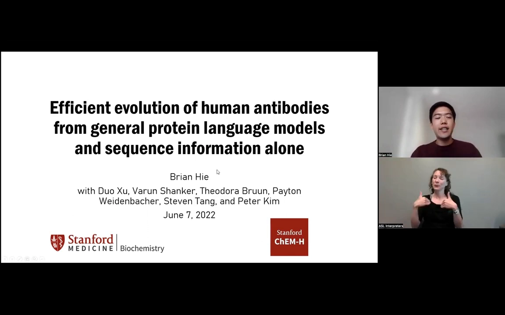

传统定向进化是"突变 → 实验测量 → 保留变好的"循环。为了少做实验，大家引入代理模型（预测器）来引导进化——但训练预测器需要任务特定数据。最常见的困境是：你手里只有一个野生型序列，甚至不知道它的结构，只有序列和一种实验方法；收集初始训练数据的高通量方式（随机突变库、暴力深度突变扫描）成本又很高。

### 1.2 自然进化只探索了序列空间的一小块

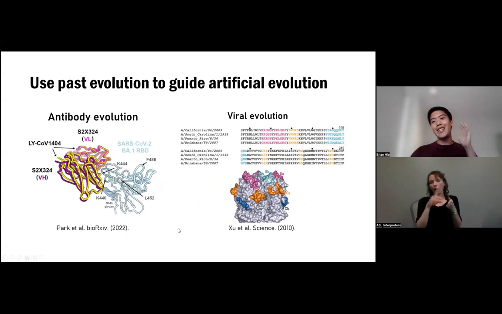

[【跳转到 02:22】](https://www.bilibili.com/video/BV1mg411m73M/?t=142)

报告给出的核心假说是：**用过去的（自然）进化来指导人工进化**。直觉依据是——虽然"所有可能抗体序列的数量比宇宙中的原子还多"，但自然进化实际探索的空间小得多。两个证据：

- **抗体的趋同进化**：两个完全不同的个体，面对不同病原，进化出的抗体可以非常相似——重链序列相似性约 87%、轻链约 91%，靶向相同表位；
- **病毒的"趋同"**：2009 年大流行流感（H1N1）与 1918 年大流行病毒相隔近一个世纪的抗原漂移，蛋白抗原区的氨基酸序列相似度仍有约 80%。

既然自然进化都收敛到同一小片空间，蛋白质工程师就有可能"搭便车"——用在这片空间上学到的规律，来指导我们自己的进化。

## 二、蛋白质语言模型：不训练也能"懂"适应度

### 2.1 语言模型是什么

[【跳转到 06:37】](https://www.bilibili.com/video/BV1mg411m73M/?t=397)

蛋白质语言模型（PLM）定义了蛋白质序列的概率分布。常见的训练方式有两种：**掩码语言模型**——遮住序列中的一些残基，让模型根据上下文预测它们；以及**自回归语言模型**——逐个预测下一个残基。把一个很大的模型在 UniProt 等通用蛋白质序列语料上训练，就得到通用 PLM。

### 2.2 惊人的现象：与实验适应度自发相关

[【跳转到 08:17】](https://www.bilibili.com/video/BV1mg411m73M/?t=497)

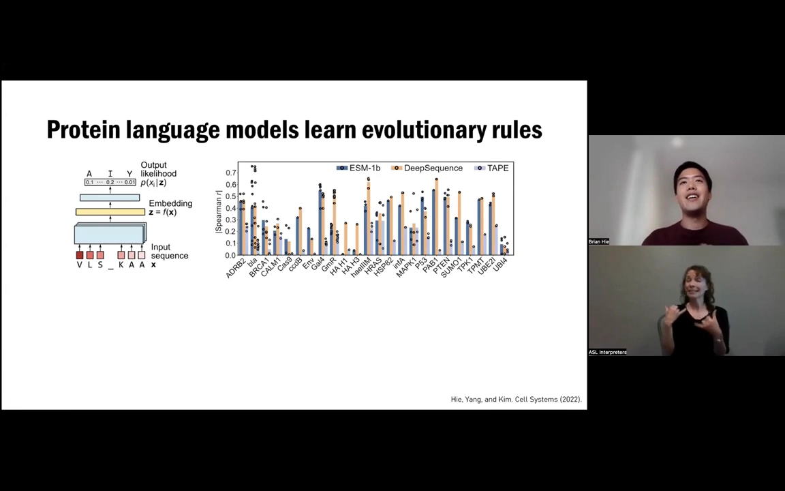

主持人（以及讲者）强调的"迷人之处"在于：这些没有任何任务标注的模型，在很多情况下与实验测定的适应度自然相关——例如 β-内酰胺酶对氨苄青霉素的抗性、以及深度突变扫描（DMS）得到的各种具体适应度测量。代表工作包括 FAIR 的 **ESM-1b**、同团队的 **ESM-1v**（突变效应预测），以及微软研究院与 Debora Marks、Yarin Gal 团队相关的 **Tranception** 等。

### 2.3 连进化轨迹都"顺着"模型似然走

[【跳转到 10:22】](https://www.bilibili.com/video/BV1mg411m73M/?t=622)

更直接的证据：观察自然界几十甚至地质时间尺度的进化轨迹，会发现它们实际沿着语言模型似然较高的方向前进。这是"用过去的进化指导人工进化"的直接依据。

## 三、核心假设：内在适应度是外在适应度的先验

### 3.1 语言模型是"幼稚"的

[【跳转到 11:27】](https://www.bilibili.com/video/BV1mg411m73M/?t=687)

但直接用 PLM 做抗体亲和力成熟有个根本问题：语言模型在训练时**没见过特定抗原的特定表位**——它完全不知道你实验室定义的"选择压力"（报告称之为**外在适应度**，extrinsic fitness，比如对某抗原的结合亲和力）。

### 3.2 模型能学到的：内在适应度

[【跳转到 11:37】](https://www.bilibili.com/video/BV1mg411m73M/?t=697)

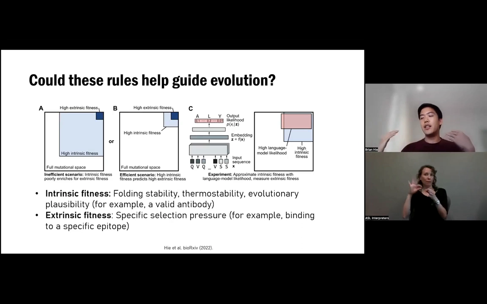

模型只能间接地学**内在适应度**（intrinsic fitness）：序列的内在属性——折叠稳定性/热稳定性、进化的合理性（突变在序列数据集中是否合理）等。

### 3.3 假设与代价

[【跳转到 12:27】](https://www.bilibili.com/video/BV1mg411m73M/?t=747)

整套方法的赌注是一个假设：**内在适应度是外在适应度的好前提**——富集"内在适应度高"的突变，其中就会有一部分自然富集出高外在适应度的变体。

- **优点**：不需要任务特定数据、不需要蛋白质结构、不需要理解突变影响表型的生物学机制；只需要一个野生型序列 + 一种测适应度的方法。
- **缺点**：没有保证——可能只有非常罕见的子集真的能改善与特定抗原的结合。

## 四、实验设计：极低通量的两轮进化

### 4.1 设置

[【跳转到 15:22】](https://www.bilibili.com/video/BV1mg411m73M/?t=922)

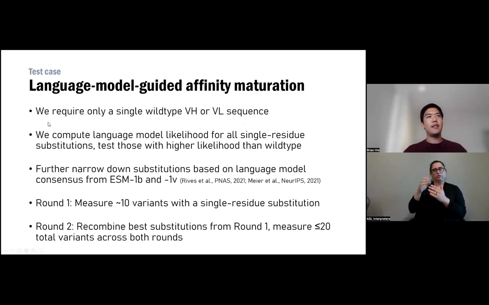

任务选了**人类抗体亲和力成熟**——定向进化最普遍的应用之一（很多疗法依赖高亲和力人源抗体）。设置极简：只需要重链可变区（VH）或轻链可变区（VL）的野生型序列；对每个位点的单残基替换计算语言模型似然，只测试**比野生型似然更高**的替换。

### 4.2 共识方案：多模型投票

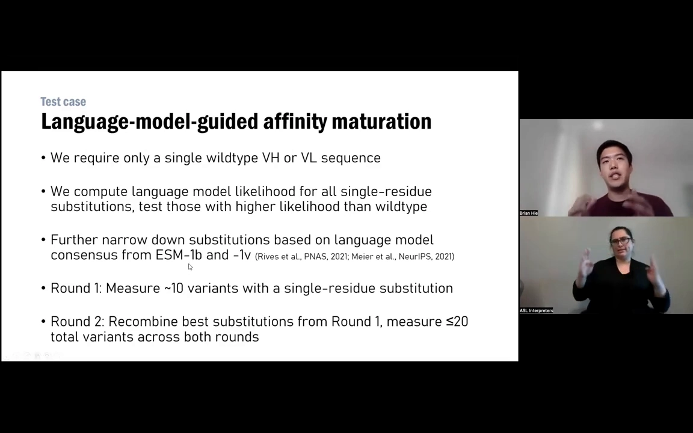

[【跳转到 16:12】](https://www.bilibili.com/video/BV1mg411m73M/?t=972)

为把候选压缩到可实验的规模，用"共识方案"：同时用多个语言模型——在 UniRef50 上训练的 ESM-1b、在 UniRef90 上训练的 ESM-1b 等（语料相似度阈值不同），**只优先考虑被多个模型同时推荐、且在给定位点最可能发生的突变**。这把每轮候选缩减到约 10 个单残基替换。

### 4.3 两轮流程

[【跳转到 17:27】](https://www.bilibili.com/video/BV1mg411m73M/?t=1047)

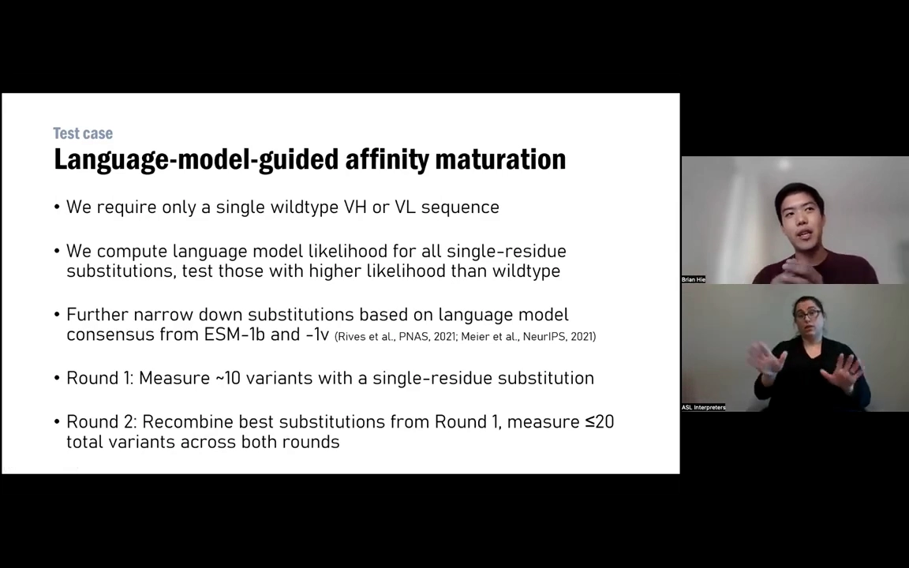

第一轮做单点突变（各自测效应）；第二轮把表现最好的重组——组合空间小时全组合，空间大时手动重组。两轮总共测量 **≤20 个变体**，结合用生物层干涉法（BLI）测量——相比动辄数万序列的库筛选，这是"几乎纯手工"的极低通量进化。共选择了 7 支抗体（覆盖流感、SARS-CoV-2、埃博拉等，成熟度与抗原各异）。

## 五、结果：20 个变体，做出高通量水平的成熟

### 5.1 流感抗体：扩大到第二系统发育群

[【跳转到 20:22】](https://www.bilibili.com/video/BV1mg411m73M/?t=1222)

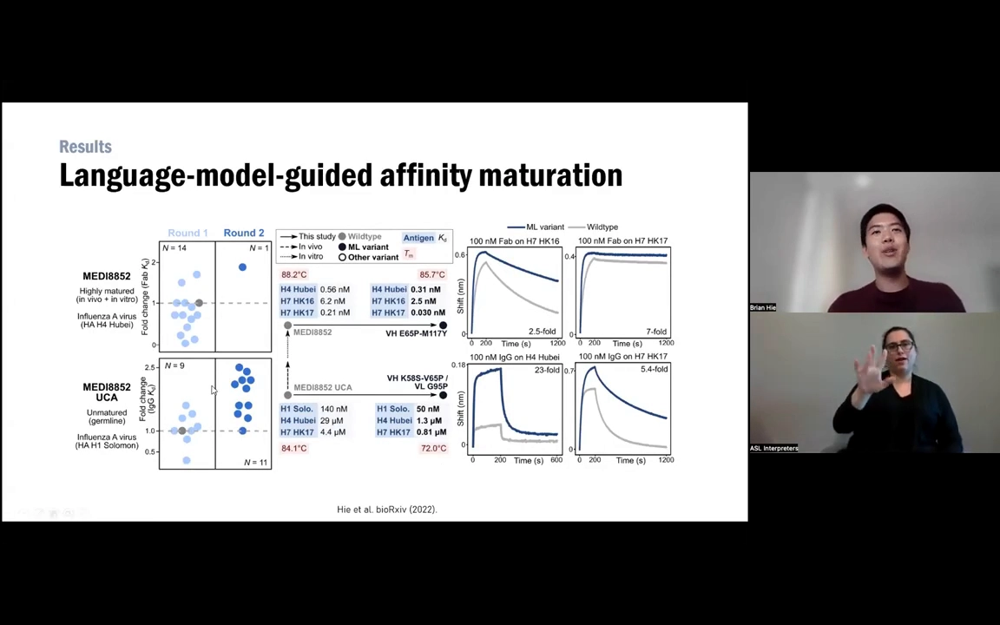

以 MEDI8852（从患者分离的高度成熟流感抗体）为例：其种系前身只能中和第一群流感。模型并不知道任何流感信息，但两轮进化后，抗体获得了与第二群抗原结合的广度——**H7 亲和力提升约 5.4 倍，H4 提升 2-3 倍**。

### 5.2 热稳定性与"超级协同"

[【跳转到 23:42】](https://www.bilibili.com/video/BV1mg411m73M/?t=1422)

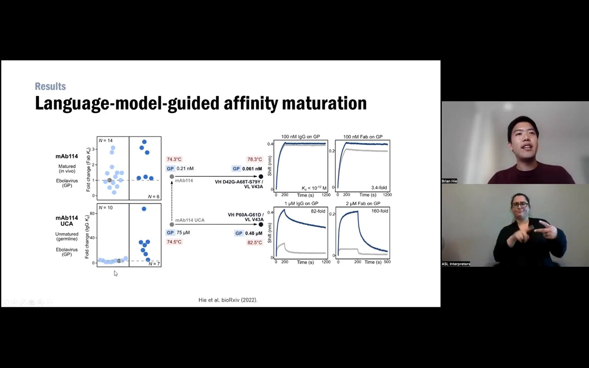

有趣的是，亲和力提升常伴随热稳定性的变化：有的抗体在热稳定性上吃了点亏；而有的组合突变表现为"超级协同"——热稳定性从 74°C 提到 82°C，带来高达 **160 倍**的亲和力改善。还有抗体在野生型时完全没有中和作用，成熟版却表现出了一些中和——讲者认为这与热稳定性的提高有关。

### 5.3 "救活"被逃逸的抗体

[【跳转到 24:57】](https://www.bilibili.com/video/BV1mg411m73M/?t=1497)

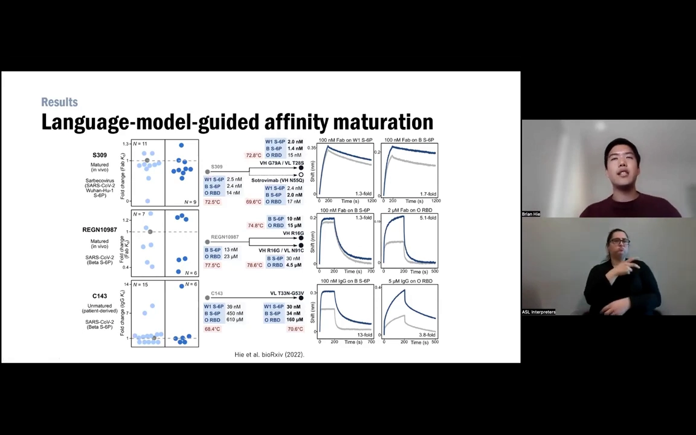

对 SARS-CoV-2（包括有紧急使用授权的临床抗体与一支未成熟抗体 C143），方法同样有效：能挽救抗体与 Beta 变种（当时免疫逃逸最强的变种之一）的结合——改善幅度比流感抗体温和，但与临床引入的突变相当。假病毒中和实验也显示：结合的改善与中和的改善有很好的相关性。

### 5.4 多反应性没有变差

[【跳转到 26:12】](https://www.bilibili.com/video/BV1mg411m73M/?t=1572)

一个自然的担心是：亲和力提高是不是靠"乱结合"（多反应性）实现的？用可溶性膜蛋白的流式检测、以低/高多反应性的临床抗体做对照：野生型抗体本就落在临床可接受范围内，成熟变体也没有显著改变多反应性。

## 六、与既有方法比较：同量级改进，少得多的资源

### 6.1 横向对比

[【跳转到 28:17】](https://www.bilibili.com/video/BV1mg411m73M/?t=1697)

与其他抗体亲和力成熟研究对比：哺乳动物细胞展示路线需要多达 3.9 万个序列来训练监督模型；基于抗体-抗原复合物、持续进化（continuous evolution）的路线对 SARS-CoV-2 RBD 有 2.9×、4×、2.1×/5.5×、2.3×~5.84× 等提升。它们都很强，但每个都涉及资源密集的组件（大库、细胞筛选、结构解析）。本方法在相同量级（约数倍）的提升范围内，只用了 ≤20 个变体——当然，不同研究不能直接比较，但这是非常有希望的信号。

### 6.2 组合使用与扩展

[【跳转到 30:22】](https://www.bilibili.com/video/BV1mg411m73M/?t=1822)

如果资源充裕，这个方法可以与其他技术叠加：例如先用零样本语言模型推荐把搜索空间缩小约 100 倍，再用高通量筛选；或先用它把亲和力提到可解结构的水平，再做结构引导的理性工程；也可以在两轮之后加入监督模型来突破局部最优。读出端也一样：只测 10-20 个变体时，可以上更贵的活病毒中和等实验。

## 七、为什么有效：有效流形假设

[【跳转到 33:42】](https://www.bilibili.com/video/BV1mg411m73M/?t=2022)

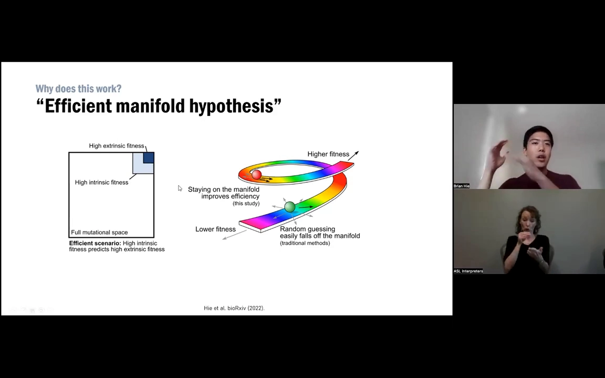

讲者对"为什么有效"的运行假说是**有效流形（effective manifold）假设**：把适应度分成内在/外在两个定义，内在适应度构成一条"彩虹之路"（流形）——随机猜测很容易从流形上脱落，而语言模型打分相当于让你保持在这条流形上行走，于是随机游走的效率大大提高。

## 八、不止抗体：更广的适用性与边界

### 8.1 在 DMS 数据集上同样有效

[【跳转到 34:32】](https://www.bilibili.com/video/BV1mg411m73M/?t=2072)

方法并不依赖抗体专用模型——通用 PLM（微软研究小组的例子、Tranception 等）在大量深度突变扫描（DMS）数据集上与实验适应度有良好的斯皮尔曼相关性；且在"低通量 + 语言模型推荐"的场景下，同样能富集出高适应度突变（有预印本描述）。

### 8.2 QA 中的边界讨论

[【跳转到 40:15】](https://www.bilibili.com/video/BV1mg411m73M/?t=2415)

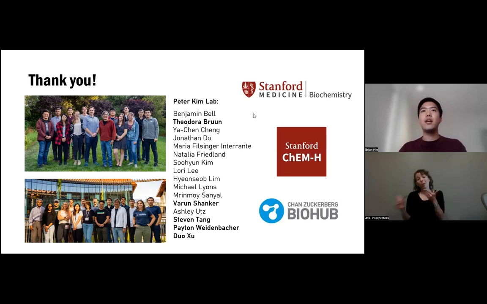

- **换一个适应度定义还有效吗？**有效——文献中无人监督模型连"临床变异风险"这类与经典适应度定义迥异的量都能预测（Debora Marks 团队的工作）；
- **框架区 vs CDR**：典型人工进化集中在 CDR，而约一半提升亲和力的突变落在常被排除的框架区；模型受种系约束、但也能超越它——甚至有出现在 99% 序列中的突变，成为轨迹上适应度最高的突变；
- **免疫原性**：没有测（也没放预测器里），框架区突变通常受种系约束——这是一个开放问题；
- **两轮之后怎么办**：语言模型只是真实内在适应度的近似，纯零样本可能陷入局部最优；拿到两轮数据后加监督是很有希望的破局方式；
- **多突变的联合效应**：条件边际似然的乘积不是好的联合似然——Joe Thornton 团队关于"上位效应漂移"的论文表明，足够分歧的遗传背景之间突变效应会变得不相关；语言模型"接收上下文再预测"的范式与之一不同，但预测大的联合效应仍不乐观；
- **溶解度/聚集的 trade-off**：Genentech 的例子显示有的突变提亲和力的同时显著损害溶解度；即使对亲和力中性的突变，也可能改善溶解度、Tm 等其他维度——这些都可以纳入选择。

### 8.3 工具开放

[【跳转到 44:19】](https://www.bilibili.com/video/BV1mg411m73M/?t=2659)

方法有一个极简的单脚本实现——编辑脚本里的序列即可运行；API 正在开发中。讲者也把"生发中心的体细胞超突变是否是这套流程的生物版"当作有趣的开放问题：AID 介导的突变率即使在没有选择时也高度非随机（Fred Alt 实验室的工作），免疫系统可能同样在利用"热点"预过滤无效序列。

## 小结

- 定向进化的瓶颈在于代理模型缺训练数据；本工作证明：通用 PLM 的序列似然可以充当"免费"的代理模型。
- 核心假设是"有效流形"：内在适应度（可折叠、热稳定、进化合理）是外在适应度（特定抗原结合）的有效先验。
- 流程极简：多模型（ESM-1b UniRef50/UniRef90 等）共识推荐单残基替换 → 两轮、共 ≤20 个变体、BLI 读出。
- 在 7 支人源抗体上做出高通量水平的亲和力成熟：H7 5.4×、超级协同案例 160×（Tm 74→82°C）、救回对 SARS-CoV-2 Beta 的结合，且多反应性不变。
- 与需要数万序列或持续进化设备的方法同量级，但资源少几个数量级；可与高通量筛选、结构引导设计、监督模型自由组合。
- 方法不限于抗体：DMS 数据集上同样能富集高适应度突变；工具已开源（单脚本），API 在开发中。
- 边界也很清楚：无保证、可能陷局部最优、成对突变联合效应难预测、免疫原性未验证——两轮后加监督、换更贵的读出是自然的扩展路径。

## 关键术语速查

| 术语 | 一句话解释 |
| --- | --- |
| 定向进化 | "突变+实验测量+保留变好的"的多轮循环，蛋白质工程的基本功 |
| 代理模型（预测器） | 用模型预测序列适应度来减少实验量的方法；通常需要任务特定训练数据 |
| 蛋白质语言模型（PLM） | 在海量蛋白质序列上自监督训练的模型，给出序列的概率分布；如 ESM-1b/1v、Tranception |
| 内在适应度 | 序列本身的性质：可折叠、热稳定、进化上"合理"；语言模型能直接学到的部分 |
| 外在适应度 | 实验室定义的具体选择压力，如对某个抗原的结合亲和力；语言模型没见过 |
| 有效流形假设 | 内在适应度构成一条"流形"，保持在其上行走能让随机游走高效地富集外在适应度 |
| 亲和力成熟 | 把已有抗体的结合亲和力进一步提高的过程；治疗抗体的常见需求 |
| VH / VL | 抗体重链/轻链的可变区，本方法对两者分别做单域进化 |
| CDR / 框架区 | 互补决定区（直接接触抗原）与周围的骨架区域；约一半有益突变落在框架区 |
| 种系（germline） | 抗体未经历亲和力成熟的"祖先"序列；框架区通常受种系约束 |
| 深度突变扫描（DMS） | 对某蛋白所有（或大量）单突变做高通量适应度测量的实验方法 |
| UniRef50 / UniRef90 | 按序列相似度聚类到 50%/90% 的蛋白质数据库；不同阈值训练出的 ESM-1b 行为略有差异 |
| BLI（生物层干涉法） | 无标记测分子结合的实验方法，本工作用它测两轮共 ≤20 个变体的结合 |
| 超级协同 | 多个突变组合的效果远超各自之和；本工作出现 Tm 74→82°C、亲和力 160× 的案例 |
| 多反应性 | 抗体"乱结合"的程度；成熟后未变差是安全性的重要证据 |
