# Chai-2 的破局：用"全原子预测 + 全原子设计"把抗体从头设计成功率从 0.1% 干到 15.5%

> 来源：Bilibili 视频《上海交大博士李松：抗体从头设计—Chai-2 的破局》（UP 主：HyperAI超神经，[BV1pqugzuE75](https://www.bilibili.com/video/BV1pqugzuE75/)，时长 59:05）。
> 本文基于视频字幕与画面逐窗口整理而成，配图取自视频截图，时间戳可跳回原视频对应位置核对。视频为上海交大洪亮老师主持的公开直播，由（已毕业、从事 AI 蛋白质设计的）李松博士主讲，拆解 Chai Labs 的 Chai-2 技术报告。报告未披露全部细节，讲者的部分推断在文中已明确标注"猜测/存疑"；口播错拼已修正（"开拓/拆too"=Chai-2、"斑点"=结合、"到Q/dog q"=DockQ、"成效性"=成药性、"BFAB"=DiffAb、"for mating"=flow matching 等）。

## 本讲要解决的核心问题（SCQA）

**背景**：抗体是千亿级市场（2023 年统计，2033 年预计接近万亿），但传统发现流程漫长：确定靶点 → 抗原制备 → 免疫动物 → 抗体筛选 → 优化与成药性评估 → 动物模型，光杂交瘤一路就要 6~15 个月。

**冲突**：传统免疫"打哪指哪"——免疫到一个表位算一个，无法定向；于是有了"AI+建库+高通量筛选"的从头设计路线，但现有方法（RFdiffusion 抗体系列、FlowDesign、Nabla Bio 等）成功率普遍只有 0.1%（全 Fv 设计甚至 0.001%），且严重依赖建库与高通量筛选，周期至少 3 个月。

**疑问**：有没有办法不建库、不筛选，直接从抗原序列出发，两周之内、用一两只培养板的量，就拿到能结合的抗体？

**回答（中心思想）**：Chai Labs 的 Chai-2 展示了一条可能的破局之路——把**全原子结构预测**和**全原子结构设计**两套系统打通：预测端把抗体-抗原界面预测的水平大幅拉高，设计端让主链与侧链自洽地共同生成。结果是：平均成功率 15.5%（VHH 20%、scFv 14%）、52 个新靶点中 26 个至少拿到一个 hit、发现周期从 3 个月缩到 2 周。当然，讲者也指出它未解任何共晶结构、未做功能实验等局限，破局成色仍需时间检验。

## 一、背景：抗体很好，但发现流程又慢又"撞运气"

### 1.1 抗体是什么，为什么值钱

[【跳转到 01:55】](https://www.bilibili.com/video/BV1pqugzuE75/?t=115)

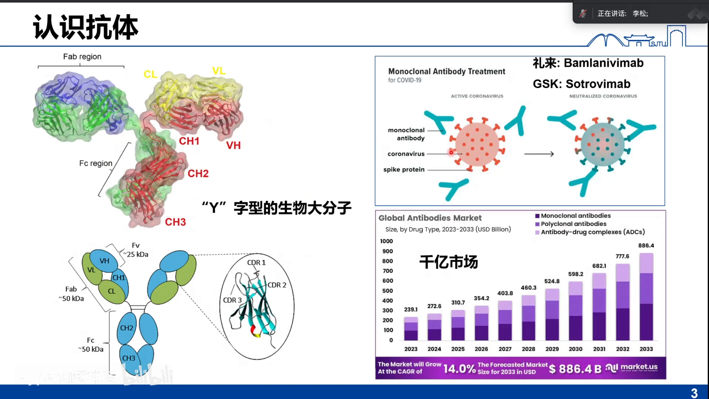

抗体是一个 Y 字形的生物大分子：两条重链 + 两条轻链通过二硫键连接，Y 字上端的 **CDR 区域**负责结合抗原。以新冠为例，设计抗体去结合病毒表面的 spike 蛋白，就能阻止它入侵人体细胞——21、22 年礼来的抗体和 JS016 就是早期救命的例子。市场层面，2023 年单抗、双抗、ADC 等合计已是千亿规模，2033 年预计接近万亿。

### 1.2 传统流程：6~15 个月，"打哪指哪"

[【跳转到 03:29】](https://www.bilibili.com/video/BV1pqugzuE75/?t=209)

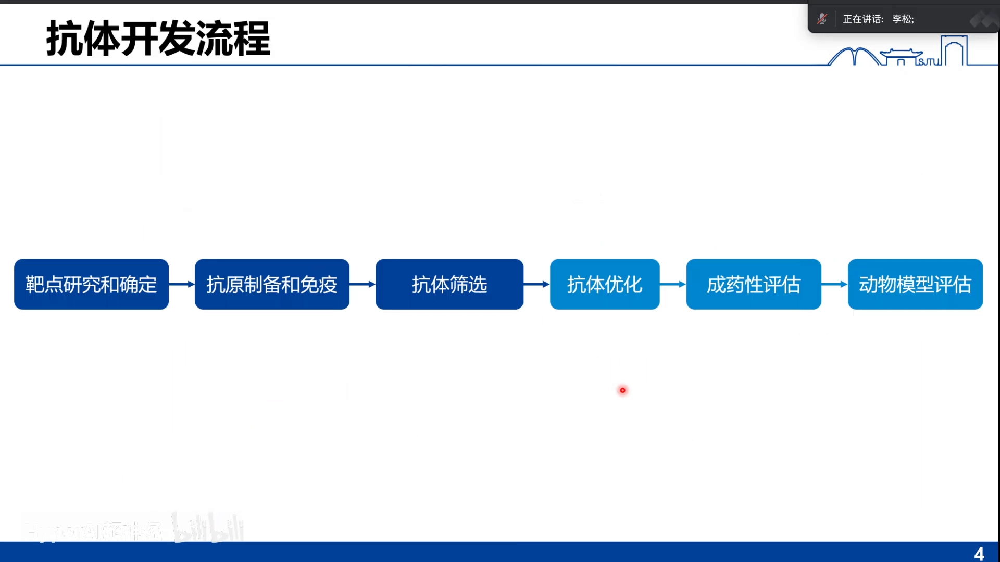

传统开发流程：确定可成药靶点 → 抗原制备 → 免疫动物（鼠、兔、羊驼、鲨鱼等；羊驼/鲨鱼主要做 VHH）→ 抗体筛选（杂交瘤、噬菌体/酵母展示库、单 B 细胞克隆）→ 亲和力成熟、成药性改造、人源化 → 成药性评估 → 动物模型 → PCC → IND。其中"抗体发现"一段以杂交瘤为例要 **6~15 个月**，且免疫法天然**不能定向**：免疫到哪个表位，事先不知道。

### 1.3 AI 从头设计的三支代表与 0.1% 的尴尬

[【跳转到 05:45】](https://www.bilibili.com/video/BV1pqugzuE75/?t=345)

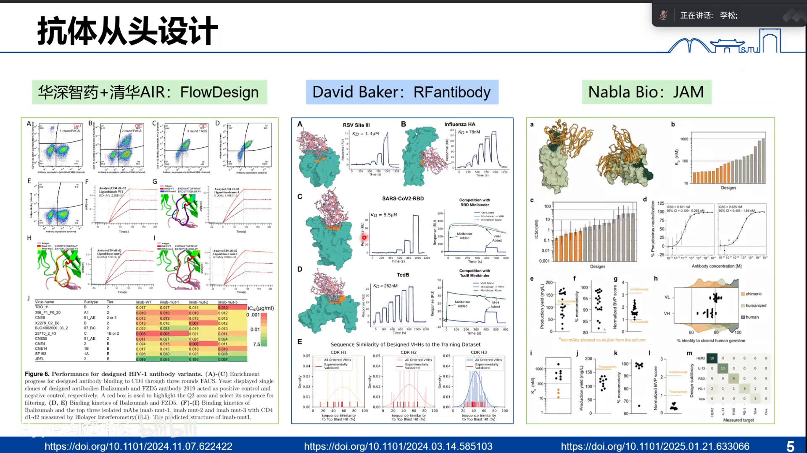

"基于 AI 的抗体发现"想做的事：直接给靶点（抗原），一步到位设计出针对指定表位的抗体。现有代表：David Baker 实验室的 RFdiffusion 抗体系列（挂 bioRxiv）、清华彭健/马剑竹老师团队的 DiffAb 与 FlowDesign、以及只发技术报告不开源的 Nabla Bio。但现状是——"AI 设计序列库 + 建库 + 展示筛选"的成功率：VHH 案例里 Baker 只设计 95 个成功 2 个（约 2%），多数工作在 **0.1%** 量级；把重链轻链同时设计的 Fv 更是掉到 **0.001%**。而且一旦依赖高通量筛选，周期就回到 3 个月起步。

## 二、Chai-2 的三个颠覆性数字

[【跳转到 08:28】](https://www.bilibili.com/video/BV1pqugzuE75/?t=508)

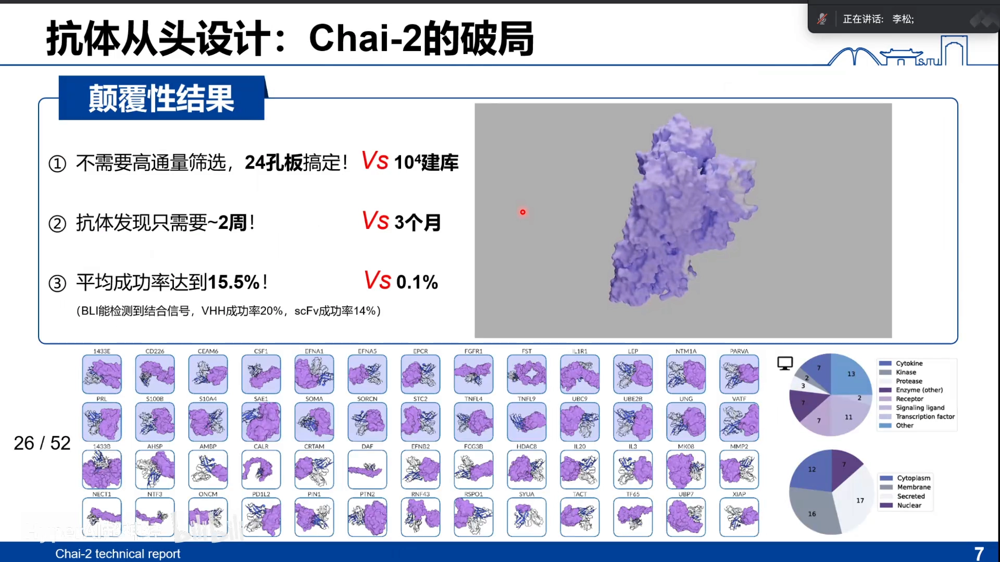

1. **不需要高通量筛选**：不用建 10^4 的库，直接 24 孔板搞定；很多靶点甚至只做 5 个、1 个候选也能成。
2. **发现周期 3 个月 → 2 周**：不建库，直接合成序列、测 BLI（生物层干涉法），两周就能拿到 hit。
3. **平均成功率 15.5%**：VHH 约 20%、scFv 约 14%——相对 0.1% 是两个数量级的提升；按"BLI 检测到结合信号即算成功"计。

补充一个大盘数字：52 个靶点中 **26 个**至少找到一个成功 binder——靶点成功率接近一半；且靶点类别、表位定位都刻意覆盖得很均匀，展示的是零样本泛化能力。（讲者提醒：媒体说"应验诺奖预言"还为时过早——工具没完全开放，就算开放，离做成药也还有很长的周期。）

## 三、破局之道一：全原子的结构预测

### 3.1 为什么结构预测决定设计成败

[【跳转到 11:16】](https://www.bilibili.com/video/BV1pqugzuE75/?t=676)

mini-protein binder 设计（成功率 10%~80%）的主流流程——RFdiffusion、BinderCraft、AlphaProteo——都有一个共同点：**依赖结构预测**。先用 AlphaFold2 预测单体或复合物结构，再基于结构筛选；Baker 组在 Nature Communications 上专门论证过"用预测结构筛掉坏 binder 能大幅提升成功率"。所以：**结构预测的水平，决定了设计的效果**。

### 3.2 老工具在抗体-抗原上"拉跨"

[【跳转到 12:29】](https://www.bilibili.com/video/BV1pqugzuE75/?t=749)

AlphaFold2 预测普通配体-受体复合物，DockQ 能到 0.7~0.8（及格偏好的水平）；但一遇抗原-抗体复合物就"拉跨"——只有百分之十几、不到 20~30% 的水平。原因在于抗体的 CDR 是柔性 loop，构象差异天然巨大。

### 3.3 AF3 也不轻松，Chai-2 把数字干上来了

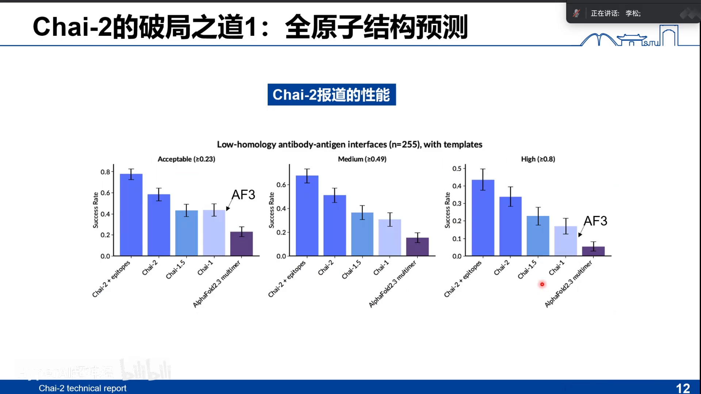

[【跳转到 13:59】](https://www.bilibili.com/video/BV1pqugzuE75/?t=839)

受 license 限制，讲者从 AF3 文档核实：protein-protein 预测能到七八十分，antibody 明显降档；跑 1000 个种子时 AF3 的 DockQ>0.23（入门线）比例是 36%（AF2 只有 18%），**单种子只有 10%**——而多数实验室最多跑 5 个种子，实际可用的水平就是 10% 几。DockQ>0.8 才算实验精度。Chai-2 披露的结果：DockQ>0.23 的水平干到接近 0.6，接近实验精度的水平干到 0.45 左右——相对 AF2/AF3 的常用配置是明显的提升。（讲者补充：不同 benchmark 结果会有差异，例如在另一个 Fab 测试集上 Chai-1 明显弱于 AF3；但 Chai-2 相对 Chai-1 的提升是确定的。）

### 3.4 架构：仿 AF3，但有两处关键改造

[【跳转到 16:11】](https://www.bilibili.com/video/BV1pqugzuE75/?t=971)

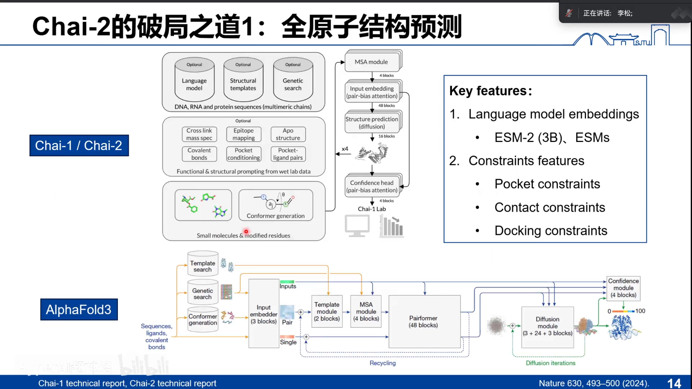

Chai 的架构就是 AF3 的简化版（模板、embedding、diffusion 模块都在）。两个关键差异：

- **用语言模型做 embedding**：Chai-1 用 ESM2-3B，Chai-2 提到会用其他系列的 ESM（如 1b、1v，存疑）。有语言模型在，就**摆脱了 MSA 约束**——单给一条序列也能预测；
- **constraint（约束）模块**：可以指定口袋、标记关键残基（比如实验发现的结合位点）再预测，可靠性比裸序列输入大得多。

其余部分与 AF3 基本一致，数据集也无大变化——性能提升从何而来，报告没说，讲者猜测是"对模块做了微操"。

## 四、破局之道二：全原子的结构设计

### 4.1 主链与侧链自洽生成，才叫 co-design

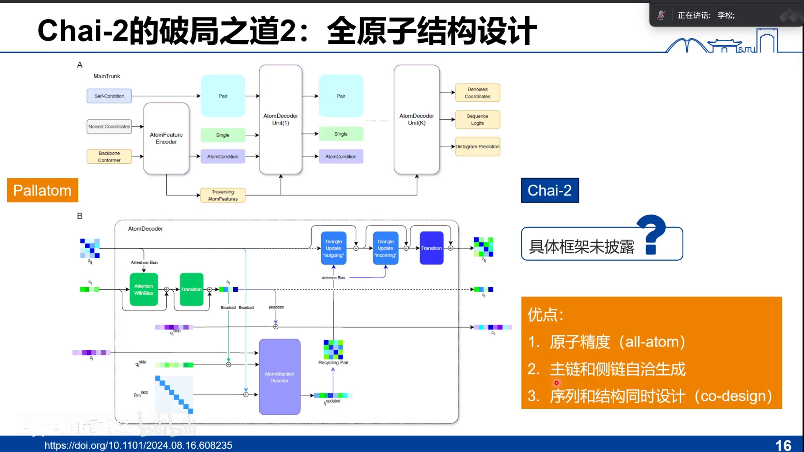

[【跳转到 19:22】](https://www.bilibili.com/video/BV1pqugzuE75/?t=1162)

Chai-2 的设计框架没有披露，但它引了 PLATO 等工作作为线索：全原子设计用"氨基酸层面 + 原子层面"两条轨道交叉更新信息，最重要的是**主链和侧链同时、自洽地生成**。这与 Baker 路线（先生成骨架、再生成序列，两者解耦）本质不同——解耦流程里，前面生成的骨架未必是后面序列探索的最优底子；自洽生成则可能找到更好的组合。而且原子定了，结构和序列就都定了——天然的 co-design。

### 4.2 前辈们：有全原子设计，但缺实验或只算 redesign

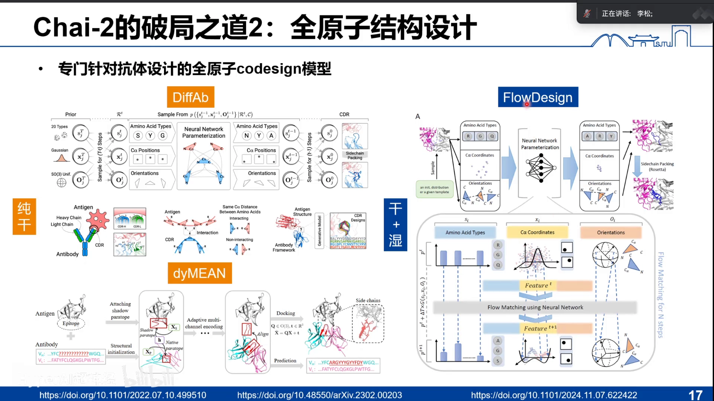

[【跳转到 20:37】](https://www.bilibili.com/video/BV1pqugzuE75/?t=1237)

DiffAb（清华彭健/马剑竹团队）用扩散模型生成原子类型、位置与朝向；另一个等变图神经网络生成模型（刘洋老师，音）同属全原子设计——但两者都只有计算实验、没有湿实验验证，信服力不足。后来的 **FlowDesign** 把 DiffAb"横过来"，把 diffusion 换成更先进的 flow matching，并做了湿实验：对已知抗体（~10^-10 M 水平）的抗原做 redesign，个别 mutant 略优、其余持平或更差——讲者评价：作为 **redesign** 案例不错，但证明不了 **de novo** 能力，因为靶点上本来就有已知抗体做参照。

### 4.3 两个模块，缺一不可

[【跳转到 23:17】](https://www.bilibili.com/video/BV1pqugzuE75/?t=1397)

讲者的核心判断：Chai-2 的惊艳 = **全原子结构设计 + 全原子结构预测**两件事同时成立。上面所有前辈工作都有全原子设计，却没有 Chai-2 这样的结果。一个合理猜测（讲者标注为猜测）：把预测端的 diffusion 模块直接变成标准 DDPM，就让同一套系统既能 fold 又能 design；甚至可以畅想把 Chai-2 design 与 Chai-2 fold 进一步合并成一个端到端、可回传梯度的模型——是否可行，留给社区探索。

## 五、成绩单细看：mini-protein 与抗体

### 5.1 mini-protein binder：从 20% 到 68%

[【跳转到 25:39】](https://www.bilibili.com/video/BV1pqugzuE75/?t=1539)

mini-protein binder：5 个靶点全部找到 binder（100%）；整体成功率 **68%**，而既有开源方法（RFdiffusion 等）大约 20%，BinderCraft/AlphaProteo 更高一些但（前者靶点多、后者未开源）。技术报告自己的对比更夸张——它挑了别人成功率低的靶点做，自己七八十%、别人 20% 左右（讲者提醒这是"取巧"：几个高成功率靶点它没做）。最能说明问题的是 **TNFR**：三聚体界面平坦刚性，AlphaProteo 明确报告成功率为 0，Chai-2 能做到 20% 多，且结合活性直接到**纳摩级**。

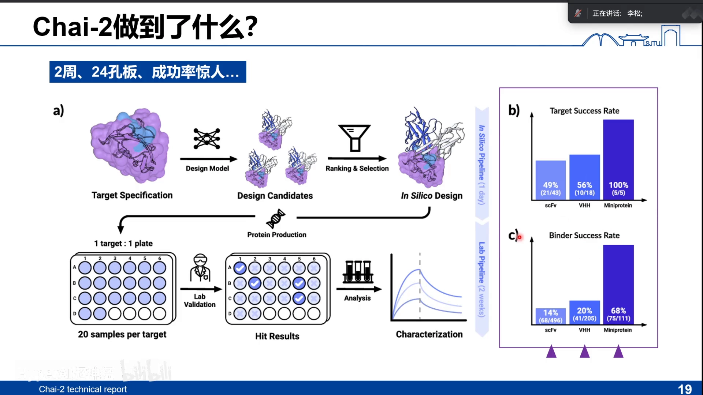

### 5.2 结构多样性：同一靶点全 α、全 β 都能出

[【跳转到 30:24】](https://www.bilibili.com/video/BV1pqugzuE75/?t=1824)

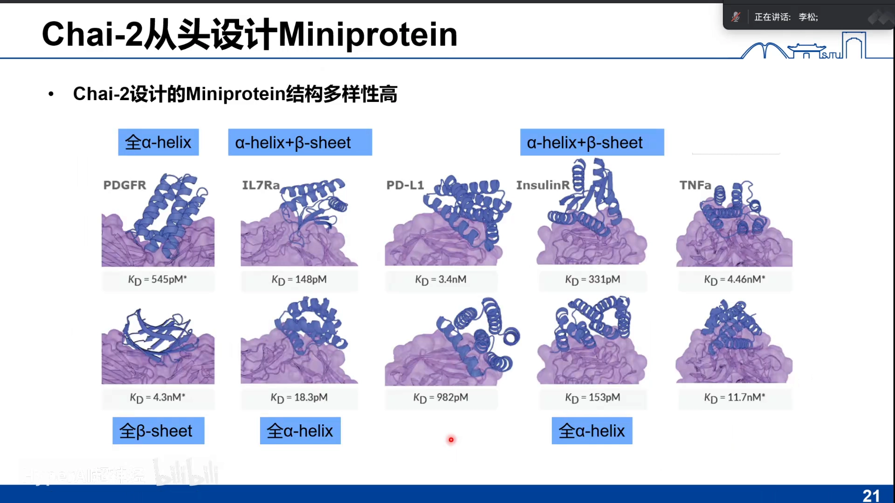

对同一靶点（PDGFR），Chai-2 能设计全 α-helix 的 binder，也能设计全 β 的 binder，pose 各不相同；亲和力可到皮摩/数百皮摩级——而且是一次性生成，没有筛选、没有亲和力成熟，最多 20 个候选里就出这种结果。

### 5.3 抗体层面：真·新抗体，还能"点菜"

[【跳转到 31:28】](https://www.bilibili.com/video/BV1pqugzuE75/?t=1888)

抗体的靶点阳性率约 50%，且所选抗原与 SAbDab 库 identity <70%（甚至 <25% 的子集阳性率依然很高）——展示零样本设计能力。新颖性方面：设计抗体与 PDB 已有抗体的结构 RMSD 都大于 10Å、CDR 序列差异也在百分之几十以上——不是照抄库里的抗体。多样性方面：同一表位可以设计出结合构象不同的多种抗体；甚至能"点单"——在指定表位、指定形式（VHH 或 scFv）生成抗体（讲者指出遗憾：没有做竞争实验或解结构来直接验证结合位置）。此外还有：**种属交叉反应**（把两个种属的抗原一起作为 prompt，得到对两者都有活性的抗体——适合新冠变异毒株、two-in-one/N-in-one 场景）、**降低多反应性**（对照实验显示设计抗体对血清蛋白的杂结合很低、靶向 CCL2 的结合被提起来）、以及可开发性/人源性计算上可接受（约 0.9，与 FDA 批准抗体接近——但讲者强调这些只是计算结果，且人源化与免疫原性并不能直接挂钩）。

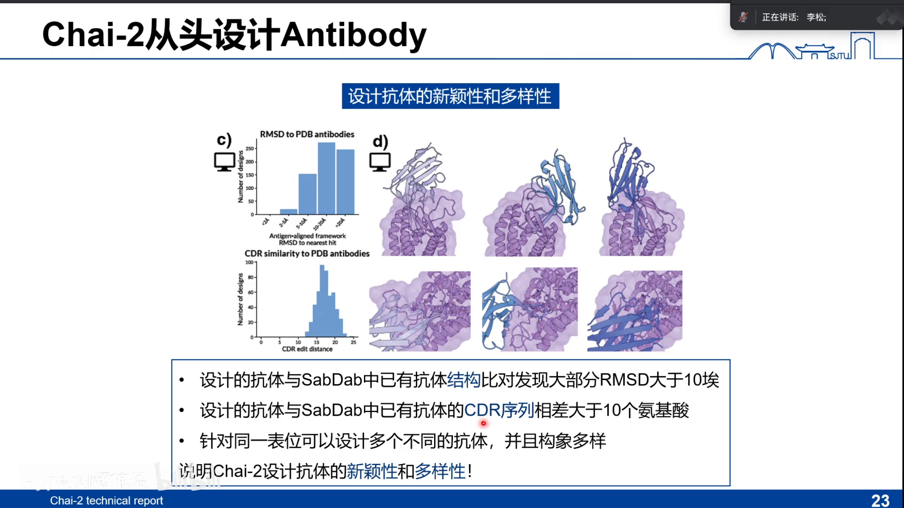

## 六、冷静看：四个商榷点

[【跳转到 37:45】](https://www.bilibili.com/video/BV1pqugzuE75/?t=2265)

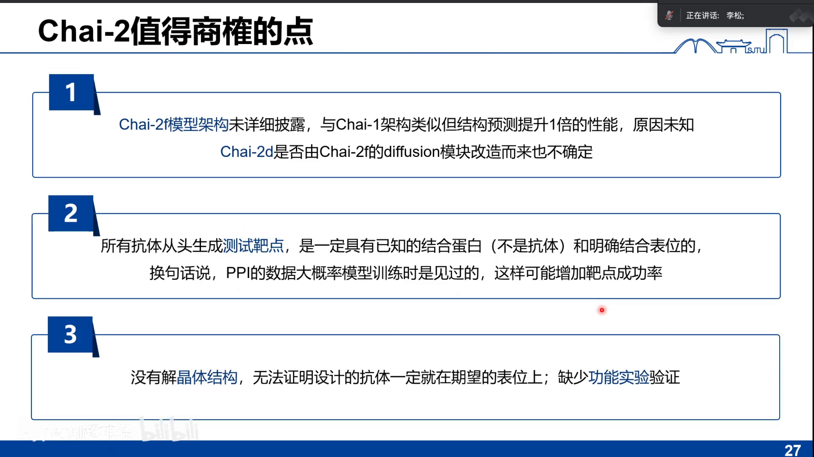

1. **folding 模型架构未披露**：只说与 Chai-1 一样，性能却翻倍，原因不明（猜测有微操）；design 端是否如猜测"把预测的 diffusion 模块改成 DDPM"，只有内部人知道。
2. **PPI"见过"的小加成**：所有抗体测试靶点都要求有已知（非抗体）结合蛋白、表位明确——相关 PPI 数据都在 PDB 里，预测模型训练时大概率见过，这可能在一定程度上抬高了成功率。
3. **零共晶、零功能实验**：声称"指定表位生成抗体"，却没解任何一个复合物结构，也没做结合位置验证或中和等功能实验——assay 是最大短板。
4. **靶点选择的先验**：靶点来自 CRO 供应商清单、删掉与已知库 identity>70% 的蛋白（PD-1/PD-L1 等"做烂了"的都删了）；这个选择既保证"新颖"，也意味着成绩建立在特定先验上。

## 七、未来与应用：从 fast follow 到"IND 梦"

[【跳转到 39:46】](https://www.bilibili.com/video/BV1pqugzuE75/?t=2386)

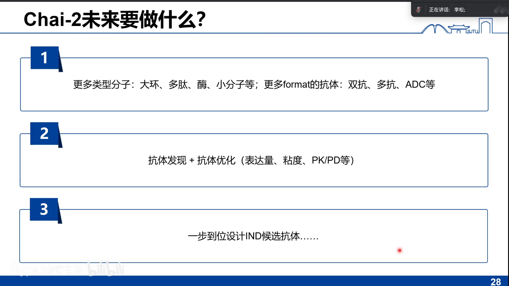

Chai 自己的蓝图：①扩展到更多分子类型（大环多肽、酶、小分子）与更多形式抗体（双抗、多抗、ADC）——不久的将来可期；②把发现与优化合并成一个模块——一步到位拿 PCC，较难；③一步到 IND——dream。讲者总结的现实应用潜力：**突破专利（fast follow）**——靶点一旦被验证，AI 可以快速做出序列不同、功能相近的分子，动摇传统"重资产专利圈地"的分子资产逻辑；以及攻坚**难成药/难结合靶点**（如平坦刚性三聚体界面的 TNFR），做 first-in-class。

讲者团队自己的两个实践：一是 VHH 的 CDR3 redesign——24 条基本都能表达，5 条超过参考抗体（十几 nM 水平），最好的提升 **33.77 倍**、阳性率约 20%（但这是部分设计，不是完全从头）；二是酶的从头设计——为兼得"低温可操作"与"高活性"，从零设计了约 20 个自然界不存在的蛋白（序列相似度低至 30% 出头），活性提升 10 倍以上且热稳定性更好，发表于 Cell Discovery；还有把临床分子序列相似度降到 75% 以下、改动约 30 个氨基酸同时保住活性的融合蛋白设计——用从头设计"打破分子资产"的实践样本。

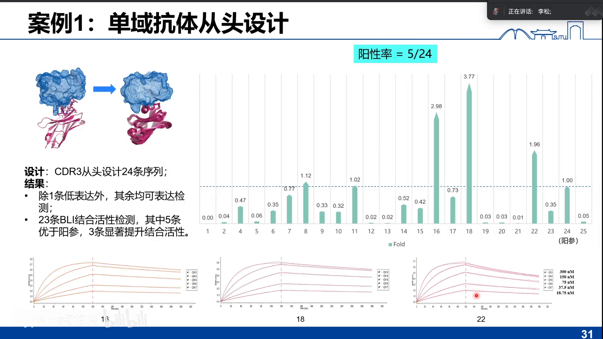

## 小结

- 抗体市场千亿级，但传统发现流程 6~15 个月、免疫法"打哪指哪"；AI+建库+筛选的从头设计成功率仅 0.1% 量级。
- Chai-2 交出三个颠覆数字：不用高通量（24 孔板甚至 1~5 个候选）、周期 3 个月→2 周、平均成功率 15.5%（VHH 20%、scFv 14%）；52 个新靶点 26 个出 hit。
- 破局之道一是全原子结构预测：AF2 在抗体-抗原上只有 10~20%，AF3 单种子约 10%；Chai-2 把入门线（DockQ>0.23）干到 0.6、高线干到 0.45；关键改造是用 ESM2 做embedding（摆脱 MSA）+ constraint 约束模块。
- 破局之道二是全原子结构设计：主链-侧链自洽共同生成（对比 Baker 路线的解耦），与预测端共享扩散系统（讲者猜测以 DDPM 连通）。
- mini-protein 上成功率 20%→68%，还做成了 AlphaProteo 成功率为 0 的 TNFR 难靶点（纳摩级）；抗体上零样本、结构 RMSD>10Å、同表位多构象、可指定表位与形式、种属交叉、降低多反应性。
- 保留意见：架构未披露、靶点 PPI 可能被"见过"、零共晶零功能实验、靶点选择有先验——"破局"的真实成色有待后续实验与复现。
- 应用想象：fast follow 破专利、攻坚难成药靶点做 first-in-class；本组已用类似思路落地 CDR3 redesign（33.77×）、酶从头设计（10×，Cell Discovery）与保功能降相似的融合蛋白设计。

## 关键术语速查

| 术语 | 一句话解释 |
| --- | --- |
| CDR | 抗体上直接结合抗原的互补决定区，柔性 loop、构象多样，是预测与设计的难点 |
| VHH / scFv | 单域抗体（纳米抗体）/单链可变片段——两种更小的抗体形式，Chai-2 可指定形式生成 |
| 从头设计（de novo） | 不依赖已有抗体，直接从抗原出发从零设计 binder；与 redesign（改造已有抗体）相对 |
| PCC / IND | 临床前候选化合物 / 新药临床试验申请——抗体研发流程的两个里程碑 |
| 杂交瘤 | 经典的单克隆抗体制备技术，从免疫动物到拿到单克隆约 6~15 个月 |
| 展示库筛选 | 噬菌体/酵母展示等高通量筛选技术，是从头设计旧范式里"建库"之后的必经环节 |
| DockQ | 衡量蛋白复合物界面预测质量的指标（0~1，越大越好；>0.23 入门、>0.8 接近实验精度） |
| AlphaFold2/3 | 深度学习的结构预测模型；AF2 在抗体-抗原复合物上失灵，AF3 单种子也只有约 10%（DockQ>0.23） |
| MSA | 多序列比对；传统结构预测依赖它，Chai 用 ESM2 语言模型 embedding 摆脱了这一约束 |
| ESM2 | Meta 的蛋白质语言模型；Chai-1 用其 3B 版本做 embedding |
| constraint（约束） | Chai 系列的特色功能：可指定口袋/关键残基，引导预测与设计聚焦目标表位 |
| PLATO | Chai-2 报告引用的全原子结构设计工作，主链与侧链双轨道交叉更新、自洽生成 |
| DiffAb / FlowDesign | 清华团队的全原子抗体扩散设计 / 把扩散换成 flow matching 并补湿实验的后继工作 |
| RFdiffusion | Baker 组的开源骨架生成模型；抗体系列延伸工作挂在 bioRxiv，但未做到全原子 |
| Nabla Bio | 只发技术报告、未开源的抗体从头设计公司 |
| BLI | 生物层干涉法，无标记测结合；Chai-2 以"BLI 出信号即算成功"统计成功率 |
| TNFR | 三聚体、界面平坦刚性的难靶点；AlphaProteo 报告成功率 0，Chai-2 能做到 20%+ |
| fast follow | 靶点验证后快速做出序列不同、功能相近的分子；AI 使其成本大降，冲击专利圈地逻辑 |
| 多反应性 | 抗体"乱结合"的程度；Chai-2 展示了降低多反应性、提高特异性的对照实验 |
| OAS | 已知抗体序列库；用于计算设计抗体的人源性（本报告约 0.9，接近 FDA 批准抗体） |
