# 10分钟用DiffDock速成分子对接：AI药物设计

> 视频来源：[B 站《10分钟用DiffDock速成分子对接：AI药物设计》](https://www.bilibili.com/video/BV1TcEgzMEWL/?t=0)（BV1TcEgzMEWL，UP 主：AI4Biology）。本文基于视频字幕与画面整理，关键步骤均可通过时间戳回到视频核对。

## 本讲要解决的核心问题（SCQA）

**背景**：DiffDock 是基于扩散模型的 AI 分子对接工具，专注小分子与蛋白之间的对接，也是目前最先进、使用最广泛的分子对接软件之一。

**冲突**：初学者打开官方网页后，面对蛋白/配体两种输入项和一堆参数（输出构象数、扩散步数、温度、噪声）无从下手；跑出多个构象后，也不知道哪个可信、怎么验证。

**疑问**：能不能用一次完整实例，把"找结构 → 提交 → 调参 → 解读 → 验证"整条链路走通？

**回答（中心思想）**：可以。本讲用"新冠病毒主蛋白酶 + 杨梅素"做端到端演示：受体直接填 PDB ID，配体从 PubChem 下载 SDF 或贴 SMILES，默认参数即可运行；结果按置信度排序下载后，用 PyMOL 与实验解析结构比对——本例 RMSD 仅 **0.296**，说明盲对接姿态与实验高度吻合。

## 一、DiffDock 定位：只做蛋白↔小分子的对接

视频开篇给 DiffDock 定位（[【跳转到 00:00】](https://www.bilibili.com/video/BV1TcEgzMEWL/?t=0)）：它基于扩散模型，**专注做小分子和蛋白之间的分子对接**——不做蛋白-蛋白、也不做蛋白-核酸对接。官方主页上，蛋白分子既可以填 PDB ID（code），也可以上传 PDB 结构文件；配体分子支持 SMILES、SDF、MOL2 等格式输入。

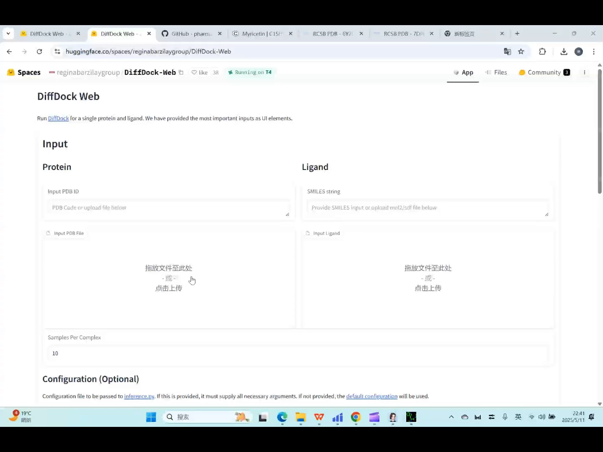

## 二、准备输入

### 2.1 受体：PDB ID 直接填

本例做**新冠病毒主蛋白酶**和**杨梅素**的对接（[【跳转到 00:50】](https://www.bilibili.com/video/BV1TcEgzMEWL/?t=50)）。主蛋白酶在 PDB 数据库中有实验解析结构，把它的 PDB ID 填进输入框即可。

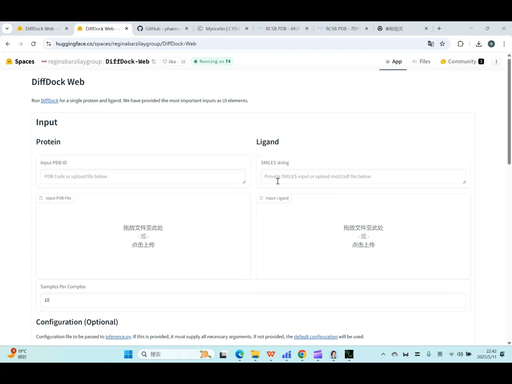

### 2.2 配体：PubChem 找杨梅素

配体到 **PubChem** 里搜（[【跳转到 01:37】](https://www.bilibili.com/video/BV1TcEgzMEWL/?t=97)）：搜索"杨梅素"，可直接下载它的 **SDF** 结构文件；也可以复制它的 **SMILES** 字符串贴进网页（[【跳转到 01:53】](https://www.bilibili.com/video/BV1TcEgzMEWL/?t=113)）。两种方式任选其一，受体和配体就都准备好了。

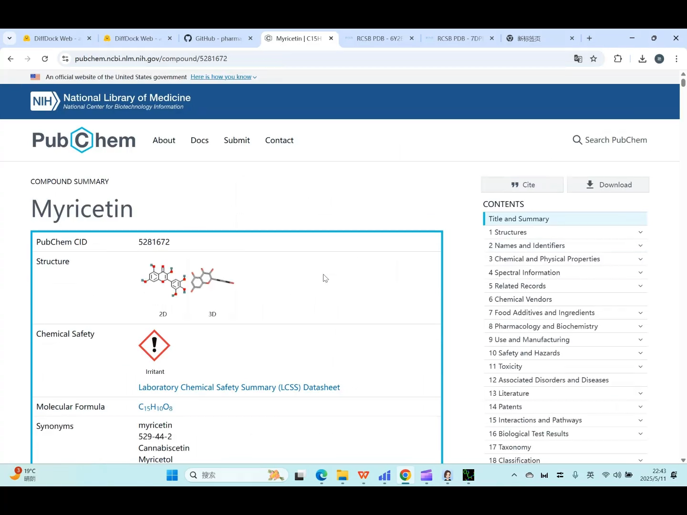

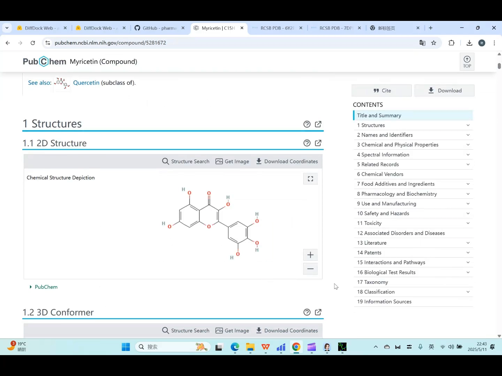

## 三、提交运行与参数调优

### 3.1 初学者：默认参数直接 Run

DiffDock 默认输出 **10 个**对接构象；参数配置如果不想动，直接点 Run DiffDock 就能运行（[【跳转到 02:18】](https://www.bilibili.com/video/BV1TcEgzMEWL/?t=138)）。

### 3.2 四个值得认识的参数

想更进一步，可以修改参数文件后再拖回输入框运行（[【跳转到 04:34】](https://www.bilibili.com/video/BV1TcEgzMEWL/?t=274)）：

| 参数 | 默认 | 视频演示 | 作用 |
| --- | --- | --- | --- |
| 输出构象数 | 10 | 20 或 30 | 得到更多候选构象用于比较（[【跳转到 02:54】](https://www.bilibili.com/video/BV1TcEgzMEWL/?t=174)） |
| 扩散步数 | — | 调大 | 找到配体在结构上更多构象，结合方式更精确（[【跳转到 03:19】](https://www.bilibili.com/video/BV1TcEgzMEWL/?t=199)） |
| 温度 | 1.0 | 0.8 | 降低随机干扰（[【跳转到 03:44】](https://www.bilibili.com/video/BV1TcEgzMEWL/?t=224)） |
| 噪声 | 1.0 | 0.3 | 探索结合方式时随机干扰更小（[【跳转到 04:09】](https://www.bilibili.com/video/BV1TcEgzMEWL/?t=249)） |

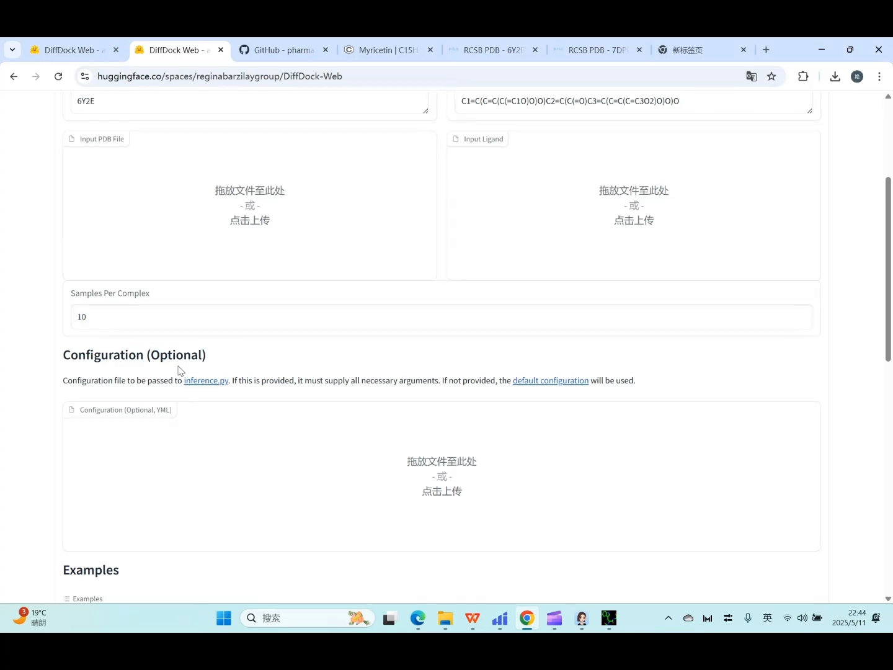

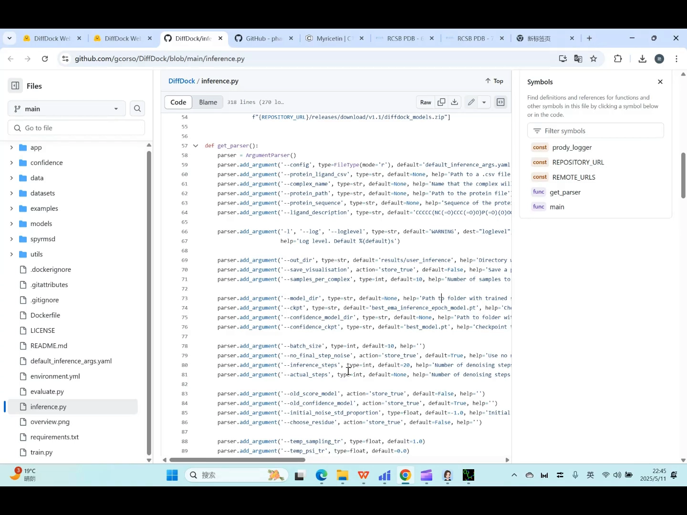

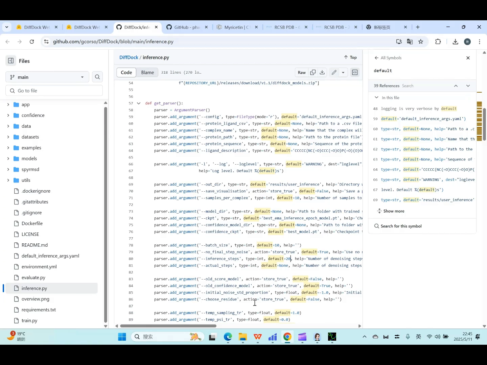

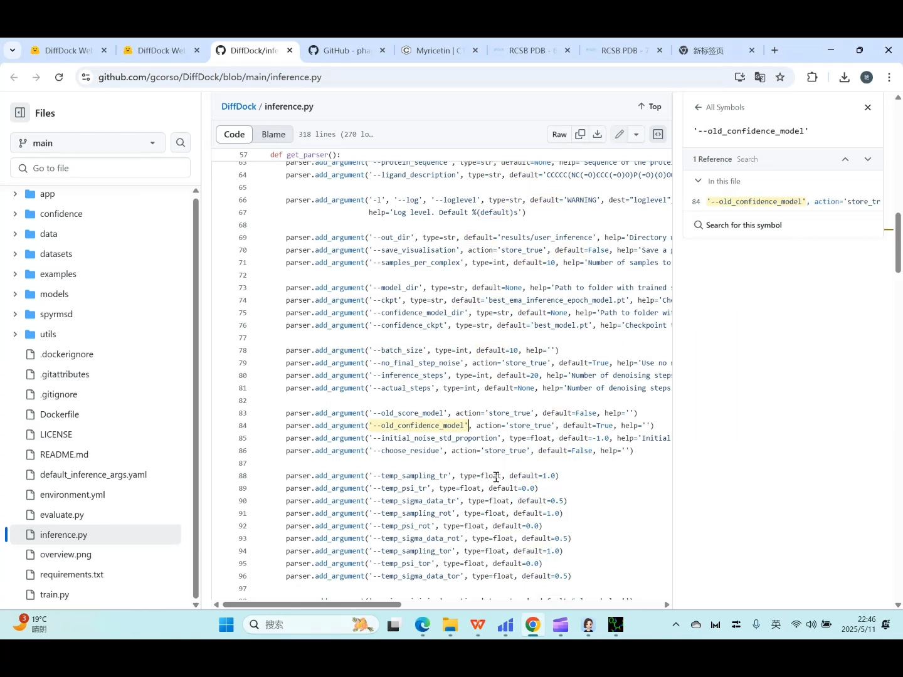

## 四、结果解读与下载

运行完成后得到 10 个对接构象，每个构象后面都跟着一个**置信度打分**——分数越高越可信（视频作者本次运行最高置信度为 0.57）（[【跳转到 04:59】](https://www.bilibili.com/video/BV1TcEgzMEWL/?t=299)）。确认结果后直接下载文件。

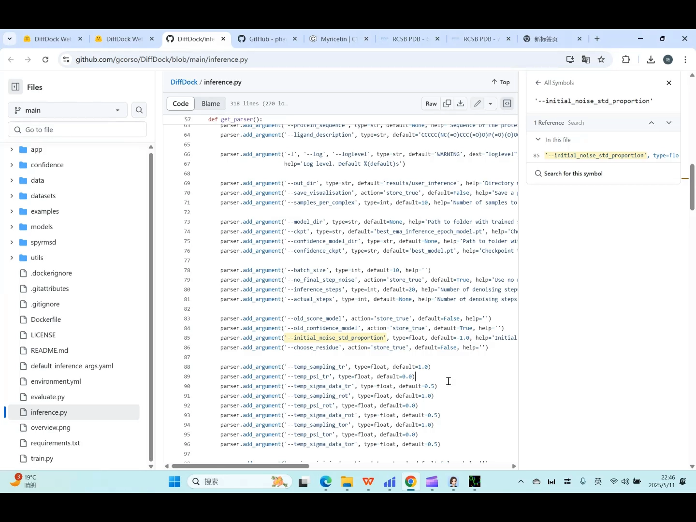

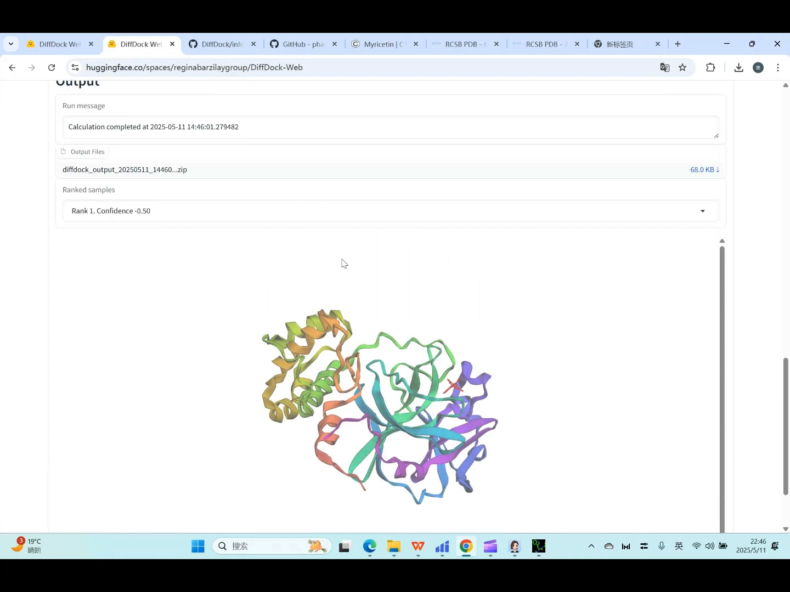

## 五、PyMOL 验证：与实验结构比对

下载的结果怎么确认靠谱？视频给出的验证闭环是"和实验解析结构比对"。

**步骤 1：打开受体、载入对接构象**（[【跳转到 06:14】](https://www.bilibili.com/video/BV1TcEgzMEWL/?t=374)）。先在 PyMOL 打开一个空的蛋白结构，再载入置信度最高的对接构象。

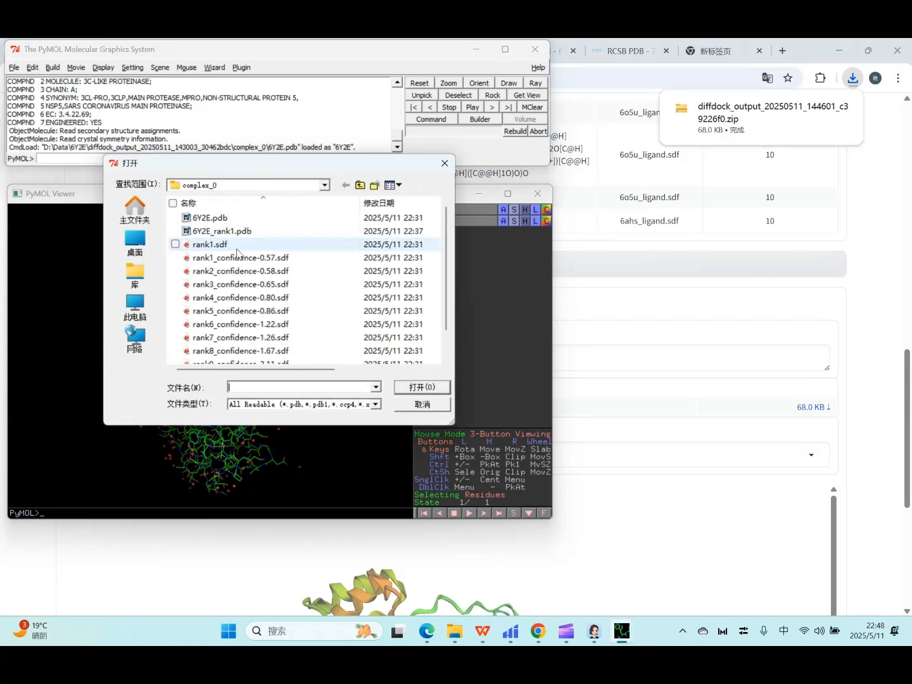

**步骤 2：合并成复合物**（[【跳转到 07:00】](https://www.bilibili.com/video/BV1TcEgzMEWL/?t=420)）。此时 PyMOL 里有蛋白和小分子两个对象，把它们都选中、合并保存成一个复合物文件（示例命名为 621），方便后续分析。

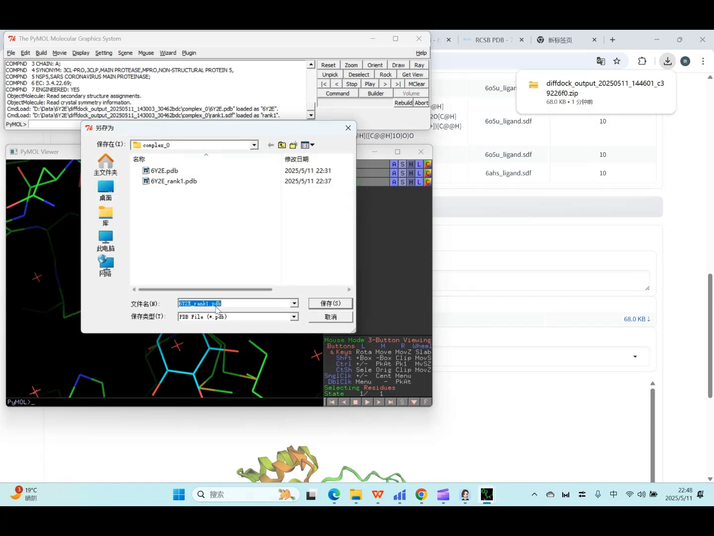

**步骤 3：与实验结构比对**（[【跳转到 07:36】](https://www.bilibili.com/video/BV1TcEgzMEWL/?t=456)）。载入提前下载好的实验复合物，在 Action 菜单里选 align → align to molecule 做结构比对——RMSD 为 **0.296**，非常小。

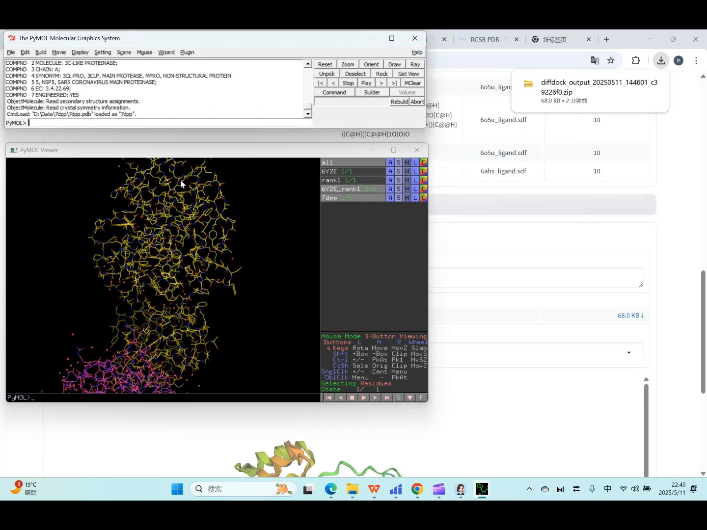

**步骤 4：可视化确认**。把蛋白显示成卡通模式，找出两个配体对比（[【跳转到 08:26】](https://www.bilibili.com/video/BV1TcEgzMEWL/?t=506)）：黄色是实验结构中的杨梅素，玫红色是 DiffDock 对接得到的小分子——两者非常接近（[【跳转到 08:56】](https://www.bilibili.com/video/BV1TcEgzMEWL/?t=536)）。如果觉得结果不理想，回到第三章调参重跑，也许能得到更符合实验的结果。

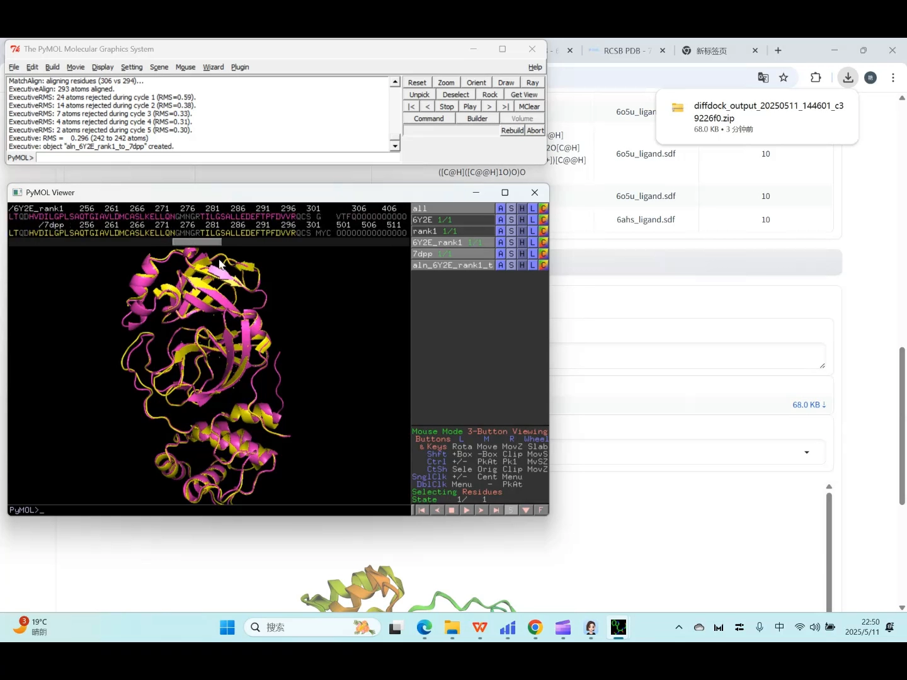

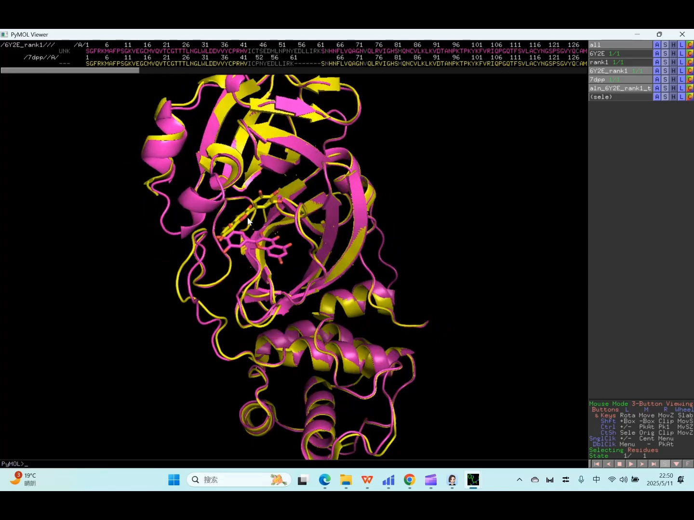

## 小结

- DiffDock 专注**蛋白↔小分子**盲对接：不给口袋，让模型在整个蛋白上找结合位置。
- 输入门槛极低：受体填 **PDB ID**，配体从 **PubChem** 拿 SDF 或贴 SMILES。
- 默认参数即可运行；输出构象数、扩散步数、温度、噪声四个参数按需调优。
- 结果自带**置信度排序**；验证方法是 PyMOL 里与实验结构 align 比对——本例 RMSD 0.296，盲对接姿态与实验高度吻合。

## 关键术语速查

| 术语 | 一句话解释 |
| --- | --- |
| 盲对接 | 不指定结合口袋，让模型在整个蛋白上找配体结合位置（DiffDock 的原生模式） |
| 构象（pose） | 配体相对蛋白的一个三维摆放；DiffDock 一次输出多个候选 |
| 置信度 | DiffDock 对每个姿态几何正确性的打分，分数越高越可信 |
| SMILES | 分子的线性文本表示，可直接贴进网页输入框 |
| SDF / MOL2 | 带三维坐标的分子文件格式，PubChem 可直接下载 |
| PubChem | 化合物的公共数据库，可按名称搜索并下载分子结构文件 |
| PyMOL | 分子可视化软件，用于打开对接结果、合并复合物与结构比对 |
| RMSD | 结构比对后的原子级偏差，数值越小越吻合（本例 0.296） |