# DiffDock（SBGrid 原作者三人报告）

> 视频来源：[SBGrid webinar《DiffDock》](https://www.youtube.com/watch?v=_S-WbbyUUbo)，主讲人为 DiffDock 三位作者：Gabriele Corso、Hannes Stark、Bowen Jing（MIT）。本文基于视频字幕与幻灯片整理，关键结论均可通过时间戳回到视频核对。

## 本讲要解决的核心问题（SCQA）

**背景**：分子对接（docking）预测"一个小分子如何结合到蛋白上"，是药物发现的核心步骤。传统工具（GLIDE、Vina、AutoDock）的做法是：先定义一个打分函数给每个候选姿态打分，再用搜索算法在姿态空间里找能量最低点。

**冲突**：真实场景里我们往往**不知道口袋在哪**——这叫盲对接（blind docking）。此时搜索空间巨大，传统方法 Top-1 预测（RMSD < 2 Å）的成功率不足 25%；对接到 AlphaFold/ESMFold 这类**预测结构**上时更是跌到 5% 以下。此前的深度学习方法（回归式预测）也没有带来实质提升。

**疑问**：深度学习到底要怎么做，才能真正提升盲对接？

**回答（中心思想）**：把对接从"回归一个点"改成"生成一个分布"。DiffDock 用扩散模型在"平移 + 旋转 + 扭转角"构成的配体姿态流形上做生成式采样，天然能覆盖多个结合模式；再配一个以"RMSD < 2 Å"为标准训练的置信度模型挑出最可靠姿态。结果是：全息（holo）结构盲对接成功率显著高于所有基线，在预测结构上损失也远小于传统方法。

---

## 一、任务定义：盲对接的输入与输出

三位作者把任务边界划得非常清楚（[【跳转到 01:49】](https://www.youtube.com/watch?v=_S-WbbyUUbo&t=109)）：

- **输入**：蛋白的三维结构 + 小分子的**二维化学图**（2D graph）。注意两点：小分子的三维构象我们不知道，它相对蛋白的位置更不知道；蛋白输入的是**整个蛋白**，不是某个已知口袋。
- **盲对接 vs 定点对接**：定点对接（pocket docking）假设你已经知道口袋，可以给一个包围盒把搜索限制在里面；DiffDock 考虑的是更难也更常见的盲对接——给整个蛋白，问小分子结合在哪。
- **输出**：配体**每个原子的三维坐标**，即一个完整的结合姿态（pose）。此外还会生成多个候选，并给每个候选一个置信度分数（[【跳转到 02:39】](https://www.youtube.com/watch?v=_S-WbbyUUbo&t=159)）。

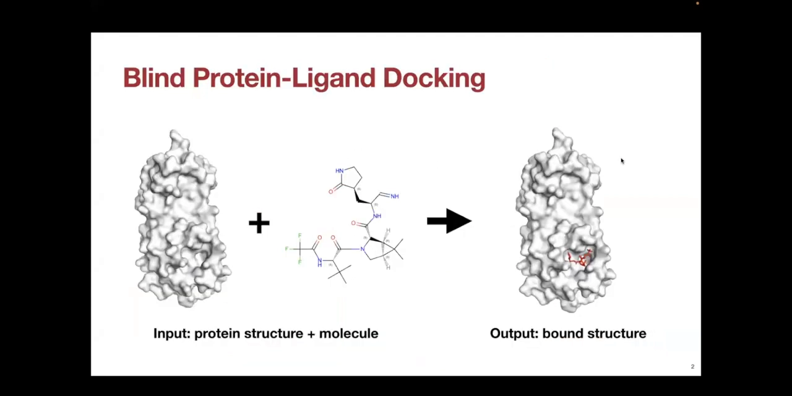

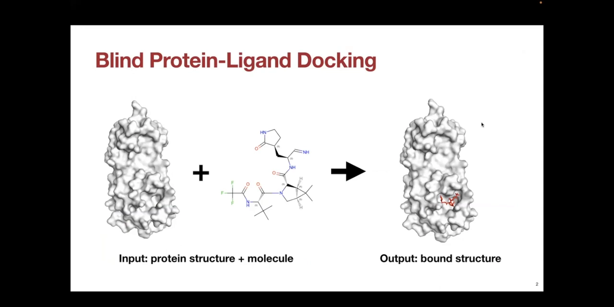

## 二、为什么传统方法和回归式深度学习都不行

### 2.1 传统方法：打分函数 + 搜索，撞上两堵墙

传统对接是两步走（[【跳转到 02:52】](https://www.youtube.com/watch?v=_S-WbbyUUbo&t=172)）：先学一个打分函数近似真实能量，再用搜索算法从随机起点出发找能量极小。Hannes 指出两堵墙：

1. **搜索空间墙**：盲对接不知道口袋，配体可以摆在蛋白表面任何地方，搜索空间巨大，找极小值非常慢。
2. **结构误差墙**：打分函数对蛋白结构的轻微误差很敏感——计算生成的结构侧链可能偏一点。已有论文表明，对 AlphaFold 这类预测结构，经典方法表现明显下滑（[【跳转到 03:42】](https://www.youtube.com/watch?v=_S-WbbyUUbo&t=222)）。

### 2.2 回归式深度学习：预测的是"均值"，不是"众数"

此前的深度学习方法是回归式的（[【跳转到 04:07】](https://www.youtube.com/watch?v=_S-WbbyUUbo&t=247)）：用图神经网络把蛋白残基、配体原子都当作带坐标的节点做消息传递，典型做法是预测蛋白上的一组关键点（模型认为口袋所在）和配体上的相互作用关键点，再计算一个平移 + 旋转把两组关键点最优对齐（Kabsch），把同样的变换施加到配体上得到最终姿态。

这类方法没有带来实质提升。Hannes 用一个统计直觉解释了根本原因（[【跳转到 06:22】](https://www.youtube.com/watch?v=_S-WbbyUUbo&t=382)）：训练时每个蛋白-配体对可能对应**多个正确姿态**（分布有多个峰/众数），而以最小化均方误差为目标的单点预测，最优解是预测**均值**——均值往往落在两个正确姿态之间，是一个物理上不存在的"平均姿态"。我们真正想要的是从各个众数处采样，这就指向了生成式建模。

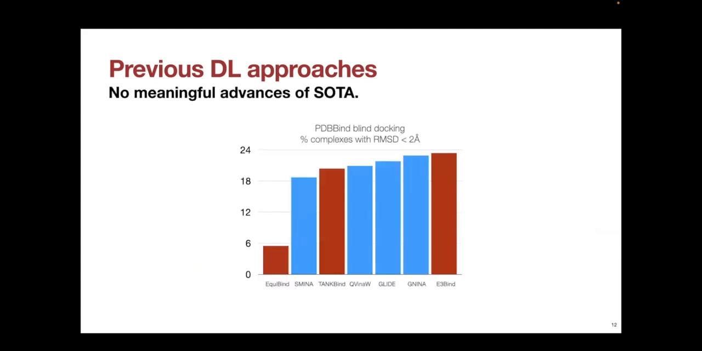

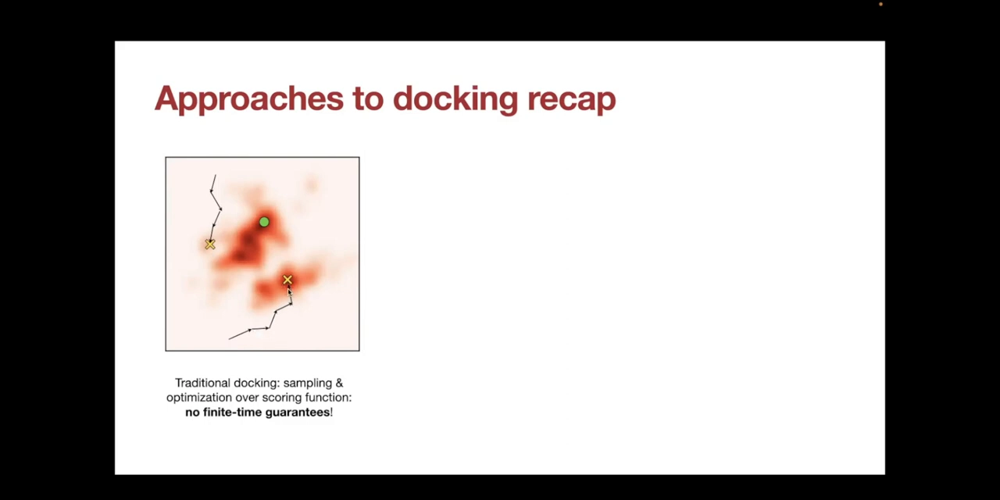

### 2.3 两个具体翻车案例

Gabriele 补充了不确定性的两个来源：**偶然不确定性**（aleatoric——本来就可能存在多个正确姿态）与**认知不确定性**（epistemic——模型在多个姿态间拿不定主意）（[【跳转到 08:02】](https://www.youtube.com/watch?v=_S-WbbyUUbo&t=482)）。

- 案例 1（[【跳转到 08:44】](https://www.youtube.com/watch?v=_S-WbbyUUbo&t=524)）：一个抗疟疾药物靶点，绿色抑制剂在蛋白上有**两个**结合位点。回归模型的预测恰好落在两个位点**正中间**——完全没用；生成模型则能把两种结合模式都采出来。
- 案例 2（[【跳转到 09:14】](https://www.youtube.com/watch?v=_S-WbbyUUbo&t=554)）：只有一个真实姿态的复合物，回归方法依然翻车——要么把配体大半塞进与蛋白冲突的位置，要么给出完全不物理的构象。

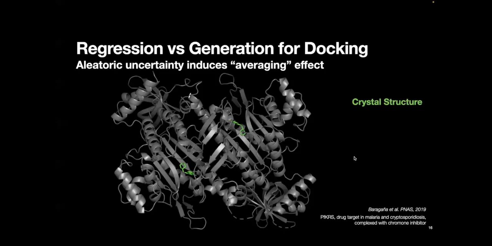

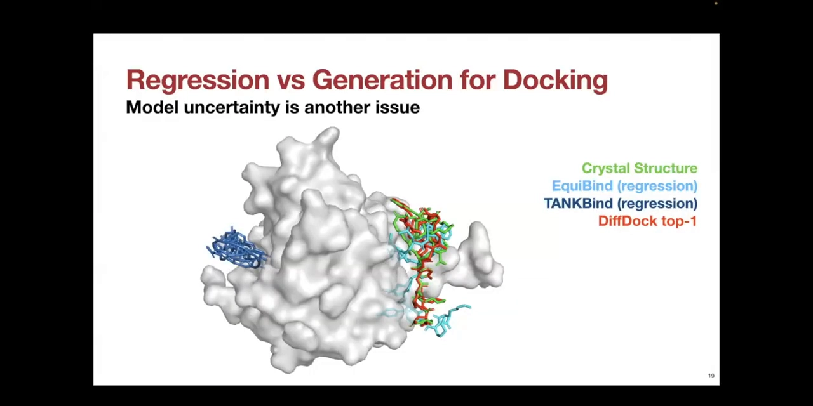

## 三、扩散模型 101：加噪、学向量场、迭代去噪

Bowen 用一页通用介绍把所有人拉到同一频道（[【跳转到 10:18】](https://www.youtube.com/watch?v=_S-WbbyUUbo&t=618)）：扩散模型因 AI 生成艺术而闻名，擅长建模复杂概率分布——分子结构正属此类。它的运行方式是：

1. **训练**：给数据逐步加噪声；神经网络学习一个"指向更高概率密度方向"的向量场——直觉上就是"去噪的方向"。这个随时间演化的场被称为**得分函数（score function）**。
2. **推理**：从带噪初始分布随机采样，跟着神经网络给出的向量场一步步去噪，最终走到数据分布。

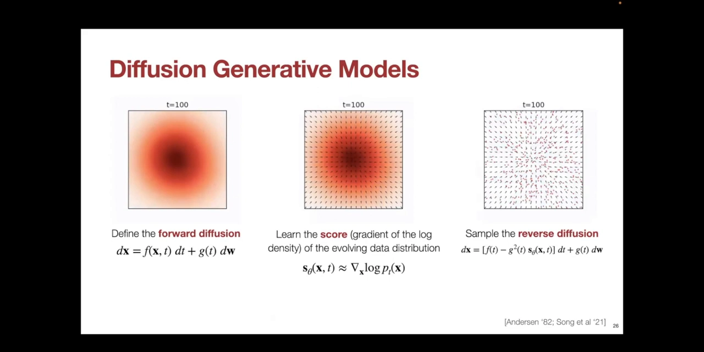

他特别强调：这里的"扩散"与物理/化学扩散只是数学形式相似，本质是**在数据分布所在的空间上做扩散**（[【跳转到 11:54】](https://www.youtube.com/watch?v=_S-WbbyUUbo&t=714)）。对 DiffDock 来说，关键问题变成：配体姿态所在的空间是什么？怎么在这个空间上加噪声？

## 四、在配体姿态空间上做扩散

### 4.1 姿态空间是一个"非欧流形"

DiffDock 的姿态空间设计直接借鉴了传统对接的智慧（[【跳转到 12:19】](https://www.youtube.com/watch?v=_S-WbbyUUbo&t=739)）：在 GLIDE 或 Vina 里，你提供一个配体构象，程序用**刚体运动**（平移 + 旋转）移动它、更新它的**扭转角**，但从不破坏键长、键角和环结构。

于是 DiffDock 把"配体姿态空间"定义为：通过扭转可旋转键、移动整个分子所能到达的所有姿态的集合——一个非欧几里得流形，取代了前一张幻灯片里的二维高斯玩具示例（[【跳转到 12:44】](https://www.youtube.com/watch?v=_S-WbbyUUbo&t=764)）。

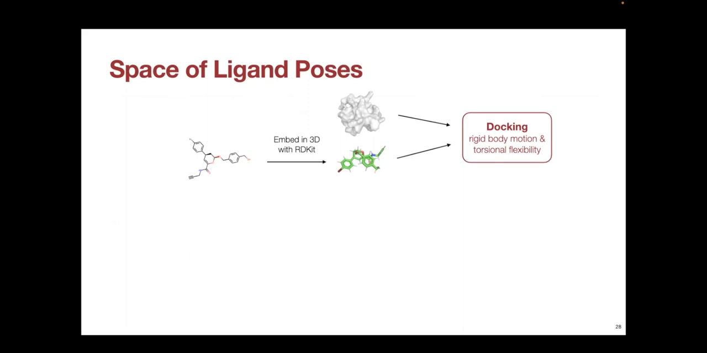

### 4.2 三类"化学一致"的噪声，与得分模型的三个输出

在这个空间上要加的噪声也必须是"化学一致"的——只动扭转角和刚体位置，不动键长键角（[【跳转到 13:34】](https://www.youtube.com/watch?v=_S-WbbyUUbo&t=814)）。噪声共三类：

| 噪声类型 | 得分模型的对应输出 | 直觉类比 |
| --- | --- | --- |
| 位置噪声（平移） | 一个平移向量（图中棕色箭头） | 线速度 / 线动量 |
| 方向噪声（旋转） | 一个旋转向量 | 角速度 / 角动量 |
| 扭转噪声 | 每个可旋转键一个"扭转角速度" | 绕该键转多快、朝哪转 |

这一切由一个特定的消息传递神经网络实现（细节报告里略去）（[【跳转到 14:49】](https://www.youtube.com/watch?v=_S-WbbyUUbo&t=889)）。重点在于：**整个采样过程完全数据驱动，没有任何基于物理的打分参与**——这是 Q&A 里反复澄清的一点（[【跳转到 29:46】](https://www.youtube.com/watch?v=_S-WbbyUUbo&t=1786)）。

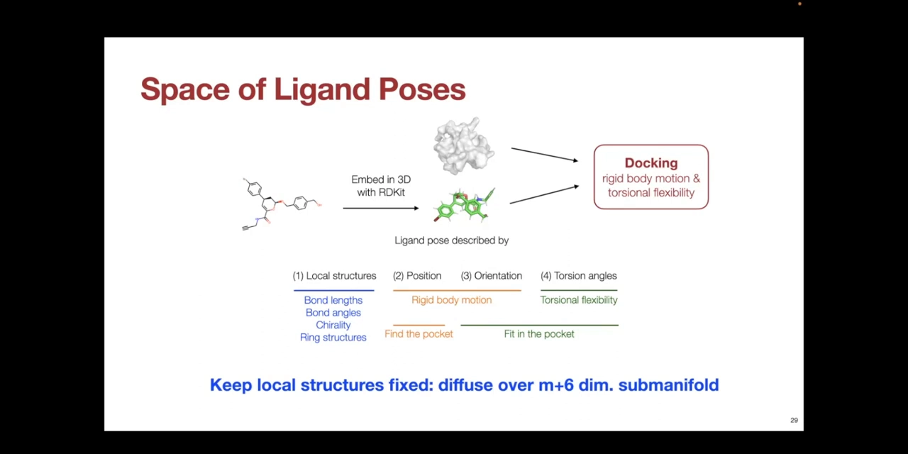

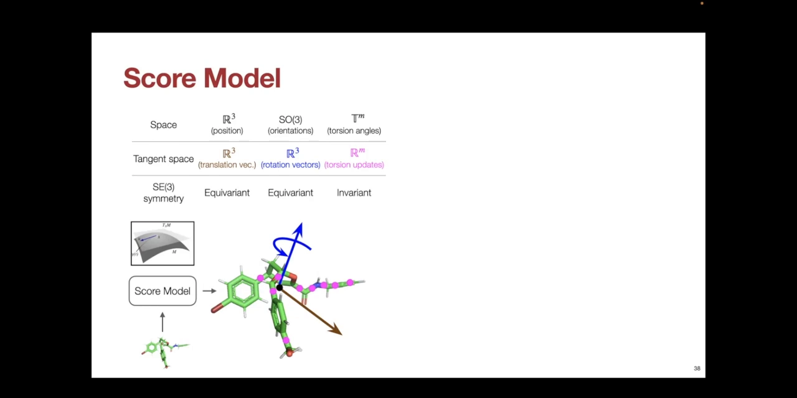

### 4.3 生成过程：随机姿态 → 约 20 步去噪 → 进入结合口袋

完整流程是（[【跳转到 15:39】](https://www.youtube.com/watch?v=_S-WbbyUUbo&t=939)）：输入配体构象（RDKit 或剑桥晶体数据库 CSD 生成均可）→ 模型把它**随机摆放**在蛋白附近、随机化方向与扭转角——这是"噪声最大"的状态 → 反复用得分模型去除三类噪声，实际中约 **20 次**迭代 → 姿态走向低噪声状态，希望就是进入结合口袋。

报告中特别说明：动画里的多个姿态是**相互独立的样本与轨迹**，彼此之间没有任何相互作用，只是同一过程的多份实例（[【跳转到 16:49】](https://www.youtube.com/watch?v=_S-WbbyUUbo&t=1009)）。

## 五、置信度模型与两条使用注意事项

### 5.1 置信度模型：一个 2 Å 分类器

从生成模型你能采出很多姿态，下游分析只需要少数几个——谁来挑？DiffDock 配了一个专门的**置信度模型**（[【跳转到 17:19】](https://www.youtube.com/watch?v=_S-WbbyUUbo&t=1039)）：它以"该姿态与真实姿态的 RMSD 是否低于 2 Å"为标准训练成一个分类器，给每个采样姿态打分，帮你选出用于下游分析的姿态。

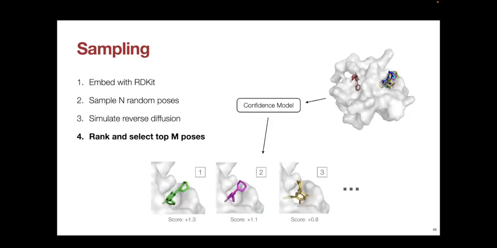

### 5.2 注意事项一："穿墙"是特性，不是 bug

去噪动画里有一个值得注意的现象：配体在去噪途中经常**直接穿过蛋白**、经过能量上极不利的区域（[【跳转到 18:07】](https://www.youtube.com/watch?v=_S-WbbyUUbo&t=1087)）。Bowen 解释这是好事——正因为可以"穿墙"，算法才不会被崎岖能量地形困住，真正到达数据驱动能量函数的全局极小。

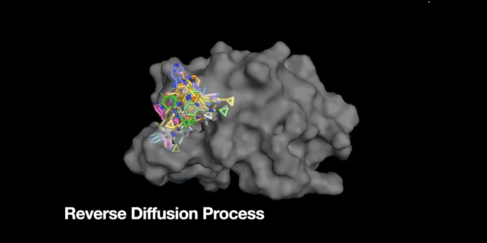

### 5.3 注意事项二：先弛豫，再评估

DiffDock 训练时**没有任何空间冲突（steric clash）概念**，唯一目标是几何上贴近真实姿态（[【跳转到 18:32】](https://www.youtube.com/watch?v=_S-WbbyUUbo&t=1112)）。这意味着：做交叉对接（cross docking）、或对接到侧链不准确的 AlphaFold 结构上时，它会把姿态放进它认为正确的口袋，但**不管是否与侧链冲突**。因此评估 DiffDock 输出时，直接用打分函数打分不是好主意——应先做一步**弛豫（relaxation）**，让能量学合理起来（[【跳转到 18:57】](https://www.youtube.com/watch?v=_S-WbbyUUbo&t=1137)）。

## 六、结果：PDBBind 基准与预测结构

### 6.1 训练数据与切分

训练用 **PDBBind** 标准基准（[【跳转到 19:32】](https://www.youtube.com/watch?v=_S-WbbyUUbo&t=1172)）：约 **19000 个**来自 PDB 的蛋白-配体复合物结构，经人工整理、质量较高、均含配体。切分方式是**按时间**：2019 年之前的复合物用于训练，之后的用于测试，并确保测试集的配体没有在训练集中出现过，以考察泛化能力。基线既有传统方法也有深度学习方法。

### 6.2 全息结构：基线不足 25%，DiffDock 显著更高

第一组实验把蛋白的**全息（holo）结构**——即结合配体状态下的真实实验结构——直接喂给方法。这是领域惯用的评估方式，虽然不算现实（[【跳转到 20:47】](https://www.youtube.com/watch?v=_S-WbbyUUbo&t=1247)）。结果（[【跳转到 21:12】](https://www.youtube.com/watch?v=_S-WbbyUUbo&t=1272)）：在这个盲对接任务上，传统方法与深度学习方法的 Top-1 成功率（RMSD < 2 Å 比例）都**低于 25%**；理论上可以用口袋预测方法（如 P2Rank）把搜索限制到口袋再配合传统方法来提升，但 DiffDock **不做任何口袋假设**就取得了显著更高的成功率。

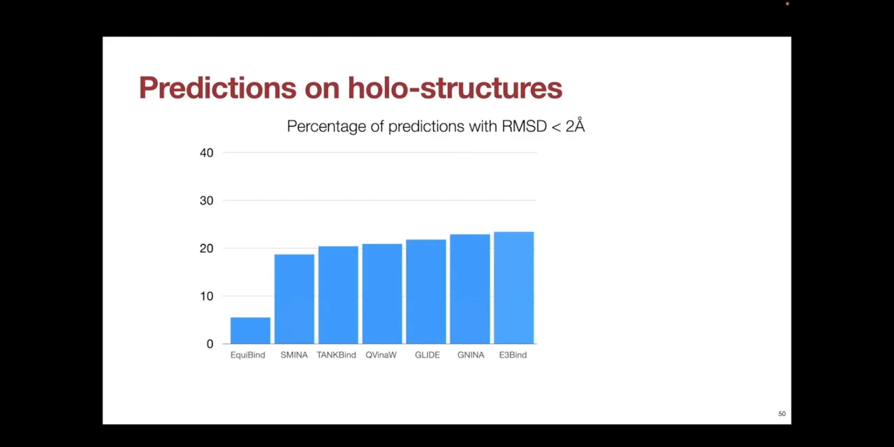

### 6.3 预测结构：传统方法跌到 5% 以下，DiffDock 损失很小

第二组实验更贴近真实使用：不喂实验结构，而是把蛋白序列喂给 **ESMFold** 折叠出结构，再把配体对接上去（[【跳转到 22:02】](https://www.youtube.com/watch?v=_S-WbbyUUbo&t=1322)）。传统方法的成功率一路跌到 **5% 以下**——原因是预测结构的侧链往往不准，而侧链在结合时本来就会重排；DiffDock 则可靠得多，成功率损失的比例小得多，在 AlphaFold 等折叠预测结构上仍保持不错的性能（[【跳转到 22:27】](https://www.youtube.com/watch?v=_S-WbbyUUbo&t=1347)）。

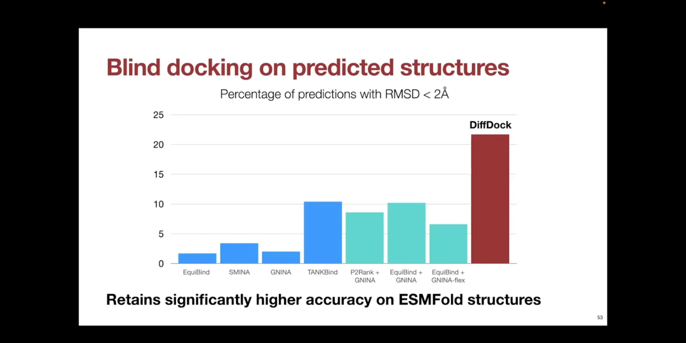

### 6.4 已有应用：反向筛选

报告还点名了一项发布后的真实应用（[【跳转到 23:23】](https://www.youtube.com/watch?v=_S-WbbyUUbo&t=1403)）：圣路易斯华盛顿大学 Tim Peterson 课题组用 DiffDock 做**反向筛选（reverse screening）**——把一个新发现药物对接到某条通路上的一系列蛋白上，以理解它的作用机制。作者认为，"对接到 AlphaFold 等预测结构上的盲对接"将有很大影响（[【跳转到 23:48】](https://www.youtube.com/watch?v=_S-WbbyUUbo&t=1428)）。

## 七、工具怎么用，以及 DiffDock-pocket 预告

### 7.1 主工具的使用闭环

模型与 Colab notebook 都在 GitHub 上（[【跳转到 24:21】](https://www.youtube.com/watch?v=_S-WbbyUUbo&t=1461)）。输入输出一览（[【跳转到 25:11】](https://www.youtube.com/watch?v=_S-WbbyUUbo&t=1511)）：

- **蛋白**：给结构文件（例如做交叉对接时用实验结构），或直接给**序列**——模型会用 ESMFold 把蛋白折叠出来；
- **配体**：给结构文件或 **SMILES 字符串**均可，且不假定配体的三维结构本身准确；
- **运行**：逆扩散采样 → 置信度模型打分；
- **输出**：预测姿态文件，**文件名里直接带排名（rank）和置信度（confidence）**。

### 7.2 DiffDock-pocket：补上两个最常见的抱怨

报告预告了后续工作 **DiffDock-pocket**，解决原始 DiffDock 被用户诟病的两个问题（[【跳转到 25:36】](https://www.youtube.com/watch?v=_S-WbbyUUbo&t=1536)）：一是无法指定特定口袋来控制生成；二是无法预测结合时侧链的重排——这让弛豫步骤更难做。做法是把**口袋条件化**（把注意力限制在口袋、让模型看到全原子坐标）与**侧链扭转柔性**直接内置进扩散过程（[【跳转到 26:26】](https://www.youtube.com/watch?v=_S-WbbyUUbo&t=1586)）。效果上：全息/交叉对接结构上至少不输给为口袋任务设计的传统方法，预测结构上优势明显更大，侧链重排预测也显著更好（[【跳转到 27:09】](https://www.youtube.com/watch?v=_S-WbbyUUbo&t=1629)）。

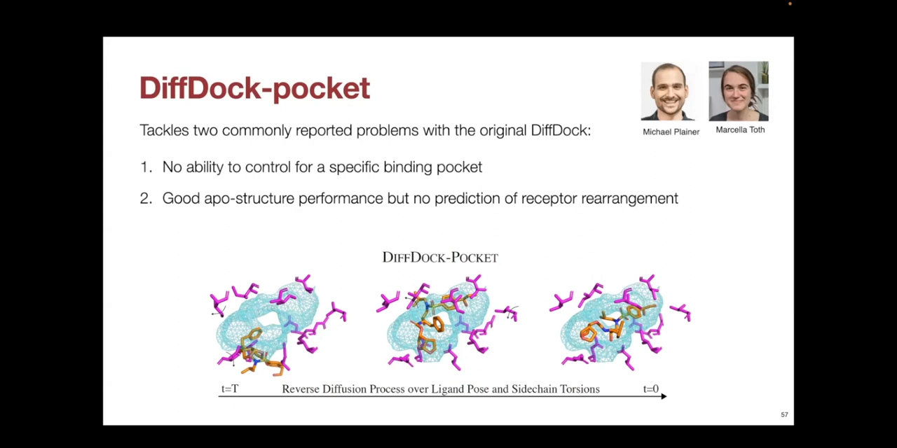

## 八、Q&A 精华

**采样过程有物理吗？**没有。神经网络预测的就是平移向量、旋转向量加每个扭转角的扭转速度，全部数据驱动（[【跳转到 30:11】](https://www.youtube.com/watch?v=_S-WbbyUUbo&t=1811)）。

**想把对接限制到某个口袋，又不想重训模型怎么办？**几个推理期技巧（[【跳转到 31:26】](https://www.youtube.com/watch?v=_S-WbbyUUbo&t=1886)）：手动纠正得分模型给出的平移向量（棕色箭头），让它指向目标口袋；或者直接编辑输入结构、删掉不想让它结合的部分（作者自嘲这是个 hack）；也可以多次采样后人工按置信度筛选。但大家普遍发现，把先验信息作为输入**重训模型**效果更好——这正是 DiffDock-pocket 的动机（[【跳转到 32:41】](https://www.youtube.com/watch?v=_S-WbbyUUbo&t=1961)）。

**速度与显存？**GPU 上跑一个复合物约 **10~40 秒**（取决于采样数，[【跳转到 33:48】](https://www.youtube.com/watch?v=_S-WbbyUUbo&t=2028)）。想加速可以少采样本：论文结果用 40 个样本，只取 10 个时性能损失很小、速度约快 4 倍（[【跳转到 34:38】](https://www.youtube.com/watch?v=_S-WbbyUUbo&t=2078)）。要注意在 GPU 上对比时它往往比传统方法还慢（[【跳转到 35:13】](https://www.youtube.com/watch?v=_S-WbbyUUbo&t=2113)）。显存取决于蛋白和配体大小，可用 batch size 调节：默认 40 个样本按每批 10 个并行，显存小可以缩到 4 或 8（[【跳转到 36:03】](https://www.youtube.com/watch?v=_S-WbbyUUbo&t=2163)）。

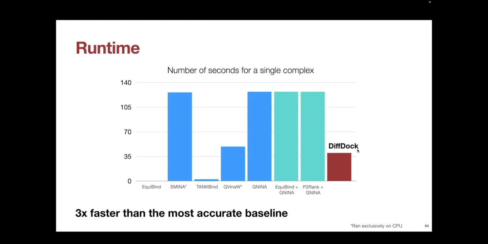

**置信度打分与传统打分的本质区别？**置信度模型是一个只为"挑出 RMSD < 2 Å 姿态"训练的分类器：理想情况下它是一个**凸能量面**，没有虚假局部极小（[【跳转到 38:13】](https://www.youtube.com/watch?v=_S-WbbyUUbo&t=2293)）。传统打分基于成对相互作用项：一个偏离真实位置 1.5 Å 但与侧链原子重叠的姿态反而能拿高分，一个进错口袋但在口袋内能量很好的配体拿低分；传统打分对原子间距、空间冲突极其敏感，能量面崎岖（[【跳转到 37:48】](https://www.youtube.com/watch?v=_S-WbbyUUbo&t=2268)）。

**配体能做多大？**这类"平滑能量面"方法在搜索维度更高时收益更大，自由度增加时理论上更占优；但要注意**越来越大的配体可能超出训练分布**——典型使用场景是片段或 20~25 个原子的配体（[【跳转到 40:18】](https://www.youtube.com/watch?v=_S-WbbyUUbo&t=2418)）。

**侧链柔性是谁的优势场景？**传统方法把侧链扭转角纳入搜索后表现"相当糟糕"——自由度爆炸让搜索算法吃力；这恰是扩散式方法相对"能量函数 + 搜索"的真正优势场景（[【跳转到 40:58】](https://www.youtube.com/watch?v=_S-WbbyUUbo&t=2458)）。当然扩散方法绕开空间冲突的同时也受训练分布限制，超出去就难了（[【跳转到 42:13】](https://www.youtube.com/watch?v=_S-WbbyUUbo&t=2533)）。

**玩过图像扩散模型，直觉能迁移吗？**能。本质上是同一类模型，共享语言非常多——图像扩散里几乎每个概念在分子扩散里都有对应物；尚未被探索的概念就是活跃的研究方向（[【跳转到 43:03】](https://www.youtube.com/watch?v=_S-WbbyUUbo&t=2583)）。

## 小结

- **盲对接是常态也是难点**：不知道口袋时传统方法 Top-1 成功率不足 25%，预测结构上跌破 5%。
- **回归式深度学习失败的根本原因**：多峰姿态分布上做均方误差回归，预测出的是"均值姿态"——物理上不存在。
- **DiffDock 的核心动作**：把对接改造成生成问题，在"平移 + 旋转 + 扭转角"的非欧姿态流形上做扩散，约 20 步去噪，天然覆盖多结合模式。
- **得分模型输出三类更新**：平移向量、旋转向量、逐扭转角的扭转速度——全程无物理打分，纯数据驱动。
- **置信度模型是 2 Å 分类器**：唯一目的是挑出几何正确的姿态；理想情况下是凸能量面。
- **两条使用要诀**：先弛豫再评估（训练里没有空间冲突概念）；算力有限就少采样本（40→10 约快 4 倍）。
- **成绩与应用**：全息盲对接显著超基线，预测结构上损失小；反向筛选等应用已落地；DiffDock-pocket 补上口袋条件化与侧链重排。

## 关键术语速查

| 术语 | 一句话解释 |
| --- | --- |
| 盲对接（blind docking） | 不知道结合口袋、在整个蛋白上搜索配体结合位置的对接 |
| pose（姿态） | 配体相对蛋白的一个完整三维摆放 |
| RMSD | 均方根偏差，衡量预测姿态与真实姿态的原子级偏离；< 2 Å 通常算成功 |
| 打分函数（scoring function） | 传统方法给姿态打分（近似能量）的函数，配合搜索算法找最优 |
| 得分模型（score model） | 扩散模型中预测"去噪方向"（向量场）的神经网络 |
| 扭转角（torsion angle） | 可旋转单键的二面角，配体柔性的主要自由度来源 |
| 置信度模型 | DiffDock 附带的 RMSD < 2 Å 分类器，给采样姿态打分排序 |
| 弛豫（relaxation） | 对接后消除空间冲突、优化能量的精修步骤 |
| 交叉对接（cross docking） | 用结合态实验结构去对接其它配体，检验方法的稳健性 |
| holo 结构 | 蛋白与配体结合状态下实验解析的结构 |
