# 多肽对接+pymol高清作图教程

> 来源视频：[【多肽对接+pymol高清作图教程】（Bilibili，29 分 15 秒）](https://www.bilibili.com/video/BV1g2RdYHEhV/) ｜ 本博客基于该视频的「图-字幕」视频演说图文稿整理，内容可核查。

## 本讲要解决的核心问题（SCQA）

**背景**：分子对接（docking）是药物发现里的常规操作：给定一个受体蛋白和一个配体，让软件去搜索两者结合的方式并打分。市面上绝大多数对接教程讲的都是**小分子**配体。

**冲突**：多肽比小分子大得多、柔性也高得多——可旋转的化学键数量多，搜索空间随之爆炸。把小分子对接的流程照搬过来，要么跑不动，要么结果不可信；专门手把手讲"蛋白-多肽对接"的实操教程却很少。

**疑问**：手头有一个受体蛋白和一个目标多肽序列，怎么从零开始完成一次像样的蛋白-多肽对接，并产出一张能直接放进文献的相互作用图？

**回答（中心思想）**：本讲以**小鼠蛋白 STUB1** 与一条**目标多肽（取名 P1）**为例，用「UniProt/RCSB 取结构 → 薛定谔 Maestro 准备蛋白与多肽 → 生成对接盒 → Glide（SP 精度）对接 → 读对接打分（-8.16）→ PyMOL 插件分析相互作用 → 高清渲染 + PPT 拼版」的完整闭环，演示了蛋白-多肽对接的全流程。下面按操作顺序逐步拆解。

## 一、拿到受体结构：先挑好晶体，再下载

### 1.1 去 UniProt 找蛋白，优先实验解析结构

打开 UniProt 网站，把小鼠蛋白 **STUB1** 的名称输进去检索，选中目标蛋白后进入它的 **Structure** 板块。这里会同时列出两类结构：实验解析的晶体结构和 AlphaFold 之类的预测结构。

选择原则（视频原话归纳）：

- **优先选实验解析出来的结构**，也就是来源前缀是 **PDB** 的条目；如果没有实验结构，才退而求其次用预测结构。
- 实验结构往往有多条，**从后往前选**——排在前面的条目对应较新的解析结果，晶体相对更新。
- 再看 **resolution（分辨率）** 这一列：数值**越低，晶体质量越高**。本例选中的结构分辨率为 **1.54 Å**，是倒数第二个实验解析结构，且分辨率较低。

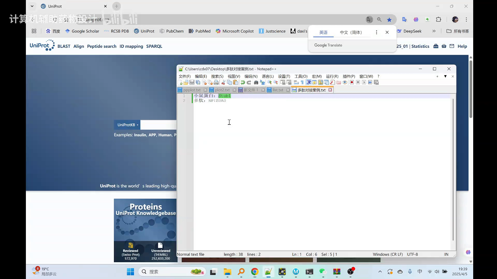

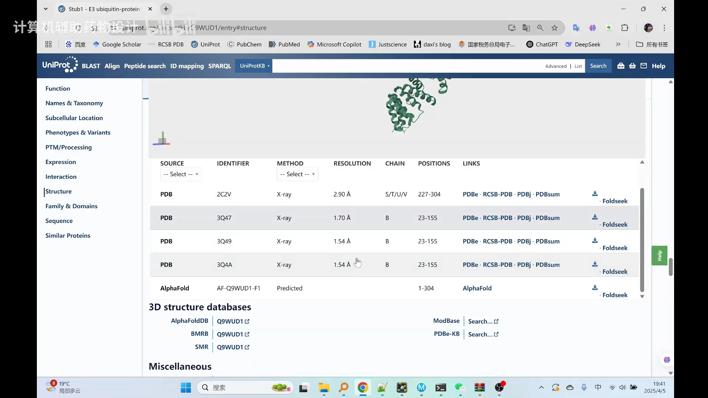

### 1.2 到 RCSB PDB 下载结构文件

选中结构后点 **RCSB PDB** 进入它的数据库页面。这一页顺带科普了几个信息：

- 数据库编号、解析该结构的文献——这些是实验人员解析晶体结构时留下的"档案"；
- **大分子组成**：本例晶体里除了目标蛋白 STUB1，还**自带一条结合态的多肽**（这正是后面设置对接位点的参考）；
- 还有一些小分子，比如一个**非标准氨基酸**，了解即可。

回到下载：点 **Download Files**，选择 PDB 格式文件，把结构下载下来。

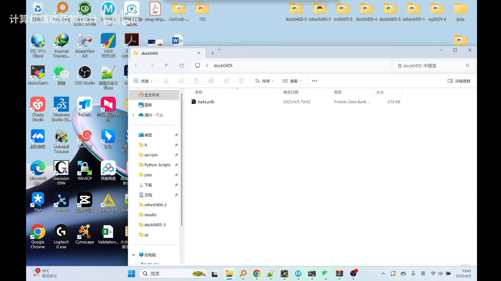

## 二、在薛定谔 Maestro 中准备蛋白

### 2.1 建工作目录、改工作路径

在桌面新建一个工作目录（如 `dock0405`），把下载好的 PDB 文件复制进去。随后打开**薛定谔（Schrödinger）**软件套装的 **Maestro** 模块，第一件事是 **File → Change Working Directory**，把工作路径改到这个目录——之后生成的记录文件、中间文件都会存到这里，便于管理。

### 2.2 拖入蛋白、删除水分子、保留原多肽

把下载的蛋白直接**拖拽**进 Maestro 工作区。用界面上的"小圆点"切换显示对象：点蛋白就显示蛋白，点多肽就显示多肽。

晶体里除了蛋白还有很多"乘客"：水分子（红色点）、原结合多肽（绿色）等。在条目面板里可以直观看到 3Q4A 这类条目下的组成——**water（水）要删掉**，其余保留。特别注意：**原结合多肽故意不删**，因为下一步生成对接盒时，要以它的位置作为目标多肽结合位点的参考。

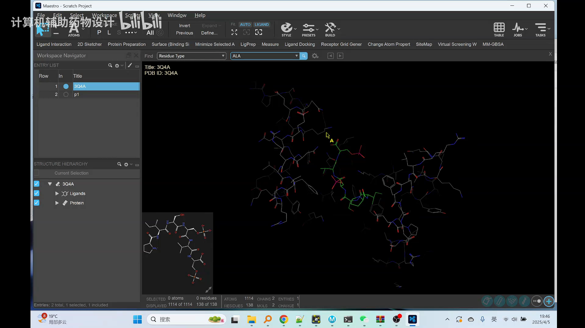

### 2.3 Protein Preparation：三步把蛋白收拾干净

点击 **Protein Preparation** 按钮打开蛋白准备向导。首先指定要处理的蛋白，来源有两种：

- **workspace（工作区）**：当前画面显示哪个结构，就处理哪个；
- **project table（项目表）**：按表格里选中的行处理，按住 Ctrl 可以多选多行。

本例只有一条蛋白，两种任选（视频以 project table 举例），点 **Run** 开始。蛋白准备实质上做了三大步：

1. **整体准备**：重新分配键级、没有氢原子的地方添加氢原子、识别并添加二硫键，并预测氨基酸的质子化状态（环境设为 **pH 7.4**），顺带修掉键级错误、侧链缺失之类的晶体小毛病；
2. **优化氢原子**：有些氢原子加上之后会互相冲突，对它们的构象做优化与能量最小化；
3. **整体能量优化**：让蛋白整体呈现一个局部低能状态。

运行进度可在 **Jobs（任务监控）** 面板查看，状态从 running 变为 finished 后会自动弹出准备好的蛋白。

## 三、构建并准备多肽

### 3.1 Build：从序列直接建模出多肽

多肽不是下载来的，而是**按序列现场构建**：点 **Build** 按钮进入"基于序列构建"面板，给多肽起名 **P1**，把目标多肽的序列粘贴进去，点 Build——工作区里立刻多出一条多肽。至此，受体蛋白和配体多肽都备齐了。

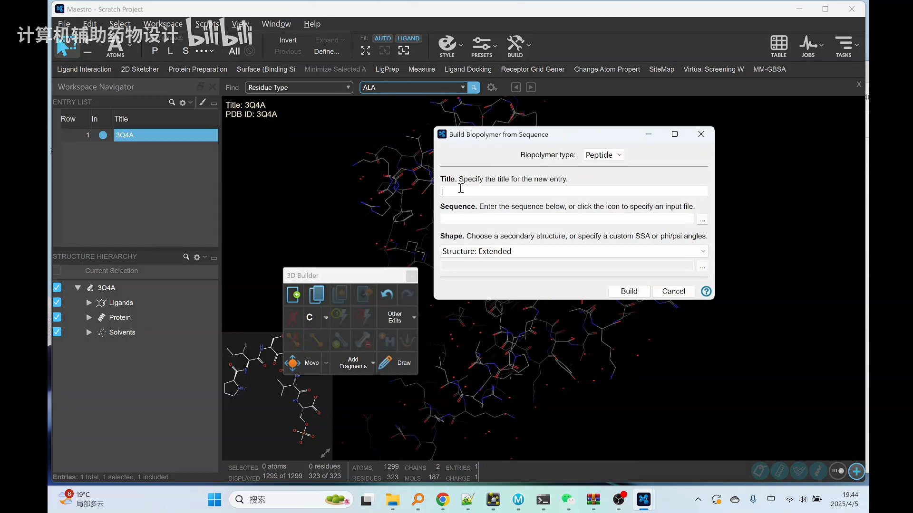

### 3.2 LigPrep：多肽的对接前处理

在 Task 里搜索 **ligprep** 打开配体准备面板，设置要点：

- 结构来源选 **project table**，勾选刚才构建的 P1；
- 处理环境 **pH 7.4 ± 0**；
- **不勾选生成异构体**（只保留这一种形态）；
- 三维结构"属性结构来自它原本的三维结构"（选第二项，沿用 Build 得到的 3D 构型）；
- 生成 **1 个**结构即可，点 Run。

这一步很快就能跑完。

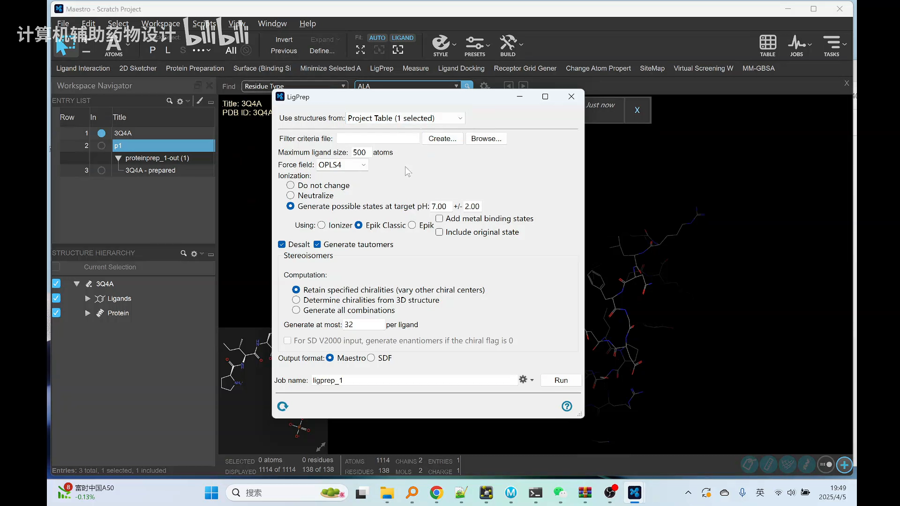

## 四、生成对接盒：告诉软件"肽该往哪儿放"

分子对接不是全蛋白瞎搜，而是限定在一个**对接盒（grid，对接区域/空间）**里搜索。在 Task 里搜索 **grid**，打开 **Receptor Grid Generation** 模块：

1. 定义对接区域时选择"蛋白中**已知的配体**"——本例就是晶体里那条**绿色的原结合多肽**；
2. 如果几个配体颜色分不清、不知道点哪个，有个简单办法：展开 ligand 菜单，**随便点中配体上的任意一个原子**，软件就会生成一个把这短肽框住的**立方盒子**；
3. 回到面板，**勾选"生成用于短肽对接的盒子"**（因为下一步就是短肽对接），点 Run。

任务完成后面板出现打勾标记，对接盒就绪。这一步本质上是在说：**P1 这条目标多肽之后就在原多肽占据的结合位点附近搜索**。

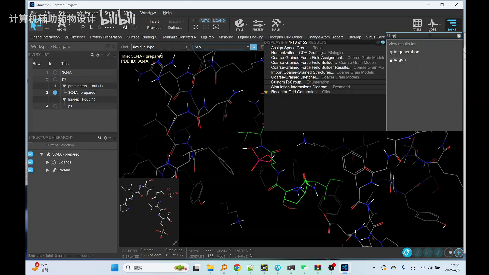

## 五、运行 Glide 对接

### 5.1 参数设置

Task 里搜索 **docking** 打开 **Ligand Docking** 面板，关键设置有三处：

- **Receptor Grid 来源选"文件"**：浏览到刚才生成的 **glide grid** 文件夹，选中里面的 **zip 压缩包**——它打包了对接位点信息与蛋白结构；
- **配体（ligand）**：来自 project table，**务必选中准备好的多肽 P1**；
- **Settings**：短肽对接默认用 **SP 精度**（视频说明：这是专门用作短肽对接的精度档位），其余保持默认即可。

点 Run 开始对接。视频里特意提醒：**多肽对接的方法和小分子对接差不多，但会慢很多——因为多肽的可旋转键多**，搜索空间大。教程为了节省时间，直接加载了预先跑好的对接结果。

### 5.2 看结果：对接打分 -8.16

对接完成后（或手动）加载结果文件：对接输出文件夹里的 **pv.maegz**（pose viewer，构象视图文件）拖进来即可。点 **Table** 按钮打开结果表，滑到最右侧的 **docking score** 列：

- 本例 P1 最优构象的对接打分为 **-8.16**（打分为负值，数值越负代表结合模式打分越有利）。

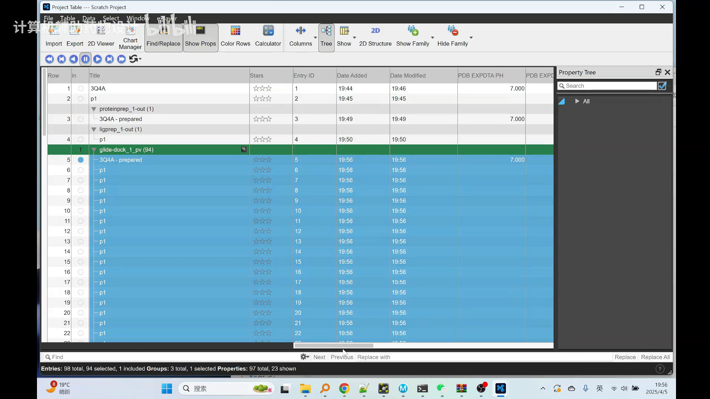

## 六、整理复合物：改链、合并、导出

要作图分析，得先把"蛋白 + 对接好的多肽"整理成一个干净的复合物：

1. 在 workspace 里**选中对接打分最好的那条 P1 构象**；在 Task 里搜索 **chain**（change chain name 面板），把多肽的链标识符从 **A 链改成 B 链**（注意要先选中多肽再点 Apply，否则按钮不可用）；
2. 同样操作把**蛋白改成 A 链**（原本是 B 链）；
3. 按住 Ctrl 同时选中蛋白与 P1，右键 **merge** 合并成一个复合物（打分 -8.16 的那套）；
4. 右键复合物 **Export → Structure → PDB 格式**导出。

这样得到一个"蛋白为 A 链、多肽为 B 链"的对接复合物 PDB 文件，交给下一步的 PyMOL。

## 七、PyMOL：用 PPI 插件自动分析相互作用

### 7.1 装一次、到处能用

用 PyMOL 打开复合物。作图前先装一个**全自动化蛋白（多肽）-蛋白相互作用分析插件**：

- 点开**插件管理（Plugin Manager）→ 安装新插件 → 选择文件**，选中 **PPI.py** 插件安装；
- 插件**每台电脑只需要装一次**，之后做蛋白-蛋白或多肽-蛋白的相互作用分析可以直接复用。

### 7.2 一条命令出相互作用图

把复合物拖进 PyMOL 后，在命令行输入 `PPI`（嫌命令长可以先给对象改名）。执行后：

- **粉色**为蛋白主体颜色，**蓝色**为多肽主体颜色；
- 参与相互作用的氨基酸连同**氨基酸名称**被标注出来；
- **黄色虚线代表氢键**，**洋红色（品红）虚线代表盐桥**。

本例的结论一目了然：**多肽与蛋白主要通过氢键和盐桥两类相互作用结合**。

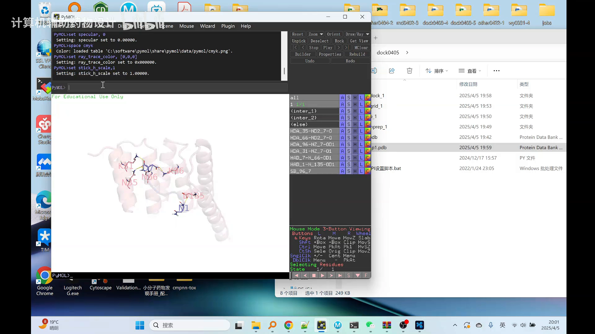

## 八、高清出图：局部图 + 整体图 + PPT 拼版

### 8.1 局部细节图（P1）

直接渲染会撞上一个问题：氨基酸名称互相重叠。视频的处理顺序值得照抄：

1. `hide cartoon` 隐藏卡通模型，只剩原子与标签；
2. 鼠标左键点中任意一个白色文字标签（状态栏从 selecting 变成 picking），**按住 Ctrl 拖拽**标签到旁边，避免与氨基酸重叠；连接标签与氨基酸的细线可留可去（它的作用是指明标签属于哪个氨基酸）；
3. `show cartoon` 重新显示卡通；
4. 右上角把渲染模式切到 **Ray（光线追踪）**，并把 **DPI 设为 300 或 350**——渲染较慢，但清晰度和质量高；
5. 渲染完成后保存，得到一张**透明底**的相互作用细节图。

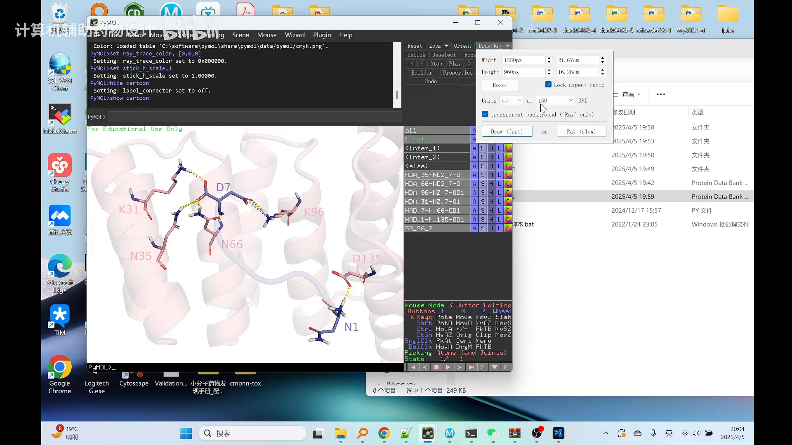

### 8.2 整体结合图（P2）

第二张图要展示"多肽结合在蛋白上"的整体形貌：

1. 把相互作用显示全部去掉——虚线随之消失；
2. `hide sticks` 隐藏棍棒模型，`hide labels` 隐藏标签，缩小视角让整体轮廓显出来；
3. 蛋白默认有点透明感，在 Setting 里**关掉卡通透明度**，画面立刻清晰；
4. 再次 Ray 渲染，保存为整体图 P2。

顺手可以 **Save Session As** 保存 PyMOL 工程文件，下次双击打开就回到调好的状态，不必从头再调。

### 8.3 PPT 拼版成文献图

最后把两张图拼成文献常用版式：

- 新建 PPT，把 P1、P2 拖入摆好；
- Office PPT 默认导出分辨率只有 150 DPI，视频用现成的**注册表脚本**把它改成 **600**——此后 PPT 另存为 TIF 就是高清输出；
- 给图片加**黑色 1.5 磅虚线边框**（形状填充设为无色），再用两根虚线把两张图连起来；
- 在"设计 → 幻灯片大小"里把高度调成约 **16 cm**，去掉上下多余留白；
- **另存为 TIF**，一张高清的蛋白-多肽相互作用组图就完成了。

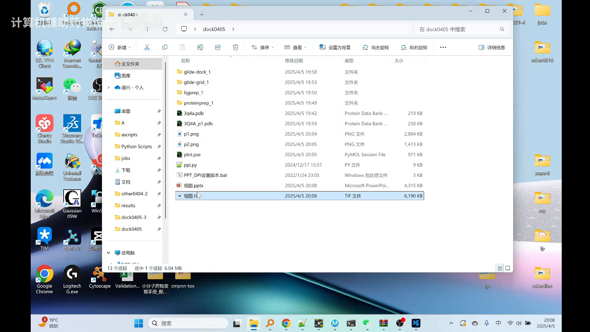

## 小结

- 蛋白-多肽对接的完整闭环：**UniProt/RCSB 挑结构 → Maestro 蛋白准备（三步）→ Build/LigPrep 多肽准备 → Receptor Grid 生成对接盒 → Glide SP 对接 → docking score → 链改名合并导出 → PyMOL PPI 插件 → Ray 高清渲染 → PPT 拼版**。
- 挑晶体三条准则：**优先实验解析（PDB 前缀）、从后往前取较新结构、resolution 越低越好**。
- 晶体里的**原结合多肽不要删**：它是对接盒的位点参考。
- 多肽对接**比小分子慢得多**，根源是**可旋转键多**；精度档用短肽对接默认的 **SP**。
- 本例对接打分 **-8.16**；相互作用以**氢键（黄虚线）与盐桥（洋红虚线）**为主。
- 高清出图的关键动作：**挪标签防重叠、DPI 300~350 Ray 渲染、PPT 导出 DPI 改 600 输出 TIF**。

## 关键术语速查

| 术语 | 一句话解释 |
| --- | --- |
| UniProt | 蛋白质信息数据库，查蛋白序列与已知/预测结构的入口 |
| RCSB PDB | 存放实验解析晶体结构的数据库，可下载 PDB 格式坐标文件 |
| resolution（分辨率，Å） | 晶体结构质量指标，数值越低质量越高 |
| Maestro | 薛定谔（Schrödinger）套装的图形操作界面 |
| Protein Preparation | 蛋白准备向导：补键级/加氢/二硫键、pH 7.4 质子化、氢优化与整体能量最小化 |
| LigPrep | 配体准备：按设定 pH 生成可对接的配体三维结构 |
| Receptor Grid（对接盒） | 圈定配体允许搜索的结合区域，本例以晶体原结合多肽为参考 |
| Glide SP | Glide 对接的标准精度档，本教程中短肽对接的默认选择 |
| docking score | 对接打分，本例 -8.16，负值模式代表有利的结合打分 |
| pv.maegz | Glide 对接结果的构象视图文件，拖入 Maestro 即可查看 |
| PPI 插件 | PyMOL 插件（PPI.py），一条命令自动标注蛋白/多肽相互作用 |
| 氢键 / 盐桥 | 图中分别以黄色虚线 / 洋红虚线表示的两类主要相互作用 |
| Ray 渲染 + DPI | PyMOL 光线追踪出图模式；DPI 越高越清晰（本例 300~350，PPT 导出改 600） |
