# SE3Bind：用 SE3 等变卷积预测抗体-抗原结合亲和力

> 来源视频：[SE3Bind: SE3 equivariant model for antibody antigen binding affinity prediction](https://www.youtube.com/watch?v=ych_CGBpzTw)（Computational Intelligence Group，约 61 分钟）
> 主讲：Honor Shria 与 Sid（共同第一作者）

## 本讲要解决的核心问题（SCQA）

**背景**：在抗体药物与免疫治疗里，我们不仅关心「抗体能不能结合抗原」，更关心「结合得有多强」。这个强度通常用结合自由能 ΔG 表示：ΔG 越负，结合越强。

**冲突**：实验测 ΔG 又贵又慢。于是人们希望用计算方法，直接从抗体和抗原的三维结构预测 ΔG。可是现有模型报告的相关系数高得惊人（有的到 0.85），仔细一看却发现：它们大多把数据随机切成训练集和验证集，训练集和验证集里混着高度相似的样本，等于「考试前做过原题」，性能被系统性高估了。

**疑问**：能不能用一个真正看结构的模型，在严格划分的数据上给出可信的预测？蛋白质在空间里可以任意旋转，模型能不能利用这种几何对称性，而不是靠大量旋转增强去硬补？

**回答（中心思想）**：SE3Bind 把蛋白质表示成「多通道三维图像」，用 **SE3 等变卷积网络**提取特征，再用 **FFT 互相关**算出抗体与抗原之间的能量景观；先在「重对接」任务上预训练，再由此预测 ΔG。它在严格的数据划分下与现有模型表现相当，同时用一个很有说服力的分析指出：**当前抗体-抗原亲和力预测的分数差异，很大一部分来自数据集怎么划分，而不是模型本身**。

---

## 一、问题背景：为什么抗体-抗原亲和力预测格外难

### 1.1 生物分子相互作用，本质是「受体 + 配体」

讲者先把问题框定为一个**受体-配体模型**：一个分子（配体）结合到另一个分子（受体）上。这里讨论的都是已经折叠好的蛋白质结构——蛋白质是氨基酸的线性聚合物，靠几何形状、电荷等性质自发折叠成局部稳定的三维结构；两个这样的折叠结构靠在一起，就形成复合物。

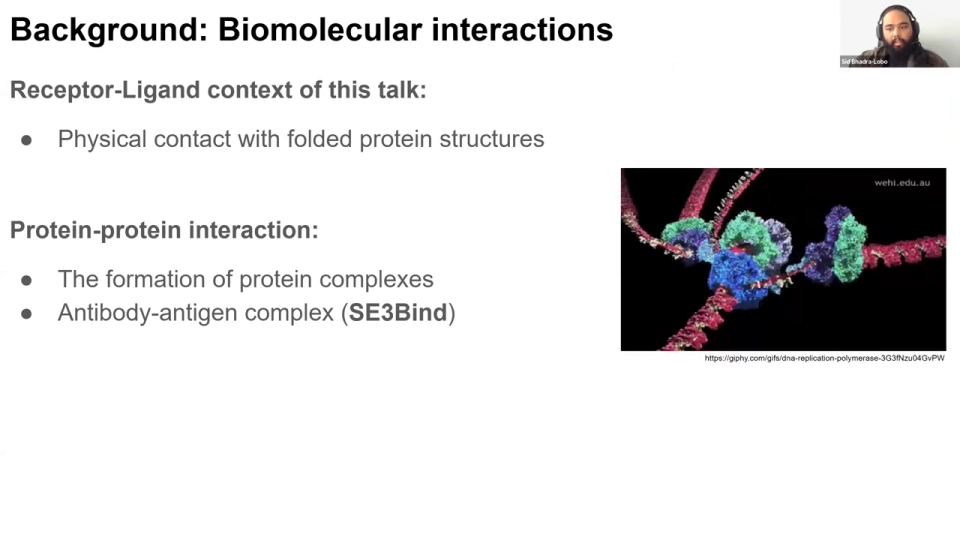

对 SE3Bind 这个项目来说，具体的「受体-配体」就是**抗体-抗原复合物**。[【跳转到 01:41】](https://www.youtube.com/watch?v=ych_CGBpzTw&t=101)

### 1.2 抗体长什么样，数据里通常只有「结合臂」

一个完整抗体包含两部分：**Fab 区**带有抗原结合位点，负责识别抗原；**Fc 区**负责结合细胞膜上的受体。但绝大多数 PDB 结构文件只解析出 Fab 部分，也就是抗体-抗原的结合臂，没有 Fc 区。因此数据集里的「抗体」通常只包含重链、轻链构成的结合臂，抗原则可能是单体或二聚体。

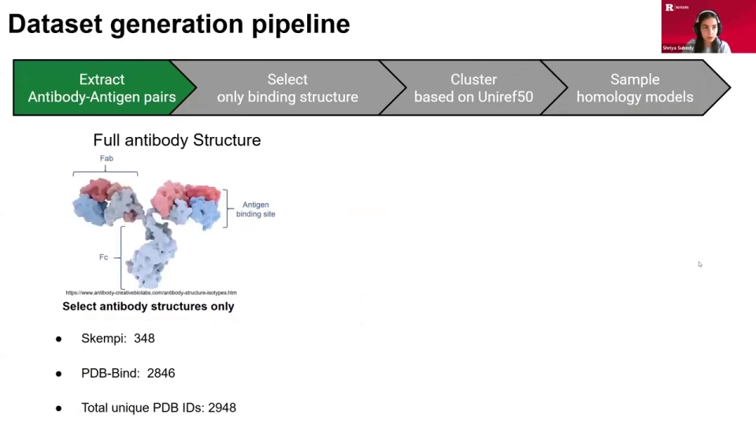

为了简化问题，作者没有研究「一个抗原被两个抗体同时结合」的情形，而是每个复合物只取**一个抗体-抗原结合对**，减少需要处理的部件。[【跳转到 20:21】](https://www.youtube.com/watch?v=ych_CGBpzTw&t=1221)

### 1.3 真正的瓶颈是数据

抗体-抗原亲和力数据非常稀缺。讲者在问答里提到，他们能用的、真正独特的抗体复合物大约只有 **200 个**。相比之下，普通蛋白质-蛋白质相互作用有大量结合亲和力数据。

更麻烦的是，抗体的 **CDR 区域**（尤其是决定结合特异性的 H3 环）进化极快、变化多端，很难维护一个覆盖这些快速演化区域的数据库。数据少、结构又复杂，使得训练一个稳健、可泛化的模型非常困难。[【跳转到 58:11】](https://www.youtube.com/watch?v=ych_CGBpzTw&t=3491)

---

## 二、从二维直觉出发：卷积、等变性与能量景观

讲者没有一上来就讲三维模型，而是先在一个**二维合成形状**的玩具问题上把直觉建立起来。这部分是理解整个方法的关键。

### 2.1 卷积在学什么：用「核」在规则网格上扫描

卷积神经网络（CNN）可以看成一个带权重的感知机：输入 X、权重 W、输出特征 Y，权重根据损失函数不断更新。区别在于，CNN 的输入是**规则网格上的像素**，所以权重也排成一个规则网格，也就是**卷积核（kernel）**。

把卷积核在图像上逐块「盖章」，每盖一次做一次点积，就得到输出特征图上的一个数。核里的权重不同，提取到的特征就不同。比如一个高斯核（中间大、四周小、总和为 1），作用到图像上就是「高斯模糊」——和修图软件里的模糊笔刷是一个道理。

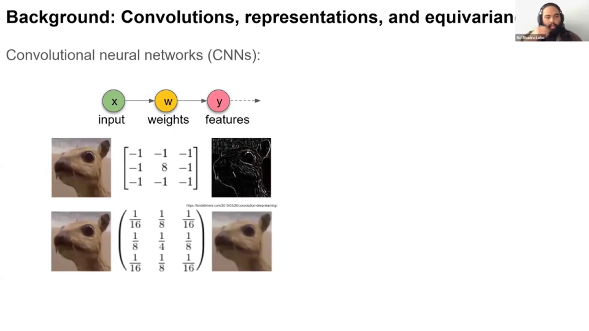

模型训练时更新的，正是卷积核里的这些权重。权重更新后，模型就能提取出对任务更有用的新特征。

### 2.2 等变性：分子没有「上下」，也没有「正着看」

普通 CNN 天生具有**平移等变性**：一个检测人脸的滤波器，不管人脸在图像左上角还是右下角，都能检测到。但如果人脸**旋转**了，普通 CNN 可能就检测不到了——除非你准备很多个不同朝向的滤波器。

**等变（equivariance）**的意思是：输入怎么变换，输出特征就跟着同样变换，但表示不被破坏。对旋转等变的滤波器来说，**一个**滤波器就能检测字母 A 的所有朝向，而不需要为每个角度各准备一个。

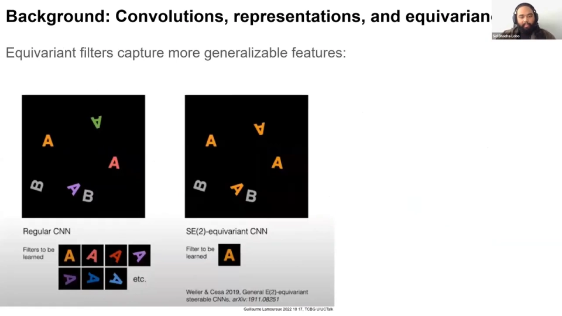

讲者用一张「视错觉」图说明为什么分子场景特别需要旋转等变：两张图看起来相似，但把右边那张竖过来，会发现眼睛和嘴巴是倒着的。人能一眼看出不对劲，是因为我们习惯「正着看」、受重力影响。但**分子没有上下之分**，所以模型不应该依赖某个固定的观察方向，而应该对旋转保持等变。

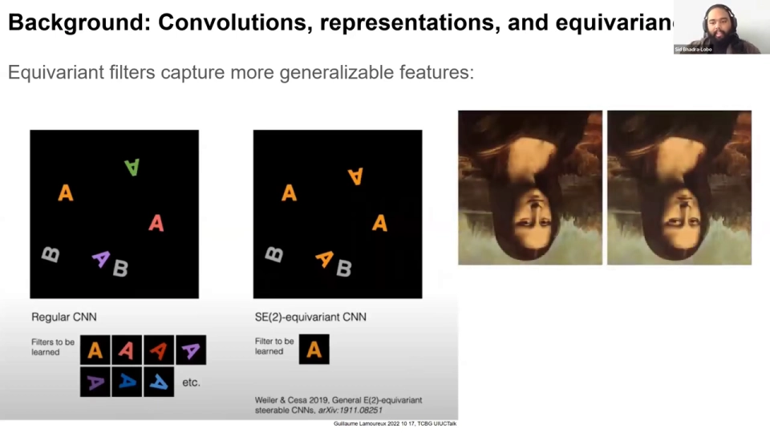

到了三维，旋转等变的好处更大。三维的旋转自由度远高于二维，如果靠「把输入旋转很多遍喂给模型」来覆盖，就会陷入采样兔子洞：转多少度才够？什么时候停？等变网络从结构上避免了这个问题。

### 2.3 用合成形状验证「能量景观」的想法

为了验证思路，作者先在二维里造了一批**合成形状**：在正方形上撒点、优化出凹包，再往形状内部填 1、外部填 0。这些形状并不代表真实蛋白质，只是用来研究「怎么给两个形状的相互作用打分」。

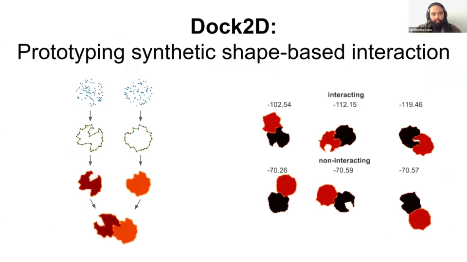

他们人为定义了一套打分规则：两个形状的「体相」重叠要被惩罚（不能占据同一空间），而「边界」靠近要被奖励（鼓励贴合）。用这套规则生成训练样本，再让模型**自己学特征**，而不是直接使用这些硬编码特征。

模型学到的特征分为两类：

- **标量特征**：可以描述体积、电荷等；
- **向量特征**：有大小和方向，可以描述电势、偶极等。

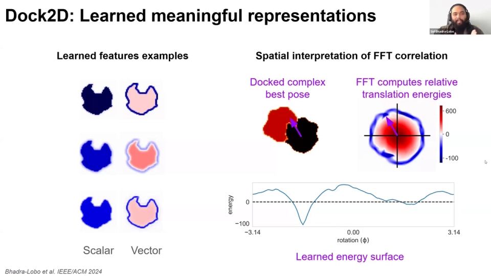

有了特征，就可以做 **FFT 互相关**：对红色配体的每一个旋转朝向，计算它与黑色受体在不同平移下的相关，从而得到一张「能量景观」。景观里的最低点，就是能量最低、最稳定的结合构象。

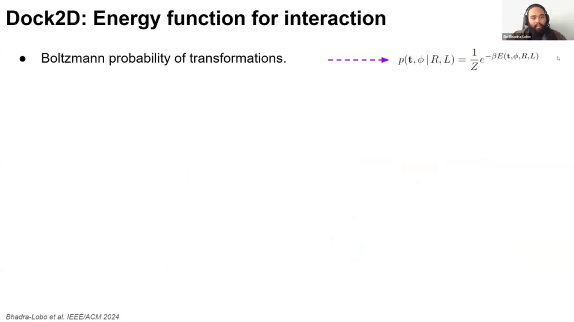

作者特别指出：用**学到的特征**算出的能量景观，比用硬编码特征算出的景观「干净」得多——硬编码特征下往往有多个相互竞争的分数，而学到的特征会给出一个占主导的单一低能量峰。这说明模型确实学会了把两个「本应代表分子」的形状拼在一起。

二维原型跑通后，作者把同样的思路搬到三维：**卷积 → 学特征 → 相关 → 能量景观 → 最佳构象**。[【跳转到 19:08】](https://www.youtube.com/watch?v=ych_CGBpzTw&t=1148)

---

## 三、SE3Bind 的三维实现：把蛋白质当成多通道三维图像

整个三维流程可以概括为：**重对接 → 特征提取 → FFT 互相关 → 计算结合亲和力**。下图是作者给出的整体工作流概览。

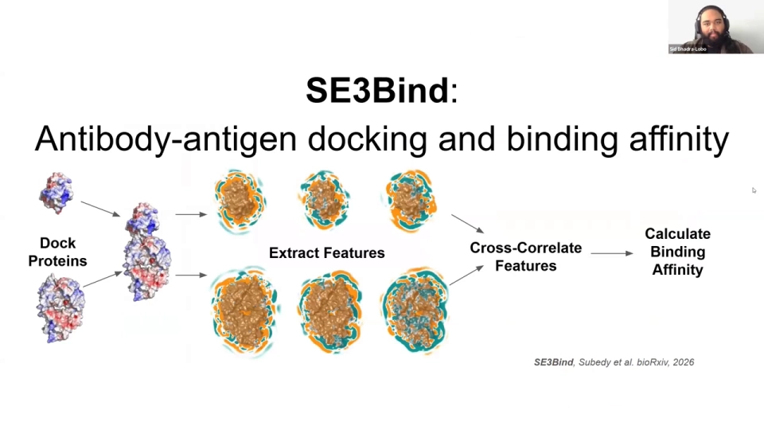

### 3.1 数据集怎么构建

三维部分以抗体-抗原复合物为对象，数据处理有几个关键步骤：

1. **只取一个结合对**：每个复合物只保留一个抗体-抗原结合对，简化问题。
2. **按抗原聚类**：用抗原的 **UniRef50** 序列一致性聚类，确保训练集和验证集没有重叠样本。
3. **尺寸过滤**：复合物要小于 150 Å，单个单体要小于 100 Å，才能放进 **75×75×75** 的网格盒子。
4. **ΔG 取值**：少数样本报告了多个实验 ΔG，取平均值。
5. **Modeler 同源建模**：所有样本跑一遍 Modeler，补全缺失残基、标准化立体化学，并生成带一点柔性的结构系综。训练集全部使用同源模型；验证时同时看同源模型和晶体结构。

实验 ΔG 的分布如幻灯片所示，大多数样本集中在一个区间，少数样本有多个测量值。

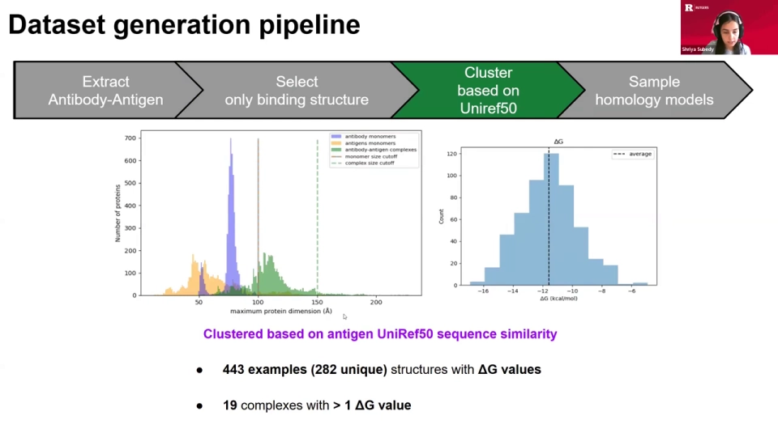

这里要区分报告里反复提到的两个「同源」概念，它们很容易混淆：

- **同源建模（homology modeling）**：用 Modeler 从一个晶体结构生成多个带柔性的结构版本，扩充结构系综，让模型输入有更好的采样；
- **同源过滤（homology filtering）**：按序列/结构同源性来划分训练集和验证集，避免相似样本同时出现在两边。

前者是为了「数据增强」，后者是为了「防止数据泄漏」，目的完全不同。[【跳转到 49:36】](https://www.youtube.com/watch?v=ych_CGBpzTw&t=2976)

### 3.2 输入表示：五种重原子通道 + 一个 bulk 通道

这是 SE3Bind 最直观的一点：**把蛋白质当成一张三维图像**。

- 类似 RGB 图像有三个颜色通道，蛋白质有碳、氮、氧、硫等重原子，各自作为一个通道；
- 再加一个 **bulk 通道**，包含所有蛋白质坐标；
- 分辨率是 **2 Å**，盒子大小 75×75×75。

受体和配体分别做同样处理，输入一个 **孪生（Siamese）SE3 卷积网络**。输出包括标量特征（特征 1、特征 2）和向量特征；特征 0 留到亲和力任务里单独使用。

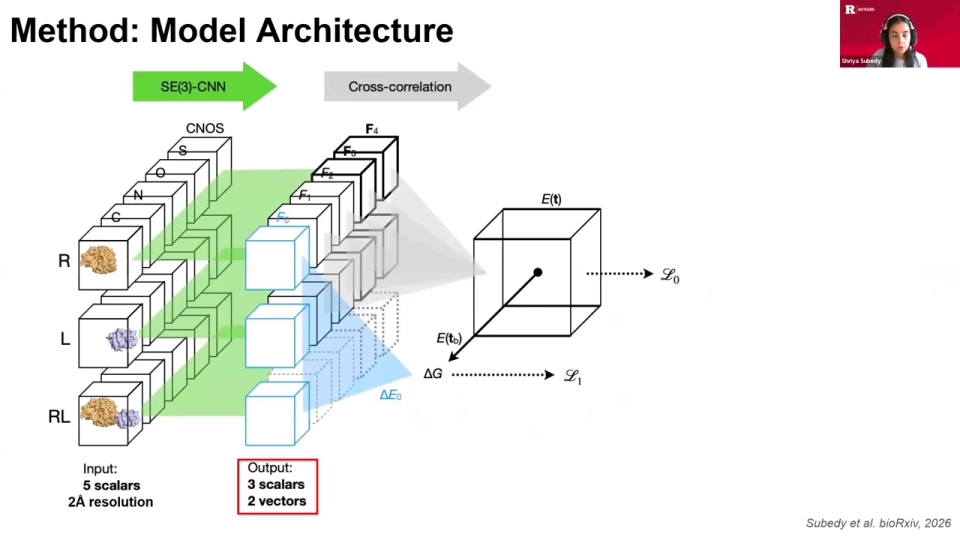

### 3.3 特征与 FFT 相关

受体和配体的特征通过 SE3 卷积网络后，进入 FFT 互相关步骤。能量项是受体、配体特征在不同平移和旋转下的相关之和，再乘上一组 **a 系数**。

三维比二维多了一个「维数灾难」问题：旋转自由度太多。为了简化，作者**直接给蛋白质正确的朝向**，让模型只学习把配体平移到受体上的那一个平移量。也就是说，模型只学平移，不学旋转。

a 系数还有一个巧妙的设计：令 `a2 = -a1`、`a4 = -a3`，就能把特征和物理性质联系起来——标量特征可以编码电荷，向量特征（有方向、有大小）可以编码偶极或静电场。这让卷积网络输出的特征具有一定可解释性。

---

## 四、两个任务：先学对接，再学亲和力

作者把训练拆成两个任务，思路和二维完全一致：先得到能量网格，再从中提取 ΔG。

### 4.1 任务零：重对接（re-docking）

任务零是**预训练**：给模型一个抗体-抗原复合物，让它学会把配体「对接」回受体上。模型输出能量网格，网格里的最低能量对应最佳构象。这个任务只学平移，因为朝向已经给好。

### 4.2 任务一：结合亲和力预测

任务一在任务零的基础上预测 ΔG。讲者先回顾了结合自由能的两种写法：

- **热力学写法**：ΔG = 焓贡献 − 温度 × 熵贡献；
- **统计力学写法**：用配分函数描述溶液中未结合态和结合态的受体-配体数目。

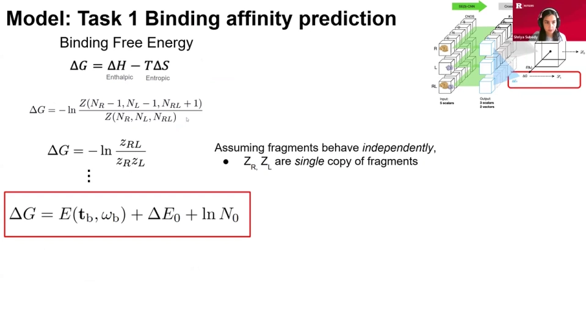

假设受体和配体独立行为、结合态由单一构象主导，经过推导，最终得到 SE3Bind 的 ΔG 公式：

```
ΔG = E_best + ΔE0 + n
```

三项的含义分别是：

- **E_best**：任务零学到的、最佳构象对应的最低能量；
- **ΔE0**：来自特征 0 的项，用来捕捉对接任务没有涵盖的**熵贡献**（以及其他结合贡献）；
- **n**：一个可学习的常数，可以理解为「放蛋白质的盒子」对结合能的贡献。

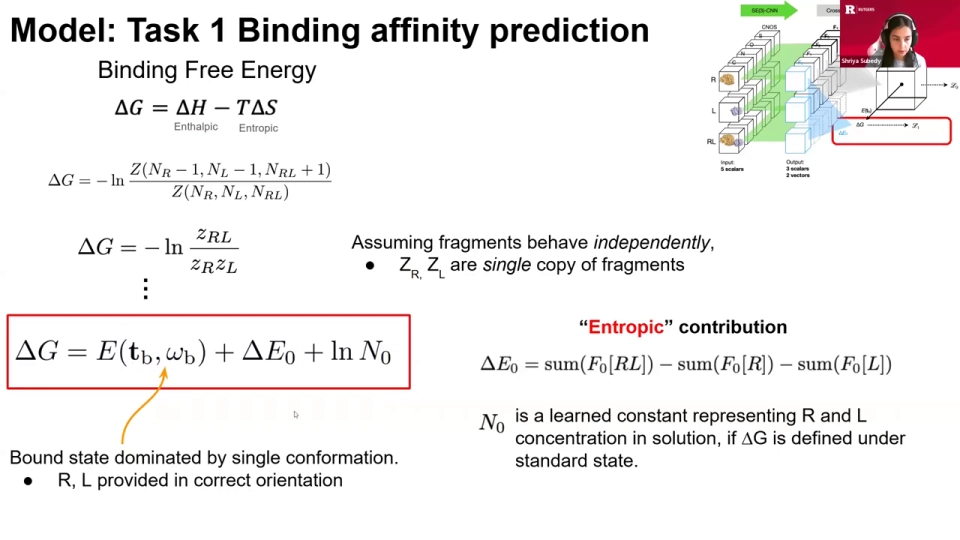

训练时，模型**联合训练**对接任务和 ΔG 预测任务，让它在同一数据集、同一流程里同时看到能量景观和 ΔG；同时也会单独预训练对接任务。[【跳转到 31:11】](https://www.youtube.com/watch?v=ych_CGBpzTw&t=1871)

---

## 五、可解释性：标量特征到底在学什么

这是报告里讨论最热烈的一部分。作者想知道：模型从结构里学到的标量特征，是否对应人们熟悉的物理量，比如电荷、静电势？

他们做了一个对比实验：把蛋白质复合物用**静电势配色**画出来（蓝色正电、红色负电），再对比模型标量特征的和与差。

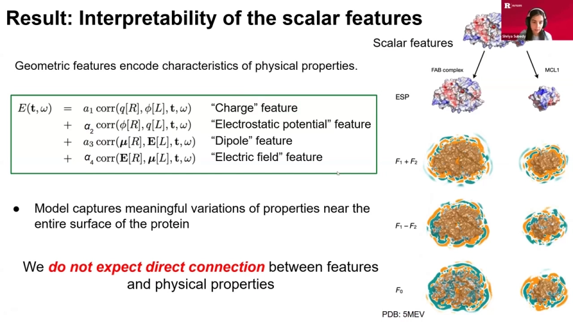

结论是**谨慎的**：虽然不能把某个特征直接等同于「电荷」，但从蓝色与青色、红色与橙色区域的重叠可以看出，模型确实在蛋白质表面学到了与电荷/静电势变化相关的信号。

讲者反复强调，这里的「电荷」「静电势」都加了引号，因为**数据集里没有电荷或电场的真值标签**，模型也没有被显式告知哪些位置带电。这更像是一种探索性分析，说明模型捕捉到了应该与这些性质相关的信号，而不是说特征就是物理量本身。

关于向量特征，本项目没有深入分析（处理大小和方向的图更麻烦），但讲者提到自己现在的博士项目正在做，初步结果显示向量特征似乎与带电残基有关，只是可视化不如标量特征直观。

问答里还有一个很好的直觉：卷积核不仅在蛋白质内部移动，也在蛋白质周围的空腔里移动，相当于在扫描整个三维空间。因此模型能检测到**埋藏的特征**，比如深口袋。有人把它概括为「模型在提取蛋白质结构中的潜在边缘和特征」，讲者表示同意。[【跳转到 37:38】](https://www.youtube.com/watch?v=ych_CGBpzTw&t=2258)

---

## 六、结果与关键发现：数据集划分比模型更影响分数

### 6.1 消融实验：特征 0 和损失函数怎么选

作者做了大量消融，重点讲了两条：

- **特征 0 的约束**：如果把特征 0 强制为正，ΔG 预测明显变差；把它设为零则基本中性，既不提升也不退化。
- **损失函数**：L2 回归损失比 L1 表现出更强的过拟合迹象（从 MAE 可以看出来）。

最终选出的 SE3Bind 模型，是过拟合最少、泛化最好的那个。

### 6.2 预测 ΔG 与实验 ΔG 的相关性

最佳模型在训练集上的 Pearson 相关系数是 **0.56**；在验证集上，晶体结构是 **0.24**，同源模型是 **0.26**。两个验证集表现接近。

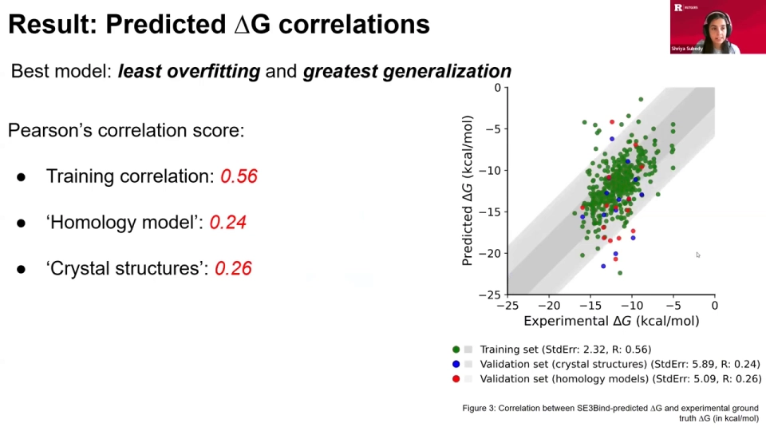

单看这个数字，似乎不算高。但接下来才是整场报告最有价值的部分。

### 6.3 现有模型的高分，很多来自数据泄漏

作者把 SE3Bind 和在同一数据集上评估过的现有模型比较，包括 AB-Bind、scampy、PDBbind 等。结果发现，现有模型报告的 Pearson 相关高得离谱，比如 TopNetTree 达到 **0.85**。

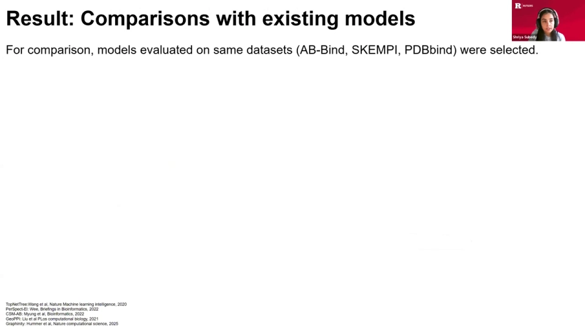

为什么差距这么大？作者深入检查了这些模型的实验设置，发现很多模型是**随机划分**训练集和验证集的。随机划分意味着训练集和验证集里会有高度相似的样本，模型实际上在「背题」，导致数据泄漏。

一些较新的工作已经开始纠正这个问题：

- **GOPI** 用进化分类域 **ECOD** 划分数据集，不只按结构同源性，还按进化分类，确保训练集和验证集真正不同；
- 当作者用 ECOD 划分的数据集重新训练 TopNetTree 时，性能从 **0.85 骤降到 0.38**。

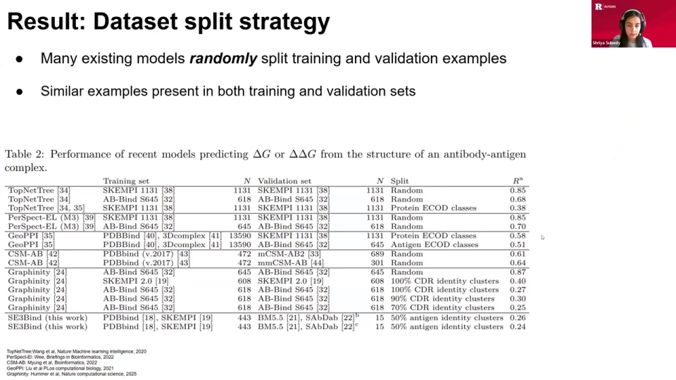

类似地，**Graffinity** 在随机划分时相关分数也很高，但按抗体的 **CDR 序列一致性**进一步划分后，性能显著下降。

### 6.4 SE3Bind 自己的数据划分有多严格

SE3Bind 一开始就用抗原 UniRef50 聚类划分数据，已经有意避免重叠。作者又follow 了 Graffinity 的方法，检查重链 CDR 环（尤其是决定结合特异性的 **H3 区**）的序列一致性：

- 训练集与验证集之间的**中位一致性约 20%**；
- 整个数据集中只有 **3 个抗体**在训练集和验证集之间共享 100% 的 CDR 序列一致性。

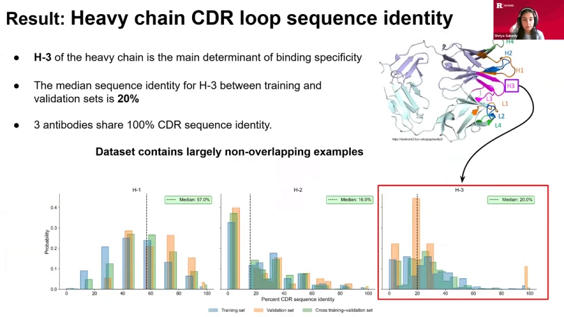

也就是说，SE3Bind 的数据划分相当严格，只有极轻微的数据泄漏。

### 6.5 关键结论：公平比较后，SE3Bind 并不差

把数据划分策略统一到严格标准后，作者发现 **SE3Bind 与现有模型表现相当**。换句话说，之前看起来「低」的 0.56，并不是模型差，而是别人的 0.85 里掺了数据泄漏的水分。

讲者把这一点提炼为全文最重要的 takeaway：

> **数据集划分策略非常关键，尤其对基于结构的模型。现有模型的高估，部分正是随机划分导致的数据泄漏造成的。**

对抗体-抗原这种本来就只有约 200 个独特复合物的领域来说，这一点尤其重要：数据越少，随机划分造成的泄漏越严重，模型越容易在有限数据上过拟合。要得到准确、可泛化的模型，必须采用**更具生物学或结构信息的分隔方式**。

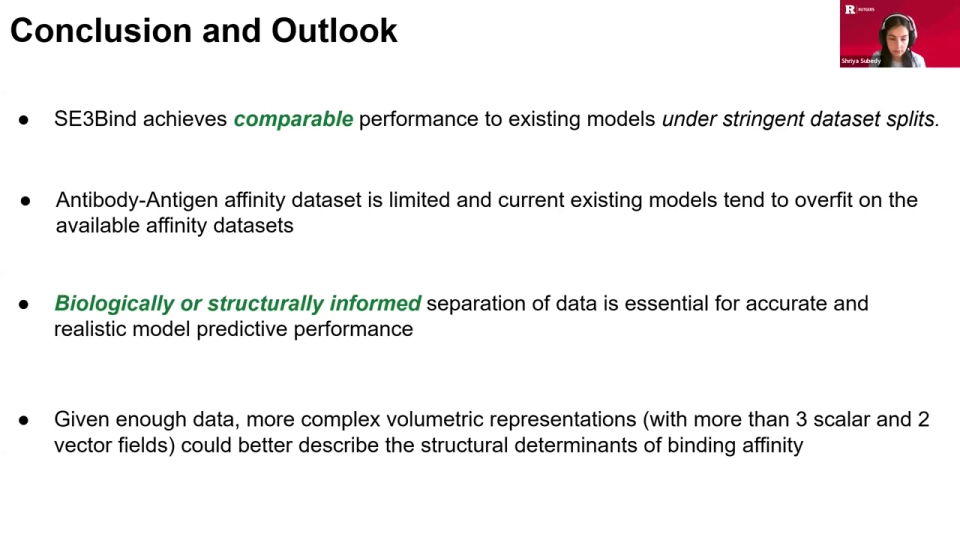

---

## 七、局限与展望

### 7.1 局限

- **数据稀缺**：真正独特的抗体复合物只有约 200 个，这是训练稳健模型的最大障碍；
- **CDR 进化快**：CDR 区域变化迅速，很难维护覆盖全面的数据库；
- **只学平移**：为了绕开三维旋转的维数灾难，模型被给定正确朝向，只学习平移；
- **可解释性有限**：标量特征与物理量的对应仍是定性的，向量特征尚未深入分析。

### 7.2 展望：SE3Bind 只是模型生态中的一个组件

讲者在问答中强调，SE3 等变 CNN 并不是「终极方案」，而是整个建模生态里的一个部件。一个可能的工作流是：

1. 用 **AlphaFold** 之类的方法生成一批候选结构；
2. 用 **SE3 卷积网络**做快速、高通量的筛选，挑出可能相互作用的区域；
3. 对感兴趣的区域做精修；
4. 进一步用**流匹配模型**处理向量特征，构建一个「如何改进结构」的向量场。

用讲者的话说：未来应该根据具体任务选择模型的变体——用语言模型生成结构，用视觉模型找感兴趣区域，再用专门的模型做精修。

### 7.3 能否迁移到其他数据集

问答里有人问：能不能把模型用在非洲数据集上？讲者的回答分两层：

- **方法上可行**：只要有蛋白质结构（晶体结构，或用 AlphaFold 生成的预测结构），就可以用这类模型做相互作用的高通量筛选；
- **分布偏移风险**：如果新数据集和训练分布不同，模型可能遇到分布偏移，需要重新训练或微调。

讲者也强调，SE3Bind 专门针对抗体-抗原训练和验证，因此更适合新的抗体复合物数据；如果要做通用蛋白质-蛋白质预测，应该使用或微调更通用的模型。[【跳转到 55:16】](https://www.youtube.com/watch?v=ych_CGBpzTw&t=3316)

---

## 小结

- **问题**：抗体-抗原结合亲和力预测数据少、CDR 变化快，现有模型的高分很多来自随机划分导致的数据泄漏。
- **方法**：SE3Bind 把蛋白质表示成多通道三维图像，用 SE3 等变卷积提取特征，用 FFT 互相关得到能量景观，先学重对接、再预测 ΔG。
- **公式**：ΔG = E_best + ΔE0 + n，三项分别对应最佳对接能量、熵贡献和常数项。
- **可解释性**：标量特征学到了与静电势相关的信号，但因为没有真值标签，只能定性解读。
- **最重要的发现**：在严格的数据划分下，SE3Bind 与现有模型表现相当；数据集怎么划分，比模型本身更能解释分数差异。
- **定位**：SE3Bind 参数只有约 1.2–1.3 万，是一个轻量、可解释的组件，适合嵌入更大的结构生成与筛选流程。

---

## 关键术语速查

| 术语 | 一句话解释 |
| --- | --- |
| 结合亲和力（binding affinity） | 抗体与抗原结合强弱的度量，通常用结合自由能 ΔG 表示，越负越强。 |
| SE3 等变 | 三维空间中的旋转和平移变换下，模型输出按同样方式变换、表示不被破坏的性质。 |
| 卷积核（kernel） | 一组在规则网格上滑动、做点积的权重，用来提取局部特征。 |
| FFT 互相关 | 用快速傅里叶变换高效计算两组特征在不同平移下的相似度，得到能量景观。 |
| 能量景观（energy landscape） | 配体在不同位置/朝向下对应的能量分布，最低点即最稳定的结合构象。 |
| 重对接（re-docking） | 已知复合物结构，让模型把配体重新放回受体上的任务，常作为预训练。 |
| ΔG | 结合自由能；SE3Bind 用 `E_best + ΔE0 + n` 预测。 |
| CDR | 抗体上的互补决定区，尤其是 H3 环，决定抗原结合特异性。 |
| UniRef50 | 按 50% 序列一致性聚类的蛋白质序列数据库，用来划分数据集、避免重叠。 |
| ECOD | 蛋白质结构域的进化分类体系，用于比结构同源性更严格的数据划分。 |
| 数据泄漏（data leakage） | 训练集和验证集含高度相似样本，导致验证分数虚高。 |
| 配分函数（partition function） | 统计力学中描述系统各状态概率归一化的函数，可用来推导结合自由能。 |