# SE3Bind: SE3 equivariant model for antibody antigen binding affinity prediction

> 来源视频：[SE3Bind: SE3 equivariant model for antibody antigen binding affinity prediction（YouTube，61 分 19 秒）](https://www.youtube.com/watch?v=ych_CGBpzTw) ｜ 本博客基于该视频的「图-字幕」视频演说图文稿整理，内容可核查。讲者：一作 Shria 与共同一作 Sid（现就职于 Bristol Myers Squibb），来自罗格斯大学 CCIB 的实验室，方法名为 SE3Bind。

## 本讲要解决的核心问题（SCQA）

**背景**：抗体药研发的核心问题之一是"这个抗体跟抗原结合得有多强"。与一般蛋白-蛋白相互作用（PPI）相比，抗体-抗原结合亲和力预测更难——训练用的实验数据极少（全场反复强调：**可用的独特抗体-抗原复合物只有约 200 个**），且抗体的 CDR 区演化极快、构象柔性大。

**冲突**：主流深度学习模型要么架构复杂、要么在"随机划分数据集"上刷出虚高分数（后面会看到 0.85 掉到 0.38 的例子）；可解释性也普遍欠佳——分数有了，但不知道模型在看什么。

**疑问**：能不能用一个小而简单、物理上可解释的模型，从抗体-抗原复合物结构直接预测结合亲和力？

**回答（中心思想）**：SE3Bind 的答案是"能，而且可以非常小"。它用 **SE(3) 等变卷积**从结构中提取标量/向量特征，用 **FFT 相关**高效扫描能量景观，先预训练"对接"再学"亲和力"，最终 ΔG 公式只有三项（最优位姿能量 + 熵修正项 + 常数项），整个模型**总共只有约 1.2~1.3 万个参数**；在严格按序列/结构同源性分割的数据集上，它与现有大模型表现相当——并顺手揭穿了后者虚高指标的来源：**数据泄漏**。

## 一、直觉铺垫：卷积、等变，与"分子没有上下"

报告分两部分：共同一作 Sid 先讲背景与直觉（用 2D 合成形状做原型），一作 Shria 再讲 3D 抗体-抗原上的正式实现。

**卷积回顾**：卷积核就是一组固定网格排列的权重，"盖"在输入上做一串点积得到特征图。经典例子是高斯核——中间权重大、四周小、总和为一，扫过图像就得到高斯模糊。学习的过程就是更新核里的权重。

**为什么要等变（equivariance）**：普通 CNN 识别旋转各角度的字母"A"需要许多个滤波器；SE(2) 等变滤波器**一个核就能覆盖所有旋转**。3D 问题维度更高、自由度更多（维数灾难），等变带来的节省更明显。讲者还用"倒过来的脸"举例：人眼看图有重力偏置，但**分子世界没有上下之分**，模型理应对任意朝向一视同仁。

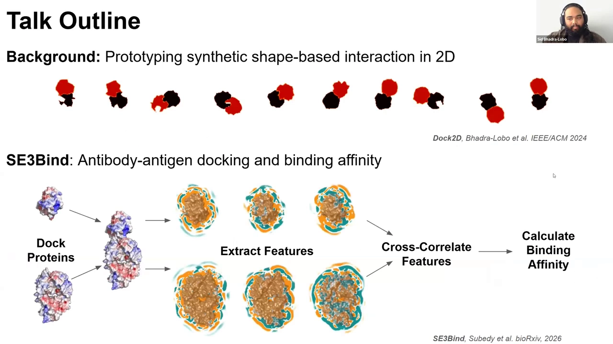

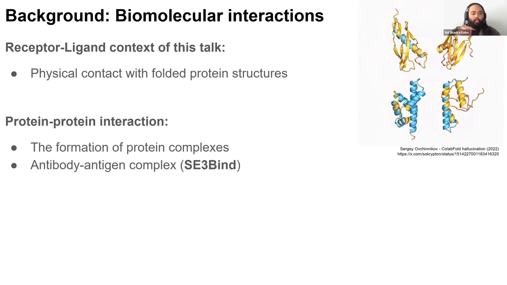

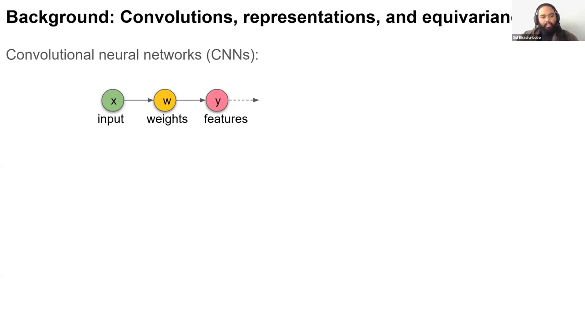

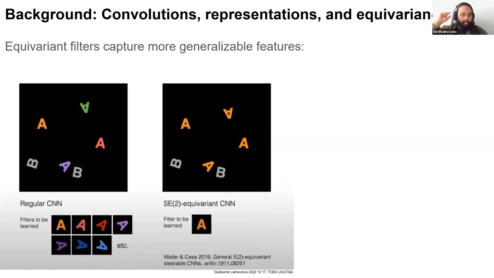

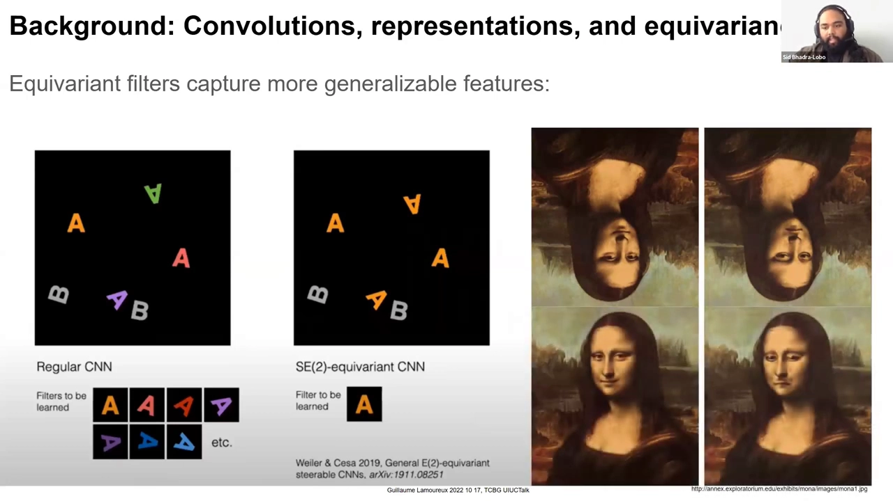

实现上，把对称性直接**编码进核的初始化**：输入旋转，输出激活跟着旋转且不畸变。卷积天生平移等变，加上对称核就有了旋转等变；同时模型可以安全地搬运高阶特征——标量特征（可描述体积）与向量特征（有幅度有方向，可描述电势类性质）。

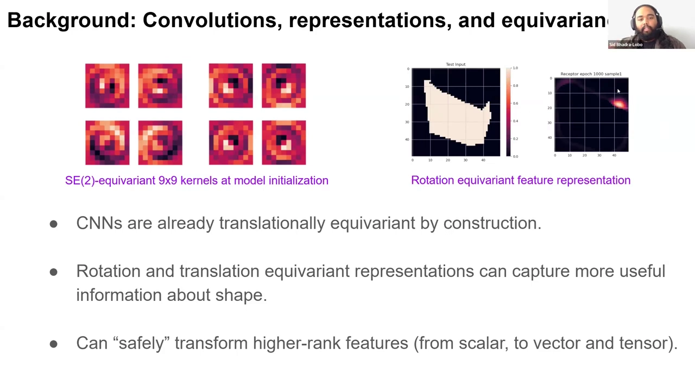

## 二、2D 原型：在合成形状上预演"对接"

在碰真蛋白之前，团队先用 2D 合成形状把整套方法论跑通：在方形上撒点、取凹包、内部填 1 外部填 0——这些形状不是蛋白，只是"分子"的抽象替身。

**怎么定义"相互作用"？** 团队给了两条约束：

1. **玻尔兹曼分布**：受体与配体的每一个相对变换（旋转/平移）都有一个概率，由配分函数刻画，能量来自两者相对位置；
2. **最优变换能量最低**：黑色受体固定、红色配体移动，每个旋转下存在一条"最低能量平移"曲线，最优位姿就是能量景观的谷底。

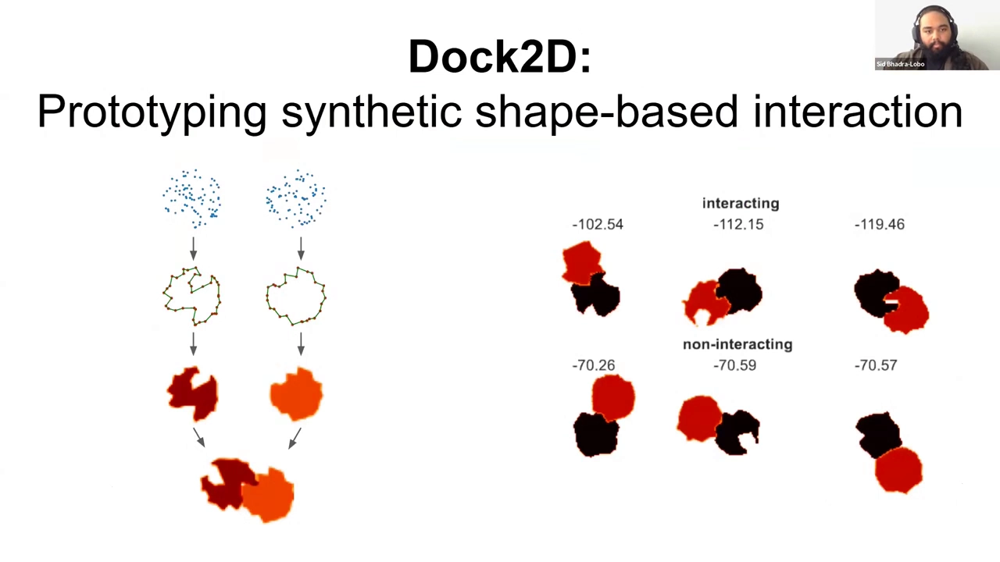

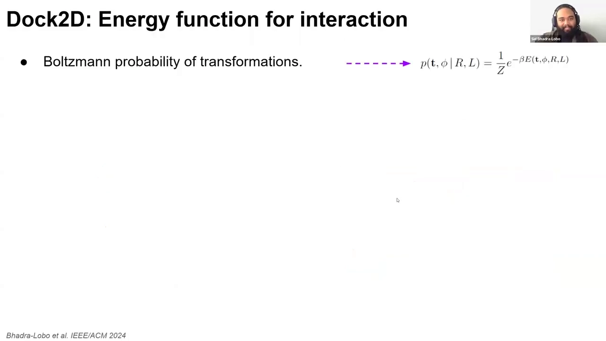

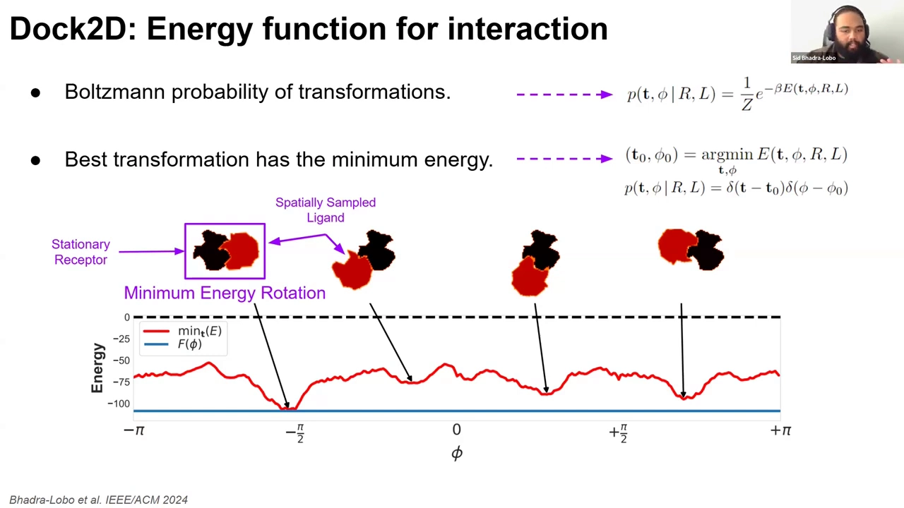

**打分从哪来？** 借鉴 1992 年 Katchalski-Katzir 的思想——用"体积特征 + 边界特征"描述每个形状，再用 **FFT 相关**高效打分（FFT 本质是把特征在空间上的逐元素乘积求和算得飞快）。权重系数 a 的符号给出物理含义：**形状重叠 → 正 a（罚分，能量升高）**；**边界靠近 → 负 a（奖励，能量降低）**。

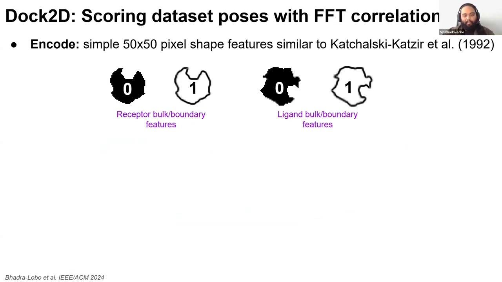

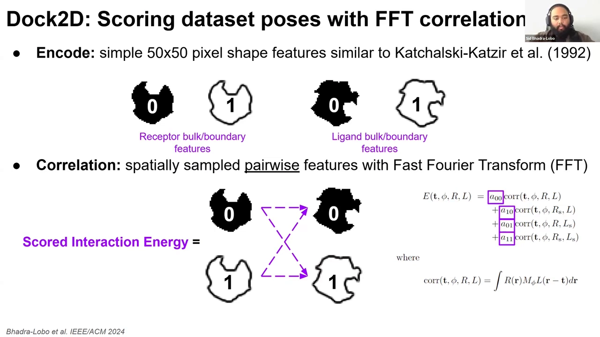

接下来让模型**自己学特征**（完全看不到人工硬编码特征）：学出的标量特征像"体积/电荷"、向量特征像"表面电势"。对每个旋转方向做 FFT 相关，取相关峰的位置即最优平移；硬编码特征会有多个竞争峰，而**学到的特征让能量景观只剩一个主导低谷**——模型学会了"怎么把两个形状拼到一起"。

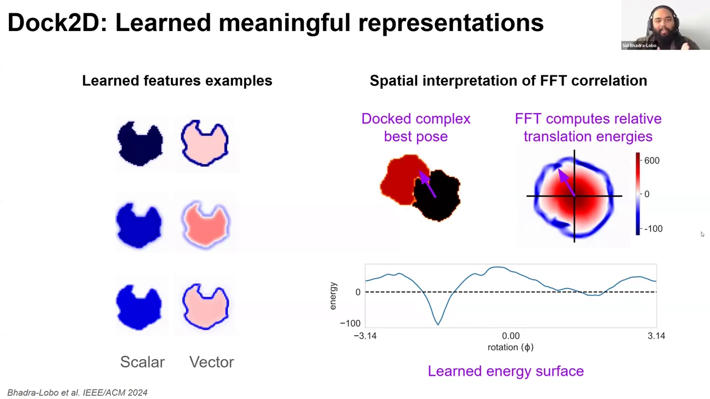

## 三、走向 3D：数据集这样搭

Shria 把 2D 概念搬到 3D 抗体-抗原问题上。数据集构建的每个决定都值得细看：

- 只取**一条抗体（重链+轻链）对一条抗原**的复合物（抗原可单体/二聚），简化问题；
- 全抗体有 Fab（结合臂）与 Fc（结合细胞膜），PDB 里多数结构只有 Fab，正好只用结合臂；
- 抗原按 **UniRef50 序列同一性聚类**，确保训练/验证集不重叠（这一点后面成为全场关键）；
- 复合物整体 **<150 Å**（要放进 75×75×75 的网格）、单体 **<100 Å**；网格分辨率 **2 Å**；
- 实验值用 **ΔG**；有多个报道值的取平均；
- 所有结构过一遍 **MODELLER 同源建模**：补缺失残基、统一立体化学、并为每个晶体结构生成 **10 个变体**构成柔性系综——训练集全用同源模型，验证集则同源模型与晶体并用。

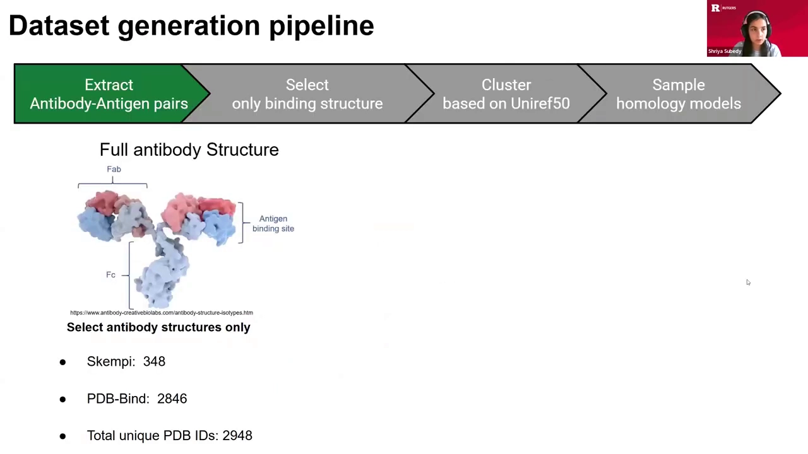

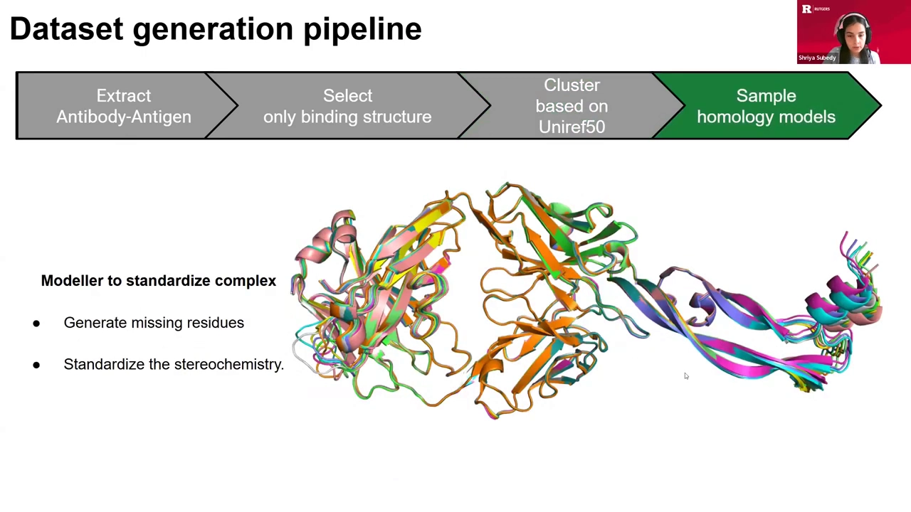

## 四、两个任务：先学对接，再学亲和力

**输入编码**：像图像的 RGB 三通道，把重原子按元素拆成 **C / N / O / S 四个通道 + 一个 bulk 通道**，铺在 2 Å 网格上——蛋白质结构变成一张"3D 图像"。受体与配体过同一个**孪生卷积网络**，输出标量特征 1、2 与向量特征；另有一个 feature 0 留给亲和力任务。

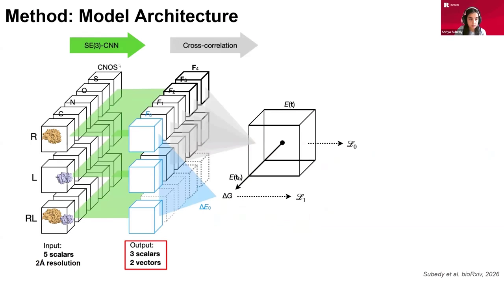

**Task 0（预训练：重对接）**：特征做 FFT 相关，a 系数满足 **a₂=−a₁、a₄=−a₃**——这个设定让特征获得物理诠释（标量≈电荷、向量≈偶极/静电场）。为绕开 3D 旋转空间的维数灾难，把受体与配体按**正确取向**放入，模型只学**平移**——找出能量最低的位姿。

**Task 1（亲和力）**：结合自由能 ΔG = 焓 − 温度×熵，也可从配分函数（未态/初态的受体-配体分子数之比）推起；假设结合态由单一构象主导（最优位姿即代表结合态），最终公式三项：

1. **E_min**：Task 0 学到的最优位姿能量（对接贡献）；
2. **ΔE₀**：feature 0 的贡献 = 结合态特征和 − 游离态特征和，捕捉对接项没覆盖的**熵贡献**；
3. **N·常数**：可学习的标准态/盒子贡献。

对接与 ΔG **联合训练**（也单独预训练过对接）。听众追问"这会不会只是参数化"，讲者的回答很坦诚：这确实像一种**正则化**——强行约定"这组特征按熵用、那组按焓用"。

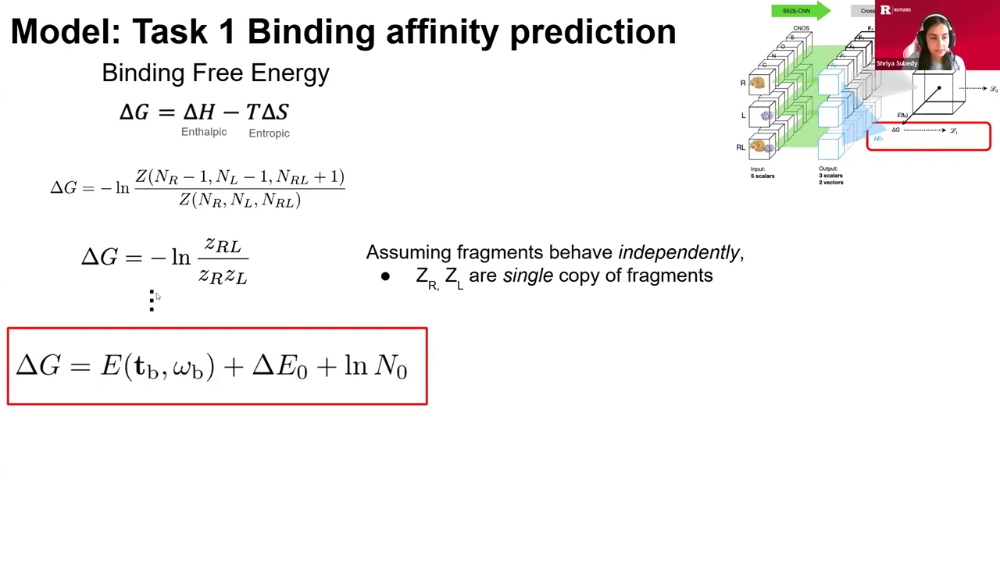

## 五、模型学到了什么：可解释性初探

把学到的标量特征的"和/差"画回蛋白表面，与静电势着色（蓝正红负）的结构对照：重叠区域显示模型确实在沿整个表面捕捉"类电荷"的变化——注意团队强调这是**带引号的"电荷"**：数据里没有电荷标签，这只是特征与物理性质的探索性对应，不主张直接等同。卷积核扫的是蛋白内外整个三维空间（输入本质是"原子坐标构成的 3D 图像"），因此还能感知**深埋的口袋**等内部特征。

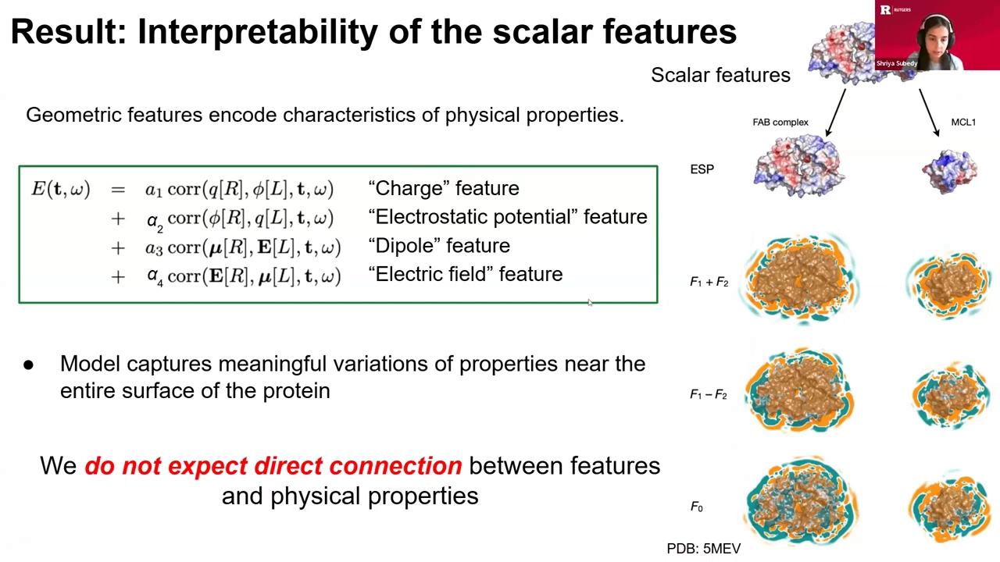

## 六、消融与成绩单

**消融实验**挑两条说：feature 0 强制为正 → ΔG 的 MAE 明显变差；强制为 0 → 中性。损失函数 L1 vs L2：**L2 过拟合更明显**。最终选的是过拟合最小、泛化最好的版本。

**成绩单**：预测 ΔG 与实验 ΔG 的 Pearson 相关——训练集 **0.56**；验证集晶体结构 **约 0.24**、同源模型 **约 0.26**。

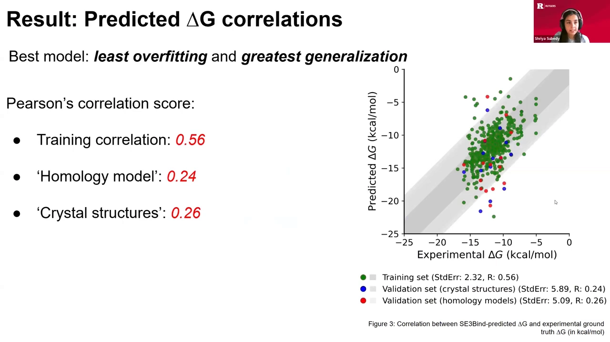

这个数字乍看不起眼——直到把它放回"别人家模型"的坐标系里。

## 七、全场最有价值的一击：数据泄漏照妖镜

团队把 SE3Bind 与在相同数据集上评测过的现有模型（AB-Bind 基准上的 TopNetTree、ProSPr-EL、Graffinity 等）对比，发现后者动辄 Pearson **0.85**。深挖之后真相浮现：

- 这些模型大多**随机划分**训练/验证集——相似样本同时出现在两侧，典型的数据泄漏；
- 有团队用 **ECOD**（按进化分类域）重划分后重训 TopNetTree，性能**从 0.85 掉到 0.38**；
- Graffinity 换成按**抗体 CDR 序列同一性**划分，阈值越严性能越低；
- SE3Bind 自己的数据集：训练/验证之间 CDR-H3 序列同一性中位数 **20%**，整个数据集只有 **3 个抗体**在训练/验证间共享 100% CDR 同一性（轻微泄漏，总体干净）。

结论：**在严格（同源性感知）的划分下，SE3Bind 与现有模型表现相当**；而抗体-抗原亲和力数据本就只有约 200 个独特复合物，随机划分只会让模型在"背题"，不是在泛化。给所有做结合预测/分类模型的人的提醒：**数据集划分策略本身，就是实验设计的一部分**。

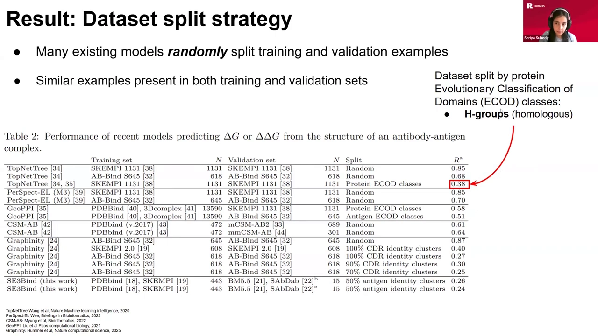

## 八、Q&A 精华

- **等变 vs 旋转增广**：增广是"采样兔子洞"——什么时候停、够不够好永远没有答案；等变把对称性放进核里，一步到位。SE3Bind 参数量仅 **1.2~1.3 万**，真正的瓶颈反倒是 **FFT**（奈奎斯特定理要求把空间 padding 到两倍）。
- **同源建模 vs 同源过滤**：前者是给输入做结构系综（每晶体 10 个变体、降低单晶偏差）；后者是按序列同源性**划分数据集**——领域内系统性缺失的一步，因为"多条序列可映射到同一个结构"，不过滤就会让泛化数字虚高。
- **为什么抗体-抗原比一般 PPI 难**：还是数据——结合亲和力标注的独特抗体-抗原复合物只有约 200 个，普通 PPI 数据多得多；加上 CDR 演化快、库难维护、结构复杂性更高。
- **未来生态**：用语言模型生成结构 → 视觉模型找感兴趣区域 → 轻量卷积模型高通量筛选 → 流匹配模型做精修；不同任务用不同模型的变体。仓库在 GitHub 上公开，欢迎读源码。

## 九、小结：对"结合强度分类"类任务的启示

回到 ABDP「Antigen-Antibody Binding——结合强度三分类」的语境，这一讲给出三面镜子：

1. **物理可解释不等于要大模型**：1.3 万参数、公式三项，照样能做事；标量/向量特征与电荷/偶极的对应是"设计出来的可解释性"。
2. **指标必须放在严格的划分下读**：0.85 与 0.38 的差距不在模型而在划分——结合强度三分类的混淆矩阵指标（见本系列 3.3.2）若建立在泄漏数据上，一切归因都是空中楼阁。
3. **数据稀缺是抗体-抗原结合预测的底层约束**：约 200 个独特复合物决定了"简单模型 + 好的划分 + 物理先验"是比"大力堆料"更现实的路线——这与前一篇《Structural plausibility without binding specificity》"结构置信度不能当结合分类器"的结论互为印证。
