# Structural plausibility without binding specificity: limits of AI antibody-antigen prediction

> 来源视频：[Structural plausibility without binding specificity: limits of AI antibody-antigen prediction（YouTube，58 分 02 秒）](https://www.youtube.com/watch?v=5PFYfeWYcCc) ｜ 本博客基于该视频的「图-字幕」视频演说图文稿整理，内容可核查。讲者：Eva Smorodina（MiLaboratories，该公司即 VDJ 分析工具 MiXCR 的开发方），主持人 Stan 为公司 CEO。

## 本讲要解决的核心问题（SCQA）

**背景**：AlphaFold 3、Chai-1 这一代 AI 结构预测工具可以"直接从序列"预测抗体-抗原复合物。业界越来越习惯把预测出的复合物结构当作结合分析、表位判定的起点，用它们输出的置信度分数（如 ipTM）来决定"这个抗体和这个抗原是不是真结合"。

**冲突**：MiLaboratories 的研究者提出一个更根本的问题——这些工具给出的结构"看起来合理"（structural plausibility），但**合理不等于真的结合**（binding specificity）。如果置信度分数无法把"真结合对"和"配错对的假结合对"区分开，那么用它做结合判定、乃至做 ABDP 这类平台里"结合 / 弱结合 / 不结合"的三分类，根基就是松的。

**疑问**：把实验解析过的抗体-抗原复合物拆成序列、重新用 AI 预测，再额外构造"故意配错对"的阴性样本，这些工具的置信度分数还能把真结合和假结合分开吗？

**回答（中心思想）**：**基本不能**。在 106 个实验解析的（纳米）抗体-抗原复合物上，只有 AlphaFold 3 能部分找回"真结合对"的对角线；三个工具的置信度分布在真/假复合物之间大量重叠；高置信度并不对应好的结构质量（ipTM 与 DockQ 几乎不相关）；多采样能提升结构精度、却提升不了结合特异性。一句话：**目前的结构预测工具给的是"结构上说得通"，而不是"结合上是对的"**。

## 一、动机：结合发生在 3D，而结构规则还没被读懂

讲者开宗明义：计算抗体设计要真正变革药物发现，就得在计算机里筛掉大部分候选、把湿实验的时间和资源省下来。但这仍是愿景，因为**我们还没理解抗体-抗原结合的规则**——"如果不理解一个东西，你就创造不出它"。

结合发生在三维空间，规则同时涉及序列与结构两个层面：

- **序列层面**：数据多、规律相对清楚，已经有方法能仅凭序列把高亲和力与低亲和力的 binder 分开；
- **结构层面**：结构远少于序列、很多抗体的实验结构质量不高、信息重复度高——现有 AI 模型拿到的"结构信息"并不够好。

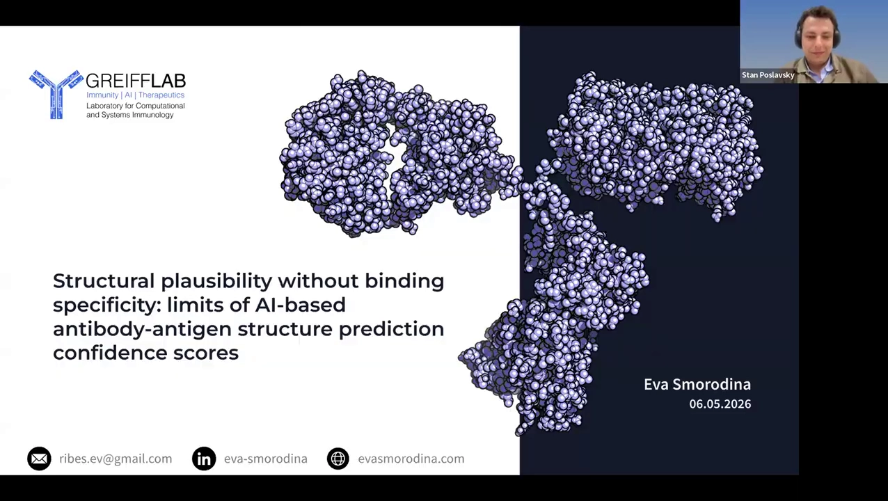

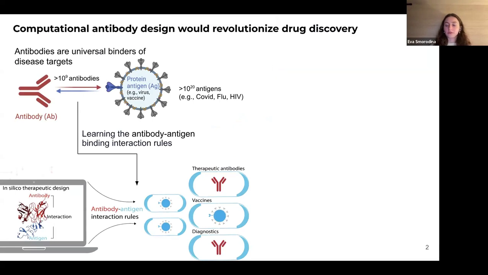

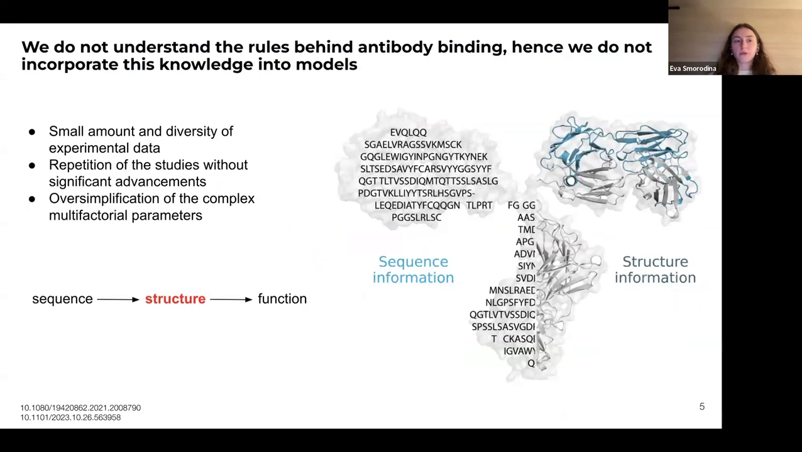

因此实践中常常拿不到实验结构，只能走"序列 → 计算建模结构 → 推断功能"的路线，中间这步 in silico 建模就成了关键：**如果中间步骤给不出代表生物物理现实的结构，后面的功能判断自然也是空中楼阁**。

## 二、实验设计：106 个复合物 + "故意配错"的阴性对照

本次分享围绕一篇预印本《Structural plausibility without binding specificity: limits of AI antibody-antigen prediction》展开，核心问题直白：

- 结构预测工具能不能为给定 paratope（抗体结合位点）找对 epitope（抗原结合位点）？
- 更进一步，**能不能区分"对的 paratope-epitope 配对"和"错的配对"**？

实验设计分三步：

1. 从 PDB 挑选 **106 个实验解析的抗体-抗原复合物**（以 VHH 纳米抗体为主），刻意让数据多样化：PDB 有新有旧、分辨率有高有低、序列组成与相似度各异；
2. 抽出序列，用三个代表性工具**重新预测复合物**：AlphaFold 3、RoseTTAFold、Chai-1——用原配对序列预测的称为 **real complexes（真复合物）**；
3. 构造阴性对照：把一条 VHH 与**其余所有**抗原两两组合，得到 **shuffled complexes（错配复合物）**。序列层面 real 与 experimental 相同、shuffled 不同；结构层面三者互不相似。

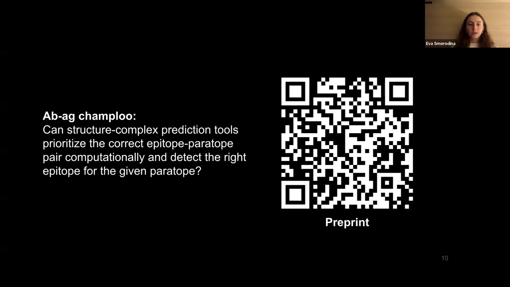

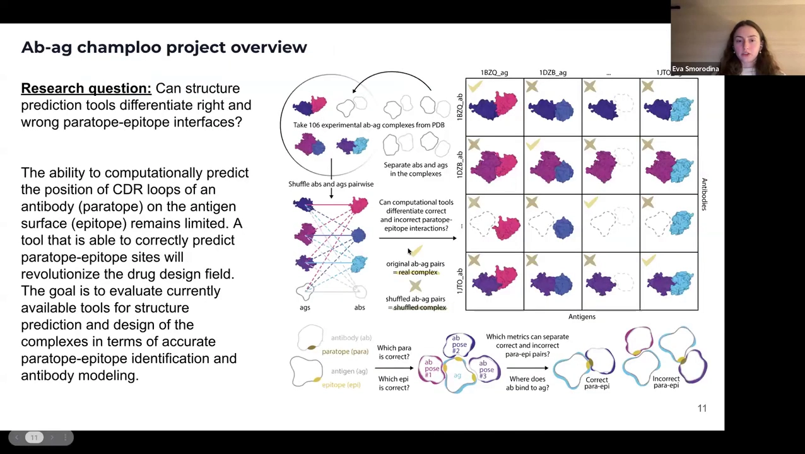

如果工具真能识别结合，那么在"抗体 × 抗原"的打分矩阵里，真复合物应当亮成**一条对角线**，而错配区域应当暗淡。

## 三、观察一：只有 AlphaFold 3 勉强找回对角线

以 ipTM 为格子颜色的 106×106 热图给出了第一盆冷水：

- **只有 AlphaFold 3 的矩阵能看到部分对角线**；RoseTTAFold 与 Chai-1 的矩阵里，真复合物与错配复合物的亮度几乎无法区分；
- 颜色深浅本应代表"工具对结合的信心"，但总体上**没有一致性**——工具无法在你不知道答案时告诉你"到底结不结合"。

把热图汇成小提琴图，结论一样：**真复合物与错配复合物的分布（均值±标准差）大量重叠**。AlphaFold 3 在"找回对角线"上确实最好，但仍有很多 off-target 预测——它分得出一点真假，却远不到"可靠分类器"的程度。

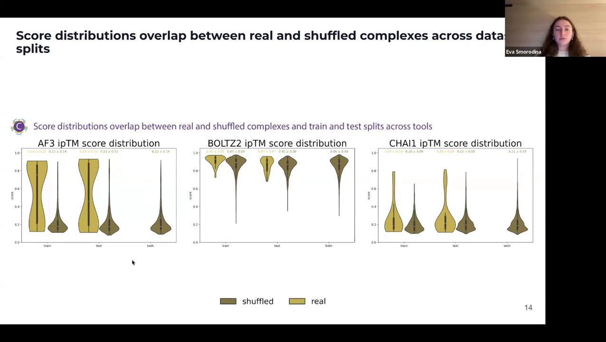

更有意思的是**离群点分析**：某个工具打分特别高（或特别低）的复合物，换一个工具并不同样突出——三者离群点的相关性极低。这意味着"这个工具预测不好，换一个试试"碰运气的成分很大，你没法确定该信谁。

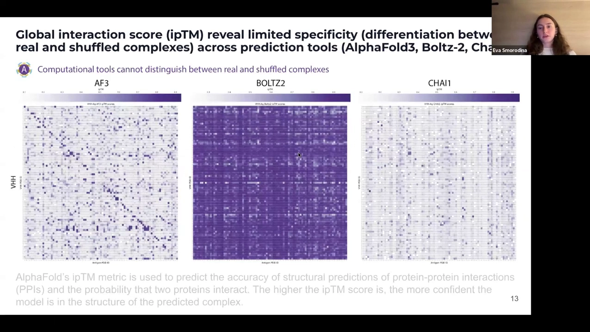

## 四、观察二：几何质量同样不过关（clashscore）

置信度是 AI 内部指标，讲者又补了一把"物理尺子"——基于几何的 TopModel clashscore（原子冲突越多，结构越不可信）：

- 三个工具的 clashscore 平均都**高于 20**（数值高 = 结构错误多、几何不一致多）；
- Chai-1 几乎是别家的**两倍差**；
- 真复合物与错配复合物的分布相似——**cognate 与 non-cognate 的结构质量同样不好**。

另外，数据集按"是否在工具训练集里"分成 train / test / both 三组，三组之间看不到差异——后面 Q&A 会再回到这一点。

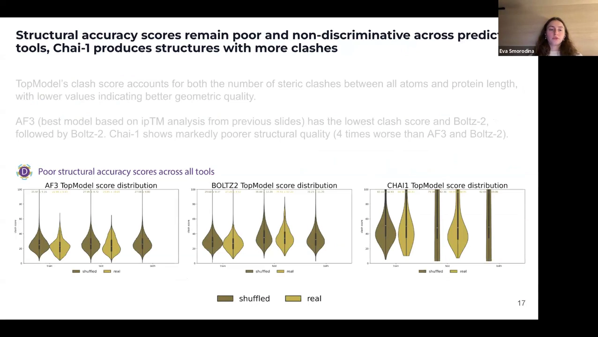

## 五、观察三：ipTM 高 ≠ 结构好（更别提结合对）

"模型知道自己是错的时候吗？"——把 AI 置信度（ipTM）和真实结构质量（DockQ，与实验结构的比对）画成散点，理想情况应是"低置信 ↔ 低 DockQ"的对角趋势。现实是：

- **ipTM 与 DockQ 基本不相关**，甚至出现高 ipTM 配低 DockQ 的情况；
- DockQ 相对可靠，因为它直接与实验结构比对；ipTM 则更像黑盒指标。

结论：**不能拿 ipTM 高来担保结构质量，更不能拿它担保"结合正确"**。

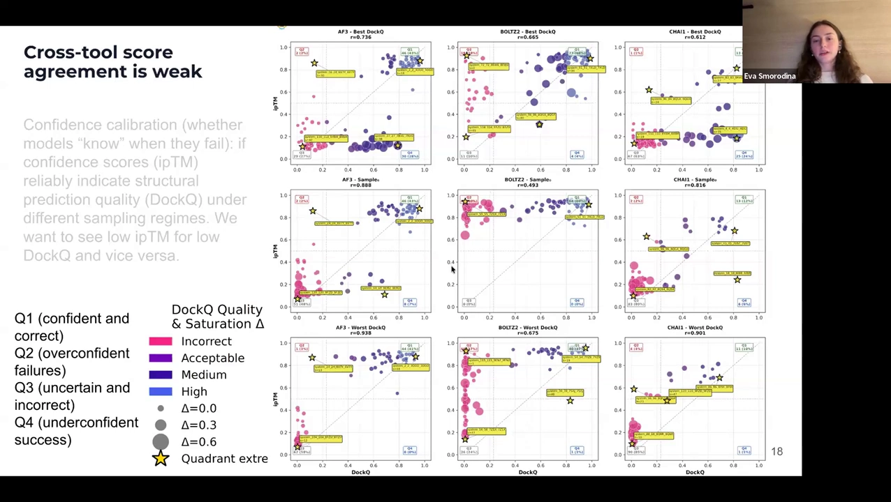

## 六、采样：能救结构精度，救不了结合特异性

提高预测精度的常规建议是"多采样"——同一个复合物预测多次。团队试了每复合物 **1 / 10 / 25 / 50 / 100** 次：

- **采样确实提升 DockQ（结构精度）**：单样本时 DockQ 往往很低，样本多了会好起来；
- 但由于 ipTM 与 DockQ 不相关，**采样并不能让置信度变得能反映结合特异性**；
- 提升很快饱和：最大的跃升发生在 1→10 个样本之间，50 之后增益很小。经验法则：**每个复合物采 10~50 个样本就够了**，把省下的算力拿去做更彻底的生物物理分析；
- 能耗因工具而异，且同样呈平台效应——"成千上万次采样"的建议在成本上不划算；
- **seed 会影响结果**（单样本可能碰巧采到错误构象），但采 10~20 个样本就能把 seed 的影响摊平。

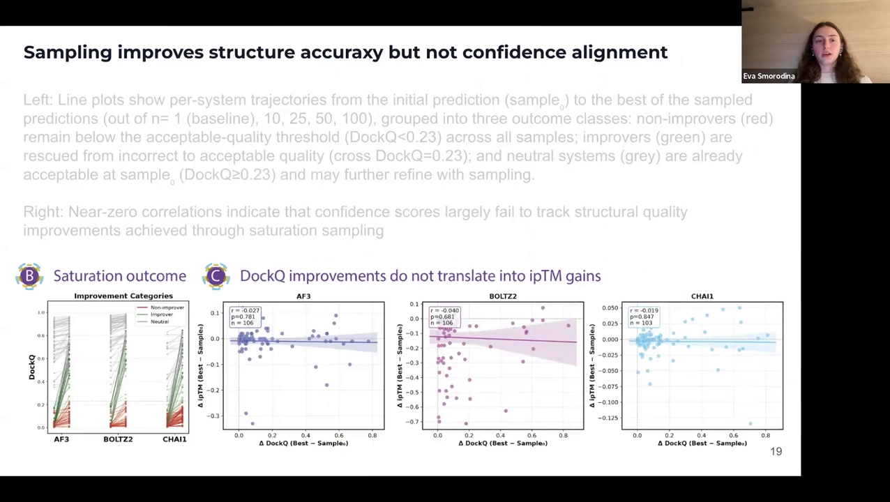

## 七、表位召回：置信度也定位不了结合位点

epitope recall 衡量"预测复合物里与实验结构重合的结合残基比例"。理想矩阵同样应亮出对角线，现实依旧没有清晰对角：

- 仅凭置信度**无法判断预测的结合位点对不对**；
- 如果有文献或实验信息提示结合位置，把它作为 **restraint（约束）**喂给支持该功能的模型，可以显著改善预测——但"默认无先验"的裸预测必须非常小心。

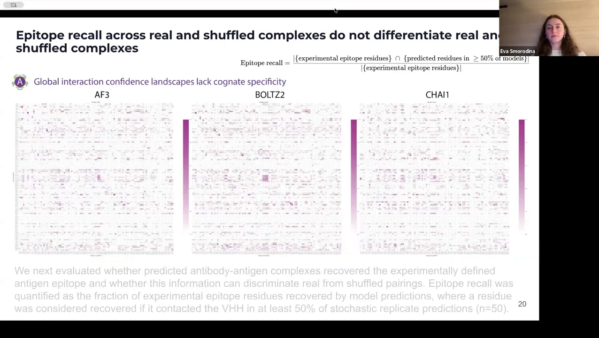

## 八、一个能用的启发式：样本间 RMSD

全场为数不多的"可操作正资产"：对同一复合物的多个预测样本计算**平均两两 RMSD**（结构一致性）——

- **真结合对**：样本结构彼此相似，结合位点稳定地聚在同一处；
- **错配对**：样本散乱，结合位点在抗原表面到处漂移。

且在全数据集上确有趋势：real 复合物的样本间 RMSD 低于 shuffled。实践建议：把待判断的复合物与**已知 binder / 已知 non-binder** 各采 10~20 个样本，比较三者的样本间 RMSD——接近 binder 的低 RMSD 则更可能是真结合。注意这仍是**启发式**，适合高通量初筛，不是"铁证"。

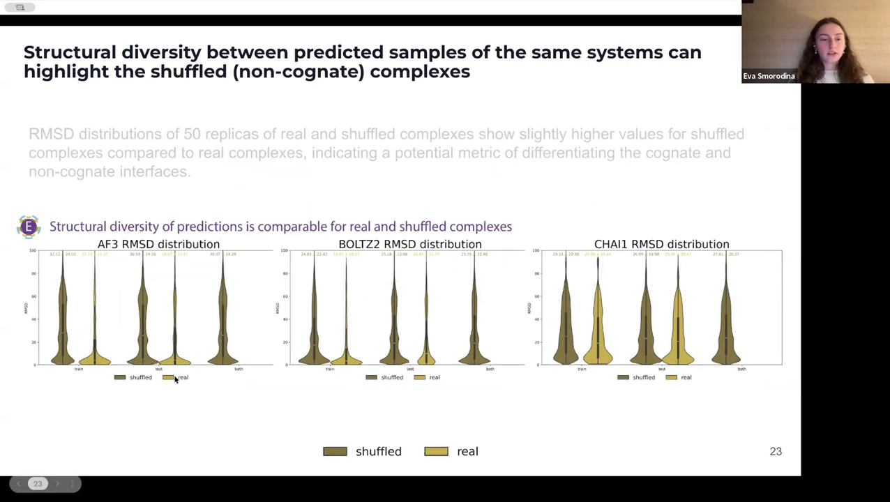

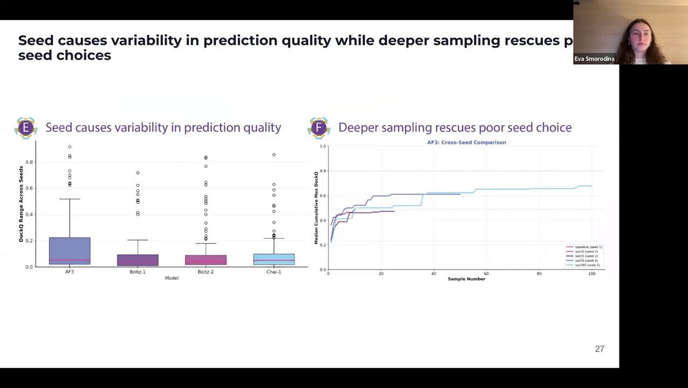

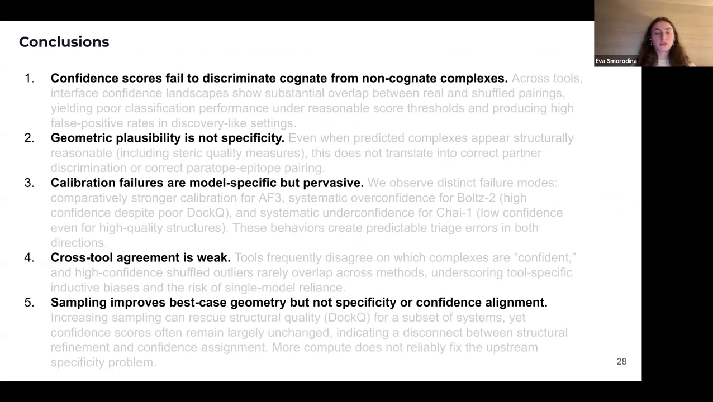

## 九、Q&A 精华：从"能信什么"到"该怎么用"

Q&A 近半小时，干货密度很高，摘录要点：

**1. Isomorphic Labs 的 IsoDock 能解决问题吗？** 商业闭源拿不到，架构不明。就算公告里说"比 AlphaFold 3 好 4 倍"——如果基线本身接近零，四倍还是零。要下"解决问题"的结论，得看公开可复现的工具在非典型基准和真实场景上的表现。

**2. 营销与现实的鸿沟？** 讲者的态度：不轻信大标题，去实际试、看工具在真实工作流里有没有"实用且可用的改进"。

**3. 失败是架构性的吗？** 讲者偏"旧学派"：希望模型更具可解释性。现在的困局是大家都在 AlphaFold 已验证的方向上迭代、"朝同一个方向犯错"；单纯堆数据不可持续——数据已经不少，缺的是正确的特征与物理规律。Q&A 中主持人总结三工具性格：**Boltz-2"对一切都过于自信"、Chai-1"几乎对一切都不自信"、AlphaFold 居中**。

**4. 训练集见过的复合物会预测得更好吗？** 不会——train / test / both 三组表现无差异。可能因为抗体的 Fv 区在训练数据里代表性不足，也可能因为抗体（尤其 CDR loop）构象柔性大、界面独特。

**5. 实操工作流怎么搭？**（观众问"现在预测抗体-抗原复合物你推荐什么流程"，讲者给出完整答案）
- 先明确问题与先验：预测一个还是一批？有没有已知结合位点的类似复合物？有没有文献/实验信息？
- 用**多个工具**（如 AlphaFold 3、Boltz-2、Chai-1，或更新的工具）；
- 每个工具**至少 10 个样本**；
- 把样本可视化并对齐：结合位点稳定聚集 →（若结合）大概率是对的位点；位点在表面四处漂散 → 红旗，模型不知道在哪结合，甚至可能根本不结合；
- 计算样本间 RMSD，与已知 binder（可从 PDB 找）和已知 non-binder（团队正在用实验确认非结合对）的基线比较；
- 多工具结论一致 → 每个工具一票，票数越多越可信。

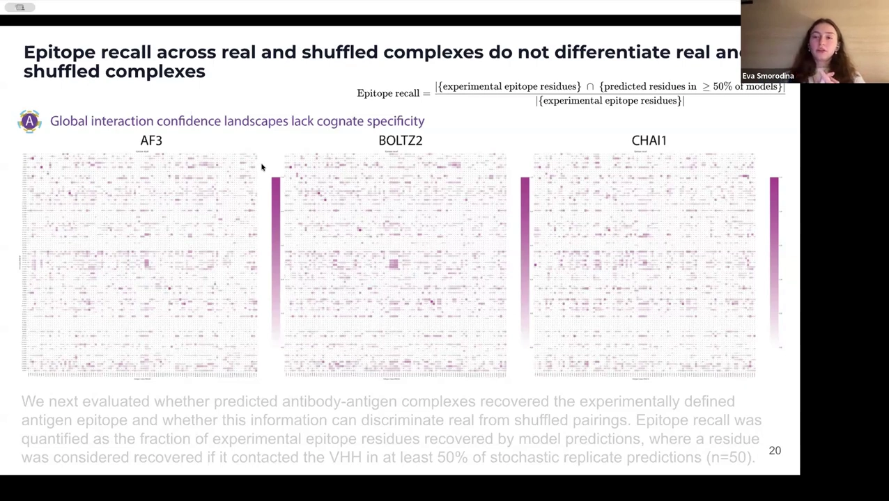

**6. 抗体专用工具值得用吗？** 两年前测试 AntibodyBuilder、IgFold 时表现不佳；建议选维护频繁、更新及时的工具，且**抗体专用与通用工具混着用**（比如 2:2）——专用工具可能忘了"通用几何规则"，还有安装维护的现实问题。

**7. ipTM 取多少当阈值？** 在她的数据里大多数格子的 ipTM 就是 0.9——**高于 0.9 也不足以区分真假结合**。问题不在阈值取多少，而在"这个工具能不能区分"本身。

**8. 怎么训练一个能辨别真假的"Oracle"？** 好主意是**用阴性数据训练**：把 shuffled 错配对、甚至把 CDR 换成全丙氨酸这类"显然非结合"的样本喂给模型，让它见过"非结合"长什么样；同时少一点层层黑盒、多一点把残基暴露程度、CDR 柔性等先验显式喂进模型。

## 十、小结：对"结合强度分类"类任务的启示

这场报告对 ABDP「Antigen-Antibody Binding——结合强度三分类」这类任务的启示非常直接：

1. **结构预测工具的置信度不能直接当结合分类器用**——真/假结合对的分数分布大量重叠，ipTM 高低与结合正确性脱节；
2. **序列层面的亲和力分类比结构层面更成熟**（数据多、规律清楚），这与 ABDP Binding 采用随机森林等传统模型做结合强度分类的路线相互印证；
3. 若要走结构路线，**多采样 + 样本间一致性（RMSD）+ 多工具投票**是当前最可操作的启发式，且必须用已知 binder / non-binder 基线校准；
4. 任何"结合预测"的评估都要**警惕数据泄漏**：按序列/结构同源性分割数据集（详见本系列 SE3Bind 一篇的对照分析），否则指标再漂亮也可能是假象。
