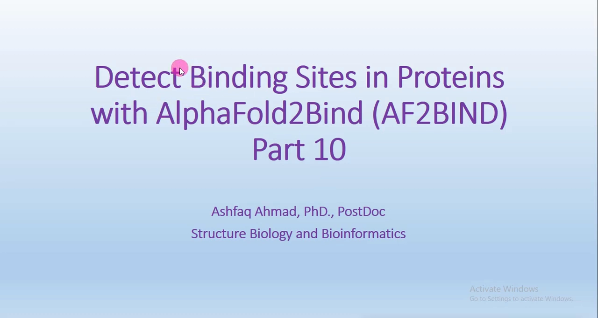
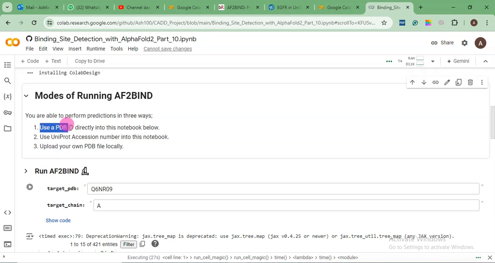
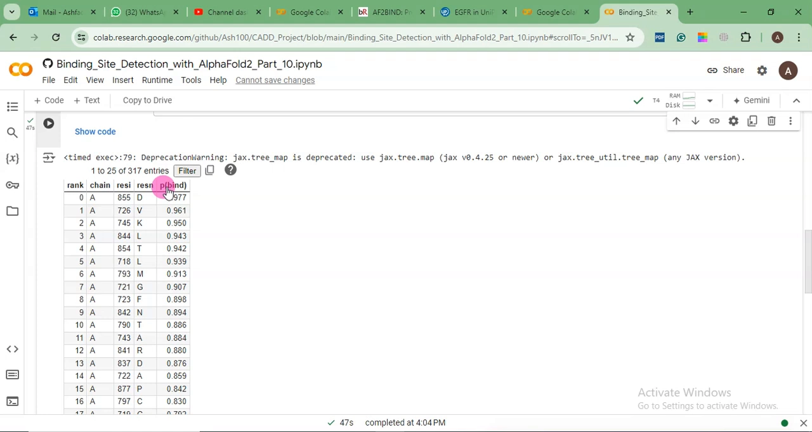
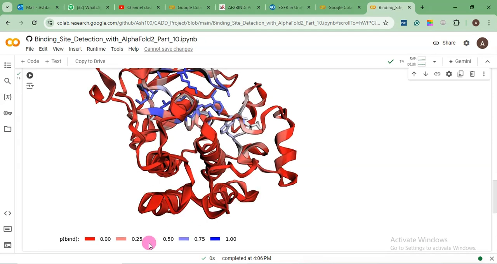
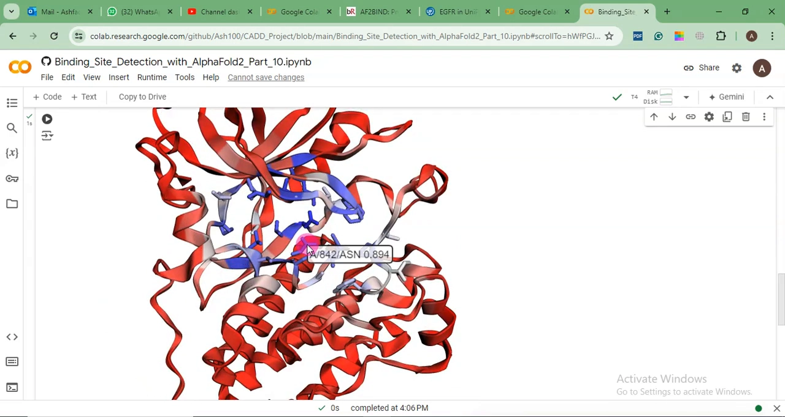
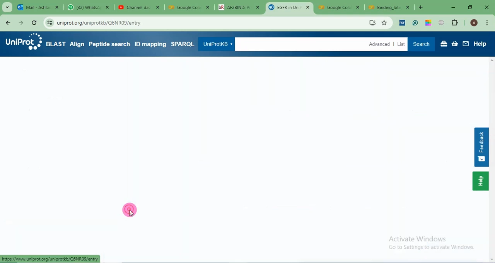
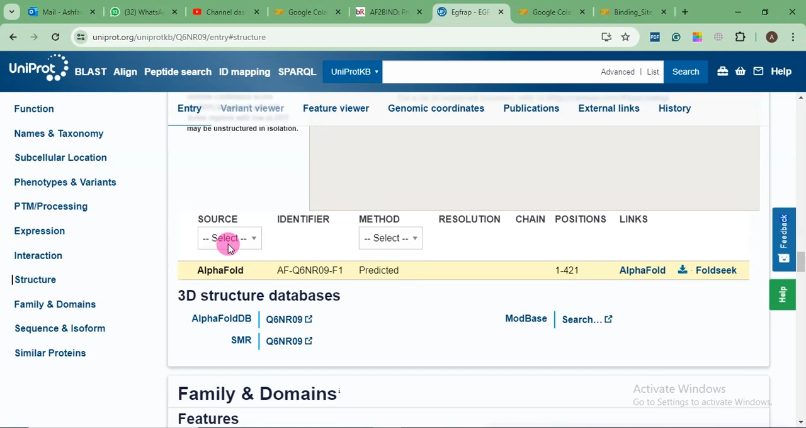
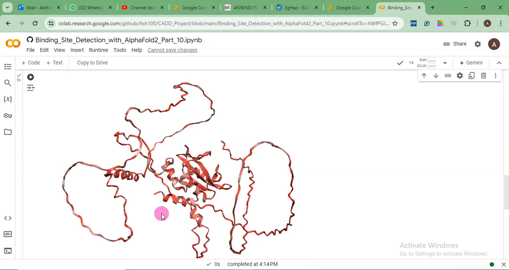
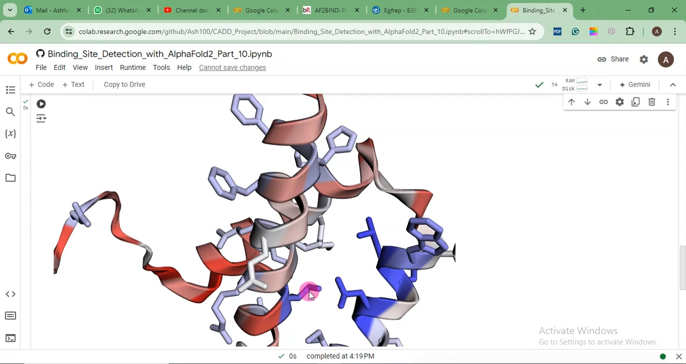
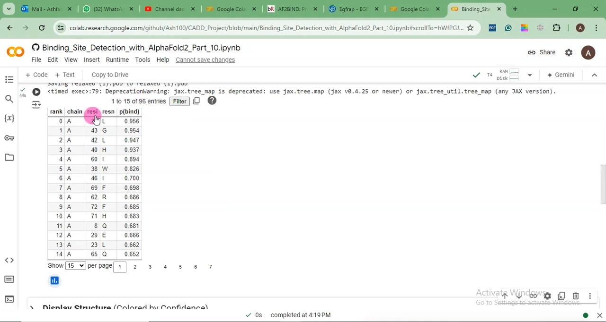

# AF2BIND：用 AlphaFold2 序列嵌入预测配体结合位点

> 视频来源：[How to Predict Ligand Binding Sites with AlphaFold (AF2BIND)](https://www.youtube.com/watch?v=hSsafwj4q0Y)（Bioinformatics Insights，25 分 51 秒，"计算机辅助药物设计"系列第 10 集）
> 本文基于视频演说图文稿整理，内容可回溯到视频时间戳。

## 本讲要解决的核心问题（SCQA）

**背景**：对接前要找蛋白的配体结合位点，经典工具 DoGSiteScorer 和 CLIPs 靠的是几何形状与网格信息——前提是你得先有一个结构。

**冲突**：很多蛋白只有 AlphaFold 预测模型，没有实验结构，也没有现成的位点注释；几何方法在这样的输入上并不好用。

**疑问**：能不能直接从 AlphaFold2 自己"读懂"的序列表征里，把结合位点残基找出来？

**回答（中心思想）**：AF2Bind 就是干这件事的——它把 AlphaFold2 的上下文表征（嵌入）训练成一个结合位点预测器，在 Colab 笔记本里提供 PDB ID、UniProt 登录号、上传自有结构三种用法，输出逐残基的 pBind 结合概率与置信度配色结构视图。本讲完整走一遍三种用法，并重点讲清"无序区"与"残基编号"两个坑。

## 一、AF2Bind 是什么：从几何方法到嵌入方法

- **方法内核**：AF2Bind（AlphaFold2 Bind 的缩写）利用 AlphaFold2 的上下文表征（context representation，即嵌入/参数），据此训练出的结合位点预测方法。
- **出处**：论文 2023 年 10 月 18 日提交于预印本平台 bioRxiv（冷泉港实验室主办）。预印本意味着当时正在同行评审、可免费获取，可以放心引用预印本版本。

- **定位**：作者声称其表现迄今优于该领域其他可用程序。与上一集用的 DoGSiteScorer / CLIPs（基于几何形状与网格信息）相比，AF2Bind 是一个**训练好的机器学习模型**，拿来直接用即可。
- **版本边界**：AlphaFold 3 上个月刚发布，但在 AF3Bind 这类更新出现之前，目前就用 AlphaFold2 版本。

## 二、准备：跑通 Colab 笔记本

笔记本链接在视频描述区，位于讲者的 CADD 项目下，名为「Binding site detection with AlphaFold 2, Part 10」。步骤：

1. **Connect** 连接运行时；
2. 点击 **Install AlphaFold 2**——同时安装 AlphaFold2 嵌入与 AF2Bind；
3. 这个程序简单快速，装完即可用。

## 三、方式一：PDB ID 直跑（最常用）

直接填 PDB 编号（示例沿用上一集的 `3W32`）和链（A；不确定是 A 还是 B 就去 PDB 查），点运行即可。

### 3.1 结果表怎么读

结果是一张逐残基的表，默认显示 15 条，点 Show 可看 25 条；整个蛋白共 317 条记录，支持按链、残基范围等条件过滤。列含义：

| 列 | 含义 |
| --- | --- |
| Rank | 排名 |
| Chain | 链 |
| Residue 编号/名称 | 残基编号与单字母代码（Asp 天冬氨酸、Lys 赖氨酸、Leu 亮氨酸、Thr 苏氨酸等） |
| pBind | **结合概率（probability of binding）** |

怎么读 pBind：**0.977 ≈ 97.7%，差不多 98%**，是非常高的分数，该残基可判定为真阳性；往下翻分数会显著下降。

### 3.2 置信度配色：结构视图上的"热力图"

把结构显示出来，颜色按置信度标记：

- **深蓝** = 置信度 1 或接近 1；
- **浅蓝** ≈ 75%；
- **偏白** ≈ 50%；
- **红** = 0%。

把光标停在结构或表格的残基上即可查询：例如 **Asn 842，得分 0.894（约 89%）**；颜色更深（深蓝）的残基分数应更高（如 0.855 一带，口述约 97%）；而浅色的 **0.517 ≈ 51%**——分数越低颜色越浅。

### 3.3 论文用图别直接截图

讲者特别提醒：**不要把笔记本里的视图截图直接放进论文**——截图工具裁出来约 96 DPI，而期刊最低要求 300 DPI。正确做法：保存结果表（或下载预测结果单元格的输出），再用 Discovery Studio、Chimera、PyMOL、VMD 等你惯用的软件重新作图。

## 四、方式二：没有 PDB 结构时，用 UniProt 登录号

### 4.1 先在 UniProt 里确认"有没有结构"

UniProt 是通用蛋白（Universal Protein）数据库：查序列、PTM（翻译后修饰）、结构是否已存入 PDB 等。演示案例是果蝇（Drosophila melanogaster）的 EGFR 适配蛋白（421 个氨基酸）：点开 Structure 选项，**没有任何 PDB 条目**——说明只有 AlphaFold 自动预测的结构。

### 4.2 复制登录号去跑

把这个蛋白的 UniProt 登录号（Q6NRO）复制、粘贴进笔记本再运行，约一两分钟出结果。

### 4.3 全偏白意味着什么

pBind 值偏低别惊讶——这是随手选的演示蛋白。关键是现象：**pBind 低于 50% 的区域颜色都偏白，看不到深蓝的棍状表示**。结合位点信号弱时，结构视图上确实"什么都不蓝"。

## 五、绕不开的坑：AlphaFold 结构里的无序区

必须记住：**AlphaFold 不能把所有蛋白都折叠正确**。判别方法（视觉）：结构中间致密的一段"看起来是对的"（不保证一定对），而**散开的线状部分是无序区（disordered region）**——无序区预测服务器很多，可进一步确认。

问题在于：程序会给无序区的残基也猜一个配体结合分数，可无序区根本谈不上"结合口袋"。讲者给出导师式建议，分四步：

1. **文献调研**：弄清这段属于哪个结构域（蛋白常有多个结构域，例如 C 端的催化域）；
2. **读论文**确认配体结合在催化域还是别处；
3. 若配体确实结合在该域：**截取这段序列**，去掉无序区，**重建一个置信度良好的蛋白模型**；
4. 再用 AF2 或其他程序计算配体结合残基。

## 六、方式三：上传自己的 PDB（截短模型的正确姿势）

按上面流程截短/重建的模型（示例是讲者做蛋白弛豫 relaxation 用的文件，链 A），通过 **Choose File** 上传本地 PDB 运行。这次排名最靠前的配体结合残基是三个：**60I（Ile）、42L（Leu）、39K（Lys）**。

### 残基编号陷阱（写论文必看）

这些编号是**模型文件的编号，不是全长蛋白的真实编号**：假设全长 500 个氨基酸，删掉开头约 250 个无序区残基，模型里的"第 1 位"其实是全长的**第 251 位**。两种修正方式：

- **改模型**：送进 AF2Bind 之前，用 Chimera 一分钟内改好残基编号；
- **改表格**：直接加回偏移量——表里的 39 + 250 = 全长 **289**。

## 小结

- AF2Bind 把 AlphaFold2 的上下文表征训练成结合位点预测器，输入不依赖实验结构与 MSA，是几何方法（DoGSiteScorer/CLIPs）之外的嵌入路线。
- Colab 笔记本三步就绪：Connect → Install AlphaFold 2 → 运行；支持 PDB ID、UniProt 登录号、上传自有 PDB 三种输入。
- 结果表逐残基给 pBind 结合概率：0.977≈98% 可判真阳性；结构视图按置信度配色（深蓝≈1 / 浅蓝≈75% / 偏白≈50% / 红=0%）。
- 论文用图不要截图（约 96 DPI，期刊要求 ≥300 DPI）；应保存表格后用 DS/Chimera/PyMOL/VMD 重作图。
- 无 PDB 结构的蛋白走 UniProt 登录号；pBind 全偏低、无蓝色是弱信号现象，不是 bug。
- AlphaFold 结构要警惕无序区：先文献定位结构域，截短重建模后再算；上传自有 PDB 时注意残基编号偏移（模型 1 = 全长 251，39 + 250 = 289）。

## 关键术语速查

| 术语 | 一句话解释 |
| --- | --- |
| AF2Bind | 利用 AlphaFold2 上下文表征训练的配体结合位点预测器 |
| 嵌入（embedding）/上下文表征 | AlphaFold2 内部对序列每个位置的数值化表征 |
| pBind | 逐残基的结合概率，0~1，越高越可能是结合位点残基 |
| 置信度配色 | 结构视图按预测置信度从深蓝到红着色 |
| UniProt 登录号 | UniProt 数据库中蛋白的唯一编号，可作为 AF2Bind 输入 |
| 无序区（disordered region） | 蛋白中缺乏稳定三维结构的区域，结合位点预测在此不可信 |
