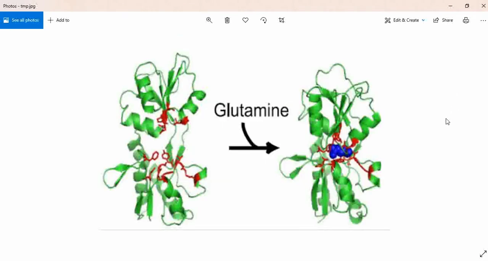
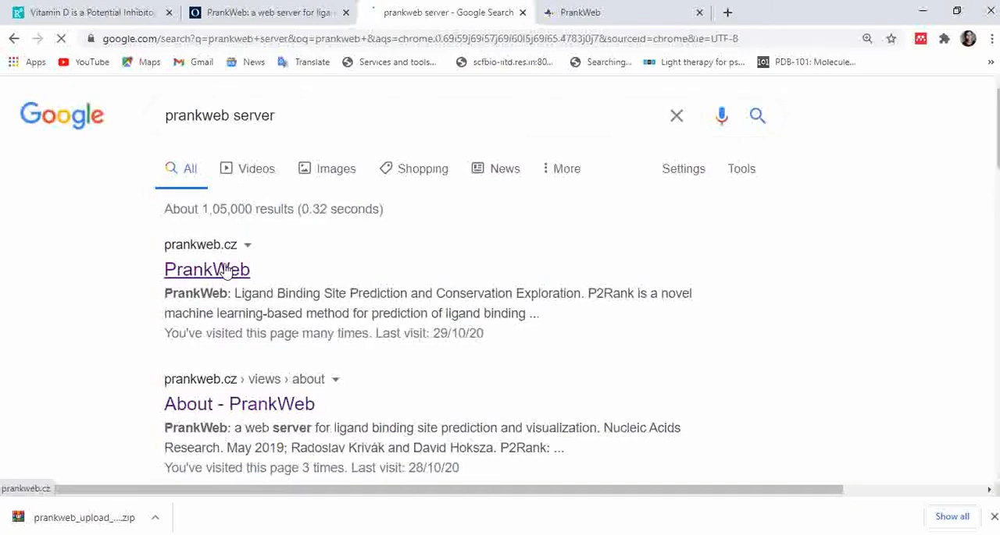
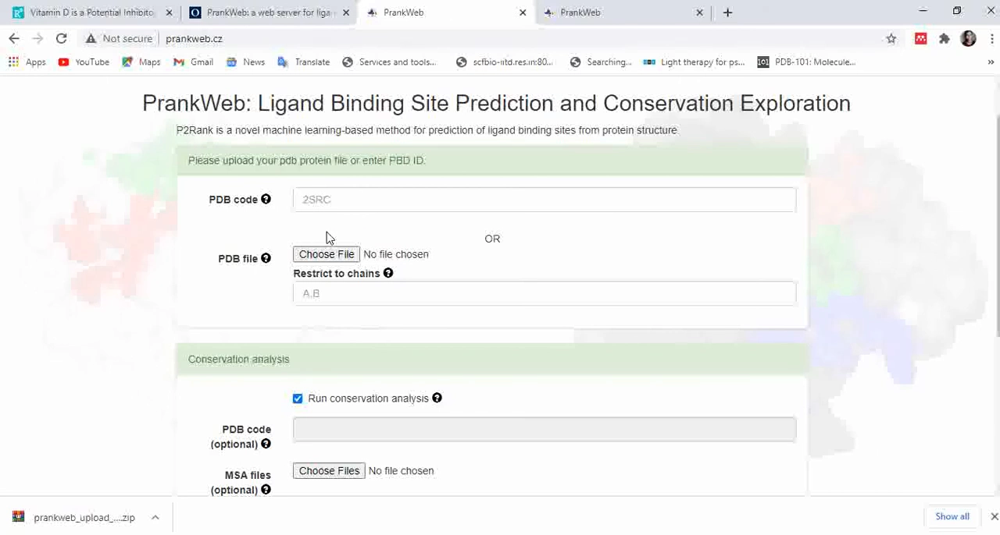
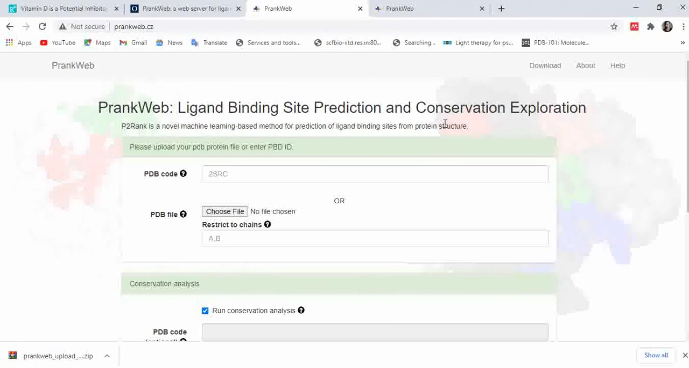
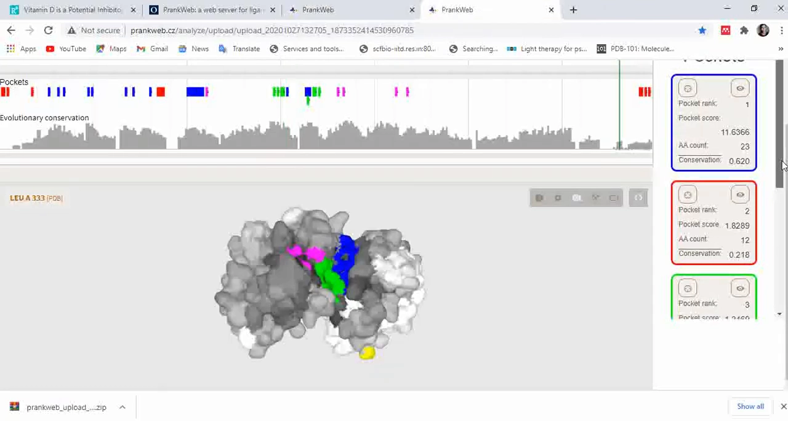
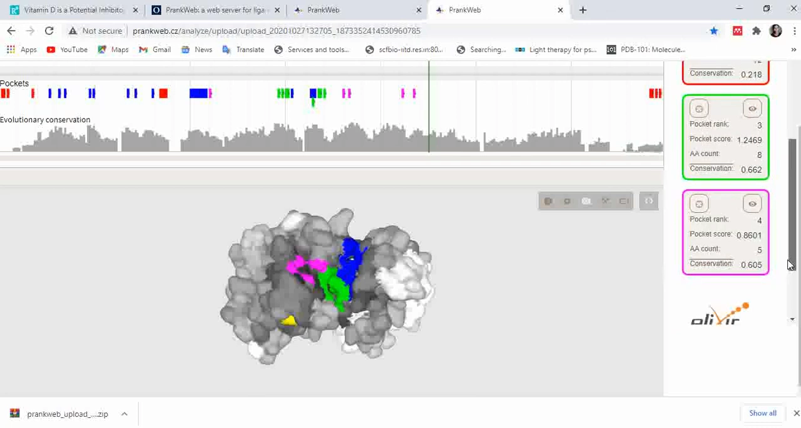
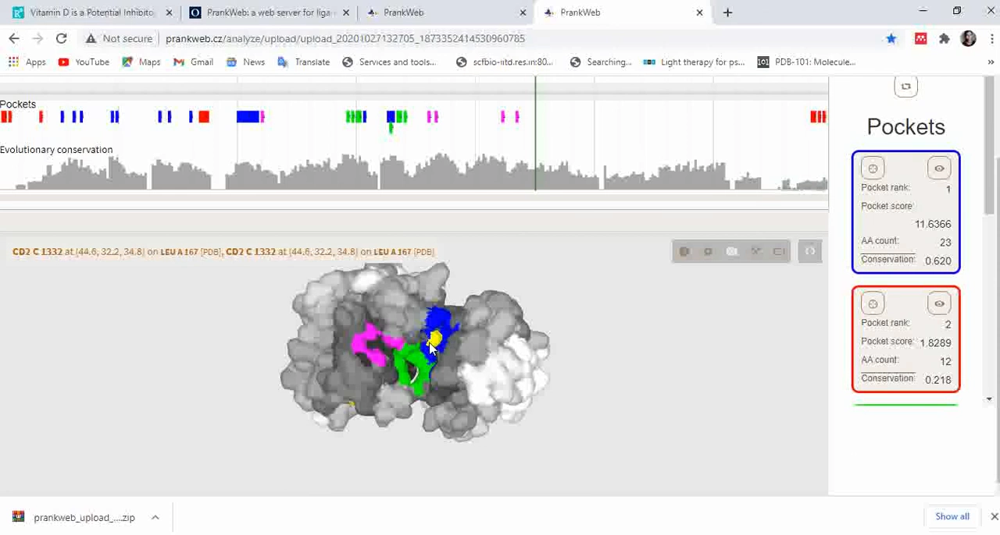
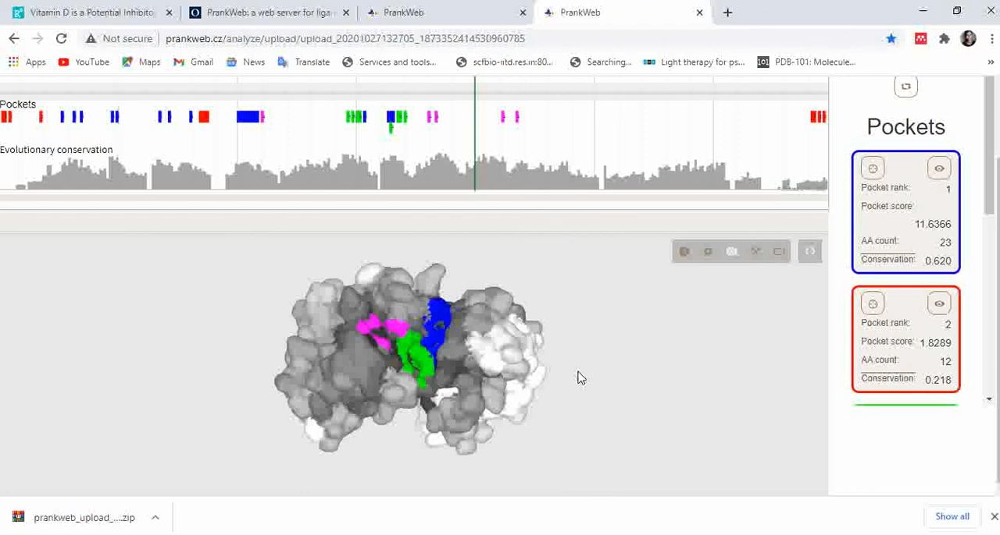
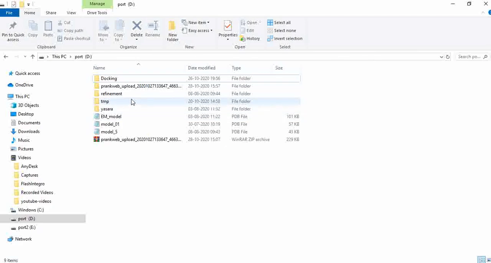
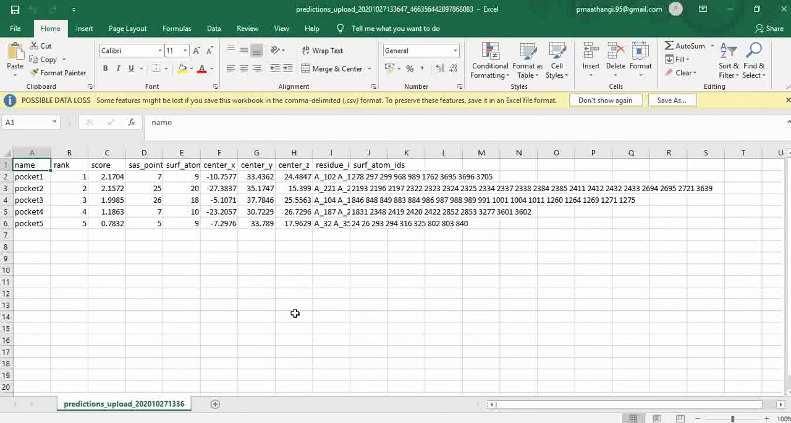

# PrankWeb：P2Rank 在线预测蛋白配体结合位点

> 视频来源：[PrankWeb - Ligand-binding site prediction server](https://www.youtube.com/watch?v=9Vm0MFsJfq0)（Bioinfo lab，15 分 21 秒）
> 本文基于视频演说图文稿整理，内容可回溯到视频时间戳。

## 本讲要解决的核心问题（SCQA）

**背景**：做分子对接之前，你得先告诉软件"配体应该结合在蛋白的哪个位置"。要是蛋白结构里没有共晶配体可以参考，这个位置从哪儿来？

**冲突**：靠人工读文献找结合位点又慢又不全，很多蛋白根本没有现成的位点注释。

**疑问**：有没有一个免费、被大量论文验证过的在线工具，输入一个 PDB 编号就能自动把结合位点找出来？

**回答（中心思想）**：PrankWeb 就是这样一个服务器——它以 P2Rank 为预测内核，输入 PDB 编号或自建结构，自动给出按分数排序的候选结合口袋、组成口袋的残基列表和口袋坐标，结果还能直接导出给虚拟筛选用。本讲以 MAP 激酶 1M7Q 为例走完全流程。

## 一、先搞清楚：什么是配体结合位点

### 1.1 配体与靶蛋白

任意蛋白或分子都可以作为**靶标分子**；前来与靶标结合的就是**配体**。配体可以是蛋白分子，也可以是小分子，更常见的是有机小分子化合物。

### 1.2 结合位点在哪儿、长什么样

配体结合到靶蛋白的**特定位置**，与该位置的氨基酸残基相互作用，形成氢键、疏水相互作用、盐桥等——这个位点就是靶蛋白的**配体结合位点**。

### 1.3 为什么配体要结合上去

把同一个蛋白"无配体"与"有配体"两个状态放在一起看：配体结合到结合位点上会**改变靶分子的结构构象**，从而**激活**它或者**抑制**它。至于是激活还是抑制，完全取决于具体是哪种蛋白和哪种配体——这正是药物设计关心的事。

## 二、为什么选 PrankWeb

- **被大量论文引用**：讲者的理由很直接——很多研究工作都用这个服务器做研究、发论文，说明它经受过同行实践的检验。
- **新冠期间也有实战**：2020 年 9 月发表的《维生素 D 是 COVID-19 的潜在抑制剂：与 SARS-CoV-2 内切核糖核酸酶 NSP15 结合位点的计算机分子对接》一文就引用了 PrankWeb。
- **有专门论文**：PrankWeb 有自己的方法论文，里面介绍了预测原理、提交方式与结果分析，建议通读。

## 三、提交任务：一个表单三种填法

打开 [PrankWeb](https://prankweb.cz/)，任务提交表单有几个字段：

| 字段 | 填什么 | 是否必填 |
| --- | --- | --- |
| PDB 编号 | 想分析 PDB 中已有结构时，填它的四字符编号（如 `1M7Q`） | 二选一 |
| 上传文件 | 有自己的建模文件/蛋白文件时，选择文件上传 | 二选一 |
| 链（Chain） | 只想针对某一条链找位点时填上（注意：这里是配体结合位点，不是活性位点） | 可选 |
| 守恒分析（conservation analysis） | 填一个 PDB 编号，或上传一份多序列比对（MSA）文件 | 可选，两个来源二选一或不填 |

两个实用细节：

1. **不需要邮箱**——表单没有邮箱字段，结果不会发到你的邮箱；
2. **一定要保存结果链接**——提交后地址栏会生成结果 URL，把它收藏或存进记事本，之后常回来看看结果是否已公布。

## 四、结果页面怎么读

### 4.1 用已知结构"考"服务器

讲者的验证思路值得学：故意选一个**已知复合物结构** 1M7Q（MAP 激酶，配体就待在它的结合位点里），先在 PyMOL 里打开，把配体标红、围绕配体的结合位点残基标蓝；再对照 PrankWeb 的预测：

结论：**服务器标成蓝色的位置与 PDB 结构中配体所在的位点是同一个位置**——说明它对结合位点的预测确实有不错的准确度。

### 4.2 口袋排名与残基列表

对 1M7Q，服务器给出**约五个口袋**，按**口袋分数（pocket score）**排序打分，并且逐一列出：

- 组成每个口袋的**氨基酸列表**；
- 每个口袋各自的**守恒分数**。

### 4.3 逐残基查询：光标即查即得

想确认"这个口袋到底由哪些残基组成"？把光标放到蛋白上的任意位置即可，同一屏幕会显示对应氨基酸的**链与编号**（例如 A 链 Gly 110，下面还列出 Ile A84、A167、Asp A168 等）。移动光标并记录，就能弄清哪些残基组成了哪个结合位点。

### 4.4 守恒着色：黑→白四档

除口袋颜色外，蛋白其余位点按**氨基酸守恒程度**从黑、深灰、浅灰到白渐变：

- **越黑 = 越保守**；
- **白色 = 没有守恒性**。

结合位点若落在深色（保守）区域，通常更值得相信。

## 五、下载结果，衔接虚拟筛选

在右侧 **Tools** 选项卡下点击 **Download Results**，结果以 zip 压缩包下载。解压后最重要的文件是一个 **Excel 表**：

表里的关键信息有两块：

1. **各口袋的 XYZ 坐标**——告诉对接软件"盒子中心放哪儿"；
2. **组成各结合位点的氨基酸列表**——告诉对接软件"哪些残基算在口袋里"。

有了位点，下一步就是**虚拟筛选**：筛选出可能结合并契合这个结合位点的小分子。预测结合位点 → 虚拟筛选 → 分子对接，这条流水线的前置一步，PrankWeb 一次跑完。

## 小结

- 配体结合位点是配体与靶蛋白特定位点残基（氢键/疏水/盐桥）相互作用的区域；配体结合会诱导构象变化，激活或抑制靶蛋白。
- PrankWeb 以 P2Rank 为内核，被大量论文引用，输入 PDB 编号或上传自有结构即可预测。
- 提交表单支持指定链与可选的守恒分析（PDB 编号或 MSA 文件）；无需邮箱，但务必保存结果链接。
- 结果页按 pocket score 排序给出候选口袋，可用已知复合物结构 + PyMOL 对照来验证预测准确度。
- 光标悬停即可逐残基查询；黑→白着色表示残基守恒程度。
- 导出的 Excel 含口袋坐标与残基列表，是虚拟筛选的直接输入。

## 关键术语速查

| 术语 | 一句话解释 |
| --- | --- |
| 配体（ligand） | 前来与靶标分子结合的分子，常见为有机小分子化合物 |
| 配体结合位点 | 靶蛋白上与配体形成氢键、疏水、盐桥等相互作用的特定位点 |
| pocket score | PrankWeb 给每个候选口袋的打分，用于排序 |
| 守恒分析（conservation analysis） | 基于同源结构或 MSA 评估残基保守程度的分析 |
| 虚拟筛选（virtual screening） | 筛选可能结合并契合结合位点的小分子的计算流程 |
