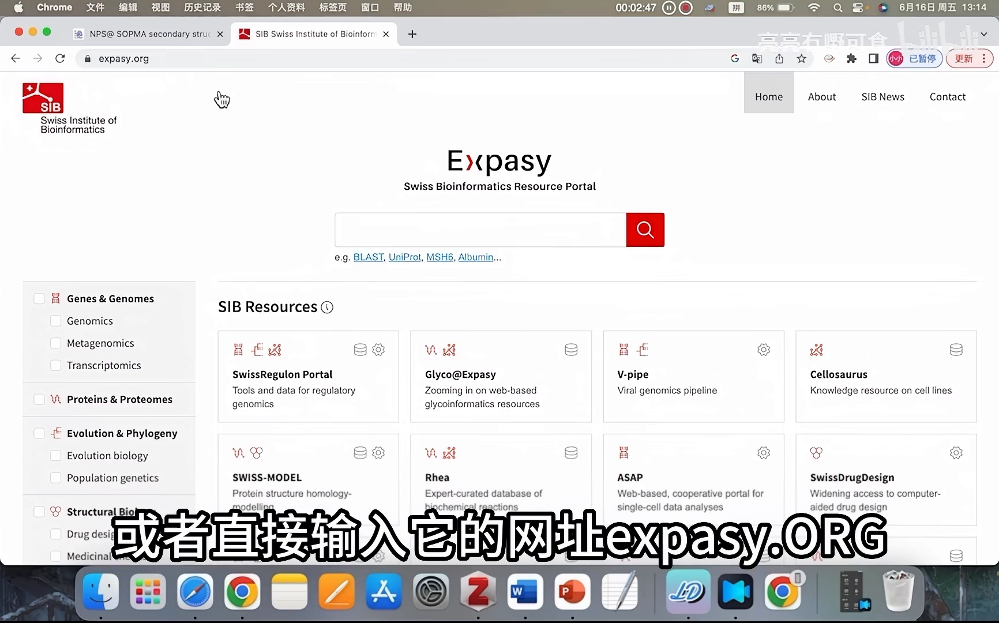
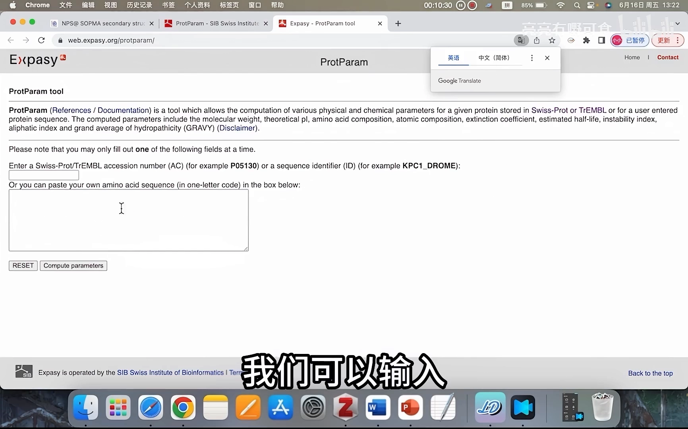
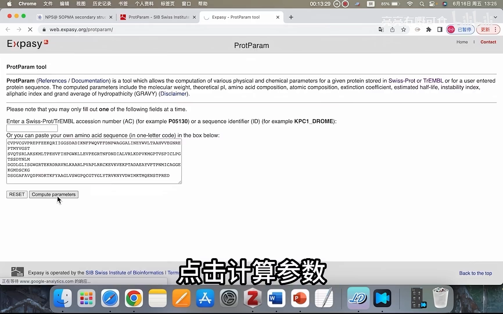
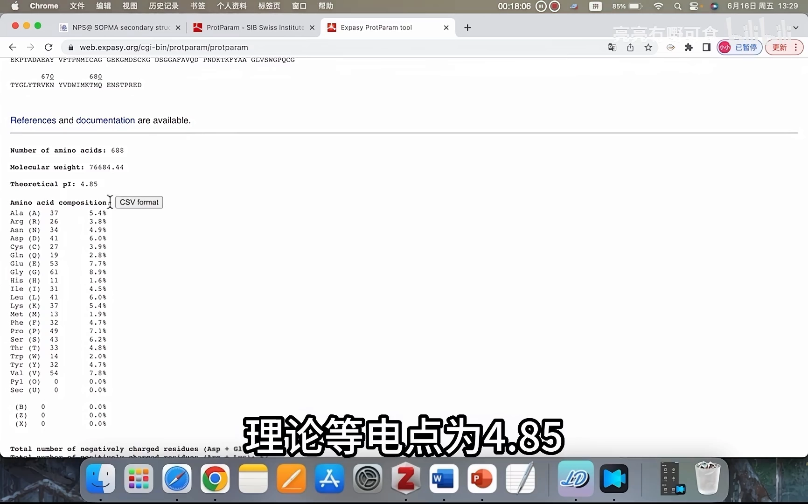
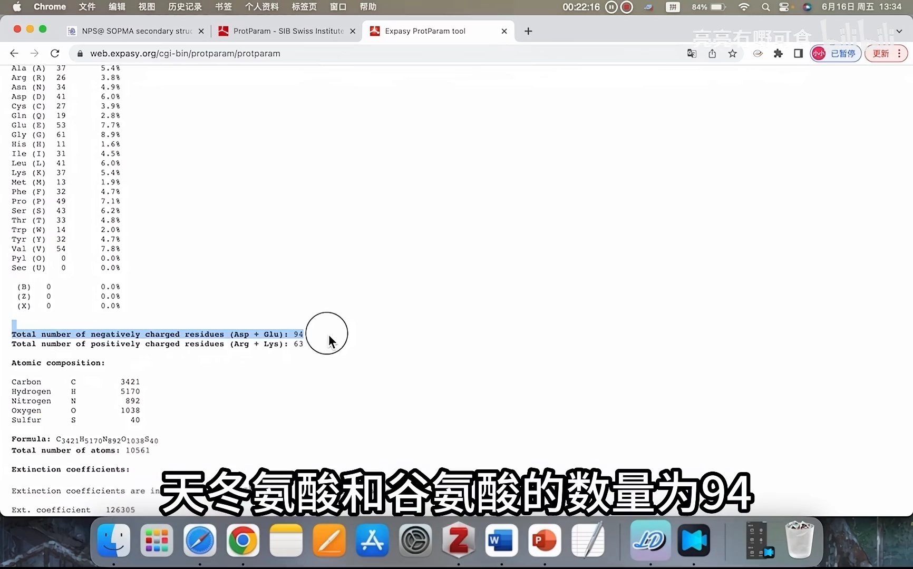
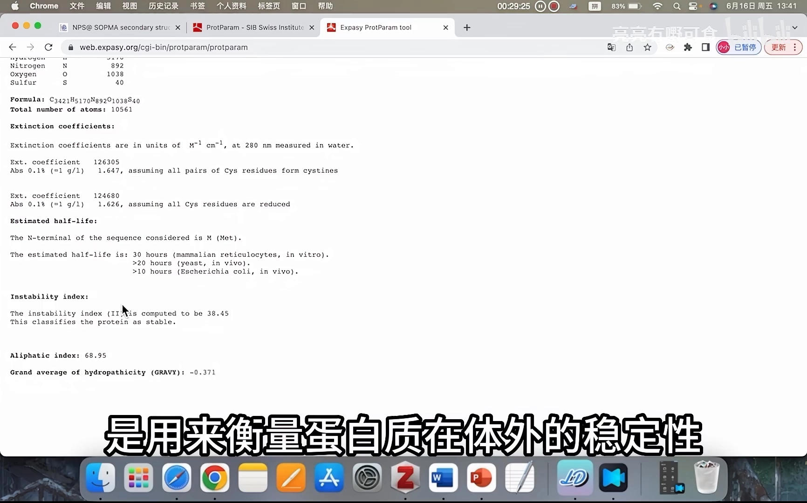
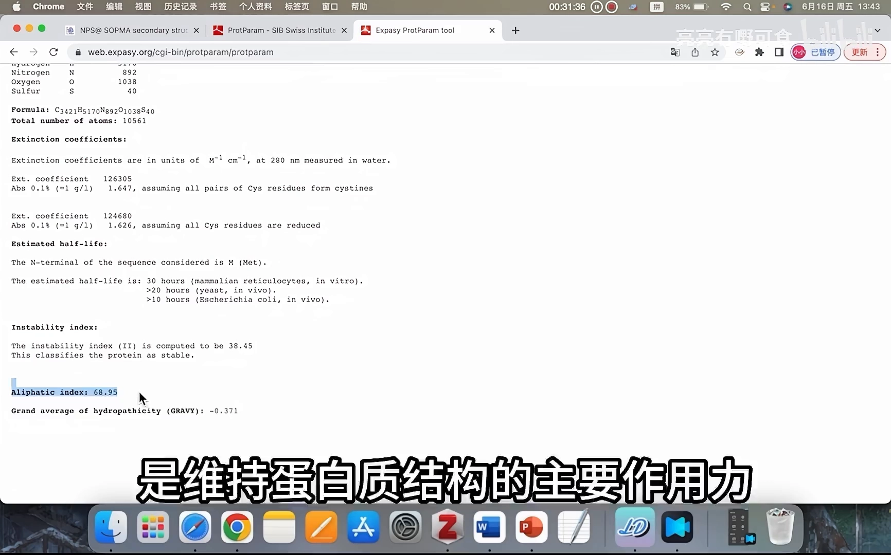
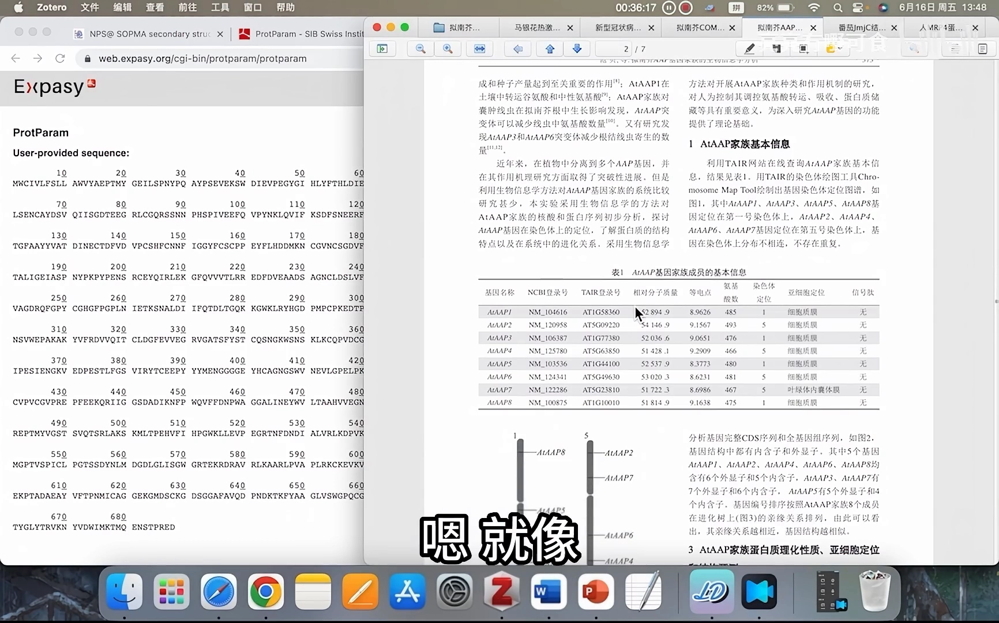

# 如何用 Expasy-ProtParam 预测蛋白理化性质

> 来源视频：[如何用Expasy-ProtParam预测蛋白理化性质](https://www.bilibili.com/video/BV1uu411e77S/)（B 站，5 分 37 秒）。本文基于该视频的「图-字幕」演说稿整理，所有结论均出自视频画面与口播，内容可核查。

## 本讲要解决的核心问题（SCQA）

**背景**：无论是做蛋白实验还是写论文，都要先摸清目标蛋白的"底细"——分子量多大、等电点在哪、稳不稳定。

**冲突**：这些参数手工推算又慢又容易错；而 SDS-PAGE 跑胶、WB、离子交换层析等实验设计，恰恰都依赖这些数值。

**疑问**：有没有"贴入序列、一键返回全套参数"的工具？

**回答（中心思想）**：用 ExPASy 网站里的 ProtParam 工具——粘贴一条氨基酸序列，几秒钟返回分子量、理论等电点、氨基酸/原子组成、消光系数、半衰期、不稳定系数、脂肪族指数、总平均亲水性等全套参数。视频以人补体 C1s 蛋白（688 个氨基酸）为例完整走了一遍流程，并逐项解释每个数值怎么用。

## 一、ExPASy 是什么，ProtParam 在哪

### 1.1 ExPASy：经典的蛋白质组学分析网站

ExPASy 这个名字来源于"蛋白质分析专家系统"（Expert Protein Analysis System）的英文缩写，由瑞士生物信息学研究所开发，是一个经典的蛋白质组学分析网站。首页下方呈现的不同区块，就是它提供的各类分析工具 [【跳转到 00:15】](https://www.bilibili.com/video/BV1uu411e77S/?t=15)。

进入方式有两种：浏览器直接搜索 ExPASy [【跳转到 00:00】](https://www.bilibili.com/video/BV1uu411e77S/?t=0)，或直接输入网址 expasy.org [【跳转到 00:10】](https://www.bilibili.com/video/BV1uu411e77S/?t=10)。

### 1.2 找到 ProtParam 工具并输入序列

在 ExPASy 的搜索栏直接搜索 ProtParam，点击这一工具，就进入分析蛋白质理化性质的界面 [【跳转到 00:15】](https://www.bilibili.com/video/BV1uu411e77S/?t=15)、[【跳转到 00:40】](https://www.bilibili.com/video/BV1uu411e77S/?t=40)。

ProtParam 支持两种输入方式（两个框同时只能填一个）：一是输入 Swiss-Prot/TrEMBL 登记号让它自动查找，二是直接在下方的文本框中粘贴单字母编码的氨基酸序列 [【跳转到 00:40】](https://www.bilibili.com/video/BV1uu411e77S/?t=40)。视频采用第二种：以一条人源蛋白为例，复制它的氨基酸序列 [【跳转到 00:51】](https://www.bilibili.com/video/BV1uu411e77S/?t=51)，粘贴到文本框中，点击"Compute parameters（计算参数）" [【跳转到 01:10】](https://www.bilibili.com/video/BV1uu411e77S/?t=70)。

> 视频口播中的"CS 蛋白"，经粘贴序列核对即**人补体 C1s 亚成分**（Complement C1s subcomponent，UniProt P09871，688 个氨基酸）。

## 二、跑一遍：C1s 的输出长什么样

提交后结果页立刻返回。第一条信息就是序列长度与分子量：这条蛋白具有 **688 个氨基酸**，相对分子质量为 **76684.44**。分子量常以千道尔顿（kDa）为单位，即约 76 kDa。这一数值在 SDS-PAGE 和 WB 实验中会用到——比如判断条带应出现的位置 [【跳转到 01:15】](https://www.bilibili.com/video/BV1uu411e77S/?t=75)。

## 三、逐项读懂输出参数

### 3.1 理论等电点（Theoretical pI）：酸碱性判断 + 纯化依据

C1s 的理论等电点为 **4.85**。等电点小于 7，表示它是一个**酸性蛋白质** [【跳转到 01:40】](https://www.bilibili.com/video/BV1uu411e77S/?t=100)。等电点这一数值会在**离子交换层析**纯化蛋白的时候用到——它决定蛋白在什么 pH 下带什么电荷、与树脂结合还是洗脱。

### 3.2 氨基酸组成与带电残基：等电点背后的账本

结果页下面列出了这一蛋白的氨基酸组成——每种氨基酸有多少个、占比是多少；并列出了带负电荷的氨基酸残基数量：天冬氨酸（D）和谷氨酸（E）共 **94** 个 [【跳转到 01:40】](https://www.bilibili.com/video/BV1uu411e77S/?t=100)；带正电荷的残基：赖氨酸（K）和精氨酸（R）共 **63** 个 [【跳转到 02:05】](https://www.bilibili.com/video/BV1uu411e77S/?t=125)。负电残基明显多于正电残基，与"pI = 4.85 的酸性蛋白"正好对上。

### 3.3 原子组成、分子式与消光系数

接着是原子组成：碳、氢、氮、氧、硫各多少个，以及由此得到的分子式 [【跳转到 02:05】](https://www.bilibili.com/video/BV1uu411e77S/?t=125)。然后是**消光系数**——它表示蛋白质对某一波长的吸收能力，不同蛋白质的数值不同。我们用分光光度计测量蛋白质溶液浓度的时候，就要用到这一数值 [【跳转到 02:30】](https://www.bilibili.com/video/BV1uu411e77S/?t=150)。

### 3.4 半衰期与不稳定系数：体内外两个稳定性刻度

**半衰期**是蛋白质降解一半所需要的时间，用来衡量蛋白质在**体内**的稳定性：半衰期越长，它在细胞中越稳定 [【跳转到 02:30】](https://www.bilibili.com/video/BV1uu411e77S/?t=150)。

**不稳定系数（instability index）**则衡量蛋白质在**体外**的稳定性，做实验时这个数值非常重要 [【跳转到 02:30】](https://www.bilibili.com/video/BV1uu411e77S/?t=150)。C1s 的不稳定系数被预测为 **38.45**，说明它是稳定的。我们一般以 **40 为临界值**：不稳定系数小于 40 说明这个蛋白质能够稳定存在，大于 40 则不稳定 [【跳转到 02:55】](https://www.bilibili.com/video/BV1uu411e77S/?t=175)。如果目标蛋白被预测为不稳定，那么做体外实验时就要注意：实验步骤需要快一点，因为这个蛋白质很容易降解 [【跳转到 03:20】](https://www.bilibili.com/video/BV1uu411e77S/?t=200)。

### 3.5 脂肪族指数：疏水氨基酸占比越高越稳定

**脂肪族指数（aliphatic index）**指蛋白质中脂肪族侧链氨基酸的权重，也就是它们的占比。脂肪族侧链氨基酸就是蛋白质中的疏水性氨基酸——我们知道疏水作用力是维持蛋白质结构的主要作用力，因此脂肪族指数也可以衡量蛋白质的稳定性：**脂肪族指数越高，蛋白质越稳定** [【跳转到 03:20】](https://www.bilibili.com/video/BV1uu411e77S/?t=200)、[【跳转到 03:45】](https://www.bilibili.com/video/BV1uu411e77S/?t=225)。

### 3.6 总平均亲水性（GRAVY）：有参考意义但别迷信

最后一个数值是**总平均亲水性（GRAVY）**：把亲水氨基酸记为正值、疏水氨基酸记为负值，求平均就得到该蛋白的平均亲水性。理论上数值越大亲水性越强，但实际上这个数值的参考意义并不是很大 [【跳转到 03:45】](https://www.bilibili.com/video/BV1uu411e77S/?t=225)。

原因在于：蛋白分子中疏水结构会隐藏在蛋白质内部，而亲水结构会暴露在蛋白质表面——疏水性氨基酸多不代表它就是疏水性蛋白，亲水性氨基酸多也不代表它就是亲水性蛋白 [【跳转到 04:10】](https://www.bilibili.com/video/BV1uu411e77S/?t=250)。

## 四、把参数用起来：Excel 汇总与论文三线表

以上就是用 ProtParam 预测蛋白质理化性质结果部分的解读 [【跳转到 04:10】](https://www.bilibili.com/video/BV1uu411e77S/?t=250)。实际研究中，我们一般会将所研究蛋白质的这些理化参数统计到一个 Excel 表格里面 [【跳转到 04:35】](https://www.bilibili.com/video/BV1uu411e77S/?t=275)。

就像视频展示的文献：作者在研究一个基因家族时，把每个蛋白的氨基酸数、相对分子质量、等电点等所需参数统计下来制成表格——分子量、等电点、不稳定系数、平均疏水性都可以统计起来 [【跳转到 04:53】](https://www.bilibili.com/video/BV1uu411e77S/?t=293)。

蛋白质的这些理化性质不仅在做体外实验时会用到，也是蛋白研究的基础——蛋白质的一级结构（序列）与后面的结构、功能预测有密切的关系 [【跳转到 05:18】](https://www.bilibili.com/video/BV1uu411e77S/?t=318)。

## 小结

- **ExPASy** 是瑞士生物信息学研究所的经典蛋白质组学分析网站，ProtParam 是其中的理化性质计算工具。
- 两种输入方式：填 UniProt 登记号，或直接粘贴单字母氨基酸序列（二选一）。
- 输出从分子量、理论等电点开始，覆盖氨基酸/原子组成、消光系数、半衰期、不稳定系数、脂肪族指数、总平均亲水性。
- **分子量**用于 SDS-PAGE/WB 判条带；**等电点**用于离子交换层析并判断酸碱性（C1s：pI 4.85，酸性蛋白）。
- **不稳定系数以 40 为界**（C1s 38.45 → 稳定），预测不稳定的蛋白做体外实验要加快操作。
- **脂肪族指数越高越稳定**；**GRAVY** 有参考意义但受"疏水藏内、亲水露表"限制，不能机械套用。
- 论文里常把这些参数做成三线表，理化性质也是后续结构/功能预测研究的基础。

## 关键术语速查

| 术语 | 一句话解释 |
| --- | --- |
| ExPASy | 瑞士生物信息学研究所的"蛋白质分析专家系统"，蛋白质组学经典在线分析站 |
| ProtParam | ExPASy 中按氨基酸序列计算理化参数的在线工具 |
| 理论等电点 pI | 蛋白净电荷为零的 pH；<7 为酸性蛋白（C1s 为 4.85） |
| 消光系数 | 蛋白对某波长的吸收能力，分光光度计测浓度时使用 |
| 半衰期 | 蛋白降解一半所需时间，衡量体内稳定性 |
| 不稳定系数 | 衡量体外稳定性，40 为临界值，越大越不稳定 |
| 脂肪族指数 | 疏水（脂肪族）侧链氨基酸的占比，越高越稳定 |
| 总平均亲水性 GRAVY | 亲水记正、疏水记负求平均；仅供参考 |
