# AI辅助抗菌肽的全文库筛选：CRIL 机器学习管线如何把 6400 万候选压缩到 10 条全活性多肽

> 视频来源：络绎科学「学术Online」第 168 期线上活动，黄俊杰博士（浙江大学高分子系）报告《AI辅助抗菌肽的全文库筛选》。
> 对应论文：Junjie Huang, et al, Peng Zhang*, Junbo Zhao*, Jian Ji*. **Nat. Biomed. Eng. 2023, 7, 797**。
> 视频链接：[BV11p4y1E7XH](https://www.bilibili.com/video/BV11p4y1E7XH)，文中时间戳均可点击跳转。

## 本讲要解决的核心问题（SCQA）

**背景**：抗菌肽（AMP）带正电、以"物理裂解"细菌细胞膜的方式杀菌，几乎不诱导耐药性，被寄予替代抗生素的厚望。但要从序列空间里"画"出一条全新的抗菌肽，候选多到天文数字——仅 6 个氨基酸的六肽，全库就有 20⁶ = 6400 万条。

**冲突**：实验手段通量远远不够——固态芯片一次 240 个样品，噬菌体展示一次 80 万，对 6400 万仍是杯水车薪；直接上机器学习也不行——IBM 用生成模型加分子动力学模拟花了 48 天，成功率只有 10%，根因是带 MIC 标签的抗菌肽数据只有约一千多条，模型泛化能力不足、预测不准。

**疑问**：不大规模加数据、也不只靠调参，怎么把"预测不准"这个死结解开？

**回答（中心思想）**：把问题倒过来做——先用"经验判断 → 分类 → 排序 → 回归"的多模块机器学习管线（CRIL）把 6400 万候选压缩到 500 条、再到 10 条，让模型只在"优等生"里做精细判断；再用少量自己实测的数据做增量学习修正模型。结果：六肽库 top10 全部有活性；对 5120 亿样本的九肽全库，27 天完成"计算 + 湿实验"，测试 55 条、54 条有活性（成功率约 98.2%）。

## 一、为什么抗菌肽难找：三条老路的天花板

### 1.1 抗菌肽：不针对靶点的"物理杀菌"

[【跳转到 02:34】](https://www.bilibili.com/video/BV11p4y1E7XH/?t=154)

抗菌肽是一种具有杀灭细菌作用的多肽物质，机制上有三个关键词：

- **带正电**：细菌细胞膜表面带负电，抗菌肽靠静电吸引吸附上去；
- **自组装成孔**：在膜表面自组装形成孔洞结构；
- **裂解细胞膜**：杀菌以裂解细胞膜为主，属于"没有具体靶点"的物理杀菌方式——细菌很难靠改造某个靶点蛋白产生耐药性。

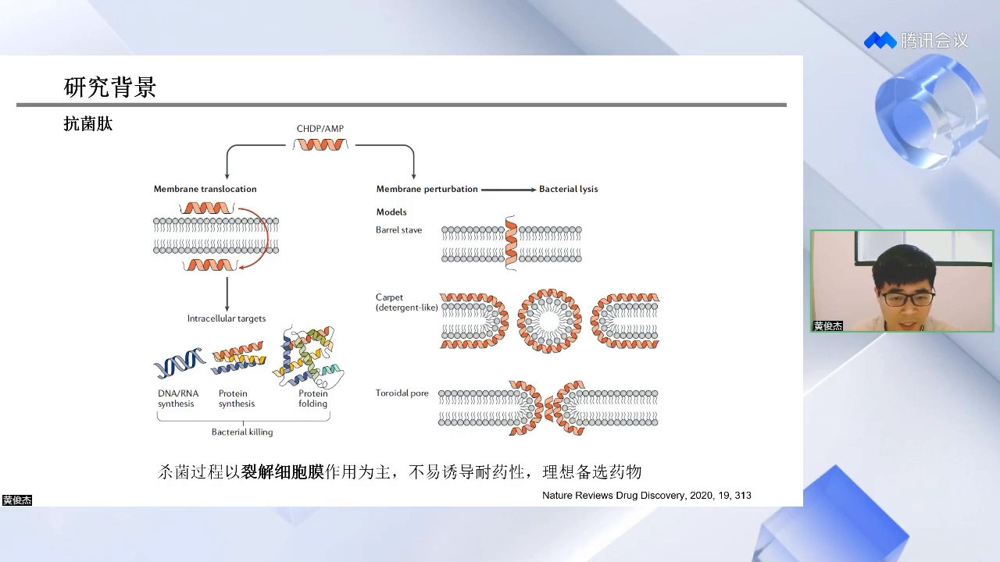

正因为如此，它被认为是理想的抗菌药物候选。天然世界里它也广泛存在——生物的免疫系统就靠分泌抗菌肽（如防御素）来杀灭入侵的细菌，最早的研究者正是从这些现象出发，从生物体中分离纯化出各种抗菌肽。

### 1.2 老路一：以模板为出发点的实验改造

[【跳转到 03:29】](https://www.bilibili.com/video/BV11p4y1E7XH/?t=209)

早期研发从自然界分离纯化开始，之后发展出以已知模板为出发点的改造手段：**氨基酸替换、截减、序列杂交**等，目的一是降低抗菌肽的生物毒性，二是提升抗菌作用。

但这条路的天花板很明显：**只能在模板附近的序列空间里搜寻**。对那些在序列空间上远离模板、却可能功能更强的新型抗菌肽，实验改造束手无策——因为对一条长度为 N 的多肽，每个位置有 20 种可能的氨基酸，全库共 20^N 条，要从如此大的文库中搜寻数量极少的、远离模板的多肽，用实验手段是不可能完成的任务。

### 1.3 老路二：高通量实验，通量仍差两个数量级

[【跳转到 06:44】](https://www.bilibili.com/video/BV11p4y1E7XH/?t=404)

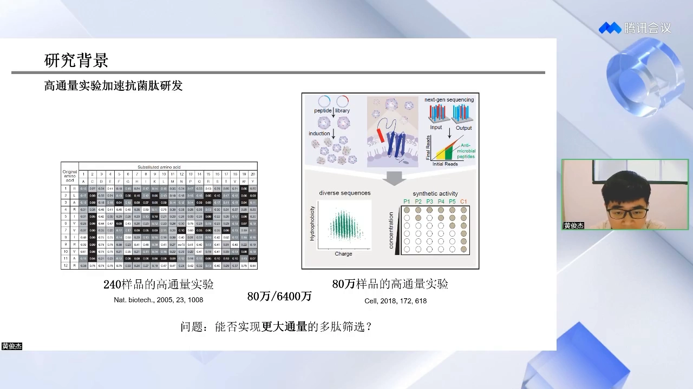

实验界也在加速度：有工作用固态芯片一次产生 240 个样品做后续测试；2018 年 Cell 论文开发出噬菌体展示路线——把肽表达在噬菌体表面进行筛选，一次实验可对多达 80 万个样品做高通量表征。

但回到六肽库：20⁶ = 6400 万个理论多肽样本。**80 万对 6400 万，依然是杯水车薪**。能否通过其他途径实现更大通量的全库筛选，成了必须回答的问题。

### 1.4 老路三：直接上机器学习，为什么只有 10% 成功率

[【跳转到 08:06】](https://www.bilibili.com/video/BV11p4y1E7XH/?t=486)

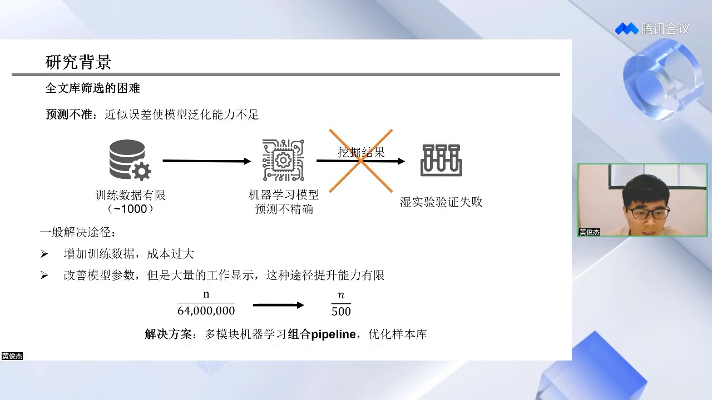

2020 年 AlphaFold 把机器学习带入研究者视野后，IBM 等团队做过尝试：生成模型 + 分子动力学模拟，用自编码器先筛出一批候选，48 天完成抗菌肽识别任务——但**成功率仅 10%**。

反思根因：**预测不准**。机器学习要在数据中寻找规律，而带 MIC 标签的抗菌肽数据仅有约 1000~1762 条，模型泛化能力不足（近似误差大），湿实验验证自然失败。

常规的两条改进途径也都走不通：

1. **增加数据量**：与"避免巨大实验工作量"的初衷相背离；实验扩数据效率低、成本高，而且即使把数据从 1000 条扩大两倍到 2000 条，对模型的提升也十分有限；
2. **调参**：大量工作显示，在数据有限的情况下，这条途径的提升能力同样十分有限。

## 二、CRIL 管线：先"缩库"，再让模型精挑

### 2.1 核心思路：把 6400 万压到 500

[【跳转到 10:11】](https://www.bilibili.com/video/BV11p4y1E7XH/?t=611)

讲者做了一个假设：六肽库里好的抗菌肽有 N 个。**如果能在尽量不丢失这 N 个的前提下，把样本库从 6400 万压缩到 500**，模型的预测压力就会极大降低——模型不再需要在 6400 万"考生"里猜谁及格，只需要在 500 个"复赛选手"里挑冠军，预测准确率自然大幅提升。

于是问题变成：**如何把冗余的 6400 万，缩小、浓缩到很可能富集了抗菌肽的 500 条？** 答案是用多模块机器学习组合的 pipeline 来优化样本库。

### 2.2 管线总览：五个模块接力

[【跳转到 11:24】](https://www.bilibili.com/video/BV11p4y1E7XH/?t=684)

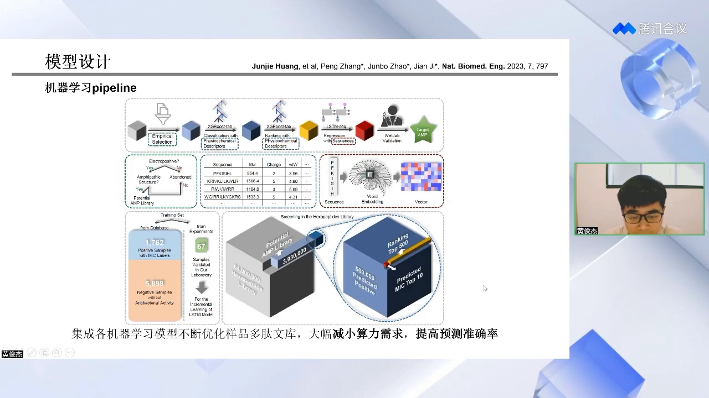

整个 pipeline 由五个部分构成：**经验判断、分类模型、排序模型、回归模型、实验验证**。训练数据从数据库获取：**1762 个带 MIC 标签的阳性样本 + 5898 个阴性样本**，分别训练分类、排序与回归模型；模型输入既包括理化参数，也包括词向量（word embedding）。

以六肽库（6400 万）为例，接力过程是：

| 步骤 | 方法 | 库规模变化 |
| --- | --- | --- |
| 经验判断 | 正电荷 + 两亲性两个边界条件 | 6400 万 → 393 万 |
| 分类模型 | XGBoost（表格特征） | 393 万 → 56 万 |
| 排序模型 | XGBoost + rankings 标签 | 56 万 → 500 |
| 回归模型 | LSTM | 500 → top 10 |
| 实验验证 | 化学合成 + MIC 测试 | top 10 |

### 2.3 第一步：经验判断——用领域知识先把"不可能"踢掉

[【跳转到 12:39】](https://www.bilibili.com/video/BV11p4y1E7XH/?t=759)

6400 万样本中绝大多数不具有抗菌活性。第一步用经验判断设置两个边界条件：**正电荷**与**两亲性**（分子同时具有亲水与疏水区域）——这是抗菌肽普遍存在的结构特征。组合这两个条件，把"可能是抗菌肽"的物质挑出来：**6400 万 → 393 万**。

### 2.4 第二步：分类模型——XGBoost，指标里召回率最优先

[【跳转到 14:30】](https://www.bilibili.com/video/BV11p4y1E7XH/?t=870)

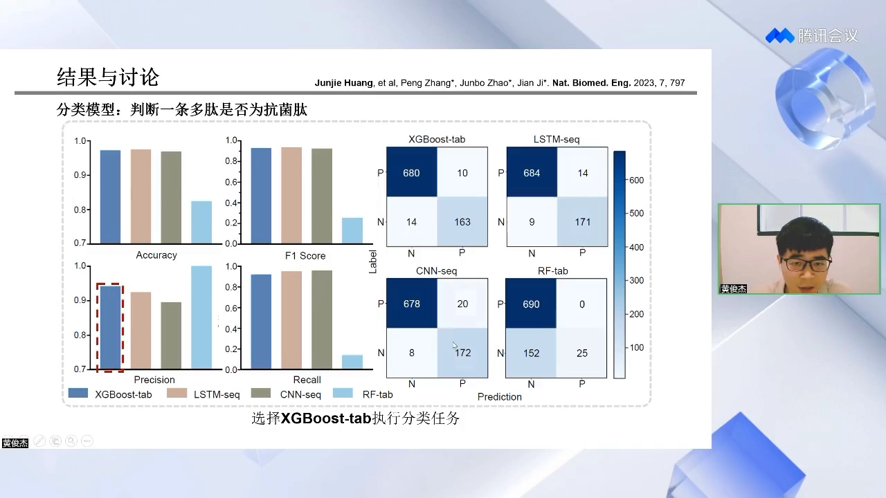

分类模型判断"一条多肽是不是抗菌肽"。讲者用混淆矩阵统计了**准确性、F1 值、精确性、召回率**四项指标，比较了 XGBoost（表格输入）、LSTM（序列输入）、CNN（序列输入）、随机森林（表格输入）等模型，其中两个模型在四项指标上表现最佳；而在这个任务里**最重要的指标是召回率**（宁可多留、不可漏放——真抗菌肽一旦在分类步被丢掉，后面就没有机会了），XGBoost 在召回率上表现最好，因此选它执行分类任务：**393 万 → 56 万**。

### 2.5 第三步：排序模型——用 rankings 替换 MIC 做"降噪"

[【跳转到 15:19】](https://www.bilibili.com/video/BV11p4y1E7XH/?t=919)

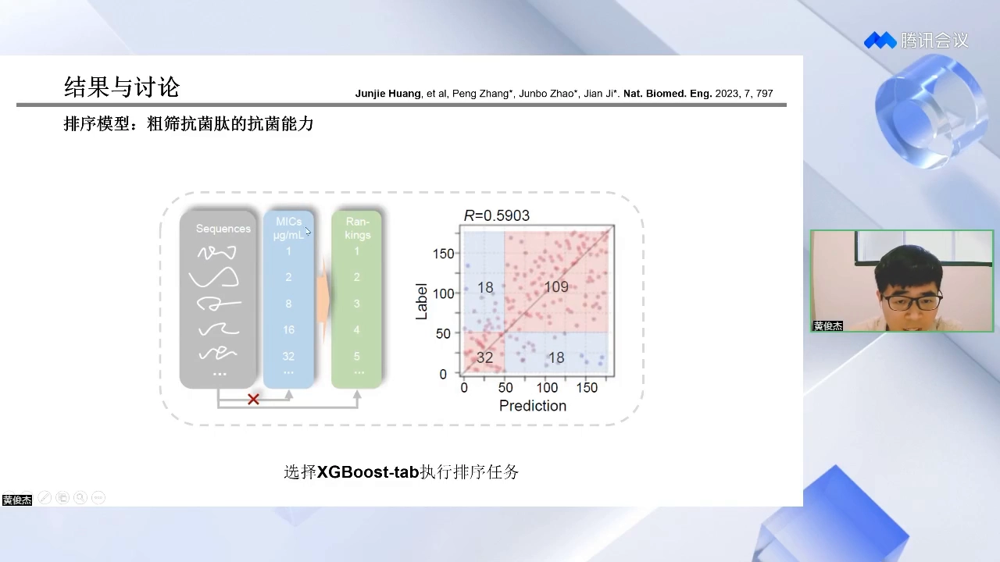

排序与分类是类似任务，直接沿用 XGBoost。但排序环节真正的新意在于**数据降噪**：训练标签本应是抗菌肽的最低抑菌浓度 MIC 值，可这些值收集自各个课题组自己的实验，实验参数不同、天然带噪声。于是把 MIC 数值替换成 **rankings**——按 MIC 从小到大排成 1、2、3…的排名标签，减弱噪声对模型的影响：**56 万 → top 500**。

### 2.6 第四步：回归模型——LSTM 精算 MIC

[【跳转到 16:59】](https://www.bilibili.com/video/BV11p4y1E7XH/?t=1019)

最后一步直接把 MIC 作为标签训练回归模型，共训练了 7 种模型，**LSTM 的 MSE 最小**、预测值与标签的对比也显示其回归能力最强，因此选 LSTM 做 MIC 精确预测：**500 → top 10**。

### 2.7 第五步：实验验证 + 增量学习，把数据噪声"补"回来

[【跳转到 17:39】](https://www.bilibili.com/video/BV11p4y1E7XH/?t=1059)

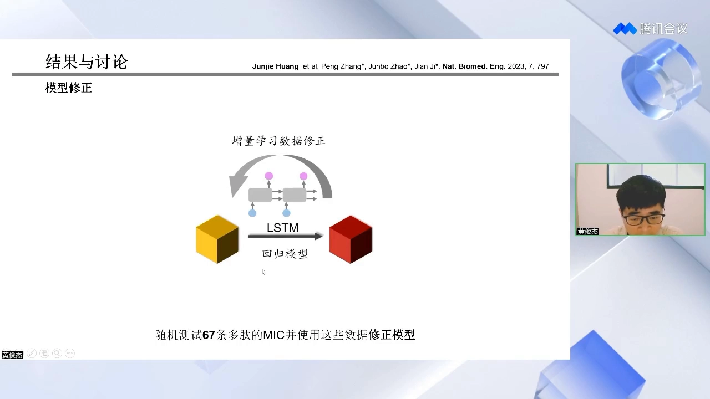

文献 MIC 的噪声到底有多大？讲者随机挑了 **67 条**多肽化学合成、实测 MIC，与文献值对照，确实存在差异。于是**用实验值替代文献值，对模型做增量学习修正**——只用 67 条新数据，模型就能更好地抓住真实实验体系下的 MIC 预测。

在此之后，对 500 条样本做 MIC 精确预测、挑出 top 多肽进行实验验证：**top 10 多肽均具有抗菌活性，MIC 均小于 200 μg/mL**。

## 三、消融实验：每个模块都不可或缺

[【跳转到 18:52】](https://www.bilibili.com/video/BV11p4y1E7XH/?t=1132)

管线设计得是否合理？每一步的贡献到底有多大？作者做了系统消融。CRIL 的四个字母分别是 **C**lassification（分类）、**R**anking（排序）、**R**egression（回归）、**I**ncremental learning（增量学习），分别剔除其中一个步骤（或只保留部分步骤），输出的 top 10 多肽全部化学合成、实测 MIC 来"验货"：

| 管线配置 | 有抗菌活性条数（top 10） |
| --- | --- |
| CR（仅分类 + 排序） | 0 |
| 去掉排序（CRI） | 1（较弱） |
| 去掉回归 | 2（较弱） |
| 去掉分类（RRI） | 4（其中 2 条中等） |
| 去掉增量学习（CRR） | 9 |
| 完整 CRRI | 10，全部有活性 |

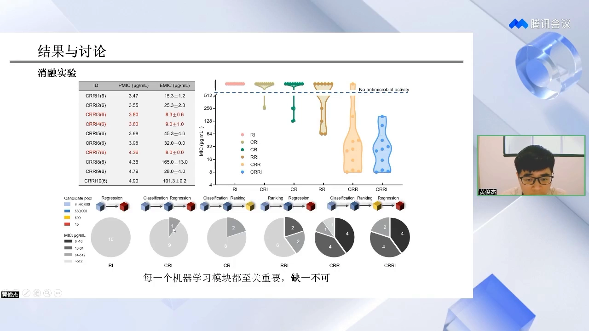

（各配置与活性数的对应关系以讲者口述为准；幻灯片以 RI／CRI／CR／RRI／CRR／CRRI 六种组合展示了十条肽的预测 MIC 与实测 MIC。）其中表现最好的 **CRRI3**（预测 MIC 3.47 μg/mL）实测 MIC 为 8.3±0.6 μg/mL——对一条六肽来说是非常好的值。

## 四、泛化与实战：从 6400 万一路推到 5120 亿

### 4.1 七肽、八肽、九肽全库扫描：27 天跑完"干 + 湿"

[【跳转到 20:57】](https://www.bilibili.com/video/BV11p4y1E7XH/?t=1257)

模型最重要的性能是泛化能力。作者**把六肽上训练好的模型原封不动固定下来**（不做任何修饰），去扫描更大的全库：七肽 12.8 亿、八肽 256 亿、九肽 5120 亿样本。

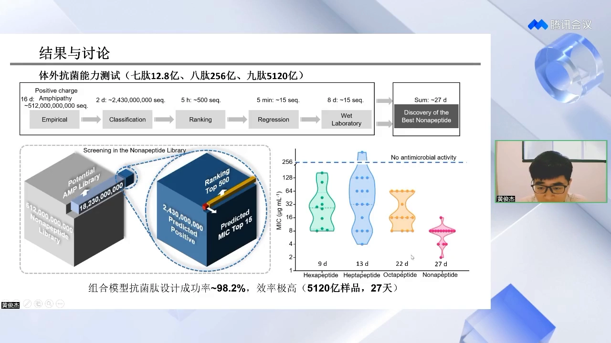

以九肽为例的"干湿接力"时间线：两亲性经验判断约 16 天、分类 2 天（约 24.3 亿候选）、排序 5 小时（约 500 条）、回归 5 分钟（约 15 条）——**计算筛选约 18 天；再花 8 天做湿实验，合计约 27 天**。

结果：共计 55 条测试多肽中 **54 条具有抗菌活性，设计成功率约 98.2%**；九肽最低 MIC 达到 2 μg/mL，几乎接近抗生素的水平。不管从设计成功率、设计的极值还是效率上，这套模型都完成得十分出色。

### 4.2 新颖性：序列差异大，理化性质像

[【跳转到 22:46】](https://www.bilibili.com/video/BV11p4y1E7XH/?t=1366)

设计新肽当然希望它具有新颖性，这样在后续的专利保护上会掌握更大的空间。分析显示：用 Needleman-Wunsch 等多序列比对衡量，**75% 以上的预测多肽与已知多肽的序列相似性小于 40%**；但它们的各项物理化学参数（电荷、疏水性等）其实与训练集里的活性多肽相似——这解释了为什么序列差异非常大，却依然具备抗菌活性。

### 4.3 广谱抗菌：五株临床耐药菌，全面优于最强六肽 MP196

[【跳转到 23:36】](https://www.bilibili.com/video/BV11p4y1E7XH/?t=1416)

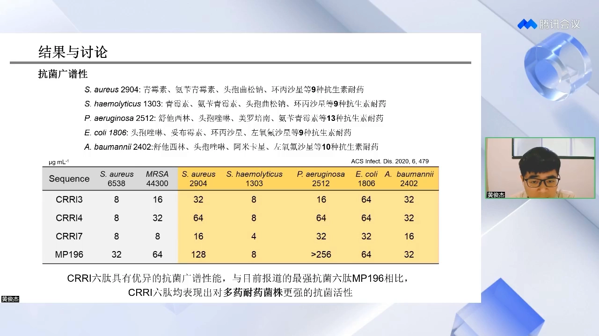

针对"解决耐药菌感染"这个最初目标，作者测试了来自临床分离的 5 株耐药菌：金黄色葡萄球菌 2904、溶血葡萄球菌 1303、铜绿假单胞菌 2512、大肠杆菌 1806、鲍曼不动杆菌 2402——分别对 9~13 种抗生素耐药。CRRI 六肽对它们均表现出较好的抗菌活性，而且**在每一种细菌上的表现都优于目前报道的最强抗菌六肽 MP196**（ACS Infect. Dis. 2020）——不仅抗菌性优异，对多种耐药菌也更强。

### 4.4 安全性：IC50／HC50 支起"治疗窗口"

[【跳转到 24:51】](https://www.bilibili.com/video/BV11p4y1E7XH/?t=1491)

安全性（脱靶毒性）是困扰抗菌肽应用的关键问题。作者测试了细胞毒性（IC50）与溶血毒性（HC50）：CRRI3/4/7 的 IC50 在约 314~944 μg/mL、HC50 在约 758~1289 μg/mL 量级，相对约 8 μg/mL 的 MIC，**IC50/MIC、HC50/MIC 的安全倍数约达 40~118 与 95~161**——对比 MP196 的 43.5 与 >31.2，表现出极低的细胞毒性与溶血性、优秀治疗窗口。

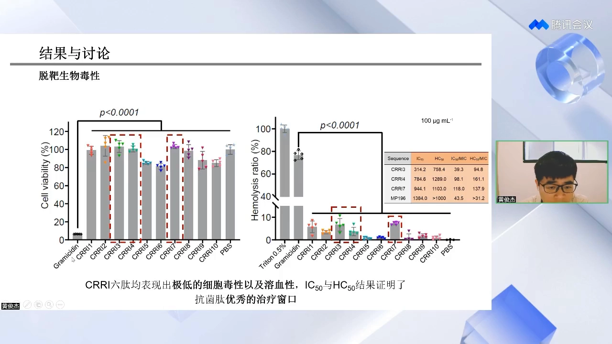

### 4.5 机理与耐药性：裂解细胞膜，100 代几乎不耐药

[【跳转到 25:35】](https://www.bilibili.com/video/BV11p4y1E7XH/?t=1535)

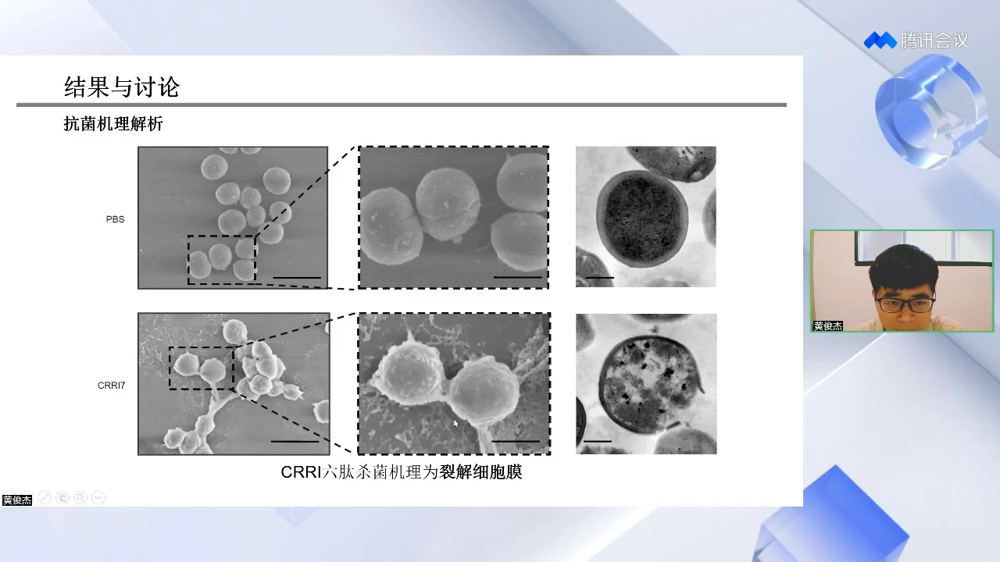

电子显微镜显示，经 CRRI7 处理后细菌表面出现大幅度形变，细胞膜明显破裂、内容物渗漏——印证了"裂解细胞膜"的杀菌机理，这也正是它不易诱导耐药的结构基础。耐药诱导实验进一步验证：在 1/2 MIC 浓度下连续传代培养 100 代，**青霉素的 MIC 提升了 16 倍，而 CRRI3 的 MIC 提升不超过 2 倍**——几乎不诱导耐药。

### 4.6 体内实验：雾化给药治疗急性与慢性肺炎

[【跳转到 26:48】](https://www.bilibili.com/video/BV11p4y1E7XH/?t=1608)

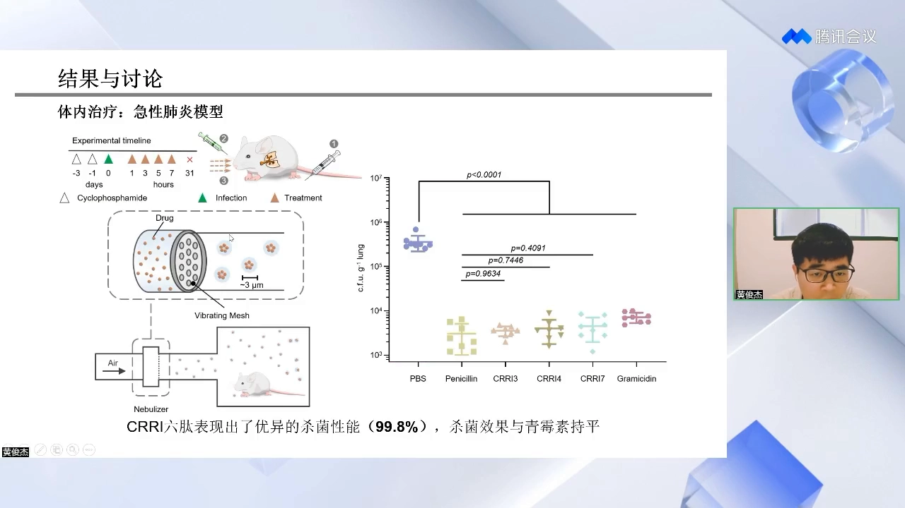

抗菌肽研发最终要用到体内。给药方式选择了**雾化吸入**——这是人类治疗肺部疾病的常用手段，用振动网筛雾化器把药液打碎成约 3 μm 的雾滴，让感染小鼠在雾化箱内自由呼吸吸药，可以更好地模拟未来在人体上实验的给药方式。

- **急性肺炎模型**：先注射环磷酰胺构建中性粒细胞减少症，第 0 天经鼻腔吸入建立感染，随后雾化治疗。结果：**CRRI3 治疗后小鼠肺部感染细菌数量减少 99.8%，与青霉素几乎持平**；肺切片显示肺泡结构清晰完整、无损伤；肺泡灌洗液中 G-CSF、TNF-α 等炎症因子浓度也大幅降低——对炎症同样有抑制作用。
- **慢性肺炎模型**（更难治的生物膜感染，第 -7 天建模、第 1/2/3 天治疗）：**CRRI3 使小鼠肺部细菌减少 98.1%**，杀菌效果同样与青霉素持平。

## 五、Q&A 里的关键澄清（对复现者最有用）

[【跳转到 32:54】](https://www.bilibili.com/video/BV11p4y1E7XH/?t=1974)

- **模型不挑肽长**：训练集 1762 条阳性样本的长度并不固定，训练时不需要考虑长度因素；6/7/8/9 肽只是应用时的示例，不在限制之内。
- **标签绑定"单一菌种"**：本工作的 MIC 全部针对**金黄色葡萄球菌**。这是它与"多菌种 MIC 预测"模型（如对 34 种菌分别输出 MIC 的 APEX 类工具）最大的差异——把这类模型接进设计管线前，先要问清楚"MIC 是对哪种菌测的"。
- **回归做不准？先查数据量与阴性样本**：有观众用约 1000 条金葡菌 MIC 数据 + 随机森林做回归，R² 非常小。讲者的答复：他们用了约 7000 多条（正负合计），数据量是观众的 5~6 倍，而且**阴性样本也要一起参与训练**（只喂有 MIC 值的阳性数据是常见坑）；数据量小的时候，随机森林确实是更合适的选择。

## 小结

- 抗菌肽靠"正电荷 + 裂解细胞膜"物理杀菌，几乎不诱导耐药；但全肽库太大（六肽已 6400 万），实验通量与纯机器学习路线都到不了终点。
- CRIL 管线的核心是"**先缩库、后精选**"：经验判断（正电荷 + 两亲性）→ 分类（XGBoost，召回率优先）→ 排序（XGBoost，rankings 降噪）→ 回归（LSTM）→ 实验验证，把 6400 万一路压到 10。
- 消融实验证明每个模块都不可或缺：完整 CRRI 为 10/10 全活性，去掉任一模块成功率骤降（仅分类+排序时 0/10）。
- 泛化测试把模型原样推到 5120 亿样本的九肽库：约 27 天完成"干 + 湿"，55 条测试 54 条有活性（约 98.2%），九肽最低 MIC 2 μg/mL。
- 新设计的多肽 75% 以上与已知序列相似性 <40%，但理化参数与活性肽相似；对 5 株临床多重耐药菌全面优于最强抗菌六肽 MP196。
- IC50/HC50 相对 MIC 的安全倍数大（治疗窗口好）；1/2 MIC 传代 100 代耐药不超过 2 倍（青霉素 16 倍）；雾化给药在小鼠急性/慢性肺炎模型上达到与青霉素持平的杀菌效果（99.8% / 98.1%）。
- 对复现者的三点提醒：模型不依赖肽长；MIC 标签绑定单一菌种（金葡菌）；回归建模要把阴性样本一起喂进去，数据量是第一瓶颈。

## 关键术语速查

| 术语 | 一句话解释 |
| --- | --- |
| 抗菌肽（AMP） | 带正电、以裂解细菌细胞膜方式杀菌的多肽，不易诱导耐药 |
| 全肽库 | 长度 N 的多肽所有可能序列的集合，规模 20^N（六肽 6400 万） |
| MIC | 最低抑菌浓度：抑制细菌可见生长的最低药物浓度，越低活性越强 |
| CRIL | 本工作的管线缩写：Classification + Ranking + Regression + Incremental learning |
| 两亲性 | 分子同时具有亲水与疏水区域，抗菌肽吸附与成孔的结构基础 |
| rankings | 把带噪声的 MIC 数值替换为按大小排序的排名标签，用于降噪 |
| 增量学习 | 用新实测的 67 条 MIC 数据在既有模型上继续训练修正 |
| 消融实验 | 逐个去掉管线模块，用"成绩下降多少"衡量每个模块的贡献 |
| IC50 / HC50 | 半数抑制浓度（细胞毒性）／半数溶血浓度；与 MIC 的比值越大，治疗窗口越大 |
| MP196 | 已报道的最强抗菌六肽之一（ACS Infect. Dis. 2020），本工作的对照肽 |
