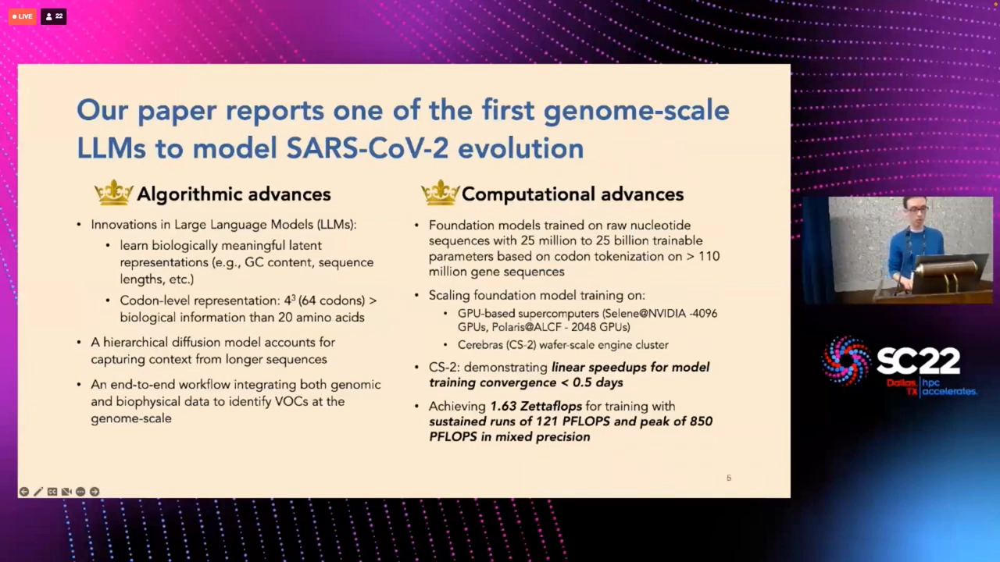
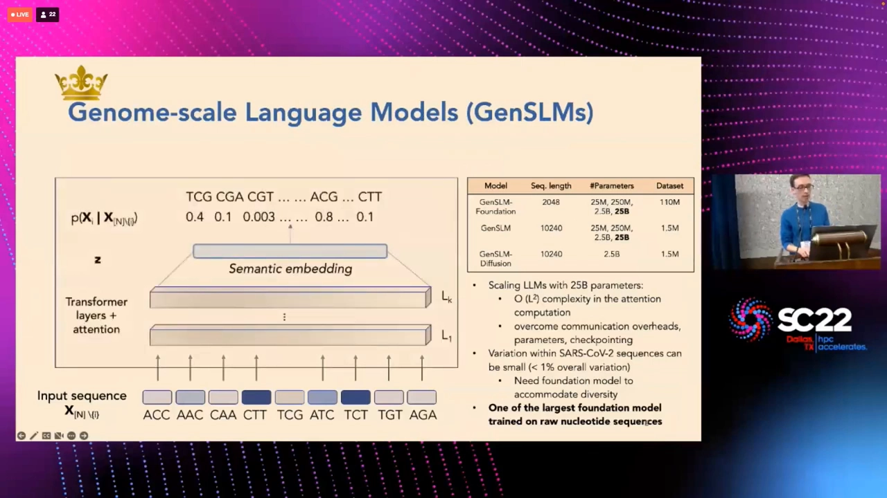
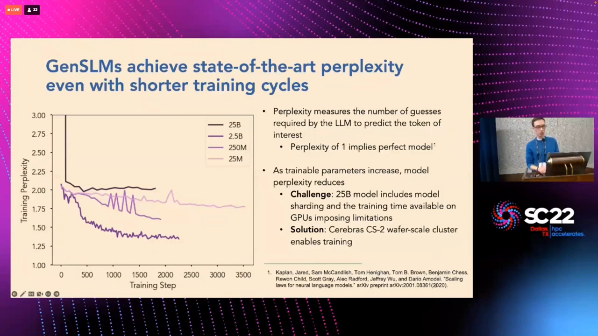
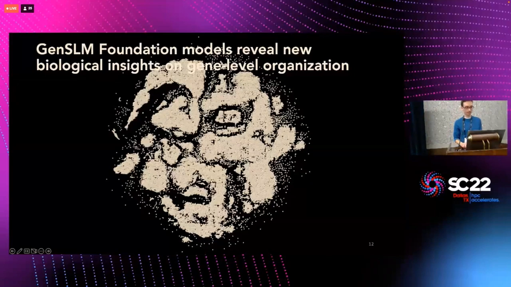
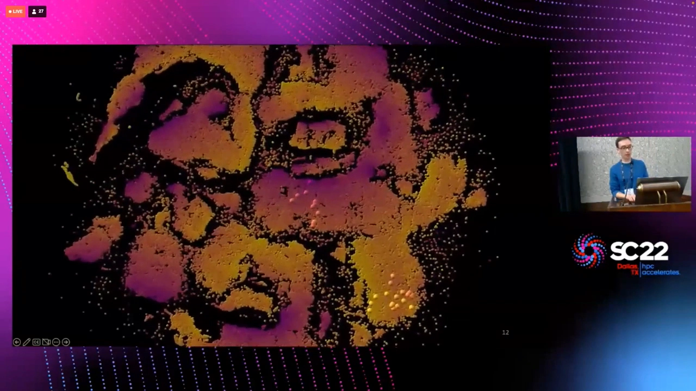
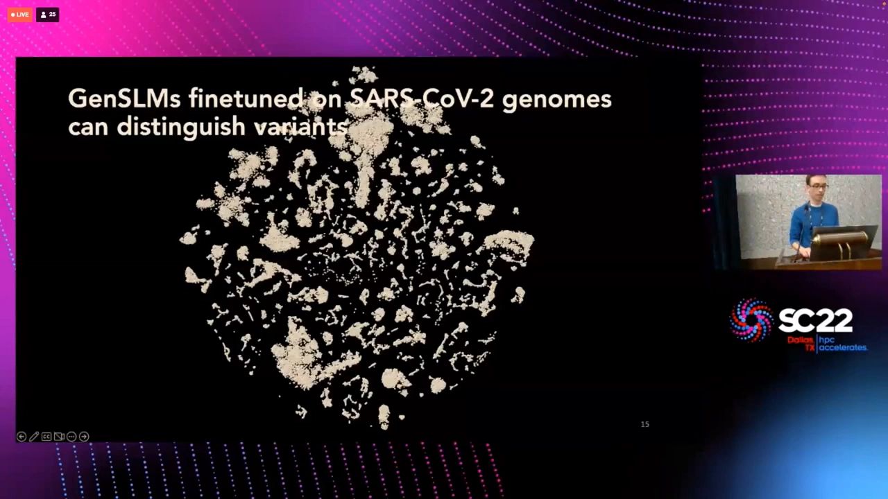
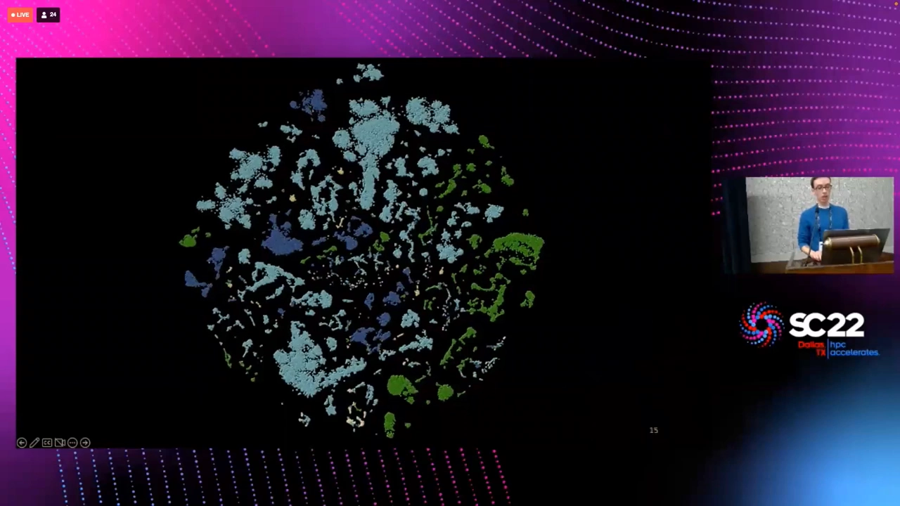
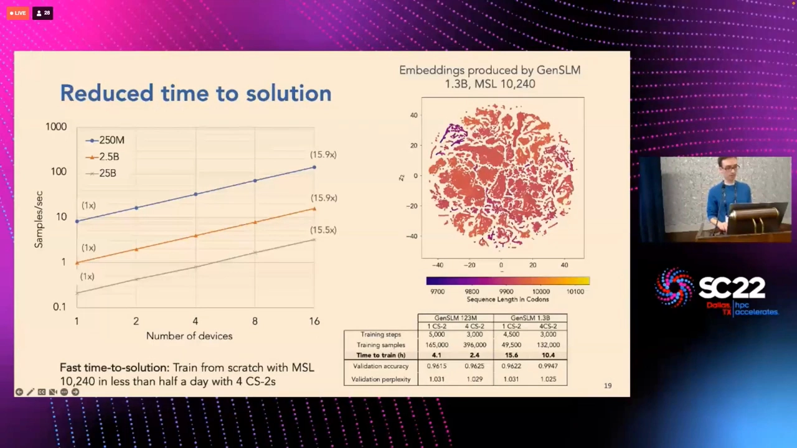
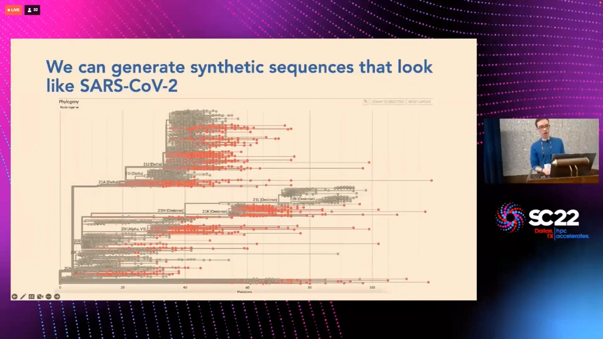
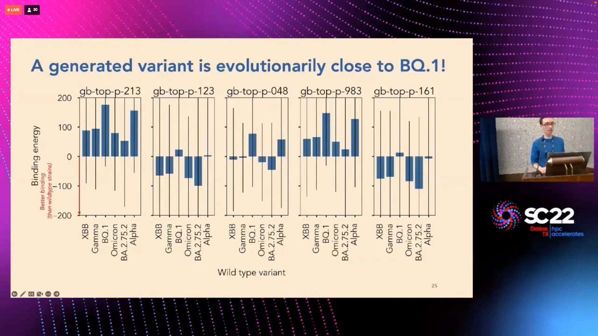

# GenSLMs: Genome-scale language models reveal SARS-CoV-2 evolutionary dynamics

> 视频来源：[YouTube《GenSLMs: Genome-scale language models reveal SARS-CoV-2 evolutionary dynamics》](https://www.youtube.com/watch?v=hlvgQTf1lLc)（28:17），主讲人 **Kyle Hippe**（阿贡国家实验室 Argonne National Lab 研究科学家），SC22 新冠研究特别戈登·贝尔奖（Gordon Bell Prize for COVID-19 Research）决选报告。这是 **GenSLMs——基因组尺度语言模型——的项目报告**：用密码子级分词把 NLP 语言模型搬上 1.1 亿条病毒基因组，从变异株监测的痛点讲到模型、嵌入空间、层级扩散生成与 AI+生物物理的变异株检测全流程。视频字幕为英文自动生成，本文基于文稿整理翻译；文中数字与结论均出自视频内容，可点击时间戳回看核对。

## 本讲要解决的核心问题（SCQA）

**背景**：SARS-CoV-2 的标准变异分析方法是系统发育分析——按遗传谱系给病毒株上色、追踪突变。变异株中传染性增强或症状加重的被称为**关切变异株（variants of concern, VoC）**；识别它们推动了大部分公共卫生响应，但这是个繁琐且资源密集的过程，一个高技能团队要花数月（[【跳转到 02:03】](https://www.youtube.com/watch?v=hlvgQTf1lLc&t=123)）。

**冲突**：只盯着刺突蛋白远远不够——疫苗大多针对刺突，但多数药物靶的是非结构蛋白；病毒与宿主的相互作用遍布全基因组。要看得全，就得建模**整条基因组**；而蛋白质语言模型的视野天然低两个层级（DNA → RNA → 蛋白质），基因组层面还额外携带翻译调控等信息（[【跳转到 02:48】](https://www.youtube.com/watch?v=hlvgQTf1lLc&t=168)）。

**疑问**：基因组序列比蛋白质序列长得多（约 3 万核苷酸）、关注突变又只占不到 1%——语言模型怎么在基因组尺度上学出"生物学意义"？

**回答（中心思想）**：**按密码子分词**。GenSLMs 把基因组切成密码子 token，在超过 1.1 亿条基因组序列上预训练 2500 万~250 亿参数的语言模型家族，再用语义相似度与序列对数似然两个分数 + OpenFold 折叠 + 分子动力学模拟组成端到端的 VoC 检测工作流——只见过第一年数据（Alpha/Beta）的模型，能把从未见过的 Delta、Omicron 按变体聚成簇（[【跳转到 04:28】](https://www.youtube.com/watch?v=hlvgQTf1lLc&t=268)）。

## 一、模型：密码子分词的基因组语言模型

### 1.1 为什么分词单位是密码子

[【跳转到 04:28】](https://www.youtube.com/watch?v=hlvgQTf1lLc&t=268)

GenSLMs 的核心设计就一句话：**learn biologically meaningful latent representations based on codon level tokenization**——基于密码子级分词学习有生物学意义的潜在表征。核苷酸三联体是遗传密码的读取单位，以密码子为 token，模型学的就是"密码子语法"；这也是它与按单核苷酸分词模型的根本区别。

### 1.2 规模：1.1 亿基因组，25M~25B 参数

[【跳转到 04:53】](https://www.youtube.com/watch?v=hlvgQTf1lLc&t=293)

直接在 SARS-CoV-2 基因组上训练走不通——病毒基因组大部分区域高度保守，有意义的突变不到 1%。解法是先在**多样化的 1.1 亿条基因组**上训练基础模型"充值"表征能力，再周期性地用 SARS-CoV-2 数据微调。模型家族横跨 2500 万~250 亿参数并已开源；架构是标准语言模型：嵌入层 → 多层 Transformer 注意力，训练目标为下一 token 预测（[【跳转到 06:33】](https://www.youtube.com/watch?v=hlvgQTf1lLc&t=393)）。

### 1.3 评测：困惑度 1.25

[【跳转到 07:48】](https://www.youtube.com/watch?v=hlvgQTf1lLc&t=468)

基因组模型没有现成评测，先用 NLP 老指标**困惑度（perplexity）**——可以理解为"模型平均要猜几次才能猜中下一个 token"，完美值是 1。参数越大困惑度越低，25 亿参数模型约 **1.25**，后续科学结果基本基于它；250 亿参数模型在常规超算上未能收敛，但换到 Cerebras CS-2 晶圆级集群后可以跑完整数据集（[【跳转到 08:13】](https://www.youtube.com/watch?v=hlvgQTf1lLc&t=493)）。

## 二、嵌入空间：没有标签，模型自己分出了"生物学"

[【跳转到 10:48】](https://www.youtube.com/watch?v=hlvgQTf1lLc&t=648)

验证模型是否学到生物学信息：把验证集子集的嵌入投到空间里，用生物学属性给每个点上色。结果出现清晰的**聚类与梯度**——按基因组长度聚类、按 GC 含量梯度排布（GC 含量是 RNA 相对稳定性的指标）。也就是说，模型在无人监督的情况下找到了"序列稳定性"的表征（[【跳转到 10:48】](https://www.youtube.com/watch?v=hlvgQTf1lLc&t=648)）。

更细的例子：苹果酸脱氢酶有结构迥异的两个同工型，模型把它们放进不同的簇——结构信息模型从没被教过，全靠自己从密码子语料里"悟"出来（[【跳转到 11:21】](https://www.youtube.com/watch?v=hlvgQTf1lLc&t=681)）。

## 三、微调之后：模型"认识"了没见过的变异株

### 3.1 只见过 Alpha/Beta，却给 Delta/Omicron 分了簇

[【跳转到 11:45】](https://www.youtube.com/watch?v=hlvgQTf1lLc&t=705)

把基础模型在**第一年的 SARS-CoV-2 数据**上微调（模型只见过 Alpha、Beta），然后用整个数据集（含第二年才出现的 Delta、Omicron 等）的基因组嵌入：生物学指标依然清晰聚类，而且**模型能按变异株类型给基因组聚类——包括从未见过的变异株**。训练数据里根本没有"变异株"这个概念，这种按演化特征的语义聚类纯粹是语言模型学习能力的产物（[【跳转到 12:03】](https://www.youtube.com/watch?v=hlvgQTf1lLc&t=723)）。

### 3.2 逐 ORF 的对数似然：哪个基因"不太像话"

[【跳转到 12:28】](https://www.youtube.com/watch?v=hlvgQTf1lLc&t=748)

变体级别的可视化：外围是开放阅读框（ORF）及其编码蛋白，内圈是模型对每段序列的对数似然——深蓝代表"模型觉得很合理"，浅蓝代表"可疑"。Beta 变体整体偏浅蓝（模型觉得它不太可能发生）；对比 Iota 与 Beta 在刺突蛋白上的演化连接，不同变体之间连接模式不同——这种跨 ORF 的演化耦合差异暗示表型差异，为研究新发突变提供探针（[【跳转到 13:08】](https://www.youtube.com/watch?v=hlvgQTf1lLc&t=788)）。

## 四、算力与工程：戈登·贝尔奖的另一半

[【跳转到 08:38】](https://www.youtube.com/watch?v=hlvgQTf1lLc&t=518)

这项工作的 HPC 面同样是大奖级：主力平台是 Polaris（阿贡 ALCF）与 Selene（NVIDIA），软件栈为 HuggingFace + PyTorch Lightning + DeepSpeed ZeRO-3；混合精度持续性能 **121 PFLOPS**（峰值 850 PFLOPS），全部科学运行累计 **1.63 ZFLOPS**（[【跳转到 10:36】](https://www.youtube.com/watch?v=hlvgQTf1lLc&t=636)）。扩展性上，25M 模型吞吐约 10⁴ 样本/秒，25B 约 10 样本/秒——模型越大计算/通信重叠越好、扩展效率越高（[【跳转到 09:21】](https://www.youtube.com/watch?v=hlvgQTf1lLc&t=561)）。

Cerebras CS-2 晶圆级引擎的表现更直观：4 台 CS-2 上从零训练 1.23 亿与 13 亿参数的 SARS-CoV-2 专属模型，验证准确率超过 96%，**不到半天收敛**；近线性扩展到 16 台 CS-2，覆盖 2.5 亿~250 亿参数（[【跳转到 14:25】](https://www.youtube.com/watch?v=hlvgQTf1lLc&t=865)）。

## 五、生成与生物物理验证：让模型"想象"变异株

### 5.1 层级扩散生成合成基因组

[【跳转到 15:02】](https://www.youtube.com/watch?v=hlvgQTf1lLc&t=902)

全基因组生成长度太长，普通自回归生成撑不住长程依赖——解法是**层级扩散模型**：在 25 亿参数模型的词级（密码子级）嵌入上做标准高斯加噪/去噪训练，捕捉长程依赖。生成序列的 ORF 分布更贴近真实数据；做系统发育分析，合成基因组会落入并延展现有谱系（橙色点为生成序列，灰色条为真实谱系）（[【跳转到 15:52】](https://www.youtube.com/watch?v=hlvgQTf1lLc&t=952)）。

### 5.2 AI + 生物物理：给"想象中的变异株"打分

[【跳转到 16:42】](https://www.youtube.com/watch?v=hlvgQTf1lLc&t=1002)

检测工作流的另一端是生物物理验证：折叠一条刺突蛋白约 30 分钟、MD 模拟数小时——不可能对全部序列跑。于是按谱系内系统发育邻居数过滤、聚类取样，用 OpenFold（AlphaFold 开源复刻）折叠刺突蛋白、提取表位改变评分与 ACE2 受体结合亲和力。结果：**部分生成变体对 ACE2 的结合比多数野生型更紧**——层级扩散不仅保住了演化信息，还维持了训练数据里没有的生物物理性质（[【跳转到 17:32】](https://www.youtube.com/watch?v=hlvgQTf1lLc&t=1052)）。

叠加 MD 模拟的个例（[【跳转到 17:57】](https://www.youtube.com/watch?v=hlvgQTf1lLc&t=1077)）能直接看到突变如何改变蛋白结合区域、让病毒与 ACE2 的相互作用更稳定——这就是"生成式模型预演变异株"的具体形态。

## 六、读后小结

[【跳转到 18:26】](https://www.youtube.com/watch?v=hlvgQTf1lLc&t=1106)

- **一句话**：GenSLMs 证明"密码子分词 + 语言模型"可以一直放大到基因组尺度——1.1 亿基因组、最高 250 亿参数，嵌入空间里自动长出 GC 含量、基因组长度、变异株类型这些生物学结构，未见过的变异株照样被识别。
- **对本条目（mRNA-FM/密码子分词）的意义**：GenSLMs 是"密码子分词"路线在基因组层面的先例——mRNA-FM 把同一思想用在 mRNA 上（密码子是翻译的读取单位、也是 mRNA 最自然的 token），GenSLMs 则展示了这条路线的可扩展性与"语义聚类先于标签"的独特优势。
- **超越新冠**：同一套基础模型 + 微调流程可快速适配未来的任何病毒疫情（Q&A 中作者确认这是平台目标）；远期应用还包括未知基因/蛋白注释、蛋白工程与疫苗/治疗设计（[【跳转到 19:16】](https://www.youtube.com/watch?v=hlvgQTf1lLc&t=1156)）。
- **工程注脚**：121 PFLOPS 持续、1.63 ZFLOPS 累计、CS-2 半天收敛——"AI for Science"的这类成果，一半在模型，一半在让模型跑得起来的系统工程。

---

*信源：SC22 戈登·贝尔奖（新冠研究）决选报告《GenSLMs: Genome-scale language models reveal SARS-CoV-2 evolutionary dynamics》（Kyle Hippe, Argonne；Ramanathan Lab 频道上传），时间戳均可点击回看；文稿为平台自动字幕，「immune escape/Perlmutter」等个别专名按上下文整理，以论文（bioRxiv 2022.10.10.511571）与官方资料为准。*
