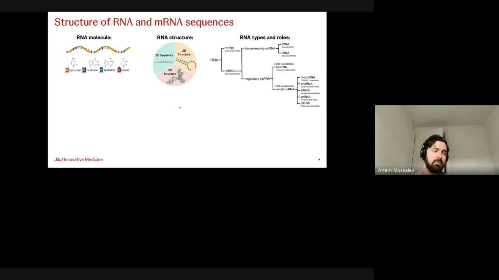
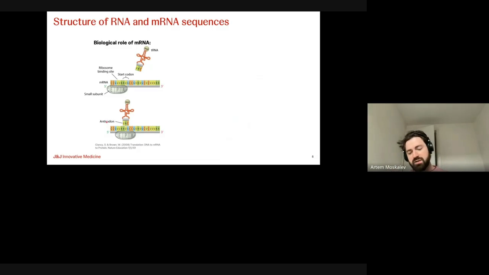
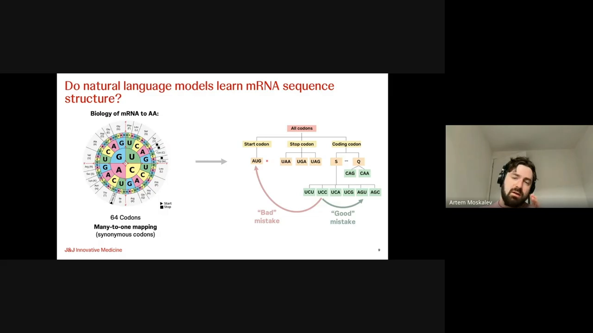
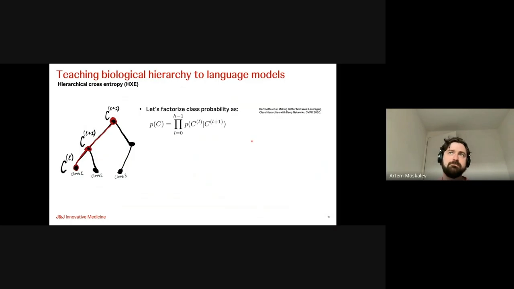
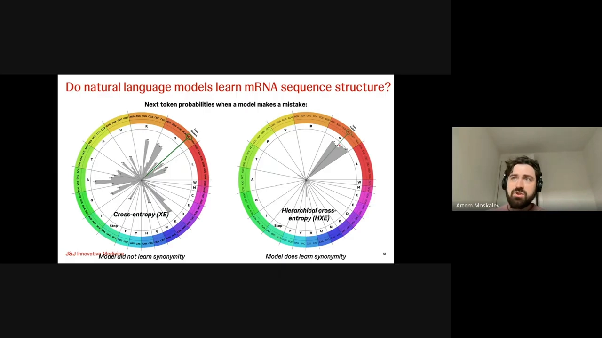
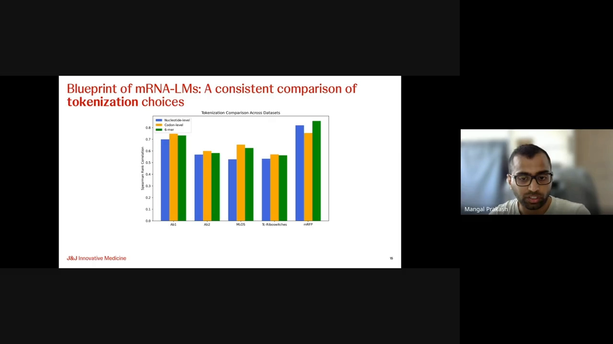
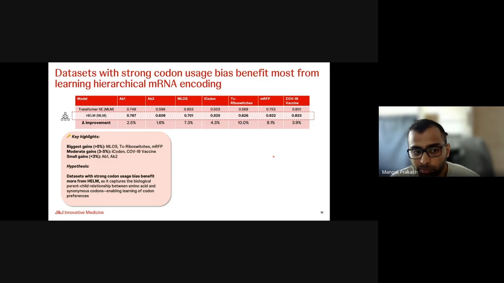
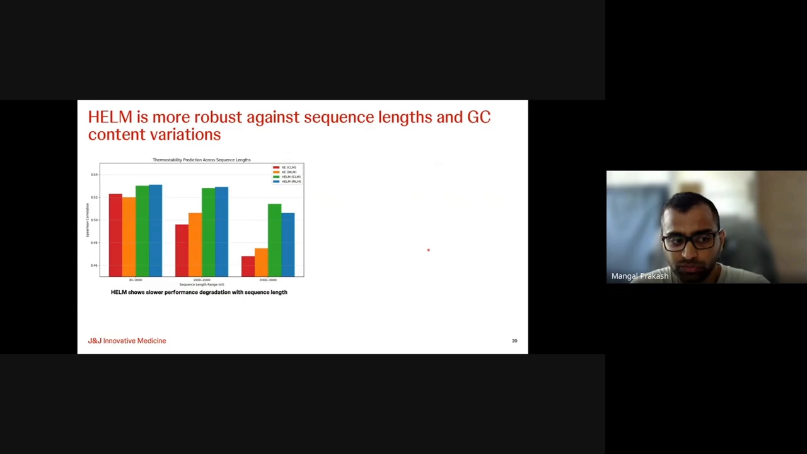
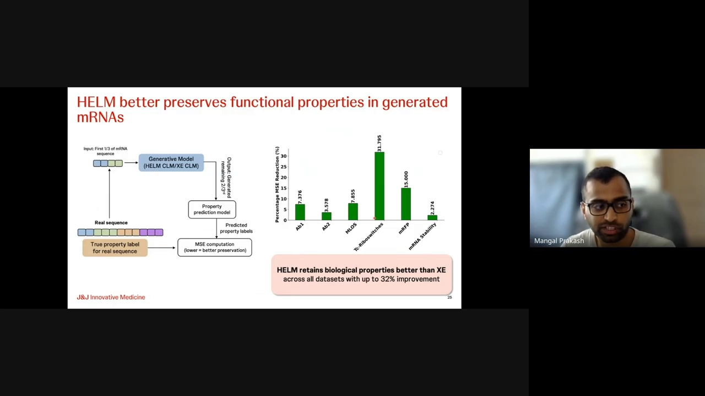

# HELM: Hierarchical Encoding for mRNA Language Modeling

> 视频来源：[YouTube《HELM: Hierarchical Encoding for mRNA Language Modeling | Mangal Prakash & Artem Moskalev》](https://www.youtube.com/watch?v=c870aQ5zfsM)（58:40），主讲人为论文作者 **Mangal Prakash 与 Artem Moskalev**（Valence Labs 读书会报告）。这是 mRNA 语言模型 **HELM（Hierarchical Encoding for mRNA Language Modeling）的作者亲讲**：从 mRNA 的结构与密码子基础讲起，先系统比较"分词方式 × 模型架构 × 预训练目标"三大设计选择，再引入**层级交叉熵**把"密码子 → 氨基酸 → 编码区"的生物学层级直接写进损失函数，最后给出下游性质预测、序列生成与抗体序列注释的完整成绩单。视频字幕为英文自动生成，本文基于文稿整理翻译；文中数字与结论均出自视频内容，可点击时间戳回看核对。

## 本讲要解决的核心问题（SCQA）

**背景**：mRNA 语言模型已经遍地开花——DNA 有 Evo、HyenaDNA、DNABERT，RNA 有 RNABERT、RNA-FM、CodonBERT，蛋白质有 ESM2/ESM3。大家用的套路都一样：把序列当"句子"，用 BERT 式掩码预测或 GPT 式逐 token 预测做自监督预训练（[【跳转到 07:42】](https://www.youtube.com/watch?v=c870aQ5zfsM&t=462)）。

**冲突**：但 mRNA 这门"语言"和自然语言有本质区别——它自带一层**生物学层级**。密码子按"起始密码子 / 终止密码子 / 编码某个氨基酸的同义密码子家族"天然分组（[【跳转到 12:07】](https://www.youtube.com/watch?v=c870aQ5zfsM&t=727)）。实验显示，用普通交叉熵训练的语言模型**并不自动学会这层层级**：预测 UCC 密码子出错时，模型的错误概率在密码子轮盘上"乱撒"——既可能错成别的氨基酸，甚至错成终止密码子，完全不知道"至少该错成同义密码子"（[【跳转到 13:47】](https://www.youtube.com/watch?v=c870aQ5zfsM&t=827)）。

**疑问**：怎么让模型"知道"这套密码子层级，而不改架构、不改数据、只动损失函数？

**回答（中心思想）**：把层级交叉熵（hierarchical cross-entropy）作为**即插即用的损失函数替换**——把每个密码子的预测概率沿层级分解成条件概率连乘，错误就被"引导"到同一个氨基酸的同义密码子上。配合"密码子级分词 + Transformer"这一最优基线组合，HELM 在下游性质预测上全面超越普通交叉熵版本，生成任务的功能误差降低 2%~31%，还能顺带做抗体序列的区域注释（[【跳转到 51:34】](https://www.youtube.com/watch?v=c870aQ5zfsM&t=3094)）。

## 一、先补齐 mRNA 的"语法"底子

### 1.1 mRNA 不是一串字母，而是一份有结构的文件

[【跳转到 01:27】](https://www.youtube.com/watch?v=c870aQ5zfsM&t=87)

RNA 可用三种粒度表示：一维序列、二维配对结构、全原子三维分子。本讲聚焦信使 RNA（mRNA）——真核 mRNA 的典型结构是 **5' 帽子 + 5' UTR + 编码区（CDS）+ 3' UTR + poly(A) 尾巴**，编码区内的起始/终止密码子标出翻译的起止（[【跳转到 02:42】](https://www.youtube.com/watch?v=c870aQ5zfsM&t=162)）。

为什么要研究它？mRNA 疫苗、蛋白替代疗法、蛋白质生产制造、肿瘤免疫治疗、CRISPR 递送——这些应用都要求我们理解或预测 mRNA 的理化/生物学性质，甚至生成带指定性质的序列（[【跳转到 04:22】](https://www.youtube.com/watch?v=c870aQ5zfsM&t=262)）。

### 1.2 密码子：三个碱基读成一个氨基酸

[【跳转到 05:12】](https://www.youtube.com/watch?v=c870aQ5zfsM&t=312)

核糖体翻译时以三个核苷酸为一步，这三联体就是**密码子（codon）**：4³ = 64 种密码子对应 20 种氨基酸，所以必然"多对一"——编码同一氨基酸的密码子互称**同义密码子**。比如 GCC、GCA、GCG 都编码丙氨酸；起始密码子只有一个，终止密码子有三个（[【跳转到 06:27】](https://www.youtube.com/watch?v=c870aQ5zfsM&t=387)）。

这个"多对一"就是后面一切设计的出发点：**mRNA 的语法单位是密码子，不是单个核苷酸**。

## 二、普通语言模型学不会密码子层级

### 2.1 一个检验：预测错了，错得"讲理"吗？

[【跳转到 12:32】](https://www.youtube.com/watch?v=c870aQ5zfsM&t=752)

按层级看，所有密码子分成三类：起始密码子（1 个）、终止密码子（3 个）、编码区内的氨基酸密码子——而每个氨基酸下面挂着若干同义密码子。于是"预测错误"有了好坏之分：把 UCC 错成同义密码子 AGU 是"好错误"（同一个氨基酸，丝氨酸）；把编码区中间的密码子错成起始密码子则是"坏错误"（生物学上根本不成立）。

### 2.2 实验结论：普通交叉熵"乱撒"概率

[【跳转到 13:22】](https://www.youtube.com/watch?v=c870aQ5zfsM&t=802)

作者在海量 mRNA 上训练了一个密码子级语言模型，然后观察它出错时的概率分布：把真实密码子 UCC 遮住，模型的概率质量在密码子轮盘上分布得相当随意——押在不同氨基酸上，甚至押在终止密码子上。**结论：只靠数据驱动，模型学不会这套层级**（[【跳转到 14:12】](https://www.youtube.com/watch?v=c870aQ5zfsM&t=852)）。

## 三、HELM 的解法：层级交叉熵

### 3.1 把概率沿层级分解

[【跳转到 15:02】](https://www.youtube.com/watch?v=c870aQ5zfsM&t=902)

方法借自论文《Making Better Mistakes》：把"预测某个类"的概率沿层级分解为条件概率连乘——预测密码子 P(密码子|氨基酸) × P(氨基酸|编码区) × …，每个条件概率都可以通过对子节点概率归一化直接算出，再取对数求和就得到**层级交叉熵**。损失函数还支持按层级深度加权——可以更看重"预测对密码子"这一层，也可以只关心叶子节点。

### 3.2 即插即用：不改架构、不改数据

[【跳转到 16:42】](https://www.youtube.com/watch?v=c870aQ5zfsM&t=1002)

层级交叉熵只是一个损失函数的"替身"：自注意力架构不用动，HuggingFace/Lightning 这些框架照常用，数据管线不变。注意一个细节（Q&A 里观众也追问了）：**模型自始至终只在密码子（叶子节点）上做预测**，氨基酸和编码区只是层级图里的"虚拟节点"，用于实现损失分解（[【跳转到 21:42】](https://www.youtube.com/watch?v=c870aQ5zfsM&t=1302)）。

效果立竿见影：同样出错，改用层级交叉熵的模型会把概率押在**同义密码子**上——"虽然没猜中 UCC，但知道该猜丝氨酸家族"（[【跳转到 17:57】](https://www.youtube.com/watch?v=c870aQ5zfsM&t=1077)）。

## 四、搭基线：三大设计选择的系统比较

[【跳转到 25:14】](https://www.youtube.com/watch?v=c870aQ5zfsM&t=1514)

在谈层级收益之前，作者先回答一个更基础的问题：**mRNA 语言模型该怎么搭？** 自然语言处理里架构、分词、预训练目标都有标准答案，生物序列领域还没有。他们在同一份精选数据集上、统一 5000 万参数规模，系统比较了三条轴（[【跳转到 26:29】](https://www.youtube.com/watch?v=c870aQ5zfsM&t=1589)）：

- **分词**：单核苷酸 vs 密码子 vs 6-mer；
- **架构**：Transformer vs Mamba vs Hyena；
- **预训练目标**：MLM（双向掩码）vs CLM（单向自回归）。

### 4.1 分词：密码子级最稳

[【跳转到 28:34】](https://www.youtube.com/watch?v=c870aQ5zfsM&t=1714)

在绝大多数下游性质预测数据集上，**密码子级分词表现最好**。生物学解释很直白：密码子是遗传密码的基本单位，每个都直接对应一个氨基酸，密码子级分词天然对齐 mRNA 的生物学语义（[【跳转到 29:24】](https://www.youtube.com/watch?v=c870aQ5zfsM&t=1764)）。词表也只有 64 个密码子加少量特殊 token，表达力与效率兼顾（[【跳转到 29:49】](https://www.youtube.com/watch?v=c870aQ5zfsM&t=1789)）。

### 4.2 架构与目标：Transformer + MLM/CLM 皆可

[【跳转到 31:29】](https://www.youtube.com/watch?v=c870aQ5zfsM&t=1889)

mRNA 序列在本研究里约 1000~1400 个 token 长——这正是全局注意力发挥优势的区间，Transformer 在 7 个任务里 5 个领先；Hyena/Mamba 的主场是数万到百万级的超长序列。MLM 与 CLM 总体打平（MLM 略胜 MLoss、核糖开关类数据集，CLM 略胜其它）。与现成基线 CodonBERT、SpliceBERT、RNA-FM 相比，这套组合有 **5%~17%** 的稳定提升（[【跳转到 33:09】](https://www.youtube.com/watch?v=c870aQ5zfsM&t=1989)）。

## 五、层级带来的增益与适用边界

### 5.1 全面小胜：MLM 六战六捷，CLM 五胜一平

[【跳转到 36:54】](https://www.youtube.com/watch?v=c870aQ5zfsM&t=2214)

HELM 与对照组（XCLM）用**完全相同的架构、分词、预训练数据**，唯一差别是损失函数——所以增益纯粹来自"建模生物学层级"。结果：MLM 版在全部 6 个数据集上胜出，CLM 版 5/6 胜出；MLM 与 CLM 各赢 3 个数据集，依旧打平（[【跳转到 37:44】](https://www.youtube.com/watch?v=c870aQ5zfsM&t=2264)）。

### 5.2 增益大小由"同义密码子使用偏性"决定

[【跳转到 40:39】](https://www.youtube.com/watch?v=c870aQ5zfsM&t=2439)

不同数据集的增益差别很大：MLoss、TCIO 核糖开关、mRFP 上增益超过 5%，内部抗体数据集 AB1/AB2 不足 3%。作者假设关键变量是**同义密码子使用偏性**（codon usage bias）——生物体对同义密码子的偏好程度。验证方式：用密码子使用熵来量化（熵越低偏性越强），结果偏性强的数据集恰好增益最大；密码子对偏性（codon pair bias）也呈类似趋势（[【跳转到 42:19】](https://www.youtube.com/watch?v=c870aQ5zfsM&t=2539)）。

评测设置（Q&A 里澄清过）：冻结预训练好的语言模型，只在其上训练一个小任务头预测**整条序列**的性质（稳定性/表达量），COVID-19 疫苗数据集除外——那个任务是逐核苷酸降解预测（[【跳转到 44:24】](https://www.youtube.com/watch?v=c870aQ5zfsM&t=2664)）。

### 5.3 长度与 GC 含量的鲁棒性

[【跳转到 45:39】](https://www.youtube.com/watch?v=c870aQ5zfsM&t=2739)

把 iCodon 热稳定性数据集按长度分成短（30~1000 nt）、中（1000~2000 nt）、长（2000~3000 nt）三组（mRNA 疫苗序列通常在 1000~4500 nt 量级）。随长度增加两个模型的性能都下降（预训练数据最长约 1400 nt，长序列超出了训练分布），但 **HELM 退化得更平缓**；对 GC 含量变化的鲁棒性实验也类似。

## 六、生成与注释：层级不止用于打分

### 6.1 条件生成：功能保真度 MSE 最多降 31%

[【跳转到 49:54】](https://www.youtube.com/watch?v=c870aQ5zfsM&t=2994)

生成实验：给模型看序列的前 1/3，让它生成剩余 2/3，再用预训练的性质预测模型给生成序列打分，以 MSE 衡量"生成的东西功能上像不像真的"。全部 6 个数据集上，层级版 HELM 一致优于非层级基线，**MSE 降低 2%~31%**（[【跳转到 50:19】](https://www.youtube.com/watch?v=c870aQ5zfsM&t=3019)）。

### 6.2 抗体序列区域注释

[【跳转到 50:44】](https://www.youtube.com/watch?v=c870aQ5zfsM&t=3044)

另一个应用是抗体序列注释：输入抗体核苷酸序列，预测每个核苷酸属于信号肽、V 区、D 区、J 区还是恒定区。HELM 的 MLM 与 CLM 版都超过非层级基线，且注释这类"需要看两侧上下文"的任务里**双向的 MLM 优势最明显**（[【跳转到 51:09】](https://www.youtube.com/watch?v=c870aQ5zfsM&t=3069)）。

## 七、读后小结

- **一句话**：mRNA 这门语言自带"密码子→氨基酸→编码区"的层级，普通语言模型学不会它；把层级交叉熵换进损失函数，模型出错时至少"错在同义密码子上"，下游预测与生成全面受益。
- **方法定位**：与 mRNA-FM 这类"密码子分词"模型同属一条技术路线——**分词对齐生物学语义**是收益的第一来源（HELM 的系统比较再次确认密码子级分词最优），层级交叉熵则是叠加在其上的第二重增益，两者是即插即用、可组合的。
- **适用边界**：层级增益的大小取决于数据集的同义密码子使用偏性——偏性弱的数据集（如内部抗体数据）收益有限；超长序列上 Transformer 全局注意力让位于 Hyena/Mamba 这类线性架构，但那已超出 mRNA 常见长度。
- **可扩展方向**（Q&A）：层级图可以继续向上长——氨基酸的疏水/亲水分组、肽段、甚至 RNA 结合 motif 都可能成为新的层级；作者表示代码即将开源。

---

*信源：Valence Labs 读书会《HELM: Hierarchical Encoding for mRNA Language Modeling》（Mangal Prakash & Artem Moskalev），视频时间戳均可点击回看；文稿为平台自动字幕，个别专名（数据集名、人名）按上下文整理。*
