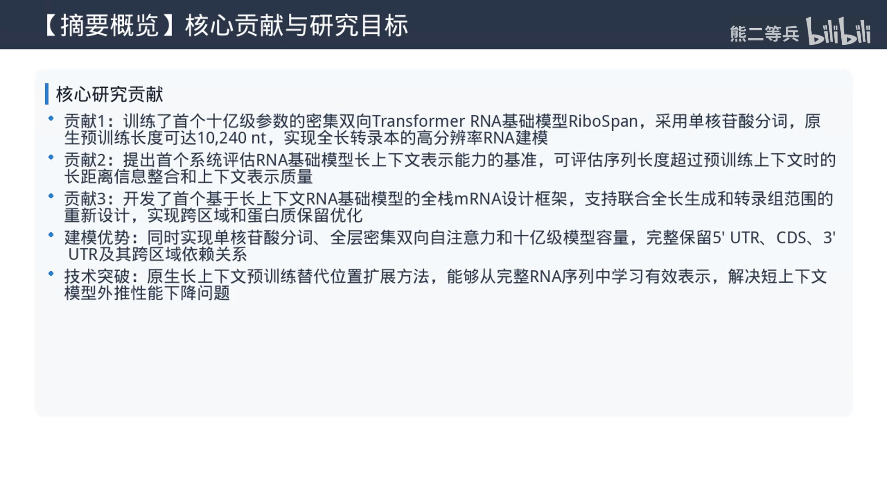
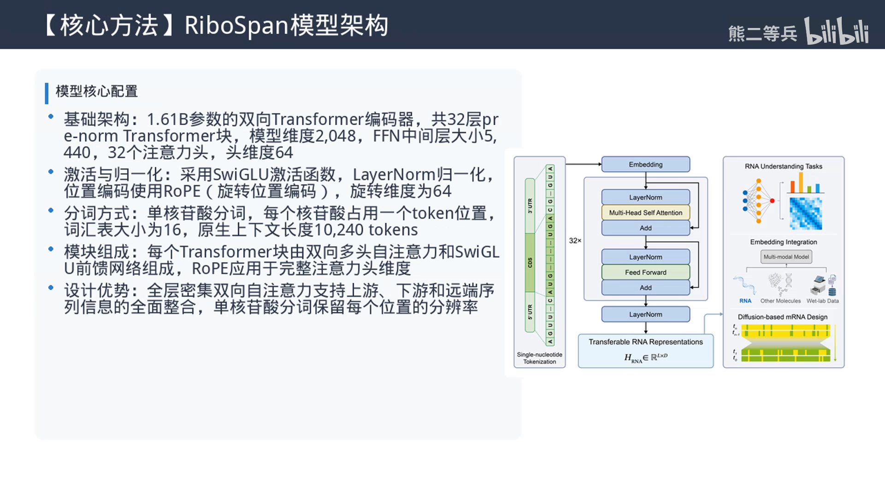
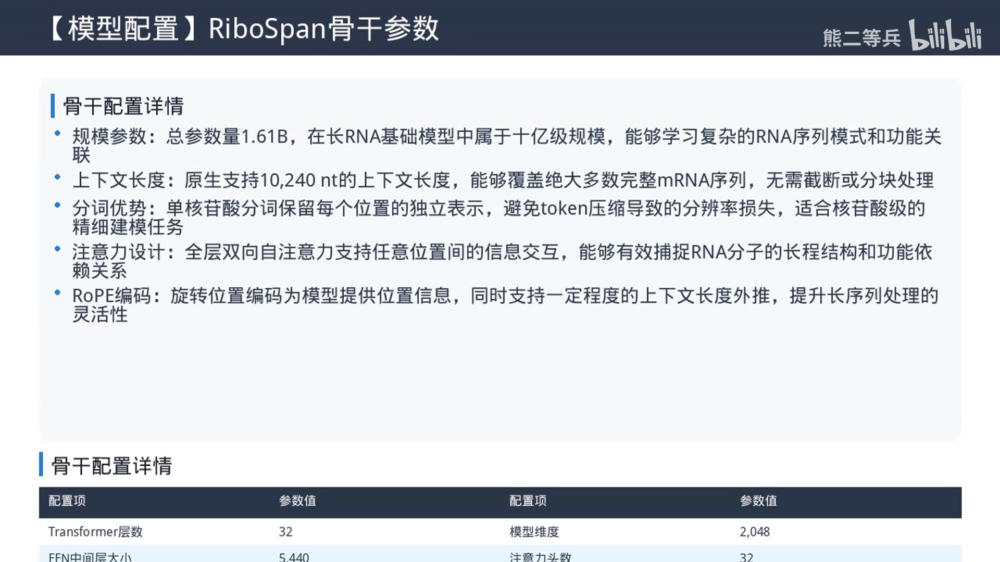
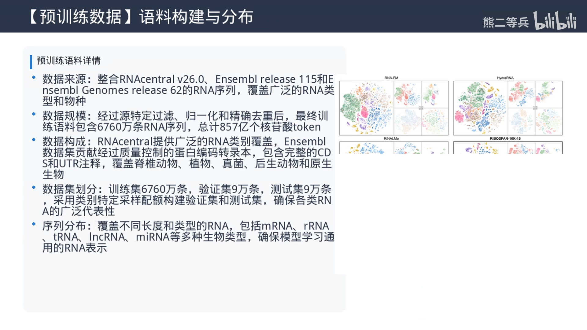
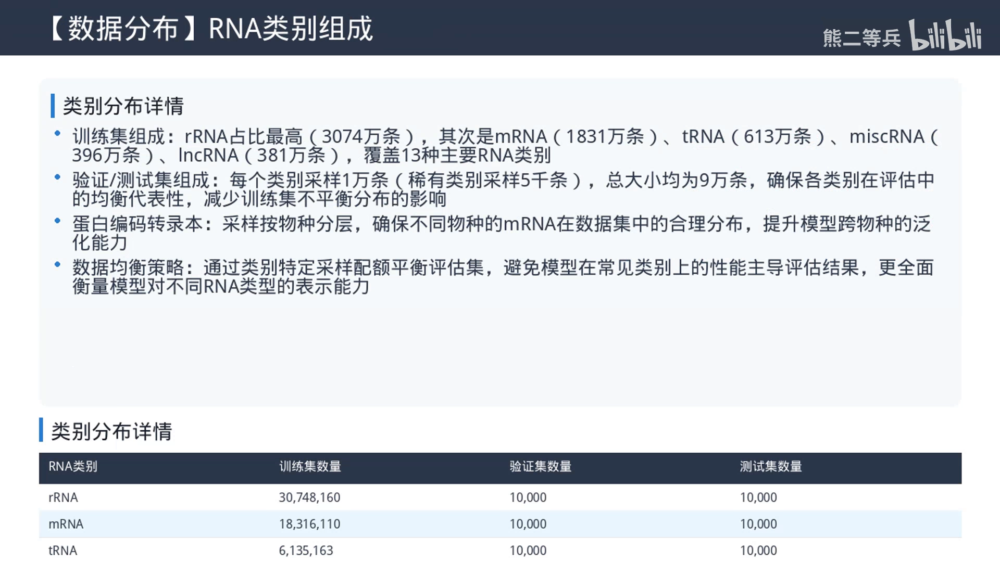
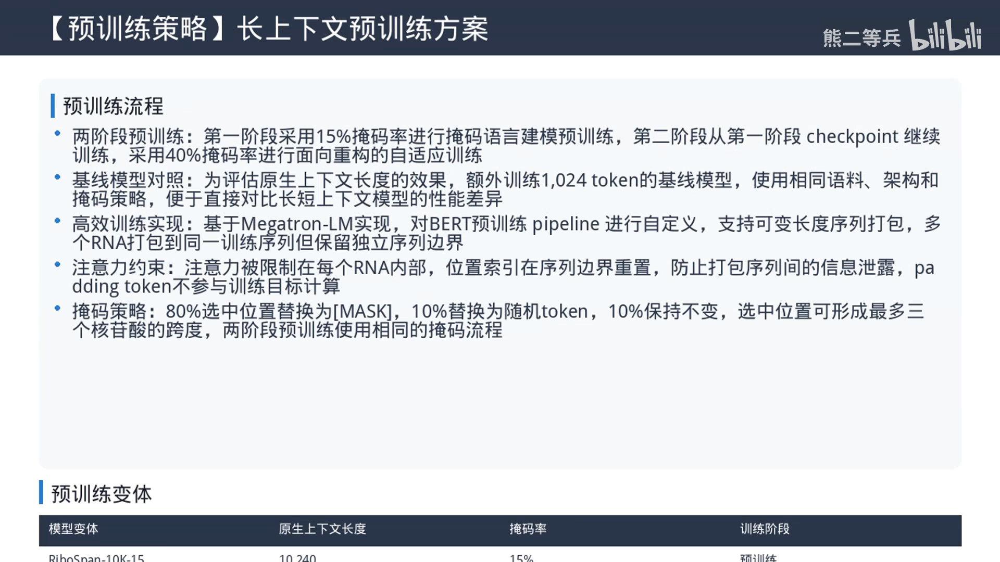

# 首个十亿级长上下文RNA基础模型来了！全长mRNA完整建模突破传统长度限制

> 视频来源：[Bilibili《首个十亿级长上下文RNA基础模型来了！全长mRNA完整建模突破传统长度限制》](https://www.bilibili.com/video/BV1pqhc6REjH/)（21:52，UP 主 **熊二等兵**「科研前沿播客」系列）。这是围绕论文《RiboSpan: long-context RNA foundation model for versatile RNA modeling》（视频口播标题）的双主持科普播客，AI 生成解说：从 mRNA 三区耦合的行业痛点讲起，介绍 **RiboSpan——首个十亿级参数、原生 10240 nt 上下文的密集双向 Transformer RNA 基础模型**，以及配套的长上下文表征评估基准与全转录本 mRNA 设计框架。字幕为平台 AI 生成，本文基于文稿整理；文中数字与结论均出自视频口播内容，可点击时间戳回看核对（口播专名经上下文校正，以论文原文为准）。

## 本期要解决的核心问题（SCQA）

**背景**：mRNA 疫苗与 mRNA 药物发展飞快，但**序列设计**是个复杂问题。mRNA 分子天然分三段——5' 非翻译区（5' UTR）、编码区（CDS）、3' 非翻译区（3' UTR）——三段看起来独立，功能却高度耦合：改编码区里的一个碱基，可能同时影响翻译效率、RNA 折叠结构、细胞内稳定性与定位（[【跳转到 00:25】](https://www.bilibili.com/video/BV1pqhc6REjH/?t=25)）。

**冲突**：现有 RNA 基础模型跟不上这个耦合结构。RNA-FM 这类双向编码器模型能学到 RNA 结构与功能表征，但预训练上下文普遍只有 **1024 个核苷酸**左右，多数完整 mRNA 远超这个长度，只能截断处理，跨区域调控信息直接丢失；Evo 这类解码器-only 长序列模型适合生成、却只能看上游序列；Hydra-RNA（状态空间）、RNABERT（字节对压缩）等长序列方案，要么放弃全连接注意力、要么牺牲单核苷酸分辨率——为了长度丢了精度（[【跳转到 01:15】](https://www.bilibili.com/video/BV1pqhc6REjH/?t=75)）。

**疑问**：能不能有一个模型，同时满足**单核苷酸 token 化、全层密集双向注意力、十亿级参数、原生超长上下文**这四个要求？

**回答（中心思想）**：RiboSpan——第一个十亿级参数（16.1 亿）的密集双向 Transformer RNA 基础模型，**原生预训练上下文 10240 个核苷酸**，一次覆盖绝大多数完整人类 mRNA；配套一个专门评估"长上下文表征"的新基准，以及一个能同时优化三个区域的全转录本 mRNA 设计框架（[【跳转到 02:35】](https://www.bilibili.com/video/BV1pqhc6REjH/?t=155)）。

## 一、模型本体：原生 10K 上下文的密集双向编码器

### 1.1 架构参数一览

[【跳转到 03:00】](https://www.bilibili.com/video/BV1pqhc6REjH/?t=180)

RiboSpan 用 32 层预归一化 Transformer 编码器：模型维度 2048，FFN 中间层 5440，32 个注意力头，激活函数 SwiGLU，位置编码 RoPE，**总参数量 16.1 亿**（[【跳转到 03:00】](https://www.bilibili.com/video/BV1pqhc6REjH/?t=180)）。

最关键的分词选择：**单核苷酸 token 化**——每个核苷酸一个 token，词表大小 16（4 种碱基加特殊 token），原生上下文长度正好 10240 token。与 RNABERT 那种把多个碱基压成一个 token 的做法相反，RiboSpan 完整保留单核苷酸分辨率与位置信息，不做任何 token 压缩（[【跳转到 03:25】](https://www.bilibili.com/video/BV1pqhc6REjH/?t=205)）。

### 1.2 预训练语料：6760 万条、857 亿核苷酸 token

[【跳转到 03:50】](https://www.bilibili.com/video/BV1pqhc6REjH/?t=230)

预训练语料来自 RNAcentral 与 Ensembl 两大数据库，经过滤、归一化、去重后共 **6760 万条 RNA 序列、857 亿个核苷酸 token**。RNAcentral 覆盖各种类型 RNA，Ensembl 提供高质量蛋白编码转录本（脊椎动物、植物、真菌等多物种）。类别分布上 rRNA 最多（3000 多万条），其后是 mRNA（1800 多万条）与 tRNA（600 多万条）——既让模型学到各类 RNA 的通用表征，又对 mRNA 的结构与调控特征学得更准（[【跳转到 04:15】](https://www.bilibili.com/video/BV1pqhc6REjH/?t=255)）。

### 1.3 两阶段掩码预训练 + 可变长度序列打包

[【跳转到 04:40】](https://www.bilibili.com/video/BV1pqhc6REjH/?t=280)

预训练分两阶段：第一阶段用 **15% 掩码率**学习基础序列表征，第二阶段用 **40% 高掩码率**继续预训练、提升模型重构能力——为后续生成任务打底（[【跳转到 04:40】](https://www.bilibili.com/video/BV1pqhc6REjH/?t=280)）。训练还用可变长度序列打包：多条 RNA 序列打包进同一序列槽，注意力被限制在各序列内部、位置索引在边界重置——既避免不同序列之间的信息泄漏，又提升训练效率（[【跳转到 05:05】](https://www.bilibili.com/video/BV1pqhc6REjH/?t=305)）。

## 二、实验一：mRNA 重构——原生 10K 完胜"短上下文 + 外推"

[【跳转到 05:30】](https://www.bilibili.com/video/BV1pqhc6REjH/?t=330)

第一组实验评估 mRNA 重构：在预训练测试集的 mRNA 子集上，分别在 1024 与 10240 输入长度、15% 与 40% 掩码率下测试，对比模型包括 AIDO.RNA（CDS 基线，口播）与四个 RiboSpan 变体（上下文长度 1K/10K × 掩码阶段 15/40，口播）。

结果差距明显（[【跳转到 06:20】](https://www.bilibili.com/video/BV1pqhc6REjH/?t=380)）：

- 10240 长度、40% 掩码下，原生 10K 的 RiboSpan-10K-40 损失仅 **0.80033**，而 1K 上下文模型靠 RoPE 外推损失 1.06730；
- 重构准确率 **85.89%**（原生 10K）对 **80.26%**（1K 外推）对 **77.79%**（AIDO.RNA/CDS 基线）；
- 40% 掩码继续预训练的收益也很实在：高掩码下重构准确率提升明显，15% 掩码下与 10K-15 版本持平——兼顾常规与高损坏场景。

## 三、实验二：长上下文表征基准——这次不看预测，看"表征"

### 3.1 一个巧妙的基准设计

[【跳转到 07:07】](https://www.bilibili.com/video/BV1pqhc6REjH/?t=427)

这是论文的重点贡献之一：此前没有专门基准系统评估 RNA 基础模型的**长上下文表征能力**。作者用完整 mRNA 转录本构造基准：分 5 个长度组（1024/2048/4096/8192/10240 nt），每组 10 条转录本；在每条转录本**中间**选一段长度为全长 1/32 的区间，只重排该区间内的核苷酸（保持核苷酸组成不变），其余区域完全不动，然后看模型对这次"局部手术"的反应（[【跳转到 07:07】](https://www.bilibili.com/video/BV1pqhc6REjH/?t=427)）。

三个核心指标（[【跳转到 07:32】](https://www.bilibili.com/video/BV1pqhc6REjH/?t=452)）：

- **ΔCS（额外上下文分离度）**：重排后干预区间与背景的表征分离度提升了多少，越大说明模型越能区分不同上下文；
- **C_cross（跨区域同碱基相似度）**：相同核苷酸在干预区与背景区的表征相似度，越小说明区域区分能力越强；
- **D_Disco（远端表征扩散）**：局部重排后，距干预区最远的 25% 位置的表征变化程度，越小说明局部扰动没有被过度扩散到远端不变区域。

### 3.2 各家的"体检报告"

[【跳转到 08:22】](https://www.bilibili.com/video/BV1pqhc6REjH/?t=502)

10240 长度下（[【跳转到 08:22】](https://www.bilibili.com/video/BV1pqhc6REjH/?t=502)）：

- **短上下文模型直接外推**：ΔCS 仅约 0.2、C_cross 高于 0.65——上下文区分能力差；
- **YaRN 位置缩放**：ΔCS 提升到 0.4 以上、C_cross 降到 0.35 左右，区分能力恢复，但 **D_Disco 从约 0.005 升到 0.02 以上**——位置匹配修好了，长距离信息传播却没校准，局部变化扩散到了远端；
- **Hydra-RNA**（状态空间+注意力混合）：D_Disco 极小（约 0.000667，几乎不扩散），但 ΔCS 只有 0.31、C_cross 0.52——不会过度扩散，也没法灵活整合长距离上下文；
- **原生 10K 的 RiboSpan**：ΔCS 约 0.4、C_cross 约 0.3、D_Disco 约 0.001——既区分得了上下文，又不乱扩散，两头兼顾（[【跳转到 08:58】](https://www.bilibili.com/video/BV1pqhc6REjH/?t=538)）。

而且序列越长差距越大：长度超过 4096 后，短上下文模型外推性能快速下降，原生 10K 模型始终稳定（[【跳转到 09:23】](https://www.bilibili.com/video/BV1pqhc6REjH/?t=563)）。另一个细节：10K-15 与 10K-40 两个变体的长上下文表征性能几乎一致——说明 40% 掩码的继续预训练没有破坏已学到的表征，同时提升了重构能力，两阶段策略两头都没耽误（[【跳转到 09:48】](https://www.bilibili.com/video/BV1pqhc6REjH/?t=588)）。

## 四、实验三：冻结表征直接"验货"

[【跳转到 10:13】](https://www.bilibili.com/video/BV1pqhc6REjH/?t=613)

第三个评估换个思路：不加任务头、不微调，**直接冻结预训练模型**，把每条序列最后一层隐状态平均池化作为表征，看不同类型 RNA 在表征空间的聚集程度——这样评估的就是模型本身学到的生物学信息质量，不受微调策略干扰。

任务设了五个维度（[【跳转到 10:43】](https://www.bilibili.com/video/BV1pqhc6REjH/?t=643)）：25 种 RNA 生物型分类（89955 条）、功能类分类 3 类（60892 条）、调控生物型分类 7 种（29895 条）、长 RNA（>1024 nt）8 种生物型分类（17130 条）、Rfam 家族分类 20 个家族（33000 条）——全部来自预训练测试集，评估客观。

结果：RiboSpan 在所有任务上优于对比模型，**长 RNA 与 Rfam 家族分类优势最明显**——长 RNA 分类的表征聚类纯度比短上下文模型高 15% 以上；且不同 RNA 类型在表征空间的分布与生物学分类高度一致——模型学到的是有生物学意义的表征，不是序列统计特征（[【跳转到 11:58】](https://www.bilibili.com/video/BV1pqhc6REjH/?t=718)）。

## 五、落地：全转录本 mRNA 设计框架

[【跳转到 12:35】](https://www.bilibili.com/video/BV1pqhc6REjH/?t=755)

模型之上是应用：口播称这是第一个基于长上下文 RNA 基础模型的**全转录本 mRNA 设计框架**，支持全长生成与全转录本重设计。用 RiboSpan 作为生成骨干，同时建模 5' UTR、CDS、3' UTR 的相互作用；支持多维条件控制（翻译效率、稳定性等属性可同时指定）；用**同义密码子扩散**保证编码的蛋白序列不变；还支持靶向区域重设计——比如已有序列只想优化 5' UTR，模型能在保留 CDS 与 3' UTR 不变的前提下生成最优 5' UTR，并兼顾它与其他区域的相互作用（[【跳转到 13:00】](https://www.bilibili.com/video/BV1pqhc6REjH/?t=780)）。

对治疗用 mRNA，这意味着从"优化密码子→稳定性掉→免疫原性高→反复试错"的循环，变成多约束下一体化求解，设计周期与研发成本大幅压缩；应用也不止疫苗药物——合成生物学的 mRNA 元件、表达载体、非编码 RNA（sRNA、lncRNA）设计都可复用其通用表征（[【跳转到 14:30】](https://www.bilibili.com/video/BV1pqhc6REjH/?t=870)）。

## 六、局限与展望

[【跳转到 14:55】](https://www.bilibili.com/video/BV1pqhc6REjH/?t=895)

- **长度上限**：10240 nt 覆盖绝大多数 mRNA，但极长转录本（部分人类 mRNA 与长非编码 RNA 可达数十 KB）仍需截断；
- **物种偏科**：语料以真核生物为主，原核 RNA 数据占比不高，原核应用需继续预训练；
- **纯序列预训练**：尚未纳入结构数据与实验数据，未来多模态预训练（序列+结构+功能）值得期待（[【跳转到 15:45】](https://www.bilibili.com/video/BV1pqhc6REjH/?t=945)）。

播客结尾把论文贡献收拢为三层递进（[【跳转到 18:45】](https://www.bilibili.com/video/BV1pqhc6REjH/?t=1125)）：**训练长上下文 RNA 基础模型（RiboSpan）→ 建立长上下文表征评估基准 → 落地全转录本 mRNA 设计框架**——从模型到评测再到应用形成闭环。两条可迁移经验：原生长上下文预训练优于事后位置扩展（YaRN 只能修位置匹配、修不了远端扩散）；两阶段掩码（15%→40%）+ 可变长度打包是生物序列大模型兼顾"表征与生成"的通用配方（[【跳转到 20:00】](https://www.bilibili.com/video/BV1pqhc6REjH/?t=1200)）。

## 七、读后小结

- **一句话**：RiboSpan 把 RNA 基础模型的"上下文长度"从约 1024 nt 拉到原生 10240 nt，用 16.1 亿参数的密集双向编码器一次性装下完整 mRNA，证明"原生超长上下文 + 单核苷酸分辨率 + 全层双向注意力"三者可以兼得。
- **与 mRNA-FM 的关系**：本条目主题（mRNA-FM/密码子分词）的同类技术树上，mRNA-FM 用"密码子分词"压缩序列长度、对齐生物学语义，但上下文有限；RiboSpan 走另一极端——单核苷酸分辨率换取全长双向建模，恰好补上"三区耦合"这块 mRNA-FM 类模型覆盖不全的拼图。两条路线在下游任务上的取舍，正是当前 RNA 基础模型的核心分野。
- **方法论启发**：评估一个"长上下文"模型，别只看预测指标——重排中间片段、观察表征如何分离与扩散的这套基准设计，值得任何序列基础模型借鉴。

---

*信源：Bilibili《首个十亿级长上下文RNA基础模型来了！全长mRNA完整建模突破传统长度限制》（熊二等兵·科研前沿播客），时间戳均可点击回看；字幕为平台 AI 生成，口播中「RiboSpan/AIDO.RNA/Hydra-RNA/RNABERT/SwiGLU/RoPE」等专名与全部数字已按上下文校正，模型与实验细节以论文原文为准。*
