# 【ColabFold実習】構造生物学者が知るべきColabfold活用方法

> 视频来源：[【ColabFold実習】構造生物学者が知るべきColabfold活用方法](https://www.youtube.com/watch?v=zTHFXTFuNHE)（YouTube，约 66 分钟，日语，2023 年）。一场面向结构生物学研究者的 ColabFold 实习课：从"复现 AlphaFold 数据库里的失败预测"出发，一路讲到双链、六聚体、组蛋白八聚体，最后落到本条目的主题——**MSA 搜索的规模决定复合物预测的成败**。原声为日语 AI 字幕，本文稿已译写为中文；所有内容可回溯到视频对应时间点。

## 本篇要解决的核心问题（SCQA）

**背景**：AlphaFold 数据库里躺着约 2 亿个预测结构（Meta 的 ESMFold 数据库更多，约 6 亿个）。对天然蛋白来说，"预测结构"似乎已经是打开网页搜一下的事 [【跳转到 00:47】](https://www.youtube.com/watch?v=zTHFXTFuNHE&t=47)。

**冲突**：但数据库里也躺着不少**失败的预测**——胰岛素就是常被点名的那一个：预测"做不出来"。天然蛋白不用预测了，那我们还需要会跑预测吗？答案是：会——因为数据库替你跑不了"你手里那个非标准输入"。

**疑问**：结构生物学家该怎么把这类失败预测修好？ColabFold 里那些参数（MSA、trim、recycle、copies……）到底在动什么？

**回答（中心思想）**：失败的根源往往在**输入**——多一段信号肽、链没分对，MSA 搜索就搜不对；而预测的成败高度依赖 **MSA 的质量与规模**（搜到多少条同源序列），外加 recycle 数等运行技巧。学会"带着生物学知识去喂对输入"，就是本次实习的核心。

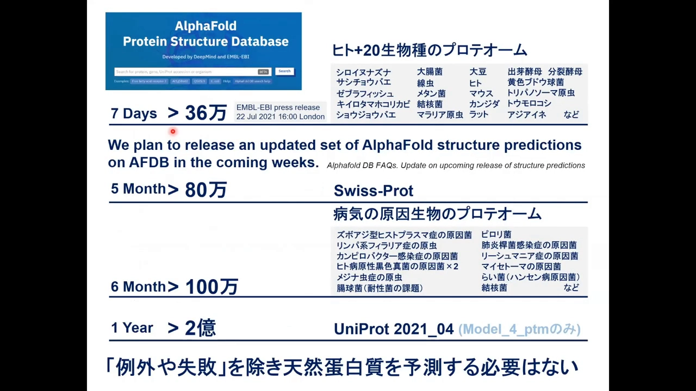

## 一、术语地图：AlphaFold2 ≠ ColabFold

开始之前先分清三个名字 [【跳转到 01:36】](https://www.youtube.com/watch?v=zTHFXTFuNHE&t=96)：

- **AlphaFold 2**：DeepMind 发布在 GitHub 上的官方代码（从 2.0 版本一路更新）；
- **ColabFold**：社区把它搬到 Google Colaboratory 上、让普通人浏览器点开就能用的版本；ColabFold 又分两本笔记本：
  - **MMseqs2 版**：最常用的主力版本，复合物预测时自动使用 AlphaFold-Multimer 参数；
  - **Advanced 版**：从 MMseqs2 版派生的 beta 版，功能更全（trim 裁剪、动画输出、自定义 copies 等），但不使用 Multimer 参数。

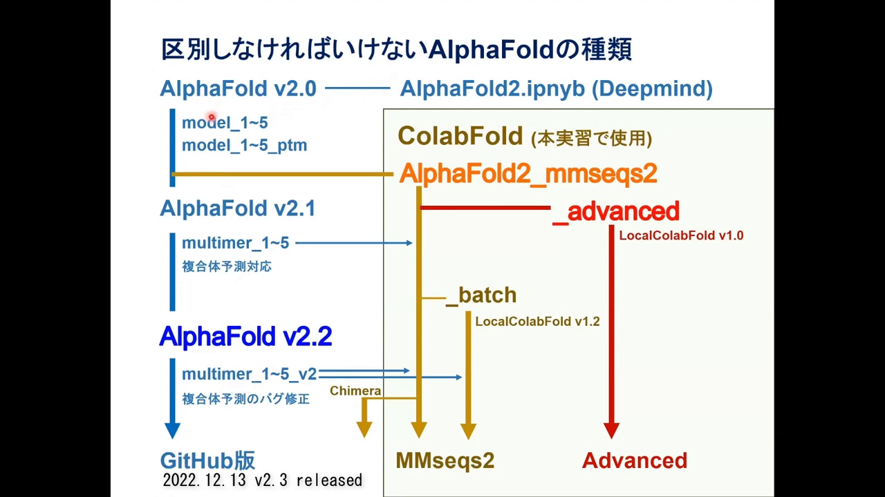

实习的流程是：先复现失败 → 用生物学知识修复 → 再挑战双链、六聚体、八聚体。

## 二、复现失败：pLDDT 很高，但蛋白质"摊平"了

从 UniProt 拿人胰岛素前体序列（P01308，带着信号肽），贴进 ColabFold 直接跑 [【跳转到 02:41】](https://www.youtube.com/watch?v=zTHFXTFuNHE&t=161)。第一次运行要先下载 AlphaFold 本体（约 3 分钟），之后就会跳过。

预测启动后，第一步就是 **MSA 搜索**：在序列数据库里搜与胰岛素相似的序列——**搜到了约 2500 条** [【跳转到 08:37】](https://www.youtube.com/watch?v=zTHFXTFuNHE&t=517)。这个数字请记住，第九节会告诉你它为什么重要。

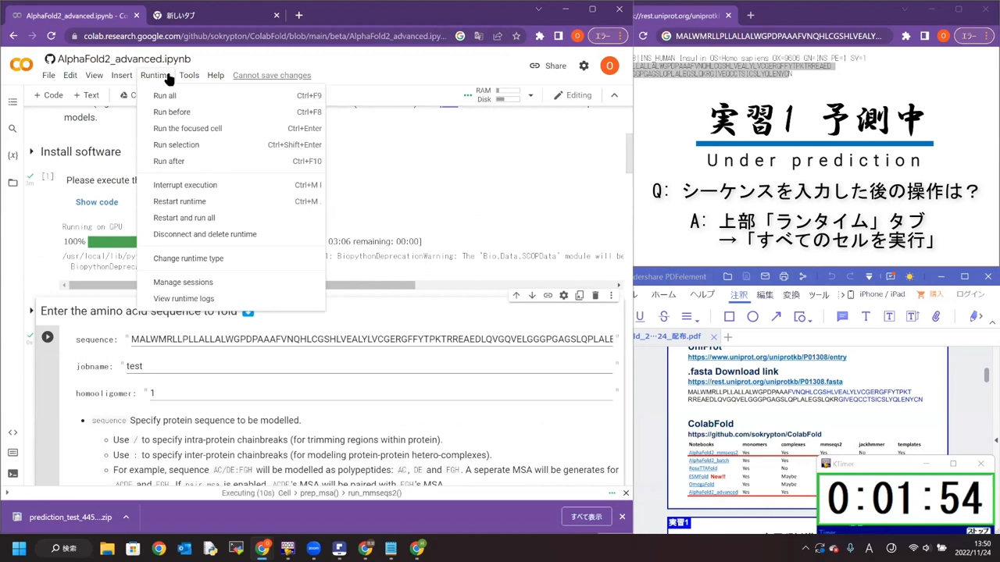

几分钟后结果出来了 [【跳转到 09:27】](https://www.youtube.com/watch?v=zTHFXTFuNHE&t=567)：**pLDDT 值很高，但整体结构完全展开（unfolded）**——除了部分 Helix，蛋白质"摊平"了。这正是 AlphaFold 数据库里那个失败预测的样子。

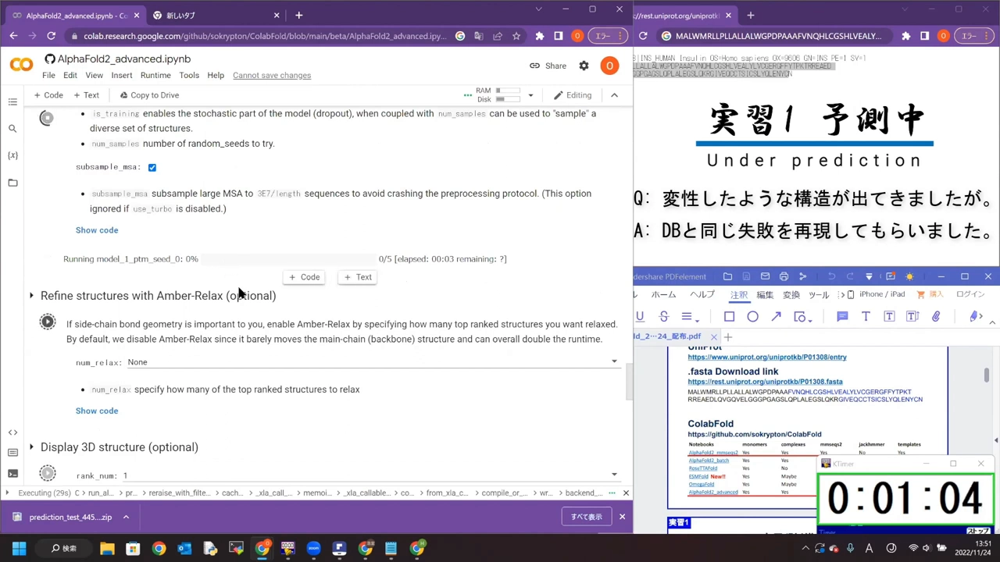

课程里还插了一个排序小知识：结果默认按 **pLDDT** 排序，但做**复合物**预测时建议换成按 **ipTM**（界面 TM 分数）排序——它衡量的是"AlphaFold 认为的残基间相对位置是否可信" [【跳转到 11:49】](https://www.youtube.com/watch?v=zTHFXTFuNHE&t=709)。

## 三、数据库侦探：失败的原因藏在"另外 4 条序列"里

怎么修？讲师的方法论值得学习：**去数据库里找参照** [【跳转到 13:31】](https://www.youtube.com/watch?v=zTHFXTFuNHE&t=811)。

在 AlphaFold 数据库里搜胰岛素，有约 10 万条命中；就算只筛人类蛋白也有 194 条（胰岛素受体之类的相关蛋白都被拉进来了）。但**只提取与胰岛素几乎完全相同的序列**，大约只剩 5 条 [【跳转到 13:56】](https://www.youtube.com/watch?v=zTHFXTFuNHE&t=836)：

- 其中大部分和你的预测一样，是展开的；
- **只有一条**返回了折叠的胰岛素核心——它与一条 **NMR 实验结构**一致，连二硫键都对得上 [【跳转到 14:21】](https://www.youtube.com/watch?v=zTHFXTFuNHE&t=861)。

把这 5 条序列一比对，差异找到了：**那条成功例子的序列缺失了 N 端的信号肽** [【跳转到 14:21】](https://www.youtube.com/watch?v=zTHFXTFuNHE&t=861)。于是假设浮出水面：保守性高的信号肽把 AlphaFold 的预测精度拉低了——去掉它试试？

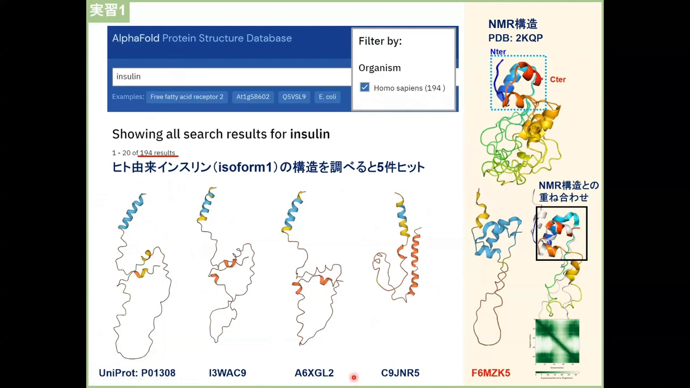

## 四、修复：切掉信号肽，蛋白质自己"折"回来了

切法有两种 [【跳转到 14:47】](https://www.youtube.com/watch?v=zTHFXTFuNHE&t=887)：

- **MMseqs2 版**：直接把输入序列 N 端的 24 个氨基酸删掉再跑；
- **Advanced 版**：用 trim（裁剪）选项填"去掉第 1–24 位"，效果相同；也可以反向写（trim inverse：保留第 22 位以后之类）。

这里藏着一个与 MSA 搜索直接相关的行为 [【跳转到 15:55】](https://www.youtube.com/watch?v=zTHFXTFuNHE&t=955)：

- 用 **trim** 裁剪时，**查询序列本身没变 → MSA 直接复用上次搜索的结果**，搜索环节整个跳过（连软件安装一起跳过，几秒就开跑）；
- 若是**手动改了输入序列**（查询序列变了）→ MSA 会**重新搜索一次**，不过大约只要 1 分钟。

**这条规则反过来也一样**：MSA 是跟"查询序列"绑定的——你换了序列，就要重搜；没换，就复用。后面六聚体、二聚体的实验都会反复用到这一点。

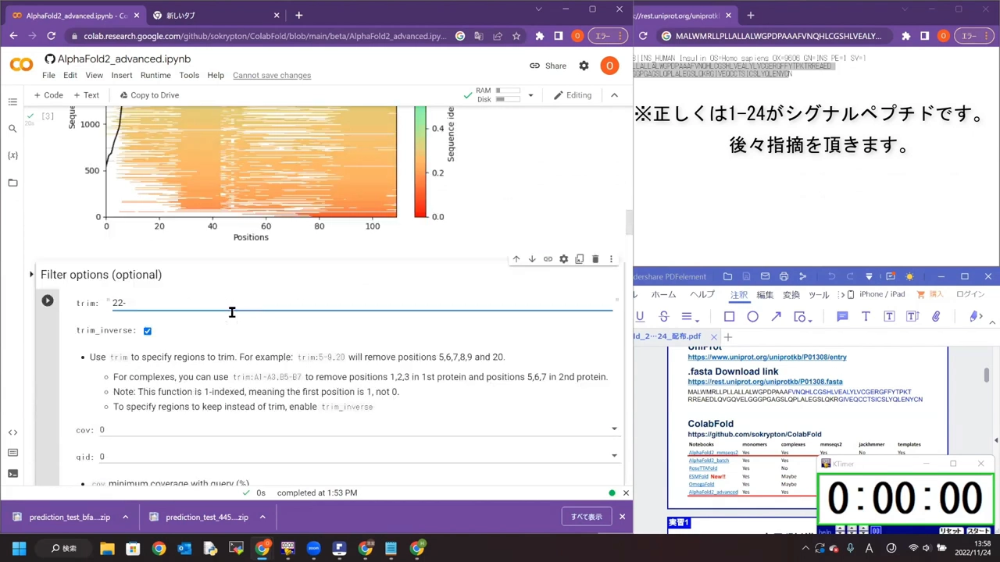

切掉信号肽重跑：这次核心区域折叠了，pLDDT 高的区域从"末端"挪到了核心；把预测结构与那条 NMR 结构（PDB：2K9P）叠合，**形成二硫键的 Cys 残基位置完全吻合** [【跳转到 19:07】](https://www.youtube.com/watch?v=zTHFXTFuNHE&t=1147)。胰岛素成熟过程中"信号肽切掉 → 二硫键形成 → C 环（C-peptide）再切掉 → 生成 A/B 两条链"是已知的生物学过程——AlphaFold 借助 MSA 表现出的"信号肽 pLDDT 高、核心不折叠"，说不定恰好反映了这种真实生物学 [【跳转到 25:00】](https://www.youtube.com/watch?v=zTHFXTFuNHE&t=1500)。

PAE 图怎么看？以这次的输出为例 [【跳转到 21:36】](https://www.youtube.com/watch?v=zTHFXTFuNHE&t=1296)：B 链 N 端约 23 个残基的区域是蓝色（误差低），说明"AlphaFold 预测的残基间距离"与"实际输出模型中的距离"对得上——模型输出的是它自己有把握的结构；A 链与 B 链核心之间的相对位置也可信。相反，与 A、B 链没有连接关系的部分误差就大。用 Advanced 版还能输出**动画**（animate），直观看到核心刚性、loop 部分取不同构象 [【跳转到 22:48】](https://www.youtube.com/watch?v=zTHFXTFuNHE&t=1368)。

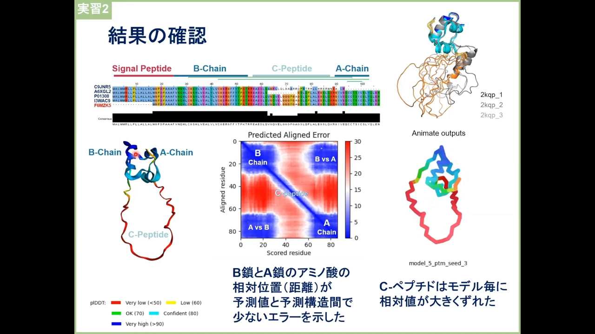

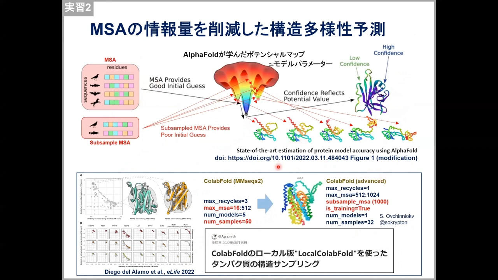

顺带一提"为什么减少 MSA 就能得到各种构象"：文献的解释是——给了 MSA，预测会落到接近全局极小（global minimum）的位置、得到好的初始模型；削减 MSA 后初始 contact 在各种位置乱猜，再靠模型参数稳定化，就会掉进各种局部极小（local minimum），输出多种构象状态。这正是"减少 MSA 给结构添多样性"的原理。

## 五、双链难题：一条 Twitter 帖子改变的历史

胰岛素成熟后是 **A、B 两条肽链**。要预测"两条链的复合物"，在 AlphaFold 2.0 刚发布时是做不到的——它既不能输入也不能输出两条链 [【跳转到 25:50】](https://www.youtube.com/watch?v=zTHFXTFuNHE&t=1550)。

破局者是东京大学森脇老师等人：他们在 Twitter 上公开了 **poly-glycine linker**（聚甘氨酸连接子）方法 [【跳转到 26:26】](https://www.youtube.com/watch?v=zTHFXTFuNHE&t=1586)——把两条链用一长串甘氨酸连成一条输入。原理：AlphaFold 把"甘氨酸长链"当作天然蛋白里那种无序柔性 linker 处理，甘氨酸与两侧氨基酸的接触预测不出来，也就几乎不影响结构形成；只要 A、B 链之间真的有相互作用，复合物照样能"折"出来。这条 Twitter 记载 **3 周后被 ColabFold 实现、3 个月后 AlphaFold 官方支持复合物预测**（即后来的 AlphaFold-Multimer），ColabFold 论文与 Multimer 论文都直接引用了它。

如今更简单：直接把 A 链、B 链连起来输入，把 B 链的残基编号 +200（接着 A 链编），不用甘氨酸也能出复合物 [【跳转到 27:25】](https://www.youtube.com/watch?v=zTHFXTFuNHE&t=1645)。

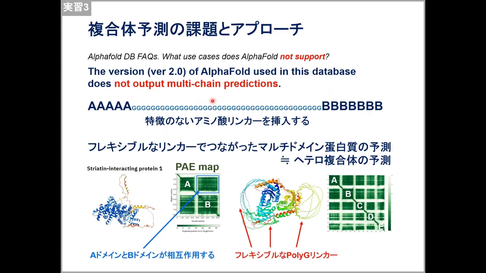

## 六、复合物预测实操：冒号与斜杠，MSA 搜法完全不同

实操中，多链输入靠**分隔符**，而分隔符的选择直接改变 **MSA 搜索的方式** [【跳转到 28:32】](https://www.youtube.com/watch?v=zTHFXTFuNHE&t=1712)：

- **冒号 `:`（A:B）**：A 链、B 链**各自独立**去搜 MSA——两条链各搜各的同源序列 [【跳转到 30:00】](https://www.youtube.com/watch?v=zTHFXTFuNHE&t=1800)；
- **斜杠 `/`（A/B）**：把 A、B **连成一条序列**去搜同源序列，然后从搜到的比对里把中间缺失的 C 肽部分去掉、拼接使用 [【跳转到 36:14】](https://www.youtube.com/watch?v=zTHFXTFuNHE&t=2174)。

两种搜法各有适用场景：对胰岛素这种"两条链在自然界本来就来自同一条前体链"的蛋白，连着搜看似更合理，但实测**精度反而下降**（序列覆盖/相似性的评估范围不同）；讲师建议：**蛋白里有明显柔性 loop、在比对中碍事的时候**，才改用斜杠的连搜方式。看结果的核心还是那句：**画图、看图**——PAE 图上不仅 A 链内部，连 A 链-B 链之间的距离预测都与模型一致，才能判断"复合物成立" [【跳转到 38:15】](https://www.youtube.com/watch?v=zTHFXTFuNHE&t=2295)。

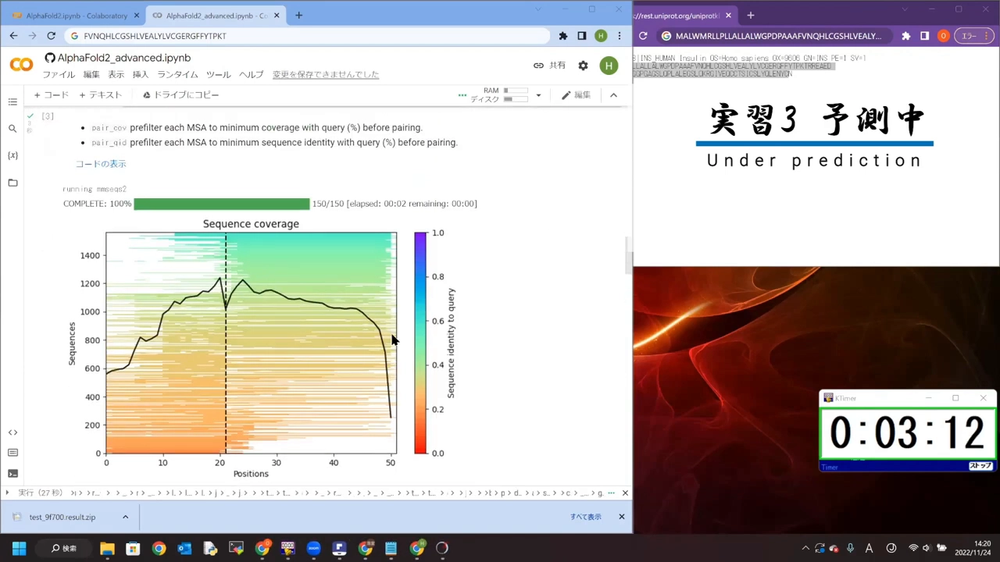

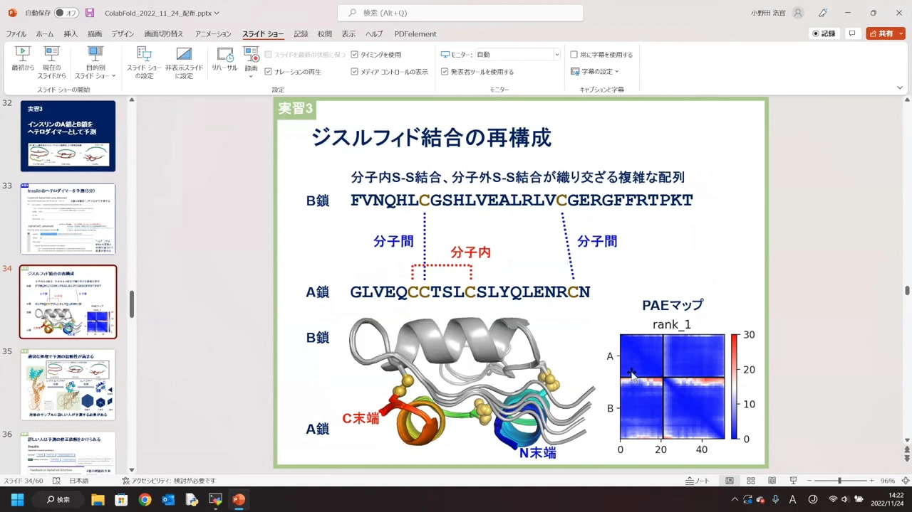

这轮实验里，5 个模型的二硫键**全部正确**；过去偶尔出现的"B 链反向贴合"（ipTM 异常低）现象，随着 MSA 搜索与程序侧的改进如今基本消失 [【跳转到 41:33】](https://www.youtube.com/watch?v=zTHFXTFuNHE&t=2493)。

## 七、二聚体与六聚体：copies、pTM 分数与 MSA 缓存坑

胰岛素在体内靠锌离子形成**六聚体**储存。实验继续升级 [【跳转到 40:34】](https://www.youtube.com/watch?v=zTHFXTFuNHE&t=2434)：

- MMseqs2 版：把 A:B 写 6 遍（A:B:A:B……）； stoichiometry 还支持 A 链 2 个、B 链 4 个这种"2:4"写法；
- Advanced 版：把 copies 从 2 改成 6（约 9 分钟）。

因为查询序列与前次完全相同，**MSA 直接复用**、不重复搜索 [【跳转到 41:08】](https://www.youtube.com/watch?v=zTHFXTFuNHE&t=2468)。结果一半成功一半失败：MMseqs2 版自动用了 Multimer 参数表现更好；Advanced 版不使用 Multimer 参数，部分模型会翻车。判断"复合物成没成"看 **pTM/ipTM 分数**：0.69 与 0.4 一目了然 [【跳转到 43:12】](https://www.youtube.com/watch?v=zTHFXTFuNHE&t=2592)；有趣的是 rank 1、2 可能给出**两种界面不同的构象**、分数都不低——AlphaFold 认为它们都是"可能的复合物"（界面异质性），动画一看便知 [【跳转到 43:37】](https://www.youtube.com/watch?v=zTHFXTFuNHE&t=2617)。

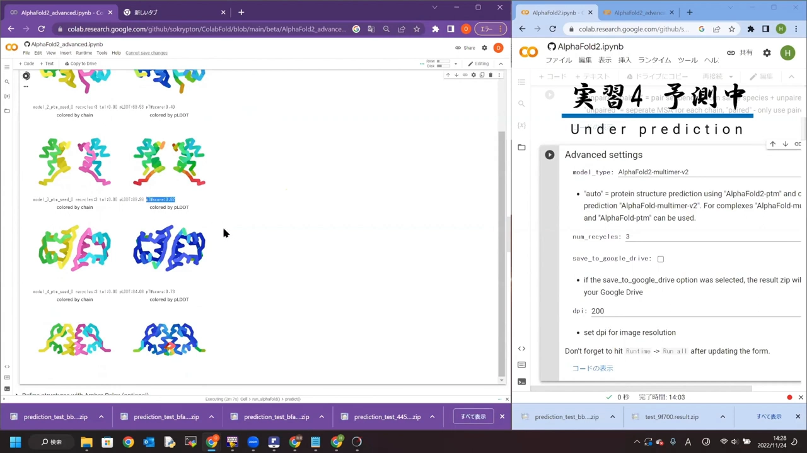

跑批量作业时还有一个**MSA 缓存坑**，务必记住 [【跳转到 45:15】](https://www.youtube.com/watch?v=zTHFXTFuNHE&t=2715)：

- 同一条序列被反复提交时，服务器可能直接返回**缓存结果**（包括别人跑过的）；
- 也就是说：你改了设置再跑同一条序列，**MSA 并不会重新获取**，拿回来的还是旧结果 [【跳转到 46:43】](https://www.youtube.com/watch?v=zTHFXTFuNHE&t=2803)；
- 对策：隔一天再跑、微调序列（注意这会影响可复现性），或用"会话管理"清理卡住的会话 [【跳转到 49:08】](https://www.youtube.com/watch?v=zTHFXTFuNHE&t=2948)。

六聚体最终与结晶结构几乎完全吻合（锌结合位点因未输入锌离子而稍有偏移）[【跳转到 60:25】](https://www.youtube.com/watch?v=zTHFXTFuNHE&t=3625)。

## 八、组蛋白八聚体：recycle 才是翻盘按钮

下一个案例更难：组蛋白八聚体（H3、H4、H2A、H2B 各两份，共 8 个亚基）。当初用 AlphaFold 2.0 预测时，成败全看模型参数 [【跳转到 53:12】](https://www.youtube.com/watch?v=zTHFXTFuNHE&t=3192)——有的模型能成，有的（如 model 2、model 4，已知不太适合复合物）只给你两份"H3-H4 四聚体 + H2A-H2B 二聚体"。

翻盘的诀窍是 **recycle（循环）数** [【跳转到 53:47】](https://www.youtube.com/watch?v=zTHFXTFuNHE&t=3227)：

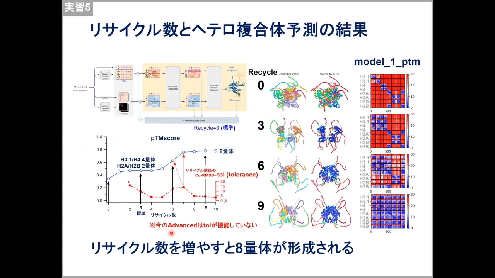

- 默认 recycle=3：八聚体装不起来；
- 把 recycle 输出的结构**再次作为输入**继续生成：结构 RMSD 逐轮下降、逐渐稳定，然后在某一轮**突然"啪"地装成八聚体**；
- 同一模型从 recycle 3 提到 6、再提到 12，各亚基逐渐靠近、趋于稳定；PAE 图整张变蓝 [【跳转到 60:50】](https://www.youtube.com/watch?v=zTHFXTFuNHE&t=3650)。

还有个参数取舍值得记：**用 pTM 分数排序会降低复合物预测精度，但不用它又画不出 PAE 图**。实战路线：先默认跑；不行换 non-pTM 跑；成了再切回 pTM（ipTM）画 PAE 图、同时加 recycle [【跳转到 55:30】](https://www.youtube.com/watch?v=zTHFXTFuNHE&t=3330)。MAX recycle 也可以手动填（6、9、10……）[【跳转到 57:41】](https://www.youtube.com/watch?v=zTHFXTFuNHE&t=3461)。

## 九、MSA 深讲：为什么"搜到多少条"决定成败

课程最后把镜头对准了 MSA 本身——也是本条目（MSA Search）的核心。

### 9.1 共进化：MSA 里的"配对突变"在暗示空间接触

MSA 就是一个"把搜到的所有相似序列排成矩阵"的东西 [【跳转到 61:56】](https://www.youtube.com/watch?v=zTHFXTFuNHE&t=3716)。AlphaFold 从里面读什么？讲师用精氨酸（Arg）-谷氨酸（Glu）这对例子讲了个通俗版：

- 带相反电荷的 Arg 和 Glu 倾向于靠近成对——这是"偏好"；
- 在 MSA 的同源序列里，如果某个位置**总是同时变化**——Glu 变成 Arg 的那些序列里，它旁边的配对残基也相应变了（比如变成 Asp）——说明这对残基在功能与结构上是**锁定**的；
- 这种**共进化信号**被模型读出来，就成了"这两个残基在空间上接触"的强约束。

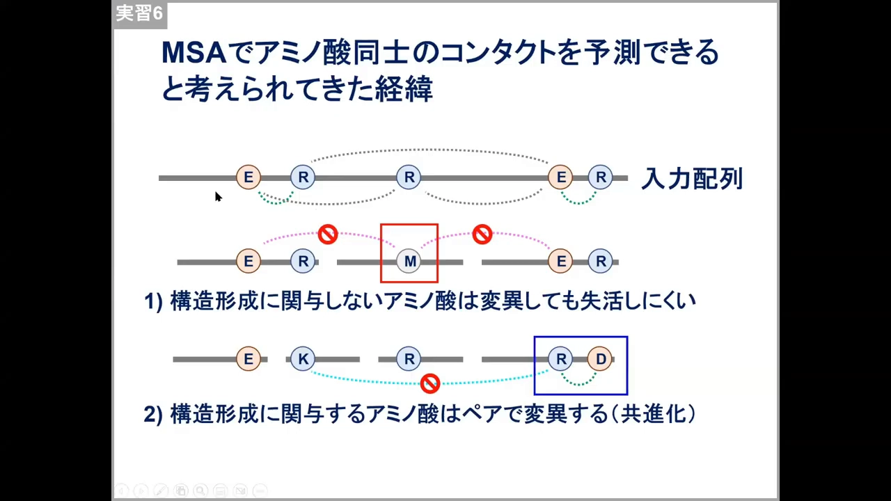

### 9.2 main MSA 与 extra MSA：100 条与"其余全部"

AlphaFold 内部把 MSA 分成两条通路 [【跳转到 63:05】](https://www.youtube.com/watch?v=zTHFXTFuNHE&t=3785)：

- **main MSA**：实际上只处理**约 100 条**序列，负责提取"哪里可能形成接触、每个位点氨基酸保守程度"这类逐列（二维）信息；
- **extra MSA**：其余**大部分序列**都进了这条通路，负责逐位点的保守性统计。

也就是说：**你搜到 2500 条还是 25000 条，决定性差别不在 main 通路，而在 extra MSA 的信息量**。

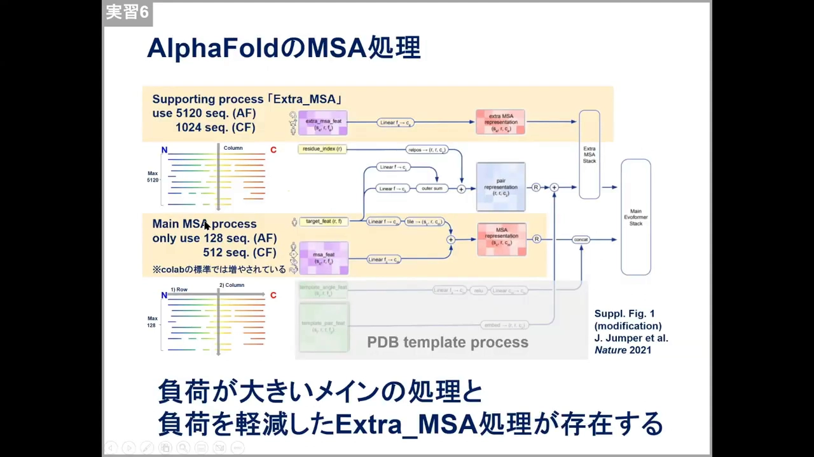

### 9.3 决定性实验：extra MSA=1 时，八聚体散架

影响有多大？课程放了一段动画实验 [【跳转到 64:06】](https://www.youtube.com/watch?v=zTHFXTFuNHE&t=3846)：把 extra MSA 的序列数压到 1——组蛋白八聚体**几乎完全无法形成**；随着 MSA 序列数逐渐增多，八个亚基才一步步装回八聚体。

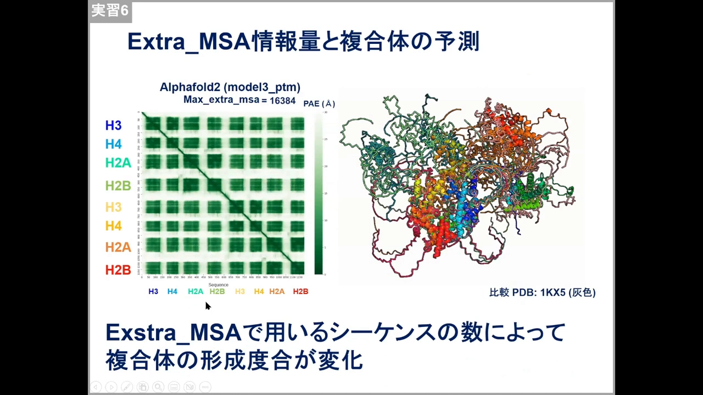

结论由此落地 [【跳转到 64:52】](https://www.youtube.com/watch?v=zTHFXTFuNHE&t=3892)：**"MSA 能搜到足够多的序列"就是复合物预测的诀窍**。反例是病毒蛋白（比如新冠病毒的序列）：知见少、变异快、序列不长，数据库里几乎没有相似序列，MSA 难搜，这类对象的复合物预测也就普遍困难——OmegaFold、ESMFold 这类"不用 MSA"的模型正是在此背景下兴起，但就现状而言，搜好 MSA 仍是第一要务。本次实习的收尾总结也呼应于此：用生物学知识喂对输入（切信号肽）、加 recycle、用 custom MSA 把搜索做扎实——复合物预测会持续改善 [【跳转到 65:42】](https://www.youtube.com/watch?v=zTHFXTFuNHE&t=3942)。

## 小结

- AlphaFold 数据库不是万能的：**失败预测**（如带信号肽的胰岛素）恰恰要靠你自己会跑预测来修复；
- 失败的根源常在输入：数据库侦探法（找同序列的成功先例、比对差异）能把"信号肽"这类元凶揪出来；
- **MSA 与查询序列绑定**：序列没变 → 复用（trim 不触发重搜）；序列变了 → 重搜（约 1 分钟）；同序列反复提交还可能踩到服务器缓存旧结果的坑；
- 多链输入的分隔符改变 MSA 搜法：**冒号=逐链各搜，斜杠=连起来搜**——胰岛素例子中连搜反而降精度，柔性 loop 碍事时才用；
- 复合物预测的检查顺序：**ipTM/pTM 分数 → PAE 图（含链间区块）→ 动画**；装配失败先加 **recycle**；
- **MSA 的规模决定复合物预测的成败**：共进化信号藏在同源序列的配对突变里；AlphaFold 只细读约 100 条（main），其余全靠 extra MSA——extra MSA=1 时八聚体直接散架。

## 关键术语速查

| 术语 | 一句话解释 |
| --- | --- |
| ColabFold | 把 AlphaFold2 搬上 Google Colab 的社区实现；分 MMseqs2 版（主力、带 Multimer 参数）与 Advanced 版（beta、多 trim/动画/copies） |
| MSA 搜索 | 预测的第一步：拿查询序列去数据库搜同源序列并拼成多序列比对；本例搜到约 2500 条 |
| MSA 复用 | 查询序列未变时跳过 MSA 搜索直接复用结果；序列变了才会重搜 |
| MSA 缓存 | 服务器对同序列提交可能返回缓存（含他人）旧结果，改参数也不会重搜 MSA |
| 信号肽 | 分泌蛋白 N 端、成熟后被切掉的一段；留在输入里会带偏预测（本例失败根源） |
| trim（裁剪） | Advanced 版按区间剔除输入残基的选项；因不改查询序列，MSA 仍复用 |
| poly-glycine linker | 用甘氨酸长链把两条链连成一条输入以预测复合物的经典技巧（源自森脇等人的 Twitter 帖） |
| 冒号 ：/ 斜杠 / | 多链分隔符：冒号逐链各搜 MSA；斜杠连链合搜 MSA，适用于柔性 loop 干扰的场景 |
| ipTM / pTM | 界面/全局 TM 分数；复合物按 ipTM 排序更可靠，分数低提示贴合错误或装配失败 |
| PAE 图 | 预测对齐误差矩阵；链间区块也是蓝色才说明复合物界面可信 |
| recycle | 把输出结构回填为输入再预测的迭代次数；默认 3，装配失败时加大常能"翻盘" |
| copies | 同一链的重复份数（Advanced 版），如胰岛素六聚体设 6 |
| 共进化（coevolution） | MSA 中成对共同变异的残基对——它们在空间上相互接触的进化证据 |
| main MSA / extra MSA | AlphaFold 内部两条 MSA 通路：main 细读约 100 条，extra 消化其余全部序列 |
| AlphaFold DB 反馈 | 发现坏预测可在 AFDB 的 GitHub Issues/Google 表单反馈，官方会重跑修正 |
