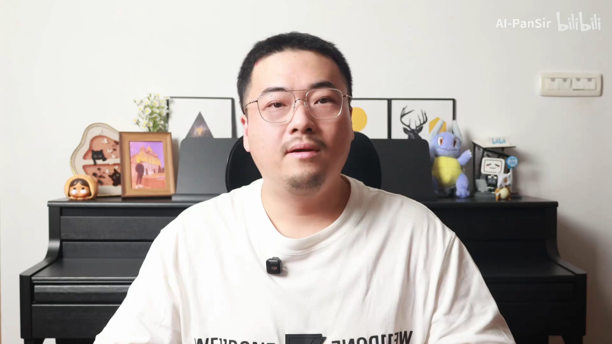
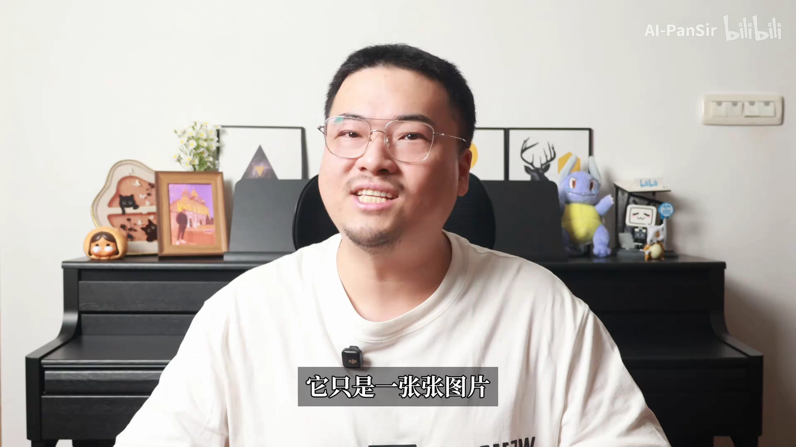
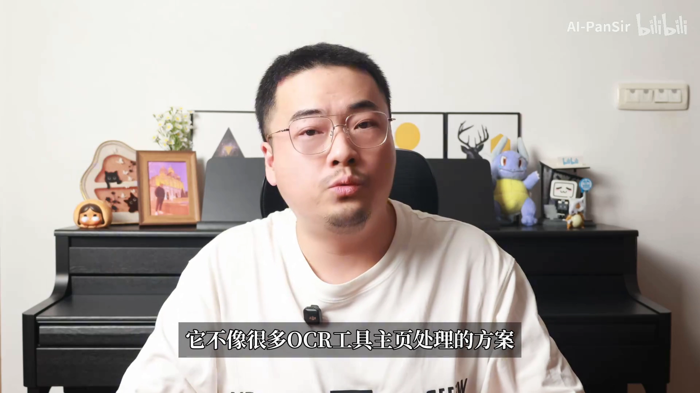
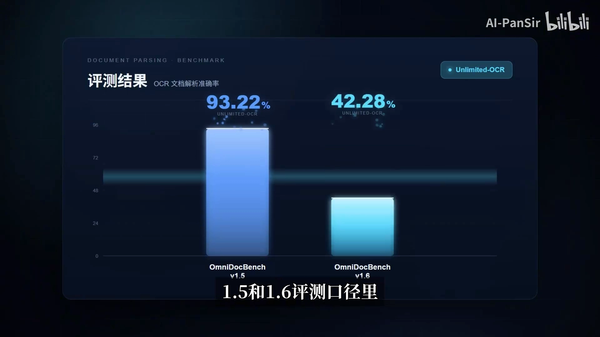
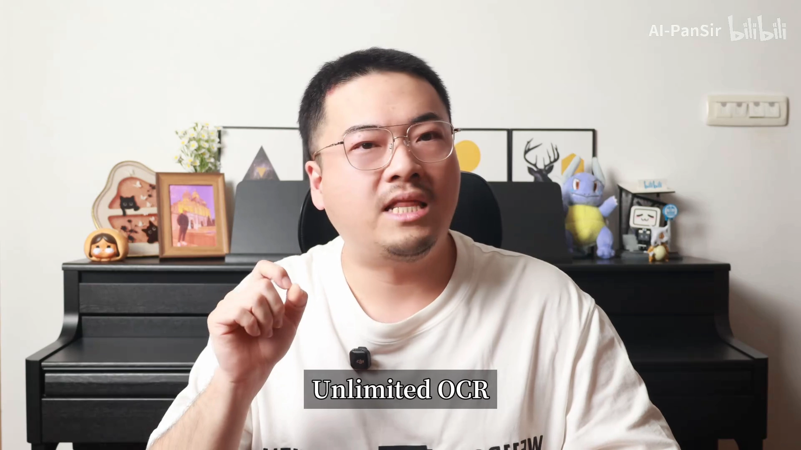
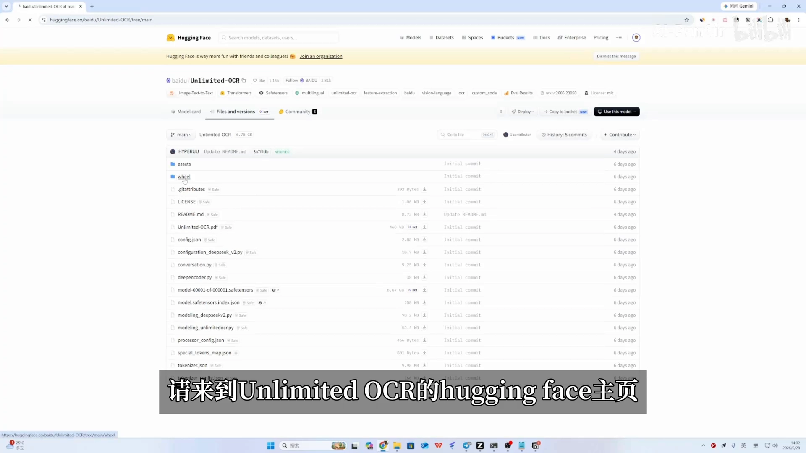
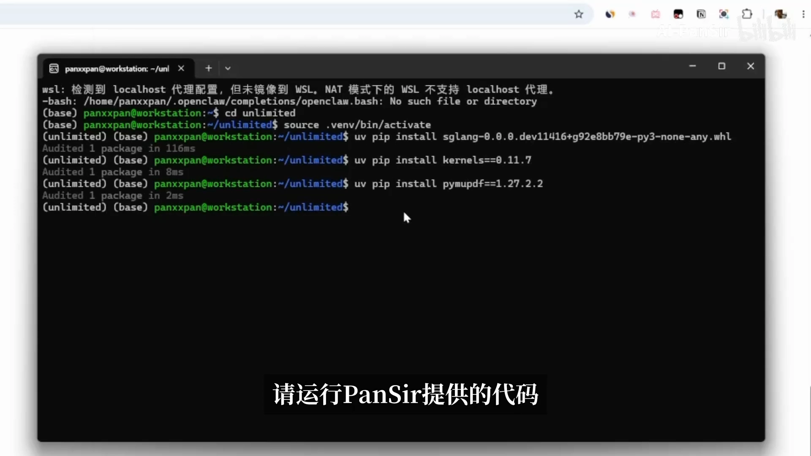
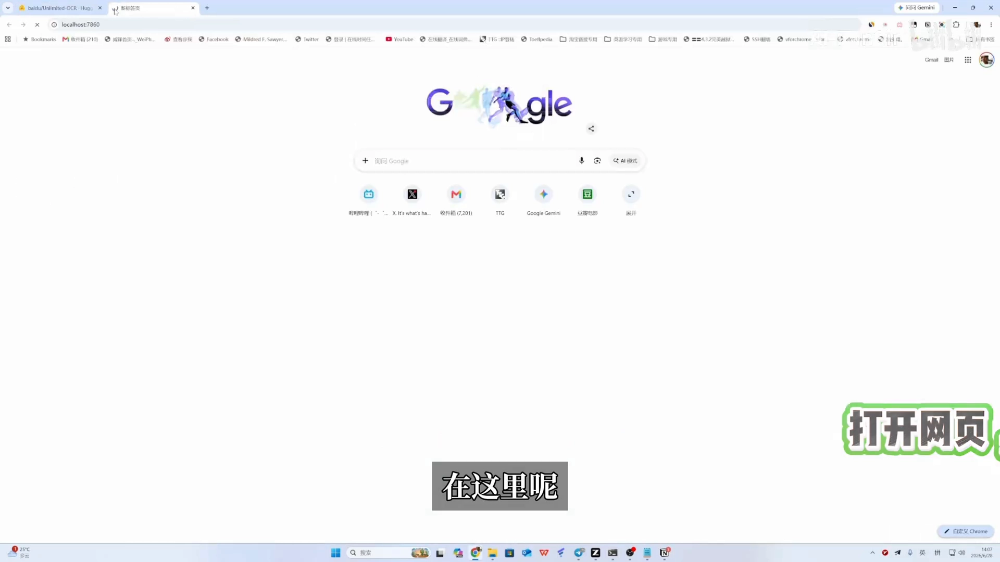
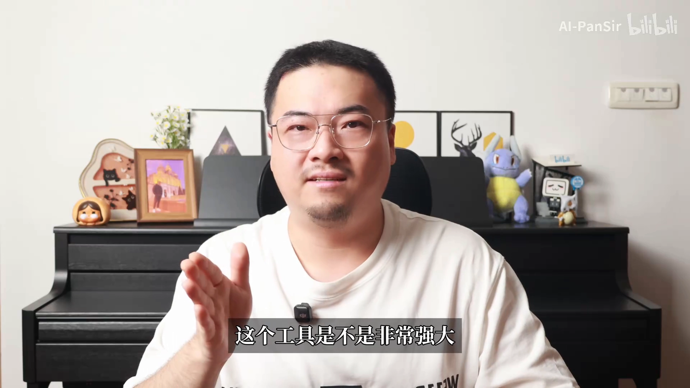

# 目前最强OCR工具：Unlimited-OCR！连续阅读一本书！

> 视频源：[Bilibili BV1nHTM61EqG](https://www.bilibili.com/video/BV1nHTM61EqG)｜UP 主：AI-PanSir｜时长 6 分 39 秒
> 本文基于视频演说图文稿整理，时间戳可跳转原视频对应位置。

## 本讲要解决的核心问题（SCQA）

**背景**：扫描版合同、教材、发票这类 PDF 随处可见。OCR（光学字符识别——把图片里的文字变成可复制的文本）早已不是新鲜事，MinerU、PaddleOCR 等工具连表格、公式、版式都能解析成 Markdown。

**冲突**：可一旦文档变成几十页、上百页，绝大多数 OCR 工具就露了馅——本质上还是一页一页处理：慢、容易漏、版式乱，文档越长越容易卡住甚至爆内存。

**疑问**：有没有一种 OCR，能把一整份复杂文档从第一页稳定读到最后一页？

**回答（中心思想）**：百度开源的 **Unlimited-OCR** 换了一种"读文档"的方式——不是逐页拍照，而是像人抄书一样整本连读。它用总参数仅 3B（推理只激活 0.5B）的小模型，在 OmniDocBench 1.6 口径拿到 93.92% 的领先分数，长输出场景比 DeepSeek-OCR 快约 35%，还从机制上绕开了"越读越慢、越读越爆显存"的问题。

## 一、扫描版 PDF 的真身是图片：想用它，第一步必须是 OCR

你大概率遇到过这种 PDF：文字明明就在屏幕上，鼠标一拖却什么都选不中——不能复制、不能搜索、不能划重点，也没法直接丢给 AI 做总结。[【跳转到 00:05】](https://www.bilibili.com/video/BV1nHTM61EqG/?t=5)

原因很简单：它看起来是 PDF，本质上只是一张张图片。扫描版的合同、教材、发票都是如此——你看到的是文字，电脑看到的只是图。所以想真正使用它，第一步必须做 OCR：把图片里的文字识别成可以复制、可以搜索、可以整理的文本。[【跳转到 00:15】](https://www.bilibili.com/video/BV1nHTM61EqG/?t=15)

## 二、单页 OCR 已经成熟，真正的拦路虎是"长文档"

过去一说 OCR，想到的就是拍照识字：识别一张截图、一张纸、一张发票，或者在 WPS 里把 PDF 转成 Word。这已经不稀奇了。尤其这几年 MinerU、PaddleOCR 这些工具出来以后，文档解析进入了新世界：表格、公式、版式、Markdown 输出，都比以前强太多。

但真正麻烦的地方来了：一页资料好识别，十页、几十页甚至上百页呢？很多 OCR 工具到了长文档场景，本质上还是一页一页处理——读一页、输出一页，最后再把结果拼起来。能用，但问题也很明显：**慢**（页数越多耗时越长）、**容易漏**（每页各自为政）、**版式容易乱**（拼接后上下文对不上）。文档越长越容易卡住，经常会爆内存。[【跳转到 00:56】](https://www.bilibili.com/video/BV1nHTM61EqG/?t=56)

所以 OCR 真正难的不是识别一张图，而是能不能把一整份复杂文档**从第一页稳定读到最后一页**。这正是百度这次开源的 Unlimited-OCR 要解决的事。

## 三、换一种读文档的方式：从逐页拍照，到整本连读

Unlimited-OCR 最让人惊讶的地方，不是把 OCR 准确率又往上抬了一点，而是它真正厉害在**换了一种读文档的方式**：过去 OCR 像一页一页拍照，Unlimited-OCR 想做的事是——"给我整份文档，我从头读到尾"。[【跳转到 01:20】](https://www.bilibili.com/video/BV1nHTM61EqG/?t=80)

它的思路来自一个很直觉的类比——**抄书**。想象一个人正在抄书，他需要盯住的是什么？

1. **原文**：这必须要看，不看原文就不知道接下来要抄什么；
2. **刚写的一小段**：保证别抄漏、别抄重、别串行；
3. 至于前面已经写过的几百行？**绝对不会回头看**——那部分已经完成了，继续向下写的时候没必要把全部内容压在脑子里。[【跳转到 02:39】](https://www.bilibili.com/video/BV1nHTM61EqG/?t=159)

Unlimited-OCR 做的事，就是把这套人类抄书的直觉变成模型机制——**R-SWA（参考滑动窗口注意力）**：让模型一直看到原始文档内容，但对自己已经输出过的文字只保留最近的一小段——具体到数值只有 **128 个 token**。这样旧输出不会一直占用模型的注意力，长文档场景下速度和显存都能保持稳定。[【跳转到 03:06】](https://www.bilibili.com/video/BV1nHTM61EqG/?t=186)

## 四、三个数字看懂它有多强：93.92 分、3B 参数、快 35%

先看论文里给出的几个数据：

- **93.92%**：百度团队在 OmniDocBench 1.5 和 1.6 两个评测口径（文档解析基准测试）下，Unlimited-OCR 都拿到了领先的分数，其中 1.6 口径达到 93.92%。[【跳转到 01:46】](https://www.bilibili.com/video/BV1nHTM61EqG/?t=106)
- **3B / 0.5B**：它不是靠几百 B 参数的大模型硬砸出来的——总参数只有 3B（30 亿），真正推理时只激活 0.5B（5 亿），是靠巧妙的结构而非堆规模。[【跳转到 02:01】](https://www.bilibili.com/video/BV1nHTM61EqG/?t=121)
- **快 35%**：在 6000 token 左右的输出场景下，它相比 DeepSeek-OCR 有大约 35% 的速度提升，而且文档越长优势越明显。[【跳转到 03:21】](https://www.bilibili.com/video/BV1nHTM61EqG/?t=201)

顺带一个有趣的花絮：Unlimited-OCR 就脱胎于 DeepSeek-OCR 这条技术路线，视频里甚至打趣说"把别人挖过去了"。它的机制在"认字"之外，还解决了 OCR 模型的三个痛点：**第一，速度更快更稳；第二，显存稳定不会一路膨胀导致爆显存；第三，各种多类型复杂版式的识别效果更强**。[【跳转到 03:42】](https://www.bilibili.com/video/BV1nHTM61EqG/?t=222)

## 五、实战：五步把 Unlimited-OCR 跑起来

视频后半段是完整的部署实操（Windows 用户请先装好 WSL——Windows 里的 Linux 子系统）。核心流程五步：

1. **装虚拟环境**：打开 WSL 终端，按官方指南新建一个虚拟环境并激活；[【跳转到 04:31】](https://www.bilibili.com/video/BV1nHTM61EqG/?t=271)
2. **装 whl 与依赖**：到 Unlimited-OCR 的 Hugging Face 主页，在文件下载中找到必备的 whl 文件（Python 的安装包格式），放进虚拟环境安装，再装两个必备依赖；[【跳转到 04:51】](https://www.bilibili.com/video/BV1nHTM61EqG/?t=291)
3. **SGLang 首次运行下载模型**：官方提供 Transformers 和 SGLang 两种部署方式，视频作者只推荐 SGLang——部署简单快速，Transformers 方式可能出问题。首次运行会自动下载模型；[【跳转到 05:14】](https://www.bilibili.com/video/BV1nHTM61EqG/?t=314)
4. **国内自动切源**：国内环境会自动切换到 ModelScope 下载，等待即可；[【跳转到 05:25】](https://www.bilibili.com/video/BV1nHTM61EqG/?t=325)
5. **调用测试**：官方提供了具体调用的代码（视频作者用 Codex 写了个自带页面的文件），实测一张发票 PDF——大约 3 秒全部识别完成，识别出的信息也非常准确。[【跳转到 05:49】](https://www.bilibili.com/video/BV1nHTM61EqG/?t=349)

## 六、它不是万能的：32K 上下文是当前的边界

工具虽强大，也不是没有局限：目前输入端仍有**上下文的常驻限制**——一次能"看进去"的内容不能超过 32K 上下文。根据论文描述，未来可能会往 128K 上下文走，甚至会做出一种类似 prefetch（预取）的机制：未来不需要把一整本书全部塞到"脑子"里，而是像人翻书一样，需要哪一部分就调哪一部分。如果这一步真的做出来，才真正更接近"Unlimited"（无限制）。[【跳转到 06:02】](https://www.bilibili.com/video/BV1nHTM61EqG/?t=362)

## 小结

- 扫描版 PDF 的真身是图片：想复制、搜索、喂给 AI，第一步必须 OCR；
- 单页 OCR 已成熟，长文档才是拦路虎：逐页处理慢、易漏、版式乱、爆内存；
- Unlimited-OCR（百度开源）换了读法：整份文档从头读到尾，而不是逐页拍照；
- 机制上是把"抄书直觉"变成模型设计 R-SWA：原文全程可见，已输出只保留最近 128 个 token；
- 三个数字：OmniDocBench 1.6 口径 93.92%、总参数 3B/激活 0.5B、6000 token 输出比 DeepSeek-OCR 快约 35%；
- 部署五步：虚拟环境 → whl + 依赖 → SGLang 首次运行 → 国内自动切 ModelScope → 调用测试（发票 PDF 约 3 秒）；
- 当前边界：32K 上下文；未来 128K 上下文 + prefetch 式"翻书"加载。

## 关键术语速查

| 术语 | 一句话解释 |
| --- | --- |
| OCR | 光学字符识别：把图片里的文字变成可复制、可搜索的文本 |
| 扫描版 PDF | 看起来是文档、本质是图片的 PDF，文字无法直接选中复制 |
| 长文档场景 | 几十页到上百页的 PDF/扫描件，OCR 真正的难点所在 |
| R-SWA | 参考滑动窗口注意力：原文全程可见，已输出内容只保留最近 128 个 token |
| DeepSeek-OCR | "端到端 OCR"技术路线的代表作，Unlimited-OCR 的基线与前身 |
| SGLang | 大模型推理服务框架，官方提供的部署方式之一，视频作者推荐使用 |
| whl 文件 | Python 的安装包格式；部署 Unlimited-OCR 时需从 Hugging Face 下载 |
| ModelScope | 魔搭社区：国内环境下自动切换的模型下载源 |
| 32K 上下文 | 模型一次能处理的内容上限，当前版本的常驻限制 |
